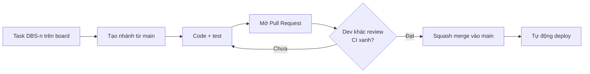

# Quy tắc đóng góp

## 1. Luồng làm việc



1. Mỗi việc là một **task `DBS-n`** trên board của nhóm.
2. Tạo nhánh từ `main` theo quy tắc đặt tên bên dưới.
3. Chưa đưa gì lên GitHub trước gate G3. Sau G3 chỉ mở **Draft PR** khi người duyệt yêu cầu (để người khác thấy tiến độ); chuyển sang Ready for review sau gate G4.
4. **Một Dev khác review** trước khi merge và **CI phải xanh**. Ruleset của `main` bắt buộc PR, chỉ cho squash, chặn force push và xóa nhánh, nhưng **không ép số approval** (đặt 0): việc review là quy ước của nhóm, GitHub không chặn. Người mở PR không tự merge khi chưa có Dev khác để lại review.
5. Merge bằng **Squash and merge** để lịch sử `main` gọn.

**Không push thẳng vào `main`.**

## 1b. Quy ước board

Board của nhóm (Google Sheet, mỗi tuần một tab) là nơi duy nhất theo dõi việc. Mỗi task có mã `DBS-n`, vai làm, cột **Phụ thuộc** và DoD. Không ai chờ ai: task bị chặn thì làm task khác; chuyển Status khi bắt đầu làm.

| Khi | Đổi Status thành |
|---|---|
| Bắt đầu làm | `In Progress` |
| Draft PR (sau G3) | giữ `In Progress`, dán link PR vào cột Thực trạng |
| Ready for review (sau G4) | `In Review` |
| PR đã merge và DoD đạt | `Done` |

- Chỉ bắt đầu task khi mọi task ở cột Phụ thuộc đã `Done`, hoặc đã thống nhất interface với người làm task đó và người duyệt G1 đồng ý phạm vi thu hẹp. Nếu phạm vi thu hẹp rỗng, làm task bị chặn trước.
- Bị chặn quá một buổi làm việc thì báo ngay trong kênh chat, ghi rõ cần ai.
- Tên nhánh và tiêu đề PR có mã task, ví dụ `feat/DBS-79-idempotency-replay`.
- Đổi interface, schema, event hay biến môi trường mà người khác dùng thì báo trước và sửa tài liệu trong cùng PR.

## 2. Đặt tên nhánh

```
<loại>/DBS-<n>-<mô-tả-ngắn>
```

| Loại | Dùng khi | Ví dụ |
|---|---|---|
| `feat` | Tính năng mới | `feat/DBS-79-transfer-idempotency` |
| `fix` | Sửa lỗi | `fix/DBS-84-daily-limit-race` |
| `docs` | Tài liệu, ADR | `docs/DBS-201-sync-docs-with-code` |
| `infra` | Terraform, CI/CD | `infra/DBS-66-rds-module` |
| `test` | Chỉ thêm/sửa test | `test/DBS-99-concurrent-transfer` |
| `chore` | Việc lặt vặt | `chore/DBS-22-money-helpers` |

## 3. Commit message

Theo [Conventional Commits](https://www.conventionalcommits.org/):

```
<loại>(<module>): <mô tả ngắn, thể mệnh lệnh>
```

Ví dụ:
- `feat(ledger): lock accounts in id order before transfer`
- `fix(risk): count recipients per sliding window`
- `docs(adr): add ADR-05 idempotency in postgres`

Module: `ledger`, `accounts`, `identity`, `risk`, `audit`, `outbox`, `notification`, `health`, `common`, `config`, `database`, `infra`, `ci`, `docs`.

## 3b. Làm task với AI agent

Mọi thay đổi code, test, migration, hạ tầng hay tài liệu đi qua skill [`dbs-delivering-task`](.claude/skills/dbs-delivering-task/SKILL.md): 5 phase (hiểu task, thiết kế, kế hoạch, implement và test kể cả **test thủ công**, tài liệu và bàn giao), 4 gate cần người duyệt (phạm vi, thiết kế, kế hoạch, bàn giao), một file `docs/features/DBS-<n>-<slug>.md` và ảnh chụp ở `docs/features/screenshots/DBS-<n>/`. Không dùng AI thì đọc skill đó và làm theo bằng tay.

## 4. Định nghĩa "xong"

Một Pull Request chỉ được merge khi:

- [ ] Code chạy được ở local với `docker compose` + `npm run start:dev`
- [ ] `npm run lint:check && npm run typecheck && npm test && npm run test:e2e && npm run test:db` (trong `backend/`) đều xanh
- [ ] Có test cho logic mới; test liên quan đến tiền chạy trên **PostgreSQL thật** (Testcontainers), không mock
- [ ] CI xanh: đủ sáu check ở [mục 4b](#4b-đọc-kết-quả-ci-trên-github-actions)
- [ ] Không có secret trong code, log hay commit
- [ ] Nếu đổi thiết kế: cập nhật `docs/03` (hoặc `docs/01–02`, `_shared/database-design.md`, `_shared/event-contract.md`) và thêm ADR nếu là quyết định kiến trúc; xem [docs/README.md](docs/README.md)
- [ ] Nếu đổi API: OpenAPI (Swagger) được cập nhật
- [ ] File `docs/features/DBS-<n>-<slug>.md` đã đủ mục 1–9, test thủ công đã chạy (bước chưa chạy ghi rõ lý do), có ảnh chụp trong `docs/features/screenshots/DBS-<n>/`

## 4b. Đọc kết quả CI trên GitHub Actions

[`.github/workflows/ci.yml`](.github/workflows/ci.yml) chạy khi mở, cập nhật hay mở lại PR và khi push vào `main`. Sáu job chạy **song song**, mỗi job một lệnh trong `backend/`, nên một job đỏ không che job khác. Mỗi job tối đa 10 phút.

| Check trên PR (tên job) | Lệnh chạy lại ở local (trong `backend/`) | Đỏ khi |
|---|---|---|
| `lint` | `npm run lint:check` | eslint báo lỗi, gồm luật ranh giới module |
| `typecheck` | `npm run typecheck` | `tsc` báo lỗi kiểu |
| `unit` | `npm test` | một test `src/**/*.spec.ts` đỏ |
| `e2e` | `npm run test:e2e` | một test `test/**/*.e2e-spec.ts` đỏ |
| `db` | `npm run test:db` (cần `docker compose up -d` và `DATABASE_URL`) | một test `test/db/*.db-spec.ts` đỏ, hoặc không nối được PostgreSQL (đỏ, không bao giờ bỏ qua); hoặc role không phải superuser, hay timezone không phải UTC |
| `build` | `npm run build` | `nest build` lỗi |

**Cách đọc khi có check đỏ:**
1. Cuối trang PR, ở khung kiểm tra, bấm **Details** cạnh check đỏ (hoặc mở tab **Checks** rồi chọn job). Bước đỏ tự mở sẵn trong log.
2. Đọc dòng lỗi đầu tiên: eslint ghi `file:dòng:cột` và tên luật; `tsc` ghi `file(dòng,cột): error TS…`; jest ghi `●` kèm tên test, giá trị mong đợi và nhận được.
3. Chạy đúng lệnh của job đó ở local (bảng trên), sửa, rồi push. CI chạy lại tự động và hủy lần chạy cũ của cùng PR; thấy lần cũ ghi "Cancelled" là bình thường.
4. Lỗi tạm thời (mạng, runner, không liên quan code): bấm **Re-run failed jobs** ở góc trên trang lần chạy; không đẩy commit rỗng.
5. Mọi job đỏ ngay bước `npm ci`: `package-lock.json` không khớp `package.json` hoặc không khớp phiên bản npm mới nhất của Node 24. Chạy `npm ci` ở local; nếu lỗi giống nhau thì cập nhật lockfile bằng `npm install`, commit lại.
6. PR **không có check nào**, hoặc các check hiện "Expected" mãi: PR đang xung đột với `main` (GitHub không chạy workflow khi PR xung đột). Gỡ xung đột rồi push.

**Quy tắc về tên job:** sáu tên `lint`, `typecheck`, `unit`, `e2e`, `db`, `build` là tên mà required status checks của `main` (DBS-37) khớp theo. Không đổi tên job mà không đổi ruleset cùng lúc, không đặt `paths:` ở trigger của `ci.yml`, và workflow khác không đặt job trùng một trong sáu tên. Action trong workflow ghim theo SHA commit; muốn nâng phiên bản thì đổi SHA và comment phiên bản cùng lúc.

## 5. Quy tắc bắt buộc khi làm với tiền

- Tiền là `bigint`/string (đơn vị đồng), **không bao giờ** dùng `number` có phần thập phân.
- Mọi thay đổi số dư đi qua `ledger`, trong **một transaction** do `TransactionService.run(...)` mở, kèm bút toán kép và nhật ký.
- **Không gọi Redis, HTTP, SQS bên trong transaction.** Deadlock làm callback bị chạy lại, và lời gọi ngoài sẽ bị lặp; sự kiện đi qua bảng outbox. Ngoại lệ duy nhất: outbox relay (docs/03 §10).
- Không sửa, không xóa `ledger_entries` và `audit_log`.
- Không đưa số dư vào Redis.

Chi tiết: [docs/03_HIGH_LEVEL_ARCHITECTURE.md](docs/03_HIGH_LEVEL_ARCHITECTURE.md) mục 6 và 9.

## 5b. Quy tắc bắt buộc khi viết backend

- **Ranh giới module do eslint ép.** Import module khác chỉ qua `@modules/<tên>`; không với tay vào ruột module khác (cả `@modules/x/y` lẫn `../x/y`). Code dùng chung import qua `@common`, `@config`, `@database`, `@libs`. Xem [backend/src/modules/README.md](backend/src/modules/README.md).
- **Lỗi có mã ổn định.** Ném `HttpException` kèm `errorCode` (enum `ErrorCode`); test theo `errorCode`, không theo câu chữ của `detail`. Chỉ thêm mã mới khi client phải rẽ nhánh theo nó.
- **Biến môi trường mới:** khai báo trong schema (`config/validation.schema.ts`), đọc qua một file `*.config.ts`, thêm vào `env/.env.example`. Không đọc `process.env` rải rác trong code nghiệp vụ.
- **Comment giải thích *vì sao*,** không mô tả *làm gì*. Một ràng buộc hay một sự cố đã dẫn tới quyết định thì ghi lại ở đúng chỗ code.
- **Consumer phải idempotent** và **chỉ khởi động khi `runsWorkers()`**, để instance `api` không bao giờ poll queue.

## 6. Bảo mật repo

- **Không commit**: `.env`, key AWS, `*.tfvars`, `terraform.tfstate`, file `.pem`/`.key`. Các mẫu này đã có trong `.gitignore`. Ngoại lệ duy nhất: `ca.pem`, `other-ca.pem`, `server.pem`, `server.key` trong `backend/test/support/tls-fixtures/`, chỉ dùng cho test TLS, khóa CA đã hủy (xem README trong thư mục). Thêm ngoại lệ khác phải hỏi #5.
- Lỡ commit secret: **báo ngay cho #5**, thu hồi (rotate) key trước rồi mới xóa khỏi lịch sử git. Xóa commit thôi là chưa đủ vì key đã bị lộ.
- GitHub Actions kết nối AWS qua **OIDC**, không lưu access key trong GitHub Secrets.
- Không dùng trigger `pull_request_target` cho workflow chạy code từ fork.

## 7. ADR

Mỗi quyết định kiến trúc quan trọng là một file trong `docs/adr/`, theo [mẫu](docs/adr/0000-template.md). 13 ADR hiện có đều đã `Accepted`. Muốn đổi một quyết định thì viết ADR mới thay thế (trạng thái cũ thành `Superseded`), không sửa nội dung ADR cũ; #1 duyệt.
