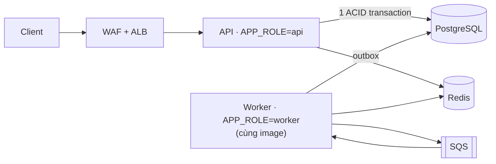

# Digital Banking Simulator

Backend của một ngân hàng số mô phỏng: sổ cái bút toán kép, chuyển tiền idempotent, phát hiện gian lận theo luật và nhật ký kiểm toán chỉ cho ghi thêm. Công nghệ: NestJS, PostgreSQL, Redis (Valkey), AWS (ECS Fargate, SQS), Terraform.

> **Mô phỏng phục vụ học tập.** Đồ án môn *Cloud Application Development* (đề tài #4). Không xử lý tiền thật, không dùng dữ liệu cá nhân thật.

## Cam kết của hệ thống

Hệ thống tập trung vào bốn điều mà một ngân hàng không được làm sai:

| Cam kết | Cách làm |
|---|---|
| **Tiền không bao giờ sai** | Sổ cái bút toán kép; mọi thay đổi số dư nằm trong một transaction PostgreSQL |
| **Không trừ tiền hai lần** | Mã yêu cầu (`Idempotency-Key`) lưu cùng transaction với giao dịch |
| **Truy vết được mọi thao tác** | Nhật ký kiểm toán chỉ cho ghi thêm, ghi cùng transaction với nghiệp vụ |
| **Phát hiện gian lận trong vài giây** | Sáu luật (R1–R6) chạy bất đồng bộ sau mỗi giao dịch; nhân viên review và quyết định. Tín hiệu từ API AI bên ngoài là phần bổ sung có điều kiện, không thay luật ([ADR-14](docs/adr/0014-fraud-rules-external-ai.md)) |

## Kiến trúc



Modular monolith (NestJS): một ứng dụng, một image, chạy thành `api` hoặc `worker` theo biến `APP_ROLE` ([ADR-13](docs/adr/0013-one-app-app-role.md)). Chi tiết và lý do: [docs/03_HIGH_LEVEL_ARCHITECTURE.md](docs/03_HIGH_LEVEL_ARCHITECTURE.md). Bản trung lập với nhà cung cấp cloud: [docs/ABSTRACT_ARCHITECTURE.md](docs/ABSTRACT_ARCHITECTURE.md).

## Bắt đầu nhanh

Yêu cầu: Docker và Node.js ≥ 24.

```bash
# 1. Hạ tầng local: PostgreSQL, Valkey (Redis), ElasticMQ (SQS)
cp .env.example .env
docker compose up -d

# 2. Ứng dụng
cd backend
npm install
cp env/.env.example env/.env.development
npm run start:dev
```

Ứng dụng nghe ở `http://localhost:3000`: `/health/ready` (kiểm tra sẵn sàng), `/docs` (Swagger UI, không có ở production). Gọi API cần token; cách tạo token thử ở local và nạp dữ liệu demo (`npm run seed`) nằm ở [backend/README.md](backend/README.md) (mục 10 và 12).

| Dịch vụ local | Địa chỉ |
|---|---|
| PostgreSQL | `localhost:5432` |
| Valkey (Redis) | `localhost:6379` |
| ElasticMQ (SQS API) | `http://localhost:9324` |
| ElasticMQ (giao diện xem queue) | `http://localhost:9325` |

## Kiểm thử

Từ thư mục `backend/`, trước khi mở Pull Request:

```bash
npm run lint:check
npm run typecheck
npm test
npm run test:e2e
npm run test:db
```

`test:e2e` và `test:db` cần Docker. CI chạy các lệnh này cùng `build`, quét image và secret, kiểm tra Terraform và test script hạ tầng; cách đọc kết quả ở [CONTRIBUTING mục 4b](CONTRIBUTING.md#4b-đọc-kết-quả-ci-trên-github-actions). Các lệnh còn lại (`test:services`, `check:invariants`, migration, seed): [backend/README.md](backend/README.md). Kịch bản tải k6 và demo chạy được từng bước: [load-tests/README.md](load-tests/README.md).

## Cấu trúc repo

```
digital-banking-simulator/
├── backend/              # ứng dụng NestJS duy nhất; xem backend/README.md
│   ├── src/
│   │   ├── common/       # app-role, ErrorCode, filter lỗi, middleware, money, metrics, rate limit
│   │   ├── config/       # cấu hình và validate biến môi trường lúc khởi động
│   │   ├── database/     # kết nối, TransactionService, migrations
│   │   ├── libs/         # adapter: redis, sqs
│   │   ├── modules/      # identity, accounts, ledger, risk, audit, outbox, notification, health
│   │   └── scripts/      # công cụ chạy một lần: seed, token dev, kiểm bất biến sổ cái, xuất OpenAPI, kiểm tuổi DLQ
│   ├── test/             # e2e, db (PostgreSQL thật), services (Testcontainers), manual, support
│   ├── scripts/          # driver kiểm thử thủ công của từng task
│   ├── env/              # .env.example của ứng dụng
│   └── Dockerfile        # một image cho cả api và worker
├── infra/
│   ├── terraform/        # hạ tầng AWS (bootstrap, envs/dev, envs/prod)
│   ├── scripts/          # script vận hành và kiểm tra hạ tầng
│   └── local/            # cấu hình ElasticMQ cho môi trường local
├── load-tests/           # kịch bản k6 và bộ dữ liệu fraud (fraud-dataset/)
├── docs/                 # tài liệu; xem bảng bên dưới
├── .github/              # CI/CD, script CI, PR template
├── .env.example          # biến cho docker-compose.yml
└── docker-compose.yml    # PostgreSQL, Valkey, ElasticMQ cho dev local
```

## Tài liệu

Bản đồ đầy đủ và quy tắc "một sự thật ở một chỗ": [docs/README.md](docs/README.md).

| Tài liệu | Nội dung |
|---|---|
| [BRD](docs/BRD.md) | Bài toán, mục tiêu, stakeholder, quy tắc nghiệp vụ; use case, FR, NFR, tiêu chí chấp nhận; mô hình miền |
| [Kiến trúc tổng thể](docs/03_HIGH_LEVEL_ARCHITECTURE.md) | Kiến trúc, luồng chuyển tiền, dữ liệu, Redis, sự kiện, bảo mật, triển khai |
| [ADR](docs/adr/README.md) | 14 quyết định kiến trúc (ADR-01…14, đều Accepted), kèm lý do và phương án đã loại |
| [Threat model](docs/security/threat-model.md) | Mối đe dọa STRIDE của luồng tiền và biện pháp |
| [Components](docs/components/index.md) | Mục lục từng module và thành phần hạ tầng, kèm concept brief |
| [Feature docs](docs/features/README.md) | Mỗi task một file: thiết kế, test case, kết quả |
| [Runbooks](docs/runbooks/rollback.md) | Quy trình vận hành: rollback, redrive DLQ, bật bộ luật fraud mới, kịch bản sự cố bất đồng bộ |
| [Backlog](docs/BACKLOG.md) | Việc còn tồn sau các task |
| [Deliverables P1–P5](docs/deliverables/README.md) | Năm bản nộp và nguồn của từng bản |

## Đóng góp

Nhóm làm việc theo task trên board, không có chủ module cố định, mỗi Pull Request do một Dev khác review. Đọc [CONTRIBUTING.md](CONTRIBUTING.md) trước khi mở Pull Request. Tóm tắt:

- Không push thẳng vào `main`; mọi thay đổi qua Pull Request, một Dev khác review (quy ước nhóm, GitHub không ép số approval) và CI xanh.
- Tiền là `bigint`/string, mọi thay đổi số dư đi qua `ledger` trong một transaction; không gọi Redis, HTTP, SQS bên trong transaction ([CONTRIBUTING mục 5](CONTRIBUTING.md#5-quy-tắc-bắt-buộc-khi-làm-với-tiền)).
- **Không bao giờ commit secret** (`.env`, key AWS, `*.tfvars`, `terraform.tfstate`).
