# 03 — High-Level Architecture: Digital Banking Simulator

> **Status:** Accepted v1.7 (chốt 2026-10-11, bổ sung 2026-10-12) · **Owner:** #1 (duyệt kiến trúc) · **Verified against code:** một phần: chỉ khung `backend/` (config, transaction, lỗi, health); module nghiệp vụ chưa có code · **Cập nhật:** 2026-10-12

> **Phần risk Proposed, chưa triển khai:** [ADR-14](adr/0014-fraud-rules-external-ai.md) đề xuất thay riêng nghĩa vụ train/ONNX của ADR-08 bằng rules + hosted API. Các bổ sung provider, `risk_decisions` và `aiAssessment` dưới đây là thiết kế đích, không phải runtime đã hoạt động. Backend risk hiện chỉ có README; ADR-08 vẫn Accepted cho tới khi nhóm chấp nhận ADR-14.

| Thuộc tính | Giá trị |
|---|---|
| Tài liệu | 03 / 03 — Kiến trúc tổng thể |
| Phiên bản | 1.7 — đã chốt; đổi thiết kế thì sửa file này trong cùng PR (code tại [`backend/`](../backend/README.md)) |
| Dựa trên | [01_BUSINESS_ANALYSIS.md](01_BUSINESS_ANALYSIS.md) (BG, BR) · [02_REQUIREMENTS_AND_DOMAIN_MODEL.md](02_REQUIREMENTS_AND_DOMAIN_MODEL.md) (UC, FR, NFR, domain model) |
| Tài liệu liên quan | [ADR-01…14](adr/README.md) (ADR-14 Proposed) · [threat model](security/threat-model.md) · [adr/](adr/README.md) |
| Lưu ý | Baseline đã chốt ngày 2026-10-11; phần mở rộng risk ghi rõ Proposed, chưa có số đo live. Giá cloud là giá tham khảo region `ap-southeast-1`; số thật lấy từ Cost Explorer |

Tài liệu này trả lời câu hỏi **"xây như thế nào và vì sao"**. Mỗi quyết định đều truy về một yêu cầu ở tài liệu 02.

---

## 1. Architecture drivers

Không phải yêu cầu nào cũng ảnh hưởng tới kiến trúc như nhau. Các yêu cầu dưới đây **quyết định hình dạng** của hệ thống.

| # | Driver | Nguồn | Hệ quả lên kiến trúc |
|---|---|---|---|
| D-1 | Tiền không bao giờ sai, kể cả khi đồng thời | NFR-COR-01…03, BR-02, 03, 06 | Database quan hệ có ACID và khóa hàng; ghi sổ trong **một transaction**; hạn mức kiểm tra trong cùng transaction |
| D-2 | Chống trừ tiền hai lần khi gửi lại | NFR-COR-01, BR-07 | Bảng mã yêu cầu nằm **trong cùng database và cùng transaction** với giao dịch |
| D-3 | Truy vết 100% | NFR-AUD-01, 02, BR-09 | Nhật ký ghi trong cùng transaction; bảng chỉ cho INSERT; mã liên kết xuyên suốt |
| D-4 | Phản hồi chuyển tiền < 300 ms; gian lận phát hiện < 5 giây | NFR-PERF-01, NFR-FRD-01 | Đường đồng bộ chỉ làm phần bắt buộc; thông báo và chấm điểm chạy **bất đồng bộ** qua hàng đợi |
| D-5 | Không mất sự kiện khi sự cố | NFR-FRD-01, FR-RSK-04 | Mẫu **transactional outbox** + hàng đợi có DLQ + consumer idempotent |
| D-6 | Thu hồi truy cập ngay khi khóa tài khoản | NFR-SEC-02, BR-12 | Mốc thu hồi phiên lưu ở DB, cache ở Redis, kiểm tra ở mọi request |
| D-7 | 99,9% ở cấu hình production; RPO ≤ 5 phút, RTO ≤ 30 phút | NFR-AVL-01, REC-01, 02 | Dịch vụ managed có Multi-AZ và PITR; app stateless chạy ≥ 2 bản |
| D-8 | Đội 6 người, 10 tuần, ≤ $150–200/tháng | Ràng buộc dự án (01 §8.2), NFR-COST-01 | **Modular monolith**, ưu tiên managed services, hai cấu hình dev/production, dựng/xóa theo giờ |

## 2. Phong cách kiến trúc và nguyên tắc

**Quyết định:** *modular monolith* — một ứng dụng triển khai được, chia module rõ theo bounded context ở tài liệu 02 — cộng **một worker** xử lý bất đồng bộ dùng chung codebase. **Không dùng microservices** (ADR-01).

| Phương án | Ưu | Nhược với bài toán này | Kết luận |
|---|---|---|---|
| Monolith không chia module | Đơn giản nhất | Code dính chặt, khó giao việc cho 6 người, khó tách sau này | ❌ |
| **Modular monolith + worker** | Một transaction cho chuyển tiền; module rõ ràng; một lần deploy | Scale theo cả khối (chấp nhận được ở 120 RPS) | ✅ |
| Microservices | Scale và deploy độc lập | Chuyển tiền trải qua nhiều service → cần saga, mất ACID đơn giản; vận hành nặng cho 6 người | ❌ |

**Nguyên tắc thiết kế:**

| # | Nguyên tắc | Ý nghĩa |
|---|---|---|
| P-1 | **PostgreSQL là nguồn sự thật duy nhất** | Redis và hàng đợi chỉ phục vụ tốc độ và tách rời; mất chúng không làm sai dữ liệu |
| P-2 | **Đường đồng bộ ngắn nhất có thể** | Request chuyển tiền chỉ làm: xác thực → một transaction DB → trả kết quả |
| P-3 | **Mọi thứ có thể chạy lại đều idempotent** | Lệnh của khách (mã yêu cầu), sự kiện (mã sự kiện), cờ gian lận (khóa theo giao dịch) |
| P-4 | **Module chỉ nói chuyện qua interface** | Không module nào đọc/ghi bảng của module khác trực tiếp |
| P-5 | **Concept first, vendor second** | Thiết kế theo năng lực (database, queue, cache); dịch vụ AWS cụ thể chỉ là một cách hiện thực (ADR-11) |

---

## 3. C4 — Mức 1: System Context

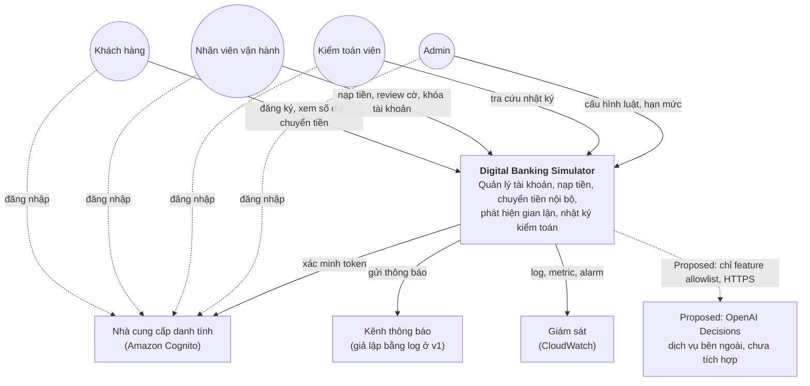

## 4. C4 — Mức 2: Container

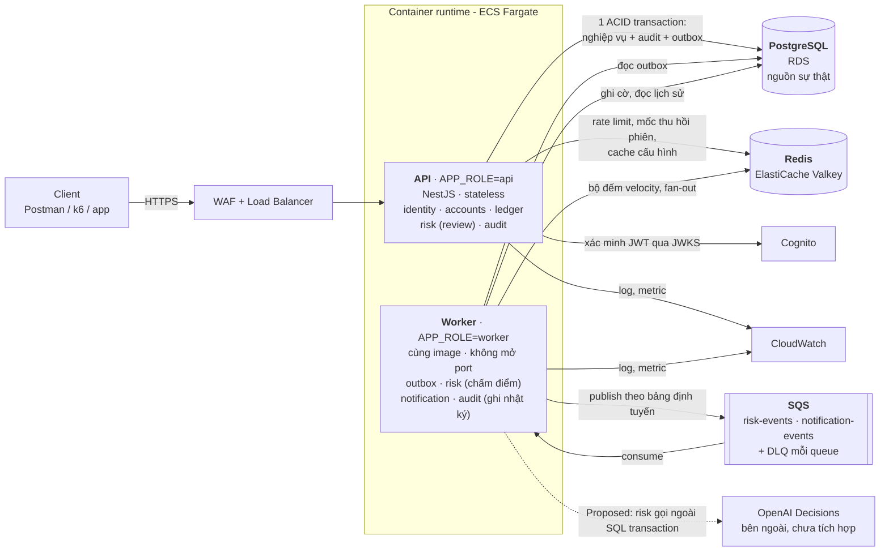

| Container | Trách nhiệm | Công nghệ | Trạng thái | Scale |
|---|---|---|---|---|
| **WAF + ALB** | TLS, chặn request độc hại, chia tải, health check | AWS WAF, ALB | — | Managed |
| **API** | Toàn bộ use case đồng bộ; ghi DB trong transaction | NestJS (Node.js, TypeScript), `APP_ROLE=api` | Stateless | Ngang: 1 → N task |
| **Worker** | Đưa sự kiện từ outbox ra hàng đợi; chấm điểm rủi ro; gửi thông báo | **Cùng image với API**, `APP_ROLE=worker`, không mở cổng HTTP | Stateless | 1–2 task |
| **PostgreSQL** | Dữ liệu nghiệp vụ, sổ cái, mã yêu cầu, nhật ký, outbox | Amazon RDS for PostgreSQL | **Nguồn sự thật** | Dọc; Multi-AZ ở production |
| **Redis** | Rate limit, mốc thu hồi phiên, bộ đếm gian lận, cache cấu hình | ElastiCache for Valkey | Tạm, dựng lại được | Managed |
| **SQS + DLQ** | Mỗi consumer một queue (`risk-events`, `notification-events`), mỗi queue một DLQ giữ message lỗi | Amazon SQS | Bền vững | Managed |
| **Cognito** | Đăng ký, đăng nhập, cấp JWT, nhóm vai trò | Amazon Cognito | — | Managed |
| **CloudWatch** | Log, metric, dashboard, alarm | Amazon CloudWatch | — | Managed |
| **OpenAI Decisions (Proposed)** | Tín hiệu review bổ sung, chỉ risk worker gọi với feature allowlist sau gate | Hosted API `POST /v1/decisions` | Chưa tích hợp, ngoài hệ thống | Theo quota/concurrency/ngân sách được Ops duyệt |

**Một image, hai service (ADR-13).** API và Worker là cùng một ứng dụng NestJS; biến `APP_ROLE` quyết định instance chạy gì:

| `APP_ROLE` | Chạy | Không chạy | Dùng ở |
|---|---|---|---|
| `api` | HTTP (controller) | consumer, scheduler | ECS service `api` |
| `worker` | outbox relay, risk scoring, notification | HTTP listener | ECS service `worker` |
| `both` (mặc định) | tất cả | — | máy local, test |

Lý do: một Dockerfile, một pipeline build, một lần quét image, và module dùng chung (ví dụ `risk` vừa có API review vừa có consumer chấm điểm) nằm trong cùng một thư mục thay vì tách đôi. Quy tắc: producer (ghi bảng outbox, publish) chạy ở mọi role vì xảy ra trong request; chỉ **consumer và scheduler** bị chặn ở role `api`. Instance `worker` không có cổng HTTP: ECS thay task khi tiến trình thoát, còn worker bị treo được phát hiện qua alarm tuổi outbox chưa gửi và tuổi message cũ nhất của queue (mục 14).

---

## 5. Mức 3: Module bên trong ứng dụng

Mỗi module tương ứng một bounded context ở tài liệu 02 §6.

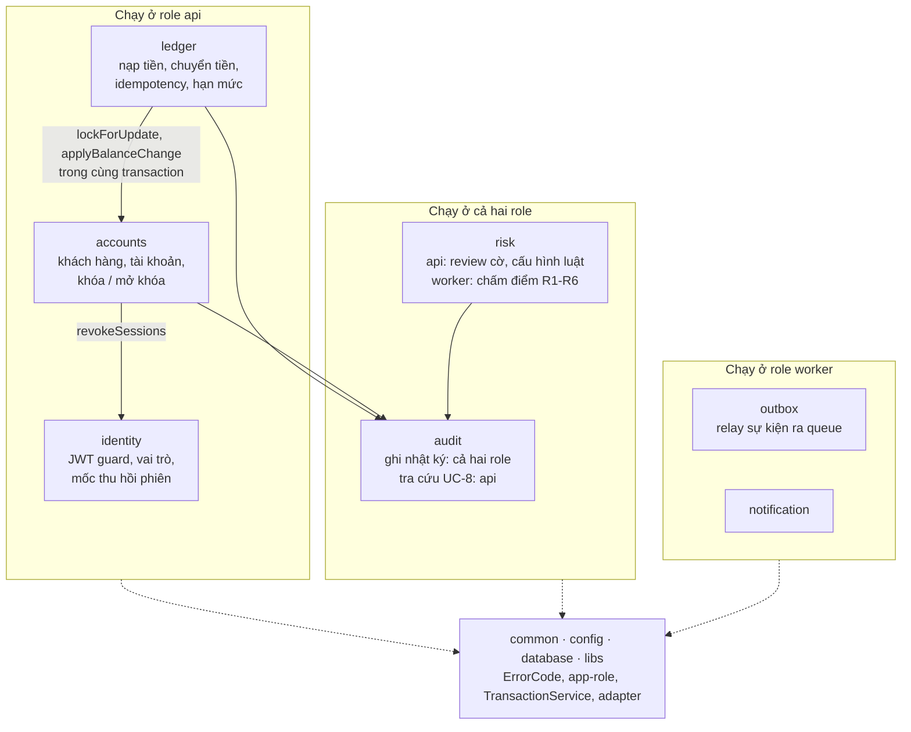

**Quy tắc phụ thuộc giữa module:**
- `ledger` **không** đọc hay ghi bảng `accounts` trực tiếp. Nó gọi các hàm được `accounts` export (`lockForUpdate`, `applyBalanceChange`) và **truyền transaction hiện tại** vào. Nhờ vậy chuyển tiền vẫn là một transaction mà quyền sở hữu dữ liệu không bị phá (P-4).
- `audit` là thư viện được mọi module ghi gọi **trong transaction của chính module đó**.
- Mỗi module có một `index.ts` là API công khai duy nhất; module khác chỉ import qua `@modules/<tên>`. **eslint ép quy tắc này** (chặn cả import sâu qua alias lẫn `../` sang module khác), nên không cần thêm plugin. Lý do làm ngay từ tuần 1: codebase lớn lên mà không có rào chắn thì module sẽ tự đăng ký schema của nhau và phải vá phụ thuộc vòng bằng `forwardRef` — không sửa được nữa khi đã có hàng chục module.
- Không có phụ thuộc vòng.
- Code trong repo: [`backend/`](../backend/README.md) (cấu trúc `common / config / database / libs / modules / scripts`).

---

## 6. Luồng xử lý quan trọng

Mỗi use case lớn có một sơ đồ trong đó **người dùng thật** thao tác và đi qua từng thành phần của hệ thống (các container ở mục 4). Dùng bảng này để tìm sơ đồ:

| Use case | Người dùng | Sơ đồ |
|---|---|---|
| UC-5 Chuyển tiền | Khách hàng | [6.3](#63-chuyển-tiền-uc-5--khách-hàng-đi-qua-từng-thành-phần) từ đầu đến cuối, kể cả phần bất đồng bộ · [6.1](#61-chuyển-tiền-uc-5--critical-path) chi tiết bên trong transaction |
| UC-3 Nạp tiền tại quầy | Nhân viên vận hành, Khách hàng | [6.4](#64-nạp-tiền-tại-quầy-uc-3--nhân-viên-đi-qua-từng-thành-phần) |
| UC-11 Khóa tài khoản | Nhân viên vận hành, Khách hàng | [6.2](#62-khóa-tài-khoản-và-thu-hồi-phiên-uc-11) |
| UC-10 Review cờ gian lận | Nhân viên vận hành | [6.5](#65-review-cờ-gian-lận-uc-10--nhân-viên-đi-qua-từng-thành-phần); cờ do UC-9 tạo ra ở cuối 6.3 |
| UC-8 Tra cứu nhật ký kiểm toán | Kiểm toán viên | [6.6](#66-tra-cứu-nhật-ký-kiểm-toán-uc-8--kiểm-toán-viên-đi-qua-từng-thành-phần) |

Chưa có sơ đồ riêng: UC-1, 2, 4, 6, 7, 12.

### 6.1 Chuyển tiền (UC-5) — critical path

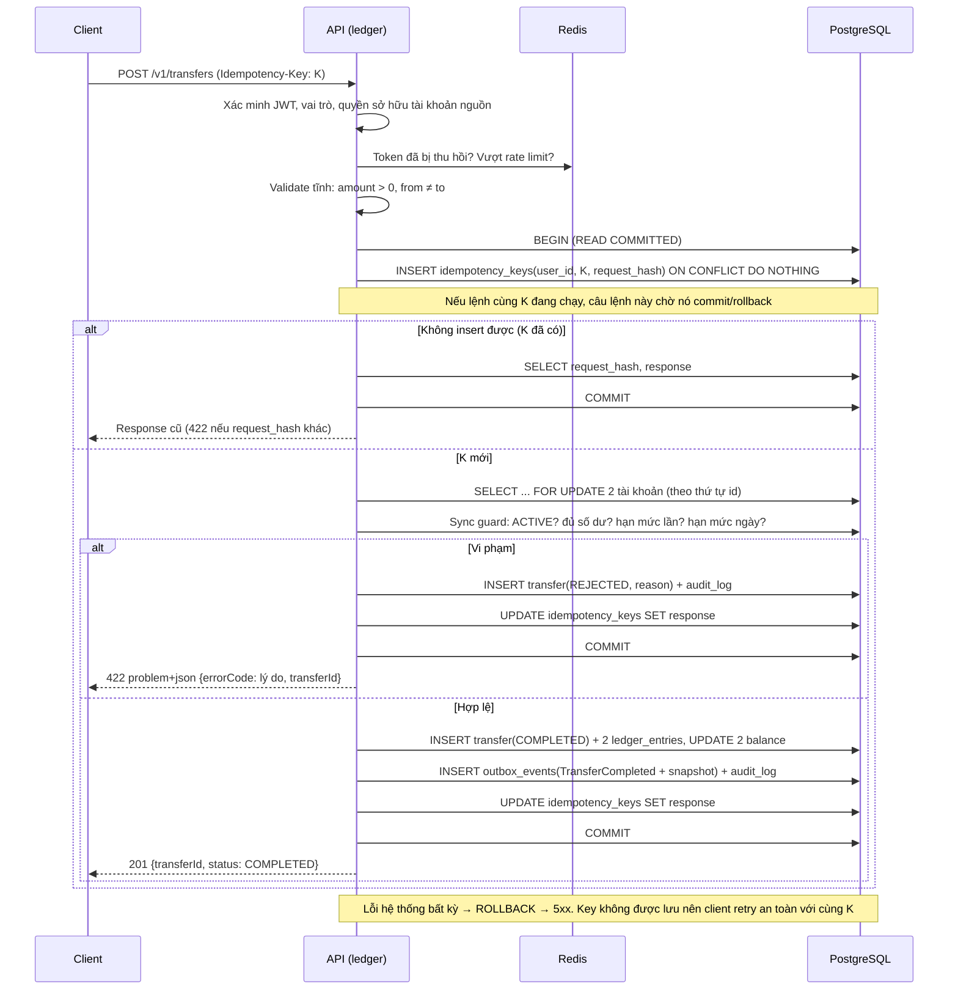

**Các quy tắc của luồng:**

| Quy tắc | Vì sao |
|---|---|
| **Một transaction** cho mã yêu cầu, khóa tài khoản, kiểm tra, bút toán, số dư, nhật ký, outbox | Debit và credit cùng thành công hoặc cùng không xảy ra (BR-02). Không có trạng thái "đã trừ, chưa cộng" |
| Mã yêu cầu **scope theo user**: `UNIQUE(user_id, key)` | Nếu unique toàn cục, user A dùng trùng mã của B sẽ nhận response của B — lộ dữ liệu |
| `INSERT … ON CONFLICT DO NOTHING` | Ở READ COMMITTED, câu lệnh chờ transaction đang giữ cùng key kết thúc. Nó commit → câu lệnh không insert, `SELECT` sau thấy response đã lưu. Nó rollback → câu lệnh insert và xử lý như lệnh mới. Không phát sinh lỗi `23505` nên transaction không bị hủy (AC-5.4) |
| Khóa hai tài khoản **theo thứ tự id** | Hai lệnh A→B và B→A không khóa chéo nhau gây deadlock |
| Sync guard đặt **sau** `FOR UPDATE` | Hạn mức ngày = tổng tiền đi hôm nay của tài khoản nguồn. Tài khoản nguồn đang bị khóa nên lệnh khác phải chờ; không thể hai lệnh cùng lọt hạn mức (AC-5.6) |
| Lưu cả kết quả `REJECTED` cùng mã yêu cầu | Cùng mã luôn trả cùng kết quả (BR-07) |
| Tài khoản SYSTEM `funding` chỉ là nguồn của nạp tiền | Đích là SYSTEM: lệnh `TRANSFER` bị từ chối `ACCOUNT_NOT_ACTIVE` (`to_account_id` NULL, cùng câu trả lời với tài khoản không tồn tại). Nguồn là SYSTEM: không khách nào sở hữu nó nên bước kiểm tra sở hữu tài khoản nguồn trả 404 kèm nhật ký `DENIED` (AC-5.8). Id `funding` cố định nên đoán được, không thể để khách chuyển tiền vào hay ra khỏi nó |
| Không lưu trạng thái lỗi hệ thống | Rollback thì không có gì để lưu; client gửi lại cùng mã (AC-5.10) |
| READ COMMITTED + `FOR UPDATE`, không dùng SERIALIZABLE | Đủ an toàn nhờ khóa hàng; không phải xử lý lỗi `40001`. Chỉ retry có giới hạn khi deadlock `40P01` hoặc mất kết nối |
| Redis chỉ đứng trước cửa | Mọi kiểm tra quyết định đúng-sai của tiền nằm trong Postgres; tắt Redis thì luồng vẫn đúng |

**Nạp tiền (UC-3)** dùng cùng luồng với `type = DEPOSIT`: tài khoản nguồn là tài khoản SYSTEM `funding`, chỉ vai trò `operator` gọi được, bỏ qua kiểm tra số dư và hạn mức của tài khoản SYSTEM nhưng vẫn có idempotency, bút toán kép, nhật ký và outbox. Script tạo dữ liệu demo cũng gọi API này thay vì sửa số dư trực tiếp, để bất biến luôn đúng.

**Giới hạn đã biết:** hàng `funding` bị khóa ở mỗi lần nạp tiền, nên mọi lệnh nạp tiền xếp hàng qua một hàng duy nhất. V1 chấp nhận vì nạp tiền do nhân viên làm tại quầy, tần suất thấp, và chuyển tiền (đường nóng) không đụng tới `funding`. Seed vài nghìn lệnh nạp chạy tuần tự trong vài chục giây. Nếu load test cho thấy nghẽn, chia thành nhiều tài khoản funding và chọn ngẫu nhiên một tài khoản mỗi lệnh (ghi ở ADR-09).

### 6.2 Khóa tài khoản và thu hồi phiên (UC-11)

Nhân viên tìm tài khoản cần khóa bằng `GET /v1/operator/accounts`, như ở 6.4.

JWT được xác minh tại chỗ bằng khóa công khai (JWKS), nên API không tự biết token đã bị thu hồi. Cách xử lý: lưu **mốc thu hồi phiên** của user; token nào phát hành trước mốc đó thì bị từ chối.

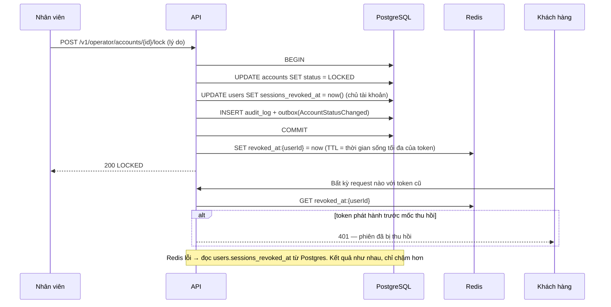

- **Nguồn sự thật là cột `users.sessions_revoked_at` trong Postgres.** Redis chỉ là bản cache để không phải đọc DB ở mọi request (P-1).
- Khách đăng nhập lại thì nhận token mới (phát hành sau mốc) và dùng được các tài khoản khác; tài khoản bị khóa vẫn bị chặn bởi kiểm tra `ACTIVE` trong transaction.
- Thu hồi phiên làm **đồng bộ trong lệnh khóa**, không chờ sự kiện, để đạt AC-11.1 ("yêu cầu kế tiếp bị từ chối").

### 6.3 Chuyển tiền (UC-5) — khách hàng đi qua từng thành phần

Cùng use case với 6.1 nhưng nhìn từ phía khách, từ lúc bấm nút đến lúc cờ gian lận và thông báo được tạo. Phần trong `BEGIN … COMMIT` được giải thích ở 6.1.

Phần risk ở cuối sequence dưới là **Proposed theo ADR-14**; đường chuyển tiền, event/outbox và notification giữ nguyên baseline.

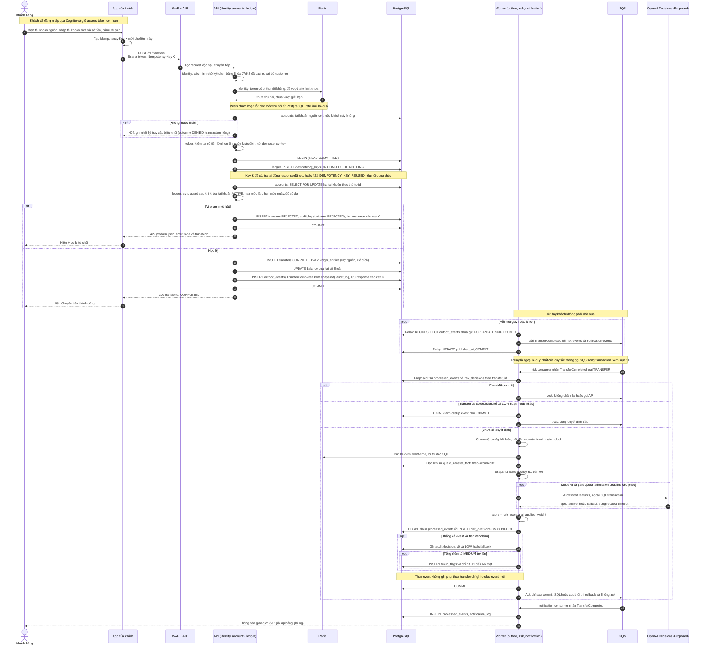

### 6.4 Nạp tiền tại quầy (UC-3) — nhân viên đi qua từng thành phần

Cùng một luồng với 6.3, nguồn tiền là tài khoản SYSTEM `funding` và người gọi là nhân viên (`operator`).

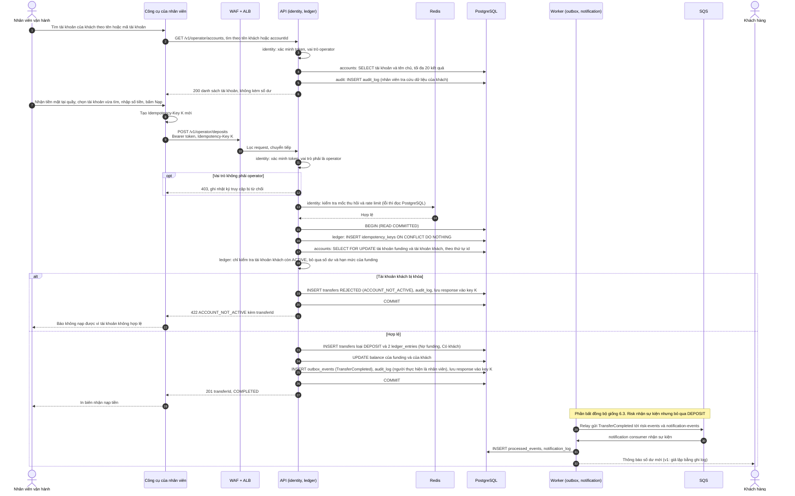

### 6.5 Review cờ gian lận (UC-10) — nhân viên đi qua từng thành phần

Cờ được thiết kế tạo sau giao dịch (cuối 6.3). Phần `aiAssessment` trong sequence là **Proposed**, chưa có API risk hoạt động. Khóa tài khoản sau khi nhân viên kết luận gian lận là UC-11, xem 6.2.

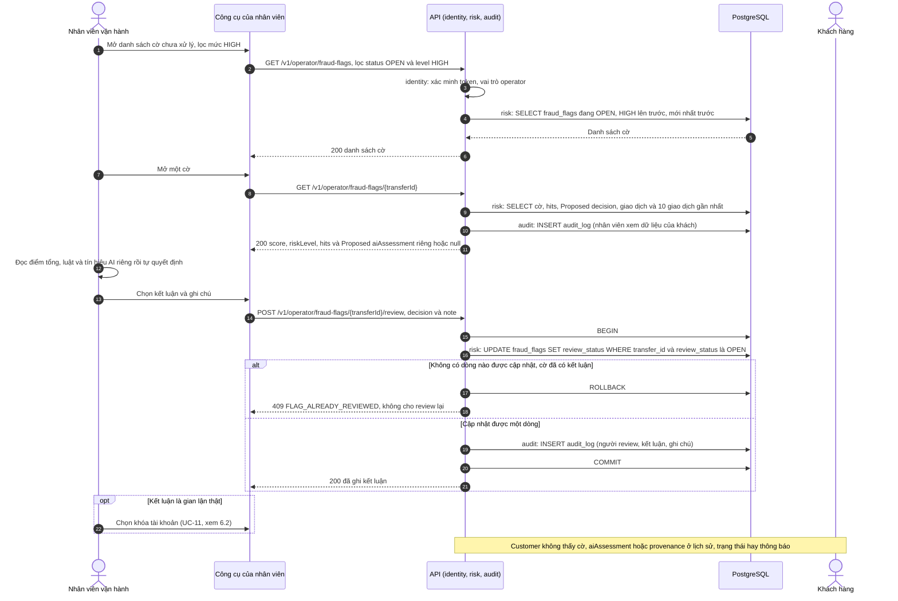

### 6.6 Tra cứu nhật ký kiểm toán (UC-8) — kiểm toán viên đi qua từng thành phần

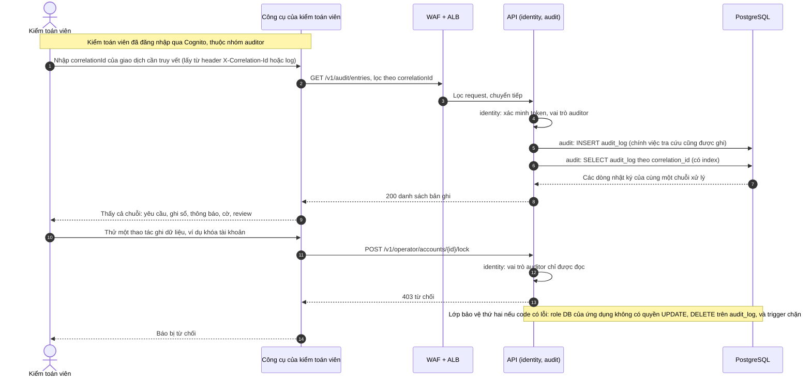

---

## 7. API (tổng quan)

Đặc tả đầy đủ sinh tự động bằng OpenAPI (Swagger) — đây là artifact "API Specification" của P2.

| Method | Path | Vai trò | UC | Ghi chú |
|---|---|---|---|---|
| POST | `/v1/customers/me` | customer | UC-1 | Idempotent: gọi lại trả hồ sơ cũ |
| GET | `/v1/customers/me` | customer | UC-1 | |
| POST | `/v1/accounts` | customer | UC-2 | Tối đa 3 tài khoản |
| GET | `/v1/accounts` | customer | UC-4 | Chỉ tài khoản của mình |
| GET | `/v1/accounts/{id}` | customer | UC-4 | Số dư mới nhất, đọc từ DB |
| GET | `/v1/accounts/{id}/transactions` | customer | UC-6 | Phân trang bằng cursor; lọc thời gian |
| POST | `/v1/transfers` | customer | UC-5 | **Bắt buộc** header `Idempotency-Key` |
| GET | `/v1/transfers/{id}` | customer | UC-7 | Chỉ người gửi / người nhận |
| POST | `/v1/operator/deposits` | operator | UC-3 | **Bắt buộc** header `Idempotency-Key` |
| GET | `/v1/operator/accounts` | operator | UC-3, UC-11 | Tìm tài khoản của khách theo `accountId` hoặc tên khách (khớp một phần), tối đa 20 kết quả. Trả mã, loại, trạng thái, tên chủ; **không** trả số dư. Mỗi lần tra cứu được ghi nhật ký (BR-10) |
| POST | `/v1/operator/accounts/{id}/lock` | operator | UC-11 | Thu hồi phiên ngay |
| POST | `/v1/operator/accounts/{id}/unlock` | operator | UC-11 | |
| GET | `/v1/operator/fraud-flags` | operator | UC-10 | Lọc theo trạng thái, mức rủi ro |
| GET | `/v1/operator/fraud-flags/{transferId}` | operator | UC-10 | Giữ `score`, `riskLevel`, `hits`, 10 giao dịch gần nhất; **Proposed:** thêm `aiAssessment` riêng/null baseline, client không tự cộng riêng hits thành total; mỗi lần xem ghi audit |
| POST | `/v1/operator/fraud-flags/{transferId}/review` | operator | UC-10 | Chỉ review một lần; lần hai trả 409 `FLAG_ALREADY_REVIEWED` |
| GET | `/v1/audit/entries` | auditor | UC-8 | Lọc theo người, hành động, thời gian, `correlationId` |
| GET | `/v1/admin/risk-config` | admin | UC-12 | Phiên bản hiện hành |
| POST | `/v1/admin/risk-config/versions` | admin | UC-12 | Tạo phiên bản mới, không sửa phiên bản cũ |
| GET | `/health/live`, `/health/ready` | — | — | Cho load balancer |

**Payload risk Proposed:** `hits` chỉ R1–R6; `score` là tổng rule + AI. `aiAssessment` chiếu từ decision, ví dụ `{"status":"SUCCEEDED","provider":"openai","model":"gpt-6-luna","probability":0.95,"appliedWeight":40,"explanation":"Đánh giá AI bổ sung đạt ngưỡng cấu hình; đây không phải kết luận gian lận."}`; baseline trả null. Đây là giải thích policy, không phải chain-of-thought của model. Provenance chỉ phục vụ operator/audit có quyền, toàn bộ trường risk/AI bị loại khỏi API và notification customer. Chưa có implementation/caller frontend risk được xác nhận; contract này phải được Dev API/giao diện cutover cùng task triển khai, không coi payload risk là không đổi.

**Quy ước chung:**
- Tiền trong request/response là **string** chứa số nguyên đồng (ví dụ `"500000"`).
- Lỗi trả theo chuẩn `application/problem+json` (RFC 7807): `type`, `title`, `status`, `detail`, kèm `errorCode` (mã ổn định để client và test rẽ nhánh — **test theo mã, không theo câu chữ**), `correlationId`, và `errors[]` cho lỗi validate.
- Lệnh chuyển tiền bị **REJECTED** trả **422**: `errorCode` là lý do (cùng chuỗi được lưu ở `transfers.reject_reason`) và `transferId`. Trường `status` của problem+json luôn là mã HTTP.
- Lỗi database tạm thời (deadlock còn sót sau retry, mất kết nối) trả **503 + `Retry-After`** với `errorCode = SERVICE_TEMPORARILY_UNAVAILABLE`. Yêu cầu chưa thay đổi gì, client gửi lại **cùng `Idempotency-Key`** là an toàn.
- Lỗi không lường trước trả 500 với nội dung chung chung; chi tiết thật chỉ ghi vào log kèm `correlationId`, không ra client.
- Truy cập tài khoản không thuộc mình trả **404** thay vì 403 để không tiết lộ tài khoản đó có tồn tại (AC-5.8).
- Mọi response có header `X-Correlation-Id`.

### 7.1 Mã lỗi (`errorCode`)

Định nghĩa duy nhất ở `backend/src/common/errors/error-code.enum.ts`. **Chỉ thêm mã khi client phải rẽ nhánh theo nó**; lỗi không ai rẽ nhánh chỉ cần `detail` rõ ràng.

| `errorCode` | HTTP | Khi nào | Quy tắc |
|---|---|---|---|
| `ACCOUNT_NOT_ACTIVE` | 422 | Tài khoản nguồn hoặc đích không `ACTIVE` | BR-05, BR-12 · lưu ở `reject_reason` |
| `LIMIT_PER_TX_EXCEEDED` | 422 | Vượt hạn mức mỗi lần | BR-06 · lưu ở `reject_reason` |
| `LIMIT_PER_DAY_EXCEEDED` | 422 | Vượt hạn mức trong ngày | BR-06 · lưu ở `reject_reason` |
| `INSUFFICIENT_FUNDS` | 422 | Không đủ số dư | BR-03 · lưu ở `reject_reason` |
| `IDEMPOTENCY_KEY_REQUIRED` | 400 | Lệnh chuyển/nạp tiền thiếu header `Idempotency-Key` | BR-07 |
| `IDEMPOTENCY_KEY_REUSED` | 422 | Cùng `Idempotency-Key` nhưng nội dung khác | BR-07 |
| `ACCOUNT_LIMIT_REACHED` | 409 | Khách đã có tối đa số tài khoản | BR-14 |
| `SESSION_REVOKED` | 401 | Token phát hành trước mốc thu hồi phiên (ví dụ tài khoản bị khóa) | BR-12 · khác "hết hạn": dùng lại token không bao giờ được |
| `RATE_LIMITED` | 429 | Vượt giới hạn tần suất | NFR-SEC-05 |
| `SERVICE_TEMPORARILY_UNAVAILABLE` | 503 | Lỗi database tạm thời | Kèm `Retry-After`; gửi lại cùng `Idempotency-Key` |
| `FLAG_ALREADY_REVIEWED` | 409 | Cờ gian lận đã có kết luận, không cho review lại | AC-10.1 |

Bốn mã đầu cũng là tập `RejectReason`: chuỗi lưu trong database và chuỗi trên đường truyền là một.

---

## 8. Data architecture

### 8.1 Dữ liệu nằm ở đâu

| Loại dữ liệu | Nơi lưu | Lý do |
|---|---|---|
| Nghiệp vụ: khách hàng, tài khoản, giao dịch, bút toán, mã yêu cầu | PostgreSQL | ACID, ràng buộc, khóa hàng — nguồn sự thật |
| Sự kiện chờ gửi | Bảng `outbox_events` → SQS | Không mất sự kiện khi sự cố sau commit |
| Nhật ký kiểm toán | PostgreSQL, bảng chỉ INSERT, ghi **cùng transaction** (tùy chọn export S3 Object Lock) | Bất biến, không có thao tác ghi nào thiếu nhật ký |
| **Proposed:** quyết định risk mọi TRANSFER/mode, kể cả LOW/fallback | PostgreSQL `risk_decisions`, append-only | Claim theo transfer, snapshot/provenance quyết định đầu; không phụ thuộc có cờ, không dùng Redis làm nguồn thật |
| Dữ liệu nóng, tạm thời | Redis | Có TTL, dựng lại được (mục 9). **Không chứa số dư** |
| Backup | RDS automated backup + PITR + snapshot | RPO ≤ 5 phút, RTO ≤ 30 phút. Redis không cần backup |

**Vì sao PostgreSQL** (ADR-02):

| Tiêu chí (từ tài liệu 02) | PostgreSQL | DynamoDB | MongoDB |
|---|---|---|---|
| Transaction nhiều hàng, nhiều bảng | ✅ Tự nhiên | ⚠️ Có nhưng giới hạn, đắt | ⚠️ Có từ v4, phức tạp hơn |
| Khóa hàng `SELECT … FOR UPDATE` | ✅ | ❌ Phải dùng điều kiện ghi | ⚠️ Hạn chế |
| Ràng buộc (UNIQUE, CHECK, FK) để bảo vệ bất biến | ✅ | ❌ | ⚠️ Một phần |
| Truy vấn lịch sử, đối soát, đặc trưng gian lận bằng SQL | ✅ | ❌ Phải thiết kế trước theo truy vấn | ⚠️ |
| Scale ngang | ⚠️ Khó hơn | ✅ | ✅ |
| **Kết luận** | ✅ Phù hợp workload OLTP 120 RPS | Thừa khả năng scale, thiếu thứ cần nhất | Không có lợi thế rõ |

### 8.2 Mô hình dữ liệu vật lý (rút gọn)

ERD gồm phần mở rộng **Proposed** `RISK_DECISIONS`/quan hệ với cờ; cardinality hit 0..n cho phép cờ AI-only. Baseline Accepted có hit rule khi tạo cờ. Sơ đồ không xác nhận migration đã có.

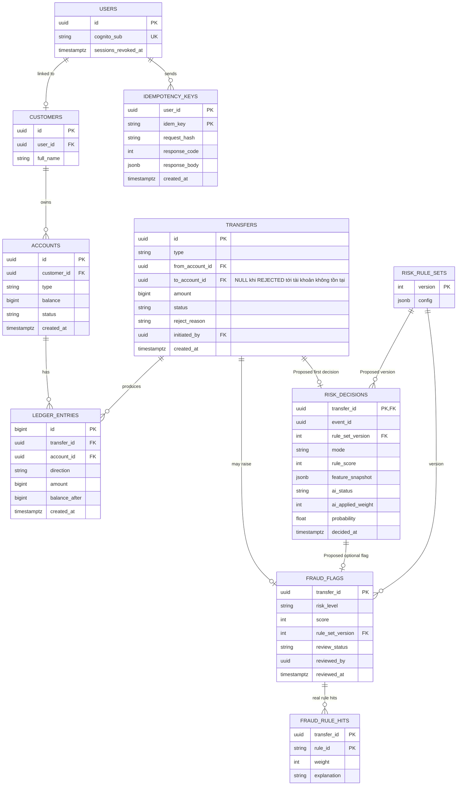

Các bảng kỹ thuật không vẽ: `outbox_events`, `processed_events`, `audit_log`, `notification_log`, `reconciliation_runs`. Schema Accepted thiết kế 14 bảng; thêm decision Proposed thành 15, không phải số migration đã triển khai. Sơ đồ rút gọn không vẽ hết metadata provider/model/hashes; **schema đầy đủ** chỉ nằm ở [`components/_shared/database-design.md` §4.8](components/_shared/database-design.md#48-nhóm-fraud). Vai trò người dùng không lưu ở `users` mà lấy từ nhóm Cognito trong JWT.

| Domain (tài liệu 02) | Bảng | Ràng buộc bảo vệ bất biến |
|---|---|---|
| Account | `accounts` | `CHECK (type = 'SYSTEM' OR balance >= 0)` |
| Transfer + LedgerEntry | `transfers`, `ledger_entries` | `amount > 0`; `UNIQUE (transfer_id, direction)`; khóa ngoại tổng hợp (dòng sổ đúng số tiền và tài khoản của giao dịch `COMPLETED`); quyền DB thu hồi UPDATE/DELETE trên `ledger_entries` |
| IdempotencyRecord | `idempotency_keys` | `PRIMARY KEY (user_id, idem_key)` |
| FraudFlag + RuleHit | `fraud_flags`, `fraud_rule_hits` | Khóa chính theo `transfer_id` và `(transfer_id, rule_id)` → không cờ trùng |
| RiskDecision (Proposed) + FraudFlag + RuleHit | `risk_decisions`, `fraud_flags`, `fraud_rule_hits` | PK transfer quyết định đầu mọi mode/LOW; FK cờ cùng transfer/version; `score = rule_score + ai_applied_weight`, tổng hit chỉ bằng rule_score khi có cờ; CHECK/constraint trigger tương lai theo database-design §4.8 |
| AuditEntry | `audit_log` | Chỉ cấp quyền INSERT và SELECT |
| Customer (tối đa 3 tài khoản) | `accounts` | Kiểm tra trong transaction mở tài khoản, khóa hàng `customers` |

**Quy ước:**
- Tiền là `BIGINT` (đồng), không dùng kiểu số thực.
- Tài khoản SYSTEM `funding` được âm; `SUM(balance mọi tài khoản) = 0` luôn đúng (ví dụ ở tài liệu 02 §7.3).
- Job đối soát định kỳ kiểm tra: tổng Nợ = tổng Có; `balance` mỗi tài khoản = tổng bút toán của nó; tổng số dư = 0.
- Index chính (đầy đủ và lý do ở database-design §6): `ledger_entries(account_id, created_at)` cho lịch sử và hạn mức ngày; `transfers(from_account_id, created_at)` và `transfers(from_account_id, to_account_id, created_at)` cho luật gian lận.

---

## 9. Cache & Redis strategy

Theo P2 (slide 30–31), câu hỏi không phải "có dùng Redis không?" mà là **data nào cache được, TTL bao nhiêu, khi nào invalidate, và Redis hỏng thì sao**. Nhóm dùng Redis cho 4 việc, mỗi việc giải quyết một vấn đề cụ thể mà Postgres hoặc bộ nhớ trong từng task không làm tốt.

**Engine:** Valkey trên Amazon ElastiCache (tương thích Redis, mã nguồn mở). Dev local dùng container Valkey. Dùng node cố định, cluster mode tắt, TLS và AUTH token ([ADR-12](adr/0012-redis-valkey-node.md)).

### 9.1 Bốn mục đích sử dụng

| # | Mục đích | Không có Redis thì | Cấu trúc | TTL / invalidate | Phục vụ |
|---|---|---|---|---|---|
| **R-1** | **Rate limit toàn cục** theo user và IP | Mỗi task đếm riêng: 2 task → giới hạn thực tế gấp đôi | Counter theo cửa sổ, `INCR` + `EXPIRE` | Hết hạn theo cửa sổ (60 giây) | NFR-SEC-05 |
| **R-2** | **Cache mốc thu hồi phiên** | Mọi request phải đọc `users` từ DB để biết token còn hợp lệ không | `revoked_at:{userId}` | TTL = thời gian sống tối đa của access token; ghi đè khi khóa | NFR-SEC-02 |
| **R-3** | **Bộ đếm đặc trưng gian lận** cho R1 (velocity) và R5 (fan-out) | Mỗi sự kiện phải quét lịch sử bằng SQL; ở 120 RPS là tải phụ đáng kể lên RDS | Sorted set `risk:vel:{accountId}` (member = `transferId`, score = `occurredAt`); sorted set người nhận `risk:fan:{accountId}` (member = tài khoản nhận, score = `occurredAt`) | Cửa sổ trượt bằng `ZREMRANGEBYSCORE`; TTL 2 giờ | NFR-FRD-01 |
| **R-4** | **Cache cấu hình** luật và hạn mức | Mỗi lệnh và mỗi sự kiện đọc lại cấu hình từ DB | Hai key: `cfg:risk:latest` (số phiên bản hiện hành) và `cfg:risk:v{n}` (nội dung bất biến của phiên bản n) | `latest` TTL 60 giây, miss/lỗi thì `SELECT max(version)` từ `risk_rule_sets`; `v{n}` TTL dài vì bất biến. Version mới truyền tới worker sau tối đa 60 giây khi kho cấu hình/TTL hoạt động đúng; không thay snapshot đang xử lý | UC-12 |

R-3 an toàn với sự kiện trùng: member của sorted set là `transferId`, nhận cùng sự kiện hai lần vẫn chỉ có một phần tử.

**Proposed — quay về baseline không phải kill switch tức thì:** tạo version `rule_only`, không sửa config/decision cũ hoặc dừng worker dùng chung. Cache `latest` còn AI có thể chọn snapshot cũ trong 60 giây; mode AI bắt buộc `ai.maxAdmissionDelayMs` và `ai.requestTimeoutMs` nguyên dương, được duyệt và đo trước bật. Đo monotonic từ lúc chọn snapshot, kiểm ngay trước gửi; quá admission delay thì không gọi, ghi `UNAVAILABLE`/weight 0. Khi kho config/TTL đúng contract, lời gọi mới theo version AI cũ bị chặn trong bound **60 giây + maxAdmissionDelayMs** từ lúc tạo version baseline; request đã gửi có thể chạy thêm tối đa requestTimeoutMs ở client. Client abort không bảo đảm provider hủy hoặc không tính phí. Sự kiện/response đang xử lý giữ version đã chọn, quyết định đã commit không đổi. Không có số admission/timeout đã đo thì AI không được bật; không sửa TTL/infra dùng chung để che giới hạn này.

### 9.2 Những gì **không** đưa vào Redis

| Dữ liệu | Lý do |
|---|---|
| **Số dư** | Cache số dư = có lúc khách thấy số cũ, hoặc tệ hơn, một logic nào đó dùng số cũ để quyết định chuyển tiền. Đọc theo khóa chính trong Postgres đã đủ nhanh cho p95 < 150 ms |
| **Trạng thái, lịch sử giao dịch** | Phải đúng ngay sau khi chuyển tiền; truy vấn có index đã đủ nhanh |
| **Mã yêu cầu** | Phải nằm cùng transaction với giao dịch mới đảm bảo "chỉ một lần". Đặt ở Redis sẽ có khe hở giữa Redis và DB |
| **Session** | JWT là stateless; Redis chỉ cache mốc thu hồi |
| **Dữ liệu cá nhân** | Redis chỉ chứa id, số đếm, mốc thời gian và cấu hình |

### 9.3 Nguyên tắc và chế độ khi Redis lỗi

> **Xóa sạch Redis bất kỳ lúc nào, hệ thống vẫn đúng — chỉ chậm hơn hoặc rate limit tạm lỏng hơn.**

| Mục đích | Khi Redis không trả lời | Lý do |
|---|---|---|
| R-1 Rate limit | **Fail-open** + alarm; WAF vẫn giới hạn theo IP ở biên | Không để một lớp bảo vệ phụ làm sập API |
| R-2 Mốc thu hồi | **Đọc `users.sessions_revoked_at` từ Postgres** | Kết quả như nhau, chậm hơn vài ms |
| R-3 Bộ đếm | **Truy vấn SQL** trên `transfers` | Kết quả như nhau, tốn tải DB hơn |
| R-4 Cấu hình | **Đọc thẳng Postgres** | Bảng nhỏ |

Client Redis đặt timeout 50 ms mỗi lệnh và circuit breaker (mở khi ≥ 50% của ít nhất 10 lệnh lỗi trong 10 giây, thử lại sau 5 giây) để Redis chậm không kéo latency API vượt SLO (ADR-12). Số lần rơi về đường dự phòng là một metric (mục 14).

### 9.4 Đo được lợi ích

| Mục đích | Thí nghiệm ở P4/P5 |
|---|---|
| R-1 | Load test vượt giới hạn với 2 task API: có Redis → số request được chấp nhận đúng bằng giới hạn; không Redis → gấp đôi |
| R-2 | Thời gian từ lúc khóa tài khoản đến lúc request kế tiếp bị từ chối |
| R-3 | CPU và số truy vấn RDS, p95 thời gian gắn cờ ở 120 RPS, khi bật và tắt bộ đếm Redis |

---

## 10. Bất đồng bộ: outbox và event

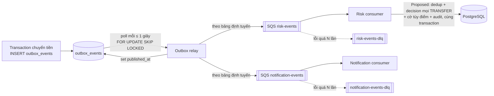

**Mỗi consumer một queue riêng.** Một queue SQS giao mỗi message cho **một** consumer duy nhất. Nếu risk và notification đọc chung một queue, mỗi sự kiện chỉ tới được một trong hai. Vì vậy relay gửi mỗi sự kiện tới **mọi queue quan tâm** theo bảng định tuyến (bảng sự kiện bên dưới), và mỗi queue có DLQ riêng để lỗi của consumer này không chặn consumer kia.

| Thành phần | Thiết kế | Đảm bảo |
|---|---|---|
| **Outbox** | Sự kiện ghi trong cùng transaction với nghiệp vụ | Commit thì chắc chắn có sự kiện; rollback thì không có |
| **Relay** | `SELECT … WHERE published_at IS NULL ORDER BY id LIMIT n FOR UPDATE SKIP LOCKED` → gửi tới từng queue theo bảng định tuyến → set `published_at`; poll 500 ms khi rảnh, lô 100 sự kiện; job dọn dòng đã gửi sau 7 ngày. Đây là **ngoại lệ duy nhất** của quy tắc "không gọi SQS trong transaction": relay chỉ khóa hàng `outbox_events` (không đụng hàng tài khoản), gửi lặp vẫn đúng vì vốn là at-least-once; relay dùng timeout riêng và không dùng cơ chế chạy lại khi deadlock của `withTransaction` | Nhiều task không lấy trùng; sự cố giữa chừng thì gửi lại cho mọi queue (**at-least-once**) |
| **SQS standard** | Mỗi consumer một queue + một DLQ; visibility timeout 30 giây; long polling 20 giây; chuyển DLQ sau 5 lần nhận (`maxReceiveCount = 5`); giữ message 4 ngày (ADR-03) | Không mất message; consumer lỗi không ảnh hưởng consumer khác; không đảm bảo thứ tự |
| **Phương án thay thế** | SNS topic fan-out ra các queue (relay chỉ publish một lần) | Tách producer khỏi danh sách consumer, đổi lại thêm một dịch vụ và khó giả lập ở local. Nhóm chọn bảng định tuyến vì chỉ có 2 consumer và chạy giống hệt nhau ở local (ElasticMQ) lẫn AWS. Ghi trong ADR-03 |
| **Consumer** | Ghi `processed_events(consumer, event_id)` cùng transaction với tác động | Sự kiện trùng bị bỏ qua (**effectively-once**) |
| **Thứ tự** | Không consumer nào phụ thuộc thứ tự sự kiện | An toàn với SQS standard |

**Proposed riêng risk:** ngoài dedup event, PK `risk_decisions(transfer_id)` giữ quyết định đầu qua mọi mode/eventId, kể cả khi `processed_events` đã được dọn. Đọc decision trước config/scoring/API; claim event rồi claim transfer trong cùng transaction, bên thắng mới ghi cờ/hits/audit decision. Thua event không ghi phụ; thua transfer chỉ commit dedup event mới. API/Redis ở ngoài callback SQL có retry. API lỗi vẫn commit baseline + trạng thái, không đẩy DLQ chỉ vì provider; SQL/audit lỗi rollback, không ack. Race trước commit hoặc rollback/giao lại có thể tạo nhiều API call nhưng chỉ một decision commit; không hứa exactly-once billing. Queue, payload sự kiện và outbox không đổi.

**Event là contract**, mang **ảnh chụp tại thời điểm giao dịch** để consumer không đọc trạng thái hiện tại (đã đổi):

```json
{
  "eventId": "uuid",
  "eventType": "TransferCompleted",
  "occurredAt": "2026-10-01T10:00:00Z",
  "correlationId": "uuid",
  "transferId": "uuid",
  "type": "TRANSFER",
  "fromAccountId": "uuid",
  "toAccountId": "uuid",
  "amount": "500000",
  "fromBalanceBefore": "520000",
  "fromAccountCreatedAt": "2026-09-30T08:00:00Z",
  "toAccountCreatedAt": "2026-01-15T08:00:00Z",
  "sameOwner": false,
  "fromUserId": "uuid",
  "toUserId": "uuid"
}
```

**Bảng định tuyến sự kiện** (relay dùng bảng này):

| Event | Phát ra khi | Gửi tới queue |
|---|---|---|
| `TransferCompleted` | Nạp tiền hoặc chuyển tiền hoàn tất | `risk-events`, `notification-events` |
| `TransferRejected` | Lệnh bị từ chối | **Không phát ở v1** |
| `AccountStatusChanged` | Khóa / mở khóa tài khoản | `notification-events` |

Ở v1 chỉ `TransferCompleted` và `AccountStatusChanged` đi qua outbox. `TransferRejected` không phát vì chưa có bên tiêu thụ: risk chỉ chấm giao dịch hoàn tất, còn khách đã nhận 422 ngay trong request; lệnh bị từ chối vẫn được lưu ở `transfers` và `audit_log`. `occurredAt` của `TransferCompleted` là `transfers.created_at`, nên cửa sổ thời gian của luật gian lận và hạn mức ngày dùng cùng một đồng hồ (DB). `FraudFlagRaised` và `FraudFlagReviewed` (docs/02 §9) là khái niệm miền: việc tạo và kết luận cờ đã được lưu ở `fraud_flags` và `audit_log`, nên chưa phát sự kiện cho tới khi có bên tiêu thụ. Trường của từng sự kiện nằm ở [event-contract](components/_shared/event-contract.md).

---

## 11. Xử lý sự cố

| Kịch bản | Cơ chế | Bằng chứng |
|---|---|---|
| Ghi nợ xong, ghi có lỗi | Một transaction → rollback toàn bộ | Kill task giữa transfer |
| Client timeout rồi gửi lại | Mã yêu cầu → trả kết quả cũ | AC-5.3, 5.10 |
| Hai lệnh cùng mã đến đồng thời | `ON CONFLICT DO NOTHING` chờ lệnh đầu | AC-5.4 |
| Lệnh bị REJECTED rồi gửi lại cùng mã | Trả lại REJECTED cũ | AC-5.3 |
| Ghi nhật ký lỗi | Cả transaction rollback (fail-closed) | Test tự động |
| Sự cố sau commit, trước khi gửi sự kiện | Outbox: relay gửi lại | Kill worker rồi bật lại |
| Consumer nhận sự kiện trùng | `processed_events`; bộ đếm Redis dùng `transferId` làm member | AC-9.2 |
| Consumer lỗi liên tục | Retry + backoff → DLQ sau 5 lần nhận + alarm | Inject lỗi consumer |
| Hai lệnh đồng thời trên cùng tài khoản | Khóa hàng theo thứ tự id; deadlock (`40P01`) thì `withTransaction` chạy lại cả transaction tối đa 3 lần với backoff; còn sót thì trả 503 + `Retry-After` | AC-5.9 |
| **Redis down hoặc chậm** | Timeout ngắn + circuit breaker; chế độ dự phòng mục 9.3 | Tắt Redis giữa load test |
| **Redis mất dữ liệu** (restart, failover) | Bộ đếm và cache tự dựng lại; mốc thu hồi đọc lại từ Postgres | Flush Redis rồi chạy AC-11.1 |
| Dịch vụ thông báo lỗi | Bất đồng bộ, không ảnh hưởng chuyển tiền; circuit breaker | Inject lỗi notification |
| DB primary lỗi | RDS Multi-AZ failover (cấu hình production) | Demo failover tuần 8 |

---

## 12. Bảo mật

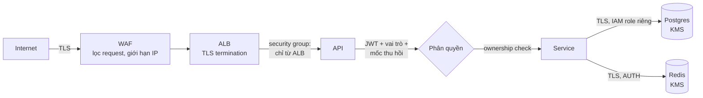

| Lớp | Biện pháp | NFR |
|---|---|---|
| **Biên** | WAF (managed rules + rate rule 1.000 yêu cầu/5 phút/IP, chỉ bật tuần 6–8); rate limit toàn cục trong app: 10 lệnh chuyển/phút/khách, 100 yêu cầu/phút/IP (R-1). Khi load test, IP của máy chạy k6 được loại khỏi rate rule của WAF và giới hạn theo IP của app được nâng qua biến môi trường; kịch bản `rate-limit` chạy với giá trị mặc định | NFR-SEC-05 |
| **Định danh** | Cognito với nhóm `customer` / `operator` / `auditor` / `admin`; JWT xác minh bằng JWKS (kiểm `iss`, `client_id`, `token_use = access`, `exp`); vai trò lấy từ `cognito:groups`, token không thuộc nhóm nào (khách tự đăng ký) là `customer`; access token 15 phút, refresh token 1 ngày (ADR-06). Dòng `users` được tạo bằng upsert theo `cognito_sub` ở token hợp lệ đầu tiên của **mọi** vai trò (ánh xạ `sub → users.id` không bao giờ đổi nên cache trong tiến trình). Tài khoản nhân viên (operator, auditor, admin) do Terraform (user pool, nhóm) và script seed (tài khoản demo, mật khẩu ở Secrets Manager) tạo, chưa có giao diện quản lý. Local và test dùng `AUTH_MODE=local` với JWKS cục bộ; staging và production có `AUTH_MODE=local` thì app từ chối khởi động | FR-ID-01, 03 |
| **Thu hồi** | Mốc `sessions_revoked_at` trong DB + cache Redis (mục 6.2) | NFR-SEC-02 |
| **Phân quyền** | Guard theo vai trò **cộng** kiểm tra sở hữu trong service ở mọi truy vấn theo tài khoản; mã yêu cầu scope theo user; trả 404 cho tài nguyên không thuộc mình | NFR-SEC-01 |
| **Mã hóa** | TLS ở ALB, tới RDS, tới ElastiCache; mã hóa at-rest bằng KMS cho RDS, ElastiCache, S3 | NFR-SEC-03 |
| **Bí mật** | Secrets Manager; không có bí mật trong repo hay image; quét bí mật trong CI | NFR-SEC-04 |
| **Quyền tối thiểu** | IAM role riêng cho task API và worker; DB role riêng cho tiến trình `api` và `worker` (`dbs_api`, `dbs_worker`; không role nào được UPDATE/DELETE sổ cái và nhật ký), risk đọc giao dịch qua view chỉ đọc `v_transfer_facts` (database-design §8); Redis và RDS chỉ mở cho security group của app | NFR-SEC-06 |
| **Kiểm toán** | Nhật ký ghi trong transaction; ghi cả truy cập nhạy cảm và lần bị từ chối; kiểm toán viên chỉ đọc | NFR-AUD-01 |
| **Threat model** | STRIDE cho luồng chuyển tiền và nạp tiền: [security/threat-model.md](security/threat-model.md) (P3) | — |

---

## 13. Triển khai (baseline AWS)

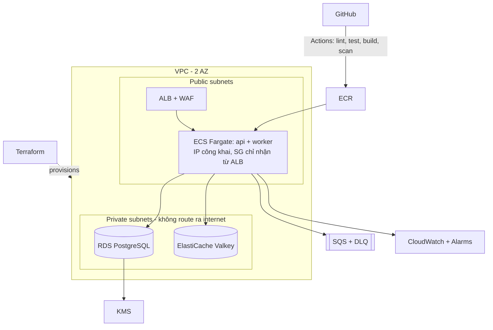

### 13.1 Hai cấu hình môi trường

| | Local | Dev (cloud) | Production (demo HA, đo SLO) |
|---|---|---|---|
| Chạy ở | `docker compose` cho hạ tầng + `npm run start:dev` (`APP_ROLE=both`) | AWS, dựng/xóa theo giờ làm việc | AWS, bật trong các đợt demo và đo |
| PostgreSQL | Container `postgres:17` | RDS `db.t4g.micro` Single-AZ | RDS `db.t4g.small` Multi-AZ |
| Redis | Container Valkey | 1 node `cache.t4g.micro` | 1 primary + 1 replica, Multi-AZ |
| API (`APP_ROLE=api`) | cùng 1 process với worker | 1 task (0,5 vCPU / 1 GB) | ≥ 2 task trên 2 AZ |
| Worker (`APP_ROLE=worker`) | cùng 1 process với API | 1 task (0,25 vCPU / 0,5 GB) | 1–2 task |
| Hàng đợi | ElasticMQ (tương thích SQS) | SQS | SQS |
| Mục tiêu availability | — | Không cam kết | 99,9% |

### 13.2 Chi phí và các lựa chọn ảnh hưởng chi phí

| Hạng mục | Lựa chọn | Ghi chú |
|---|---|---|
| Redis | Node `cache.t4g.micro`, cluster mode tắt | ADR-12 |
| Egress mạng | Task ở public subnet có IP công khai, security group chỉ nhận từ ALB; không NAT Gateway, không interface endpoint; gateway endpoint S3 (miễn phí) | ADR-10. NAT ≈ 43 USD/tháng mỗi AZ; 5 interface endpoint × 2 AZ ≈ 95 USD/tháng; IPv4 ≈ 3,6 USD/tháng mỗi task |
| Dev khi đang bật | ≈ 0,14 USD/giờ (`ap-southeast-1`, ước tính) | Bảng chi tiết ở phụ lục [ADR-11](adr/0011-aws-managed-session-based.md) |
| Dựng/xóa theo phiên, 10 tuần | ≈ 80–100 USD (gồm WAF tuần 6–8 và ~20 giờ cấu hình production) | Nằm trong credit AWS 200 USD; chạy 24/7 sẽ ≈ 230–250 USD |

**Connection pool:** `DATABASE_POOL_MAX = 10` mỗi task, và `số task × 10 + 5 (migration, quản trị) ≤ max_connections`. `db.t4g.micro` có `max_connections` khoảng 80–110 (kiểm bằng `SHOW max_connections;`) nên dev chạy tối đa 6 task; `db.t4g.small` của cấu hình production gấp khoảng đôi.

### 13.3 Deploy và rollback

| Bước | Cách làm |
|---|---|
| Build | Mỗi commit vào nhánh chính → lint, typecheck, unit + e2e test (gồm Testcontainers), build **một image** (`backend/Dockerfile`), quét lỗ hổng, đẩy lên ECR với tag = commit SHA |
| Migration | Chạy như một bước riêng trước deploy, theo kiểu backward-compatible: **expand → migrate → contract** |
| Deploy | Hai ECS service dùng chung image, khác `APP_ROLE`. Service `api`: rolling update; ALB kiểm `/health/ready` mỗi 15 giây, timeout 5 giây, 2 lần đạt là healthy, 3 lần trượt liên tiếp là unhealthy; ECS `healthCheckGracePeriodSeconds = 60`. Ngưỡng 3 × 15 giây đủ rộng để một đợt pool bão hòa ngắn không làm ECS thay task hàng loạt. Service `worker`: không có cổng HTTP; ECS thay task khi tiến trình thoát |
| Rollback | Cập nhật service về task definition trước đó (image cũ); migration kiểu expand nên schema vẫn tương thích |

---

## 14. Quan sát và SLI/SLO

SLO chính thức (chốt 2026-10-11). Đo trong các đợt bật cấu hình production và trong load test; môi trường dev không cam kết.

| SLI | Đo ở đâu | SLO | Cửa sổ | Alarm khi |
|---|---|---|---|---|
| Tỉ lệ request API không lỗi 5xx (422 và 429 không tính là lỗi) | ALB, API | ≥ 99,9% | 30 ngày (ngân sách lỗi ≈ 43 phút) | Tỉ lệ 5xx > 1% trong 5 phút |
| Latency chuyển tiền p95 / p99 | API | p95 < 300 ms, p99 < 1 s ở ≤ 120 RPS | 5 phút | p95 > 300 ms trong 3 cửa sổ liên tiếp |
| Latency đọc (số dư, lịch sử) p95 | API | < 150 ms | 5 phút | p95 > 150 ms trong 3 cửa sổ liên tiếp |
| Thời gian từ giao dịch tới khi có cờ p95 | Worker (`fraud_flags.created_at − transfers.created_at`) | < 5 giây | 15 phút | p95 > 5 giây |
| Tuổi outbox chưa gửi cũ nhất | Worker | < 10 giây | 1 phút | > 30 giây (relay hoặc worker treo) |
| Số message trong DLQ; tuổi message cũ nhất của queue chính | SQS | DLQ = 0; tuổi < 60 giây | 1 phút | DLQ > 0; tuổi > 120 giây |
| Kết quả đối soát sổ cái | Job đối soát | 0 lệch | Mỗi lần chạy | `MISMATCH` hoặc `ERROR` |
| Cảnh báo gian lận trên 1.000 giao dịch | Worker | ≤ 20 | 24 giờ trượt, khi có ≥ 1.000 giao dịch | > 20 |
| Latency Redis, số lần rơi về đường dự phòng (`redis_fallback_total`), số request bị rate limit | API, Worker | Theo dõi | — | Redis không truy cập được > 1 phút |

- **Log:** JSON có cấu trúc, mỗi dòng có `correlationId`; mã này đi từ API → outbox → sự kiện → consumer → nhật ký kiểm toán.
- **Dashboard:** CloudWatch (hoặc Grafana) theo các SLI trên.
- **Alarm:** theo cột cuối của bảng trên, gửi SNS email; tạo bằng Terraform.
- **Health check:** `/health/ready` báo Redis ở trạng thái *degraded* chứ không *down*, vì hệ thống vẫn chạy được khi không có Redis.

---

## 15. Kiến trúc phát hiện gian lận (P5)

Danh mục luật R1–R6 định nghĩa ở tài liệu 02 §2.1. Baseline vẫn giữ nguyên. Phương án API dưới đây là **Proposed theo [ADR-14](adr/0014-fraud-rules-external-ai.md), chưa triển khai**, không phải API/ML đã hoạt động hoặc ADR-08 đã bị thay.

### 15.1 Hai tầng

| Tầng | Chạy khi nào | Hành động | Ví dụ |
|---|---|---|---|
| **Sync guard** (module `ledger`) | Trong transaction, sau `FOR UPDATE` | Chặn cứng → `REJECTED` | Vượt hạn mức lần/ngày, tài khoản bị khóa |
| **Async detection** (module `risk`, chạy ở role worker) | Sau commit, qua sự kiện `TransferCompleted` | Chỉ **gắn cờ** | R1–R6 |

Sync guard phải rẻ (chỉ đọc tài khoản đang khóa và tổng tiền đi trong ngày, ≤ 5 ms) và không được làm hỏng giao dịch. Phân tích lịch sử chạy bất đồng bộ nên không ảnh hưởng SLO chuyển tiền. Đánh đổi: giao dịch đáng ngờ đã chuyển xong khi bị phát hiện. V1 chấp nhận vì có nhân viên review; giữ tiền chờ duyệt là hướng mở rộng.

### 15.2 Nguồn dữ liệu cho từng luật

| Luật | Nguồn dữ liệu | Vì sao |
|---|---|---|
| R1 Velocity | Bộ đếm Redis (R-3), dự phòng SQL | Truy vấn lặp lại nhiều nhất |
| R2 Số tiền bất thường | SQL lịch sử 30 ngày + `amount` trong sự kiện | Cần thống kê trên lịch sử dài |
| R3 Tài khoản mới chuyển lớn | Ảnh chụp `fromAccountCreatedAt` trong sự kiện | Phải đúng tại thời điểm giao dịch |
| R4 Chuyển vòng | SQL lịch sử 1 giờ | Truy vấn theo cặp tài khoản |
| R5 Fan-out | Bộ đếm Redis (R-3), dự phòng SQL | Truy vấn lặp lại nhiều |
| R6 Rút cạn | Ảnh chụp `fromBalanceBefore` trong sự kiện | Số dư hiện tại đã thay đổi khi consumer chạy |

Mọi cửa sổ lịch sử dùng `occurredAt`, không dùng thời gian nhận message; Redis lạnh/lỗi hoặc event trễ/đảo thứ tự phải khôi phục được cùng feature với SQL point-in-time. R2 cần n ≥ 5; R3 tuổi < 24h và amount > 10 triệu; R5/R6 miễn trừ `sameOwner`; R6 chỉ khi snapshot số dư ≥ 1 triệu, tỷ lệ ≥ 90%. Giữ tiền dạng bigint/canonical string, không so rule bằng floating-point. Đây là yêu cầu feature parity cần chứng minh ở task implementation, không phải bảo đảm p live tái lập.

### 15.3 Luồng dữ liệu

```mermaid
flowchart LR
    E[TransferCompleted loại TRANSFER] --> C[Proposed: tra event dedup và decision transfer]
    C -->|đã commit| OLD[Dùng quyết định đầu<br/>dedup event mới nếu cần, rồi ack]
    C -->|chưa có| CFG[Chọn config bất biến và snapshot feature]
    CFG --> F1[Bộ đếm Redis event-time<br/>fallback SQL]
    CFG --> F2[Lịch sử SQL point-in-time]
    CFG --> F3[Snapshot R3 và R6 trong event]
    F1 & F2 & F3 --> S[R1-R6 thuần<br/>rule_score]
    S --> G{Mode AI và gate cho phép}
    G -->|có| P[OpenAI Decisions ngoài transaction<br/>chỉ feature allowlist]
    G -->|không| A[AI weight 0<br/>DISABLED hoặc fallback]
    P --> A2[Typed answer hoặc fallback<br/>AI fixed weight theo threshold]
    A & A2 --> D[Claim event và decision transfer<br/>mọi mode, LOW, fallback]
    D -->|thắng claim| AUD[Audit decision cùng transaction]
    AUD --> FL[Cờ nếu tổng từ MEDIUM<br/>hits chỉ R1-R6, có thể 0]
    D -->|thua claim| DUP[Không ghi trùng<br/>chỉ dedup event mới nếu cần]
    FL --> OP[UC-10 nhân viên review]
    OP -->|nhân viên kết luận và chọn khóa| LK[UC-11 khóa tài khoản]
    OP -->|nhãn riêng cho đánh giá| EV[Dữ liệu đánh giá, không gửi provider]
```

Mode `rule_only` là seed mặc định; `rules_with_external_ai` opt-in sau gate. `rule_score = sum(ruleHits.weight)`; `ai_applied_weight` bằng fixed configured weight khi `SUCCEEDED` và p hữu hạn ≥ threshold, còn lại 0. `score = rule_score + ai_applied_weight`, không `p*100`; AI không trừ điểm, xóa hit hay hủy cờ baseline. Threshold hữu hạn thuộc `(0,1]`, weight nguyên không âm và tổng tối đa vừa PostgreSQL int; không tự đặt cấu hình AI vận hành. Không lọc API theo ruleScore: mỗi TRANSFER mới trong mode AI có tối đa một lần đánh giá mỗi lần consumer xử lý nếu budget/admission cho phép. Decision commit đầu thắng dù LOW/rule-only rồi nhận eventId mới ở mode khác. [Database-design §4.8](components/_shared/database-design.md#48-nhóm-fraud) là nguồn duy nhất cho schema và ràng buộc.

Provider đầu tiên được đề xuất là **OpenAI Decisions** `POST /v1/decisions`, guide công bố model `gpt-6-luna` (public beta), chưa có benchmark fraud của nhóm; [guide chính thức](https://developers.openai.com/api/docs/guides/decisions). Không triển khai Jev adapter hoặc tự chuyển provider khi lỗi. Adapter nội bộ risk chỉ gửi allowlist: amount/fromBalanceBefore canonical, tuổi tài khoản từ snapshot, sameOwner, counts 10 phút/1 giờ, n/median 30 ngày, phút từ giao dịch ngược, người nhận mới 1 giờ và distinct recipients 24 giờ. Không gửi IDs/tên/email/free text/correlationId/thời điểm tuyệt đối/labels/scenario/raw history. Predicate `needs_operator_review`, rubric cố định có hash; không yêu cầu chain-of-thought hoặc tự sinh bằng chứng. Model yêu cầu và model thực tế lưu riêng khi response có cung cấp, không hứa alias là snapshot bất biến.

Response thiếu/nhân đôi tên, sai type, p không hữu hạn/ngoài [0,1] → `INVALID_RESPONSE`; refusal → `REFUSED`; lỗi kết nối/timeout/401/402/429/5xx hoặc quá admission → `UNAVAILABLE`; hết quota/ngân sách → `BUDGET_EXHAUSTED`. `SUCCEEDED` có p hợp lệ, các trạng thái khác p=null và weight=0; `rule_only` là `DISABLED` với metadata AI null. Không retry API trong một lần xử lý; SQL/audit fail rollback, không ack, còn provider fail vẫn lưu baseline/status. Chi tiết deadline/cache/in-flight ở §9.1.

### 15.4 Đánh giá

| Hạng mục | Nội dung |
|---|---|
| **Bộ dữ liệu** | Dữ liệu tổng hợp do Dev dataset giao; tách tune và holdout, không yêu cầu train model trong phương án API. Tune chia nhóm theo customer thành phần chọn cấu hình và validation; rubric/threshold/weight chỉ chọn trên phần tune tương ứng. Nhãn không là feature |
| **Đối chứng và chất lượng Proposed** | B0 R1–R6; B1 API-only chỉ chẩn đoán offline; B2 rules+API theo cùng policy. Một capture API dùng chung B1/B2. TP/FP/FN/TN, precision/recall/F1, cờ/1.000 TRANSFER, recall từng kịch bản và hard negatives; không dùng accuracy chung hoặc coi p là precision/xác suất đã calibration |
| **Gate bật AI Proposed** | Giữ recall ≥70% cho năm kịch bản mục tiêu và ≤20 cờ/1.000 TRANSFER; baseline phải đạt ngân sách, B2 không vượt. B2 tăng ≥5 điểm phần trăm recall trên customer-grouped validation cùng ngân sách, paired cluster bootstrap theo customer cho CI 95% của chênh recall loại trừ 0. Thiếu bằng chứng → no-go, giữ baseline |
| **Freeze/holdout Proposed** | Chốt ứng viên trước validation, công bố mọi ứng viên; chọn lại theo validation phải công bố nó đã thành tune. Freeze config/code/model identifier/rubric hash trước khi giao holdout; chạy holdout một lần cho các phiên bản đã chốt, không chỉnh theo holdout |
| **Vận hành Proposed** | p95 giao dịch→cờ <5 giây tại 120 RPS, đo B0/B2 cả API khỏe và fallback; queue age, feature/provider/DB latency, timeout/429/fallback, coverage API, lượt gọi trùng và cost/1.000 TRANSFER. Quota/concurrency/ngân sách, maxAdmissionDelayMs/requestTimeoutMs phải được Ops duyệt và đo trước enable |
| **Giới hạn** | Capture input/rubric hash, model/request ID nếu có và typed response/status để replay policy, không hứa live model giống nhau; replay không chứng minh latency/cost live. Dữ liệu tổng hợp không chứng minh hiệu quả ngân hàng thật hoặc thắng model được train. Chưa có số đo API/chất lượng/chi phí/hiệu năng của đề xuất |

### 15.5 Guardrails và chi phí

- **Human-in-the-loop:** hệ thống không tự khóa tài khoản; chỉ nhân viên khóa, mọi hành động có nhật ký.
- **Quyền:** nhân viên xem/kết luận cờ, kiểm toán viên chỉ đọc, khách không thấy cờ hoặc assessment/provenance AI ở bất kỳ API/notification nào (BR-13). AI chỉ gợi ý review, không là chứng cứ gian lận.
- **Dữ liệu Proposed:** chỉ allowlist feature tổng hợp đi qua HTTPS theo ADR-10, không ID/tên/email/free text/nhãn/lịch sử thô; không log request body, secret hoặc Authorization. Allowlist vẫn nhạy cảm: spike chỉ dùng dữ liệu tổng hợp, dữ liệu khác cần nhóm duyệt quyền gửi/điều kiện provider/retention; không mặc định ZDR.
- **Xử lý tiền khi gian lận thật:** ngoài phạm vi v1; hướng mở rộng là giao dịch `REVERSAL` mới qua sổ cái.
- **Chi phí:** baseline rule_only không gọi provider, chỉ tốn worker/DB/Redis. **Proposed API** thêm chi phí request/token theo billing thực, gồm race/rollback/giao lại dù không tạo thêm decision; không hứa exactly-once billing. Chỉ estimate từ giá công bố thì ghi rõ ước tính và giả định token, không gọi là số đo. Theo dõi usage nếu provider trả, giới hạn concurrency/ngân sách và alarm trước bật; hết budget ghi `BUDGET_EXHAUSTED` và dùng baseline. Model/giá beta có thể đổi; quay về rule_only chịu TTL/admission/in-flight ở §9.1, không dừng chi phí tức thì.

---

## 16. NFR được đáp ứng thế nào

| NFR (tài liệu 02) | Cơ chế kiến trúc | Mục |
|---|---|---|
| NFR-COR-01 Không mất / nhân đôi tiền | Một transaction; mã yêu cầu cùng transaction; khóa hàng theo thứ tự | 6.1 |
| NFR-COR-02 Bất biến sổ cái | Bút toán kép; `CHECK` trên số dư; tài khoản SYSTEM; job đối soát | 8.2 |
| NFR-COR-03 Hạn mức đúng khi đồng thời | Sync guard sau `FOR UPDATE` | 6.1 |
| NFR-PERF-01, 02 Latency | Đường đồng bộ ngắn; tác vụ phụ bất đồng bộ; không gọi dịch vụ ngoài trong request chuyển tiền | 6.1, 10 |
| NFR-SCAL-01 120 RPS | API stateless scale ngang; pool kết nối có giới hạn; Redis giảm tải đọc lặp | 4, 9, 13 |
| NFR-SCAL-02 Tài khoản nóng | Khóa hàng giữ ngắn (transaction chỉ vài câu lệnh); đo riêng bằng load test | 6.1 |
| NFR-AVL-01 99,9% | RDS Multi-AZ, ≥ 2 task trên 2 AZ, health check ALB, Redis có replica | 13.1 |
| NFR-REC-01, 02 RPO / RTO | RDS PITR + snapshot; Redis không cần khôi phục | 8.1 |
| NFR-SEC-01 Cách ly khách | Ownership check ở service; mã yêu cầu theo user; 404 cho tài nguyên không thuộc mình | 7, 12 |
| NFR-SEC-02 Thu hồi ngay | `sessions_revoked_at` + cache Redis | 6.2 |
| NFR-SEC-03…06 | TLS, KMS, Secrets Manager, IAM role riêng, rate limit Redis + WAF | 12 |
| NFR-AUD-01, 02 | Nhật ký trong transaction; chỉ INSERT; `correlationId` xuyên suốt | 8, 14 |
| NFR-OBS-01, 02 | Log JSON có `correlationId`; dashboard; alarm | 14 |
| NFR-FRD-01…03 | Outbox poll ≤ 1 giây; SQS; bộ đếm Redis; bộ đánh giá riêng | 10, 15 |
| NFR-MNT-01, 02 | CI/CD tự động; ECS rolling update; rollback bằng task definition | 13.3 |
| NFR-COST-01 | Cấu hình dev/production; dựng/xóa theo giờ; tránh NAT | 13.2 |

## 17. Demo bắt buộc

| Demo đề bài | Cách làm | Tiêu chí chấp nhận |
|---|---|---|
| **Concurrent transfer** | Nạp tiền qua API; N luồng chuyển chéo nhau gồm một tài khoản nóng; kiểm tra bất biến sau khi chạy | AC-5.6, 5.9 |
| **Duplicate request** | Gửi cùng mã yêu cầu nhiều lần, **song song** | AC-5.3, 5.4, 5.5 |
| **Failure / recovery** | Kill task giữa lệnh; kill worker rồi bật lại, outbox xử lý bù; consumer lỗi → DLQ; **tắt Redis giữa load test, bất biến vẫn đúng** | AC-5.10 |
| **Security & audit review** | A truy cập dữ liệu B → 404 và có nhật ký; dùng lại mã yêu cầu của B không lộ gì; **khóa tài khoản → request kế tiếp bị từ chối**; kiểm toán viên chỉ đọc; truy vết một giao dịch theo `correlationId` | AC-5.8, 8.1, 8.2, 11.1 |
| **Load test** | k6 ở 12 → 60 → 120 RPS + tài khoản nóng; stress vượt 120 RPS tìm điểm gãy; so sánh tải RDS khi bật/tắt bộ đếm Redis | NFR-PERF, SCAL |

## 18. Architecture Decision Records

Tối thiểu 3 ADR theo đề bài; ADR-01–13 vẫn Accepted. ADR-14 là **Proposed**, chỉ đề xuất thay nghĩa vụ train/ONNX của ADR-08, không tự đổi ADR-08 thành Superseded hoặc coi phê duyệt task tài liệu là nhóm đã chấp nhận kiến trúc mới.

| # | Quyết định | Phương án so sánh | Driver |
|---|---|---|---|
| [ADR-01](adr/0001-modular-monolith-worker.md) | Modular monolith + worker | Monolith thuần · Microservices | D-1, D-8 |
| [ADR-02](adr/0002-postgresql-ledger.md) | PostgreSQL làm sổ cái | DynamoDB · MongoDB | D-1, D-2 |
| [ADR-03](adr/0003-sync-transfer-async-outbox-sqs.md) | Chuyển tiền đồng bộ, tác vụ phụ bất đồng bộ (outbox + SQS) | Full async / saga · Đồng bộ toàn bộ | D-4, D-5 |
| [ADR-04](adr/0004-row-locking-read-committed.md) | Khóa `FOR UPDATE` theo thứ tự id ở READ COMMITTED | Optimistic version · SERIALIZABLE | D-1 |
| [ADR-05](adr/0005-idempotency-in-postgres.md) | Idempotency trong Postgres, scope theo user, `ON CONFLICT DO NOTHING` | Redis · Không idempotency | D-2 |
| [ADR-06](adr/0006-cognito-ecs-fargate.md) | Cognito; ECS Fargate | JWT tự quản; EKS | D-8 |
| [ADR-07](adr/0007-nestjs-typeorm-explicit-sql.md) | NestJS/TypeScript và tầng truy cập dữ liệu | Spring Boot · FastAPI; TypeORM vs Kysely vs Prisma | D-8 |
| [ADR-08](adr/0008-fraud-detection-architecture.md) | **Accepted, giữ nguyên:** 6 luật (`v1`), học tham số (`v2`), ONNX (`v3`) có go/no-go; phần train/ONNX đang được ADR-14 đề xuất thay, chưa bị thay chính thức | Chặn đồng bộ · Chỉ luật tĩnh · Microservice Python riêng · Không phát hiện | D-4 |
| [ADR-09](adr/0009-funding-system-account.md) | Nạp tiền qua tài khoản SYSTEM, đi qua sổ cái | Sửa số dư trực tiếp · Không có nạp tiền | D-1 |
| [ADR-10](adr/0010-fargate-egress-public-subnet.md) | Egress mạng cho Fargate | NAT Gateway · VPC endpoints · Public subnet + security group | D-8 |
| [ADR-11](adr/0011-aws-managed-session-based.md) | Cloud managed services | VPS tự quản · Kết hợp | D-7, D-8 |
| [ADR-12](adr/0012-redis-valkey-node.md) | Redis (Valkey) cho rate limit, mốc thu hồi, bộ đếm, cấu hình; **không** cache số dư | Không cache · Bộ nhớ từng task · Cache cả số dư; Serverless vs node | D-6, D-4 |
| [ADR-13](adr/0013-one-app-app-role.md) | **Một ứng dụng, một image, chạy theo `APP_ROLE`** (`api` / `worker` / `both`) | Hai app riêng (`apps/api`, `apps/worker`) · Hai repo | D-8 |
| [ADR-14](adr/0014-fraud-rules-external-ai.md) | **Proposed, chưa triển khai:** R1–R6 baseline + OpenAI Decisions tùy chọn; fixed-weight additive, decision bất biến mọi mode/LOW, không train bắt buộc trong nhánh API | Rules-only · Tự train/ONNX theo ADR-08 · Rules + hosted API | D-4, D-8 |

## 19. Tech stack

| Mảng | Lựa chọn | Ghi chú |
|---|---|---|
| Runtime / ngôn ngữ | Node.js LTS + TypeScript (strict) | Một ngôn ngữ cho API và worker |
| Framework | NestJS 11, **một app** chạy theo `APP_ROLE` (ADR-13) | Mỗi thư mục trong `src/modules/` = một module ở mục 5; ranh giới do eslint ép |
| Truy cập DB | TypeORM (CRUD, migration) + **SQL tường minh trong `QueryRunner` cho luồng chuyển tiền** | Cần `ON CONFLICT`, `FOR UPDATE`, thứ tự khóa; Kysely là phương án thay thế (ADR-07) |
| Migration | TypeORM migrations, expand → migrate → contract | Bước riêng trong pipeline |
| Redis | `ioredis` + storage Redis cho `@nestjs/throttler` | Timeout ngắn, circuit breaker, mọi key có TTL |
| Cấu hình | `@nestjs/config` + **Joi validate lúc khởi động** | Thiếu/sai biến → app từ chối chạy; staging và production bắt buộc TLS tới Postgres và Redis |
| Validation | `class-validator` + `ValidationPipe` (whitelist) | |
| Lỗi | `ProblemDetailsFilter` (RFC 7807) + enum `ErrorCode` | Mục 7.1 |
| Transaction | `TransactionService` / `withTransaction` | READ COMMITTED; tự chạy lại khi deadlock (3 lần, backoff + jitter); callback phải chạy lại được an toàn |
| API doc | `@nestjs/swagger` | Artifact API Specification của P2 |
| Auth | Cognito JWT (JWKS) + guard vai trò + mốc thu hồi + ownership check | |
| Queue | `@aws-sdk/client-sqs`, long polling | |
| Resilience | `opossum` (circuit breaker), retry có backoff | Cho Redis và notification |
| Log / metric | Nest `Logger` (đã có), `nestjs-pino` (dự kiến), `prom-client` hoặc CloudWatch EMF, `@nestjs/terminus` (health đã có) | |
| Test | Jest + Supertest + **Testcontainers (Postgres, Valkey thật)** | Test đồng thời không được mock DB |
| Load test | k6 | |
| CI/CD, IaC | GitHub Actions, Terraform | |

**Lưu ý với Node/TypeScript khi xử lý tiền:**
- Driver `pg` trả `BIGINT` dạng **string**. Tiền luôn là `bigint`/string ở domain, API và event; không dùng `number` có phần thập phân.
- Node là single-thread, nhưng đúng-sai của đồng thời nằm ở **khóa trong DB**, không ở code ứng dụng hay Redis. Nhiều task chạy song song vẫn an toàn nhờ `FOR UPDATE`.
- Bắt deadlock `40P01` và mất kết nối để retry có giới hạn.

## 20. Câu hỏi đã chốt

| # | Câu hỏi | Kết luận |
|---|---|---|
| 1 | Deadline chính thức của P1–P5? | Theo lịch giảng viên; ghi ở [deliverables](deliverables/README.md) |
| 2 | TypeORM hay Kysely? | TypeORM + SQL tường minh cho luồng tiền ([ADR-07](adr/0007-nestjs-typeorm-explicit-sql.md)) |
| 3 | NAT, VPC endpoints hay public subnet? | Public subnet, security group chỉ nhận từ ALB ([ADR-10](adr/0010-fargate-egress-public-subnet.md)) |
| 4 | ElastiCache Serverless hay node? | Node `cache.t4g.micro`, cluster mode tắt ([ADR-12](adr/0012-redis-valkey-node.md)) |
| 5 | Cloud có credit hay VPS? | AWS, `ap-southeast-1`, dựng/xóa theo phiên ([ADR-11](adr/0011-aws-managed-session-based.md)) |
| 6 | Giá trị tham số | Hạn mức 50 triệu/lần, 200 triệu/ngày; rate limit 10 lệnh chuyển/phút/khách, 100 yêu cầu/phút/IP; access token 15 phút; giữ mã yêu cầu 7 ngày; tham số luật `v1` ở docs/02 §2.1 |

## 21. Lịch sử thay đổi

| Phiên bản | Thay đổi chính |
|---|---|
| v0.1 | Bản nháp đầu: modular monolith, Postgres, outbox, fraud rule-based |
| v0.2 | Tài khoản SYSTEM + nạp tiền; sync guard sau `FOR UPDATE`; idempotency theo user với `ON CONFLICT`; bỏ trạng thái FAILED; audit chỉ trong transaction; event có ảnh chụp; cấu hình dev/production |
| v0.3 | Thêm Redis với 4 mục đích, danh sách không cache, chế độ khi Redis lỗi |
| 1.0 | Sửa luồng sự kiện: mỗi consumer một queue SQS riêng (một queue chung chỉ giao mỗi message cho một consumer). Tách bộ tài liệu thành 01 Business → 02 Requirements & Domain → 03 Architecture. Thêm architecture drivers, C4 mức 1–3, bảng API, so sánh database, bảng NFR → cơ chế. Thu hồi phiên chuyển sang mốc `sessions_revoked_at` trong DB (Redis chỉ cache). Tách `fraud_flags` và `fraud_rule_hits` |
| 1.1 | Khởi tạo code tại `backend/`. **Một app chạy theo `APP_ROLE`** thay cho hai app `apps/api` + `apps/worker` (ADR-13); gộp `risk-admin` + `risk-scoring` thành module `risk`, `outbox-relay` thành module `outbox`. Thêm validate cấu hình lúc khởi động (production bắt buộc TLS), `TransactionService` có retry deadlock, enum `ErrorCode` + định dạng lỗi RFC 7807 (mục 7.1), lỗi DB tạm thời → 503 + `Retry-After`, ranh giới module do eslint ép. Lệnh bị REJECTED trả 422 problem+json thay vì `{status: REJECTED}` vì trường `status` của RFC 7807 là mã HTTP |
| **1.2** | Đồng bộ với database-design: tên cột `from_account_id`/`to_account_id`, `balance_after`, bỏ `users.role` (vai trò lấy từ nhóm Cognito), `fraud_rule_hits.weight` thay `rule_version`, bỏ index `transfers(to_account, …)`. Event `TransferCompleted` thêm `sameOwner`, `fromUserId`, `toUserId`. Relay outbox là ngoại lệ của quy tắc "không gọi SQS trong transaction". Chi phí egress gồm VPC endpoint. Nêu giới hạn hàng `funding` khi nạp tiền. Staging cũng bắt buộc TLS |
| **1.3** | Thêm bảng tra use case và 4 sơ đồ người dùng đi qua các thành phần ở mục 6: UC-5 đầu-cuối (6.3), UC-3 (6.4), UC-10 (6.5), UC-8 (6.6). UC-11 giữ nguyên ở 6.2 |
| **1.4** | Lấp các khoảng trống trước khi implement: endpoint tra cứu tài khoản cho nhân viên (§7, §6.4), mã `FLAG_ALREADY_REVIEWED` (§7.1), key `cfg:risk:latest` (§9), ghi chú sự kiện không phát ở v1 (§10), tạo dòng `users` và tài khoản nhân viên (§12) |
| **1.5** | Đồng bộ với ADR-08 mới: chi phí fraud (§15.5), dòng ADR-08 ở bảng ADR, thêm `GET /v1/operator/fraud-flags/{transferId}` vào bảng API (§7) |
| **1.6** | Chốt toàn bộ giả định: viết ADR-01…07, 09…12 và chuyển 13 ADR sang Accepted. Task ECS ở public subnet (§13, ADR-10); Redis node cố định (§9, ADR-12); `TransferRejected` không phát ở v1, `occurredAt = transfers.created_at` (§10); tham số SQS và relay (§10); vai trò từ `cognito:groups`, xác thực local (§12); health check ALB và worker (§4, §13.3); SLO chính thức kèm ngưỡng alarm (§14); câu hỏi mở chuyển thành bảng kết luận (§20) |
| **1.7** | Thêm quy tắc §6.1: `TRANSFER` vào tài khoản SYSTEM bị từ chối `ACCOUNT_NOT_ACTIVE`, từ tài khoản SYSTEM thì không qua được kiểm tra sở hữu (404 kèm `DENIED`) |
