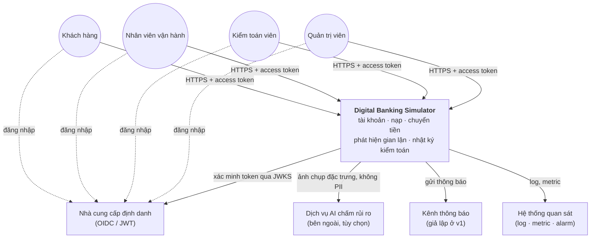
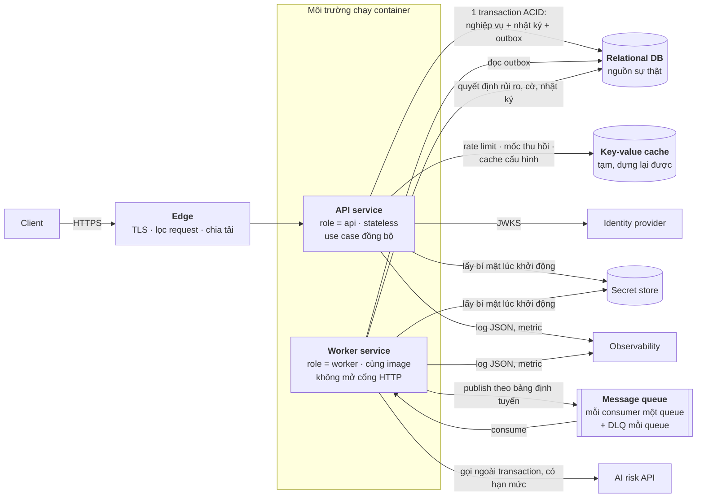
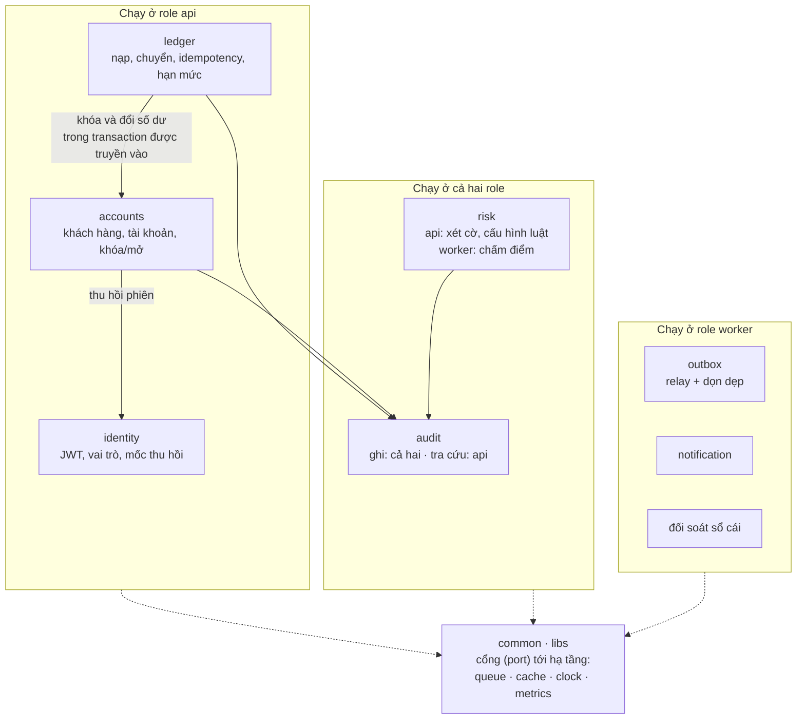
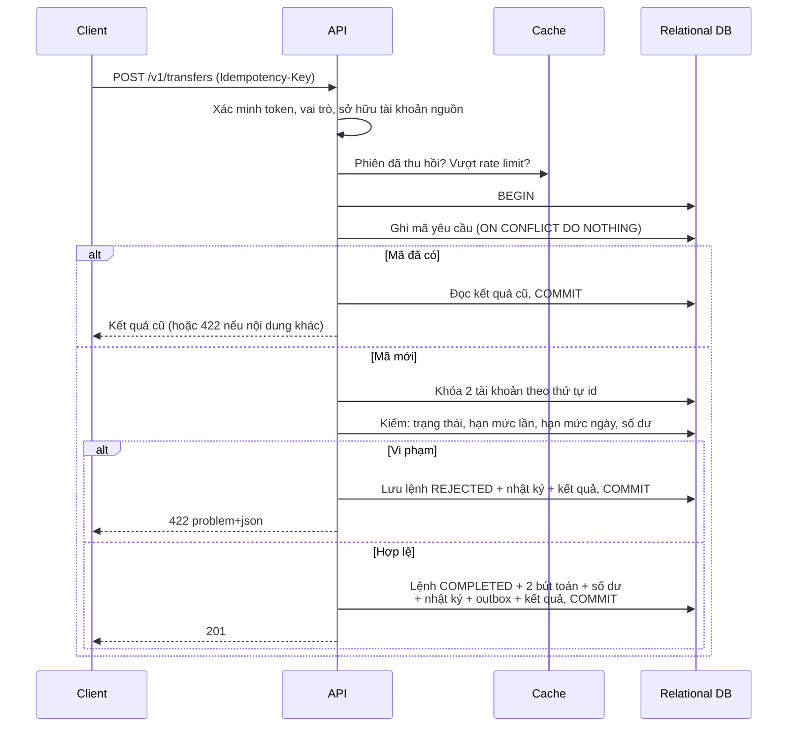
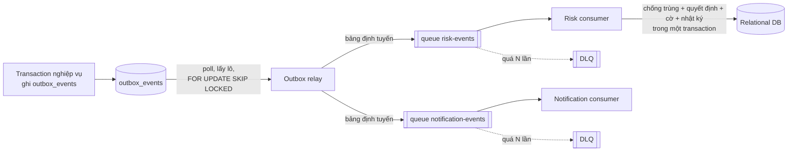
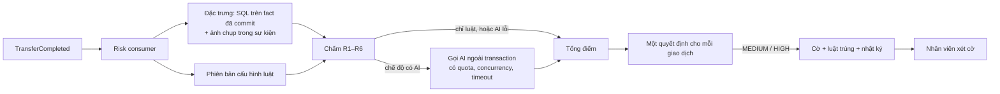
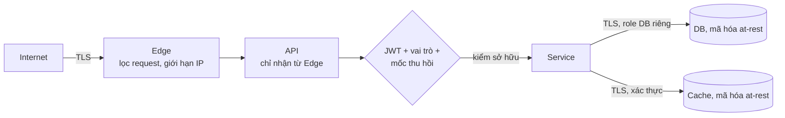
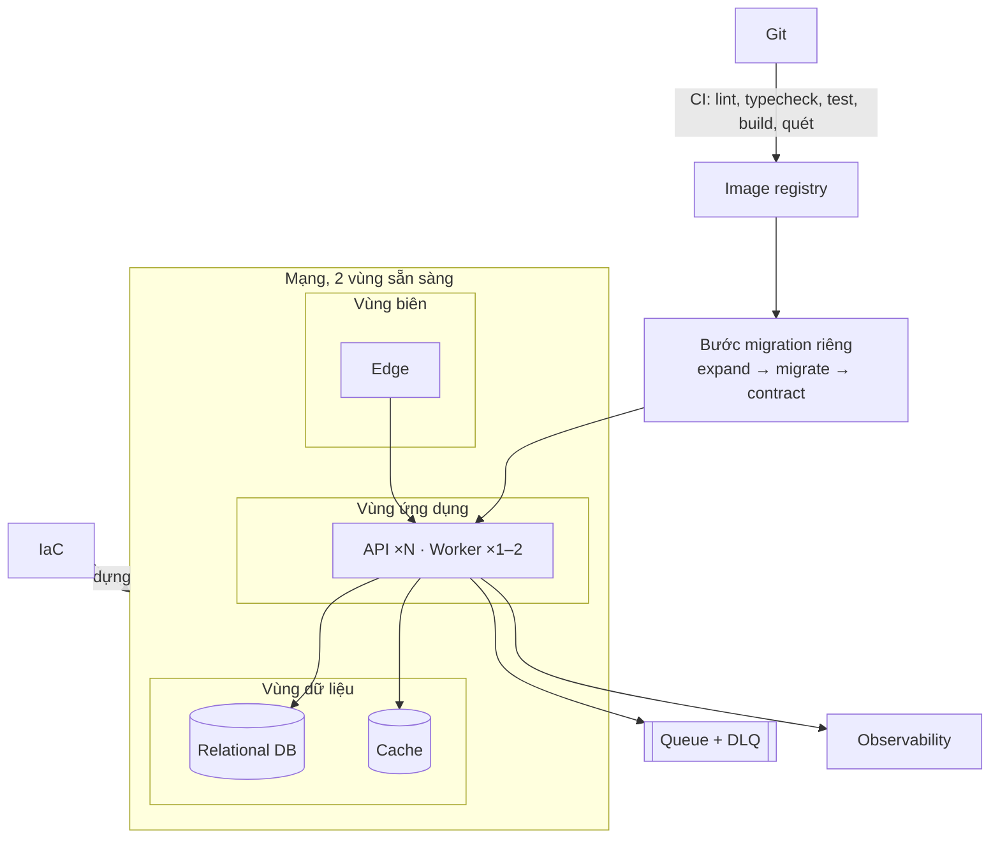

# Kiến trúc tổng thể (trung lập với nhà cung cấp cloud)

> **Mục đích:** mô tả Digital Banking Simulator bằng **năng lực** (database, hàng đợi, cache, định danh…) thay vì bằng dịch vụ của một cloud cụ thể. Bản hiện thực trên AWS nằm ở [03_HIGH_LEVEL_ARCHITECTURE.md](03_HIGH_LEVEL_ARCHITECTURE.md); tài liệu này là lớp trừu tượng phía trên nó (nguyên tắc P-5 «concept first, vendor second», ADR-11).
>
> **Cập nhật:** 2026-11-11 · **Dựa trên:** BRD, docs/03, ADR-01…14, code ở `backend/`

---

## 1. Hệ thống làm gì

Một ngân hàng số mô phỏng: khách hàng mở tài khoản, nhận tiền nạp tại quầy, chuyển tiền nội bộ; nhân viên vận hành nạp tiền, khóa tài khoản và xét cờ gian lận; kiểm toán viên tra nhật ký; quản trị viên cấu hình luật gian lận.

| Tác nhân | Việc chính |
|---|---|
| Khách hàng | Đăng ký, xem số dư và lịch sử, chuyển tiền |
| Nhân viên vận hành | Nạp tiền, khóa/mở khóa tài khoản, xét cờ gian lận |
| Kiểm toán viên | Tra nhật ký theo người, thời gian, mã truy vết (chỉ đọc) |
| Quản trị viên | Cấu hình bộ luật gian lận theo phiên bản |

## 2. Yêu cầu định hình kiến trúc

| # | Yêu cầu | Hệ quả |
|---|---|---|
| D-1 | Tiền không bao giờ sai, kể cả khi đồng thời | Database quan hệ có ACID và khóa hàng; mọi bút toán của một lệnh nằm trong **một transaction** |
| D-2 | Gửi lại một lệnh không trừ tiền hai lần | Mã yêu cầu (idempotency key) lưu **cùng database, cùng transaction** với lệnh |
| D-3 | Truy vết 100% | Nhật ký ghi trong cùng transaction, chỉ cho thêm; một mã truy vết đi xuyên suốt |
| D-4 | Chuyển tiền phản hồi < 300 ms; gian lận phát hiện < 5 giây | Đường đồng bộ chỉ làm phần bắt buộc; chấm điểm và thông báo chạy **bất đồng bộ** |
| D-5 | Không mất sự kiện khi sự cố | **Transactional outbox** + hàng đợi bền có DLQ + consumer idempotent |
| D-6 | Khóa tài khoản là chặn ngay | Mốc thu hồi phiên lưu ở database, cache ở bộ nhớ đệm, kiểm ở mọi request |
| D-7 | 99,9%; RPO ≤ 5 phút, RTO ≤ 30 phút | Database có bản sao và khôi phục theo thời điểm; ứng dụng stateless chạy ≥ 2 bản |
| D-8 | Đội nhỏ, thời gian ngắn, ngân sách thấp | **Modular monolith**, ưu tiên dịch vụ managed, môi trường dựng/xóa theo phiên |

## 3. Nguyên tắc

| # | Nguyên tắc | Ý nghĩa |
|---|---|---|
| P-1 | **Database quan hệ là nguồn sự thật duy nhất** | Cache và hàng đợi chỉ phục vụ tốc độ và tách rời; mất chúng không làm sai dữ liệu |
| P-2 | **Đường đồng bộ ngắn nhất** | Request chuyển tiền: xác thực → một transaction → trả kết quả. Không gọi dịch vụ ngoài trong transaction tiền |
| P-3 | **Mọi thứ chạy lại được đều idempotent** | Lệnh (mã yêu cầu), sự kiện (mã sự kiện), quyết định gian lận (khóa theo giao dịch) |
| P-4 | **Module chỉ nói chuyện qua interface** | Không module nào đọc/ghi bảng của module khác trực tiếp |
| P-5 | **Năng lực trước, nhà cung cấp sau** | Thiết kế theo năng lực; dịch vụ cloud cụ thể chỉ là một cách hiện thực, nằm sau adapter |
| P-6 | **Fail-closed với tiền, fail-open với phần phụ** | Lỗi nhật ký hay khóa → hủy cả lệnh; lỗi cache hay rate limit → hệ thống vẫn chạy, chỉ chậm hoặc lỏng hơn |

---

## 4. Bối cảnh hệ thống (C4 mức 1)

## 5. Các khối logic (C4 mức 2)

### 5.1 Năng lực cần có của từng khối

Đây là phần **không đổi** khi đổi nhà cung cấp: bất kỳ dịch vụ nào thay vào phải đáp ứng đủ cột «Phải bảo đảm».

| Khối | Vai trò | Phải bảo đảm | Không được phụ thuộc vào |
|---|---|---|---|
| **Edge** | Cửa vào duy nhất | TLS; chia tải giữa các bản API; health check theo endpoint `/health/ready`; giới hạn theo IP ở biên | — |
| **API service** | Mọi use case đồng bộ | Stateless; scale ngang; tắt bất kỳ bản nào cũng không mất dữ liệu | Bộ nhớ cục bộ để giữ trạng thái |
| **Worker service** | Relay outbox, chấm rủi ro, thông báo, đối soát, dọn dẹp | Thay thế khi tiến trình thoát; nhiều bản chạy song song không xử lý trùng | Cổng HTTP (không có health check HTTP) |
| **Relational DB** | Nguồn sự thật | ACID nhiều bảng; khóa hàng `SELECT … FOR UPDATE`; `ON CONFLICT`; CHECK/UNIQUE/FK; quyền theo role; sao lưu + khôi phục theo thời điểm; bản sao dự phòng ở production | — |
| **Key-value cache** | Tăng tốc, đếm toàn cục | Lệnh nguyên tử (`INCR`, `EXPIRE`); TTL; TLS + xác thực | Độ bền: xóa sạch bất kỳ lúc nào hệ thống vẫn đúng |
| **Message queue** | Tách phần bất đồng bộ | At-least-once; visibility timeout; DLQ sau N lần nhận; long polling; giữ message vài ngày | Thứ tự (không consumer nào cần thứ tự) |
| **Identity provider** | Đăng ký, đăng nhập, cấp token | JWT ký số, công khai JWKS; nhóm/vai trò trong claim; access token ngắn hạn | — |
| **Secret store** | Mật khẩu DB, khóa API | Đọc lúc khởi động theo quyền của từng service; mã hóa at-rest | Bí mật nằm trong repo hay image |
| **Observability** | Log, metric, alarm, dashboard | Nhận log JSON; dựng metric từ log hoặc agent; alarm theo ngưỡng | — |
| **AI risk API** | Chấm rủi ro bổ sung | Timeout; trả xác suất có cấu trúc | Có mặt: hệ thống phải chạy đúng khi tắt hoặc lỗi |

### 5.2 Ánh xạ tham khảo sang các nền tảng

Chỉ để minh họa tính khả chuyển; bản đang chạy là cột AWS.

| Khối | AWS (hiện tại) | GCP | Azure | Tự host / on-prem |
|---|---|---|---|---|
| Edge | ALB + WAF | Cloud Load Balancing + Cloud Armor | Application Gateway + WAF | Nginx/HAProxy + ModSecurity |
| Container runtime | ECS Fargate | Cloud Run / GKE Autopilot | Container Apps / AKS | Kubernetes, Nomad, Docker Swarm |
| Relational DB | RDS PostgreSQL | Cloud SQL PostgreSQL | Azure Database for PostgreSQL | PostgreSQL + Patroni |
| Key-value cache | ElastiCache Valkey | Memorystore | Azure Cache for Redis | Valkey/Redis |
| Message queue | SQS + DLQ | Pub/Sub (pull) + dead-letter topic | Service Bus queue + DLQ | RabbitMQ, ElasticMQ |
| Identity provider | Cognito | Identity Platform | Entra External ID | Keycloak |
| Secret store | Secrets Manager | Secret Manager | Key Vault | Vault |
| Observability | CloudWatch (EMF) | Cloud Logging / Monitoring | Azure Monitor | Loki + Prometheus + Grafana |
| Image registry | ECR | Artifact Registry | ACR | Harbor |
| IaC / CI | Terraform / GitHub Actions | Terraform / GitHub Actions | Terraform / GitHub Actions | Terraform / GitHub Actions |

---

## 6. Bên trong ứng dụng (C4 mức 3)

**Một codebase, một image, nhiều vai trò chạy** (ADR-01, ADR-13). Biến `APP_ROLE` quyết định tiến trình chạy gì: `api` (HTTP), `worker` (consumer và job định kỳ), `both` (máy local, test).

| Quy tắc | Lý do |
|---|---|
| Mỗi module có một API công khai duy nhất (`index.ts`); lint chặn import sâu | Giữ ranh giới khi codebase lớn lên |
| `ledger` không chạm bảng `accounts`; nó gọi hàm của `accounts` và truyền transaction hiện tại | Chuyển tiền vẫn là một transaction mà không phá quyền sở hữu dữ liệu |
| `audit` được gọi **trong transaction của module gọi** | Không thao tác ghi nào thiếu nhật ký |
| Hạ tầng ngoài (queue, cache) chỉ đi qua adapter ở `libs/` | Đổi nhà cung cấp chỉ đổi adapter |
| Không phụ thuộc vòng | — |

---

## 7. Các luồng chính

### 7.1 Chuyển tiền (đường đồng bộ)

Những điều luồng này bảo đảm, bất kể nhà cung cấp:
- Debit và credit cùng thành công hoặc cùng không xảy ra.
- Hai lệnh song song trên cùng tài khoản không cùng lọt hạn mức (kiểm sau khi khóa hàng).
- Khóa theo thứ tự id nên A→B và B→A không deadlock; deadlock hiếm còn sót thì chạy lại có giới hạn.
- Cache chỉ đứng trước cửa: tắt cache thì luồng vẫn đúng.

### 7.2 Phần bất đồng bộ (outbox → queue → consumer)

| Bước | Bảo đảm |
|---|---|
| Outbox ghi cùng transaction nghiệp vụ | Commit thì chắc chắn có sự kiện, rollback thì không |
| Relay gửi tới **mọi** queue quan tâm (mỗi consumer một queue) | Một message trong queue chỉ tới một consumer, nên không dùng chung queue |
| At-least-once, không bảo đảm thứ tự | Consumer không phụ thuộc thứ tự |
| Consumer ghi dấu chống trùng (`processed_events`) cùng transaction với tác động | Effectively-once |
| Sự kiện mang **ảnh chụp tại thời điểm giao dịch** | Consumer không đọc trạng thái hiện tại (đã đổi) |

### 7.3 Phát hiện gian lận (hai tầng)

| Tầng | Khi nào | Hành động |
|---|---|---|
| **Kiểm tra đồng bộ** (trong transaction tiền) | Sau khi khóa hàng | Chặn cứng: tài khoản bị khóa, vượt hạn mức |
| **Phát hiện bất đồng bộ** (worker) | Sau commit, qua sự kiện | Chỉ **gắn cờ** để nhân viên xét; không tự khóa tài khoản |

AI là phần **tùy chọn**: chế độ `rule_only` là baseline bắt buộc; lỗi AI giữ nguyên kết quả của luật (ADR-14). Khách hàng không bao giờ thấy cờ, điểm hay kết quả AI.

### 7.4 Khóa tài khoản và thu hồi phiên

Nhân viên khóa → một transaction đổi trạng thái, ghi mốc thu hồi phiên, nhật ký và outbox → sau commit cập nhật cache. Mọi request sau đó so `iat` của token với mốc thu hồi (cache, rồi database nếu cache không có) và bị từ chối ngay.

### 7.5 Truy vết

Mỗi request có một mã truy vết do server sinh. Mã này đi vào nhật ký, outbox, message, log của consumer và nhật ký của quyết định gian lận, nên kiểm toán viên tra một mã là thấy đủ chuỗi.

---

## 8. Dữ liệu

| Loại | Nơi lưu | Quy tắc |
|---|---|---|
| Khách hàng, tài khoản, lệnh, bút toán, mã yêu cầu | Relational DB | Tiền là số nguyên (đồng), không dùng số thực |
| Sự kiện chờ gửi | Bảng outbox → queue | Dọn sau khi gửi quá thời hạn giữ |
| Nhật ký kiểm toán | Relational DB, chỉ INSERT | Có thể xuất ra object storage bất biến |
| Quyết định gian lận | Relational DB, chỉ INSERT | Một dòng cho mỗi giao dịch |
| Dữ liệu tạm | Key-value cache | Có TTL; **không chứa số dư, mã yêu cầu, dữ liệu cá nhân** |

**Bất biến được ép bằng database**, không bằng code ứng dụng:
- Bút toán kép: tổng Nợ = tổng Có; số dư mỗi tài khoản = tổng bút toán của nó; tổng số dư mọi tài khoản = 0 (tài khoản SYSTEM `funding` được âm).
- `CHECK (balance >= 0)` cho tài khoản thường; `UNIQUE` chống cờ và quyết định trùng.
- Role database riêng cho `api` và `worker`; không role nào được UPDATE/DELETE sổ cái, nhật ký hay quyết định.
- Job đối soát định kỳ kiểm lại các bất biến và báo động khi lệch.

## 9. Khi một thành phần hỏng

| Sự cố | Hệ thống phản ứng |
|---|---|
| Lỗi giữa chừng một lệnh | Rollback toàn bộ; client gửi lại cùng mã yêu cầu |
| Client timeout rồi gửi lại | Trả kết quả cũ |
| Ghi nhật ký lỗi | Hủy cả lệnh (fail-closed) |
| Worker chết sau commit, trước khi gửi sự kiện | Relay gửi lại khi worker sống lại |
| Consumer nhận trùng | Dấu chống trùng bỏ qua |
| Consumer lỗi liên tục | Thử lại có backoff → DLQ → alarm → redrive theo runbook |
| Cache chậm hoặc mất | Timeout ngắn + circuit breaker; rate limit fail-open, mốc thu hồi và cấu hình đọc từ database |
| AI lỗi, chậm, hết quota | Giữ kết quả của luật |
| Database primary hỏng | Chuyển sang bản dự phòng (production) |

## 10. Bảo mật

| Lớp | Biện pháp |
|---|---|
| Mạng | Ba vùng: **biên** (công khai), **ứng dụng** (chỉ nhận từ biên), **dữ liệu** (chỉ nhận từ ứng dụng, không ra internet) |
| Định danh | Token ngắn hạn từ identity provider; vai trò lấy từ claim nhóm; chế độ khóa nội bộ chỉ cho local/test |
| Phân quyền | Guard theo vai trò **và** kiểm sở hữu ở service; tài nguyên không thuộc mình trả 404 và ghi nhật ký `DENIED` |
| Thu hồi | Mốc thu hồi ở database, cache ở key-value |
| Bí mật | Secret store; không có bí mật trong repo, image hay log |
| Quyền tối thiểu | Danh tính riêng cho từng service (API, worker, migration); role database riêng |
| Lỗi trả về | `application/problem+json` có mã lỗi và mã truy vết; không lộ stack, SQL hay dữ liệu người khác |

## 11. Triển khai

| | Local | Dev (cloud) | Production |
|---|---|---|---|
| Chạy | Container cho hạ tầng + một tiến trình `APP_ROLE=both` | Dựng/xóa theo phiên làm việc | Bật khi demo và đo SLO |
| Database | Container | Một bản, không dự phòng | Có bản dự phòng ở vùng khác |
| Cache | Container | Một node | Primary + replica |
| API / Worker | Cùng một tiến trình | 1 / 1 | ≥ 2 trên 2 vùng / 1–2 |
| Queue | Bản giả lập tương thích (ElasticMQ) | Dịch vụ managed | Dịch vụ managed |

**Deploy và rollback:** cùng một image cho mọi service, khác biến `APP_ROLE`; API cập nhật cuốn chiếu theo health check; rollback bằng cách trỏ về image trước, schema vẫn tương thích nhờ migration kiểu expand.

## 12. Quan sát và SLO

| SLI | SLO |
|---|---|
| Request không lỗi 5xx (không tính 422, 429) | ≥ 99,9% / 30 ngày |
| Latency chuyển tiền | p95 < 300 ms, p99 < 1 s ở ≤ 120 RPS |
| Latency đọc | p95 < 150 ms |
| Giao dịch → cờ | p95 < 5 giây |
| Tuổi outbox chưa gửi cũ nhất | < 10 giây (alarm > 30 giây: relay treo) |
| DLQ / tuổi message cũ nhất | DLQ = 0; < 60 giây |
| Đối soát sổ cái | 0 lệch |

Log là JSON có `correlationId` và `role`; metric được dựng từ log hoặc agent; worker không có health check HTTP nên **worker treo được phát hiện qua tuổi outbox và tuổi message**.

---

## 13. Chỗ code đang gắn với một nhà cung cấp

Để đổi nền tảng, đây là những điểm phải chạm, theo mức độ:

| Điểm gắn | Hiện tại | Đã có lớp trừu tượng? | Đổi nền tảng cần |
|---|---|---|---|
| Queue | SQS SDK | Có: `libs/sqs`, `common/messaging` (`ConsumerBase`) | Adapter mới cho RabbitMQ / Pub/Sub / Service Bus; giữ ngữ nghĩa visibility timeout và DLQ |
| Cache | Redis protocol (Valkey) | Có: `libs/redis` | Không cần nếu nền tảng có Redis-compatible |
| Identity | JWT + JWKS, nhóm từ claim `cognito:groups` | Một phần: chuẩn OIDC, nhưng tên claim gắn Cognito | Cấu hình tên claim vai trò (ví dụ `realm_access.roles` của Keycloak) |
| Metric | CloudWatch EMF (log JSON → metric) | Một phần: `common/metrics` | Exporter Prometheus/OTel thay cho EMF |
| Database | PostgreSQL 17 (`FOR UPDATE`, `SKIP LOCKED`, `ON CONFLICT`, role, trigger) | Không cần: là PostgreSQL chuẩn | Bất kỳ PostgreSQL managed hay tự host; **không** thay bằng database khác |
| Hạ tầng | Terraform cho AWS | Không | Viết lại module IaC cho nền tảng mới |
| AI | API ngoài theo contract FRAUD-API-01 | Có: adapter `risk/ai` | Đổi endpoint và khóa; giữ timeout, quota, fallback |

## 14. Quyết định kiến trúc liên quan

| ADR | Quyết định | Phụ thuộc nhà cung cấp? |
|---|---|---|
| 01 | Modular monolith + worker | Không |
| 02 | PostgreSQL làm sổ cái | Không (chỉ cần PostgreSQL) |
| 03 | Chuyển tiền đồng bộ, phần phụ qua outbox + queue | Không |
| 04 | Khóa hàng theo thứ tự id ở READ COMMITTED | Không |
| 05 | Idempotency trong database, theo user | Không |
| 06 | Identity provider managed; container runtime managed | Có (Cognito, ECS Fargate) |
| 07 | NestJS/TypeScript, SQL tường minh | Không |
| 08, 14 | Gian lận bất đồng bộ: luật R1–R6 + AI ngoài tiến trình tùy chọn | Không |
| 09 | Nạp tiền qua tài khoản SYSTEM, đi qua sổ cái | Không |
| 10 | Egress mạng không dùng NAT | Có (tối ưu chi phí AWS) |
| 11 | Dịch vụ managed, dựng/xóa theo phiên | Một phần (nguyên tắc chung, bảng giá AWS) |
| 12 | Redis-compatible cache, không cache số dư | Không |
| 13 | Một image, chạy theo `APP_ROLE` | Không |
