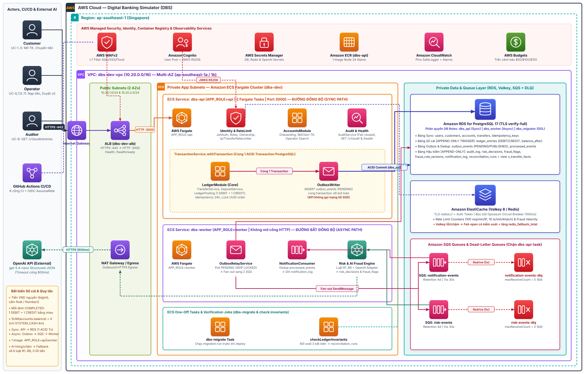

# Giải thích chi tiết từng Component trong Sơ đồ Kiến trúc & AWS (`architecture-components-aws.drawio`)

> **Status:** Active · **Owner:** cả nhóm · **Verified against code:** `main` · **Cập nhật:** 2026-11-08
>
> Tài liệu này đi kèm trực tiếp với sơ đồ [architecture-components-aws.drawio](architecture-components-aws.drawio), giải thích rõ **vai trò**, **cơ chế vận hành**, **mã nguồn/hạ tầng tương ứng** và **hồ sơ tính năng (`DBS-*` / `ADR-*`)** của từng khối trên sơ đồ.

---

## 1. Nhóm Actors, CI/CD & Dịch vụ bên ngoài (Cột ngoài cùng bên trái)

| Component trên sơ đồ | Vai trò & Cơ chế hoạt động | Thuộc Use Case / Feature (`DBS-*` / `ADR-*`) | Đường dẫn Code / Infra |
|---|---|---|---|
| **Customer** (`customer`) | Khách hàng cá nhân sử dụng ngân hàng số: đăng ký hồ sơ khách hàng (`POST /v1/customers/me`), mở tài khoản VND (`POST /v1/accounts`), xem danh sách/số dư tài khoản (`GET /v1/accounts`, `GET /v1/accounts/:id`), chuyển tiền nội bộ (`POST /v1/transfers`), xem lịch sử giao dịch (`GET /v1/accounts/:id/transactions`) và trạng thái lệnh chuyển (`GET /v1/transfers/:id`). | `UC-1`..`UC-5`; [DBS-61](features/DBS-61-customer-transfers.md), [DBS-63](features/DBS-63-open-accounts.md), [DBS-64](features/DBS-64-read-accounts.md), [DBS-87](features/DBS-87-history-and-transfer-status.md) | [`backend/src/modules/accounts/`](../backend/src/modules/accounts/), [`backend/src/modules/ledger/`](../backend/src/modules/ledger/) |
| **Operator** (`operator`) | Nhân viên vận hành / giao dịch viên tại quầy: nạp tiền mặt từ `SYSTEM_CASH` vào tài khoản khách (`POST /v1/operator/deposits`), tìm kiếm và tra cứu tài khoản khách hàng (`GET /v1/operator/accounts`), xem và duyệt cờ gian lận (`UC-9`, `UC-10`), khoá/mở khoá tài khoản (`UC-11`). | `UC-6`, `UC-7`, `UC-9`..`UC-11`; [DBS-60](features/DBS-60-operator-deposits.md), [DBS-88](features/DBS-88-operator-account-search.md) | [`operator-deposits.controller.ts`](../backend/src/modules/ledger/operator-deposits.controller.ts), [`operator-accounts.controller.ts`](../backend/src/modules/accounts/operator-accounts.controller.ts) |
| **Auditor** (`auditor`) | Kiểm toán viên độc lập: chỉ có quyền đọc nhật ký kiểm toán bất biến (`GET /v1/audit/entries`); mọi thao tác tra cứu của chính Auditor cũng tự động sinh một dòng `audit.search` (`self-audit`). Không có quyền gọi các API ghi nghiệp vụ. | `UC-8`; [DBS-56](features/DBS-56-audit-service-record.md), [DBS-103](features/DBS-103-audit-search.md) | [`audit.controller.ts`](../backend/src/modules/audit/audit.controller.ts), [`audit-search.service.ts`](../backend/src/modules/audit/audit-search.service.ts) |
| **GitHub Actions CI/CD** | Hệ thống kiểm định và triển khai tự động: chạy 6 cổng bắt buộc (`lint`, `typecheck`, `unit`, `e2e`, `db`, `build`); dùng chuẩn **OpenID Connect (OIDC)** `AssumeRole` vào AWS (không lưu AWS Secret Key tĩnh trên GitHub) để đóng gói Docker image đẩy lên ECR, chạy one-off task `dbs-migrate` rồi mới cập nhật ECS service. | [DBS-35](features/DBS-35-ci-github-actions.md), [DBS-36](features/DBS-36-ci-build-push-ecr-oidc.md), [DBS-38](features/DBS-38-auto-deploy-ecs.md), [DBS-41](features/DBS-41-testcontainers-ci.md), [DBS-68](features/DBS-68-migration-step.md) | [`.github/workflows/ci.yml`](../.github/workflows/ci.yml), [`.github/workflows/image.yml`](../.github/workflows/image.yml), [`.github/workflows/deploy.yml`](../.github/workflows/deploy.yml) |
| **OpenAI API (External)** (`gpt-5.4-nano`) | Dịch vụ AI bên ngoài chỉ được gọi ở **luồng hậu kiểm bất đồng bộ** trong `worker` sau khi lệnh chuyển tiền đã `COMMIT`. Sử dụng **Structured Outputs (`strict: true`)** với ngân sách thời gian cứng `800ms` và Circuit Breaker; nếu timeout/lỗi/từ chối thì tự động fallback về điểm của 6 luật tất định `R1–R6`, không bao giờ làm hỏng giao dịch tiền. | [ADR-0014](adr/0014-fraud-rules-external-ai.md), [FRAUD-API-01](features/FRAUD-API-01-external-ai-decision.md), [FRAUD-API-02](features/FRAUD-API-02-standalone-risk.md) | [`backend/src/modules/risk/ai/openai-decisions.ts`](../backend/src/modules/risk/ai/openai-decisions.ts) |

---

## 2. Tầng Dịch vụ Quản lý Vùng của AWS (`ap-southeast-1` — Thanh ngang trên cùng)

| Component trên sơ đồ | Vai trò & Cơ chế hoạt động | Thuộc Feature (`DBS-*` / `ADR-*`) | Đường dẫn Code / Infra |
|---|---|---|---|
| **AWS WAFv2** | Tường lửa ứng dụng web lớp 7 gắn trước ALB: lọc các mẫu tấn công SQL Injection, XSS và chặn lưu lượng flood bất thường trước khi vào VPC. | [ADR-0011](adr/0011-aws-managed-session-based.md), [DBS-34](features/DBS-34-terraform-ecs-alb.md) | [`docs/components/platform-infra/01-concept-brief.md`](components/platform-infra/01-concept-brief.md) |
| **Amazon Cognito** | Quản lý định danh (IdP) thông qua Cognito User Pool với 3 nhóm (`customer`, `operator`, `auditor`). Phát hành JWT ký bằng thuật toán bất đối xứng **RS256** và công bố khóa công khai qua endpoint **JWKS** để `api` xác thực chữ ký mà không cần chia sẻ khóa bí mật. | [ADR-0006](adr/0006-cognito-ecs-fargate.md), [DBS-50](features/DBS-50-jwt-auth-guard-jwks.md), [DBS-54](features/DBS-54-terraform-cognito.md) | [`infra/terraform/envs/dev/base/cognito.tf`](../infra/terraform/envs/dev/base/cognito.tf), [`jwks-verifier.service.ts`](../backend/src/modules/identity/jwks-verifier.service.ts) |
| **AWS Secrets Manager** | Lưu trữ và xoay vòng thông tin nhạy cảm (`DB_PASSWORD` của RDS, `REDIS_AUTH_TOKEN` của Valkey, `OPENAI_API_KEY`). ECS Task nạp các giá trị này trực tiếp vào biến môi trường lúc khởi chạy container, tuyệt đối không lưu mật khẩu trong Git hay Terraform plaintext. | [DBS-66](features/DBS-66-terraform-rds.md), [DBS-67](features/DBS-67-rds-tls-secrets.md), [DBS-75](features/DBS-75-terraform-valkey.md) | [`infra/terraform/envs/dev/session/rds.tf`](../infra/terraform/envs/dev/session/rds.tf), [`compose-database-url.ts`](../backend/src/config/compose-database-url.ts) |
| **Amazon ECR** (`dbs-api`) | Kho chứa Docker image nội bộ: lưu **1 image duy nhất** đóng gói bằng multi-stage build trên nền `node:24-alpine`, chạy dưới quyền non-root user, có ghim sẵn chứng chỉ CA của AWS RDS (`global-bundle.pem`) kèm kiểm tra SHA-256. Cùng một image này được dùng cho cả `api`, `worker` và `dbs-migrate`. | [ADR-0001](adr/0001-modular-monolith-worker.md), [ADR-0013](adr/0013-one-app-app-role.md), [DBS-33](features/DBS-33-terraform-vpc-ecr.md), [DBS-67](features/DBS-67-rds-tls-secrets.md) | [`backend/Dockerfile`](../backend/Dockerfile), [`infra/terraform/envs/dev/base/ecr.tf`](../infra/terraform/envs/dev/base/ecr.tf) |
| **Amazon CloudWatch** | Thu thập log định dạng JSON một dòng từ `SafeLogger` (Pino) của mọi container ECS (đã tự động che PII, mật khẩu, token và đính kèm `correlationId`), đồng thời theo dõi các metric/alarm vận hành (`DLQ visible > 0`, `5xx`, `P99 latency`, `Redis unreachable`). | [DBS-42](features/DBS-42-json-logger.md) | [`backend/src/common/logging/`](../backend/src/common/logging/), [`docs/components/observability/01-concept-brief.md`](components/observability/01-concept-brief.md) |
| **AWS Budgets** | Kiểm soát trần chi phí đám mây của dự án ($150 cho toàn kỳ): phát cảnh báo ở các ngưỡng $50, $100, $150 và đi kèm kiến trúc tách Terraform thành 2 tầng `base` (rẻ, giữ thường trực) và `session` (tốn phí theo giờ, bật khi dùng và `destroy` sau phiên). | [ADR-0011](adr/0011-aws-managed-session-based.md), [DBS-31](features/DBS-31-terraform-bootstrap-s3-backend.md), [DBS-143](features/DBS-143-cost-report.md) | [`infra/terraform/README.md`](../infra/terraform/README.md), [`infra/scripts/cost-report.py`](../infra/scripts/cost-report.py) |

---

## 3. Tầng Mạng VPC & Public Subnets (`10.20.0.0/16` — Cột trái trong VPC)

| Component trên sơ đồ | Vai trò & Cơ chế hoạt động | Thuộc Feature (`DBS-*` / `ADR-*`) | Đường dẫn Code / Infra |
|---|---|---|---|
| **VPC `dbs-dev-vpc` (`10.20.0.0/16`)** | Mạng ảo cô lập trải trên 2 Availability Zones (`ap-southeast-1a`, `ap-southeast-1b`), chia tách rạch ròi giữa **Public Subnets** (chỉ đặt ALB & kết nối ra Internet) và **Private Subnets** (đặt RDS, Valkey — không có IP public trực tiếp từ Internet). | [DBS-33](features/DBS-33-terraform-vpc-ecr.md) | [`infra/terraform/envs/dev/base/network.tf`](../infra/terraform/envs/dev/base/network.tf), [`infra/terraform/envs/dev/base/security_groups.tf`](../infra/terraform/envs/dev/base/security_groups.tf) |
| **Internet Gateway (IGW)** | Cổng kết nối giữa VPC và Internet cho lưu lượng HTTPS đi vào ALB và lưu lượng chiều ra. | [DBS-33](features/DBS-33-terraform-vpc-ecr.md) | [`infra/terraform/envs/dev/base/network.tf`](../infra/terraform/envs/dev/base/network.tf) |
| **Application Load Balancer (`dbs-dev-alb`)** | Chấm dứt kết nối TLS (`HTTPS :443`) từ phía người dùng, gắn header `X-Forwarded-For` (`TRUST_PROXY_HOPS = 1`), chuyển tiếp lưu lượng HTTP nội bộ tới cổng `:3000` của các task `dbs-api`, và liên tục kiểm tra sức khỏe qua endpoint `/health/ready`. | [DBS-34](features/DBS-34-terraform-ecs-alb.md), [DBS-78](features/DBS-78-health-redis-degraded.md) | [`infra/terraform/envs/dev/session/alb.tf`](../infra/terraform/envs/dev/session/alb.tf), [`health.controller.ts`](../backend/src/modules/health/health.controller.ts) |
| **NAT Gateway / Egress** | Cho phép các container `api` và `worker` mở kết nối HTTPS chiều ra (outbound) để tải JWKS từ Cognito, gửi/nhận SQS, kéo image từ ECR và gọi OpenAI API mà không cho phép bất kỳ kết nối chiều vào nào từ Internet. | [ADR-0010](adr/0010-fargate-egress-public-subnet.md), [ADR-0014](adr/0014-fraud-rules-external-ai.md), [DBS-33](features/DBS-33-terraform-vpc-ecr.md) | [`infra/terraform/envs/dev/base/network.tf`](../infra/terraform/envs/dev/base/network.tf) |

---

## 4. Tầng Ứng dụng — Amazon ECS Fargate Cluster (`dbs-dev` — Cột giữa)

Toàn bộ ứng dụng được viết trong một **Modular Monolith** ([ADR-0001](adr/0001-modular-monolith-worker.md)) và phân vai lúc khởi chạy qua biến môi trường `APP_ROLE` ([ADR-0013](adr/0013-one-app-app-role.md)).

### 4.1. Khối `ECS Service: dbs-api` (`APP_ROLE=api` — Đường đồng bộ)

| Component trên sơ đồ | Vai trò & Cơ chế hoạt động | Thuộc Feature (`DBS-*` / `ADR-*`) | Đường dẫn Code |
|---|---|---|---|
| **AWS Fargate (`APP_ROLE=api`)** | Chạy các container phục vụ HTTP API trên cổng `3000` (tối thiểu 2 tasks trên 2 AZ để chịu lỗi). Khi `APP_ROLE=api`, [`AppModule.register()`](../backend/src/app.module.ts) chỉ nạp các controller và service đồng bộ, **không** khởi chạy `OutboxRelayService` hay SQS Consumer. | [ADR-0001](adr/0001-modular-monolith-worker.md), [ADR-0013](adr/0013-one-app-app-role.md), [DBS-34](features/DBS-34-terraform-ecs-alb.md) | [`backend/src/app.module.ts`](../backend/src/app.module.ts), [`backend/src/main.ts`](../backend/src/main.ts) |
| **Identity & RateLimit** | Bảo vệ cửa ngõ của mọi request HTTP theo thứ tự: 1. [`CorrelationIdMiddleware`](../backend/src/common/middleware/correlation-id.middleware.ts): gắn `X-Correlation-Id`. 2. [`IpRateLimitMiddleware`](../backend/src/common/rate-limit/ip-rate-limit.middleware.ts): giới hạn `100 req/phút/IP`. 3. [`JwtAuthGuard`](../backend/src/modules/identity/jwt-auth.guard.ts): kiểm chữ ký RS256 qua JWKS, tự động upsert bảng `users` ở lần gọi đầu, kiểm tra `sessions_revoked_at` (`401 SESSION_REVOKED`). 4. [`RolesGuard`](../backend/src/modules/identity/roles.guard.ts): kiểm tra `@Roles('customer' \| 'operator' \| 'auditor')`. 5. [`TransferRateLimitGuard`](../backend/src/common/rate-limit/transfer-rate-limit.guard.ts): giới hạn `10 lệnh chuyển/phút/khách`. 6. [`AccountsService.getOwnedAccount`](../backend/src/modules/accounts/accounts.service.ts): chống BOLA/IDOR (khách truy cập tài khoản người khác nhận `404` + ghi `audit_log` `DENIED`). | [ADR-0006](adr/0006-cognito-ecs-fargate.md), [DBS-50](features/DBS-50-jwt-auth-guard-jwks.md), [DBS-51](features/DBS-51-roles-guard-current-user.md), [DBS-52](features/DBS-52-users-upsert-first-token.md), [DBS-86](features/DBS-86-resource-ownership.md), [DBS-89](features/DBS-89-rate-limit.md) | [`backend/src/modules/identity/`](../backend/src/modules/identity/), [`backend/src/common/rate-limit/`](../backend/src/common/rate-limit/) |
| **AccountsModule** | Quản lý vòng đời hồ sơ khách hàng và tài khoản ngân hàng: tạo hồ sơ khách hàng (`POST /v1/customers/me`), sinh số tài khoản 12 chữ số bắt đầu bằng `10` (`POST /v1/accounts`), truy vấn tài khoản của khách (`GET /v1/accounts`, `GET /v1/accounts/:id`), và tìm kiếm tài khoản đa tiêu chí cho Operator (`GET /v1/operator/accounts`). | [DBS-55](features/DBS-55-accounts-service.md), [DBS-63](features/DBS-63-open-accounts.md), [DBS-64](features/DBS-64-read-accounts.md), [DBS-88](features/DBS-88-operator-account-search.md) | [`backend/src/modules/accounts/`](../backend/src/modules/accounts/) |
| **Audit & Health** | • [`AuditService`](../backend/src/modules/audit/audit.service.ts): ghi nhật ký kiểm toán bất biến (`record` trong cùng transaction với nghiệp vụ theo nguyên tắc fail-closed; `recordDenied` trên kết nối độc lập để không mất dấu vết khi request bị từ chối) và phục vụ API tìm kiếm cho Auditor (`GET /v1/audit/entries`). • [`HealthModule`](../backend/src/modules/health/health.module.ts): cung cấp `/health/live` (liveness) và `/health/ready` (readiness: kiểm tra kết nối PostgreSQL `SELECT 1` và Valkey `PING`). | [DBS-56](features/DBS-56-audit-service-record.md), [DBS-78](features/DBS-78-health-redis-degraded.md), [DBS-103](features/DBS-103-audit-search.md) | [`backend/src/modules/audit/`](../backend/src/modules/audit/), [`backend/src/modules/health/`](../backend/src/modules/health/) |
| **LedgerModule (ACID)** | **Trái tim của hệ thống ngân hàng**, chạy trong [`TransactionService.withTransaction()`](../backend/src/database/transaction.service.ts): • [`TransferService`](../backend/src/modules/ledger/transfer.service.ts): kiểm tra `Idempotency-Key` (replay trong 24h hoặc trả `422` nếu đổi body), khoá 2 tài khoản `FOR UPDATE` theo thứ tự UUID tăng dần để triệt tiêu deadlock, kiểm tra số dư và hạn mức ngày theo giờ Việt Nam (`Asia/Ho_Chi_Minh`). • [`DepositService`](../backend/src/modules/ledger/deposit.service.ts): nạp tiền từ tài khoản hệ thống `SYSTEM_CASH` vào tài khoản khách. • [`LedgerPostingService`](../backend/src/modules/ledger/ledger-posting.service.ts): ghi cặp bút toán kép (`1 DEBIT` + `1 CREDIT`) và cập nhật `accounts.balance` bằng kiểu `Money`/`Balance` (`bigint` VND). • [`TransactionHistoryQuery`](../backend/src/modules/ledger/transaction-history.query.ts) & [`TransferQueryService`](../backend/src/modules/ledger/transfer-query.service.ts): phân trang lịch sử giao dịch bằng con trỏ `(created_at, id)` và tra cứu chi tiết lệnh chuyển. | [ADR-0002](adr/0002-postgresql-ledger.md), [ADR-0004](adr/0004-row-locking-read-committed.md), [ADR-0005](adr/0005-idempotency-in-postgres.md), [ADR-0007](adr/0007-nestjs-typeorm-explicit-sql.md), [ADR-0009](adr/0009-funding-system-account.md), [DBS-22](features/DBS-22-common-money-type-dto-validator.md), [DBS-60](features/DBS-60-operator-deposits.md), [DBS-61](features/DBS-61-customer-transfers.md), [DBS-79](features/DBS-79-idempotency-replay.md)..[DBS-85](features/DBS-85-midnight-boundary.md), [DBS-87](features/DBS-87-history-and-transfer-status.md) | [`backend/src/modules/ledger/`](../backend/src/modules/ledger/), [`backend/src/common/money/`](../backend/src/common/money/) |
| **OutboxWriter** | Ghi sự kiện chuẩn `EventEnvelope` (`v1`) vào bảng `outbox_events` (`status = 'PENDING'`) bằng chính `EntityManager` của giao dịch sổ cái. Đảm bảo tính nguyên tử 100%: bút toán `COMMIT` thì sự kiện tồn tại, bút toán `ROLLBACK` thì sự kiện biến mất. `api` hoàn toàn không gọi mạng tới SQS. | [ADR-0003](adr/0003-sync-transfer-async-outbox-sqs.md), [DBS-24](features/DBS-24-common-events-types-schema.md), [DBS-57](features/DBS-57-outbox-writer.md) | [`backend/src/modules/outbox/outbox-writer.ts`](../backend/src/modules/outbox/outbox-writer.ts) |

---

### 4.2. Khối `ECS Service: dbs-worker` (`APP_ROLE=worker` — Đường bất đồng bộ)

| Component trên sơ đồ | Vai trò & Cơ chế hoạt động | Thuộc Feature (`DBS-*` / `ADR-*`) | Đường dẫn Code |
|---|---|---|---|
| **AWS Fargate (`APP_ROLE=worker`)** | Chạy tiến trình nền không mở cổng HTTP nghiệp vụ (`NestFactory.createApplicationContext`), kết nối PostgreSQL bằng role `dbs_worker` (không có quyền sửa `accounts` hay `transfers`). | [ADR-0001](adr/0001-modular-monolith-worker.md), [ADR-0013](adr/0013-one-app-app-role.md) | [`backend/src/main.ts`](../backend/src/main.ts), [`backend/src/app.module.ts`](../backend/src/app.module.ts) |
| **OutboxRelayService** | Định kỳ mỗi `500ms` quét các dòng `outbox_events` đang `PENDING` đến hạn bằng `SELECT ... FOR UPDATE SKIP LOCKED`, phát sự kiện đồng thời (fan-out) lên cả 2 hàng đợi SQS (`notification-events` và `risk-events`), sau đó cập nhật `status = 'PUBLISHED'`. Khi SQS lỗi thì tăng `attempts` và lùi `next_attempt_at` theo hàm mũ (exponential backoff). | [ADR-0003](adr/0003-sync-transfer-async-outbox-sqs.md), [DBS-57](features/DBS-57-outbox-writer.md), [DBS-77](features/DBS-77-sqs-adapter.md) | [`outbox-relay.service.ts`](../backend/src/modules/outbox/outbox-relay.service.ts) |
| **NotificationConsumer** | Long-poll hàng đợi `notification-events`, kiểm tra cấu trúc sự kiện qua `validateEvent`, chống xử lý trùng lặp bằng `INSERT INTO processed_events (event_id, consumer_group) ... ON CONFLICT DO NOTHING`, và ghi thông báo biến động số dư (không chứa PII) vào bảng chỉ-thêm `notification_log`. | [ADR-0003](adr/0003-sync-transfer-async-outbox-sqs.md), [DBS-25](features/DBS-25-migration-outbox-events.md), [DBS-77](features/DBS-77-sqs-adapter.md) | [`notification.consumer.ts`](../backend/src/modules/notification/notification.consumer.ts) |
| **Risk & AI Fraud Engine** | Tiêu thụ sự kiện từ `risk-events`, đọc dữ liệu giao dịch qua view thu hẹp quyền `v_transfer_facts`, tính bộ đặc trưng (`Features`) để chấm 6 luật tất định `R1–R6` (Velocity, Structuring, High-value, Dormant, New-pair, Round-amount) kết hợp gọi [`OpenAiDecisionAdapter`](../backend/src/modules/risk/ai/openai-decisions.ts), rồi ghi kết quả vào `risk_decisions` và `fraud_flags`. | [ADR-0008](adr/0008-fraud-detection-architecture.md), [ADR-0014](adr/0014-fraud-rules-external-ai.md), [DBS-58](features/DBS-58-fraud-migration.md), [DBS-59](features/DBS-59-risk-module-skeleton.md), [FRAUD-API-01](features/FRAUD-API-01-external-ai-decision.md), [FRAUD-API-02](features/FRAUD-API-02-standalone-risk.md) | [`backend/src/modules/risk/`](../backend/src/modules/risk/) |

---

### 4.3. Khối `ECS One-Off Tasks` (`dbs-migrate` & `checkLedgerInvariants`)

| Component trên sơ đồ | Vai trò & Cơ chế hoạt động | Thuộc Feature (`DBS-*` / `ADR-*`) | Đường dẫn Code / Infra |
|---|---|---|---|
| **dbs-migrate Task** | Task chạy một lần (one-off) trên ECS Fargate trong pipeline triển khai: thực thi migration TypeORM trên RDS trước khi rollout `api`/`worker`. Nếu migration thất bại, pipeline dừng ngay và giữ nguyên phiên bản đang chạy. | [DBS-68](features/DBS-68-migration-step.md) | [`.github/workflows/deploy.yml`](../.github/workflows/deploy.yml), [`data-source.ts`](../backend/src/database/data-source.ts) |
| **checkLedgerInvariants** | Bộ kiểm toán đối soát 3 bất biến sổ cái: 1. Mọi lệnh `COMPLETED` có đúng 2 dòng sổ (`1 DEBIT`, `1 CREDIT`) cùng số tiền. 2. `SUM(DEBIT) = SUM(CREDIT)` và `SUM(accounts.balance) = 0`. 3. Không có tài khoản khách hàng nào có `balance < 0` và `accounts.balance` khớp tổng phát sinh. Kết quả đối soát được lưu vào bảng chỉ-thêm `reconciliation_runs`. | [DBS-69](features/DBS-69-ledger-invariants.md), [DBS-116](features/DBS-116-reconciliation-runs.md) | [`invariants.ts`](../backend/test/support/invariants.ts), [`1793577600000-CreateReconciliationRuns.ts`](../backend/src/database/migrations/1793577600000-CreateReconciliationRuns.ts) |

---

## 5. Tầng Dữ liệu & Hàng đợi trong Private Subnets (Cột bên phải trong VPC)

| Component trên sơ đồ | Vai trò & Cơ chế hoạt động | Thuộc Feature (`DBS-*` / `ADR-*`) | Đường dẫn Code / Infra |
|---|---|---|---|
| **Amazon RDS for PostgreSQL 17** | Cơ sở dữ liệu quan hệ trung tâm lưu trữ 12 bảng + 1 view (`v_transfer_facts`), kết nối bắt buộc qua TLS `verify-full`. Áp dụng nguyên tắc **Defense-in-Depth** ngay ở tầng DB: • Các bảng `ledger_entries`, `audit_log`, `fraud_flags`, `notification_log`, `reconciliation_runs` gắn trigger `prevent_modify()` chặn mọi lệnh `UPDATE`/`DELETE` kể cả từ chủ bảng. • Phân tách quyền tối thiểu giữa `dbs_api` (ghi sổ cái + outbox) và `dbs_worker` (chỉ đọc `v_transfer_facts`, cập nhật `outbox_events`, ghi bảng hậu kiểm). | [ADR-0002](adr/0002-postgresql-ledger.md), [DBS-20](features/DBS-20-migration-users-customers-accounts.md), [DBS-21](features/DBS-21-migration-transfers-ledger-idempotency.md), [DBS-25](features/DBS-25-migration-outbox-events.md), [DBS-26](features/DBS-26-migration-audit-log.md), [DBS-27](features/DBS-27-append-only-triggers.md), [DBS-58](features/DBS-58-fraud-migration.md), [DBS-66](features/DBS-66-terraform-rds.md), [DBS-67](features/DBS-67-rds-tls-secrets.md), [DBS-116](features/DBS-116-reconciliation-runs.md) | [`backend/src/database/migrations/`](../backend/src/database/migrations/), [`infra/scripts/db-roles.sql`](../infra/scripts/db-roles.sql), [`infra/terraform/envs/dev/session/rds.tf`](../infra/terraform/envs/dev/session/rds.tf) |
| **Amazon ElastiCache (Valkey 8 / Redis)** | Bộ nhớ đệm tốc độ cao trong RAM (bật mã hóa TLS `rediss://` và `REDIS_AUTH_TOKEN`): lưu bộ đếm Rate Limit theo cửa sổ phút (`rl:ip:*`, `rl:tx:*`) và bộ đếm vận tốc giao dịch (Fraud Velocity). Được bọc bởi **Circuit Breaker Opossum** (`timeout = 100ms`, mở mạch khi lỗi $\ge 50\%$): nếu Valkey chậm hoặc sập, hệ thống tự động chuyển sang chế độ dự phòng (fail-open có kiểm soát kèm tăng bộ đếm `redis_fallback_total`), không bao giờ làm treo luồng chuyển tiền. | [ADR-0012](adr/0012-redis-valkey-node.md), [DBS-75](features/DBS-75-terraform-valkey.md), [DBS-76](features/DBS-76-redis-adapter.md), [DBS-89](features/DBS-89-rate-limit.md) | [`backend/src/libs/redis/`](../backend/src/libs/redis/), [`infra/terraform/envs/dev/session/redis.tf`](../infra/terraform/envs/dev/session/redis.tf) |
| **Amazon SQS (`notification-events` & `risk-events`) + 2 DLQ** | Hàng đợi tin nhắn bất đồng bộ nối giữa `OutboxRelayService` và các Consumer trong `worker`. • Queue chính giữ tin `4 ngày`, `visibility_timeout = 30s`, kèm Queue Policy cấm `dbs-api-task` gọi SQS. • Mỗi queue chính gắn một **Dead-Letter Queue (`*-dlq`)** giữ tin `6 ngày` với `maxReceiveCount = 5`: tin nhắn bị lỗi sau 5 lần nhận hoặc sai định dạng JSON sẽ được cô lập sang DLQ và kích hoạt cảnh báo CloudWatch để tránh nghẽn hàng đợi chính. | [ADR-0003](adr/0003-sync-transfer-async-outbox-sqs.md), [DBS-73](features/DBS-73-terraform-sqs.md), [DBS-77](features/DBS-77-sqs-adapter.md) | [`backend/src/libs/sqs/`](../backend/src/libs/sqs/), [`infra/terraform/envs/dev/base/sqs.tf`](../infra/terraform/envs/dev/base/sqs.tf) |
