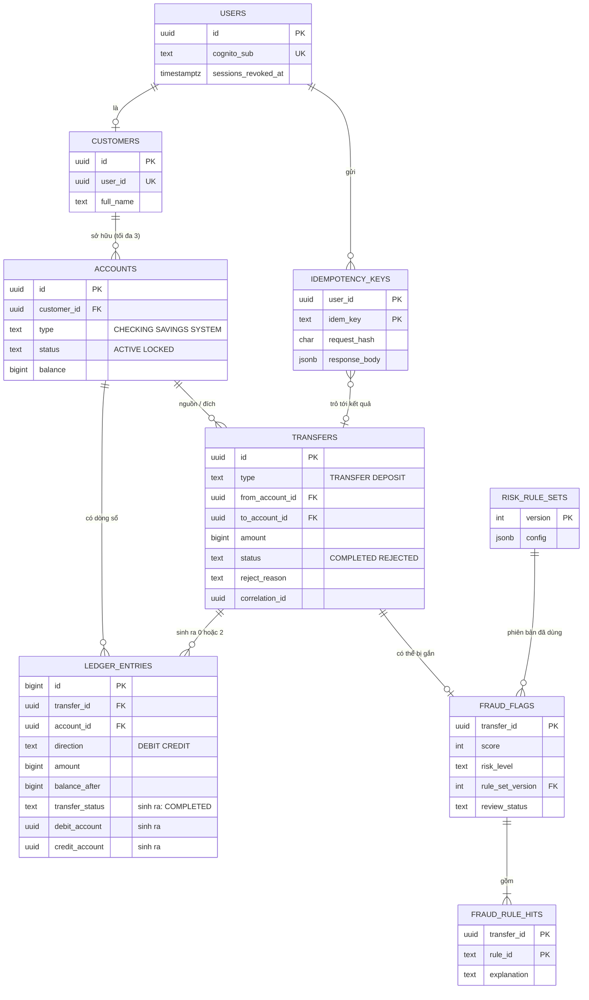

# Database Design

> **Status:** Accepted (chốt 2026-10-11) · **Owner:** #1 (schema và migration) · **Cặp đôi:** #3 (outbox, audit), #4 (fraud), #5 (role, RDS) · **Verified against code:** §4.1, §4.2 (migration 1, DBS-20, 2026-10-12); §4.3, §4.4, §4.5, §8.2 và các index §6.1 của ba bảng đó (migration 2, DBS-21, 2026-10-17) ; §4.6 và hai partial indexes outbox (DBS-25); §4.7 và ba index audit (DBS-26), writer (DBS-56) và query API (DBS-103); §8.3 trigger ba bảng `transfers`, `ledger_entries`, `audit_log` bằng owner local (DBS-27); §4.8 nhóm fraud (migration `CreateFraudStorage1792713600000`, DBS-58); §4.9 `notification_log` (migration `CreateNotificationLog1792886400000`, DBS-96) và `reconciliation_runs`, CHECK details và revert (DBS-116); §8.1 ba role `dbs_migrator`, `dbs_api`, `dbs_worker` và GRANT ma trận quyền tối thiểu (migration 7, `CreateDbRolesAndGrants1793664000000`, DBS-119, 2026-11-08); guard cấm `dbs_migrator` ở runtime và trigger append-only §8.3; các phần còn lại là thiết kế · **Cập nhật:** 2026-11-08

> **ADR-14 (Accepted 2026-11-08):** Giữ rules R1–R6 và thêm tùy chọn API AI bổ sung theo [ADR-14](../../adr/0014-fraud-rules-external-ai.md), mô tả ở [FRAUD-API-01](../../features/FRAUD-API-01-external-ai-decision.md). Bảng `risk_decisions` có migration từ [RSK-01](../../features/RSK-01-risk-decisions-migration.md) (`1793836800000-CreateRiskDecisions`); schema gốc ở FRAUD-API-01 §3.8.

Tài liệu này chốt **hình dạng cơ sở dữ liệu** của cả hệ thống: bảng nào, cột nào, ràng buộc nào, index nào, ai được ghi, dọn dữ liệu ra sao. Nó phục vụ ba người: #1 viết migration đầu tiên (tuần 1), mọi người review migration của nhau, và P2 (Data Architecture).

Nguồn: [docs/03 §8](../../03_HIGH_LEVEL_ARCHITECTURE.md) (data architecture), [docs/BRD.md Phần 3 §7–8](../../BRD.md) (aggregate, bất biến, vòng đời), [FRAUD_DETECTION_GUIDE §5.3](../risk/FRAUD_DETECTION_GUIDE.md) (bảng fraud). Các điểm từng khác các tài liệu đó đã được sửa vào nguồn; lịch sử ở [§13](#13-các-điểm-đã-chốt).

---

## 1. Tóm tắt: 10 quy tắc

| # | Quy tắc | Vì sao |
|---|---|---|
| 1 | **PostgreSQL là nguồn sự thật duy nhất.** Redis và SQS mất thì dựng lại được | P-1 trong docs/03 |
| 2 | **Tiền là `bigint` (đồng)**, luôn `CHECK (amount > 0)` cho số tiền giao dịch | BR-01; `numeric`/`float` sinh sai số |
| 3 | **Bất biến nằm ở DB**, không chỉ ở code: `CHECK`, `UNIQUE`, `FK`, trigger chặn sửa/xóa | Code có lỗi hoặc bị bỏ qua, ràng buộc DB thì không |
| 4 | **Bảng ghi một lần (append-only):** `ledger_entries`, `transfers`, `audit_log`, `risk_rule_sets` bị chặn `UPDATE`/`DELETE` bằng quyền **và** trigger | BR-08, BR-09 |
| 5 | **Trạng thái và loại là `text` + `CHECK`**, không dùng kiểu `ENUM` của Postgres | `ENUM` khó đổi (thêm/bớt giá trị) khi làm migration kiểu expand → contract |
| 6 | **Mọi thời điểm là `timestamptz`**, DB chạy UTC; ranh giới ngày tính bằng `AT TIME ZONE 'Asia/Ho_Chi_Minh'` | Hạn mức ngày theo giờ Việt Nam (BR-06) |
| 7 | **Khóa chính `uuid`** cho thực thể nghiệp vụ, **`bigint identity`** cho bảng chỉ thêm (`ledger_entries`, `audit_log`, `outbox_events`) | uuid khó đoán, lộ ra ngoài API được; identity cho thứ tự và phân trang |
| 8 | **Không có `ON DELETE CASCADE`.** Ngân hàng không xóa dữ liệu; mọi `FK` là `RESTRICT` | Xóa dây chuyền = mất dấu vết |
| 9 | **Mỗi bảng có đúng một module sở hữu**; module khác không đọc/ghi trực tiếp | P-4; xem [§3](#3-bảng-nào-thuộc-module-nào) |
| 10 | **Index theo truy vấn thật**, không theo cảm giác; cái nào cố ý *không* tạo cũng được ghi rõ | Mỗi index làm chậm mọi lệnh ghi; xem [§6](#6-index) |

---

## 2. Bức tranh: 14 bảng



**Năm bảng kỹ thuật không vẽ trong ERD** vì không có quan hệ nghiệp vụ: `outbox_events`, `processed_events`, `audit_log`, `notification_log` và `reconciliation_runs` (bảng mới, xem [§13](#13-các-điểm-đã-chốt)). Tổng: 9 bảng nghiệp vụ + 5 bảng kỹ thuật = **14 bảng** (chưa kể bảng `migrations` của TypeORM).

---

## 3. Bảng nào thuộc module nào

"Sở hữu" = module duy nhất được viết `INSERT/UPDATE` và quyết định hình dạng bảng. Module khác muốn dữ liệu thì gọi hàm module đó export.

| Module | Bảng sở hữu | Ghi chú |
|---|---|---|
| `identity` | `users` | `sessions_revoked_at` là nguồn sự thật của thu hồi phiên |
| `accounts` | `customers`, `accounts` | Gồm tài khoản SYSTEM `funding` (tạo bằng migration) |
| `ledger` | `transfers`, `ledger_entries`, `idempotency_keys`, `reconciliation_runs` | Duy nhất được đổi `accounts.balance`, **thông qua** `AccountsService.applyBalanceChange` |
| `outbox` | `outbox_events`, `processed_events` | Mọi module ghi sự kiện đều gọi `OutboxWriter.add` |
| `audit` | `audit_log` | Mọi module ghi qua `AuditService.record`, trong transaction của mình |
| `risk` | `fraud_flags`, `fraud_rule_hits`, `risk_rule_sets` | |
| `notification` | `notification_log` | v1 chỉ ghi log |

Ngoại lệ đáng chú ý: `risk` cần **đọc** lịch sử chuyển tiền (luật R2, R4, R5). Thay vì cho `risk` `SELECT` thẳng bảng `transfers` (vi phạm quy tắc 9), `ledger` cung cấp một **view chỉ đọc** `v_transfer_facts` làm hợp đồng dữ liệu ổn định. Xem [§8](#8-quyền-truy-cập-và-tính-bất-biến-ở-mức-db).

---

## 4. Thiết kế từng bảng

Viết dưới dạng SQL để người viết migration chép được; mọi tên đã theo quy ước ở [§11](#11-migration-và-dữ-liệu-khởi-tạo).

### 4.1 `users`, `customers`

```sql
CREATE TABLE users (
  id                  uuid PRIMARY KEY DEFAULT gen_random_uuid(),
  cognito_sub         text NOT NULL UNIQUE,
  sessions_revoked_at timestamptz,                       -- NULL = chưa từng thu hồi
  created_at          timestamptz NOT NULL DEFAULT now()
);

CREATE TABLE customers (
  id         uuid PRIMARY KEY DEFAULT gen_random_uuid(),
  user_id    uuid NOT NULL UNIQUE REFERENCES users(id), -- mỗi user đúng một customer
  full_name  text NOT NULL,
  created_at timestamptz NOT NULL DEFAULT now()
);
```

Dòng `users` được tạo bằng `INSERT … ON CONFLICT (cognito_sub) DO NOTHING` ở token hợp lệ đầu tiên của mọi vai trò (khách, nhân viên, kiểm toán viên, admin). Không lưu vai trò: nguồn sự thật duy nhất là nhóm Cognito trong JWT (`cognito:groups`). Lưu thêm một cột `role` là tạo hai nơi có thể lệch nhau mà không có ai dùng; nhật ký ghi vai trò tại thời điểm thao tác ở `audit_log.actor_role`. Không lưu email, số điện thoại: Cognito giữ danh tính, DB chỉ giữ `cognito_sub`. Ít dữ liệu cá nhân hơn nghĩa là ít thứ phải bảo vệ.

**Ngoại lệ audit (DBS-52, duyệt 2026-11-01):** việc tạo dòng `users` ở token hợp lệ đầu tiên là hệ thống tự cấp phát, không phải thao tác do người dùng hay nhân viên ra lệnh, nên **không** ghi `audit_log` (FR-AUD-01 không liệt kê ngoại lệ này; đây là quyết định thiết kế đã được người duyệt chấp nhận). Khi `AuditService` (DBS-56) có, [BL-130](../../BACKLOG.md) đề xuất ghi hành động `user.provisioned` với `actor_user_id` NULL (hệ thống).

### 4.2 `accounts`

Thu hồi phiên dùng `users.sessions_revoked_at` là nguồn sự thật: UPDATE trong transaction khóa tài khoản, chỉ publish `revoked_at:{userId}` epoch giây sang Redis sau COMMIT. TTL=`ACCESS_TOKEN_TTL_SECONDS`; không cacheNULL. Cache chỉ đủ để từ chối token có iat≤marker; mọi nhánh chưa đủ bằng chứng/lỗi/miss xác nhận SQL, tránh cache cũ cho qua lần thu hồi mới. Unlock không xóa mốc. [DBS-114](../../features/DBS-114-session-revocation.md) kiểm actual API role, commit/rollback/retry và Redis lỗi thật; [docs/03 §6.2](../../03_HIGH_LEVEL_ARCHITECTURE.md#62-khóa-tài-khoản-và-thu-hồi-phiên-uc-11) mô tả luồng.

```sql
CREATE TABLE accounts (
  id          uuid PRIMARY KEY DEFAULT gen_random_uuid(),
  customer_id uuid REFERENCES customers(id),            -- NULL cho tài khoản SYSTEM
  type        text NOT NULL CHECK (type IN ('CHECKING','SAVINGS','SYSTEM')),
  status      text NOT NULL DEFAULT 'ACTIVE' CHECK (status IN ('ACTIVE','LOCKED')),
  balance     bigint NOT NULL DEFAULT 0,
  created_at  timestamptz NOT NULL DEFAULT now(),
  updated_at  timestamptz NOT NULL DEFAULT now(),
  CONSTRAINT accounts_balance_non_negative CHECK (type = 'SYSTEM' OR balance >= 0),
  CONSTRAINT accounts_owner_matches_type   CHECK ((type = 'SYSTEM') = (customer_id IS NULL))
) WITH (fillfactor = 80);                                -- chừa chỗ cho HOT update, xem §9

CREATE UNIQUE INDEX accounts_single_system ON accounts (type) WHERE type = 'SYSTEM';
CREATE INDEX accounts_customer_idx ON accounts (customer_id) WHERE customer_id IS NOT NULL;
```

- `type` là `CHECKING` hoặc `SAVINGS`; ở v1 hai loại hành xử giống nhau (chỉ là nhãn). Thêm loại mới bằng migration đổi `CHECK`.
- **Giới hạn 3 tài khoản/khách (BR-14) không biểu diễn được bằng `CHECK`.** Nó được giữ bằng transaction mở tài khoản có `SELECT … FOR UPDATE` hàng `customers`, rồi `COUNT`. Có test đồng thời bắt buộc cho việc này.
- Lý do khóa tài khoản (UC-11) **không** nằm ở bảng này mà ở `audit_log`: một tài khoản có thể bị khóa/mở nhiều lần và mỗi lần là một sự kiện.
- Không có số tài khoản dạng người đọc được: v1 dùng `uuid` làm định danh tài khoản trong API. Chấp nhận vì đề tài là backend; thêm `account_number` sau cũng chỉ là một cột `UNIQUE`.

### 4.3 `transfers`

```sql
CREATE TABLE transfers (
  id              uuid PRIMARY KEY DEFAULT gen_random_uuid(),
  type            text NOT NULL CHECK (type IN ('TRANSFER','DEPOSIT')),
  from_account_id uuid NOT NULL REFERENCES accounts(id),
  to_account_id   uuid REFERENCES accounts(id),          -- NULL chỉ khi REJECTED và đích không tồn tại
  amount          bigint NOT NULL CHECK (amount > 0),
  status          text NOT NULL CHECK (status IN ('COMPLETED','REJECTED')),
  reject_reason   text CHECK (reject_reason IN
                    ('ACCOUNT_NOT_ACTIVE','LIMIT_PER_TX_EXCEEDED','LIMIT_PER_DAY_EXCEEDED','INSUFFICIENT_FUNDS')),
  initiated_by    uuid NOT NULL REFERENCES users(id),
  correlation_id  uuid NOT NULL,
  created_at      timestamptz NOT NULL DEFAULT clock_timestamp(),
  CONSTRAINT transfers_distinct_accounts       CHECK (to_account_id IS NULL OR from_account_id <> to_account_id),
  CONSTRAINT transfers_reason_matches_status   CHECK ((status = 'REJECTED') = (reject_reason IS NOT NULL)),
  CONSTRAINT transfers_completed_has_target    CHECK (status <> 'COMPLETED' OR to_account_id IS NOT NULL),
  -- đích của khóa ngoại tổng hợp từ ledger_entries (xem §4.4); transfers chỉ-thêm nên các cột này không đổi
  CONSTRAINT transfers_ledger_from_key UNIQUE (id, amount, status, from_account_id),
  CONSTRAINT transfers_ledger_to_key   UNIQUE (id, amount, status, to_account_id)
);
```

Hai điểm thiết kế cần giải thích:

- **`to_account_id` cho phép `NULL`.** UC-5 bước 6a: lệnh chuyển tới tài khoản **không tồn tại** vẫn phải lưu thành `REJECTED/ACCOUNT_NOT_ACTIVE` (và trả cùng lời từ chối với trường hợp tài khoản bị khóa, để không lộ tài khoản có tồn tại hay không). Nếu `to_account_id` là `NOT NULL REFERENCES`, `INSERT` này sẽ vỡ vì khóa ngoại. Id mà client đã gửi nằm trong `audit_log.metadata`. `CHECK` thứ ba bảo đảm lệnh `COMPLETED` luôn có đích.
- **`created_at` dùng `clock_timestamp()`, không phải `now()`.** `now()` trả thời điểm **bắt đầu transaction**; một lệnh phải chờ khóa tài khoản nóng 1,5 giây sẽ có `created_at` cũ hơn thời điểm ghi thật, làm sai thứ tự theo tài khoản và lệch ranh giới ngày lúc 00:00. `clock_timestamp()` được gọi sau khi đã giữ khóa nên **tăng đơn điệu theo thứ tự khóa**.

### 4.4 `ledger_entries`

```sql
CREATE TABLE ledger_entries (
  id            bigint GENERATED ALWAYS AS IDENTITY PRIMARY KEY,
  transfer_id   uuid   NOT NULL,
  account_id    uuid   NOT NULL,
  direction     text   NOT NULL CHECK (direction IN ('DEBIT','CREDIT')),
  amount        bigint NOT NULL CHECK (amount > 0),
  balance_after bigint NOT NULL,                          -- số dư của account_id ngay sau bút toán này
  created_at    timestamptz NOT NULL DEFAULT clock_timestamp(),
  -- ba cột sinh ra, chỉ để làm khóa của hai khóa ngoại tổng hợp bên dưới; không ghi được
  transfer_status text GENERATED ALWAYS AS ('COMPLETED') STORED,
  debit_account   uuid GENERATED ALWAYS AS (CASE WHEN direction = 'DEBIT'  THEN account_id END) STORED,
  credit_account  uuid GENERATED ALWAYS AS (CASE WHEN direction = 'CREDIT' THEN account_id END) STORED,
  CONSTRAINT ledger_entries_one_per_direction UNIQUE (transfer_id, direction),
  CONSTRAINT ledger_entries_transfer_debit_fkey
    FOREIGN KEY (transfer_id, amount, transfer_status, debit_account)
    REFERENCES transfers (id, amount, status, from_account_id),
  CONSTRAINT ledger_entries_transfer_credit_fkey
    FOREIGN KEY (transfer_id, amount, transfer_status, credit_account)
    REFERENCES transfers (id, amount, status, to_account_id)
);
```

- `UNIQUE (transfer_id, direction)` biến luật "**tối đa một Nợ và một Có** cho mỗi giao dịch" thành ràng buộc DB. Giao dịch `REJECTED` có 0 dòng vì code không `INSERT`, và DB cũng từ chối nếu có (xem dưới).
- **Hai khóa ngoại tổng hợp (DBS-21)** ép ba điều ngay ở DB: dòng sổ có **đúng số tiền** của giao dịch, nằm **đúng tài khoản** (Nợ ở `from_account_id`, Có ở `to_account_id`), và chỉ tồn tại cho giao dịch `COMPLETED`. Mỗi dòng có đúng một trong `debit_account`/`credit_account` khác NULL, và với `MATCH SIMPLE` cột NULL tắt khóa ngoại kia, nên mỗi dòng chỉ tra một khóa. Khóa này đã bao luôn "giao dịch tồn tại" và "tài khoản tồn tại", vì vậy **không** có khóa ngoại đơn `transfer_id` hay `account_id`; hai `UNIQUE` ở §4.3 là đích bắt buộc của chúng. Ghi tường minh `transfer_status`, `debit_account` hay `credit_account` bị từ chối (`428C9`); entity phải đánh dấu ba cột không insert/update, và SQL tay liệt kê cột tường minh.
- **Còn ngoài DB:** "`COMPLETED` có đúng 2 dòng" (một giao dịch chỉ có dòng Nợ vẫn commit được ở mức DDL, nên Nợ = Có về số tiền không do constraint DB ép) và `balance_after` khớp `accounts.balance`. Theo quyết định tại [ADR-02](../../adr/0002-postgresql-ledger.md), phần này do transaction nguyên tử của tầng ứng dụng (`TransferService`, `DepositService`) thực thi và được công cụ đối soát định kỳ (§10) hậu kiểm thay vì cài constraint trigger `DEFERRABLE INITIALLY DEFERRED` trên đường nóng.
- **`balance_after` là cột nên thêm** (spec chưa có). Chi phí 8 byte/dòng, lợi ích: (1) job đối soát kiểm tra được từng bước, không chỉ tổng; (2) dựng lại số dư tại bất kỳ thời điểm nào; (3) `fromBalanceBefore` của event bằng `balance_after + amount` của dòng Nợ; (4) debug nhanh khi đối soát lệch. Không cần khóa thêm vì tài khoản đã bị khóa lúc ghi.

### 4.5 `idempotency_keys`

```sql
CREATE TABLE idempotency_keys (
  user_id       uuid NOT NULL REFERENCES users(id),
  idem_key      text NOT NULL CHECK (char_length(idem_key) BETWEEN 1 AND 128),
  request_hash  char(64) NOT NULL,                        -- sha256 hex của {method, path, body}, khóa body sắp xếp (ADR-05)
  transfer_id   uuid REFERENCES transfers(id),
  response_code smallint,
  response_body jsonb,
  created_at    timestamptz NOT NULL DEFAULT now(),
  PRIMARY KEY (user_id, idem_key)
);
CREATE INDEX idempotency_keys_created_idx ON idempotency_keys (created_at);   -- cho job dọn
```

- **Khóa chính `(user_id, idem_key)`** chứ không phải `idem_key`: nếu unique toàn cục, user A dùng trùng mã của B sẽ nhận response của B (lộ dữ liệu).
- `response_*` cho phép `NULL` vì dòng được `INSERT … ON CONFLICT DO NOTHING` **trước** (để giữ chỗ), còn kết quả chỉ biết ở cuối transaction. Các transaction khác chỉ thấy dòng sau khi commit, lúc đó `response_*` luôn đã có. Test bắt buộc: "không bao giờ thấy dòng thiếu response sau commit".
- Lỗi hệ thống thì transaction rollback, **dòng biến mất**, nên client gửi lại cùng key là an toàn.

### 4.6 `outbox_events`, `processed_events`

```sql
CREATE TABLE outbox_events (
  id             bigint GENERATED ALWAYS AS IDENTITY PRIMARY KEY,   -- relay lấy theo thứ tự id
  event_id       uuid NOT NULL UNIQUE DEFAULT gen_random_uuid(),
  event_type     text NOT NULL,                                     -- TransferCompleted, ...
  aggregate_id   uuid NOT NULL,                                     -- transferId hoặc accountId
  payload        jsonb NOT NULL,                                    -- theo _shared/event-contract.md
  correlation_id uuid NOT NULL,
  created_at     timestamptz NOT NULL DEFAULT clock_timestamp(),
  published_at   timestamptz                                        -- NULL = chưa gửi
);

CREATE TABLE processed_events (
  consumer     text NOT NULL,                                       -- 'risk', 'notification'
  event_id     uuid NOT NULL,
  processed_at timestamptz NOT NULL DEFAULT now(),
  PRIMARY KEY (consumer, event_id)
);
CREATE INDEX processed_events_processed_at_idx ON processed_events (processed_at); -- cho job dọn 7 ngày
```

### 4.7 `audit_log`

```sql
CREATE TABLE audit_log (
  id             bigint GENERATED ALWAYS AS IDENTITY PRIMARY KEY,
  occurred_at    timestamptz NOT NULL DEFAULT clock_timestamp(),
  actor_user_id  uuid REFERENCES users(id) ON DELETE RESTRICT, -- NULL = hệ thống (worker)
  actor_role     text NOT NULL,
  action         text NOT NULL,                           -- 'transfer.create', 'account.lock', 'audit.search', 'access.denied'...
  outcome        text NOT NULL CHECK (outcome IN ('SUCCESS','REJECTED','DENIED')),
  target_type    text NOT NULL,                           -- 'transfer', 'account', 'fraud_flag'...
  target_id      text NOT NULL,                           -- text vì có thể là id của tài khoản không tồn tại
  correlation_id uuid NOT NULL,
  metadata       jsonb NOT NULL DEFAULT '{}'              -- chỉ id, lý do, số đếm; KHÔNG tên, email, số tài khoản đầy đủ
);
```

`outcome = 'DENIED'` là lần bị từ chối quyền (A mở tài khoản của B): vẫn phải ghi (FR-AUD-02). Không dùng chuỗi hash nối các dòng (kiểu blockchain) vì mọi lệnh ghi sẽ tranh nhau cập nhật "dòng cuối", tạo nút thắt đúng ở đường chuyển tiền. Bảo vệ chống sửa bằng quyền, trigger và (tùy chọn) export sang S3 Object Lock.

**Ý nghĩa của `correlation_id` (DBS-135, AC-8.2):** với hành động gắn vào một giao dịch, đó là mã chuỗi của giao dịch (`transfers.correlation_id`, server sinh ở request chuyển tiền), để kiểm toán viên tra trọn chuỗi bằng một mã. Nguồn các dòng của một chuỗi: `transfer` (API, cùng transaction với hai bút toán ledger nên là bằng chứng ghi sổ), `notification.sent` (worker, một dòng mỗi event thông báo, chỉ `count`), `fraud.flagged` (worker) và `fraud_flag.review` (API: mã của giao dịch gốc lấy qua hàm export của ledger; mã của request review nằm ở `metadata.id`). Hành động không gắn một giao dịch (`audit.search`, `fraud_flag.search`, `fraud_flag.view`) vẫn dùng mã của request. Dung lượng: thêm một dòng mỗi event thông báo, khoảng 10.000 dòng/ngày ở tải thiết kế (§6.3), cận trên theo ADR-14 (120 RPS liên tục, toàn bộ là chuyển tiền) khoảng 10,4 triệu dòng/ngày; bảng có ba index và không xóa được, nên phân vùng hoặc lưu trữ khi tải thật gần cận trên là việc còn mở (BL-227).

Schema audit đã triển khai trong migration `CreateAuditLog1792627200001`, độc lập với outbox; [DBS-26](../../features/DBS-26-migration-audit-log.md) đối chiếu từng cột, constraint và index bằng PostgreSQL thật. Các constraint được đặt tên `audit_log_pkey`, `audit_log_actor_user_id_fkey`, `audit_log_outcome_check`. Role/action/target_type vẫn là text mở; metadata là JSONB và schema không tự lọc PII. [AuditService](../../../backend/src/modules/audit/README.md) kiểm metadata tại runtime và INSERT bằng transaction caller; denial có transaction riêng bên ngoài callback nghiệp vụ. Production grants còn chờ DBS-119; trigger trình bày ở §8.3.

Ba index ngoài PK là `audit_log_correlation_idx (correlation_id)`, `audit_log_actor_occurred_idx (actor_user_id, occurred_at DESC)` và `audit_log_action_occurred_idx (action, occurred_at DESC)`, đều B-tree không unique. Migration `down` yêu cầu transaction READ COMMITTED, lấy ACCESS EXCLUSIVE rồi dùng statement mới kiểm dữ liệu; có dòng thì lỗi `55000` và giữ nguyên bảng/history. Không xóa audit để hoàn tác schema.

`GET /v1/audit/entries` chỉ cho JWT có nhóm auditor và trả projection audit tường minh, không JOIN hồ sơ khách. Query dùng alias `a`, sắp `a.occurred_at DESC,a.id DESC`; cursor tuple so cột timestamp/bigint gốc, còn projection `a.id::text` và SQL UTC format giữ string/microsecond cho response. Filter là parameter; không cast cột lọc làm mất index. Bỏ cận thời gian không đặt cutoff lịch sử. `AuditHttpModule` chỉ chạy ở api/both, writer vẫn dùng được ở worker.

Mỗi lookup hợp lệ INSERT `audit.search` trước SELECT trong cùng `TransactionService.run`, bằng cùng manager, rồi trả body sau COMMIT. Role audit cố định auditor, actor là internal users.id, target/correlation là UUID request server, metadata `{}`; filter/cursor không đi vào audit. Lỗi INSERT/SELECT trước commit rollback toàn lookup; nếu COMMIT mất kết nối thì trạng thái commit có thể chưa xác định. Hợp đồng live keyset và bằng chứng PostgreSQL/HTTP ở [DBS-103](../../features/DBS-103-audit-search.md). Đây không phải thay đổi schema hay cấp quyền production; phần production-role AC-8.1 vẫn chưa hoàn tất.

### 4.8 Nhóm fraud

```sql
CREATE TABLE risk_rule_sets (
  version    int PRIMARY KEY,
  config     jsonb NOT NULL,                              -- tham số, trọng số, ngưỡng, enabled của R1–R6
  created_by uuid REFERENCES users(id),                   -- NULL cho phiên bản khởi tạo
  created_at timestamptz NOT NULL DEFAULT now()
);

CREATE TABLE fraud_flags (
  transfer_id      uuid PRIMARY KEY REFERENCES transfers(id),       -- tối đa 1 cờ / giao dịch
  score            int  NOT NULL CHECK (score >= 0),                -- tổng trọng số, có thể > 100
  risk_level       text NOT NULL CHECK (risk_level IN ('MEDIUM','HIGH')),
  rule_set_version int  NOT NULL REFERENCES risk_rule_sets(version),
  review_status    text NOT NULL DEFAULT 'OPEN'
                   CHECK (review_status IN ('OPEN','CONFIRMED_FRAUD','FALSE_POSITIVE')),
  reviewed_by      uuid REFERENCES users(id),
  reviewed_at      timestamptz,
  review_note      text,
  created_at       timestamptz NOT NULL DEFAULT clock_timestamp(),
  CONSTRAINT fraud_flags_review_consistent CHECK
    ((review_status = 'OPEN' AND reviewed_by IS NULL AND reviewed_at IS NULL)
     OR (review_status <> 'OPEN' AND reviewed_by IS NOT NULL AND reviewed_at IS NOT NULL))
);

CREATE TABLE fraud_rule_hits (
  transfer_id uuid NOT NULL REFERENCES fraud_flags(transfer_id),
  rule_id     text NOT NULL CHECK (rule_id IN ('R1','R2','R3','R4','R5','R6')),
  weight      int  NOT NULL,                              -- đóng góp vào score, giúp giải thích
  explanation text NOT NULL,
  PRIMARY KEY (transfer_id, rule_id)
);
```

- **Review một lần** (AC-10.1): `UPDATE fraud_flags SET review_status = $1, … WHERE transfer_id = $2 AND review_status = 'OPEN'`; 0 dòng bị ảnh hưởng nghĩa là đã được review, từ chối. Không cần khóa riêng.
- `fraud_flags_review_consistent` dùng hai nhánh tường minh để PostgreSQL không nhận `UNKNOWN` khi thiếu riêng `reviewed_by` hoặc `reviewed_at` ở trạng thái đã review (DBS-58, BL-047).
- `risk_rule_sets` phải có **phiên bản 1 từ migration**, nếu không worker khởi động mà chưa có luật nào để chấm.
- Bỏ `rule_version` ở `fraud_rule_hits` (docs/03 ERD có) vì thừa so với `fraud_flags.rule_set_version`.
- Mỗi nhóm luật một dòng (khóa chính `(transfer_id, rule_id)`). Nếu sau này bật chế độ `v3` (ADR-08), điểm của mô hình được cộng vào dòng của nhóm được quy kết hoặc tạo dòng mới có `explanation` bắt đầu bằng `[AI-Rn]`. Không đổi cột. Theo ADR-14 (Accepted), bất biến là `risk_decisions.rule_score = sum(fraud_rule_hits.weight)` và `fraud_flags.score = rule_score + ai_applied_weight`: cờ do AI cộng điểm có thể có tổng `weight` nhỏ hơn `score`, và cờ AI-only có 0 hit. DB chưa ép bất biến liên bảng này (constraint trigger: BL-223).

**`risk_decisions`** ([RSK-01](../../features/RSK-01-risk-decisions-migration.md), ADR-14): một dòng bất biến cho mỗi TRANSFER đã chấm, mọi mode, kể cả LOW. Schema đúng [FRAUD-API-01 §3.8](../../features/FRAUD-API-01-external-ai-decision.md#38-phụ-lục-schema-đề-xuất-bảng-quyết-định-risk-proposed-chưa-có-migration), mọi ràng buộc đặt tên `risk_decisions_<quy tắc>`.

- PK `transfer_id`; `UNIQUE (transfer_id, rule_set_version)` là đích của `fraud_flags_decision_fkey`: cờ chỉ tồn tại khi có decision cùng phiên bản luật (lỗi `23503` nếu thiếu).
- **Claim:** `INSERT … ON CONFLICT DO NOTHING RETURNING transfer_id`, **không chỉ định conflict target**, để cả hai unique index đều là arbiter: bên thua nhận 0 dòng, không bao giờ `23505`. Bên thắng commit trước giữ `event_id`; bên thắng rollback thì bên chờ thắng.
- `feature_snapshot` chỉ bị ép là object; allowlist FRAUD-API-01 §2.3 (không ID, tên, email, ghi chú, nhãn) do writer DBS-111 kiểm.
- `probability` `NaN`/`Infinity`/`-Infinity` bị `risk_decisions_status_probability` từ chối; `fraud_rule_hits_weight_check` ép `weight >= 0`.
- Migration từ chối (`55000`) khi `fraud_flags` có cờ chưa có decision; revert từ chối khi `risk_decisions` có dòng.

### 4.9 `notification_log`, `reconciliation_runs`

```sql
CREATE TABLE notification_log (
  id         bigint GENERATED ALWAYS AS IDENTITY PRIMARY KEY,
  event_id   uuid NOT NULL,
  kind       text NOT NULL CONSTRAINT notification_log_kind_check
               CHECK (kind IN ('transfer_completed', 'account_status_changed')),
  user_id    uuid CONSTRAINT notification_log_user_id_fkey REFERENCES users(id) ON DELETE RESTRICT,
  message    text NOT NULL,                  -- không nêu lý do gian lận (BR-13)
  created_at timestamptz NOT NULL DEFAULT now(),
  correlation_id uuid                        -- DBS-134: correlationId của event gây ra thông báo
);
CREATE INDEX notification_log_event_id_idx ON notification_log(event_id);
-- correlation_id nullable: dòng sinh trước DBS-134 được backfill từ outbox_events theo event_id khi
-- dòng outbox còn (cleanup DBS-92 xóa dòng cũ), worker bản cũ trong lúc deploy cuốn chiếu có thể
-- vẫn INSERT không có cột. Code mới luôn điền. Không index: kiểm toán tra theo audit_log.
-- BR-13: writer chỉ ghi thông báo chung, không nêu lý do gian lận.
-- Index không UNIQUE: một event có thể có nhiều người nhận. DBS-96.

CREATE TABLE public.reconciliation_runs (
  id                  bigint GENERATED ALWAYS AS IDENTITY,
  started_at          timestamptz NOT NULL,
  finished_at         timestamptz,
  status              text NOT NULL,
  total_debit         bigint,
  total_credit        bigint,
  total_balance       bigint,              -- 0 khi đối soát sạch; vẫn lưu được giá trị lệch
  mismatched_accounts int NOT NULL DEFAULT 0,
  details             jsonb,
  CONSTRAINT reconciliation_runs_pkey PRIMARY KEY (id),
  CONSTRAINT reconciliation_runs_status_check CHECK (status IN ('OK','MISMATCH','ERROR')),
  CONSTRAINT reconciliation_runs_details_check CHECK (details IS NULL OR ((
    jsonb_typeof(details) = 'array'
    AND jsonb_path_query_array(details, 'strict $[*] ? (
      @.type() == "object"
      && exists (@.accountId ? (
        @.type() == "string"
        && @ like_regex "^[0-9a-fA-F]{8}-[0-9a-fA-F]{4}-[0-9a-fA-F]{4}-[0-9a-fA-F]{4}-[0-9a-fA-F]{12}$"))
      && exists (@.balance ? (
        @.type() == "string" && @ like_regex "^(0|-?[1-9][0-9]{0,18})$"
        && @.bigint().string() == @))
      && exists (@.ledgerBalance ? (
        @.type() == "string" && @ like_regex "^(0|-?[1-9][0-9]{0,18})$"
        && @.bigint().string() == @))
      && !exists (@.keyvalue() ? (
        @.key != "accountId" && @.key != "balance" && @.key != "ledgerBalance"))
    )'::jsonpath, '{}'::jsonb, true) = details
  ) IS TRUE))
);
```

`notification_log` ([migration](../../../backend/src/database/migrations/1792886400000-CreateNotificationLog.ts), DBS-96) và `reconciliation_runs` ([migration](../../../backend/src/database/migrations/1793577600000-CreateReconciliationRuns.ts), [DBS-116](../../features/DBS-116-reconciliation-runs.md)) đã có trong migration và được kiểm schema/lifecycle trên PostgreSQL thật.

`details` nhận SQL NULL hoặc mảng (kể cả rỗng) các object đúng ba khóa `accountId`, `balance`, `ledgerBalance`. ID là UUID dạng8-4-4-4-12, không FK để giữ snapshot lịch sử. Hai số là chuỗi nguyên thập phân chuẩn trong miền signed bigint; JSON number, `-0`, số0 đầu, overflow, khóa thừa hoặc kiểu lồng bị CHECK23514 từ chối. Không có ô tên/email/số tài khoản/thông báo lỗi tự do. `silent` cùng `IS TRUE` chặn lỗi chuyển đổi và SQL/JSON unknown lọt CHECK. Tính đúng của số đếm, status và kết quả đối soát thuộc producer/job DBS-117; schema không tự tính hoặc ép các trường phụ thuộc nhau.

`down` cần transaction READ COMMITTED, lấy ACCESS EXCLUSIVE trước khi kiểm rỗng bằng statement mới; có hàng thì SQLSTATE55000 và giữ dữ liệu/history. Không xóa kết quả để rollback. Bảng không có append-only trigger vì có retention90 ngày; role thực và chính sách cleanup thuộc DBS-119/job cleanup, không suy quyền từ superuser test.

---

## 5. Ràng buộc DB bảo vệ nghiệp vụ

Cột "Bảo vệ" cho thấy luật không chỉ dựa vào code.

| Quy tắc | Ràng buộc DB | Còn cần gì ngoài DB |
|---|---|---|
| BR-01 tiền là số nguyên đồng | Kiểu `bigint` | Không dùng `number` ở code |
| BR-02 bút toán kép | `UNIQUE (transfer_id, direction)`; `amount > 0`; khóa ngoại tổng hợp: dòng sổ đúng số tiền, đúng tài khoản của giao dịch `COMPLETED`, không có dòng cho `REJECTED` | Cùng transaction ghi đủ 2 dòng (DB chưa ép "đủ cặp"); job đối soát kiểm tổng |
| BR-03 số dư khách ≥ 0 | `CHECK (type = 'SYSTEM' OR balance >= 0)` | Sync guard (để trả `INSUFFICIENT_FUNDS` thay vì lỗi DB) |
| BR-05 khác tài khoản | `CHECK (from_account_id <> to_account_id)` | |
| BR-06 hạn mức | — (không biểu diễn được) | Sync guard sau `FOR UPDATE`; test AC-5.6 |
| BR-07 chống trùng | `PRIMARY KEY (user_id, idem_key)` | `ON CONFLICT DO NOTHING`; so `request_hash` |
| BR-08 giao dịch bất biến | Trigger chặn `UPDATE/DELETE` + thu quyền | |
| BR-09 audit bất biến | Trigger chặn `UPDATE/DELETE` + thu quyền | Ghi cùng transaction (fail-closed) |
| BR-11/FR-RSK-04 tối đa 1 cờ | `PRIMARY KEY (transfer_id)` ở `fraud_flags` | |
| Mỗi luật tối đa 1 lần / cờ | `PRIMARY KEY (transfer_id, rule_id)` | |
| Chỉ review một lần | `fraud_flags_review_consistent` | `UPDATE … WHERE review_status = 'OPEN'` |
| Chỉ một tài khoản SYSTEM | Unique index một phần `accounts_single_system` | |
| BR-14 tối đa 3 tài khoản | — | Khóa hàng `customers` + `COUNT` trong transaction |

---

## 6. Index

### 6.1 Index nên tạo, theo truy vấn

| Truy vấn (ai chạy) | Index | Vì sao |
|---|---|---|
| Khóa tài khoản `WHERE id = ANY($1) ORDER BY id FOR UPDATE` (ledger) | PK `accounts(id)` | Có sẵn |
| **Hạn mức ngày:** `SUM(amount)` tiền đi hôm nay của một tài khoản (ledger, **trong lúc đang giữ khóa**) | `ledger_entries_daily_debit_idx`: `ledger_entries (account_id, created_at) INCLUDE (amount) WHERE direction = 'DEBIT'` | Index một phần + `INCLUDE` cho phép *index-only scan*: không đọc bảng. Chạy khi đang giữ khóa nên mỗi mili-giây đều làm tài khoản nóng chậm đi |
| Lịch sử giao dịch phân trang cursor (UC-6) | `ledger_entries_account_history_idx`: `ledger_entries (account_id, created_at DESC, id DESC)` | Cursor là cặp `(created_at, id)`: ổn định khi nhiều dòng cùng thời điểm |
| Trạng thái một giao dịch (UC-7) | PK `transfers(id)` | Có sẵn |
| **R1/R2/R5** đếm lệnh, trung vị số tiền, người nhận mới (risk) | `transfers_account_completed_idx`: `transfers (from_account_id, created_at) INCLUDE (amount, to_account_id) WHERE status = 'COMPLETED' AND type = 'TRANSFER'` | Một index phục vụ cả ba luật, và nhỏ vì loại `REJECTED` và `DEPOSIT` |
| **R4** có lệnh chuyển ngược trong 1 giờ (risk) | `transfers_pair_completed_idx`: `transfers (from_account_id, to_account_id, created_at) WHERE status = 'COMPLETED' AND type = 'TRANSFER'` | Truy vấn theo cặp |
| Relay lấy sự kiện chưa gửi (`outbox`) | `outbox_unpublished_idx`: `outbox_events (id) WHERE published_at IS NULL` | Chỉ chứa các dòng đang chờ: luôn nhỏ dù bảng lớn |
| Dọn outbox cũ | `outbox_published_cleanup_idx`: `outbox_events (published_at) WHERE published_at IS NOT NULL` | Truy vấn tuổi dòng đã gửi |
| Dọn processed_events cũ (ít nhất7 ngày) | `processed_events_processed_at_idx`: `processed_events (processed_at)` | `OutboxCleanupService`: cutoff Clock, ORDER BY processed_at LIMIT; EXPLAIN thật trong `dedup-cleanup.db-spec.ts` |
| Dọn idempotency cũ (ít nhất7 ngày) | `idempotency_keys_created_idx`: `idempotency_keys (created_at)` | Cùng job, cutoff Clock và ORDER BY created_at LIMIT; EXPLAIN thật, không ép planner |
| Truy vết theo `correlationId` (UC-8, AC-8.2) | `audit_log (correlation_id)` | Truy vấn nóng nhất của kiểm toán viên |
| Lọc audit theo người, theo hành động | `audit_log (actor_user_id, occurred_at DESC)`, `audit_log (action, occurred_at DESC)` | |
| Hàng đợi cờ chưa review, HIGH lên trước (UC-10) | `fraud_flags (risk_level, created_at DESC) WHERE review_status = 'OPEN'` | Chỉ chứa cờ OPEN, cỡ nhỏ và đúng truy vấn |
| Đăng nhập / tra user | `users(cognito_sub)` (UNIQUE) | Có sẵn |
| Liệt kê tài khoản của khách | `accounts (customer_id)` | |

PostgreSQL **không tự đánh index cho cột khóa ngoại**. Các cột khóa ngoại còn lại (`ledger_entries.transfer_id`, `fraud_flags.rule_set_version`…) đều hoặc đã nằm trong một ràng buộc `UNIQUE`/index ở trên, hoặc chỉ có thao tác xóa mới cần (mà ta không xóa).

### 6.2 Index cố ý KHÔNG tạo

| Không tạo | Lý do |
|---|---|
| `accounts(balance)`, `accounts(status)` | Cập nhật cột có index làm mất **HOT update**; `accounts` là bảng bị ghi nóng nhất (xem [§9](#9-đồng-thời-và-tài-khoản-nóng-ở-tầng-db)). Truy vấn theo trạng thái hầu như không có |
| `transfers (to_account_id, created_at)` | docs/03 liệt kê, nhưng v1 không có truy vấn nào dùng (fan-in nằm ngoài phạm vi, lịch sử đọc từ `ledger_entries`). Thêm khi có luật fan-in |
| `transfers (created_at)` đơn lẻ | Không có truy vấn theo thời gian trên toàn bảng |
| Index tìm tên khách trên `customers` | Nhân viên tra cứu khớp một phần trên khoảng 50.000 dòng, giới hạn 20 kết quả; quét tuần tự đủ nhanh. Thêm index trigram khi đo thấy chậm |
| GIN trên `payload`, `metadata` (jsonb) | Chỉ đọc theo khóa chính hoặc `correlation_id`, không tìm theo nội dung |
| Index mọi cột cho "chắc ăn" | Mỗi lệnh chuyển ghi 5+ dòng; thừa index = chậm đường găng |

**Ngoại lệ đã biết:** `transfers_ledger_from_key` và `transfers_ledger_to_key` (§4.3) là index duy nhất 4 cột, không phục vụ truy vấn nào; chúng tồn tại vì Postgres đòi `UNIQUE` đúng bộ cột làm đích của hai khóa ngoại tổng hợp ở §4.4. Mỗi lệnh chuyển ghi một dòng `transfers`, nên thêm hai index vào đúng một lần ghi; chi phí chưa đo (load test NFR-SCAL-02).

### 6.3 Dung lượng và có cần phân vùng không

Tải thiết kế ≈ 10.000 lệnh chuyển/ngày (docs/BRD.md Phần 2 §5.3) → ~20.000 dòng `ledger_entries`/ngày ≈ **7,3 triệu dòng/năm**, mỗi dòng cộng index khoảng 100–250 byte → ước lượng **~1–2 GB/năm**, khớp "< 10 GB/năm" trong docs/BRD.md. **Không cần phân vùng (partition)** ở quy mô này; ngưỡng cân nhắc là hàng trăm triệu dòng.

### 6.4 Pool kết nối và giới hạn `max_connections` (DBS-172)

Công thức chuẩn nằm ở [docs/03 §13.2](../../03_HIGH_LEVEL_ARCHITECTURE.md): `số task × DATABASE_POOL_MAX + 5 (migration, quản trị) ≤ max_connections`, với `DATABASE_POOL_MAX = 10` mặc định (`validation.schema.ts`, 1 đến 50). Mục này chỉ thêm những gì công thức đó chưa tính:

| Hạng mục | Giá trị / quy tắc | Nguồn |
|---|---|---|
| `max_connections` của `db.t4g.micro` (dev) | **79 (đo thật)**; `superuser_reserved_connections` 3 và `reserved_connections` 2, nên ứng dụng dùng được 79 − 3 − 2 = **74**; `6 × 10 + 5 = 65 ≤ 74` (dev tối đa 6 task, `desired_count` ≤ 6 ở `infra/terraform/envs/dev/session/variables.tf`) | [DBS-66](../../features/DBS-66-terraform-rds.md) M-66-04..06 |
| Lớp khác (`db.t4g.small` của production, …) | **chưa đo**: công thức mặc định của AWS là `LEAST({DBInstanceClassMemory/9531392}, 5000)`, trong đó `DBInstanceClassMemory` nhỏ hơn RAM danh định (micro 1 GiB danh định cho 79, không phải 112). Kiểm bằng `SHOW max_connections;` trên instance thật trước khi dựa vào con số nào | tài liệu AWS RDS (tham số `max_connections`) |
| Kết nối ngoài pool của worker | mỗi lần gọi AI mở thêm một `pg.Client` ngoài pool (`AiGate.execute`, `ai-gate.ts`): cộng `số task worker × RISK_AI_CONCURRENCY` khi bật AI (`RISK_AI_CONCURRENCY` chỉ bị chặn trên ở 2147483647, nên đặt giá trị nhỏ) | `ai-gate.ts`, `validation.schema.ts` |
| Rolling deploy | ECS không đặt `deployment_maximum_percent` trong `infra/terraform`, mặc định 200%: lúc triển khai số task có thể tạm gấp đôi, tính `2 × số task` khi kiểm | `infra/terraform` (không có `maximum_percent`) |
| Số task worker | **giả định** cho tới khi DBS-121 (worker trên ECS) xong: docs/03 §13.1 ghi 1 task ở dev và 1 đến 2 task ở production; production có ít nhất 2 task api | docs/03 §13.1 |

Timeout `DATABASE_LOCK_TIMEOUT_MS` (2000), `DATABASE_STATEMENT_TIMEOUT_MS` (5000) và `DATABASE_IDLE_IN_TRANSACTION_TIMEOUT_MS` (10000) giới hạn **thời gian** một kết nối bị giữ, không giới hạn **số** kết nối; chúng giảm nguy cơ cạn pool khi có truy vấn treo nhưng không loại trừ nó (rủi ro đã ghi ở [DBS-56](../../features/DBS-56-audit-service-record.md) §3). Test `backend/src/config/connection-pool.spec.ts` giữ công thức với giá trị thật của cấu hình (pool mặc định, `desired_count` tối đa của dev, số đo 74), không tự định nghĩa công thức.

---

## 7. Truy vấn nóng phải được kiểm chứng bằng `EXPLAIN`

Đây là việc của #6 cùng #1 trong Task 8, và là bằng chứng cho P2/P4 ("vì sao index này"). Sinh dữ liệu đủ lớn (ví dụ `generate_series` hoặc generator fraud) rồi chạy `EXPLAIN (ANALYZE, BUFFERS)`:

| Truy vấn | Plan mong đợi | Ngưỡng |
|---|---|---|
| Hạn mức ngày, tài khoản có 1 triệu dòng | `Index Only Scan` trên `ledger_entries_daily_debit_idx`, `Heap Fetches` gần 0 | ≤ 5 ms |
| Lịch sử trang đầu, 20 dòng | `Index Scan` theo `(account_id, created_at DESC, id DESC)`, không có `Sort` | ≤ 20 ms |
| R2: trung vị 30 ngày của một tài khoản | `Index Scan` trên index `transfers` một phần | ≤ 30 ms cho cả R2+R4+R5 |
| Relay lấy 100 sự kiện chưa gửi | `Index Scan` trên `outbox_unpublished_idx` | vài ms, kể cả khi bảng có hàng triệu dòng đã gửi |
| Audit theo `correlationId` | `Index Scan` trên `audit_log (correlation_id)` | ≤ 10 ms |

Mọi `Seq Scan` xuất hiện trên bảng lớn trong các truy vấn trên là lỗi cần sửa.

### 7.1 Đã đo: hạn mức ngày (DBS-84, 2026-11-08)

PostgreSQL 17, `timezone = UTC`, 1.000.400 dòng ghi nợ của một tài khoản (730 ngày, 968 dòng hôm nay) + 500.000 dòng của 50.000 tài khoản khác, `VACUUM (ANALYZE)`; nạp và chạy bằng `node backend/scripts/manual-dbs84.cjs` (output thô: [manual-test.txt](../../features/screenshots/DBS-84/manual-test.txt)).

| Truy vấn | Plan | Thời gian (trung vị 7 lần) |
|---|---|---|
| `SENT_TODAY_SQL` (mốc ngày từ tham số `$2` của `Clock`) | `Index Only Scan` trên `ledger_entries_daily_debit_idx`, `Index Cond: created_at >= '2026-11-07 17:00:00+00'`, `Heap Fetches: 0`, 14 buffer | **0,163 ms** (ngưỡng 5 ms) |
| Bản cũ, mốc ngày từ `clock_timestamp()` trong SQL | `Parallel Seq Scan`, 24.369 buffer đọc đĩa | 203 ms |

**Quy tắc rút ra:** điều kiện trên cột có index không được chứa hàm `VOLATILE` (`clock_timestamp()`, `random()`): nó chỉ thành `Filter`, không thành `Index Cond`. Đưa "bây giờ" vào dưới dạng tham số (PostgreSQL gấp `date_trunc(… $2 AT TIME ZONE …)` thành hằng khi lập plan) hoặc dùng hàm `STABLE` như `statement_timestamp()`. Test tự động giữ quy tắc này: `backend/test/db/daily-limit.db-spec.ts` › `TC-84-01`.

### 7.2 Đã đo: lịch sử giao dịch trang đầu (DBS-87, 2026-11-08)

Cùng dữ liệu như §7.1 (1.000.400 dòng của một tài khoản, 500.000 dòng của 50.000 tài khoản khác), `limit = 20`, truy vấn của `buildHistorySql` (`ledger_entries` ⨝ `transfers` theo PK), trung vị 7 lần: `Limit` → `Nested Loop` → `Index Scan using ledger_entries_account_history_idx` (21 dòng) + `Index Scan using transfers_pkey`, **không có `Sort`**, 88 buffer, **0,118 ms** (ngưỡng 20 ms). Qua HTTP đầy đủ (JWT, kiểm sở hữu, audit, JSON): trung vị **13 ms**. Output thô: [manual-test.txt](../../features/screenshots/DBS-87/manual-test.txt). Test tự động giữ plan này: `backend/test/db/transaction-history-plan.db-spec.ts` (TC-87-03).

Query audit được kiểm bằng đúng projection/order/limit+1 của service trên DB tạm ít nhất 50.000 dòng, correlation target khớp một dòng. EXPLAIN tự chọn plan, không ép `enable_seqscan`; assertion yêu cầu cùng node có `Node Type = Index Scan` và `Index Name = audit_log_correlation_idx`, không chấp nhận Bitmap Index Scan. [DBS-103 §8](../../features/DBS-103-audit-search.md#8-kết-quả) giữ các lượt đo warm và giới hạn môi trường local; đây chưa phải benchmark RDS hoặc latency endpoint dưới tải.

### 7.3 Đã đo: relay lấy lô sự kiện chưa gửi (DBS-171, 2026-11-11)

PostgreSQL 17, 400.000 dòng `outbox_events` đã gửi + 1.000 dòng chưa gửi, `VACUUM (ANALYZE)`, `limit = 100`; câu SQL là hằng số `PENDING_BATCH_SQL` của `OutboxRelayService`, chạy bằng `backend/test/db/outbox-relay-plan.db-spec.ts`. Plan: `Limit` → `Index Scan` trên `outbox_unpublished_idx`, không `Seq Scan`, không `Sort`; trung vị 5 lần **0,096 ms** (không có id parked) và **0,110 ms** (50 id parked), 5 block. Tổng hợp cả năm truy vấn nóng và test của từng cái: [docs/components/ledger/query-plans.md](../ledger/query-plans.md).

---

## 8. Quyền truy cập và tính bất biến ở mức DB

### 8.1 Ba role Postgres

Ứng dụng chạy **một image, nhiều `APP_ROLE`** (ADR-13), nên role DB chia theo **tiến trình**, không theo module.

| Role Postgres | Ai dùng | Làm gì |
|---|---|---|
| `dbs_migrator` | Bước migration trong pipeline | Sở hữu bảng, chạy DDL. **Ứng dụng không bao giờ dùng role này** |
| `dbs_api` | ECS service `api` | DML nghiệp vụ, theo bảng bên dưới |
| `dbs_worker` | ECS service `worker` (relay + risk + notification + job đối soát + job dọn) | DML cho phần nền, theo bảng bên dưới |

Ma trận quyền (S = SELECT, I = INSERT, U = UPDATE, D = DELETE):

| Bảng / đối tượng | `dbs_api` | `dbs_worker` |
|---|---|---|
| `users` | S I U (`sessions_revoked_at`) | — |
| `customers` | S I U (`full_name`; cần để `SELECT … FOR UPDATE` khóa hàng khi mở tài khoản) | — |
| `accounts` | S I U (`balance`, `status`, `updated_at`) | S (đối soát) |
| `transfers` | S I | — (đọc qua view bên dưới) |
| `v_transfer_facts` (view) | — | S |
| `ledger_entries` | S I | S |
| `idempotency_keys` | S I U | D (dọn) |
| `outbox_events` | I | S U D |
| `processed_events` | — | S I D |
| `audit_log` | S I | I |
| `fraud_flags` | S U (cột `review_*`) | S I |
| `fraud_rule_hits` | S | S I |
| `risk_decisions` ([RSK-01](../../features/RSK-01-risk-decisions-migration.md)) | S | S I |
| `risk_rule_sets` | S I | S |
| `notification_log` | — | S I D |
| `reconciliation_runs` | S | S I D |

Ma trận này được cài thành migration bước 7 TypeORM `1793664000000-CreateDbRolesAndGrants.ts` ([DBS-119](../../features/DBS-119-db-roles-grant-matrix.md)) và script SQL đồng bộ ở [`infra/scripts/db-roles.sql`](../../../infra/scripts/db-roles.sql) (idempotent, chạy bằng tài khoản quản trị/master; bao gồm tạo `dbs_migrator`, `dbs_api`, `dbs_worker`, chuyển quyền sở hữu view `v_transfer_facts` sang `dbs_migrator`, cấp quyền sequences, `notification_log` và `reconciliation_runs`). Toàn bộ ma trận được kiểm chứng tự động bằng `backend/test/db/db-roles.db-spec.ts` (TC-119-01..05): luồng nạp tiền, chuyển tiền, replay và thu hồi phiên chạy được chỉ với quyền đã cấp; job đối soát (DBS-117) chạy được bằng `dbs_worker` (TC-117-10); thao tác ngoài ma trận bị PostgreSQL từ chối với `42501`; `dbs_worker` đọc `v_transfer_facts` thành công dù không có quyền trên `transfers` (BL-005); ứng dụng bị guard `assertNotMigratorUser` chặn kết nối bằng `dbs_migrator` (DoD #2); và trigger `forbid_mutation()` chặn sửa/xóa các bảng chỉ-thêm kể cả khi kết nối bằng `dbs_migrator` (AC-8.1, §8.3).

Nhìn bảng này thấy ngay: **không role nào có `UPDATE` hay `DELETE` trên `ledger_entries`, `transfers`, `audit_log`**. Với `accounts`, nên cấp `UPDATE` theo cột (`GRANT UPDATE (balance, status, updated_at)`), tương tự `fraud_flags` chỉ cho sửa các cột `review_*`.

Suite [`db-role-permissions.db-spec.ts`](../../../backend/test/db/db-role-permissions.db-spec.ts) kiểm riêng các ranh giới API/worker bằng actual LOGIN trong PostgreSQL17 container riêng: sáu UPDATE/DELETE lịch sử bị ACL từ chối (`42501`, phân biệt với trigger), worker không INSERT transfers, API không INSERT fraud_flags; worker commit được fraud_flags/audit_log và chỉ đọc transfers qua view với dữ liệu thực. Setup tiền qua HTTP thật; mọi phép thử cấm luôn rollback, so snapshot tiền và kiểm bất biến. Negative control cấp thừa quyền trong container riêng chứng minh assertion phát hiện được sai lệch và khôi phục GRANT. Cách chạy và bằng chứng: [DBS-122](../../features/DBS-122-db-role-permissions.md).

**Giới hạn cần nói thật:** FRAUD guide muốn "DB role riêng cho risk consumer, chỉ đọc `transfers` và chỉ ghi bảng fraud". Với một process `worker` chứa cả relay, risk, notification, role đó phải là **hợp** các quyền trên. Muốn tách đúng nghĩa thì `risk` phải mở một kết nối riêng với role riêng; đó là hướng mở rộng, không làm ở v1 (đã ghi ở mục rủi ro chấp nhận của [threat model](../../security/threat-model.md)).

### 8.2 View `v_transfer_facts`

```sql
CREATE VIEW v_transfer_facts AS
SELECT id, type, from_account_id, to_account_id, amount, status, created_at
FROM transfers;
```

`risk` đọc view này, không đọc bảng. Nó là **hợp đồng chỉ đọc** do `ledger` sở hữu: `ledger` đổi cấu trúc bảng thì sửa view, `risk` không phải biết. `dbs_worker` chỉ được `SELECT` view này.

### 8.3 Chặn sửa/xóa bằng trigger (phòng thủ nhiều lớp)

Quyền DB chặn ứng dụng, nhưng chủ bảng (`dbs_migrator`) hay một lần cấp quyền nhầm vẫn có thể sửa. Trigger là lớp thứ hai:

```sql
CREATE FUNCTION public.forbid_mutation() RETURNS trigger LANGUAGE plpgsql AS $$
BEGIN
  RAISE EXCEPTION '% on % is not allowed (append-only)', TG_OP, TG_TABLE_NAME
    USING ERRCODE = '42501';
END $$;

-- DBS-27: ledger_entries, transfers, audit_log; DBS-58 thêm hai trigger risk_rule_sets.
CREATE TRIGGER ledger_entries_append_only
  BEFORE UPDATE OR DELETE ON ledger_entries
  FOR EACH ROW EXECUTE FUNCTION forbid_mutation();
CREATE TRIGGER ledger_entries_no_truncate
  BEFORE TRUNCATE ON ledger_entries
  FOR EACH STATEMENT EXECUTE FUNCTION forbid_mutation();
```

**Test bắt buộc (cho AC-8.1):** kết nối bằng `dbs_api` thử `UPDATE`/`DELETE` các bảng trên, nhận `permission denied`; kết nối bằng `dbs_migrator` thử cũng bị trigger chặn. Test này phải chạy trên Postgres thật (Testcontainers) với các role được tạo đúng như production, nếu không sẽ không chứng minh được gì.

**Hệ quả cho test khác:** `TRUNCATE` giữa các test sẽ bị trigger chặn. Cách làm: tạo một database mới cho mỗi suite (từ template đã chạy migration) rồi bỏ cả database khi xong, thay vì dọn bảng.

Migration `AddAppendOnlyTriggers1792627200002` triển khai một hàm PL/pgSQL security invoker và sáu trigger enabled trên ba bảng hiện có. Mỗi bảng có `<table>_append_only` BEFORE UPDATE OR DELETE FOR EACH ROW và `<table>_no_truncate` BEFORE TRUNCATE FOR EACH STATEMENT. INSERT hợp lệ vẫn thành công; UPDATE/DELETE không khớp hàng tác động 0 hàng, còn TRUNCATE bảng rỗng vẫn bị RAISE chặn. `down` gỡ sáu trigger trước rồi DROP FUNCTION, không CASCADE, không sửa bảng/dữ liệu/sequence.

[DBS-27](../../features/DBS-27-append-only-triggers.md) kiểm lớp trigger bằng owner NOSUPERUSER trên PostgreSQL thật: trước từng thao tác kiểm owner/quyền, sau lỗi kiểm cả `42501` và context `PL/pgSQL function forbid_mutation() ... at RAISE`; không nhận nhầm permission denied của ACL. Fixture chỉ cấp SELECT accounts/idempotency_keys và TRUNCATE idempotency_keys trong DB tạm; có key tham chiếu transfer thật và đối chứng TRUNCATE CASCADE thành công sau down rồi rollback. Production dbs_api/dbs_worker/dbs_migrator và chủ view còn chờ task roles (BL-005); chưa nhận đủ AC-8.1. Chủ bảng cố ý đổi DDL hoặc tắt trigger nằm ngoài lớp bảo vệ này.

**DBS-58 risk_rule_sets:** migration fraud chạy sau migration27 và thêm đúng hai trigger dưới đây; không tạo bảng placeholder hoặc áp trigger trước khi bảng tồn tại:

```sql
CREATE TRIGGER risk_rule_sets_append_only
  BEFORE UPDATE OR DELETE ON public.risk_rule_sets
  FOR EACH ROW EXECUTE FUNCTION public.forbid_mutation();
CREATE TRIGGER risk_rule_sets_no_truncate
  BEFORE TRUNCATE ON public.risk_rule_sets
  FOR EACH STATEMENT EXECUTE FUNCTION public.forbid_mutation();
```

Down của migration fraud phải DROP hai trigger của mình trước khi DROP bảng; không DROP hàm dùng chung. Hoàn tác task fraud trước khi hoàn tác27; DROP FUNCTION ở27 không dùng CASCADE để tránh âm thầm gỡ trigger ngoài scope. Task fraud phải có test owner INSERT/UPDATE/DELETE/TRUNCATE (cả bảng rỗng), SQLSTATE + context và rollback/rerun như ba bảng hiện có; phần này theo BL-021.

---

## 9. Đồng thời và tài khoản nóng ở tầng DB

| Vấn đề | Thiết kế |
|---|---|
| Hai lệnh A→B và B→A khóa chéo nhau | `SELECT id, balance, status FROM accounts WHERE id = ANY($1::uuid[]) ORDER BY id FOR UPDATE`: **luôn khóa theo thứ tự id**. `id` không bao giờ thay đổi nên thứ tự khóa ổn định |
| Chờ khóa vô hạn làm cạn pool | `lock_timeout` 2 s, `statement_timeout` 5 s, `idle_in_transaction_session_timeout` 10 s (đặt `is_local` theo từng transaction, đã có trong `withTransaction`) |
| Tài khoản nóng: các lệnh xếp hàng chờ khóa | Giữ thời gian giữ khóa ngắn: các lệnh sau `FOR UPDATE` chỉ là sync guard (index-only), 1 `INSERT transfers`, 2 `INSERT ledger_entries`, 2 `UPDATE accounts`, `INSERT outbox`, `INSERT audit`, `UPDATE idempotency_keys`. Khoảng 9 câu lệnh, mỗi câu cỡ 1 ms trong cùng AZ, nên ước lượng trần lý thuyết cỡ vài chục lệnh/giây cho **một** tài khoản. Cần đo bằng load test hot-account (NFR-SCAL-02), không tin ước lượng này |
| `accounts` bị `UPDATE` liên tục trên cùng hàng | `fillfactor = 80` và **không** index cột `balance`/`status` để các cập nhật là HOT (không phải ghi lại index, ít bloat). Theo dõi `n_dead_tup` và autovacuum của `accounts` khi load test |
| Giữ khóa trong lúc gọi dịch vụ ngoài | Cấm: không Redis/HTTP/SQS trong transaction; sự kiện đi qua `outbox_events` |
| Pool | `DATABASE_POOL_MAX` mỗi task × số task ≤ `max_connections` của RDS. Kiểm bằng `SHOW max_connections;` trên instance thật (instance nhỏ chỉ cỡ khoảng một trăm). Chưa cần RDS Proxy/PgBouncer |

---

## 10. Vòng đời dữ liệu

| Bảng | Giữ bao lâu | Dọn bằng | Ghi chú |
|---|---|---|---|
| `ledger_entries`, `transfers`, `audit_log` | **Vĩnh viễn** | Không dọn | Dữ liệu tài chính và kiểm toán |
| `accounts`, `customers`, `users`, `risk_rule_sets`, `fraud_*` | Vĩnh viễn | Không dọn | |
| `risk_decisions` | **Vĩnh viễn**, không phân vùng ([RSK-01](../../features/RSK-01-risk-decisions-migration.md)) | Không dọn (append-only, là bằng chứng của quyết định) | Đo 2026-11-10 trên PostgreSQL 17: dòng `rule_only` 480 B, dòng AI 696 B; 10.000 dòng = 616 B/dòng gồm PK và UNIQUE. Ở 120 RPS **liên tục** là ≈ 6,4 GB/ngày; ở tải demo (≤ 50.000 TRANSFER/ngày) ≈ 31 MB/ngày. Xem lại hướng (hash partition theo `transfer_id` hoặc bảng claim hẹp + snapshot lưu trữ) khi bảng vượt 100 GB hoặc lưu lượng thật vượt 1 triệu TRANSFER/ngày kéo dài; ghi ở ADR-14 |
| `idempotency_keys` | **Ít nhất7 ngày** (ADR-05), `IDEMPOTENCY_KEY_RETENTION_DAYS` mặc định7,7–3650 | `OutboxCleanupService` ở worker xóa `created_at < cutoff`, Clock UTC chốt đầu lượt | Khi key hết hạn và đã bị dọn, cùng key có thể trở thành lệnh mới; khi key còn tồn tại vẫn replay. Không hứa xóa đúng giây hết hạn |
| `outbox_events` | Đã gửi + `OUTBOX_RETENTION_DAYS` (mặc định 7) | Job `worker` (`OutboxCleanupService`) xóa `published_at < now() - N days` theo lô 1000 dòng | Dòng chưa gửi không bao giờ bị xóa (`published_at IS NOT NULL`; chốt ở DB: BL-180) |
| `processed_events` | **≥ thời gian giữ message của SQS + dư**; `PROCESSED_EVENTS_RETENTION_DAYS` (mặc định/min7,max3650) | Cùng job worker, `processed_at < cutoff`; advisory riêng theo bảng | Queue4ngày, DLQ6ngày, marker7ngày; Ops phải nâng retention trước khi nới cửa sổ queue/redrive (BL-051) |
| `notification_log` | 30 ngày | Job `worker` | v1 chỉ để quan sát |
| `reconciliation_runs` | 90 ngày | Job `worker` | |

Job dọn **xóa theo lô nhỏ** (ví dụ 5.000 dòng mỗi lần, lặp), không `DELETE` một phát cả triệu dòng: một câu `DELETE` lớn giữ khóa và sinh bloat. Chúng dùng đúng các index dọn ở [§6.1](#6-index).

`OutboxCleanupService` chạy khi worker khởi động và mỗi giờ:1000dòng/lô,200lô mỗi bảng mỗi lượt; đầy budget chạy tiếp sau1s, nghỉ25ms sau commit. Hai bảng dedup dùng cùng instant Clock đọc đầu lượt, giữ timestamp bằng cutoff; mỗi bảng có advisory xact lock riêng, không cần thêm UPDATE grant. Mỗi batch có lock_timeout500ms/statement_timeout2s/idle2s; row bị giữ làm batch rollback55P03 rồi thử lại trong lượt sau, không giữ transaction khi nghỉ. [DBS-136](../../features/DBS-136-dedup-cleanup.md) kiểm boundary, actual role, index, concurrency và replay tiền thật.

**Đối soát:** job đọc toàn bộ `ledger_entries` nên chạy với `statement_timeout` nâng riêng (đã hỗ trợ: `tx.run(fn, { statementTimeoutMs: 60000 })`). Khi bảng lớn, đối soát *gia tăng* (chỉ các tài khoản có dòng mới từ lần chạy trước) mỗi giờ và đối soát *toàn bộ* mỗi ngày là đủ.

Bốn kiểm tra của job (DBS-117, `ReconciliationService`): (1) `SUM` Nợ = `SUM` Có; (2) với mỗi tài khoản `balance` = `SUM(Có) − SUM(Nợ)` (chuỗi `balance_after` chưa được kiểm, xem BL-006); (3) `SUM(balance)` mọi tài khoản = 0; (4) mỗi giao dịch `COMPLETED` (đọc qua `v_transfer_facts`) có đúng một dòng Nợ và một dòng Có khớp số tiền và tài khoản. Cả bốn chạy trong một câu `SELECT` (một snapshot, không khóa hàng), `statement_timeout` 60 s; một instance tại một thời điểm nhờ `pg_try_advisory_xact_lock(20261108, 117)`. Đo 100.000 dòng `ledger_entries`: 197 ms cả lượt, 230 ms thời gian thực thi SQL (local, [manual-test.txt](../../features/screenshots/DBS-117/manual-test.txt)).

---

## 11. Migration và dữ liệu khởi tạo

### Quy ước

| Hạng mục | Quy ước |
|---|---|
| Tên bảng, cột | `snake_case`, tên bảng số nhiều (`ledger_entries`), khóa ngoại `<thực_thể>_id` |
| Tên index | `<bảng>_<mục đích>_idx`, ràng buộc `<bảng>_<quy tắc>` |
| Ánh xạ TypeORM | Dùng `SnakeNamingStrategy` (hoặc đặt `name:` tường minh cho từng cột), vì luồng chuyển tiền viết SQL tay trong `QueryRunner` và entity phải trỏ đúng cùng tên cột. Tự viết ở `backend/src/database/snake-naming.strategy.ts` (không thêm thư viện), bật ở cả `DatabaseModule` và `data-source.ts`. Chiến lược không đổi tên bảng sang số nhiều: entity ghi tên bảng tường minh |
| Tên ràng buộc | Ghi tường minh trong migration (`CONSTRAINT <bảng>_<quy tắc>`), FK ghi `ON DELETE RESTRICT`; test kiểm lỗi theo SQLSTATE và tên ràng buộc |
| Test migration | `npm run test:db`: Postgres thật, mỗi file một database tạm, chạy migration bằng đúng cấu hình của CLI; mỗi ràng buộc mới có một hàng sai bị từ chối (checklist §12) |
| Cột `bigint` | `pg` trả về `string`; để là `string` tới tận domain và chuyển sang `bigint` ở đó; không bao giờ `parseInt`. Dùng `@common/money` ([backend/README §7](../../../backend/README.md)): `parseMoney` / `parsePositiveMoney` cho số tiền (`transfers.amount`, `ledger_entries.amount`), `parseBalance` cho số dư có dấu (`accounts.balance`, `ledger_entries.balance_after`, vì `funding` âm), `formatMoney` / `formatBalance` cho tham số ghi lại |
| Thời gian | Luôn `timestamptz`; đặt `timezone` của DB là `UTC` (cả local và RDS) |
| Kiểu enum | `text` + `CHECK`, thêm giá trị mới bằng migration đổi `CHECK` |

### Thứ tự migration đầu tiên (một PR mỗi nhóm, #1 review tất cả)

1. `users`, `customers`, `accounts` (+ index, + tạo tài khoản SYSTEM `funding` với id cố định)
2. `transfers`, `ledger_entries`, `idempotency_keys`, view `v_transfer_facts` (migration `1791849600000-CreateTransfersLedgerIdempotency`, DBS-21)
3. `outbox_events`, `processed_events` (migration `1792627200000-CreateOutboxEventsProcessedEvents`, DBS-25); `audit_log` (migration `1792627200001-CreateAuditLog`, DBS-26). Hai nhóm độc lập, không gộp migration hoặc PR.
4. `risk_rule_sets` (+ **seed phiên bản 1**), `fraud_flags`, `fraud_rule_hits` (migration DBS-58 chạy sau bước 6 để dùng hàm trigger)
5. `notification_log` (migration `1792886400000-CreateNotificationLog`, DBS-96); `reconciliation_runs` (migration `1793577600000-CreateReconciliationRuns`, DBS-116), độc lập job DBS-117 và quyền DBS-119
6. Hàm `public.forbid_mutation()` và sáu trigger trên ledger_entries/transfers/audit_log (`1792627200002-AddAppendOnlyTriggers`, DBS-27); task fraud thêm cặp trigger risk_rule_sets khi bảng tồn tại
7. Role và `GRANT` (migration `1793664000000-CreateDbRolesAndGrants`, [DBS-119](../../features/DBS-119-db-roles-grant-matrix.md); tạo `dbs_migrator`, `dbs_api`, `dbs_worker`, đổi owner view `v_transfer_facts` sang `dbs_migrator`, cấp quyền sequences, idempotent, có revert `down()` hoàn tác view owner về `CURRENT_USER`; chạy bằng tài khoản đủ quyền master/pipeline)
8. `notification_log.correlation_id` (migration `1793750400000-AddNotificationLogCorrelationId`, [DBS-134](../../features/DBS-134-correlation-propagation.md))
9. `risk_decisions`, `fraud_flags_decision_fkey`, `fraud_rule_hits_weight_check`, trigger append-only và quyền S/S I (migration `1793836800000-CreateRiskDecisions`, [RSK-01](../../features/RSK-01-risk-decisions-migration.md)). Bảng tạo sau bước 7 tự cấp quyền trong migration của nó và trong `infra/scripts/db-roles.sql` (khối có `to_regclass`); chạy lại riêng bước 7 (`REVOKE ALL ON ALL TABLES`) sẽ xóa các quyền này, nên sau đó phải chạy lại `db-roles.sql`.

### Dữ liệu khởi tạo (seed trong migration, không phải script rời)

- Tài khoản SYSTEM `funding`: id cố định **`00000000-0000-4000-8000-000000000001`**, `type = 'SYSTEM'`, `customer_id` NULL, `balance = 0` (migration `1791763200000-CreateUsersCustomersAccounts`, DBS-20). Migration ghi literal; code dùng hằng số export từ `@modules/accounts` khi task nạp tiền cần.
- `risk_rule_sets` phiên bản 1 với tham số mặc định của R1–R6.
- **Không** seed người dùng demo bằng `INSERT` trực tiếp số dư; dữ liệu demo đi qua API nạp tiền để bất biến luôn đúng (`scripts/seed.ts`).

### Nguyên tắc triển khai

- Không `synchronize`, không chạy migration lúc app khởi động (đã có trong `DatabaseModule`).
- **Expand → migrate → contract:** thêm cột/bảng mới trước (bản cũ vẫn chạy), chuyển dữ liệu, rồi mới xóa cái cũ ở bản sau. Thêm cột `NOT NULL` mới cần có `DEFAULT` hoặc làm 2 bước.
- Tạo index trên bảng đã có dữ liệu dùng `CREATE INDEX CONCURRENTLY`. Lệnh này **không chạy được trong transaction**, nên migration đó phải chạy ngoài transaction (TypeORM cho tắt transaction khi chạy migration; kiểm tra tùy chọn của phiên bản đang dùng).
- Mỗi migration phải **revert được** (`down`), trừ migration chỉ thêm dữ liệu không thể hoàn tác (ghi rõ). `down` có `DROP TABLE` thì tự kiểm bảng còn ở trạng thái `up` để lại và từ chối nếu đã có dữ liệu (ví dụ migration 1 và 2), vì `migration:revert` chạy vào bất cứ DB nào `DATABASE_URL` trỏ tới.

### Cấu hình Postgres/RDS đáng bật

| Cấu hình | Giá trị | Lý do |
|---|---|---|
| `timezone` | `UTC` | Mọi so sánh thời gian nhất quán; **bỏ `TZ: Asia/Ho_Chi_Minh` khỏi `docker-compose.yml`** để local khớp RDS, nếu không test ranh giới ngày sẽ đúng ở máy này và sai ở máy khác |
| `log_min_duration_statement` | 200 ms | Thấy câu lệnh chậm khi load test |
| `pg_stat_statements` | bật | Bằng chứng p95 theo từng câu lệnh cho P4 |
| `rds.force_ssl` | bật | Khớp NFR-SEC-03 |
| Mã hóa lưu trữ | KMS | NFR-SEC-03 |
| Backup / PITR | bật (RDS mặc định) | RPO ≤ 5 phút |

---

## 12. Checklist review một migration (cho #1 và cặp đôi)

- [ ] Tiền là `bigint`; có `CHECK (amount > 0)` nếu là số tiền giao dịch.
- [ ] Mọi thời điểm là `timestamptz`; cột `created_at` của bảng ghi trong đường chuyển tiền dùng `clock_timestamp()`.
- [ ] Trạng thái/loại là `text` + `CHECK`, không phải `ENUM`.
- [ ] Khóa ngoại là `RESTRICT`; không có `CASCADE`.
- [ ] Mỗi index mới ghi rõ **truy vấn nào dùng nó** (một dòng trong PR); không index cột bị `UPDATE` liên tục.
- [ ] Bảng chỉ-thêm có trigger `forbid_mutation` và không cấp `UPDATE/DELETE`.
- [ ] Không có dữ liệu cá nhân thừa (tên, email, số tài khoản đầy đủ) trong `jsonb`.
- [ ] Tạo index trên bảng đã có dữ liệu dùng `CONCURRENTLY`.
- [ ] Có `down`, hoặc ghi rõ vì sao không thể.
- [ ] Bản cũ của ứng dụng vẫn chạy được với schema mới (expand → migrate → contract).
- [ ] Có test trên Postgres thật cho ràng buộc mới (vi phạm thì bị DB từ chối).

---

## 13. Các điểm đã chốt

Bảng giữ lại làm lịch sử: 18 điểm từng khác các tài liệu khác, **tất cả đã chốt ngày 2026-10-11** và đã sửa vào tài liệu nguồn. Cột "Chặn" là task từng phải đợi.

**06/10:** điểm 1–10, 12 và 14 đã sửa vào nguồn. **11/10:** chốt nốt 11 (`clock_timestamp()`), 13 (uuid v4), 15 (bỏ `users.role`), 16 (một hàng `funding`, [ADR-09](../../adr/0009-funding-system-account.md)), 17 (upsert `users` ở token đầu tiên, [ADR-06](../../adr/0006-cognito-ecs-fargate.md)), 18 (`GET /v1/operator/accounts`). Thứ tự migration ở §11 giữ nguyên. Ai thấy điểm nào sai thì viết ADR hoặc mở PR sửa.

| # | Đề xuất | Hiện tại ở đâu | Chặn |
|---|---|---|---|
| 1 | Đặt tên cột **`from_account_id`, `to_account_id`** (nhất quán hậu tố `_id`) | docs/03 §8.2, FRAUD guide §4.2 và roadmap Task 3 dùng `from_account`, `to_account` | Migration tuần 1; sửa SQL ví dụ trong FRAUD guide khi tách docs |
| 2 | **`transfers.to_account_id` cho phép NULL** để lưu lệnh REJECTED tới tài khoản không tồn tại | docs/03 ERD để ngầm là bắt buộc | Task 3 (UC-5 bước 6a) |
| 3 | Thêm **`ledger_entries.balance_after`** | Chưa có trong docs | Task 3, đối soát |
| 4 | Thêm bảng **`reconciliation_runs`** | Schema, CHECK details và revert đã triển khai ở [§4.9](#49-notificationlog-reconciliationruns); job đã có ở DBS-117 | DBS-116 (lưu trữ), DBS-117 (job) |
| 5 | Bỏ `fraud_rule_hits.rule_version`, dùng `fraud_flags.rule_set_version`; thêm `weight` | docs/03 ERD có `rule_version` | Task 6 (đã ghi ở roadmap) |
| 6 | Cho `risk` đọc qua **view `v_transfer_facts`**, không `SELECT` bảng `transfers` | FRAUD guide §5.3 "chỉ SELECT trên `transfers`" | Task 6; hợp P-4 |
| 7 | **`outbox_events` thuộc module `outbox`**, không thuộc `ledger` | `ledger/README.md` ghi ledger sở hữu; `accounts` cũng ghi vào outbox | Task 4 |
| 8 | **Job đối soát chạy ở role `worker`** | `ledger/README.md` ghi "chạy ở `api` (+ job đối soát)", trái ADR-13 ("scheduler bị chặn ở role `api`") | Task 3 |
| 9 | Hai role ứng dụng **`dbs_api`, `dbs_worker`** (+ `dbs_migrator`); role riêng cho risk là hướng mở rộng | FRAUD guide §5.3 yêu cầu role riêng cho risk | Task 9 |
| 10 | **Bỏ index `transfers(to_account, created_at)`** ở v1 | docs/03 §8.2 liệt kê | — |
| 11 | `created_at` dùng **`clock_timestamp()`** ở bảng ghi trong đường chuyển tiền | Chưa nêu | Task 3 (liên quan Review Focus #2) |
| 12 | DB chạy **UTC**; bỏ `TZ` khỏi `docker-compose.yml`; dùng `SnakeNamingStrategy` | `docker-compose.yml` đang đặt `TZ: Asia/Ho_Chi_Minh` | Task 1 |
| 13 | `uuid` v4 qua `gen_random_uuid()` (có sẵn từ PG13, không cần extension); uuid v7 là tối ưu tùy chọn | Chưa nêu | — |
| 14 | Event `TransferCompleted` chỉ mang id hai **tài khoản**, chưa mang **chủ sở hữu** (user) nên `notification` chưa biết gửi cho ai | `_shared/event-contract.md` | Task 5; thêm `fromUserId`, `toUserId` vào contract |
| 15 | **Bỏ cột `users.role`**: vai trò chỉ lấy từ nhóm Cognito trong JWT | docs/03 ERD, README `identity` | Task 2 |
| 16 | Hàng `funding` bị khóa ở **mỗi** lần nạp tiền → mọi lệnh nạp xếp hàng. Chấp nhận ở v1 (nạp tiền tần suất thấp, chuyển tiền không đụng `funding`); nghẽn thì chia nhiều tài khoản funding — khi đó bỏ index `accounts_single_system` | docs/03 §6.1, ADR-09 | Task 3 (chỉ khi load test thấy nghẽn) |
| 17 | Dòng `users` được tạo ở token hợp lệ đầu tiên của mọi vai trò | docs/03 §12 | Task 2 |
| 18 | Thêm `GET /v1/operator/accounts` cho nhân viên tra cứu tài khoản (không trả số dư, có ghi nhật ký) | docs/03 §7, FR-ACC-04 | Task 2 |

**Về uuid v4:** khóa chính ngẫu nhiên làm chèn kém cục bộ hơn so với khóa tăng dần, nhưng ở ~10.000 giao dịch/ngày chênh lệch không đáng kể; các bảng nhiều dòng nhất (`ledger_entries`, `audit_log`, `outbox_events`) đã dùng `identity`.

---

## 14. Cách kiểm chứng thiết kế này

| Cần chứng minh | Cách | Task |
|---|---|---|
| Ràng buộc DB thực sự từ chối dữ liệu sai | Test tích hợp: cố `INSERT` số dư âm, 2 dòng Nợ cùng giao dịch, `from = to`, `REJECTED` thiếu lý do → DB trả lỗi | Task 3 |
| Bảng chỉ-thêm không sửa được | Test với `dbs_api` và `dbs_migrator` (xem [§8.3](#83-chặn-sửaxóa-bằng-trigger-phòng-thủ-nhiều-lớp)) | Task 4 |
| Index đúng và đủ | `EXPLAIN (ANALYZE, BUFFERS)` theo bảng [§7](#7-truy-vấn-nóng-phải-được-kiểm-chứng-bằng-explain) trên dữ liệu lớn | Task 8 |
| Hạn mức ngày đúng quanh nửa đêm | Test với DB chạy UTC và `created_at` gần 00:00 giờ Việt Nam | Task 3 |
| Đối soát bắt được sai lệch | Test cố tình sửa một `balance` bằng `dbs_migrator` rồi chạy job, mong đợi `MISMATCH` | Task 3 |
| Migration revert được | CI chạy `migration:run` rồi `migration:revert` rồi `migration:run` trên DB trống | Task 1 |
