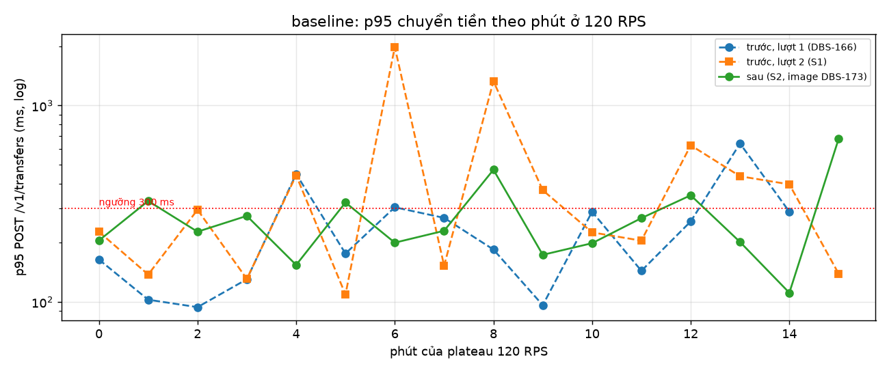
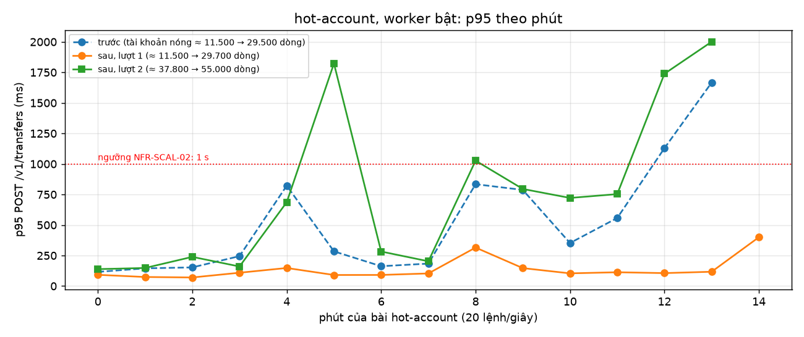
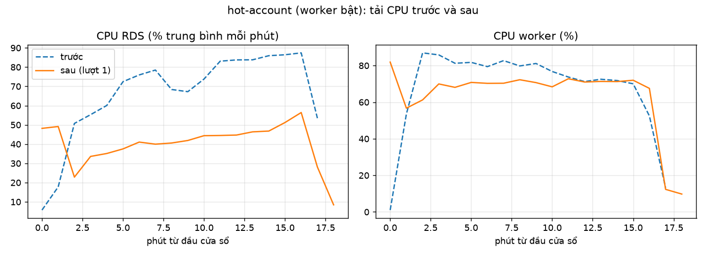

# load-tests: Kết quả tối ưu p95 chuyển tiền (DBS-173, 2026-11-21)

> **Status:** Implemented (một phiên «trước» S1, một phiên «sau» S2, đã dọn sạch) · **Owner:** Dev (thay #4 Fraud cho truy vấn đặc trưng) · **Verified against code:** chạy thật trên AWS `ap-southeast-1` ngày 2026-11-21, mọi số lấy từ k6, `pg_stat_statements`, EXPLAIN và CloudWatch của lượt thật · **Cập nhật:** 2026-11-21 · Thiết kế, quyết định, test: [DBS-173](../../features/DBS-173-p95-120rps.md) · Báo cáo trước: [02](02-ket-qua-tai-cloud-2026-11-21.md) · Kết quả thô: [results/](results/)

## 0. Tóm tắt

| DoD | Kết quả |
|---|---|
| 1. Phân tích nút thắt; chỉnh pool, index, truy vấn | **Đã làm bằng số đo thật** (§3): bốn truy vấn đặc trưng fraud ≈ ba phần tư thời gian DB, planner quét cả bảng vì visibility map 85%. Đổi: một câu SQL gộp (3 → 1 lượt quét), migration autovacuum, `keepAliveTimeout`. Pool và cỡ task không đổi vì số đo (CPU RDS không còn là nút thắt; api và worker là, thuộc BL-417). |
| 2. Báo cáo k6 cuối: p95 < 300 ms ở 120 RPS, lỗi < 0,1%, số trước/sau | **Đạt ở `baseline` plateau 120** (p95 262 ms, p99 851 ms, lỗi 0,0009%, 0 dropped, đọc p95 < 150 ms) **nhưng chưa đạt đủ bốn điều kiện đã định ở DBS-173 §4:** p95 theo phút chưa dưới 300 ms (5/16 khung), `stress` plateau 120 p95 304 ms (hụt 4 ms; lỗi 0, p99 997 ms; trước 784 ms và 0,119%), `hot-account` 4 timeout (lượt 1) và 1.881 (lượt 2, tài khoản nóng ≥ 40.000 dòng). Cải thiện đo được: thời gian DB mỗi extract giảm 4,7 lần, CPU RDS đỉnh 79 → 49% ở `baseline`, 87 → 56% ở `hot-account`, lỗi `baseline` 171 → 1, `stress` 43 → 0, `hot-account` lượt 1 34 → 4 và p95 649 → 121 ms. |
| 3. Bất biến đúng sau chạy; AC-5.x xanh | **Đạt:** `invariantExit` 0 sau cả 8 lượt trên AWS (`PASS`, tổng nợ = tổng có, số dư 0); AC-5.x: `duplicate` đúng 600 × 201 và 60 × 422; spec tiền (`money-flow`, `transfer-concurrency`, `idempotency-rollback`, `daily-limit`, `resource-ownership`, `customer-transfers`, `midnight-boundary`) xanh (DBS-173 §8). |
| 4. PR merge, CI xanh | Quy trình, ghi ở PR. |
| BL-414 (`keepAliveTimeout`) | `HTTPCode_ELB_5XX_Count` = 0 trong cả đợt `baseline` (trước: 1 và 6); test e2e và thủ công (socket ocioso 62 s dùng lại). |

## 1. Cấu hình đo

Giống [02 §1](02-ket-qua-tai-cloud-2026-11-21.md#1-cấu-hình-đo) (2 task api 0,5 vCPU, 1 worker 0,25 vCPU, RDS `db.t4g.small` Multi-AZ, Valkey 1 primary + 1 replica, WAF bật và miễn trừ IP máy tải, giới hạn tốc độ 1.000.000, máy tải `t3.medium` cùng VPC, k6 v2.3.0, DB mới, fixture 3 khách). Khác:

| Hạng mục | «Trước» | «Sau» |
|---|---|---|
| Image `dbs-api` | `d6bf542d1fdfcf5ab1c73826992f440c1e98521b` (`main`, build của CI) | `409f9f12949d4ca0c3825a333656ce8dbea0830f` (nhánh `perf/DBS-173-p95-120rps`, build tay, digest `sha256:fa989deb09b431ef5b681ce4568e1037748ee7a46886bec3973a6f1622dccc18`, Trivy cục bộ sạch; xóa khỏi ECR sau đo, §8) |
| Migration | đến `AddNotificationLogOccurredAt1795000010000` | thêm `TuneTransfersAutovacuum1795000011000` |
| `pg_stat_statements` | DBS-166: không; lượt đo lại (S1): bật bằng task master một lần | bật như S1 |
| Cách dựng | DBS-166: một phiên; S1: một phiên (DB mới) | S2: phiên mới sau khi hủy S1 (DB mới), cùng thứ tự bài: `baseline` → `hot-account` → `quiesce` → `duplicate` → `stress` → `hot-account` |
| Ngoại lệ ghi nhận | | trong S1, sau `baseline` và `hot-account` «trước», cùng phiên đã nhận image mới và chạy thêm một lượt `hot-account` «sau» (tín hiệu sớm; DB lớn hơn lượt trước) |

## 2. Cách đo và đọc số

Như [02 §2](02-ket-qua-tai-cloud-2026-11-21.md#2-cách-đo-và-đọc-số): k6 `constant-arrival-rate`, p95/p99 tính từ `requests.csv.gz`, phán quyết DoD 3 theo plateau ở `aggregate.json › plateaus`, mọi 429 ngoài bài `rate-limit` là lỗi, checker bất biến DBS-69 sau mỗi lượt. Thêm:

- **p95 theo phút** lấy các dòng `scenario = write_120` (hoặc `hot`) của `per-minute.json`; khung phút đầu và cuối của plateau thiếu mẫu nên chỉ tính khung có ≥ 500 mẫu (≥ 800 với `hot`).
- **`pg_stat_statements`** chụp bằng một task ECS dùng credential master (`dbs-db-roles` với `command` ghi đè, không có bí mật trong tham số): thời gian DB mỗi câu lệnh = hiệu của hai lần chụp chia cho hiệu số lần gọi. `total_exec_time` là thời gian chạy (gồm chờ khóa và I/O), không chỉ CPU.
- **Hai lượt «trước» cùng cấu hình** (lượt 1 của DBS-166, lượt 2 đo lại ở S1) vì hai lượt cho hai kết quả khác nhau; số «trước» luôn nêu cả hai.

## 3. Phân tích nút thắt (DoD 1)

Chi tiết và bằng chứng: [DBS-173 §2.1](../../features/DBS-173-p95-120rps.md). Tóm lược:

**Hai lượt «trước», plateau 120 của `baseline`:**

| | Lượt 1 (DBS-166) | Lượt 2 (S1) |
|---|---|---|
| Chuyển p95 / p99 | 218 / 703 ms | 344 / 1.406 ms |
| Lỗi hệ thống / dropped | 0 / 0 | 171 (0,158%) / 54 |
| Phút có p95 > 300 ms | 3 trên 15 | 7 trên 16 khung (phút p95 đỉnh 1.985 ms, 71 timeout) |

Cùng cấu hình mà hai kết quả khác nhau: ở 120 RPS với worker bật hệ thống không ổn định.

**Thời gian DB theo câu lệnh, `baseline` cả đợt (S1):** `history` 679 s (19,7 ms/lần), `outflow24h` 425 s (12,3), `velocity` 350 s (10,1), `newRecipientCount` 233 s (6,7): bốn truy vấn đặc trưng fraud của worker chiếm khoảng ba phần tư thời gian câu lệnh; ở `hot-account` (20 giao dịch/giây) chúng cộng lại ≈ 191 ms mỗi giao dịch ≈ 3,8 giây thời gian DB mỗi giây trên RDS 2 vCPU: **bão hòa**.

**Kế hoạch thực thi trên RDS thật:** Seq Scan cả bảng ở cả bốn truy vấn vì visibility map chỉ phủ 85% trang (autovacuum mỗi 5 đến 7 phút, ngưỡng mặc định 20%), index-only scan bị tính phí heap; ép `random_page_cost = 1,1` làm tệ hơn (39% heap fetch). Thí nghiệm cùng dữ liệu, DB rảnh: `history` + `velocity` + `outflow24h` cũ 76,6 ms; sau `VACUUM` 58,8 ms; `accountFacts` mới 38,7 ms, và **26,2 ms** sau `VACUUM` (2,9 lần).

## 4. Thay đổi (DoD 1: index, truy vấn)

| # | Thay đổi | Ở đâu |
|---|---|---|
| B1 | Một câu SQL `accountFacts` thay ba truy vấn `history`, `velocity`, `outflow24h`: một lượt quét `v_transfer_facts` của tài khoản nguồn trong 30 ngày, các cửa sổ hẹp bằng `FILTER`; từng giá trị đặc trưng giữ nguyên (oracle ba SQL cũ trong test) | `transfer-facts.ts`, `online-feature-provider.ts` |
| B2 | `autovacuum_vacuum_insert_scale_factor = 0`, `autovacuum_vacuum_insert_threshold = 1000` cho `transfers` (visibility map luôn mới) | migration `1795000011000-TuneTransfersAutovacuum.ts` |
| B3 | `keepAliveTimeout` 65 s, `headersTimeout` 66 s (BL-414) | `app.setup.ts` |
| không đổi theo số đo | pool `DATABASE_POOL_MAX` 10 (kết nối RDS ở §5), `random_page_cost`, cỡ worker và RDS (BL-417 bàn giao #5) | |

## 5. Kết quả trước và sau

«Trước» = image `main` `d6bf542d`, hai lượt `baseline` cùng cấu hình (lượt 1 DBS-166, lượt 2 S1). «Sau» = image nhánh `409f9f12` (S2, DB mới). Mọi số lấy từ `aggregate.json`, `per-minute.json`, `pg_stat_statements` và CloudWatch trong [results/](results/).

### 5.1 `baseline`, plateau 120 RPS (80% đọc, 15 phút)

| | Trước, lượt 1 | Trước, lượt 2 | **Sau** |
|---|---|---|---|
| Chuyển p50 / p95 / p99 (ms) | 36,7 / 218,2 / 703,2 | 36,5 / 344,0 / 1.406,0 | 31,9 / **262,4** / **850,9** |
| Lỗi hệ thống / tỉ lệ / dropped | 0 / 0% / 0 | 171 / 0,158% / 54 | **1 / 0,0009% / 0** |
| DoD 3 theo plateau (`meetsDoD3`) | đạt | **không đạt** | **đạt** |
| Đọc số dư / lịch sử p95 (ms) | 52,9 / 61,1 | 76,5 / 95,3 | 59,8 / 71,4 |
| Số phút (khung) có p95 chuyển > 300 ms | 3 / 15 (đỉnh 641) | 7 / 16 (đỉnh 1.985) | **5 / 16 (đỉnh 678)** |
| Thời gian DB mỗi lần extract (worker, `pg_stat_statements`, plateau 120) | không đo | 78,4 ms (31,6 + 19,8 + 16,3 + 10,6) | **16,8 ms** (`accountFacts` 14,2 + `newRecipientCount` 2,6) |
| Thời gian DB mỗi lần extract, cả đợt `baseline` | không đo | 48,8 ms | 11,8 ms |
| CPU RDS trung bình / đỉnh (CloudWatch, cả đợt) | không đo | 29,9% / 78,8% | 24,1% / 49,2% |
| CPU worker trung bình / đỉnh | 85 đến 90% (báo cáo 02) | 45,4% / 94,7% | 43,7% / 83,7% |
| Kết nối RDS đỉnh | 30 | 30 | 30 |
| `HTTPCode_ELB_5XX_Count` (cả đợt) | 1 | 6 | **0** |
| Invariant DBS-69 | PASS | PASS | PASS |

Đọc số: **các ngưỡng tổng của plateau 120 đạt** (p95 262 < 300 ms, p99 851 < 1.000 ms, lỗi 0,0009% < 0,1%, 0 dropped, đọc p95 < 150 ms), nhưng **p95 tổng không thấp hơn lượt 1 «trước» (218 ms)** và **p95 theo phút chưa dưới 300 ms** (5 trên 16 khung, đỉnh 678 ms ở khung cuối, gồm đuôi `gracefulStop`): phần cải thiện rõ nhất ở `baseline` là độ ổn định (0 so với 171 lỗi ở lượt 2), p99 và tải DB (thời gian DB mỗi extract giảm 4,7 lần, CPU RDS đỉnh 79% xuống 49%). Phần còn lại của đuôi độ trễ không đến từ truy vấn đặc trưng nữa: khóa dòng tài khoản của api (`FOR UPDATE`, trung bình 22 ms ở plateau 120, ba tài khoản nhận 8 lệnh/giây mỗi tài khoản), CPU api và worker (§6) và các lần đứng hình (§7).

### 5.2 `stress`, plateau 120 (DB đã có ≈ 53.000 giao dịch, thứ tự bài như DBS-166)

| | Trước (DBS-166, worker bật) | **Sau** |
|---|---|---|
| Chuyển p95 / p99 (ms) | 784 / 1.770 | **304,1 / 996,8** |
| Lỗi hệ thống / tỉ lệ / dropped | 43 / 0,119% / 0 | **0 / 0% / 0** |
| Đọc số dư p95 / lịch sử p95 (ms) | 183 (lịch sử) | 65,7 / 78,5 |
| Phút có p95 > 300 ms (5 khung đủ mẫu) | không tính | 3 (đỉnh 538) |
| Plateau 180 và 240 | 180: 97,3% timeout; 240: 99,4% | 180: 84,9% timeout (195 dropped); 240: 98,1% |
| Invariant DBS-69 | PASS | PASS |

p95 plateau 120 là **304,1 ms, cao hơn ngưỡng 300 ms 4 ms**; p99 và lỗi đạt. Ở plateau 180 và 240 hệ thống vẫn sập, nhưng nút thắt đã đổi: CPU api đạt 98 đến 100% (hai task 0,5 vCPU), CPU worker 90 đến 98%, **CPU RDS chỉ 60 đến 78%** (trước đây RDS 81 đến 90% với kết nối 30/30): điểm gãy không còn do truy vấn đặc trưng mà do cỡ api và worker (BL-417).

### 5.3 `hot-account`, worker bật (20 lệnh/giây, 15 phút)

| | Trước (S1) | Sau, lượt 1 (S2, cùng trạng thái DB) | Sau, lượt 2 (S2, sau `stress`) |
|---|---|---|---|
| Dòng của tài khoản nóng (đầu → cuối lượt) | 11.500 → 29.500 | 11.500 → 29.700 | 37.800 → 55.000 |
| Chuyển p50 / p95 / p99 (ms) | 82 / 649 / 1.519 | 35 / **121** / 426 | 93 / **2.000** / 2.001 |
| Timeout (lỗi hệ thống) | 34 (0,19%) | **4 (0,022%)** | **1.881 (10,4%)** |
| Thời gian DB mỗi lần extract | 191 ms (77,6 + 49,4 + 32,2 + 31,6) | 40,8 ms (35,2 + 5,6) | 155,1 ms (132,9 + 22,2) |
| CPU RDS trung bình / đỉnh | 66,1% / 87,4% | 40,0% / 56,4% | 65,7% / 88,6% |
| CPU worker trung bình / đỉnh | 67,5% / 86,9% | 63,6% / 81,9% | 59,0% / 71,1% |
| Lượt «sau» thêm trên DB của chính S1 (tín hiệu sớm, tài khoản nóng 29.500 → 47.500 dòng) | | p95 309 ms, p99 1.115 ms, 14 timeout; CPU RDS 53,5% / 78,0% | |
| Invariant DBS-69 | PASS | PASS | PASS |

Lượt 1 cải thiện rõ (p95 649 → 121 ms, lỗi 34 → 4, thời gian DB mỗi extract giảm 4,7 lần) nhưng **chưa 0 lỗi**. Lượt 2 (tài khoản nóng ≥ 40.000 dòng, mức «lịch sử lớn» của BL-413) **không đạt** (10,4% timeout): đúng như tính ở [DBS-173 §2.3](../../features/DBS-173-p95-120rps.md): chi phí vẫn O(số dòng trong cửa sổ 30 ngày) (≈ 133 ms mỗi lần ở 46.000 dòng bình quân, 2,9 µs mỗi dòng khi RDS bận), 20 lần mỗi giây ≈ 3,1 giây thời gian DB mỗi giây trên 2 vCPU: bão hòa. Tăng thời gian giữ khóa tài khoản (`FOR UPDATE` trung bình 184 ms) làm độ trễ chuyển tiền tăng theo.

### 5.4 `duplicate`

600 × 201 cùng thân và 60 × 422 `IDEMPOTENCY_KEY_REUSED`, p95 81 ms (< 300), `invariantExit` 0: AC-5.3, 5.4 và 5.5 giữ nguyên trên image mới.

### 5.5 Kiểm kết nối, khóa và visibility map dưới tải (B2)

| Số đo | Trước (S1, `hot-account` 25.600 dòng) | Sau (S2) |
|---|---|---|
| `relallvisible / relpages` của `transfers` | 836 / 978 (85%) | 476 / 478 (99,6%), 599 / 604 (99,2%) ở plateau 120; 1.700 / 1.706 (99,6%) ở `hot-account` lượt 2 |
| Heap fetch của index-only scan | 39% (11.608/29.525) | 0,5% (249/45.353) đến 1,8% |
| Kế hoạch của bốn truy vấn | Seq Scan cả bảng (1.008 buffer mỗi lần) | Index Only Scan (`accountFacts` 1.073 buffer ở 38.445 dòng) |
| Khoảng giữa hai lần autovacuum | 5 đến 7 phút | ≈ 1 phút (`autovacuum_count` 21 → 27 trong 5 phút) |

## 6. Giới hạn và nút thắt còn lại

1. **Hot-account ≥ 40.000 dòng chưa đạt.** Chi phí O(cửa sổ 30 ngày) còn nguyên; phần cấu trúc của BL-413 (thống kê gia tăng theo tài khoản hoặc bảng tổng hợp) đổi kiến trúc fraud và quyền bảng nên không làm trong task này: dòng BACKLOG riêng (§8).
2. **Độ trễ theo phút ở 120 RPS chưa dưới 300 ms** và `stress` plateau 120 hụt 4 ms: nằm ở khóa dòng tài khoản của api (trung bình 22 ms, 3 tài khoản), CPU api (đỉnh 63% ở `baseline`, 100% ở `stress`) và CPU worker (đỉnh 84 đến 98%, 0,25 vCPU). Cỡ task là quyết định của #5 (BL-417); task này không đổi cỡ và không đổi `DATABASE_POOL_MAX` (kết nối RDS đỉnh vẫn 30 = 3 task × 10, nhưng CPU RDS không còn là nút thắt).
3. **Tính đại diện** như [02 §3](02-ket-qua-tai-cloud-2026-11-21.md#3-tính-đại-diện-đọc-trước-khi-trích-số): 3 khách, một IP nguồn, một lượt mỗi bài cho mỗi phiên, không có khoảng tin cậy; hai lượt «trước» khác nhau chứng minh phương sai lớn, nên «sau» chỉ một mẫu `baseline`, một `stress`, hai `hot-account` (và một mẫu sớm trên S1).
4. Thời gian tới khi có cờ (p95 < 5 giây) và đo ở chế độ B2 là của DBS-174, không đo ở đây (`risk_transfer_to_flag_ms` không có điểm dữ liệu trong cửa sổ `baseline`).

## 7. Cảnh báo vận hành thấy trong lúc đo

- **Đứng hình một phút, ≈ 70 timeout:** `baseline` S2 plateau 60, phút 9 (≈ 10:00Z): 70 timeout (đọc và ghi) trong một phút, làm plateau 60 vượt 0,1% (0,13%, `meetsDoD3` false); CloudWatch cùng phút: CPU RDS 24%, `WriteLatency` 4 ms, `TargetResponseTime` lớn nhất 1,96 giây, log api không có cảnh báo. Lượt 2 «trước» có đúng một sự kiện cỡ này (plateau 120 phút 36, 71 timeout, RDS CPU 78% lúc đó). **Không giải thích được bằng truy vấn đặc trưng** (RDS rảnh); nghi tầng ứng dụng, Valkey hoặc ALB: chưa điều tra, BACKLOG.
- **`pg_stat_statements`** phải được bật bằng task master (`CREATE EXTENSION`, `GRANT pg_read_all_stats TO dbs_api`): `shared_preload_libraries` của RDS đã có sẵn thư viện; không nằm trong Terraform.
- Máy tải EC2 mới dựng không đăng ký SSM cho tới khi `reboot-instances` (IP công khai giữ nguyên, WAF vẫn miễn trừ).
- Image đo là image build tay của nhánh, đã **xóa khỏi ECR sau đo**: `aws ecr describe-images --image-ids imageTag=409f9f12949d4ca0c3825a333656ce8dbea0830f` trả `ImageNotFoundException` (§8).
- Dựng `session` mất ≈ 16 phút; hủy ≈ 10 phút; đợt này: hai phiên `session` (S1, S2) dùng chung một máy tải, máy tải chạy ≈ 5,3 giờ.

## 8. Dọn dẹp và bằng chứng

| Bước | Kết quả |
|---|---|
| `terraform destroy` `session` S1 và S2, `loadgen` | `Destroy complete`: 66, 66 và 14 tài nguyên |
| `infra/scripts/verify-clean.sh` | thoát 0, `KET LUAN: sạch (13 loại)` |
| `list-user-pool-clients` | chỉ còn `dbs-app` |
| ECR `dbs-api` tag `409f9f12949d4ca0c3825a333656ce8dbea0830f` | đã xóa (`batch-delete-image`), `describe-images` báo `ImageNotFoundException`; ba tag còn lại là của `main` |
| State tạm | `dev/loadgen-dbs173.tfstate`, `dev/session-dbs173.tfstate`; `base.tfstate` và `session.tfstate` không đụng |

## 9. Kết quả thô

Thư mục trong [results/](results/): `s1-before-baseline`, `s1-before-hot-account`, `s1-after-hot-account` (phiên S1), `s2-baseline`, `s2-hot-account-1`, `s2-duplicate`, `s2-stress`, `s2-hot-account-2` (phiên S2), mỗi thư mục có `aggregate.json`, `per-minute.json`, `summary.json`, `exit.json` (`runExit`, `invariantExit`), `invariants.txt`, `requests.csv.gz`, `raw.json.sha256` và `.size` (`raw.json` đầy đủ không commit), `cloudwatch.json`; [explain-pgss/](results/explain-pgss/): ảnh chụp `pg_stat_statements` (S1, S2), EXPLAIN trên RDS thật (cũ, gộp, sau `VACUUM`, cài đặt planner, dưới tải) và các script đã dùng (`dbtask.sh`, `chain.sh`, `analyze.py`, `pgss_delta.py`, `charts.py`).

| Lượt | `runExit` | `invariantExit` |
|---|---|---|
| `s1-before-baseline` | 99 | 0 |
| `s1-before-hot-account` | 99 | 0 |
| `s1-after-hot-account` | 99 | 0 |
| `s2-baseline` | 99 | 0 |
| `s2-hot-account-1` | 99 | 0 |
| `s2-duplicate` | 0 | 0 |
| `s2-stress` | 99 | 0 |
| `s2-hot-account-2` | 99 | 0 |

`runExit` 99 là ngưỡng k6 (`checks == 1` nên mọi timeout làm đỏ, kể cả 1 lỗi); phán quyết DoD đọc ở `aggregate.json › plateaus` và các bảng trên.
