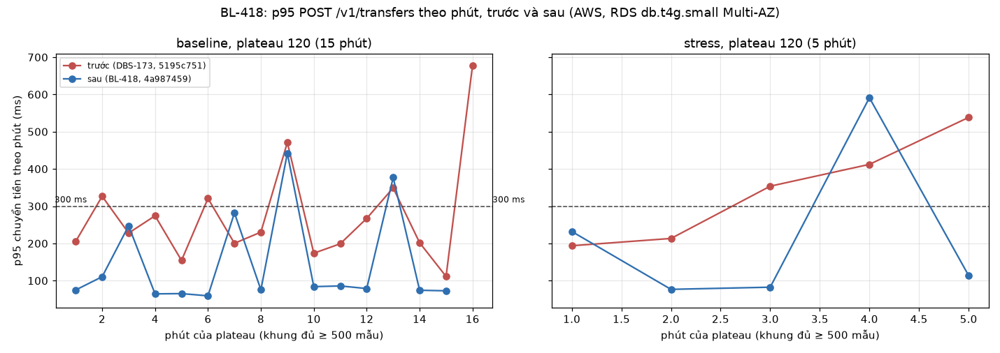

# load-tests: Kết quả đo BL-418, hạn mức ngày đọc bộ đếm (2026-11-22)

> **Status:** Implemented (một phiên, một lượt `baseline` và một lượt `stress`, đã dọn sạch) · **Owner:** Dev (đo thay Platform & Ops) · **Verified against code:** chạy thật trên AWS `ap-southeast-1` từ 16:58Z đến 18:02Z ngày 2026-11-21 (đồng hồ UTC; 23:58 đến 01:02 giờ Việt Nam), mọi số lấy từ k6, `pg_stat_statements` và CloudWatch của lượt thật · **Cập nhật:** 2026-11-22 · Thiết kế, quyết định, test: [BL-418](../../features/BL-418-daily-limit-counter.md) · Báo cáo trước: [03](03-ket-qua-toi-uu-p95-2026-11-21.md) · Kết quả thô: [results/](results/)

## 0. Tóm tắt

BL-418 chuyển tổng tiền đã chuyển trong ngày ra khỏi thời gian giữ khóa (bộ đếm trên hàng `accounts`, trigger giữ). Câu hỏi của BL-423: ở `baseline` 120 RPS, p95 chuyển tiền đã **dưới 300 ms ở từng phút** chưa?

| Điều kiện | Kết quả |
|---|---|
| Thời gian giữ khóa giảm | **Có, đo trên RDS thật**: chờ khóa `FOR UPDATE` của api 22,4 → **9,8 ms** (plateau 120 của `baseline`); `SUM` hạn mức ngày (1,9 ms, 1.030 buffer mỗi lần) **không còn trong top truy vấn**; câu lệnh trong khóa ≈ 2,9 → 1,4 ms (§4) |
| `baseline` plateau 120: p95 chuyển < 300 ms **từng phút** | **Chưa đạt trọn**: 13 trên 15 khung đủ mẫu dưới 300 ms (trước 11 trên 16); **2 khung vượt** (442 và 377 ms). Trung vị p95 theo phút 79 ms (trước 229 ms) |
| `baseline` plateau 120: p95 tổng, lỗi | p95 **91,9 ms** (trước 262,4), p99 585,5 ms (trước 850,9); **9 lỗi timeout (0,0083%) và 1 dropped iteration**, nên `meetsDoD3` là `false` (trước `true`, 1 lỗi, 0 dropped): cả 9 lỗi nằm trong một phút |
| `stress` plateau 120 | p95 **119,9 ms** (trước 304,1, hụt 4 ms của DBS-173 nay đạt), 7 lỗi (0,019%), 0 dropped, `meetsDoD3` `true`; 1 trên 5 khung vượt 300 ms (591 ms, trước 3 trên 5) |
| Điểm gãy của `stress` | plateau 180: 0,13% lỗi (71) so với **84,9% timeout** trước; plateau 240 vẫn gãy: 68,9% (trước 98,1%), CPU api và worker 100% |
| AC-5.x, bất biến | `invariantExit` 0 sau cả hai lượt (checker có kiểm thứ 6 `daily_debit_totals`, `PASS`); AC-5.6 giữ (test và thủ công ở [BL-418 §8](../../features/BL-418-daily-limit-counter.md)) |

**Kết luận trung thực:** BL-418 giảm rõ thời gian giữ khóa và kéo p95 tổng xuống 3 lần, nhưng **điều kiện «từng phút dưới 300 ms» chưa đạt** vì còn những phút có đuôi 1 đến 2 giây (p99 theo máy chủ từ 0,5 giây trở lên ở 9 trong 15 phút và từ 1,8 giây ở 4 phút, RDS chỉ ≈ 45% CPU, api ≈ 55%). Đuôi đó **không đến từ `SUM`** (không còn) và **chưa tìm ra nguyên nhân**: nó cùng dạng với các lần «đứng hình 2 giây» của [BL-419](../../BACKLOG.md). Cả hai lượt «trước» và «sau» đều vượt 300 ms ở phút 9 và 13 của plateau, gợi ý một tác nhân tuần hoàn chưa xác định (chưa kiểm; có thể chỉ là trùng hợp).

## 1. Cấu hình đo

Giống [03 §1](03-ket-qua-toi-uu-p95-2026-11-21.md#1-cấu-hình-đo): 2 task api 0,5 vCPU (1 GB), 1 worker 0,25 vCPU (0,5 GB), RDS `db.t4g.small` Multi-AZ (PostgreSQL 17.9, 20 GB gp3), Valkey `cache.t4g.micro` 1 primary + 1 replica, WAF bật và miễn trừ IP máy tải, giới hạn tốc độ nâng lên 1.000.000, máy tải `t3.medium` cùng VPC, k6 v2.3.0, DB mới, fixture 3 khách. Khác:

| Hạng mục | «Trước» (DBS-173, S2) | «Sau» (phiên này) |
|---|---|---|
| Image `dbs-api` | `409f9f12…` (nhánh, build tay) | `4a9874590c52db2e587891b6c806c71159057411`: **build của workflow Image trên `main`** sau merge #227 (không build tay, không có tag nào để xóa) |
| Migration | đến `TuneTransfersAutovacuum1795000011000` | thêm `AddDailyDebitCounter1795000012000` (chạy bằng `migrate.sh` trên DB trống; trigger bật, hàm `SECURITY DEFINER`, hai cột có mặt: kiểm bằng task `dbs-db-roles` ghi đè lệnh) |
| `pg_stat_statements` | bật bằng task master | bật như trước, chụp mỗi ≈ 2,5 phút bằng task master (≈ 25 lượt; sáu lượt sát đầu và cuối các plateau được giữ trong `results/`) |
| Bài chạy | `baseline` → `hot-account` → `quiesce` → `duplicate` → `stress` → `hot-account` | smoke → `baseline` → nghỉ 90 giây → `stress`. **Không chạy** `rate-limit`, `hot-account`, `duplicate`: ngoài phạm vi BL-418 (BL-413 và AC-5.3/5.4 không bị đụng) |
| Số lượt | một lượt mỗi bài | một lượt mỗi bài: **không có khoảng tin cậy** (hai lượt «trước» của DBS-173 cho hai kết quả khác nhau, nên mỗi số «sau» chỉ là một mẫu) |
| Máy tải | `t3.medium` | `t3.medium`, nguồn đúng `4a987459` (`COMMIT` trong `src.tgz`) |

## 2. Cách đo và đọc số

Như [03 §2](03-ket-qua-toi-uu-p95-2026-11-21.md#2-cách-đo-và-đọc-số): p95 theo phút lấy dòng `scenario = write_120` của `per-minute.json`, chỉ khung ≥ 500 mẫu; phán quyết DoD 3 theo plateau ở `aggregate.json › plateaus`; mọi 429 ngoài bài `rate-limit` là lỗi; checker bất biến DBS-69 sau mỗi lượt. Thêm: delta `pg_stat_statements` giữa hai lần chụp sát đầu và cuối plateau ([results/bl418-explain-pgss/pgss-delta.txt](results/bl418-explain-pgss/pgss-delta.txt)): `baseline` plateau 120 từ 17:29:04Z đến 17:44:41Z; `stress` plateau 120 từ 17:47:15Z đến 17:49:50Z (2,5 phút đầu), plateau 180 từ 17:52:22Z đến 17:54:57Z.

## 3. Kết quả

### 3.1 `baseline`, plateau 120 (15 phút)

| | Trước (S2) | **Sau** |
|---|---|---|
| Chuyển p50 / p95 / p99 (ms) | 31,9 / 262,4 / 850,9 | 30,5 / **91,9** / **585,5** |
| Lỗi hệ thống / tỉ lệ / dropped | 1 / 0,0009% / 0 | 9 / 0,0083% / 1 |
| `meetsDoD3` | đạt | **không đạt** (1 dropped iteration; tỉ lệ lỗi vẫn < 0,1%) |
| Đọc số dư / lịch sử p95 (ms) | 59,8 / 71,4 | 41,8 / 46,4 |
| Khung đủ mẫu có p95 > 300 ms | 5 / 16 (đỉnh 678) | **2 / 15** (đỉnh 442) |
| Trung vị p95 theo phút (ms) | 229 | 79 |
| Plateau 60: lỗi hệ thống | 70 (0,13%, `meetsDoD3` sai: một «đứng hình») | **0** (p95 50,6 ms) |
| `HTTPCode_ELB_5XX_Count`, 5xx của máy chủ | 0 | 0 |
| Invariant DBS-69 (6 kiểm) | PASS (5 kiểm) | PASS |

p95 theo phút của `write_120` (ms), sau: 75 111 247 65 65 59 282 75 **442** 84 86 79 **377** 74 73 150 (khung cuối chỉ 179 mẫu, không tính). Trước: 205 327 228 274 154 321 200 230 471 174 199 267 349 202 111 678.

Phút có 9 lỗi là phút 39 của lượt (17:37:47Z đến 17:38:47Z): cả 9 timeout 2 giây và 1 dropped iteration nằm trong đúng phút đó, cùng dạng với «đứng hình» của BL-419 (nhưng nhẹ hơn: 9 thay vì 70 đến 71).

### 3.2 `stress`

| | Trước (S2) | **Sau** |
|---|---|---|
| Plateau 120: chuyển p95 / p99 (ms) | 304,1 / 996,8 | **119,9** / 940,0 |
| Plateau 120: lỗi / dropped / `meetsDoD3` | 0 / 0 / đạt | 7 (0,019%) / 0 / đạt |
| Plateau 120: khung có p95 > 300 ms | 3 / 5 (đỉnh 538) | 1 / 5 (591, cùng phút với 7 lỗi) |
| Plateau 180: lỗi hệ thống / dropped | 45.677 (**84,9%**) / 195 | 71 (**0,13%**) / 105 |
| Plateau 180: chuyển p95 (ms) | 2.001 | 493 (p95 theo phút: 226 186 1.275 337 1.245 745) |
| Plateau 240: lỗi hệ thống | 98,1% | 68,9% (CPU api và worker 100%) |
| Invariant DBS-69 | PASS | PASS (6 kiểm) |

### 3.3 CloudWatch trong cửa sổ `baseline` (16:58Z đến 17:46Z)

| | Trước (S2) | Sau |
|---|---|---|
| CPU RDS trung bình / đỉnh | 24,1% / 49,2% | 23,6% / 46,4% |
| CPU api, đỉnh của task cao nhất | 63% | 56,7% |
| CPU worker trung bình / đỉnh | 43,7% / 83,7% | 46,3% / 87,8% |
| Kết nối RDS đỉnh | 30 | 30 |
| Chuyển tiền p95 / p99 đo ở máy chủ, đỉnh theo phút | không có | 194,7 ms / **1.964 ms** |
| Tuổi outbox lớn nhất | không có | 1,9 giây |

CPU RDS và api không thay đổi đáng kể, nên phần cải thiện đến từ thời gian giữ khóa chứ không từ việc nhường tải. Worker vẫn ở 84 đến 88% (0,25 vCPU, BL-417). Ở `stress`: CPU RDS đỉnh 72,3%, api 100% (plateau 240), worker 100%.

## 4. Thời gian giữ khóa trên RDS thật (DoD: đo và giảm)

Delta `pg_stat_statements` của plateau 120 (`baseline`, 21.601 lệnh chuyển), ms mỗi lần:

| Câu lệnh (api) | Trước | **Sau** |
|---|---|---|
| Chờ khóa `SELECT … FOR UPDATE` (cả `lockForUpdate`) | 22,44 | **9,81** |
| `SENT_TODAY_SQL` (`SUM` hạn mức ngày) | 1,90 (1.030 buffer) | **không còn** (guard đọc bộ đếm) |
| `INSERT ledger_entries` (nay gồm trigger bộ đếm) | 0,27 | 0,57 (+0,30) |
| `INSERT transfers` | 0,31 | 0,30 |
| `UPDATE accounts` (mỗi lần, 2 lần mỗi lệnh) | 0,08 | 0,11 |
| `UPDATE idempotency_keys` | 0,18 | 0,17 |
| `INSERT outbox_events` | 0,09 | 0,09 |
| **Tổng câu lệnh chạy trong khóa** | **≈ 2,9** | **≈ 1,4** |
| Thời gian DB mỗi lần extract (worker) | 16,8 | 15,1 |

Chi phí của trigger trên đường ghi là +0,30 ms mỗi lệnh (tính vào `INSERT ledger_entries`), nhỏ hơn 1,9 ms của `SUM` và không có thêm vòng đi về. Chờ khóa ở `stress` tăng theo tải: 13,5 ms (plateau 120) và 43,8 ms (plateau 180). Số tuyệt đối thời gian giữ khóa (gồm COMMIT Multi-AZ, vòng đi về, event loop) vẫn không đo được từ phía DB; số đo cục bộ ở [BL-418 §8.1](../../features/BL-418-daily-limit-counter.md).

## 5. Giới hạn và nút thắt còn lại

1. **Đuôi 1 đến 2 giây chưa giải thích được.** Ở 9 trong 15 phút của `baseline` plateau 120, p99 chuyển tiền đo ở máy chủ từ 0,5 giây trở lên (1,9 giây ở 4 phút: 17:34, 17:36, 17:37, 17:40Z; cỡ 14 lệnh mỗi phút), trong khi RDS ≈ 45% CPU, api ≈ 55%, ALB p99 tối đa ≈ 1,0 giây, không 5xx, chờ khóa trung bình 9,8 ms. Hai phút vượt 300 ms ở p95 là các phút có nhiều lệnh nhất ở đuôi này. Không đủ số đo để chỉ ra nguyên nhân: nghi tác nhân tuần hoàn (phút 9 và 13 của plateau vượt ở cả hai lượt «trước» và «sau»), tạm dừng GC của api, hoặc COMMIT đồng bộ Multi-AZ. Chuyển [BL-419](../../BACKLOG.md).
2. **CPU worker 84 đến 88% ở 0,25 vCPU** và CPU api 100% ở `stress` plateau 240: cỡ task là quyết định của [BL-417](../../BACKLOG.md); phiên này không đổi cỡ.
3. **Tính đại diện** như [02 §3](02-ket-qua-tai-cloud-2026-11-21.md#3-tính-đại-diện-đọc-trước-khi-trích-số): 3 khách, một IP nguồn, một lượt mỗi bài, không có khoảng tin cậy. Một lượt «sau» không đủ để nói «đạt» hay «không đạt» ở mức một phút nhiễu: hai lượt «trước» đã cho 3 và 7 khung vượt.
4. Không đo `hot-account` và fraud ở phiên này (BL-413, BL-187).

## 6. Cảnh báo vận hành thấy trong lúc đo

- Máy tải EC2 mới **không đăng ký SSM** sau lần `reboot-instances` đầu (đến quá sớm lúc máy còn `pending`); lần reboot thứ hai, 12 phút sau, mới `Online` (cùng cảnh báo ở [03 §7](03-ket-qua-toi-uu-p95-2026-11-21.md#7-cảnh-báo-vận-hành-thấy-trong-lúc-đo)).
- Dựng `session` mất ≈ 18 phút (RDS Multi-AZ chiếm phần lớn); image đo là image của CI trên `main`, nên không có bước build tay và không có tag nào để xóa khỏi ECR.
- Helper chụp `pg_stat_statements` của DBS-173 có đường dẫn cứng và truyền đường dẫn kiểu `/f/...` cho Python trên Windows: phải đổi sang `F:/...` (BL-420 vẫn mở).

## 7. Dọn dẹp và bằng chứng

| Bước | Kết quả |
|---|---|
| `terraform destroy` `session` | `Destroy complete! Resources: 66 destroyed`, thoát 0 (≈ 8 phút) |
| `terraform destroy` `loadgen` | `Destroy complete! Resources: 14 destroyed` |
| `infra/scripts/verify-clean.sh` | thoát 0, `KET LUAN: sạch (13 loại)` |
| `list-user-pool-clients` | chỉ còn `dbs-app`; `describe-user-pool-client` của `dbs-app` trước và sau **giống hệt từng byte** |
| ECR `dbs-api` | không build tay nên không có tag nào để xóa; tag `4a987459…` là của workflow Image trên `main`, giữ nguyên |
| State tạm | `dev/loadgen-bl418.tfstate` và `dev/session-bl418.tfstate` đã xóa sau `destroy`; `base.tfstate` và `session.tfstate` không đụng |
| Còn lại trên AWS | không EC2, RDS hay cluster ECS; bucket `dbs-loadgen-*` đã mất; log group `/dbs/dev/api` và `/dbs/dev/worker` (thuộc `base`). Tức chỉ còn `base` |
| Thời gian và chi phí | máy tải và `session` chạy ≈ 1 giờ 50 phút (dựng 16:24Z, hủy xong ≈ 18:13Z); ước ≈ 1 USD theo 0,5 USD/giờ của [03](03-ket-qua-toi-uu-p95-2026-11-21.md), **chưa đối chiếu hóa đơn** |

## 8. Kết quả thô

Thư mục trong [results/](results/): `bl418-baseline` và `bl418-stress` (mỗi thư mục có `aggregate.json`, `per-minute.json`, `summary.json`, `exit.json` với `runExit` và `invariantExit`, `invariants.txt`, `requests.csv.gz`, `raw.json.sha256` và `.size` (`raw.json` đầy đủ không commit), `cloudwatch.json`; `run.log` không commit vì chứa tên miền của ALB, như các thư mục kết quả trước); `bl418-explain-pgss/`: sáu ảnh chụp `pg_stat_statements` sát đầu và cuối các plateau và `pgss-delta.txt`.

| Lượt | `runExit` | `invariantExit` |
|---|---|---|
| `bl418-baseline` | 99 | 0 |
| `bl418-stress` | 99 | 0 |

`runExit` 99 là ngưỡng k6 (`checks == 1` nên mọi timeout làm đỏ, kể cả 1 lỗi); phán quyết DoD đọc ở `aggregate.json › plateaus` và các bảng trên.
