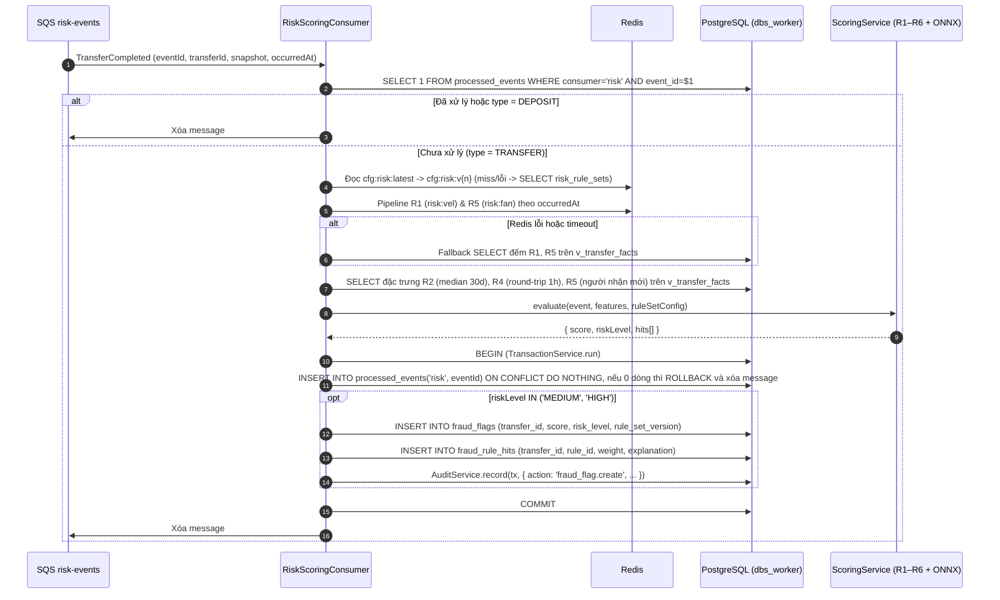

# risk — Architecture

> **Status:** Draft · **Owner:** #4 · **Cặp đôi:** #1 · **Verified against code:** n/a (chưa có code) · **Cập nhật:** 2026-10-11

> Tài liệu kiến trúc chi tiết của module `risk` (Task 6 trong [master roadmap](../../superpowers/plans/2026-10-02-master-roadmap.md)), đồng bộ với [`docs/03` §15](../../03_HIGH_LEVEL_ARCHITECTURE.md), [`_shared/database-design.md`](../_shared/database-design.md), [`_shared/event-contract.md`](../_shared/event-contract.md) và [ADR-08](../../adr/0008-fraud-detection-architecture.md).

---

## 1. Cấu trúc

Module `risk` nằm trọn trong `backend/src/modules/risk/` (đăng ký ở `sharedModules` trong `backend/src/modules/index.ts` vì vừa phục vụ HTTP ở role `api`, vừa chạy consumer ở role `worker` khi `runsWorkers() === true`), kèm công cụ đánh giá offline ở `backend/src/scripts/`; công cụ huấn luyện ML (chỉ khi `v3` qua cổng go/no-go của ADR-08) ở `backend/ml/` và artifact ở `backend/models/`, cả hai nằm ngoài `src`.

| File / Thư mục | Chạy ở | Trách nhiệm |
|---|---|---|
| `risk.module.ts` | `api` + `worker` | Đăng ký controller, service, repository; chỉ khởi tạo `RiskScoringConsumer` khi `runsWorkers()` |
| `risk-flags.controller.ts` | `api` | Endpoint UC-10 cho `operator`: danh sách cờ, chi tiết cờ (+ 10 giao dịch gần nhất), duyệt cờ một lần |
| `risk-config.controller.ts` | `api` | Endpoint UC-12 cho `admin`: xem cấu hình hiện hành, tạo phiên bản cấu hình mới (`risk_rule_sets`) |
| `risk-scoring.consumer.ts` | `worker` | Nhận `TransferCompleted` từ queue `risk-events`, kiểm tra idempotency (`processed_events`), gọi `ScoringService`, ghi `fraud_flags` + `fraud_rule_hits` + `audit_log` trong một transaction |
| `scoring.service.ts` | `worker` + script | Điều phối chấm điểm theo phiên bản `RiskRuleSet`: chạy 6 luật hàm thuần `R1–R6` và (khi cấu hình bật `ml`) kết hợp bộ chấm điểm `OnnxModelScorer` |
| `rules/rule.ts` | `worker` + script | Định nghĩa `RiskRule`, `RuleHit`, `Features`, `RuleSetConfig` |
| `rules/r1-velocity.rule.ts` … `r6-drain.rule.ts` | `worker` + script | 6 luật hàm thuần `evaluate(event, features, params): RuleHit \| null`, không gọi I/O |
| `ml/onnx-model.scorer.ts` | `worker` + script | **Chỉ khi có `v3`.** Nạp `backend/models/fraud-model.onnx` bằng `onnxruntime-node` sau khi kiểm `sha256` khớp `ml.modelSha256`; suy luận xác suất từ vector 12 đặc trưng ([guide §4.3.b](FRAUD_DETECTION_GUIDE.md)); quy kết về nhóm `R1–R6` bằng cách đặt từng nhóm đặc trưng về giá trị cơ sở; bọc `try/catch` fail-safe |
| `backend/models/fraud-model.onnx` | `worker` + script | **Chỉ khi có `v3`.** Artifact mô hình LightGBM/XGBoost, `COPY` rõ ràng vào image (không dựa vào `nest build`); kích thước thực đo ở cổng go/no-go |
| `features/feature-provider.ts` | `worker` + script | Interface `FeatureProvider.extract(event): Promise<Features>` |
| `features/online-feature-provider.ts` | `worker` | Trích xuất đặc trưng từ Redis (`risk:vel:{accountId}`, `risk:fan:{accountId}`) + truy vấn view `v_transfer_facts` trên PostgreSQL; tự động rơi về SQL khi Redis lỗi/chậm |
| `features/offline-feature-provider.ts` | script | Trích xuất cùng tập đặc trưng từ dữ liệu CSV trong bộ nhớ để đánh giá offline tốc độ cao |
| `config/rule-set.repository.ts` | `api` + `worker` | Đọc/ghi `risk_rule_sets`, quản lý cache Redis `cfg:risk:latest` (TTL 60s) và `cfg:risk:v{n}` (bất biến) |
| `entities/*.entity.ts` | `api` + `worker` | `RiskRuleSetEntity`, `FraudFlagEntity`, `FraudRuleHitEntity` |
| `dto/*.dto.ts` | `api` | DTO validate query/body cho review cờ và tạo phiên bản cấu hình |
| `index.ts` | `api` + `worker` | Chỉ export `RiskModule` (không module nào khác gọi trực tiếp vào `risk`) |
| `../../scripts/evaluate-rules.ts` | CLI / offline | Chạy đánh giá trên tập CSV (`tune` / `holdout`), xuất Precision, Recall, F1, Recall theo kịch bản, Ablation và đường cong PR cho các chế độ đã đóng băng; có lệnh `export-features` xuất CSV đặc trưng cho huấn luyện |
| `backend/ml/` (`train.py`, `requirements.txt`) | CLI / offline | Chỉ đọc CSV đặc trưng do `export-features` xuất (không tự tính đặc trưng), huấn luyện `v2` (Logistic Regression) và `v3` (LightGBM/XGBoost), xuất `fraud-model.onnx` cùng `sha256` và báo cáo SHAP. Công cụ dev, **không** vào image production |

---

## 2. Dữ liệu

Schema chính thức nằm tại [`_shared/database-design.md` §4.8](../_shared/database-design.md). Module `risk` sở hữu 3 bảng và sử dụng 2 đối tượng dùng chung:

### 2.1 Bảng sở hữu

| Bảng | Khóa chính | Ràng buộc & Đặc điểm chính |
|---|---|---|
| **`risk_rule_sets`** | `version int` | Append-only (có trigger `forbid_mutation`). Cột `config jsonb` chứa ngưỡng mức (`medium`, `high`), cấu hình `R1..R6` (`enabled`, `weight`, tham số) và cấu hình `ml` (`enabled`, `mode`, `modelVersion`, `modelSha256`, `weight`, `threshold`, `baseline`). API tạo phiên bản (UC-12) phải validate khối `ml` để cấu hình sai không làm worker lỗi. Migration khởi tạo sẵn `version = 1` (`mode = 'rule_only'`). |
| **`fraud_flags`** | `transfer_id uuid` | Tối đa 1 cờ/giao dịch. `score int >= 0`, `risk_level IN ('MEDIUM','HIGH')`, `rule_set_version` tham chiếu `risk_rule_sets(version)`, `review_status IN ('OPEN','CONFIRMED_FRAUD','FALSE_POSITIVE')`. Ràng buộc `fraud_flags_review_consistent` đảm bảo `OPEN` khi và chỉ khi `reviewed_by IS NULL AND reviewed_at IS NULL`. |
| **`fraud_rule_hits`** | `(transfer_id, rule_id)` | `rule_id CHECK (rule_id IN ('R1','R2','R3','R4','R5','R6'))`, `weight int`, `explanation text` (tiếng Việt). Mỗi nhóm một dòng; tổng `weight` các dòng bằng `score` của cờ. |

### 2.2 Quy ước tương thích Schema cho 3 chế độ chấm điểm (`v1` → `v2` → `v3`)

Để giữ nguyên `CHECK (rule_id IN ('R1','R2','R3','R4','R5','R6'))` và khóa chính `(transfer_id, rule_id)` trong `database-design.md`, mỗi mã `R1–R6` là một **nhóm luật** đúng như định nghĩa ở [docs/02 §2.1](../../02_REQUIREMENTS_AND_DOMAIN_MODEL.md) (R1 velocity, R2 số tiền bất thường, R3 tài khoản mới chuyển lớn, R4 chuyển vòng, R5 fan-out, R6 rút cạn):
- Khi chạy **`v1`** và **`v2`**: `fraud_rule_hits` ghi các luật vượt ngưỡng.
- Khi chạy **`v3`**: điểm của mô hình được quy về một nhóm; nếu luật của nhóm đó đã kích hoạt thì cộng điểm vào dòng đó và nối `[AI]` vào `explanation`, nếu chưa thì tạo dòng mới có `explanation` bắt đầu bằng `[AI-Rn]`. Công thức điểm, vector đặc trưng và cách quy kết nằm ở [guide §4.3.b](FRAUD_DETECTION_GUIDE.md) và [ADR-08](../../adr/0008-fraud-detection-architecture.md).

### 2.3 Đối tượng đọc/ghi phối hợp và Index

- **Đọc lịch sử giao dịch:** Worker (`dbs_worker`) không đọc bảng `transfers` mà chỉ `SELECT` trên view chỉ đọc `v_transfer_facts (id, type, from_account_id, to_account_id, amount, status, created_at)`.
- **Index phục vụ truy vấn của `risk`:**
  - `transfers (from_account_id, created_at) INCLUDE (amount, to_account_id) WHERE status = 'COMPLETED' AND type = 'TRANSFER'` (cho R1 fallback, R2, R5).
  - `transfers (from_account_id, to_account_id, created_at) WHERE status = 'COMPLETED' AND type = 'TRANSFER'` (cho R4).
  - `fraud_flags (risk_level, created_at DESC) WHERE review_status = 'OPEN'` (cho hàng đợi review của nhân viên ở UC-10).
- **Key Redis (R-3, R-4):**
  - `risk:vel:{accountId}`: Sorted Set (`member = transferId`, `score = occurredAtMs`, TTL 7200s).
  - `risk:fan:{accountId}`: Sorted Set (`member = toAccountId` mới, `score = occurredAtMs`, TTL 7200s).
  - `cfg:risk:latest`: lưu số phiên bản hiện hành (TTL 60s); `cfg:risk:v{n}`: lưu JSON cấu hình của phiên bản `n` (TTL 24h, bất biến).

---

## 3. Interface công khai

### 3.1 Export qua `index.ts`
- Chỉ export `RiskModule`. Không module nghiệp vụ nào gọi hàm của `risk`.
- Riêng hàm chặn cứng đồng bộ `checkGuards(manager, lockedFrom, lockedTo, amount)` thuộc tầng 1 (Sync guard) nằm tại `backend/src/modules/ledger/sync-guard.ts` (do #1 viết; #4 thống nhất danh sách lý do từ chối và review).

### 3.2 Sự kiện nhận vào (Queue `risk-events`)
- Nhận sự kiện `TransferCompleted` (xem [`_shared/event-contract.md`](../_shared/event-contract.md)).
- Chỉ chấm điểm khi `event.type === 'TRANSFER'`; nếu `event.type === 'DEPOSIT'` thì chỉ đánh dấu `processed_events` rồi bỏ qua.

### 3.3 Endpoint HTTP (chạy ở role `api`)

| Method & Path | Vai trò | UC | Mô tả & Hành vi chính |
|---|---|---|---|
| `GET /v1/operator/fraud-flags` | `operator` | UC-10 | Lọc theo `status` (`OPEN` mặc định, `CONFIRMED_FRAUD`, `FALSE_POSITIVE`), `level` (`MEDIUM`, `HIGH`), phân trang `cursor`/`limit`. Sắp xếp `HIGH` trước, `created_at DESC` trước. |
| `GET /v1/operator/fraud-flags/:transferId` | `operator` | UC-10 | Trả chi tiết cờ, mảng `hits` (`ruleId`, `weight`, `explanation`), thông tin giao dịch và 10 dòng giao dịch gần nhất của tài khoản nguồn (lấy qua `LedgerQueryService.listTransactions`, không đọc thẳng bảng của ledger). Ghi `audit_log` (`action = 'fraud_flag.view'`). |
| `POST /v1/operator/fraud-flags/:transferId/review` | `operator` | UC-10 | Body: `{ decision: 'CONFIRMED_FRAUD' \| 'FALSE_POSITIVE', note?: string }`. Cập nhật nguyên tử `WHERE transfer_id = $1 AND review_status = 'OPEN'` + ghi `audit_log`. Nếu cờ đã review trước đó → trả **409 `FLAG_ALREADY_REVIEWED`** (AC-10.1). |
| `GET /v1/admin/risk-config` | `admin` | UC-12 | Trả phiên bản cấu hình `risk_rule_sets` mới nhất đang có hiệu lực. |
| `POST /v1/admin/risk-config/versions` | `admin` | UC-12 | Tạo phiên bản cấu hình mới (`version = max + 1`) trong `risk_rule_sets`, ghi `audit_log`, cập nhật `cfg:risk:latest` và `cfg:risk:v{n}` trên Redis. |

---

## 4. Luồng nội bộ

### 4.1 Luồng chấm điểm bất đồng bộ tại Worker (UC-9)

### 4.2 Luồng nhân viên review cờ gian lận (UC-10)

Xem sơ đồ tuần tự tại [`docs/03` §6.5](../../03_HIGH_LEVEL_ARCHITECTURE.md#65-review-cờ-gian-lận-uc-10--nhân-viên-đi-qua-từng-thành-phần). Điểm bất biến: câu lệnh `UPDATE fraud_flags SET review_status = $1, reviewed_by = $2, reviewed_at = clock_timestamp(), review_note = $3 WHERE transfer_id = $4 AND review_status = 'OPEN'` và `AuditService.record(...)` nằm trong **cùng một transaction**. Nếu `rowCount === 0` (cờ tồn tại nhưng không còn `OPEN`), rollback và ném HTTP `409` kèm `errorCode: ErrorCode.FLAG_ALREADY_REVIEWED`.

---

## 5. Phụ thuộc

| Chiều | Thành phần | Kiểu giao tiếp | Chi tiết |
|---|---|---|---|
| `risk` nhận từ | `outbox` / SQS (`risk-events`) | Bất đồng bộ (event) | Nhận message `TransferCompleted` theo [`_shared/event-contract.md`](../_shared/event-contract.md) |
| `risk` gọi | `audit` (`@modules/audit`) | Đồng bộ (trong cùng DB tx) | `AuditService.record(manager, ...)` khi tạo cờ, xem chi tiết cờ, review cờ, đổi cấu hình |
| `risk` gọi | `identity` (`@modules/identity`) | Đồng bộ (HTTP Guard) | `@Roles('operator')`, `@Roles('admin')`, `@CurrentUser()` |
| `risk` gọi | `ledger` (`@modules/ledger`) | Đồng bộ (trong request `api`) | `LedgerQueryService.listTransactions` cho 10 giao dịch gần nhất ở màn chi tiết cờ |
| `risk` gọi | `libs/redis` (`@libs/redis`) | Đồng bộ (có timeout + fallback) | Bộ đếm R1/R5 và cache cấu hình `cfg:risk:*` |
| `risk` gọi | PostgreSQL | Đồng bộ | Đọc `v_transfer_facts`; đọc/ghi `risk_rule_sets`, `fraud_flags`, `fraud_rule_hits`, `processed_events` |
| Module khác gọi `risk` | *Không có* | — | Không module nào phụ thuộc vào `risk`; khách hàng xem giao dịch qua `accounts`/`ledger` không bao giờ chạm tới bảng của `risk` (AC-10.2) |

---

## 6. Phân quyền

| Vai trò | Quyền trên API của `risk` | Quyền dữ liệu |
|---|---|---|
| `customer` | **Bị từ chối 100 %** trên mọi `/v1/operator/*` và `/v1/admin/*` | Không thấy bất kỳ trường nào về điểm rủi ro hay cờ gian lận trên các API khách hàng (BR-13, AC-10.2) |
| `operator` | Được gọi `GET /v1/operator/fraud-flags`, `GET /v1/operator/fraud-flags/:transferId`, `POST /v1/operator/fraud-flags/:transferId/review` | Xem chi tiết cờ phải ghi `audit_log`; chỉ kết luận được cờ đang `OPEN` |
| `auditor` | Không được gọi API sửa đổi (`review`, `versions`) | Tra cứu lịch sử tạo/xem/review cờ qua `/v1/audit/entries` (UC-8) |
| `admin` | Được gọi `GET /v1/admin/risk-config`, `POST /v1/admin/risk-config/versions` | Chỉ thêm phiên bản cấu hình mới, không sửa/xóa phiên bản cũ |

---

## 7. Lỗi và sự cố

| Tình huống | Mã lỗi / Hành vi xử lý |
|---|---|
| Nhân viên review cờ đã có kết luận (`CONFIRMED_FRAUD` / `FALSE_POSITIVE`) | HTTP `409 Conflict` · `errorCode = ErrorCode.FLAG_ALREADY_REVIEWED` (AC-10.1) |
| Nhân viên mở/review `transferId` không có cờ | HTTP `404 Not Found` (`application/problem+json`) |
| Sự kiện `TransferCompleted` bị SQS giao trùng (≥ 2 lần) | Member của Redis sorted set là `transferId` nên không đếm đôi R1; `processed_events('risk', event_id)` và khóa chính `fraud_flags(transfer_id)` chặn tạo cờ trùng (AC-9.2) |
| Sự kiện đến trễ hoặc đảo thứ tự | Mọi cửa sổ thời gian (10 phút, 1 giờ, 24 giờ, 30 ngày) tính theo `event.occurredAt`, kết quả chấm điểm bất biến theo thời điểm xử lý |
| Redis chết hoặc chậm vượt timeout | Circuit breaker mở → `OnlineFeatureProvider` tự động chạy truy vấn dự phòng trên `v_transfer_facts` và đọc `risk_rule_sets` từ PostgreSQL; ghi metric `risk_redis_fallback_total`; kết quả chấm điểm không đổi |
| Một luật hoặc mô hình ONNX ném lỗi | Bắt lỗi tại chỗ, tăng `risk_rule_error_total{rule}`, các luật còn lại vẫn chạy bình thường để không chặn hàng đợi |
| File mô hình sai `sha256` hoặc không nạp được | Sự kiện chấm bằng 6 luật, `risk_rule_error_total{rule="ML"}`; tắt hẳn bằng phiên bản cấu hình mới có `ml.enabled = false` |
| Message sai schema JSON | Ghi log cảnh báo kèm `correlationId` và chuyển thẳng sang `risk-events-dlq` (không retry) |
| PostgreSQL lỗi tạm thời khi worker ghi cờ | Transaction rollback, không xóa message khỏi SQS → SQS giao lại sau visibility timeout; quá 5 lần thất bại → chuyển sang `risk-events-dlq` và bật alarm |
