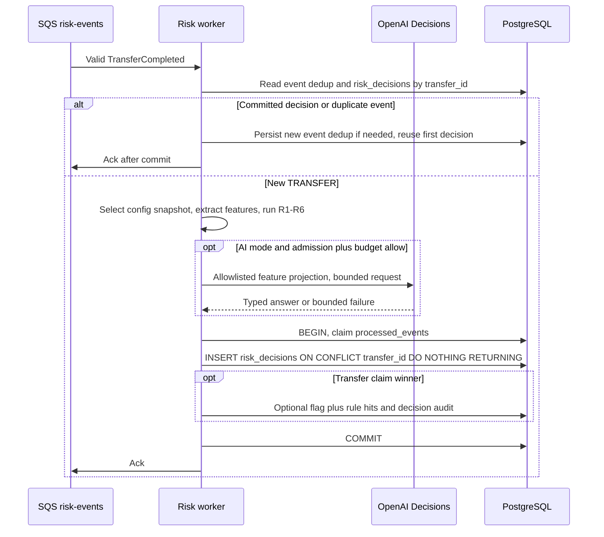

# risk — Architecture

> **Status:** Proposed — phương án API theo ADR-14, chưa triển khai · **Owner:** #4 · **Cặp đôi:** #1 · **Verified against code:** module risk hiện chỉ có README, chưa có consumer/service/controller fraud · **Cập nhật:** 2026-10-23

> Nguồn thiết kế: [FRAUD-API-01 §§2–7](../../features/FRAUD-API-01-external-ai-decision.md), [ADR-14 Proposed](../../adr/0014-fraud-rules-external-ai.md), [database-design](../_shared/database-design.md), [event contract](../_shared/event-contract.md). [ADR-08](../../adr/0008-fraud-detection-architecture.md) vẫn Accepted/unmodified; ADR-14 đề xuất thay riêng nghĩa vụ train/học tham số/ONNX, chưa phải quyết định nhóm đã Accepted.

## 1. Cấu trúc đích — không phải danh sách file đã tồn tại

Thiết kế đặt `RiskModule` ở `sharedModules`: HTTP ở role `api`, consumer chỉ có lifecycle khi `runsWorkers()`. Runtime fraud và các adapter phụ thuộc vẫn phải được xây ở task riêng; không tạo stub để coi dependency đã hoàn thành. Nhánh API không cần pipeline Python, model artifact hoặc native inference runtime.

| Thành phần dự kiến | Chạy ở | Trách nhiệm |
|---|---|---|
| `risk.module.ts`, `index.ts` | `api` + `worker` | Wiring; chỉ export `RiskModule`, không module nghiệp vụ nào gọi trực tiếp scoring |
| `risk-flags.controller.ts` | `api` | UC-10 operator: danh sách, chi tiết, review một lần |
| `risk-config.controller.ts` | `api` | UC-12 admin: đọc cấu hình, thêm version bất biến |
| `risk-scoring.consumer.ts` | `worker` | Validate event, early dedup theo event/transfer, điều phối và claim/commit decision |
| `scoring.service.ts` | `worker` + offline | R1–R6 thuần và policy cộng phần AI riêng, không tự gọi module khác để sửa transfer |
| `rules/rule.ts`, `rules/r1-…` đến `r6-…` | `worker` + offline | `RiskRule.evaluate(event, features, params): RuleHit \| null` |
| `features/feature-provider.ts` | `worker` + offline | `FeatureProvider.extract(event): Promise<Features>` |
| Online/offline feature providers | `worker` / offline | Redis + SQL truth / dữ liệu được phép dùng; cùng money/event-time/snapshot semantics |
| Adapter OpenAI Decisions nội bộ | `worker` / spike được duyệt | Allowlist projection, typed response validation, deadline và trạng thái fallback; không Jev adapter hoặc fallback provider |
| Rule-set repository | `api` + `worker` | `risk_rule_sets`; cache `cfg:risk:latest` TTL 60s, `cfg:risk:v{n}` bất biến TTL 24h |
| Decision/flag repositories, entities, DTO | `api` + `worker` | Schema đích ở §2, quyền tối thiểu, audit cùng SQL transaction |
| Script đánh giá offline | CLI | B0/B1/B2, capture/replay policy, chỉ số chất lượng; không gọi API tính phí trong CI acceptance tất định |

## 2. Dữ liệu đề xuất — chưa có migration trong PR này

### 2.1 Bảng risk-owned

Schema/ràng buộc chi tiết tại [database-design §4.8](../_shared/database-design.md#48-nhóm-fraud). Bốn bảng trong thiết kế đích:

| Bảng | Khóa / bất biến |
|---|---|
| `risk_rule_sets` | PK `version`; append-only, config chứa mode, ngưỡng MEDIUM/HIGH, R1–R6 và policy AI bất biến; seed `rule_only` |
| `risk_decisions` | PK `transfer_id`, FK tới `transfers`; một hàng bất biến cho **mọi TRANSFER/mode**, kể cả LOW và AI fallback; dùng làm claim theo transfer |
| `fraud_flags` | Tối đa một cờ/transfer, chỉ MEDIUM/HIGH; tham chiếu decision cùng transfer/version; review `OPEN` chỉ một lần |
| `fraud_rule_hits` | PK `(transfer_id, rule_id)`; `rule_id` chỉ R1–R6; lưu weight và giải thích tiếng Việt của rule, không chứa điểm/quy kết AI |

`risk_decisions` lưu `event_id` đầu tiên, `rule_set_version` (FK), `mode`, `rule_score`, `feature_snapshot`, `ai_status`, `ai_applied_weight`, `probability`, `provider`, `requested_model`, `response_model`, `rubric_sha256`, `input_sha256`, `provider_request_id`, `decided_at`. Snapshot đủ replay rule/policy và hash input AI, không lưu raw response. Decision append-only; `dbs_api`/`dbs_worker` không được sửa/xóa decision. Quyền đọc phục vụ operator/audit theo nhu cầu, không customer; không thêm bảng assessment thứ hai.

| Mode / status | Ràng buộc |
|---|---|
| `rule_only` | `ai_status = DISABLED`, `probability = NULL`, `ai_applied_weight = 0`; provider/model/hashes/request id đều null |
| `rules_with_external_ai` | Provider, requested model và hai hash bắt buộc; status không DISABLED |
| `SUCCEEDED` | p hữu hạn trong [0,1]; weight đúng policy threshold |
| `UNAVAILABLE`, `REFUSED`, `INVALID_RESPONSE`, `BUDGET_EXHAUSTED` | p null, weight 0, vẫn lưu decision baseline |

`response_model` và `provider_request_id` nullable, chỉ ghi khi provider cung cấp; không giả alias model là immutable snapshot hoặc bịa request id.

### 2.2 Điểm và provenance

`rule_score = sum(ruleHits.weight)`; `ai_applied_weight = ai.weight` cố định khi response hợp lệ với p ≥ `ai.threshold`, còn lại 0. `score = rule_score + ai_applied_weight`, không `p*100`, không nhân weight với p. Khi có cờ: `sum(fraud_rule_hits.weight) = risk_decisions.rule_score` và `fraud_flags.score = rule_score + ai_applied_weight`. LOW không có flag/hits nhưng vẫn có decision/snapshot. AI không xóa cờ hoặc làm giảm điểm rule.

Config validate weight nguyên không âm, tổng điểm tối đa vừa PostgreSQL `int`; threshold AI hữu hạn trong `(0,1]`. Ngưỡng baseline MEDIUM/HIGH là 40/70. AI mode không có giá trị vận hành mặc định cho threshold/weight/rubric/model.

### 2.3 Dữ liệu lịch sử, tiền và cache

- `dbs_worker` đọc lịch sử qua `v_transfer_facts`, không SELECT trực tiếp `transfers`. Truy vấn phải có `status = 'COMPLETED' AND type = 'TRANSFER'` và bound theo `event.occurredAt` để dùng đúng partial index.
- Tiền trên wire là chuỗi đồng canonical; nội bộ bigint/numeric chính xác theo `@common/money`, không `Number`, `parseInt` hay floating-point cho predicate. Median chẵn phải giữ phần nửa đồng chính xác; R6 so bằng nhân chéo, không `0.9 * number`.
- R3 dùng `fromAccountCreatedAt`, R6 dùng `fromBalanceBefore`, R5/R6 giữ miễn trừ `sameOwner`. Các trường này đã có trong event contract/runtime type; malformed event không được thay default hoặc bỏ ngoại lệ.
- Redis là cache, không là truth: `risk:vel:{accountId}` dùng member transferId, score event time; `risk:fan:{accountId}` chỉ phục vụ distinct recipients khi đã chứng minh coverage/ngữ nghĩa “mới” bằng SQL. Thiếu/lạnh/chậm/lỗi/không đủ coverage cửa sổ thì SQL, không suy cache rỗng = 0.
- Trim theo wall clock/retention của cache, **không trim theo occurredAt của event đang xử lý**; event trễ ngoài vùng đã giữ phải SQL. Đếm cửa sổ vẫn theo event time, không theo wall clock. Một sorted set người nhận với timestamp bị ghi đè không đủ bảo đảm event đảo thứ tự.
- Redis/config/feature I/O đều trước `BEGIN`, ghi metric path trả lời. Parity online/offline phải có test in-order/warm-cache; cold/delayed/out-of-order và SQL fallback là case riêng, không suy từ mock hoặc tự hứa p live bất biến.

## 3. Interface và quyền

### 3.1 Event vào

Nhận `TransferCompleted` từ `risk-events` theo contract hiện hữu. Chỉ TRANSFER được chấm; DEPOSIT chỉ dedup rồi ack theo consumer contract, không decision fraud/AI. Không đổi event/outbox/ledger transaction/sync guard/queue vì đổi provider. Chính sách unknown event type còn phụ thuộc BL-010; không tự coi mọi event lạ là đã xử lý thành công.

### 3.2 HTTP đích

| Method & Path | Vai trò | Hành vi |
|---|---|---|
| `GET /v1/operator/fraud-flags` | operator | Lọc status/level, cursor/limit; HIGH trước rồi mới nhất |
| `GET /v1/operator/fraud-flags/:transferId` | operator | Giữ `score`, `riskLevel`, `hits`, thêm `aiAssessment` riêng từ decision (baseline null); giao dịch và 10 dòng gần nhất qua `LedgerQueryService.listTransactions`; audit view |
| `POST /v1/operator/fraud-flags/:transferId/review` | operator | `{ decision: 'CONFIRMED_FRAUD' \| 'FALSE_POSITIVE', note?: string }`; atomic update OPEN và audit cùng tx; lần sau HTTP 409 `FLAG_ALREADY_REVIEWED` |
| `GET /v1/admin/risk-config` | admin | Version hiện hành |
| `POST /v1/admin/risk-config/versions` | admin | Thêm version bất biến và audit; cache update ngoài callback SQL có retry |

`aiAssessment` gồm status, provider/model provenance có thật, p nullable và `appliedWeight`; lời giải thích do policy tạo, không phải chain-of-thought hoặc giải thích nhân quả của model. Client dùng `score`, hoặc cộng rule hits + appliedWeight, không chỉ tổng hits. Customer API/notification không chứa risk/assessment/provenance. Auditor không review/sửa config; admin không sửa/xóa version cũ. Operator review không tự khóa tài khoản.

## 4. Luồng nội bộ đề xuất

### 4.1 Consumer và quyết định đầu tiên thắng

1. Validate trước; DEPOSIT xử lý dedup riêng. Early lookup `risk_decisions(transfer_id)` **trước lấy config/chấm lại/gọi AI** tránh tính phí cho transfer đã commit, kể cả rule-only LOW được giao lại bằng eventId khác sau đổi mode.
2. Chọn một config version và feature snapshot; luật thuần. Mode AI đánh giá mỗi TRANSFER mới, không prefilter theo ruleScore; quota/concurrency/budget/deadline có thể bỏ AI và ghi trạng thái rõ.
3. Gọi API ngoài SQL transaction, tối đa một lần trong mỗi lần consumer xử lý; không retry provider hoặc đổi provider. Kết quả/status đã có là input bất biến của callback SQL.
4. `TransactionService.run`: claim `processed_events`, rồi `INSERT risk_decisions ... ON CONFLICT (transfer_id) DO NOTHING RETURNING transfer_id`. Claim event thua không ghi dữ liệu phụ; claim transfer thua chỉ commit dedup event mới và dùng decision cũ. Bên thắng ghi optional flag/hits và audit decision trong cùng tx, kể cả quyết định LOW.
5. Không Redis/HTTP/SQS trong callback có retry. SQL/audit lỗi rollback, không ack. Ack chỉ sau commit. Race hai worker có thể gọi provider hai lần trước commit; không hứa exactly-once billing. PostgreSQL quyết định một winner dùng chung mọi eventId/mode; rollback winner cho phép bên còn lại claim theo semantics ON CONFLICT.

### 4.2 Review một lần

`UPDATE fraud_flags ... WHERE transfer_id = $1 AND review_status = 'OPEN'` và audit cùng transaction. Nếu cờ tồn tại nhưng không còn OPEN, HTTP 409 `FLAG_ALREADY_REVIEWED`; cờ không tồn tại trả 404. Giữ contract identity/audit hiện có, không tự tạo guard/adapter giả.

## 5. Hosted AI, cấu hình và failure

Provider đầu tiên đề xuất: OpenAI Decisions `POST /v1/decisions`, model guide hiện công bố `gpt-6-luna`; [guide chính thức](https://developers.openai.com/api/docs/guides/decisions) ghi public beta, chưa có benchmark fraud. Requested identifier/rubric/hash/config phải bất biến theo version; response model chỉ ghi nếu có.

Payload chỉ allowlist: amount/fromBalanceBefore canonical strings, tuổi nguồn từ snapshot, sameOwner, count 10m/1h, count/median lịch sử 30d chính xác, phút từ lệnh ngược (null nếu không có), new recipients 1h, distinct recipients 24h. Không gửi ID giao dịch/user/account/correlation, timestamp tuyệt đối, tên/email/free text/scenario/labels/raw history. Rubric cố định `needs_operator_review`, tách dữ liệu; không yêu cầu chain-of-thought. Feature nhạy cảm vẫn cần duyệt điều kiện provider/retention/quyền gửi, không tự nhận ZDR.

| Tình huống | Hành vi đích |
|---|---|
| Response hợp lệ | p hữu hạn [0,1], áp policy cố định; p thấp vẫn SUCCEEDED nhưng weight 0 |
| Timeout/kết nối/HTTP 401/402/429/5xx hoặc quá admission | UNAVAILABLE, baseline |
| Refusal / typed answer sai type, thiếu/nhân đôi predicate, p sai | REFUSED / INVALID_RESPONSE, baseline |
| Hết ngân sách | BUDGET_EXHAUSTED, baseline |
| API lỗi | Không đưa DLQ chỉ vì AI; commit baseline/status/audit |
| SQL/audit lỗi | Rollback, không ack, retry theo ConsumerBase; lần xử lý sau có thể gọi API lại nếu chưa commit |
| Schema event sai | Theo schema/DLQ contract, không bỏ sameOwner hoặc dùng số dư hiện tại để chấm |

Không log payload, raw response, secret hoặc Authorization; metric chỉ status/latency/token khi provider trả và mã lỗi nội bộ rút gọn. Ops phải duyệt HTTPS egress/secret/quota/concurrency/cost và alarm trong task riêng trước enable.

AI mode bắt buộc `ai.maxAdmissionDelayMs`, `ai.requestTimeoutMs` nguyên dương, đo/duyệt trước enable. Ghi monotonic time khi chọn config; ngay trước send quá admission thì không gửi, ghi UNAVAILABLE. Request gửi rồi có client deadline, không giữ DB/slot vô hạn.

Chuyển baseline bằng version `rule_only` mới, không sửa version/decision cũ. **Không phải kill switch tức thì:** `cfg:risk:latest` TTL 60s; nếu config store/TTL đáp ứng contract, request mới theo version cũ bị chặn sau `60s + maxAdmissionDelayMs` từ khi tạo version baseline. Request đã gửi có thể còn tối đa thêm requestTimeoutMs phía client; abort không bảo đảm provider hủy hoặc ngừng tính phí. Store lỗi thì không tự nhận đạt bound. Dừng egress/secret tức thì là quy trình Ops riêng, không sửa cloud dùng chung.

## 6. Gate kiểm chứng và giới hạn

- B0 R1–R6; B1 API riêng chỉ chẩn đoán offline, không mode production bỏ rule; B2 tổng hợp. B1/B2 dùng cùng một capture API trên cùng feature, không gọi hai lần rồi coi cùng điều kiện.
- Tune chia tiếp theo khách để chọn cấu hình và validation; freeze ứng viên trước validation. Muốn enable: baseline và B2 đều ≤20 cờ/1.000 TRANSFER; giữ mục tiêu recall ≥70% trên năm kịch bản mục tiêu; B2 tăng ≥5 điểm phần trăm trên grouped validation và paired customer-cluster 95% CI chênh recall loại trừ 0. Báo cả hard negatives/kịch bản ngoài tầm.
- Freeze code/config/model identifier/rubric trước holdout; holdout một lần, không chọn default theo holdout. API không cần train nhưng không miễn đánh giá độc lập.
- Đo p95 giao dịch→cờ <5 giây tại 120 RPS cả khỏe/fallback; queue age, features/provider/DB time, timeout/429/fallback/coverage, duplicate calls và cost/1.000 TRANSFER gồm rollback/race. Quota và deadline phải phù hợp visibility/pool.
- Test thật cần có race cùng event, khác event cùng transfer/mode, LOW trước đổi AI, rollback SQL/audit, cache cũ/admission/request đang chạy và PostgreSQL claim semantics; mock không chứng minh các case này.
- Chưa có runtime fraud, live API, benchmark, số đo chất lượng/latency/cost hoặc gate enable hoàn tất trong PR này. Replay chỉ kiểm policy trên capture, không bảo đảm live model tái lập. Dữ liệu tổng hợp không chứng minh hiệu quả ngân hàng thật hoặc thắng model tự train; cờ sau commit không thu hồi tiền và không là kết luận gian lận.
