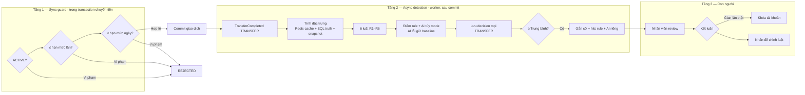
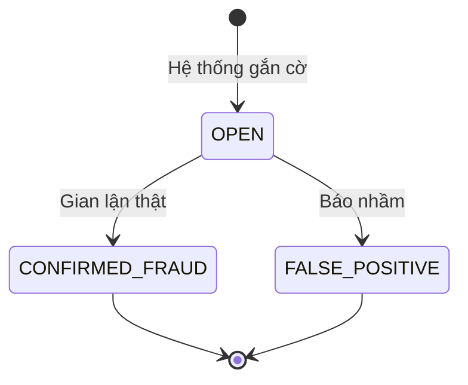
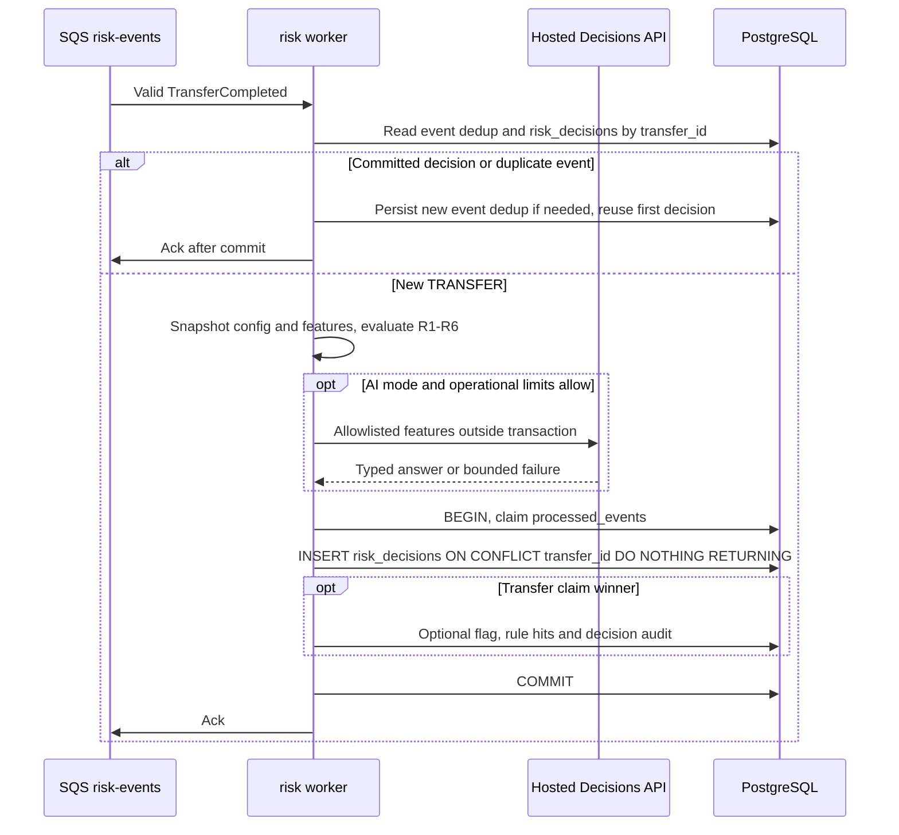
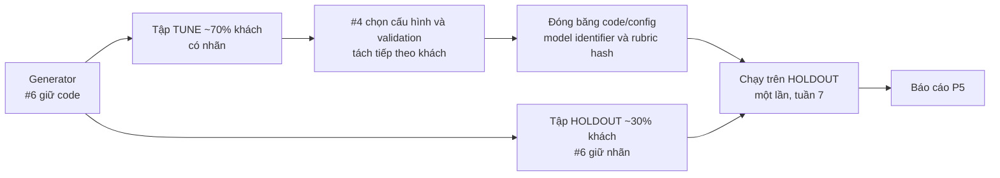

# Fraud Detection — Hướng dẫn chi tiết

> **Status:** Proposed — phương án API theo ADR-14, chưa triển khai · **Owner:** #4 · **Cặp đôi:** #1, #6 · **Verified against code:** risk mới có README, chưa có fraud end-to-end; event/money contract đã có source · **Cập nhật:** 2026-10-23

> Tài liệu làm việc nội bộ cho mảng **Fraud** (#4) và người làm bộ dữ liệu (#6).
> Dựa trên: `docs/01` (BR-06, BR-11, BR-13), `docs/02` (UC-9, UC-10, UC-12, FR-RSK-*, NFR-FRD-*), `docs/03` (mục 9, 10, 15).
> Bảng 4.2 giữ nguyên baseline R1–R6; seed `rule_only` là thiết kế, không xác nhận migration fraud đã tồn tại. [ADR-08](../../adr/0008-fraud-detection-architecture.md) vẫn Accepted/unmodified. [ADR-14](../../adr/0014-fraud-rules-external-ai.md) Proposed đề xuất thay riêng nghĩa vụ train/học tham số/ONNX bằng hosted AI. Toàn bộ cấu trúc/luồng API bên dưới là thiết kế đích theo [FRAUD-API-01 §§2–7](../../features/FRAUD-API-01-external-ai-decision.md), chưa phải chức năng đã chạy.

---

## 1. Mảng này làm gì

### 1.1 Một câu

> Sau mỗi lệnh chuyển tiền hoàn tất, worker dự kiến chấm điểm bằng 6 luật có giải thích (`R1–R6`), gắn cờ để nhân viên xem và quyết định. Mode mặc định `rule_only` không phụ thuộc API; `rules_with_external_ai` chỉ bổ sung tín hiệu từ hosted API sau gate độc lập. Nhánh đề xuất không tự train hoặc chạy ONNX nhưng vẫn phải có bằng chứng định lượng về chất lượng, an toàn, latency và chi phí; chưa có số đo API thật.

### 1.2 Làm và không làm

| Làm theo thiết kế | Không làm |
|---|---|
| Sync guard của ledger kiểm trạng thái, hạn mức, số dư trong transaction | Chặn giao dịch vì “đáng ngờ” |
| Chấm mọi TRANSFER sau hoàn tất; baseline thuần luôn có thể chạy không API | Tự khóa tài khoản, đảo giao dịch hoặc giữ tiền |
| Cờ giữ hits R1–R6; AI assessment/provenance riêng | Giả điểm AI thành hit rule hoặc xóa cờ baseline |
| Operator review một lần: Gian lận thật / Báo nhầm | Cho customer thấy risk, cờ hoặc assessment |
| Version config bất biến; AI opt-in có gate | Train/fine-tune, artifact ONNX hoặc fallback provider trong nhánh API |
| Dữ liệu tổng hợp + đánh giá độc lập/P5 | Gửi IDs, tên/email/free text, nhãn, kịch bản hoặc raw history ra provider |

### 1.3 Thế nào là thành công

| Chỉ số | Mục tiêu | Nguồn |
|---|---|---|
| Thời gian từ giao dịch tới khi có cờ | p95 < 5 giây | NFR-FRD-01 |
| Số cảnh báo / 1.000 giao dịch | ≤ 20 trên giao dịch `TRANSFER` (lưu ý 6.4) | NFR-FRD-02 |
| Recall trên các kịch bản luật nhắm tới | ≥ 70 % gộp trên 5 kịch bản trong tầm luật | NFR-FRD-02 |
| Báo cáo precision, recall, F1 trên tập giữ lại | Có, kèm phân tích từng luật | NFR-FRD-03 |
| Chuyển tiền không chậm đi vì fraud | Sync guard thêm ≤ 5 ms | NFR-PERF-01 |
| Lỗi ở fraud không làm hỏng chuyển tiền | 0 ảnh hưởng | D-4 |

---

## 2. Bức tranh tổng thể



| Tầng | Ở đâu | Khi nào | Hậu quả | Vì sao đặt ở đây |
|---|---|---|---|---|
| **1. Sync guard** | `backend` (role `api`) · module `ledger` | Trong transaction, sau `FOR UPDATE` | `REJECTED` | Quy tắc cứng (BR-06, BR-12) phải đúng tuyệt đối kể cả khi đồng thời |
| **2. Async detection** | `backend` (role `worker`) · module `risk` | Vài giây sau commit | Gắn cờ | Phân tích lịch sử tốn truy vấn; không được làm chậm hay hỏng giao dịch |
| **3. Human-in-the-loop** | `backend` (role `api`) · module `risk` | Khi nhân viên xử lý | Kết luận, có thể khóa | Báo nhầm gây hại thật cho khách; quyết định cuối thuộc con người |

---

## 3. Tầng 1 — Sync guard

Viết **cùng #1** trong luồng chuyển tiền (`docs/03` mục 6.1). Chạy sau khi đã khóa hai tài khoản.

| Kiểm tra | Điều kiện từ chối | `reject_reason` |
|---|---|---|
| Trạng thái | Tài khoản nguồn hoặc đích không `ACTIVE` | `ACCOUNT_NOT_ACTIVE` |
| Hạn mức mỗi lần | `amount > TRANSFER_LIMIT_PER_TX` (50.000.000đ) | `LIMIT_PER_TX_EXCEEDED` |
| Hạn mức ngày | `đã chuyển hôm nay + amount > TRANSFER_LIMIT_PER_DAY` (200.000.000đ) | `LIMIT_PER_DAY_EXCEEDED` |
| Số dư | `balance < amount` | `INSUFFICIENT_FUNDS` |

**Tính "đã chuyển hôm nay"** (ngày theo giờ Việt Nam, chỉ tính tiền đi):

```sql
SELECT COALESCE(SUM(amount), 0)
FROM ledger_entries
WHERE account_id = $1
  AND direction = 'DEBIT'
  AND created_at >= date_trunc('day', now() AT TIME ZONE 'Asia/Ho_Chi_Minh') AT TIME ZONE 'Asia/Ho_Chi_Minh';
```

- Dùng index `ledger_entries(account_id, created_at)`.
- **Phải chạy sau `SELECT … FOR UPDATE`** tài khoản nguồn. Nếu chạy trước, hai lệnh đồng thời cùng thấy "còn hạn mức" và cùng lọt (AC-5.6).
- Nạp tiền (`DEPOSIT`) bỏ qua hạn mức và số dư của tài khoản SYSTEM.
- Ngân sách thời gian: ≤ 5 ms.

---

## 4. Tầng 2 — Async detection

### 4.1 Phạm vi chấm điểm

- Chỉ chấm `TransferCompleted` có `type = TRANSFER`. **Không chấm `DEPOSIT`** (tiền từ tài khoản ngân hàng).
- Chấm phía **người gửi** (tài khoản nguồn). Phía người nhận (nhiều người chuyển vào một tài khoản) là hướng mở rộng (mục 9).

### 4.2 Sáu luật

| ID | Luật | Điều kiện kích hoạt (baseline) | Nguồn dữ liệu | Trọng số (baseline) |
|---|---|---|---|---|
| **R1** | Velocity | > 5 lệnh chuyển từ tài khoản nguồn trong 10 phút (tính cả lệnh này) | Redis sorted set, dự phòng SQL | 30 |
| **R2** | Số tiền bất thường | `amount > 5 × trung vị` các lệnh chuyển 30 ngày trước của chính tài khoản; cần **≥ 5 lệnh lịch sử**, không đủ thì bỏ qua | SQL | 25 |
| **R3** | Tài khoản mới chuyển lớn | Tuổi tài khoản nguồn < 24 giờ **và** `amount > 10.000.000` | Snapshot `fromAccountCreatedAt` | 35 |
| **R4** | Chuyển vòng | Có lệnh `to → from` đã `COMPLETED` trong 1 giờ trước đó | SQL | 20 |
| **R5** | Fan-out (mule) | ≥ 5 người nhận **mới** trong 1 giờ (mới = chưa nhận tiền từ tài khoản này trong 30 ngày trước) | Redis sorted set + SQL kiểm tra "mới" | 40 |
| **R6** | Rút cạn | `amount ≥ 90% × fromBalanceBefore` **và** `fromBalanceBefore ≥ 1.000.000` | Snapshot `fromBalanceBefore` | 30 |

**Ngoại lệ chung:** chuyển giữa hai tài khoản cùng một khách hàng không kích hoạt R5, R6. `sameOwner` **đã có** trong [event contract](../_shared/event-contract.md) và type [`TransferCompleted`](../../../backend/src/common/events/event-types.ts); không đề xuất thêm field. Thiếu/sai `sameOwner` là event malformed, xử lý schema/DLQ theo consumer contract, không bỏ miễn trừ hay tự gán false.

#### Logic từng luật (giả mã)

```ts
// R1 — velocity
count = countTransfersFrom(fromAccountId, window = 10m, until = occurredAt)
hit if count > 5
explain: `${count} lệnh chuyển trong 10 phút (ngưỡng 5)`

// R2 — số tiền bất thường
history = amountsFrom(fromAccountId, last = 30d, before = occurredAt)
skip if history.length < 5
median = percentile50(history)
hit if amount > 5 * median
explain: `Số tiền ${amount} gấp ${amount/median}× trung vị 30 ngày (${median})`

// R3 — tài khoản mới chuyển lớn
age = occurredAt - fromAccountCreatedAt
hit if age < 24h && amount > 10_000_000
explain: `Tài khoản mở ${age} trước, chuyển ${amount}`

// R4 — chuyển vòng
hit if exists transfer(from = toAccountId, to = fromAccountId, status = COMPLETED,
                       createdAt in [occurredAt - 1h, occurredAt))
explain: `Tài khoản đích đã chuyển ngược lại ${x} phút trước`

// R5 — fan-out
newRecipients = distinctNewRecipients(fromAccountId, window = 1h, until = occurredAt)
hit if !sameOwner && newRecipients >= 5
explain: `${n} người nhận mới trong 1 giờ (ngưỡng 5)`

// R6 — rút cạn
hit if !sameOwner && fromBalanceBefore >= 1_000_000n && amount * 10n >= fromBalanceBefore * 9n
explain: `Chuyển ${pct}% số dư (${amount}/${fromBalanceBefore})`
```

**Tiền và thời gian chính xác:** `amount`/`fromBalanceBefore` trên wire là chuỗi đồng canonical, parse qua `@common/money`; nội bộ bigint/numeric, không `Number`, `parseInt`, `percentile_cont` trả floating-point hay `0.9 * number` để so luật. R2 với số lịch sử chẵn phải giữ trung vị nửa đồng chính xác (numeric hoặc tử số/2), không làm tròn. Lịch sử dùng bound theo `occurredAt = transfers.created_at`, không giờ worker; R1 đếm cả lệnh hiện tại đúng một lần, R2/R4 chỉ lịch sử trước event. R3/R6 tuyệt đối không thay snapshot bằng tuổi/số dư hiện tại. Các đoạn TypeScript ở đây là giả mã, không runtime đã triển khai.

**Ví dụ SQL cho R2 và R4:**

```sql
-- R2: trung vị chính xác, không ép bigint sang double precision
WITH history AS (
  SELECT amount,
         row_number() OVER (ORDER BY amount) AS rn,
         count(*) OVER () AS n
  FROM v_transfer_facts
  WHERE from_account_id = $1 AND status = 'COMPLETED' AND type = 'TRANSFER'
    AND created_at >= $2 - interval '30 days' AND created_at < $2
)
SELECT avg(amount::numeric) AS median, max(n) AS n
FROM history
WHERE rn IN ((n + 1) / 2, (n + 2) / 2);

-- R4: có lệnh chuyển ngược trong 1 giờ trước
SELECT EXISTS (
  SELECT 1 FROM v_transfer_facts
  WHERE from_account_id = $1 AND to_account_id = $2 AND status = 'COMPLETED' AND type = 'TRANSFER'
    AND created_at >= $3 - interval '1 hour' AND created_at < $3
);
```

### 4.3 Tính điểm và mức rủi ro

```
rule_score = Σ trọng số các luật kích hoạt
ai_applied_weight = ai.weight cố định nếu p hợp lệ và p >= ai.threshold, ngược lại 0
score = rule_score + ai_applied_weight
```

| Điểm | Mức | Hành động |
|---|---|---|
| 0 – 39 | `LOW` | Không gắn cờ; vẫn ghi decision/snapshot/metric |
| 40 – 69 | `MEDIUM` | Gắn cờ |
| ≥ 70 | `HIGH` | Gắn cờ, đưa lên đầu danh sách review |

**Ý tưởng của trọng số:** tín hiệu đủ mạnh một mình (R5 mule = 40) thì tự gắn cờ. Tín hiệu yếu một mình (R6 rút cạn = 30, R4 chuyển vòng = 20) chỉ gắn cờ khi **kết hợp**: R6 + R3 = 65 → MEDIUM là kịch bản chiếm tài khoản mới tạo.

| Ví dụ | Luật kích hoạt | Điểm | Mức |
|---|---|---|---|
| Khách chuyển 95% số dư sang người quen | R6 | 30 | LOW — không cờ |
| Tài khoản 3 giờ tuổi chuyển 20tr, gần hết số dư | R3 + R6 | 65 | MEDIUM |
| 6 người nhận mới trong 1 giờ | R5 | 40 | MEDIUM |
| 8 lệnh / 10 phút, toàn người nhận mới | R1 + R5 | 70 | HIGH |

Trọng số/ngưỡng là baseline. Có thể chọn cấu hình mới thủ công trên phần tune dành cho chọn tham số, lưu version mới; không tự gọi đó là model training hoặc sửa seed.

### 4.3.b Hai mode đề xuất, tín hiệu AI tách khỏi rule

| Mode | Điểm / hành vi | Gate |
|---|---|---|
| `rule_only` | R1–R6; status AI DISABLED, p null, contribution 0 | Seed mặc định, không gọi provider |
| `rules_with_external_ai` | Cùng R1–R6 + trọng số AI cố định khi p hợp lệ đạt threshold | Opt-in sau gate chất lượng/dữ liệu/vận hành; không có default tự bật |

Không giữ alias mode học model cũ trong implementation đích. [ADR-08](../../adr/0008-fraud-detection-architecture.md) chứa quyết định train/ONNX lịch sử còn Accepted; đề xuất thay ở [ADR-14](../../adr/0014-fraud-rules-external-ai.md), không là hướng dẫn thực hiện nhánh API.

- `ai.threshold` hữu hạn trong `(0,1]`; trọng số nguyên không âm; tổng điểm tối đa vừa PostgreSQL `int`. AI mode bắt buộc threshold/weight/rubric/model đã duyệt, không lấy số ví dụ làm default.
- Không dùng `100*p`, không `round(weight*p)`, không gọi p là xác suất gian lận đã calibration. AI không trừ điểm/xóa cờ baseline.
- Ví dụ **chỉ kiểm công thức**, threshold 0.9, weight 40: R6=30 + p=0.89/API lỗi → LOW; p=0.9 →70 HIGH. Không hit rule, p=0.95 →40 MEDIUM. Rule=70 và p=0.01 vẫn HIGH.
- `fraud_rule_hits` chỉ chứa R1–R6 thật: không cộng AI vào weight của rule hoặc tạo `[AI-Rn]`. Tổng hits bằng **rule_score**, không nhất thiết bằng total score.
- Mỗi TRANSFER mới trong mode AI được đánh giá tối đa một lần **trong mỗi lần consumer xử lý**, không prefilter ruleScore. Hết quota/budget/concurrency hoặc quá deadline thì baseline với trạng thái/metric rõ; không gọi thêm provider khác hoặc retry API trong lần xử lý đó.

**Provider và input:** đề xuất OpenAI Decisions `POST /v1/decisions`, model guide hiện công bố `gpt-6-luna`; [guide chính thức](https://developers.openai.com/api/docs/guides/decisions) ghi public beta. Không có Jev adapter/fallback provider. Chỉ gửi allowlist: amount/fromBalanceBefore dạng chuỗi canonical, tuổi nguồn từ snapshot, sameOwner, count 10m/1h, count/median 30d chính xác, phút từ lệnh ngược (null khi không có), newRecipients1h, distinctRecipients24h. Không gửi ID transfer/user/account/correlation, timestamp tuyệt đối, tên/email/free text/labels/scenario/raw history. Rubric cố định có hash, predicate `needs_operator_review`, tách dữ liệu; không yêu cầu chain-of-thought. Feature tài chính vẫn nhạy cảm; chỉ dùng dữ liệu tổng hợp trong spike và phải duyệt retention/quyền gửi/điều kiện provider, không khẳng định ZDR mặc định.

**Đánh giá thay cho train:** cùng feature/policy online và offline. B0 luật, B1 API riêng chỉ chẩn đoán, B2 tổng hợp; B1/B2 dùng cùng một capture, không gọi hai lần rồi coi như cùng kết quả. Replay capture kiểm policy, không phải benchmark live hoặc cam kết model tái lập. Giao thức chọn tham số/validation/freeze/holdout ở §6 vẫn bắt buộc.

### 4.4 Cờ và lời giải thích

Mỗi cờ lưu giao dịch, total score, mức, version và hits R1–R6. Operator detail thêm `aiAssessment` tách riêng từ decision (baseline null), không là bảng/quyết định thứ hai. Client dùng `score` hoặc tổng hits **cộng appliedWeight**, không chỉ cộng hits. AI explanation do policy tạo, không phải giải thích nội tại hoặc bằng chứng gian lận.

```json
{
  "transferId": "8f3c…",
  "score": 65,
  "riskLevel": "MEDIUM",
  "ruleSetVersion": 3,
  "hits": [
    { "ruleId": "R3", "weight": 35, "explanation": "Tài khoản mở 3 giờ trước, chuyển 20.000.000đ" },
    { "ruleId": "R6", "weight": 30, "explanation": "Chuyển 96% số dư (20.000.000/20.800.000)" }
  ],
  "aiAssessment": null,
  "reviewStatus": "OPEN"
}
```

Ví dụ phần bổ sung ở mode AI: `{"status":"SUCCEEDED","provider":"openai","model":"gpt-6-luna","probability":0.95,"appliedWeight":40,"explanation":"Đánh giá AI bổ sung đạt ngưỡng cấu hình; đây không phải kết luận gian lận."}`. Status fallback vẫn được lưu/chiếu, p null và appliedWeight 0. Requested model luôn được ghi ở decision khi mode AI; response model/request id chỉ ghi nếu provider trả, không bịa model snapshot. Customer không thấy bất kỳ phần nào của assessment/provenance.

### 4.5 Review của nhân viên (UC-10)



| API | Mô tả |
|---|---|
| `GET /v1/operator/fraud-flags?status=OPEN&level=HIGH` | Danh sách cờ, HIGH lên trước, mới nhất trước |
| `GET /v1/operator/fraud-flags/{transferId}` | Chi tiết: score/riskLevel/hits, aiAssessment riêng, giao dịch và 10 giao dịch gần nhất của nguồn |
| `POST /v1/operator/fraud-flags/{transferId}/review` | Body: `decision` (`CONFIRMED_FRAUD` / `FALSE_POSITIVE`), `note`. Chỉ review một lần |

Mọi lần xem chi tiết và review đều ghi nhật ký. Review cập nhật nguyên tử cờ OPEN và audit trong cùng transaction; lần review sau trả HTTP 409 `FLAG_ALREADY_REVIEWED`. Kết luận operator là nhãn nghiệp vụ để phân tích về sau, không được đưa vào input AI hoặc dùng thay nhãn đánh giá độc lập.

### 4.6 Cấu hình luật có phiên bản (UC-12)

- `risk_rule_sets` là các version bất biến: mode, tham số/trọng số/ngưỡng mức R1–R6 và policy/rubric/model AI.
- Đổi cấu hình = thêm version mới và audit; latest cache TTL 60s, nội dung `cfg:risk:v{n}` bất biến TTL 24h, miss/lỗi đọc SQL. Mỗi decision/cờ lưu đúng version đã chọn.
- Công tắc về baseline là version mới `rule_only`, không sửa/xóa decision cũ; **không dừng egress tức thì**. Worker còn latest cache cũ vẫn có thể chọn AI. Khi store/TTL đúng contract, lời gọi mới theo version cũ bị giới hạn bởi `60s + ai.maxAdmissionDelayMs` từ khi tạo baseline; request đã gửi có thể còn tối đa thêm `ai.requestTimeoutMs` phía client. Abort không bảo đảm provider hủy hoặc ngừng tính phí; store không đáp ứng thì không hứa bound đã đạt.
- AI mode phải có `ai.maxAdmissionDelayMs` và `ai.requestTimeoutMs` nguyên dương được đo/duyệt trước enable. Ghi monotonic time khi chọn config, kiểm ngay trước send; quá admission không gửi, status UNAVAILABLE, contribution 0. Không giữ DB/slot vô hạn. Dừng egress/secret tức thì cần quy trình Ops riêng.

---

## 5. Làm như thế nào — thiết kế chưa triển khai

### 5.1 Luồng xử lý một sự kiện



Đây là luồng TRANSFER; DEPOSIT chỉ dedup/ack theo consumer contract, không gọi AI. Early lookup transfer decision phải **trước config/chấm lại/API**: rule-only LOW đã commit vẫn không được chấm lại qua eventId khác sau đổi mode. Trong `TransactionService.run`, claim event trước, rồi claim PK transfer. Event thua không ghi dữ liệu phụ; transfer thua chỉ commit dedup event mới và dùng decision cũ, không tạo flag/hits/audit-create trùng. Bên thắng ghi decision mọi score/mode, optional flag/hits và audit cùng transaction.

Redis/HTTP/SQS luôn ngoài callback có retry; response/status là input bất biến của callback. SQL/audit lỗi rollback, không ack. Race trước commit có thể gọi provider hai lần; PostgreSQL chỉ cho một decision/cờ commit. Winner rollback thì bên khác có thể claim theo ON CONFLICT; phải test DB thật, không hứa exactly-once billing. Chưa commit thì lần consumer sau có thể gọi API lại.

### 5.2 Đầu vào: event contract đã có

Type [`TransferCompleted`](../../../backend/src/common/events/event-types.ts) và [event contract](../_shared/event-contract.md) là nguồn shape, không đổi payload vì API:

| Trường | Dùng cho |
|---|---|
| `eventType`, `eventId` | Validate loại sự kiện và dedup |
| `transferId`, `type` | Claim transfer; chỉ chấm TRANSFER |
| `fromAccountId`, `toAccountId` | Lịch sử R1/R2/R4/R5 nội bộ, không gửi provider |
| `amount` (string canonical) | Tiền dương chính xác cho R2/R3/R6 |
| `fromBalanceBefore` (string canonical) | Snapshot R6; DEPOSIT có thể có nguồn SYSTEM âm nhưng không chấm |
| `fromAccountCreatedAt`, `toAccountCreatedAt` | Snapshot thời điểm tạo; tuổi nguồn cho R3 |
| `occurredAt` | UTC, `transfers.created_at`; mốc cửa sổ, không giờ worker |
| `sameOwner` | Boolean bắt buộc, miễn trừ R5/R6; DEPOSIT là false |
| `fromUserId`, `toUserId` | Contract ownership; fromUserId null chỉ ở DEPOSIT, không gửi provider |
| `correlationId` | Truy vết nội bộ, không gửi provider |

Event sai/mất field phải xử lý schema/DLQ theo consumer contract. Không suy từ trạng thái account hiện tại hoặc bỏ miễn trừ để tiếp tục; chính sách unknown event type vẫn theo handoff BL-010, không tự ack loại lạ.

### 5.3 Dữ liệu và provenance

Schema/ràng buộc đề xuất tại [database-design §4.8](../_shared/database-design.md#48-nhóm-fraud), chưa có migration trong task này. Bảng mới `risk_decisions` PK/FK `transfer_id` tới transfers có một hàng immutable cho **mọi TRANSFER và cả hai mode**, kể cả LOW/fallback. Không có bảng assessment thứ hai.

Decision lưu `event_id` đầu tiên, `rule_set_version` FK, `mode`, `rule_score`, `feature_snapshot`, `ai_status`, `ai_applied_weight`, `probability`, `provider`, `requested_model`, `response_model`, `rubric_sha256`, `input_sha256`, `provider_request_id`, `decided_at`. Snapshot đủ replay rule/policy; không lưu raw response. Rule-only bắt buộc DISABLED/p null/weight 0 và AI metadata null. AI mode bắt buộc provider/requested_model/hashes, không DISABLED; SUCCEEDED p hữu hạn [0,1], weight đúng policy; UNAVAILABLE/REFUSED/INVALID_RESPONSE/BUDGET_EXHAUSTED p null/weight 0. Response model và request id nullable theo dữ liệu provider thực trả.

Cờ phải tham chiếu decision cùng transfer/version; `sum(fraud_rule_hits.weight) = risk_decisions.rule_score`, `fraud_flags.score = rule_score + ai_applied_weight`. LOW không cờ/hits nhưng snapshot vẫn đủ replay. Decision append-only, không UPDATE/DELETE bởi dbs_api/dbs_worker; quyền đọc phục vụ review/audit, không customer.

`dbs_worker` đọc lịch sử qua `v_transfer_facts`, không SELECT thẳng `transfers`. Index nguồn cho R1/R2/R5: `(from_account_id, created_at) INCLUDE (amount, to_account_id)`; R4: `(from_account_id, to_account_id, created_at)`; đều partial `status = 'COMPLETED' AND type = 'TRANSFER'`, truy vấn lặp predicate đó. Claim/dedup/audit/flag cùng SQL transaction, không thay transaction chuyển tiền.

### 5.4 Redis chỉ là cache (R1, R5)

Không có Redis client risk đang chạy để coi recipe dưới là đã kiểm chứng.

| Cache | Điều kiện được dùng |
|---|---|
| `risk:vel:{accountId}` | Sorted set member transferId, score event time; unique member tránh đếm event trùng. Chỉ đếm cửa sổ khi đủ coverage theo event |
| `risk:fan:{accountId}` | Dữ liệu distinct người nhận “mới” phải được xác nhận bằng SQL/lịch sử 30 ngày. Một timestamp/recipient có thể bị ghi đè bởi event mới, không đủ tự chứng minh đúng khi đảo thứ tự |

- SQL là nguồn sự thật. Miss, cold/empty chưa biết coverage, timeout/lỗi hoặc cửa sổ event nằm ngoài lịch sử cache đã giữ → SQL; **không dùng cold cache = 0**.
- Cửa sổ đếm vẫn theo occurredAt. Cleanup cache theo wall clock và retention (TTL bộ đếm thiết kế 7200s), **không `ZREMRANGEBYSCORE` dựa trên occurredAt của event đang xử lý**: event mới tới trước có thể xóa phần event cũ cần. Đã trim/không chứng minh đủ coverage thì event trễ phải SQL.
- MULTI/pipeline chỉ giảm round-trip/nhóm thao tác, không chứng minh coverage hoặc tự làm parity đúng. Redis I/O trước `BEGIN`; ghi metric SQL/cache path và fallback.
- Online/offline parity phải được kiểm trên input in-order, warm-cache; cold/miss, delayed/out-of-order và fallback có test riêng đối chiếu SQL. Không hứa kết quả live AI giống nhau ở mọi lần gọi.

### 5.5 Cấu trúc code đích

Xem [architecture §1](02-architecture.md) và [README module](../../../backend/src/modules/risk/README.md). Đây là thiết kế, không source đã có. Consumer chỉ có lifecycle khi `runsWorkers()`, adapter provider nội bộ, không module khác gọi scoring; không pipeline train/ONNX trong nhánh API.

Luật giữ interface thuần dự kiến:

```ts
interface RiskRule {
  id: 'R1' | 'R2' | 'R3' | 'R4' | 'R5' | 'R6';
  evaluate(event: TransferCompleted, features: Features, params: RuleParams): RuleHit | null;
}
```

`FeatureProvider.extract(event): Promise<Features>` cấp feature online Redis/SQL hoặc offline dữ liệu trong bộ nhớ. Cùng code rule chạy ở hai phía; không tự nhận throughput offline hoặc feature parity khi chưa đo.

### 5.6 Xử lý lỗi

| Tình huống | Hành vi đề xuất |
|---|---|
| Trùng event / khác eventId cùng transfer, kể cả khác mode | Reuse decision đầu; không tạo assessment/cờ mới; early lookup tránh gọi provider cho quyết định đã commit |
| Redis lạnh/lỗi/chậm/không đủ coverage | SQL truth, metric path/fallback |
| DB/audit lỗi | Rollback, không ack, retry/DLQ theo ConsumerBase, không nuốt lỗi |
| Event malformed | Schema/DLQ contract, không chấm với field giả |
| Một luật ném lỗi | Ghi lỗi luật đó và metric `risk_rule_error_total{rule}`, các luật còn lại vẫn chạy theo contract baseline; không coi lần chấm thiếu luật là bằng chứng không gian lận |
| HTTP 401/402/429/5xx, timeout, connection failure hoặc admission quá hạn | UNAVAILABLE, baseline; không retry API/đổi provider trong lần xử lý |
| Refusal | REFUSED, baseline |
| Typed answer thiếu/nhân đôi predicate, sai type, p không hữu hạn/ngoài [0,1] | INVALID_RESPONSE, baseline |
| Ngân sách không cho phép | BUDGET_EXHAUSTED, baseline |
| AI lỗi nói chung | Ghi decision/status/audit baseline, không DLQ chỉ vì API |
| Worker chết | Transfer đã commit không bị thay; queue xử lý lại theo contract |

### 5.7 Ngân sách hiệu năng và admission

Gate là **p95 giao dịch→cờ <5 giây tại 120 RPS**, cho cả baseline và B2 khi API khỏe/fallback. Không tái sử dụng dự toán ONNX hoặc kết luận một worker/concurrency nào “đủ” khi chưa đo. Cần ghi queue age, feature time, provider time, SQL time, coverage API, timeout/429/fallback/duplicate calls và cost/1.000 TRANSFER (kể cả rollback/race).

Ops phải duyệt quota/concurrency/ngân sách, `maxAdmissionDelayMs`, `requestTimeoutMs` dương đã đo và nhỏ hơn SQS visibility dành cho xử lý; không làm cạn DB pool. AI chưa được bật nếu thiếu số đo/điều kiện dữ liệu hoặc các giới hạn này. Client deadline/abort không phải bảo đảm provider cancellation.

---

## 6. Đánh giá

Đây là phần **hội đồng hỏi nhiều nhất** (câu bảo vệ 12): "luật của các bạn tốt đến mức nào, và các bạn biết bằng cách nào?"

### 6.1 Bộ dữ liệu tổng hợp (do #6 làm)

**Quy mô:** ~2.000 khách hàng, mô phỏng 60 ngày, ~100.000 giao dịch, ~1% gian lận (chốt cùng #6, DBS-11).

**Hành vi bình thường** — mỗi khách có "thói quen" riêng:

| Thành phần | Cách sinh |
|---|---|
| Số lệnh / ngày | Poisson, λ riêng mỗi khách trong khoảng 0,3 – 3 |
| Số tiền | Log-normal với trung vị riêng mỗi khách (từ 100k đến vài triệu) |
| Người nhận | "Vòng quen" 3–10 người chiếm ~80% lệnh; còn lại là người mới |
| Thời điểm | Nhiều vào giờ hành chính và buổi tối; đỉnh vào ngày lương |
| Số dư | Nạp tiền định kỳ (lương), số dư thay đổi theo giao dịch |

**Giao dịch hợp lệ nhưng trông đáng ngờ** (hard negatives — bắt buộc có, để đo báo nhầm thật):
- Trả tiền nhà hằng tháng, số tiền lớn gấp nhiều lần thường ngày (dễ dính R2).
- Chuyển gần hết số dư sang tài khoản khác **của chính mình** (dễ dính R6).
- Khách mới mở tài khoản, nhận lương rồi chuyển lớn ngay (dễ dính R3).
- Chia tiền ăn nhóm cho nhiều bạn mới quen trong một buổi (dễ dính R5).
- Mượn rồi trả lại tiền trong ngày (dễ dính R4).

**Kịch bản gian lận** (có nhãn `is_fraud = 1` và `scenario`):

| Kịch bản | Mô tả | Luật nên bắt |
|---|---|---|
| `ATO_DRAIN` | Chiếm tài khoản, chuyển gần hết tiền cho vài người nhận mới | R6, R5, R1 |
| `MULE_FANOUT` | Tài khoản trung gian nhận tiền rồi rải cho nhiều tài khoản mới | R5, R1 |
| `VELOCITY_BURST` | Nhiều lệnh nhỏ liên tiếp trong vài phút | R1 |
| `BUST_OUT` | Tài khoản mới mở, chuyển lớn ngay | R3, R6 |
| `ROUND_TRIP` | Chuyển qua lại giữa hai tài khoản để làm rối dòng tiền | R4 |
| `SLOW_DRIP` ⚠️ | Rút dần số tiền nhỏ trong nhiều ngày, dưới mọi ngưỡng | *Không luật nào cố ý bắt* |
| `STRUCTURING` ⚠️ | Chia nhỏ ngay dưới ngưỡng (ví dụ nhiều lệnh 9,9tr) | *Không luật nào cố ý bắt* |
| `FAN_IN` ⚠️ | Nhiều tài khoản cùng chuyển vào một tài khoản | *Không luật nào cố ý bắt* (chấm phía người gửi) |

Các kịch bản ⚠️ cố ý nằm ngoài khả năng của luật. Mục đích là **đo trung thực** recall, và chỉ ra giới hạn trong báo cáo, thay vì có con số đẹp giả tạo.

**Định dạng file** (CSV, sinh bằng seed cố định để chạy lại ra đúng kết quả):

```
tx_id, occurred_at, from_account, to_account, from_customer, to_customer,
amount, from_balance_before, from_account_created_at, to_account_created_at,
is_fraud, scenario
```

- Khi đọc CSV trong `OfflineFeatureProvider`, cờ `sameOwner` được tính trực tiếp từ `from_customer === to_customer` (khớp ngữ nghĩa với trường `sameOwner` trong `TransferCompleted` của [event-contract](../_shared/event-contract.md)).
### 6.2 Chia tập và "bức tường" giữa #4 và #6



| Quy tắc | Lý do |
|---|---|
| Chia theo **khách hàng**, không chia ngẫu nhiên từng giao dịch | Tránh cùng một khách nằm ở cả hai tập → luật "học thuộc" thói quen của khách đó |
| #4 chỉ biết **tên và mô tả một câu** của kịch bản, không xem code generator | Tránh viết luật khớp đúng cách sinh dữ liệu |
| #6 giữ nhãn của tập holdout tới tuần 7 | Đánh giá cuối là trên dữ liệu #4 chưa từng thấy nhãn |
| Đóng băng cấu hình trước khi chạy holdout; **chỉ chạy holdout một lần** | Chạy nhiều lần rồi chỉnh = biến holdout thành tập tune |
| Ghi lại mọi lần chỉnh trên tập tune (phiên bản cấu hình + kết quả) | Có lịch sử để đưa vào báo cáo |
| Tune tiếp tục chia theo khách thành phần chọn cấu hình và validation | Chỉ phần chọn được dùng đổi rubric/threshold/weight. Freeze danh sách ứng viên trước validation; nếu chọn lại theo validation thì phải công bố nó đã thành tune |

Mỗi record đánh giá có local transfer key, feature/input hash, rule-set version, rubric hash, requested/response model có thật, thời gian, typed answer/status và policy B0/B1/B2. Local key không gửi provider; không dùng labels/scenario làm feature. Capture B1/B2 một lần; replay không được báo thành latency/cost live.

### 6.3 Chỉ số

**Ma trận nhầm lẫn:**

| | Thực tế: gian lận | Thực tế: bình thường |
|---|---|---|
| **Có cờ** | TP (bắt đúng) | FP (báo nhầm) |
| **Không cờ** | FN (bỏ sót) | TN |

| Chỉ số | Công thức | Ý nghĩa nghiệp vụ |
|---|---|---|
| **Precision** | TP / (TP + FP) | Trong các cảnh báo, bao nhiêu là thật → nhân viên có tin cảnh báo không |
| **Recall** | TP / (TP + FN) | Bắt được bao nhiêu % gian lận |
| **F1** | 2 · P · R / (P + R) | Cân bằng hai cái trên |
| **False positive rate** | FP / (FP + TN) | Bao nhiêu % khách bình thường bị làm phiền |
| **Cảnh báo / 1.000 giao dịch** | (TP + FP) / N × 1.000 | Khối lượng việc của nhân viên |

**Phân tích bắt buộc trong báo cáo:**

| Phân tích | Cách làm |
|---|---|
| Recall **theo từng kịch bản** | Bảng kịch bản × tỉ lệ bắt được; nêu rõ các kịch bản ⚠️ |
| Đóng góp từng luật (ablation) | Tắt lần lượt từng luật, đo Δ precision và Δ recall |
| Đường precision – recall | Quét ngưỡng gắn cờ từ 20 đến 90 điểm, vẽ đường; đánh dấu điểm đang chọn |
| Báo nhầm theo loại hard negative | Hard negative nào hay bị gắn cờ nhất → gợi ý cải tiến luật |
| So sánh B0 luật, B1 API riêng (chẩn đoán), B2 luật+API | Cùng feature/capture; B1 không phải mode vận hành bỏ baseline. Freeze tất cả trước holdout, chạy một lần, không chọn default theo holdout |

### 6.4 Mục tiêu đánh giá (đã chốt)

Với tỉ lệ gian lận 1% thì cứ 1.000 giao dịch có ~10 vụ gian lận. Giới hạn 10 cảnh báo nghĩa là gần như **mọi cảnh báo phải đúng**: muốn recall 80% (8 vụ) thì chỉ được tối đa 2 báo nhầm, tức precision ≥ 80%. Với luật thủ công, đây là mục tiêu rất khó.

**Đã chốt ngày 2026-10-11** (NFR-FRD-02, BG-4):

| Mục tiêu | Giá trị | Cách tính |
|---|---|---|
| Khối lượng cảnh báo | **≤ 20 cảnh báo / 1.000 giao dịch** | Mẫu số là số giao dịch `TRANSFER` (không tính `DEPOSIT`); tử số là số giao dịch có cờ (MEDIUM hoặc HIGH) |
| Recall | **≥ 70%** | Gộp trên 5 kịch bản trong tầm luật: `ATO_DRAIN`, `MULE_FANOUT`, `VELOCITY_BURST`, `BUST_OUT`, `ROUND_TRIP`. Ba kịch bản ngoài tầm (`SLOW_DRIP`, `STRUCTURING`, `FAN_IN`) báo cáo riêng, không tính vào mục tiêu |
| Tập đo | Holdout, một lần, sau khi đóng băng | Tune chỉ dùng để chỉnh tham số |

Với 1% gian lận, 20 cảnh báo/1.000 tương ứng precision khoảng 35% nếu recall đạt 70%; đây chỉ là phép tính minh họa, **không phải kết quả đã đạt**. Chọn cấu hình trên tune nhằm tăng recall trong ràng buộc cảnh báo, không tối ưu accuracy hoặc gọi p là precision.

**Gate bổ sung để bật AI:** B0 phải đạt ngân sách cảnh báo và B2 không vượt ≤20/1.000 TRANSFER; policy chỉ cộng không thể sửa baseline báo quá nhiều. B2 phải tăng recall ≥5 điểm phần trăm trên customer-grouped validation của tune ở cùng ngân sách. So theo cặp cùng giao dịch, bootstrap theo cụm khách hàng dùng cùng cụm cho B0/B2; CI 95% của chênh recall phải loại trừ 0 trước khi tuyên bố lợi ích có bằng chứng. Công bố seed/số resample và mọi ứng viên đã thử, số cờ AI thêm đúng/sai, ca bỏ sót, hard negatives và kịch bản xấu. Ít ca hoặc CI chưa phân biệt → chưa đủ bằng chứng/no-go, không hạ gate. Freeze code/config/model identifier/rubric trước holdout; không chọn lại theo kết quả holdout.

### 6.5 Hai kiểu chạy đánh giá

| | Offline (chất lượng) | Online (vận hành) |
|---|---|---|
| Đo gì | Precision, recall, F1, ablation, PR, paired delta B0/B2 và CI | p95 giao dịch→cờ, queue/features/provider/DB time, fallback/coverage, cost |
| Chạy thế nào | CSV được phép dùng → OfflineFeatureProvider + cùng rule/policy; live API chỉ ở spike được duyệt, capture cho B1/B2 | Replay qua API bằng k6 tại 120 RPS; so baseline/B2 và khỏe/fallback trên cùng mức tải |
| Thời gian | Phải đo; replay capture không phải latency API thật | Thời lượng/tải do kế hoạch vận hành duyệt, không suy từ mock |
| Người chạy | #4 | #6 + #4 |
| Khi nào | Mỗi lần chỉnh tham số (tập tune); một lần cuối (holdout) | Tuần 7, có và không có bộ đếm Redis |

### 6.6 Khung báo cáo P5

1. **Kiến trúc AI/Data:** sync guard, async R1–R6 và policy hosted AI Proposed; vì sao chọn pretrained API, giữ baseline và không tự train. ADR-08 còn Accepted, ADR-14 chưa được nhóm chấp nhận thì ghi đúng trạng thái.
2. **Bộ dữ liệu:** cách sinh, kịch bản, hard negative, cách chia tập, các giới hạn.
3. **Kết quả:** ma trận nhầm lẫn, các chỉ số, recall theo kịch bản, ablation, đường PR.
4. **Vận hành:** latency/tải DB/cache, API coverage, fallback/timeout/429/duplicate calls, điều kiện admission và mode switch TTL.
5. **Guardrails:** mục 7.
6. **Chi phí:** mục 7.
7. **Giới hạn và hướng phát triển:** mục 9.

---

## 7. Guardrails và chi phí

| Guardrail | Yêu cầu thiết kế |
|---|---|
| Con người quyết định cuối | Cờ không là chứng cứ gian lận, không tự khóa/đảo tiền |
| Customer không thấy risk | Loại cả assessment/provenance khỏi API/notification |
| Quyền tối thiểu | dbs_worker đọc view, chỉ INSERT decision immutable; operator xem/review, auditor không sửa |
| Truy vết | Một decision mọi TRANSFER/mode/LOW/fallback, version/snapshot/hash/model/status; review có audit |
| Dữ liệu gửi | Allowlist §4.3.b; không body/raw response/secret/Authorization trong log; metric rút gọn, usage nếu provider có trả |
| Kiểm soát config | Version bất biến, threshold/weight/rubric/model; baseline seed không tự bật AI |
| Chuyển về baseline | Version rule_only mới; TTL60 + admission, request timeout hữu hạn, không immediate kill hay exactly-once billing |
| Ngân sách cảnh báo/chi phí | Dashboard/alarms; AI chỉ enable khi gate và ngân sách Ops duyệt |
| Không đổi chuyển tiền | Ledger/event/outbox/sync guard/queue/ErrorCode giữ nguyên; không tự sửa infra/env/dependency trong docs PR |

**Chi phí chưa đo:** rule-only không gọi provider; AI mode có thể phát sinh usage/token theo dịch vụ thực trả/tính phí. Tính cost/1.000 TRANSFER gồm cả gọi trùng do race/rollback, không chỉ response thành công. Dùng usage/billing thật khi có; giá công bố × token assumptions chỉ là ước tính, phải ghi rõ. Còn CPU worker, SQL, Redis và HTTPS egress theo [ADR-10](../../adr/0010-fargate-egress-public-subnet.md); không hứa số truy vấn hoặc một task đủ khi chưa đo. Quota/concurrency/secret/egress/retention/service terms cần Ops/nhóm duyệt trước enable; chưa có quyền gọi/số đo thì AI tắt, không bịa số liệu.

---

## 8. Cách làm việc

### 8.1 Ai làm gì

| Người | Vai trò trong mảng fraud |
|---|---|
| **#4** | Chủ fraud: R1–R6, policy API, review/config, đánh giá độc lập/P5; cùng #1 thống nhất sync guard, không sửa ledger vì đổi AI |
| **#6** | Generator dữ liệu tổng hợp, giữ nhãn holdout, `libs/redis` và `libs/sqs`, viết script k6 |
| **#1** | Viết sync guard (`checkGuards`, trạng thái, hạn mức lần, hạn mức ngày) trong transaction chuyển tiền; cặp đôi review code `risk` |
| **#3** | Event contract, outbox, queue `risk-events` + DLQ, khung consumer idempotent |
| **#2** | Thu hồi phiên khi nhân viên khóa tài khoản sau review |
| **#5** | Hạ tầng/DB role/alarm, egress/secret/quota/concurrency/cost; duyệt và đo gate vận hành cùng #4/#6 trước enable |

### 8.2 Hợp đồng phối hợp và phần còn phải chứng minh

| Với ai | Thỏa thuận | Hạn |
|---|---|---|
| #3 | Contract đã có sameOwner/snapshots; producer/consumer validate đúng, không đổi event để phục vụ API | Task dependency riêng |
| #1 | Vị trí, chữ ký `checkGuards` và danh sách mã lỗi của sync guard (#1 viết, #4 thống nhất lý do từ chối) | Tuần 2 |
| #6 | Định dạng CSV, danh sách tên kịch bản, tỉ lệ chia tập, lịch giao tập tune | Tuần 2 |
| #6, #5 | `libs/redis` (#6) và key Redis (`risk:vel:*`, `risk:fan:*`, `cfg:risk:*`); quyền của `dbs_worker` trên `v_transfer_facts` (#1 viết migration, #5 hạ tầng) | Tuần 3 |
| Cả nhóm | Mục tiêu recall / số cảnh báo (mục 6.4) | Tuần 2 |
| Dev API/giao diện risk | Detail thêm aiAssessment, total không chỉ sum(hits); customer không được thấy provenance | Trước implementation cutover |
| #5 và nhóm | Quyền gửi/retention/provider terms, quota/cost, admission/timeout và egress | Trước enable AI |

### 8.3 Lộ trình phụ thuộc đề xuất, không phải cập nhật board

Thay đổi phạm vi train/ONNX chỉ có hiệu lực khi nhóm chấp nhận ADR-14; không tự đánh dấu task cũ đã hoàn thành. Mapping task/handoff tại [FRAUD-API-01 §3.3 và §7.4](../../features/FRAUD-API-01-external-ai-decision.md).

| Bước | Công việc | Điều kiện kết thúc |
|---|---|---|
| Baseline | Contract rule/feature, schema decision, R1–R6 thuần, SQL provider | Ca biên tiền/snapshot/time/sameOwner và SQL thật |
| Consumer | Dependency queue/audit/config, claim event+transfer, optional flag/hits | Race/rollback/dedup khác mode/LOW và không I/O trong callback retry |
| Operator/config | Detail AI riêng, review một lần, version bất biến | Auth/customer isolation/audit và thông báo caller |
| API spike | Allowlist/rubric/provider/provenance, bounded errors, dữ liệu tổng hợp | Dữ liệu/usage được duyệt, không claim mock là live |
| Đánh giá | Tune chọn tham số và grouped validation B0/B1/B2 | Ngân sách + delta/CI đạt gate, nếu không thì no-go |
| Freeze/holdout | Freeze code/config/rubric/model; #6 giao holdout | Chạy một lần, báo mọi bản, không chọn default theo holdout |
| Vận hành | Đo tại 120 RPS, failure/TTL/admission/cost, hoàn thiện P5 | Gate Ops/nhóm duyệt; chưa đủ thì giữ rule_only |

### 8.4 Kiểm thử

| Loại | Nội dung | Chạy ở đâu |
|---|---|---|
| Unit test từng luật | Mỗi luật: ≥ 1 ca kích hoạt, ≥ 1 ca không kích hoạt, các ca biên (đúng ngưỡng, thiếu lịch sử cho R2, `sameOwner`) | CI |
| Unit test policy | Công thức §4.3, p dưới/bằng threshold, baseline HIGH không bị p thấp xóa, invalid/nonfinite/refusal | CI, deterministic capture |
| Integration consumer | Queue thật cục bộ → SQL decision mọi TRANSFER/LOW/mode, optional flag/hits/audit; review 409 và customer isolation | PostgreSQL thật |
| Race/dedup/rollback | Cùng event; khác event cùng transfer; khác mode; LOW trước đổi AI; winner rollback; chỉ một decision/cờ, không API khi decision đã commit | PostgreSQL thật, không suy từ mock |
| Redis/SQL | Warm-cache in-order parity; cold/miss/lỗi/chậm/trễ/đảo thứ tự đối chiếu SQL, không cold=0 | Integration |
| Deadline/mode switch | latest TTL60/cache AI cũ, quá admission không send, request in-flight timeout, quyết định giữ version | Clock/TTL inject được; live riêng cho gate latency/cost |
| Đánh giá offline | Script tính chỉ số trên tập tune | Thủ công, mỗi lần chỉnh |

### 8.5 Định nghĩa "xong" cho mảng fraud

- [ ] Luật là hàm thuần, có unit test đủ ca biên
- [ ] Mọi cửa sổ thời gian tính theo `occurredAt`
- [ ] Mọi TRANSFER/mode/LOW/fallback có một decision; khác eventId/mode không chấm lại quyết định đã commit
- [ ] Redis lỗi thì kết quả vẫn đúng
- [ ] Cờ có hits rule và assessment AI riêng, total/provenance đúng, customer không thấy risk
- [ ] Không có dữ liệu cá nhân trong log
- [ ] Mỗi lần đổi tham số có ghi phiên bản và kết quả trên tập tune
- [ ] AI tắt mặc định; gate quality/data/operational, delta/CI và latency/cost đã được đo/duyệt trước enable
- [ ] Không gọi provider trong callback SQL retry; SQL/audit lỗi rollback không ack; TTL/admission/in-flight được kiểm

### 8.6 Rủi ro của mảng

| Rủi ro | Dấu hiệu | Xử lý |
|---|---|---|
| Kết quả "đẹp bất thường" | Precision/recall gần 100% | Kiểm tra lại bức tường #4/#6; xem có rò rỉ nhãn hoặc chia tập sai không |
| Báo nhầm quá nhiều | > 20 cảnh báo / 1.000 trên tập tune | Xem hard negative nào gây nhiều nhất; nâng ngưỡng hoặc thêm ngoại lệ |
| Generator trễ | Tuần 4 chưa có tập tune | #4 tự làm bộ dữ liệu nhỏ thủ công để test luật (không dùng cho đánh giá cuối) |
| Truy vấn/features chậm | p95 end-to-end không đạt tại 120 RPS | Đo queue/features/provider/DB, sửa index/cache theo SQL truth; không tự tăng phạm vi dữ liệu AI |
| Event thiếu/sai sameOwner/snapshot | Schema validation lỗi | Schema/DLQ contract, không bỏ miễn trừ/default false hoặc dùng số dư hiện tại |
| API beta/model drift hoặc lỗi/ngân sách | Lợi ích/gate không còn đạt, fallback/429/cost cao | Giữ/chuyển rule_only bằng version mới theo TTL/admission; dừng egress tức thì qua Ops riêng |
| Overfit hoặc leakage | Tune đẹp, validation/holdout xấu | Customer split, freeze ứng viên trước validation, holdout một lần; không gửi scenario/labels |

---

## 9. Giới hạn và hướng phát triển

| Giới hạn hiện tại | Hướng nghiên cứu ngoài proposal, cần gate riêng trước thay đổi |
|---|---|
| Chỉ chấm phía người gửi | Luật fan-in phía người nhận (nhiều người chuyển vào một tài khoản) |
| R1–R6 có thể bỏ sót rút dần/chia nhỏ dưới ngưỡng | Đo B1/B2 trên cùng feature để xem API có tín hiệu bổ sung, không hứa bắt được khi chưa đo |
| Không có dữ liệu thiết bị, IP, vị trí | Giả lập header `X-Device-Id`, thêm luật "thiết bị mới + chuyển lớn" |
| Phát hiện sau khi tiền đã đi | Giữ tiền chờ duyệt với giao dịch điểm `HIGH` |
| Dữ liệu tổng hợp và p API chưa calibration | Không suy hiệu quả ngân hàng thật, không coi p là precision hoặc thắng model tự train khi chưa có đối chứng |
| Dữ liệu tổng hợp | Thử trên bộ dữ liệu công khai (ví dụ PaySim — kiểm tra giấy phép trước) |

---

## 10. Trả lời câu bảo vệ 12: “AI: chất lượng, an toàn, chi phí?”

Phần này là khung trình bày trung thực, **không phải kết quả nghiệm thu**:

- **Chất lượng:** đề xuất pretrained API bổ sung cho luật, không nhận công huấn luyện model của provider. Báo B0/B1/B2, customer-grouped validation, delta recall và paired cluster CI, ngân sách cờ, freeze/holdout một lần, kịch bản ngoài tầm và hard negatives. Chưa có số đo thật thì nói “chưa kiểm chứng”, không điền số minh họa như kết quả.
- **An toàn:** decision bất biến, provenance có thật, hits rule/AI tách riêng, baseline fallback và operator quyết định; input allowlist/retention được duyệt. Không gửi nhãn/ID/free text/raw history; không ảnh hưởng ledger/event/outbox hoặc cho customer thấy risk. Chuyển baseline chịu TTL/admission, không hứa provider cancellation.
- **Chi phí:** đo usage/billing và cost/1.000 TRANSFER gồm race/rollback; tách ước tính khỏi số thật. Replay chỉ kiểm policy, không là latency/billing live. Chưa có chứng cứ thì AI tắt.
- **Giới hạn:** dữ liệu tổng hợp không chứng minh triển khai ngân hàng thật; model alias có thể drift, API mất thì mất tín hiệu bổ sung. Không có model tự train làm đối chứng nên không tuyên bố thắng LightGBM/XGBoost. Flag sau commit không thu hồi tiền và không là giải thích nhân quả hay bằng chứng gian lận.

---

## 11. Checklist nhanh — chưa đánh dấu hoàn thành runtime

- [ ] Nhóm chấp nhận ADR-14 trước cutover production; ADR-08 vẫn Accepted tới lúc đó
- [ ] Baseline R1–R6/money/snapshot/time/sameOwner đúng, dependency không được thay bằng stub
- [ ] Decision mọi TRANSFER/mode, claim event+transfer và SQL/audit rollback được test thật
- [ ] Operator aiAssessment riêng, customer isolation và review một lần
- [ ] Redis SQL truth, coverage/cold/delayed/parity scope được chứng minh
- [ ] Spike API/input allowlist/provenance/deadline và ngân sách được duyệt, không dùng mock thay live evidence
- [ ] Tune/validation theo khách, B0/B1/B2 đạt gate hoặc ghi no-go
- [ ] Freeze trước holdout, chạy một lần; đo vận hành 120 RPS, mode switch TTL/admission/in-flight, cost
- [ ] P5 ghi đúng bằng chứng/hạn chế, không bịa metric hoặc coi docs-only là implementation
