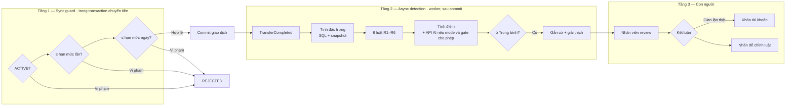
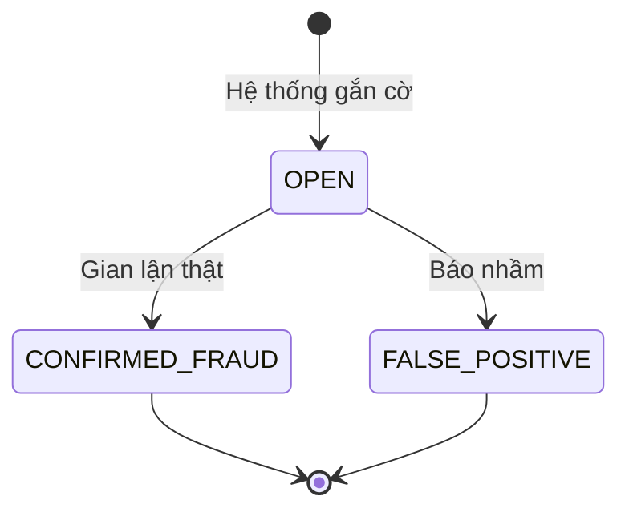
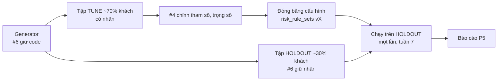

# Fraud Detection — Hướng dẫn chi tiết

> **Status:** ADR-14 Accepted · **Owner:** #4 · Bản này giữ lịch sử hướng dẫn cũ; trạng thái code và kiến trúc hiện hành xem [risk architecture](02-architecture.md), [DBS-128](../../features/DBS-128-offline-features.md), [DBS-129/130](../../features/DBS-129-130-fraud-operator-api.md) và [RSK-02](../../features/RSK-02-durable-ai-gate.md).

> **Cập nhật ADR-14 (Accepted, 2026-11-08):** Phương án rules + API AI ở [ADR-14](../../adr/0014-fraud-rules-external-ai.md) ([FRAUD-API-01](../../features/FRAUD-API-01-external-ai-decision.md), [FRAUD-API-02](../../features/FRAUD-API-02-standalone-risk.md)) đã được nhóm chấp nhận để bỏ hướng tự train / ONNX `v3` của ADR-08; 6 luật `R1–R6` (`rule_only`) giữ nguyên làm mặc định.
>
> **Đọc trước:** Các mục còn nói `ml_tuned_rules`, `hybrid_onnx`, train model, candidate gate, Redis counter hoặc không tốn token là **lịch sử, không phải triển khai hiện hành**. Hiện có `rule_only` và `rules_with_external_ai`; mọi TRANSFER mới ở mode AI hợp lệ được admission, không lọc trước theo điểm luật. Đặc trưng online đọc SQL, Redis chỉ cache cấu hình. Chưa có đo chất lượng, tải production, hay phê duyệt dữ liệu/egress thật. Chỉ dùng synthetic cho phát triển/test.
>
> **Cách đọc bản này (BL-186).** Số mục và tiêu đề được giữ nguyên vì ADR-08 và các feature doc cũ trỏ tới chúng (ví dụ §4.3.b, §4.2, §5.x, §6.1). Phần còn là quy tắc nghiệp vụ (sync guard, sáu luật, cờ, review, bộ dữ liệu, chỉ số đánh giá, guardrails) vẫn dùng được. Phần nào mô tả hướng ADR-08 cũ được đánh dấu **«Lịch sử (ADR-08, đã thay bởi ADR-14)»** ngay dưới tiêu đề hoặc trong ô liên quan:
>
> | Mục | Trạng thái |
> |---|---|
> | §4.3.b `v1`/`v2`/`v3`, vector 12 đặc trưng, đường huấn luyện | Lịch sử. Hiện hành: bảng «Chế độ hiện hành» ở đầu mục đó |
> | §4.2 cột «Nguồn dữ liệu» (R1, R5 ghi Redis) | Lịch sử. Hiện R1/R5 đọc SQL aggregate; Redis chỉ cache cấu hình |
> | §5.4 bộ đếm Redis; §8.4 dòng «Test dự phòng» (tắt Redis) | Lịch sử, giữ để hiểu quyết định cũ |
> | §5.1 sơ đồ, §5.5 cây code | Đã sửa theo code hiện tại (SQL, `ai/`, không có `ml/`) |
> | §5.7 dòng Redis và ONNX; §8.3 tuần 5–6 | Đánh dấu lịch sử ngay trong bảng |
> | §6.3, §6.4, §6.6, §8.6, §9 phần `v2`/`v3` | Đã sửa trỏ ADR-14, phần ADR-08 ghi «lịch sử» |
> | §7 guardrails và chi phí, §10 câu bảo vệ | Đã viết lại theo ADR-14 |
>
> **Hạn chế khi bật API AI.** `rule_only` là mặc định và là đường vận hành độc lập. `rules_with_external_ai` chỉ chạy khi version có khối `ai` hợp lệ **và** qua gate vận hành ([README risk](../../../backend/src/modules/risk/README.md), [RSK-02](../../features/RSK-02-durable-ai-gate.md)): `RISK_AI_EGRESS_APPROVED` mặc định `false`, policy/quota ngày/concurrency do Ops khai báo, không có policy mặc định. Dữ liệu gửi đi là allowlist 11 trường; dữ liệu thật cần phê duyệt riêng ([chính sách dữ liệu AI](04-ai-data-governance.md), trạng thái Proposed). Chưa có benchmark B0/B1/B2 chứng minh API tốt hơn luật; theo ADR-14, thiếu bằng chứng thì giữ AI tắt (no-go là kết quả hợp lệ).

> Tài liệu làm việc nội bộ cho mảng **Fraud** (#4) và người làm bộ dữ liệu (#6).
> Dựa trên: `docs/BRD.md` (BR-06, BR-11, BR-13, UC-9, UC-10, UC-12, FR-RSK-*, NFR-FRD-*), `docs/03` (mục 9, 10, 15).
> Tham số ở bảng 4.2 là seed `rule_only`; thay đổi phải được đánh giá và tạo version mới, không sửa version cũ.

---

## 1. Mảng này làm gì

### 1.1 Một câu

> Sau mỗi giao dịch hoàn tất, worker chấm 6 luật có giải thích; có thể bổ sung tín hiệu API AI qua admission đã được phép, sau đó gắn cờ để nhân viên review. Mục tiêu đánh giá định lượng chưa được xem là đạt khi chưa có dữ liệu và bằng chứng.

### 1.2 Làm và không làm

| ✅ Làm | ❌ Không làm (v1) |
|---|---|
| Chặn cứng giao dịch vượt hạn mức, tài khoản bị khóa (**sync guard**) | Chặn giao dịch vì "đáng ngờ" |
| Chấm điểm mọi lệnh chuyển tiền sau khi hoàn tất (**async detection**) | Tự động khóa tài khoản |
| Gắn cờ kèm danh sách luật và lời giải thích | Đảo giao dịch, giữ tiền chờ duyệt |
| Cho nhân viên review: Gian lận thật / Báo nhầm | Cho khách hàng thấy cờ (BR-13) |
| Cấu hình luật và AI có phiên bản (`rule_only`, `rules_with_external_ai`) | Tự train/ONNX hoặc tách microservice Python cho inference |
| Bộ dữ liệu tổng hợp + báo cáo đánh giá P5 | Dữ liệu thiết bị, IP, vị trí |

### 1.3 Thế nào là thành công

| Chỉ số | Mục tiêu | Nguồn |
|---|---|---|
| Thời gian từ giao dịch tới khi có cờ | p95 < 5 giây | NFR-FRD-01 |
| Số cảnh báo / 1.000 giao dịch | ≤ 20 trên giao dịch `TRANSFER` (lưu ý 6.4) | NFR-FRD-02 |
| Recall trên các kịch bản luật nhắm tới | ≥ 70 % gộp trên 5 kịch bản trong tầm luật | NFR-FRD-02 |
| Báo cáo precision, recall, F1 trên tập giữ lại | Có, kèm phân tích từng luật | NFR-FRD-03 |
| Chuyển tiền không chậm đi vì fraud | Sync guard thêm ≤ 5 ms | NFR-PERF-01 |
| Lỗi ở fraud không làm hỏng chuyển tiền | 0 ảnh hưởng | D-4 |

---

## 2. Bức tranh tổng thể



| Tầng | Ở đâu | Khi nào | Hậu quả | Vì sao đặt ở đây |
|---|---|---|---|---|
| **1. Sync guard** | `backend` (role `api`) · module `ledger` | Trong transaction, sau `FOR UPDATE` | `REJECTED` | Quy tắc cứng (BR-06, BR-12) phải đúng tuyệt đối kể cả khi đồng thời |
| **2. Async detection** | `backend` (role `worker`) · module `risk` | Vài giây sau commit | Gắn cờ | Phân tích lịch sử tốn truy vấn; không được làm chậm hay hỏng giao dịch |
| **3. Human-in-the-loop** | `backend` (role `api`) · module `risk` | Khi nhân viên xử lý | Kết luận, có thể khóa | Báo nhầm gây hại thật cho khách; quyết định cuối thuộc con người |

---

## 3. Tầng 1 — Sync guard

Viết **cùng #1** trong luồng chuyển tiền (`docs/03` mục 6.1). Chạy sau khi đã khóa hai tài khoản.

| Kiểm tra | Điều kiện từ chối | `reject_reason` |
|---|---|---|
| Trạng thái | Tài khoản nguồn hoặc đích không `ACTIVE` | `ACCOUNT_NOT_ACTIVE` |
| Hạn mức mỗi lần | `amount > TRANSFER_LIMIT_PER_TX` (50.000.000đ) | `LIMIT_PER_TX_EXCEEDED` |
| Hạn mức ngày | `đã chuyển hôm nay + amount > TRANSFER_LIMIT_PER_DAY` (200.000.000đ) | `LIMIT_PER_DAY_EXCEEDED` |
| Số dư | `balance < amount` | `INSUFFICIENT_FUNDS` |

**Tính "đã chuyển hôm nay"** (ngày theo giờ Việt Nam, chỉ tính tiền đi):

```sql
SELECT COALESCE(SUM(amount), 0)
FROM ledger_entries
WHERE account_id = $1
  AND direction = 'DEBIT'
  AND created_at >= date_trunc('day', now() AT TIME ZONE 'Asia/Ho_Chi_Minh') AT TIME ZONE 'Asia/Ho_Chi_Minh';
```

- Dùng index `ledger_entries(account_id, created_at)`.
- **Phải chạy sau `SELECT … FOR UPDATE`** tài khoản nguồn. Nếu chạy trước, hai lệnh đồng thời cùng thấy "còn hạn mức" và cùng lọt (AC-5.6).
- Nạp tiền (`DEPOSIT`) bỏ qua hạn mức và số dư của tài khoản SYSTEM.
- Ngân sách thời gian: ≤ 5 ms.

---

## 4. Tầng 2 — Async detection

### 4.1 Phạm vi chấm điểm

- Chỉ chấm `TransferCompleted` có `type = TRANSFER`. **Không chấm `DEPOSIT`** (tiền từ tài khoản ngân hàng).
- Chấm phía **người gửi** (tài khoản nguồn). Phía người nhận (nhiều người chuyển vào một tài khoản) là hướng mở rộng (mục 9).

### 4.2 Sáu luật

| ID | Luật | Điều kiện kích hoạt (`v1`) | Nguồn dữ liệu | Trọng số (`v1`) |
|---|---|---|---|---|
| **R1** | Velocity | > 5 lệnh chuyển từ tài khoản nguồn trong 10 phút (tính cả lệnh này) | Redis sorted set, dự phòng SQL | 30 |
| **R2** | Số tiền bất thường | `amount > 5 × trung vị` các lệnh chuyển 30 ngày trước của chính tài khoản; cần **≥ 5 lệnh lịch sử**, không đủ thì bỏ qua | SQL | 25 |
| **R3** | Tài khoản mới chuyển lớn | Tuổi tài khoản nguồn < 24 giờ **và** `amount > 10.000.000` | Snapshot `fromAccountCreatedAt` | 35 |
| **R4** | Chuyển vòng | Có lệnh `to → from` đã `COMPLETED` trong 1 giờ trước đó | SQL | 20 |
| **R5** | Fan-out (mule) | ≥ 5 người nhận **mới** trong 1 giờ (mới = chưa nhận tiền từ tài khoản này trong 30 ngày trước) | Redis sorted set + SQL kiểm tra "mới" | 40 |
| **R6** | Rút cạn | `amount ≥ 90% × fromBalanceBefore` **và** `fromBalanceBefore ≥ 1.000.000` | Snapshot `fromBalanceBefore` | 30 |

**Ngoại lệ chung:** chuyển giữa **hai tài khoản của cùng một khách hàng** không kích hoạt R5, R6 (chuyển tiền tiết kiệm sang tài khoản khác của mình là bình thường). `sameOwner` **đã có** trong [event contract](../_shared/event-contract.md) và type [`TransferCompleted`](../../../backend/src/common/events/event-types.ts); thiếu hoặc sai kiểu là event malformed, xử lý theo schema/DLQ của consumer contract, không bỏ miễn trừ hay tự gán `false`.

#### Logic từng luật (giả mã)

```ts
// R1 — velocity
count = countTransfersFrom(fromAccountId, window = 10m, until = occurredAt)
hit if count > 5
explain: `${count} lệnh chuyển trong 10 phút (ngưỡng 5)`

// R2 — số tiền bất thường
history = amountsFrom(fromAccountId, last = 30d, before = occurredAt)
skip if history.length < 5
median = percentile50(history)
hit if amount > 5 * median
explain: `Số tiền ${amount} gấp ${amount/median}× trung vị 30 ngày (${median})`

// R3 — tài khoản mới chuyển lớn
age = occurredAt - fromAccountCreatedAt
hit if age < 24h && amount > 10_000_000
explain: `Tài khoản mở ${age} trước, chuyển ${amount}`

// R4 — chuyển vòng
hit if exists transfer(from = toAccountId, to = fromAccountId, status = COMPLETED,
                       createdAt in [occurredAt - 1h, occurredAt))
explain: `Tài khoản đích đã chuyển ngược lại ${x} phút trước`

// R5 — fan-out
newRecipients = distinctNewRecipients(fromAccountId, window = 1h, until = occurredAt)
hit if !sameOwner && newRecipients >= 5
explain: `${n} người nhận mới trong 1 giờ (ngưỡng 5)`

// R6 — rút cạn
hit if !sameOwner && fromBalanceBefore >= 1_000_000n && amount * 10n >= fromBalanceBefore * 9n
explain: `Chuyển ${pct}% số dư (${amount}/${fromBalanceBefore})`
```

**Tiền và thời gian chính xác:** `amount`/`fromBalanceBefore` trên wire là chuỗi đồng canonical, parse qua `@common/money`; nội bộ bigint/numeric, không `Number`, `parseInt`, `percentile_cont` trả floating-point hay `0.9 * number` để so luật. R2 với số lịch sử chẵn phải giữ trung vị nửa đồng chính xác (numeric hoặc tử số/2), không làm tròn. Lịch sử dùng bound theo `occurredAt = transfers.created_at`, không giờ worker; R1 đếm cả lệnh hiện tại đúng một lần, R2/R4 chỉ lịch sử trước event. R3/R6 tuyệt đối không thay snapshot bằng tuổi/số dư hiện tại. Các đoạn TypeScript ở đây là giả mã.

**Ví dụ SQL cho R2 và R4:**

```sql
-- R2: trung vị chính xác, không ép bigint sang double precision
WITH history AS (
  SELECT amount,
         row_number() OVER (ORDER BY amount) AS rn,
         count(*) OVER () AS n
  FROM v_transfer_facts
  WHERE from_account_id = $1 AND status = 'COMPLETED' AND type = 'TRANSFER'
    AND created_at >= $2 - interval '30 days' AND created_at < $2
)
SELECT avg(amount::numeric) AS median, max(n) AS n
FROM history
WHERE rn IN ((n + 1) / 2, (n + 2) / 2);

-- R4: có lệnh chuyển ngược trong 1 giờ trước
SELECT EXISTS (
  SELECT 1 FROM v_transfer_facts
  WHERE from_account_id = $1 AND to_account_id = $2 AND status = 'COMPLETED' AND type = 'TRANSFER'
    AND created_at >= $3 - interval '1 hour' AND created_at < $3
);
```

### 4.3 Tính điểm và mức rủi ro

```
score = Σ trọng số các luật kích hoạt
```

| Điểm | Mức | Hành động |
|---|---|---|
| 0 – 39 | `LOW` | Không gắn cờ (vẫn ghi metric) |
| 40 – 69 | `MEDIUM` | Gắn cờ |
| ≥ 70 | `HIGH` | Gắn cờ, đưa lên đầu danh sách review |

**Ý tưởng của trọng số:** tín hiệu đủ mạnh một mình (R5 mule = 40) thì tự gắn cờ. Tín hiệu yếu một mình (R6 rút cạn = 30, R4 chuyển vòng = 20) chỉ gắn cờ khi **kết hợp**: R6 + R3 = 65 → MEDIUM là kịch bản chiếm tài khoản mới tạo.

| Ví dụ | Luật kích hoạt | Điểm | Mức |
|---|---|---|---|
| Khách chuyển 95% số dư sang người quen | R6 | 30 | LOW — không cờ |
| Tài khoản 3 giờ tuổi chuyển 20tr, gần hết số dư | R3 + R6 | 65 | MEDIUM |
| 6 người nhận mới trong 1 giờ | R5 | 40 | MEDIUM |
| 8 lệnh / 10 phút, toàn người nhận mới | R1 + R5 | 70 | HIGH |

Trọng số và ngưỡng là **điểm xuất phát**, sẽ chỉnh bằng tập tune (mục 6). Ở mode `rules_with_external_ai`, điểm tổng còn cộng `ai.weight` khi API trả kết quả hợp lệ đạt ngưỡng (xem bảng «Chế độ hiện hành» ở 4.3.b); mức rủi ro vẫn theo cùng ngưỡng 40 / 70.

### 4.3.b Ba chế độ chấm điểm theo phiên bản cấu hình (`v1` → `v2` → `v3`)

**Chế độ hiện hành (ADR-14).** Cột `risk_rule_sets.config` là `jsonb`; mỗi version bất biến mang một `mode`. Chỉ có hai giá trị được chấp nhận khi tạo version (`POST /v1/admin/risk-config/versions`):

| `mode` | Cách tính điểm | Ghi chú |
|---|---|---|
| `rule_only` (seed `v1`, mặc định; thiếu `mode` cũng hiểu là `rule_only`) | `score = Σ trọng số R1–R6`. Không gọi API | Tất định, là baseline và đường vận hành độc lập |
| `rules_with_external_ai` | `score = Σ trọng số R1–R6 + aiContribution`. `aiContribution = ai.weight` khi câu trả lời `needs_operator_review` hợp lệ và xác suất `p ≥ ai.threshold`, ngược lại 0. AI không trừ điểm hay hủy cờ của luật | Cần khối `ai` hợp lệ (`model`, `rubric`, `threshold`, `weight`, `maxAdmissionDelayMs`, `requestTimeoutMs`) và gate ở phần «Hạn chế khi bật API AI» đầu tài liệu. Khối `ai` hỏng → `CONFIG_INVALID`, vẫn chấm sáu luật; provider lỗi/timeout/429 → giữ điểm luật |

Giá trị `mode` khác (kể cả `ml_tuned_rules`, `hybrid_onnx`) bị API cấu hình từ chối; nếu vẫn đọc ra từ dữ liệu cũ thì `ScoringService` chấm như `rule_only` và tăng metric `risk_unsupported_mode_total`. Khối `ml` chỉ còn nhận `{ "enabled": false }`. Không có pipeline train, file `.onnx` hay `onnxruntime-node` trong repo. Chi tiết: [ADR-14](../../adr/0014-fraud-rules-external-ai.md), [kiến trúc risk](02-architecture.md) §2.2, [RSK-02](../../features/RSK-02-durable-ai-gate.md).

> **Lịch sử (ADR-08, đã thay bởi ADR-14).** Từ đây tới hết mục này (bảng `v1`/`v2`/`v3`, vector 12 đặc trưng, quy ước giải thích `v3`, đường huấn luyện, giao thức đánh giá ba phiên bản) mô tả hướng tự train mô hình ONNX của [ADR-08](../../adr/0008-fraud-detection-architecture.md). Hướng này **không được triển khai và không còn là khuyến nghị**: không có `v2` học tham số tự động, không có `v3`. Giữ lại để ADR-08 và các task cũ còn chỗ tham chiếu; không dùng làm yêu cầu.

| Phiên bản | Chế độ (`mode`) | Cách tính điểm | Trạng thái |
|---|---|---|---|
| **`v1`** (seed mặc định) | `rule_only` | 6 luật `R1–R6` với ngưỡng và trọng số ở bảng 4.2 | Bắt buộc. Mọi unit test và e2e (`AC-9.1`, bảng ví dụ 4.3) tất định 100% |
| **`v2`** | `ml_tuned_rules` | Vẫn đúng 6 luật, nhưng ngưỡng và trọng số học từ tập `tune`. Mục tiêu: recall lớn nhất với ràng buộc ≤ 20 cảnh báo / 1.000 giao dịch (không tối ưu F2) | Phạm vi chính |
| **`v3`** | `hybrid_onnx` | `score = Σ trọng số luật + round(ml.weight × p)` nếu `p ≥ ml.threshold` (giá trị khởi đầu 40 và 0,5; spike DBS-212 chọn lại trên tập `tune`), `p` là xác suất gian lận của mô hình LightGBM / XGBoost xuất `.onnx` | Mở rộng có điều kiện: chỉ khi qua cổng go/no-go cuối tuần 5 |

Mức rủi ro dùng chung ngưỡng với `v1` (LOW < 40, MEDIUM 40–69, HIGH ≥ 70). Các con số về kích thước và độ trễ của mô hình (ví dụ "~100 KB", "< 2 ms") chỉ là giả định cho tới khi spike đo được.

**Vector 12 đặc trưng cho `v3`** (dùng cho cả spike lẫn huấn luyện; chỉ thêm đặc trưng bằng PR có ghi lại kết quả cross-validation). Mọi đặc trưng chỉ dùng dữ liệu **trước** `occurredAt`; không dùng cột `scenario` hay `is_fraud`.

| Nhóm | Đặc trưng | Cách tính | Nguồn |
|---|---|---|---|
| R1 | `txCount10m`, `txCount1h` | Số lệnh chuyển từ tài khoản nguồn trong 10 phút, 1 giờ (tính cả lệnh này) | Redis, dự phòng SQL |
| R2 | `amountToMedian30d` | `amount` / trung vị 30 ngày (0 nếu dưới 5 lệnh lịch sử) | SQL |
| R2 | `sumOut24hToDailyLimit` | Tổng tiền đi 24 giờ (gồm lệnh này) / hạn mức ngày | SQL |
| R2 | `smallTxCount24h` | Số lệnh trong 24 giờ có `amount` dưới 10% hạn mức mỗi lần (dấu hiệu chia nhỏ) | SQL |
| R3 | `accountAgeHours` | Tuổi tài khoản nguồn (giờ), cắt ở 720 | Snapshot trong event |
| R4 | `minutesSinceReverse` | Số phút từ lệnh ngược gần nhất trong 1 giờ trước (60 nếu không có) | SQL |
| R5 | `newRecipients1h` | Số người nhận mới trong 1 giờ | Redis + SQL |
| R5 | `distinctRecipients24h` | Số người nhận khác nhau trong 24 giờ | SQL |
| R5 | `sameOwner` | 1 nếu hai tài khoản cùng khách hàng | Snapshot trong event |
| R6 | `amountToBalance` | `amount` / `fromBalanceBefore` | Snapshot trong event |
| R6 | `drain24h` | Tổng tiền đi 24 giờ / (`fromBalanceBefore` + tổng tiền đi 24 giờ trước lệnh này) | Snapshot + SQL |

**Quy ước ghi giải thích (không đổi schema).** `fraud_rule_hits` giữ `CHECK (rule_id IN ('R1',…,'R6'))` và khóa chính `(transfer_id, rule_id)` ([database-design §4.8](../_shared/database-design.md)), nên mỗi mã đại diện đúng nhóm luật như bảng 4.2 và mỗi nhóm có tối đa một dòng:
- Khi chạy `v1` và `v2`: ghi các luật vượt ngưỡng.
- Khi chạy `v3`: điểm của mô hình được **quy về một nhóm**, là nhóm có đóng góp dương lớn nhất, với đóng góp của nhóm = `p − p'`, trong đó `p'` là xác suất khi đặt các đặc trưng của nhóm đó về giá trị cơ sở (trung vị trên tập `tune`, lưu trong cấu hình). Chỉ cần thêm 6 lần suy luận nhẹ, không cần TreeSHAP trong worker (TreeSHAP vẫn dùng ngoại tuyến để vẽ biểu đồ cho P5).
- Nếu luật của nhóm đó đã kích hoạt: giữ dòng luật, cộng điểm mô hình vào `weight` và nối « · [AI] …» vào `explanation`. Nếu chưa: tạo dòng mới với `weight` bằng điểm mô hình và `explanation` bắt đầu bằng «[AI-Rn]». Nhờ vậy tổng `weight` luôn bằng `score` của cờ.

**Đường huấn luyện.** `OfflineFeatureProvider` (TypeScript) xuất CSV đặc trưng; công cụ Python ở `backend/ml/` chỉ đọc CSV đó để huấn luyện và xuất `backend/models/fraud-model.onnx` cùng `sha256` (ghi vào `ml.modelSha256` của cấu hình). Không tính đặc trưng bằng Python để hai nơi không lệch nhau.

**Giao thức đánh giá.** Dùng cross-validation theo khách trong tập `tune`. **Đóng băng cả ba phiên bản trước khi chạy holdout**, chạy holdout đúng một lần, báo cáo tất cả, không chọn phiên bản dựa trên holdout.

### 4.4 Cờ và lời giải thích

Mỗi cờ lưu: giao dịch, điểm, mức, **phiên bản luật đã dùng**, và từng luật kích hoạt kèm câu giải thích bằng tiếng Việt cho nhân viên.

```json
{
  "transferId": "8f3c…",
  "score": 65,
  "riskLevel": "MEDIUM",
  "ruleSetVersion": 3,
  "hits": [
    { "ruleId": "R3", "explanation": "Tài khoản mở 3 giờ trước, chuyển 20.000.000đ" },
    { "ruleId": "R6", "explanation": "Chuyển 96% số dư (20.000.000/20.800.000)" }
  ],
  "reviewStatus": "OPEN"
}
```

### 4.5 Review của nhân viên (UC-10)



| API | Mô tả |
|---|---|
| `GET /v1/operator/fraud-flags?status=OPEN&level=HIGH` | Danh sách cờ, HIGH lên trước, mới nhất trước |
| `GET /v1/operator/fraud-flags/{transferId}` | Chi tiết: giao dịch, các luật, giải thích, 10 giao dịch gần nhất của tài khoản nguồn |
| `POST /v1/operator/fraud-flags/{transferId}/review` | Body: `decision` (`CONFIRMED_FRAUD` / `FALSE_POSITIVE`), `note`. Chỉ review một lần |

Mọi lần xem chi tiết và review đều ghi nhật ký. Kết luận của nhân viên là **nhãn thật** dùng để chỉnh luật về sau.

### 4.6 Cấu hình luật có phiên bản (UC-12)

- Bảng `risk_rule_sets`: mỗi dòng là một **phiên bản bất biến** chứa tham số, trọng số và ngưỡng mức của cả 6 luật, kèm cờ bật/tắt từng luật.
- Đổi cấu hình = thêm phiên bản mới. Worker biết phiên bản hiện hành qua key Redis `cfg:risk:latest` (TTL 60 giây; miss hoặc lỗi thì `SELECT max(version)` từ `risk_rule_sets`), rồi đọc nội dung từ `cfg:risk:v{n}` (bất biến nên TTL dài). Phiên bản mới có hiệu lực sau tối đa 60 giây.
- Mỗi cờ ghi `ruleSetVersion`, để biết cờ được tạo theo cấu hình nào.
- **Công tắc khẩn cấp:** tắt một luật đang báo nhầm hàng loạt chỉ cần tạo phiên bản mới với luật đó `enabled = false`.

---

## 5. Làm như thế nào — hiện thực

### 5.1 Luồng xử lý một sự kiện

```mermaid
sequenceDiagram
    participant Q as SQS risk-events
    participant W as risk (worker)
    participant DB as PostgreSQL

    Q->>W: TransferCompleted (eventId, snapshot)
    W->>DB: Đã có processed_events(risk, eventId)?
    alt Đã xử lý
        W->>Q: Xóa message, kết thúc
    else Chưa
        W->>DB: Đọc version cấu hình (cache Redis, lỗi thì SQL) và đặc trưng R1, R2, R4, R5 từ v_transfer_facts
        W->>W: Đọc snapshot cho R3, R6 · chạy 6 luật · tính điểm
        opt Mode rules_with_external_ai hợp lệ và gate cho phép
            W->>W: Gọi API AI ngoài transaction, có timeout; lỗi thì giữ điểm luật
        end
        W->>DB: BEGIN
        W->>DB: INSERT processed_events
        W->>DB: INSERT risk_decisions (mọi TRANSFER) ON CONFLICT DO NOTHING
        W->>DB: INSERT fraud_flags + fraud_rule_hits (nếu ≥ MEDIUM) + audit_log (fraud.flagged)
        W->>DB: COMMIT
        W->>Q: Xóa message
    end
    Note over W,DB: Lỗi giữa chừng → không xóa message → SQS giao lại → quá 5 lần vào DLQ
```

### 5.2 Đầu vào: event contract

Shape nằm ở [event contract](../_shared/event-contract.md) và type [`TransferCompleted`](../../../backend/src/common/events/event-types.ts); `sameOwner` đã có:

| Trường | Dùng cho |
|---|---|
| `eventId` | Chống xử lý trùng |
| `transferId`, `type` | Khóa của cờ; bỏ qua `DEPOSIT` |
| `fromAccountId`, `toAccountId` | R1, R2, R4, R5 |
| `amount` (string) | R2, R3, R6 |
| `fromBalanceBefore` (string) | R6 — **phải** lấy từ snapshot, không đọc số dư hiện tại |
| `fromAccountCreatedAt` | R3 — **phải** lấy từ snapshot |
| `occurredAt` | Mốc thời gian cho mọi cửa sổ (không dùng giờ worker) |
| `sameOwner` | Ngoại lệ cho R5, R6 (boolean bắt buộc; `false` khi `DEPOSIT`) |
| `correlationId` | Ghi nhật ký, truy vết |

Event sai hoặc mất field phải xử lý theo schema/DLQ của consumer contract. Không suy từ trạng thái tài khoản hiện tại hoặc bỏ miễn trừ để tiếp tục; chính sách khi gặp loại event lạ theo [BL-010](../../BACKLOG.md), không tự ack.

**Vì sao dùng `occurredAt` chứ không dùng giờ hiện tại của worker:** sự kiện có thể tới trễ (worker restart, message được giao lại). Nếu tính cửa sổ theo giờ worker, cùng một giao dịch có thể cho kết quả khác nhau tùy lúc nào được xử lý.

### 5.3 Dữ liệu

Schema chính thức của `risk_rule_sets`, `fraud_flags`, `fraud_rule_hits`, `processed_events` chỉ nằm ở [database-design §4.6, §4.8](../_shared/database-design.md) (một sự thật, một chỗ). Điểm riêng của mảng fraud:

- Mỗi cờ ghi `rule_set_version` ở `fraud_flags`; `fraud_rule_hits` lưu `weight` (đóng góp vào điểm) và `explanation`, không lặp lại phiên bản.
- `risk` đọc lịch sử chuyển tiền qua view chỉ đọc `v_transfer_facts` do `ledger` sở hữu, không `SELECT` thẳng bảng `transfers`.
- Index cho truy vấn luật: `transfers(from_account_id, created_at) INCLUDE (amount, to_account_id)` và `transfers(from_account_id, to_account_id, created_at)`, cả hai chỉ chứa hàng `status = 'COMPLETED' AND type = 'TRANSFER'`.
- Quyền DB: worker chạy bằng role `dbs_worker` (đọc `v_transfer_facts`; ghi bảng fraud, `processed_events`, `audit_log`). Role riêng chỉ cho risk là hướng mở rộng (database-design §8.1).

### 5.4 Bộ đếm Redis (R1, R5)

> **Lịch sử (ADR-08, đã thay bởi ADR-14 và các task DBS-109/111).** Mục này mô tả thiết kế bộ đếm Redis ban đầu. Hiện hành: `OnlineFeatureProvider` đọc 5 SELECT từ `v_transfer_facts` theo `occurredAt`, R1/R5 dùng SQL aggregate vì thứ tự giao message không bằng thứ tự commit nên không thể chứng minh coverage của cache; Redis chỉ cache cấu hình luật (`cfg:risk:latest:v2`, `cfg:risk:v{n}`; TTL của key latest là 60 giây). Xem [kiến trúc risk §2.3](02-architecture.md) và [DBS-109](../../features/DBS-109-online-feature-provider.md). Metric `risk_redis_fallback_total` vẫn được khai báo trong code.

| Luật | Key | Lệnh |
|---|---|---|
| R1 | `risk:vel:{accountId}` (sorted set, member = `transferId`, score = `occurredAt`) | `ZADD` → `ZCOUNT key (occurredAt−10m) occurredAt` → `EXPIRE key 7200` (dọn phần cũ theo giờ tường, xem bên dưới) |
| R5 | `risk:fan:{accountId}` (sorted set, member = `toAccountId`, score = `occurredAt`) | Chỉ `ZADD` khi người nhận là **mới** (kiểm tra bằng SQL) → `ZCOUNT` cửa sổ 1 giờ theo `occurredAt` → `EXPIRE` (dọn phần cũ theo giờ tường, xem bên dưới) |

- Dùng `transferId` làm member nên nhận trùng sự kiện không đếm trùng.
- SQL là nguồn sự thật. Miss, cold/empty chưa biết coverage, timeout/lỗi hoặc cửa sổ của event nằm ngoài lịch sử cache đã giữ → SQL; **không coi cache lạnh là 0**.
- Cửa sổ đếm theo `occurredAt`, nhưng việc dọn cache theo giờ tường và retention (TTL 7200 giây), **không `ZREMRANGEBYSCORE` dựa trên `occurredAt` của event đang xử lý**: event mới tới trước sẽ xóa phần mà event cũ tới sau còn cần. Phần đã dọn hoặc không chứng minh đủ coverage thì event trễ phải đọc SQL.
- Gom các lệnh của một key vào một `MULTI`/pipeline chỉ giảm round-trip, không chứng minh coverage hay làm parity tự đúng. Redis I/O thực hiện **trước** `BEGIN` của consumer.
- Parity online/offline chỉ được tuyên bố trên input theo thứ tự, cache ấm; cache lạnh, event trễ/đảo thứ tự và đường dự phòng SQL có test riêng đối chiếu SQL.
- **Redis lỗi → dự phòng SQL:** đếm trực tiếp trên view `v_transfer_facts` (role `dbs_worker` không có quyền SELECT bảng `transfers`), cùng cửa sổ. Kết quả như nhau, chỉ tốn tải DB hơn. Ghi metric `risk_redis_fallback_total`.

### 5.5 Cấu trúc code

Một module `risk` duy nhất, vừa có phần API vừa có phần worker (xem `backend/src/modules/risk/README.md`). Consumer chỉ khởi động khi `runsWorkers()`.

```
backend/src/modules/risk/
├── risk.module.ts
├── risk-flags.controller.ts     # role api: danh sách cờ, review (UC-10)
├── risk-config.controller.ts    # role api: cấu hình luật có phiên bản (UC-12)
├── risk-scoring.consumer.ts     # role worker: nhận message, idempotency, transaction ghi cờ
├── scoring.service.ts           # điều phối chấm điểm (rule_only / rules_with_external_ai)
├── rules/
│   ├── rule.ts                  # interface chung
│   ├── r1-velocity.rule.ts
│   ├── r2-unusual-amount.rule.ts
│   ├── r3-new-account-large.rule.ts
│   ├── r4-round-trip.rule.ts
│   ├── r5-fan-out.rule.ts
│   └── r6-drain.rule.ts
├── ai/                          # ADR-14: adapter OpenAI Decisions, gate quota/egress, chiếu 11 trường
├── features/
│   ├── feature-provider.ts      # interface lấy đặc trưng cho 6 luật
│   ├── online-feature-provider.ts   # SQL v_transfer_facts (chạy thật)
│   └── offline-feature-provider.ts  # tính từ dữ liệu trong bộ nhớ (đánh giá)
├── config/                      # rule-set.ts, rule-set.repository.ts (Redis cache cấu hình, lỗi thì SQL)
└── index.ts                     # API công khai
```

Cây trên là rút gọn theo code hiện tại; thư mục `ml/` và `onnx-model.scorer.ts` của thiết kế ADR-08 (`v3`) **không tồn tại** và không được thêm theo ADR-14. Danh sách đầy đủ xem `backend/src/modules/risk/`.

**Điểm thiết kế quan trọng nhất: luật là hàm thuần.**

```ts
interface RiskRule {
  id: 'R1' | 'R2' | 'R3' | 'R4' | 'R5' | 'R6';
  evaluate(event: TransferCompleted, features: Features, params: RuleParams): RuleHit | null;
}
```

- Luật **không** gọi Redis hay DB. Mọi dữ liệu đến từ `FeatureProvider`.
- Nhờ vậy **cùng một code luật** chạy được ở hai nơi:
  - **Online:** `OnlineFeatureProvider` lấy đặc trưng từ Redis/SQL.
  - **Offline:** `OfflineFeatureProvider` lấy đặc trưng từ bộ dữ liệu tổng hợp đọc vào bộ nhớ → chạy đánh giá 100k giao dịch trong vài giây, không cần dựng cả hệ thống.
- Có một test **so khớp** hai provider trên cùng dữ liệu, để kết quả đánh giá offline phản ánh đúng hệ thống thật.

### 5.6 Xử lý lỗi

| Tình huống | Xử lý |
|---|---|
| Nhận trùng sự kiện | `processed_events` → bỏ qua; khóa chính `fraud_flags` chặn cờ trùng |
| Redis lỗi | Dự phòng SQL (mục 5.4) |
| DB lỗi | Không xóa message → SQS giao lại; quá 5 lần → DLQ + alarm |
| Message không đúng định dạng | Log + chuyển thẳng DLQ, không retry vô ích |
| Một luật hoặc truy vấn feature lỗi | Theo ADR-14: rollback, không ack, retry và sau giới hạn thì DLQ; metric `risk_rule_error_total{rule}` khi lỗi luật. Consumer đã có ([DBS-111](../../features/DBS-111-risk-scoring-consumer.md)); metric và alarm còn ở BL-046/051 |
| Cấu hình AI không hợp lệ hoặc provider AI lỗi | Giữ điểm sáu luật, contribution AI bằng 0, ghi trạng thái tương ứng; không đẩy DLQ chỉ vì AI. `rule_only` là mặc định; không tự bật AI khi chưa đạt gate ADR-14 |
| Worker chết | Giao dịch không bị ảnh hưởng; khi bật lại, message còn trong queue được xử lý tiếp |

### 5.7 Ngân sách hiệu năng

| Bước | Ngân sách |
|---|---|
| Redis (1 pipeline cho R1, R5) — *lịch sử, hiện R1/R5 đọc SQL (mục 5.4); chưa đo lại ngân sách này* | ≤ 5 ms |
| SQL (R2, R4, kiểm tra người nhận mới) | ≤ 30 ms |
| Ghi cờ (1 transaction) | ≤ 15 ms |
| ONNX suy luận + quy kết nhóm (chỉ `v3`) — *lịch sử, không triển khai* | ≤ 15 ms |
| **Tổng xử lý một sự kiện** (ngân sách ADR-08, chưa đo trên bản hiện hành) | **≤ 50 ms** (`v1`, `v2`), **≤ 65 ms** (`v3`, lịch sử) |
| Gọi API AI (chỉ mode `rules_with_external_ai`) | Ngoài ngân sách trên: giới hạn bởi `ai.maxAdmissionDelayMs` và `ai.requestTimeoutMs` của version; chưa đo 120 RPS |
| Thời gian chờ outbox relay (poll ≤ 1 giây) + SQS | ≤ 2 giây |
| **Từ giao dịch tới khi có cờ** | **p95 < 5 giây** |

Ở 25 lệnh chuyển/giây × 50 ms = 1,25 giây xử lý mỗi giây → 1 worker với concurrency 2–4 là đủ.

---

## 6. Đánh giá

Đây là phần **hội đồng hỏi nhiều nhất** (câu bảo vệ 12): "luật của các bạn tốt đến mức nào, và các bạn biết bằng cách nào?"

### 6.1 Bộ dữ liệu tổng hợp (do #6 làm)

**Quy mô:** ~2.000 khách hàng, mô phỏng 60 ngày, ~100.000 giao dịch, ~1% gian lận (chốt cùng #6, DBS-11).

**Hành vi bình thường** — mỗi khách có "thói quen" riêng:

| Thành phần | Cách sinh |
|---|---|
| Số lệnh / ngày | Poisson, λ riêng mỗi khách trong khoảng 0,3 – 3 |
| Số tiền | Log-normal với trung vị riêng mỗi khách (từ 100k đến vài triệu) |
| Người nhận | "Vòng quen" 3–10 người chiếm ~80% lệnh; còn lại là người mới |
| Thời điểm | Nhiều vào giờ hành chính và buổi tối; đỉnh vào ngày lương |
| Số dư | Nạp tiền định kỳ (lương), số dư thay đổi theo giao dịch |

**Giao dịch hợp lệ nhưng trông đáng ngờ** (hard negatives — bắt buộc có, để đo báo nhầm thật):
- Trả tiền nhà hằng tháng, số tiền lớn gấp nhiều lần thường ngày (dễ dính R2).
- Chuyển gần hết số dư sang tài khoản khác **của chính mình** (dễ dính R6).
- Khách mới mở tài khoản, nhận lương rồi chuyển lớn ngay (dễ dính R3).
- Chia tiền ăn nhóm cho nhiều bạn mới quen trong một buổi (dễ dính R5).
- Mượn rồi trả lại tiền trong ngày (dễ dính R4).

**Kịch bản gian lận** (có nhãn `is_fraud = 1` và `scenario`):

| Kịch bản | Mô tả | Luật nên bắt |
|---|---|---|
| `ATO_DRAIN` | Chiếm tài khoản, chuyển gần hết tiền cho vài người nhận mới | R6, R5, R1 |
| `MULE_FANOUT` | Tài khoản trung gian nhận tiền rồi rải cho nhiều tài khoản mới | R5, R1 |
| `VELOCITY_BURST` | Nhiều lệnh nhỏ liên tiếp trong vài phút | R1 |
| `BUST_OUT` | Tài khoản mới mở, chuyển lớn ngay | R3, R6 |
| `ROUND_TRIP` | Chuyển qua lại giữa hai tài khoản để làm rối dòng tiền | R4 |
| `SLOW_DRIP` ⚠️ | Rút dần số tiền nhỏ trong nhiều ngày, dưới mọi ngưỡng | *Không luật nào cố ý bắt* |
| `STRUCTURING` ⚠️ | Chia nhỏ ngay dưới ngưỡng (ví dụ nhiều lệnh 9,9tr) | *Không luật nào cố ý bắt* |
| `FAN_IN` ⚠️ | Nhiều tài khoản cùng chuyển vào một tài khoản | *Không luật nào cố ý bắt* (chấm phía người gửi) |

Các kịch bản ⚠️ cố ý nằm ngoài khả năng của luật. Mục đích là **đo trung thực** recall, và chỉ ra giới hạn trong báo cáo, thay vì có con số đẹp giả tạo.

**Định dạng file** (CSV, sinh bằng seed cố định để chạy lại ra đúng kết quả):

```
tx_id, occurred_at, from_account, to_account, from_customer, to_customer,
amount, from_balance_before, from_account_created_at, to_account_created_at,
is_fraud, scenario
```

- Khi đọc CSV trong `OfflineFeatureProvider`, cờ `sameOwner` được tính trực tiếp từ `from_customer === to_customer` (khớp ngữ nghĩa với trường `sameOwner` trong `TransferCompleted` của [event-contract](../_shared/event-contract.md)).
### 6.2 Chia tập và "bức tường" giữa #4 và #6



| Quy tắc | Lý do |
|---|---|
| Chia theo **khách hàng**, không chia ngẫu nhiên từng giao dịch | Tránh cùng một khách nằm ở cả hai tập → luật "học thuộc" thói quen của khách đó |
| #4 chỉ biết **tên và mô tả một câu** của kịch bản, không xem code generator | Tránh viết luật khớp đúng cách sinh dữ liệu |
| #6 giữ nhãn của tập holdout tới tuần 7 | Đánh giá cuối là trên dữ liệu #4 chưa từng thấy nhãn |
| Đóng băng cấu hình trước khi chạy holdout; **chỉ chạy holdout một lần** | Chạy nhiều lần rồi chỉnh = biến holdout thành tập tune |
| Ghi lại mọi lần chỉnh trên tập tune (phiên bản cấu hình + kết quả) | Có lịch sử để đưa vào báo cáo |

### 6.3 Chỉ số

**Ma trận nhầm lẫn:**

| | Thực tế: gian lận | Thực tế: bình thường |
|---|---|---|
| **Có cờ** | TP (bắt đúng) | FP (báo nhầm) |
| **Không cờ** | FN (bỏ sót) | TN |

| Chỉ số | Công thức | Ý nghĩa nghiệp vụ |
|---|---|---|
| **Precision** | TP / (TP + FP) | Trong các cảnh báo, bao nhiêu là thật → nhân viên có tin cảnh báo không |
| **Recall** | TP / (TP + FN) | Bắt được bao nhiêu % gian lận |
| **F1** | 2 · P · R / (P + R) | Cân bằng hai cái trên |
| **False positive rate** | FP / (FP + TN) | Bao nhiêu % khách bình thường bị làm phiền |
| **Cảnh báo / 1.000 giao dịch** | (TP + FP) / N × 1.000 | Khối lượng việc của nhân viên |

**Phân tích bắt buộc trong báo cáo:**

| Phân tích | Cách làm |
|---|---|
| Recall **theo từng kịch bản** | Bảng kịch bản × tỉ lệ bắt được; nêu rõ các kịch bản ⚠️ |
| Đóng góp từng luật (ablation) | Tắt lần lượt từng luật, đo Δ precision và Δ recall |
| Đường precision – recall | Quét ngưỡng gắn cờ từ 20 đến 90 điểm, vẽ đường; đánh dấu điểm đang chọn |
| Báo nhầm theo loại hard negative | Hard negative nào hay bị gắn cờ nhất → gợi ý cải tiến luật |
| So sánh các chế độ | Hiện hành (ADR-14): B0 chỉ luật, B1 API riêng (chỉ phân tích offline), B2 luật + API trên cùng giao dịch và cùng capture API; xem «Cách kiểm chứng» ở ADR-14. *Lịch sử (ADR-08): so `v1`, `v2`, `v3`.* Đóng băng trước khi chạy holdout, chạy một lần, báo cáo đủ; không chọn bản tốt nhất dựa trên holdout |

### 6.4 Mục tiêu đánh giá (đã chốt)

Với tỉ lệ gian lận 1% thì cứ 1.000 giao dịch có ~10 vụ gian lận. Giới hạn 10 cảnh báo nghĩa là gần như **mọi cảnh báo phải đúng**: muốn recall 80% (8 vụ) thì chỉ được tối đa 2 báo nhầm, tức precision ≥ 80%. Với luật thủ công, đây là mục tiêu rất khó.

**Đã chốt ngày 2026-10-11** (NFR-FRD-02, BG-4):

| Mục tiêu | Giá trị | Cách tính |
|---|---|---|
| Khối lượng cảnh báo | **≤ 20 cảnh báo / 1.000 giao dịch** | Mẫu số là số giao dịch `TRANSFER` (không tính `DEPOSIT`); tử số là số giao dịch có cờ (MEDIUM hoặc HIGH) |
| Recall | **≥ 70%** | Gộp trên 5 kịch bản trong tầm luật: `ATO_DRAIN`, `MULE_FANOUT`, `VELOCITY_BURST`, `BUST_OUT`, `ROUND_TRIP`. Ba kịch bản ngoài tầm (`SLOW_DRIP`, `STRUCTURING`, `FAN_IN`) báo cáo riêng, không tính vào mục tiêu |
| Tập đo | Holdout, một lần, sau khi đóng băng | Tune chỉ dùng để chỉnh tham số |

Với 1% gian lận, 20 cảnh báo / 1.000 tương ứng precision khoảng 35% nếu recall đạt 70%. Đây là mức nhân viên còn xử lý được, và đạt được bằng luật có giải thích. Khi chọn lại ngưỡng/trọng số trên tập tune (không còn là `v2` học tự động của ADR-08 — *lịch sử*): mục tiêu là **recall lớn nhất với ràng buộc ≤ 20 cảnh báo / 1.000** (không tối ưu F2). Với API AI, ADR-14 còn đòi B2 tăng recall ít nhất 5 điểm phần trăm trên grouped validation (khoảng tin cậy paired bootstrap 95% loại trừ 0) và vẫn trong ngân sách cảnh báo, mới đủ điều kiện bật; chưa có số đo nên AI giữ tắt.

### 6.5 Hai kiểu chạy đánh giá

| | Offline (chất lượng) | Online (vận hành) |
|---|---|---|
| Đo gì | Precision, recall, F1, ablation, đường PR | p95 thời gian tới khi có cờ, tải RDS, tác dụng của Redis |
| Chạy thế nào | Script đọc CSV → `OfflineFeatureProvider` → cùng code luật → tính chỉ số | Phát lại một phần dữ liệu qua API bằng k6 ở 120 RPS; đo `fraud_flags.created_at − transfers.created_at` |
| Thời gian | Vài giây | 15–30 phút |
| Người chạy | #4 | #6 + #4 |
| Khi nào | Mỗi lần chỉnh tham số (tập tune); một lần cuối (holdout) | Tuần 7, có và không có bộ đếm Redis |

### 6.6 Khung báo cáo P5

1. **Kiến trúc AI/Data:** hai tầng, luồng dữ liệu, vì sao bắt đầu từ luật (giải thích được, không cần dữ liệu huấn luyện, chi phí thấp), vì sao ADR-14 bỏ hướng tự train (`v2` học tham số, ONNX `v3` của ADR-08) và chỉ cho phép API AI bổ sung sau gate, kể cả khi kết luận là no-go.
2. **Bộ dữ liệu:** cách sinh, kịch bản, hard negative, cách chia tập, các giới hạn.
3. **Kết quả:** ma trận nhầm lẫn, các chỉ số, recall theo kịch bản, ablation, đường PR.
4. **Vận hành:** latency, tải DB, so sánh có/không Redis.
5. **Guardrails:** mục 7.
6. **Chi phí:** mục 7.
7. **Giới hạn và hướng phát triển:** mục 9.

---

## 7. Guardrails và chi phí

| Guardrail | Hiện thực |
|---|---|
| Con người quyết định cuối cùng | Hệ thống chỉ gắn cờ; chỉ nhân viên khóa tài khoản |
| Khách không biết mình bị gắn cờ | API khách hàng không trả bất kỳ trường nào về cờ (AC-10.2) |
| Quyền tối thiểu | DB role riêng cho worker; chỉ vai trò `operator` xem/review cờ; `auditor` chỉ đọc |
| Truy vết quyết định | Mỗi cờ ghi phiên bản luật; mọi review có người, thời điểm, ghi chú, nhật ký |
| Không lộ dữ liệu cá nhân | Log và Redis chỉ chứa id, số đếm; không ghi số tài khoản đầy đủ hay tên |
| Kiểm soát thay đổi luật | Cấu hình có phiên bản, đổi phải tạo phiên bản mới, có nhật ký |
| Công tắc khẩn cấp | Tắt từng luật, hoặc chuyển về `rule_only` (khối `ml` chỉ nhận `enabled: false`), bằng phiên bản cấu hình mới. Cache latest TTL 60 giây nên đây là chuyển có độ trễ, không phải ngắt egress tức thì (ADR-14) |
| Giới hạn gọi API AI | `RISK_AI_EGRESS_APPROVED=false` mặc định; policy, quota ngày và concurrency ở gate do Ops khai báo; payload chỉ 11 trường allowlist |
| Theo dõi báo nhầm | Metric cảnh báo / 1.000 giao dịch trên dashboard; alarm khi vượt ngân sách |
| Không ảnh hưởng chuyển tiền | Async + DLQ; worker chết thì giao dịch vẫn chạy bình thường |

**Chi phí (ADR-14).**
- Mode `rule_only` (mặc định): không gọi API ngoài nên không tốn token hay phí provider. Chi phí chỉ là CPU worker (đã nằm trong ECS chung) và 5 SELECT feature mỗi TRANSFER tới `v_transfer_facts`; tải phụ lên RDS ở 120 RPS **chưa đo** (kiến trúc risk §2.3 ước tính khoảng 600 SELECT/giây).
- Mode `rules_with_external_ai`: mỗi TRANSFER được admission đều có thể gọi API, không lọc trước theo điểm luật. Có phí theo token của provider, cộng egress, secret, quota và latency. Retry hoặc hai delivery đồng thời có thể gọi thêm, không hứa exactly-once billing. Giá tham khảo trong ADR-14 ($0,10/1M token input theo trang provider ngày 2026-10-25) cần xác nhận lại; ước tính cost/1.000 TRANSFER phải ghi giả định, không phải hóa đơn thực.
- `risk_decisions` thêm một dòng cho mọi TRANSFER (≈ 616 B/dòng đo ở RSK-01).
- Không có chi phí train, `.onnx` hay `onnxruntime-node`: các mục này thuộc hướng ADR-08 đã bị thay.

---

## 8. Cách làm việc

### 8.1 Ai làm gì

| Người | Vai trò trong mảng fraud |
|---|---|
| **#4** | Chủ mảng fraud: 6 luật, tính điểm, API review, cấu hình, đánh giá offline, báo cáo P5; cùng #1 thống nhất danh sách lý do từ chối của sync guard |
| **#6** | Generator dữ liệu tổng hợp, giữ nhãn holdout, `libs/redis` và `libs/sqs`, viết script k6 |
| **#1** | Viết sync guard (`checkGuards`, trạng thái, hạn mức lần, hạn mức ngày) trong transaction chuyển tiền; cặp đôi review code `risk` |
| **#3** | Event contract, outbox, queue `risk-events` + DLQ, khung consumer idempotent |
| **#2** | Thu hồi phiên khi nhân viên khóa tài khoản sau review |
| **#5** | Hạ tầng Redis và SQS trên cloud, role DB cho worker, alarm, chạy đánh giá online (k6) và diễn tập sự cố trên cloud |

### 8.2 Các thỏa thuận cần chốt sớm (tuần 1–2)

| Với ai | Thỏa thuận | Hạn |
|---|---|---|
| #3 | Event contract `TransferCompleted` (gồm `sameOwner`, `fromBalanceBefore`, `fromAccountCreatedAt`) | Tuần 1 |
| #1 | Vị trí, chữ ký `checkGuards` và danh sách mã lỗi của sync guard (#1 viết, #4 thống nhất lý do từ chối) | Tuần 2 |
| #6 | Định dạng CSV, danh sách tên kịch bản, tỉ lệ chia tập, lịch giao tập tune | Tuần 2 |
| #6, #5 | `libs/redis` (#6) và key Redis (`risk:vel:*`, `risk:fan:*`, `cfg:risk:*`); quyền của `dbs_worker` trên `v_transfer_facts` (#1 viết migration, #5 hạ tầng) | Tuần 3 |
| Cả nhóm | Mục tiêu recall / số cảnh báo (mục 6.4) | Tuần 2 |

### 8.3 Lộ trình theo tuần

> **Lịch sử (ADR-08).** Lộ trình dưới đây là kế hoạch ban đầu. Hai dòng tuần 5 và 6 nhắc spike ONNX, cổng go/no-go và `v3` đã bị ADR-14 thay: không còn spike/huấn luyện ONNX; thay vào đó là các gate bật API AI của ADR-14. Chưa dòng nào trong bảng này là cam kết lịch hiện hành.

| Tuần | #4 làm | #6 làm | ✅ Xong khi |
|---|---|---|---|
| **1** | Chốt 6 luật, trọng số ban đầu; chốt event contract với #3 | Thiết kế mô hình hành vi bình thường | Bảng luật + contract được cả nhóm đồng ý |
| **2** | Bảng `risk_rule_sets`, `fraud_flags`, `fraud_rule_hits`; interface `RiskRule`, `FeatureProvider` | Bản đầu của generator (chỉ giao dịch bình thường) | Migration chạy được; code khung có test |
| **3** | Luật R1–R3 dạng hàm thuần; review sync guard của #1 | Thêm kịch bản gian lận và hard negative | AC-5.6, 5.7 xanh trong CI |
| **4** | 6 luật + consumer + Redis + dự phòng SQL; unit test từng luật | Hoàn thiện generator, giao **tập tune** | Chuyển tiền → cờ tự xuất hiện; AC-9.1, 9.2 xanh |
| **5** | API review (UC-10); `OfflineFeatureProvider`; đánh giá lần đầu trên tập tune; **spike ONNX và cổng go/no-go cho `v3` (cuối tuần)** | Hỗ trợ đọc kết quả, kiểm tra dữ liệu có hợp lý không | Demo giữa kỳ có phần review cờ; có số liệu đầu tiên |
| **6** | Học tham số (`v2`) trên tập tune; chỉ nếu qua cổng go/no-go: huấn luyện và tích hợp `v3`; test so khớp online/offline; cấu hình có phiên bản (UC-12) | — | Có bảng đối sánh các chế độ trên tập tune |
| **7** | **Đóng băng cấu hình** → chạy holdout một lần; ablation, đường PR | Giao nhãn holdout; viết script k6 để #5 chạy đánh giá online (latency, tải DB, có/không Redis) cùng #4 | Có toàn bộ số liệu cho P5 |
| **8** | Metric cảnh báo / 1.000 giao dịch (#4); alarm do #5 dựng | #5 diễn tập sự cố cho worker (tắt Redis, DB lỗi) bằng script của #6 | Số liệu fraud có trong P4 |
| **9** | **Viết báo cáo P5**; chuẩn bị trả lời câu 12 | Viết phần mô tả bộ dữ liệu và giới hạn | Nộp P5 |

### 8.4 Kiểm thử

| Loại | Nội dung | Chạy ở đâu |
|---|---|---|
| Unit test từng luật | Mỗi luật: ≥ 1 ca kích hoạt, ≥ 1 ca không kích hoạt, các ca biên (đúng ngưỡng, thiếu lịch sử cho R2, `sameOwner`) | CI |
| Unit test tính điểm | Bảng ví dụ ở mục 4.3 | CI |
| Integration test | Gửi sự kiện vào ElasticMQ → consumer → kiểm tra cờ trong Postgres (Testcontainers) | CI |
| Test idempotency | Gửi cùng sự kiện 3 lần → 1 cờ (AC-9.2) | CI |
| Test dự phòng *(lịch sử, theo bộ đếm Redis của mục 5.4; hiện R1/R5 đọc SQL)* | Tắt Redis → kết quả luật R1, R5 không đổi | CI |
| Test so khớp | `OnlineFeatureProvider` và `OfflineFeatureProvider` cho cùng đặc trưng trên cùng dữ liệu | CI |
| Đánh giá offline | Script tính chỉ số trên tập tune | Thủ công, mỗi lần chỉnh |

### 8.5 Định nghĩa "xong" cho mảng fraud

- [ ] Luật là hàm thuần, có unit test đủ ca biên
- [ ] Mọi cửa sổ thời gian tính theo `occurredAt`
- [ ] Gửi trùng sự kiện không tạo cờ trùng
- [ ] Redis lỗi thì kết quả vẫn đúng
- [ ] Cờ có giải thích đọc được cho nhân viên
- [ ] Không có dữ liệu cá nhân trong log
- [ ] Mỗi lần đổi tham số có ghi phiên bản và kết quả trên tập tune

### 8.6 Rủi ro của mảng

| Rủi ro | Dấu hiệu | Xử lý |
|---|---|---|
| Kết quả "đẹp bất thường" | Precision/recall gần 100% | Kiểm tra lại bức tường #4/#6; xem có rò rỉ nhãn hoặc chia tập sai không |
| Báo nhầm quá nhiều | > 20 cảnh báo / 1.000 trên tập tune | Xem hard negative nào gây nhiều nhất; nâng ngưỡng hoặc thêm ngoại lệ |
| Generator trễ | Tuần 4 chưa có tập tune | #4 tự làm bộ dữ liệu nhỏ thủ công để test luật (không dùng cho đánh giá cuối) |
| Truy vấn luật chậm | p95 xử lý sự kiện > 50 ms | Kiểm tra index; chuyển thêm đặc trưng sang Redis |
| Event thiếu trường | Không có `sameOwner` | Tạm bỏ ngoại lệ, ghi rõ trong báo cáo; đề xuất bổ sung sớm ở tuần 1 |
| *Lịch sử (ADR-08, đã thay):* gói ONNX không chạy trên image hoặc quá nặng | Spike tuần 5 không qua | Không còn áp dụng: ADR-14 bỏ hướng ONNX. Thay bằng rủi ro API AI ở dòng dưới |
| API AI không chứng minh được lợi ích, vượt chi phí, hoặc chưa được phép gửi dữ liệu | Không đạt gate ADR-14, thiếu credential/quota/phê duyệt egress | Giữ `rule_only`; ghi «chưa kiểm chứng» hoặc no-go trong P5, không hạ gate |
| Chọn cấu hình dựa trên holdout, hoặc tune quá khớp | Recall tune rất cao, holdout thấp | Tách khách cho tune/validation; đóng băng mọi phiên bản trước holdout, chạy holdout một lần; không dùng `scenario` làm đặc trưng |

---

## 9. Giới hạn và hướng phát triển

| Giới hạn hiện tại | Hướng phát triển |
|---|---|
| Chỉ chấm phía người gửi | Luật fan-in phía người nhận (nhiều người chuyển vào một tài khoản) |
| Sáu luật hiện tại không bắt được rút dần, chia nhỏ dưới ngưỡng | Luật tổng tiền theo cửa sổ dài (24h, 7 ngày); hoặc tín hiệu API AI bổ sung nếu qua gate ADR-14 (chỉ bật khi đo được lợi ích; trước đây ADR-08 đề xuất mô hình `v3`, đã bị thay) |
| Không có dữ liệu thiết bị, IP, vị trí | Giả lập header `X-Device-Id`, thêm luật "thiết bị mới + chuyển lớn" |
| Phát hiện sau khi tiền đã đi | Giữ tiền chờ duyệt với giao dịch điểm `HIGH` |
| Ngưỡng/trọng số chọn trên dữ liệu tổng hợp, không phải nhãn thật (ADR-08 gọi là `v2`, không triển khai tự động) | Dùng nhãn review của nhân viên để chọn lại tham số (qua version cấu hình mới); so sánh trên cùng holdout. Thêm mô hình tự train cần ADR mới |
| Dữ liệu tổng hợp | Thử trên bộ dữ liệu công khai (ví dụ PaySim — kiểm tra giấy phép trước) |

---

## 10. Trả lời câu bảo vệ 12: "AI: chất lượng, an toàn, chi phí?"

> **Chất lượng:** chúng em đánh giá trên tập holdout ~30.000 giao dịch do thành viên #6 sinh độc lập, chưa từng thấy nhãn khi chỉnh luật. Chúng em đóng băng mọi cấu hình trước khi chạy holdout, chạy một lần rồi báo cáo đủ: B0 (6 luật `R1–R6`, `rule_only`) và, nếu đủ điều kiện dữ liệu và credential, B2 (luật + API AI bổ sung theo ADR-14). Chúng em không tự train mô hình. Trên các kịch bản mục tiêu, recall đạt X%, precision Y%, Z cảnh báo trên 1.000 giao dịch; chúng em nêu rõ kịch bản mà luật tĩnh bỏ sót (`STRUCTURING`, `SLOW_DRIP`), kết quả B2 trên đó hoặc lý do chưa kiểm chứng/no-go, cùng giới hạn thiết kế với `FAN_IN`.
>
> **An toàn:** hệ thống không bao giờ tự chặn hay tự khóa — chỉ gắn cờ có giải thích tiếng Việt theo 6 nhóm rủi ro `R1–R6`, nhân viên quyết định cuối cùng. Khách không thấy cờ (AC-10.2). Mỗi cờ ghi phiên bản cấu hình `rule_set_version`, mỗi quyết định có nhật ký. Nếu bật API AI: gọi ở worker sau commit, ngoài transaction; chỉ gửi 11 trường allowlist, không gửi ID hay văn bản tự do; lỗi hoặc timeout thì giữ điểm sáu luật; egress mặc định tắt và phải được Ops phê duyệt. Toàn bộ chạy bất đồng bộ nên không ảnh hưởng chuyển tiền.
>
> **Chi phí:** `rule_only` không gọi API nên không tốn token. Nếu bật `rules_with_external_ai` thì có phí theo token của provider, tính cho mọi TRANSFER được admission và có thể bị gọi thừa khi retry/đua; chi phí ước tính phải ghi giả định. Không có chi phí train hay lưu mô hình. Cả hai mode đều tốn 5 SELECT mỗi TRANSFER, tải RDS ở 120 RPS chưa đo.

Các chữ X, Y, Z điền từ kết quả tuần 7, nếu có đo thật.

---

## 11. Checklist nhanh

- [ ] Tuần 1: chốt bảng luật, event contract có `sameOwner`
- [ ] Tuần 2: chốt mục tiêu recall / cảnh báo; schema; interface luật
- [ ] Tuần 3: sync guard xanh (AC-5.6, 5.7)
- [ ] Tuần 4: 6 luật chạy end-to-end, idempotent, có dự phòng Redis
- [ ] Tuần 5: API review; đánh giá đầu tiên trên tập tune
- [ ] Tuần 7: đóng băng cấu hình, chạy holdout **một lần**, đo online
- [ ] Tuần 9: nộp P5, tập trả lời câu 12
