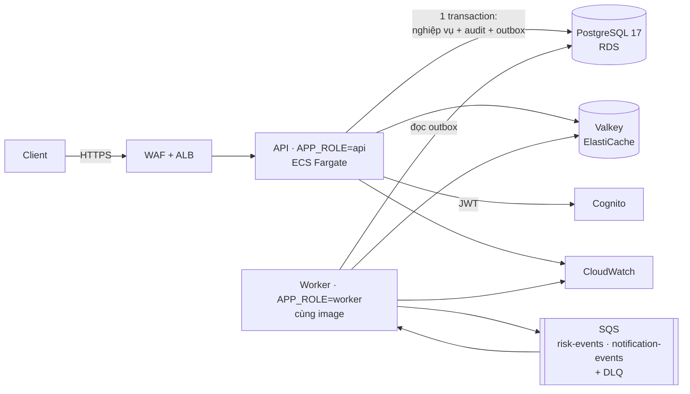

# P1 — Business & Initial Architecture: Digital Banking Simulator

> **Status:** Bản ghép để nhóm duyệt và nộp (DBS-14) · **Dẫn dắt:** #2 · **Cập nhật:** 2026-10-11
> Bản này **tóm tắt và trỏ về nguồn**, không viết lại. Mọi con số lấy từ [docs/01](../01_BUSINESS_ANALYSIS.md), [docs/02](../02_REQUIREMENTS_AND_DOMAIN_MODEL.md) và [docs/03](../03_HIGH_LEVEL_ARCHITECTURE.md) §1–5. Sửa số ở nguồn trước rồi mới sửa ở đây. Nếu giảng viên có mẫu riêng, chép các mục dưới vào mẫu đó theo đúng thứ tự.

## 1. Business problem

Ngân hàng số X (mô phỏng): khoảng 50.000 khách đăng ký, 5.000 khách hoạt động mỗi ngày. Nghiệp vụ cốt lõi là mở tài khoản, nạp tiền tại quầy và chuyển tiền nội bộ ([docs/01 §1](../01_BUSINESS_ANALYSIS.md)).

| # | Vấn đề hiện tại | Hậu quả |
|---|---|---|
| P-1 | Bấm "chuyển" hai lần thì bị trừ tiền hai lần | Khiếu nại, hoàn tiền thủ công |
| P-2 | Hai giao dịch cùng lúc làm số dư sai hoặc âm | Sai sổ sách |
| P-3 | Đối soát làm tay cuối ngày | Phát hiện sai lệch muộn |
| P-4 | Nhật ký rời rạc, sửa được | Không đáp ứng kiểm toán |
| P-5 | Giao dịch đáng ngờ phát hiện ngày hôm sau | Tiền đã đi xa |
| P-6 | Tài khoản bị khóa vẫn dùng được một lúc | Kẻ gian tiếp tục thao tác |

**Problem statement.** Ngân hàng số X cần một nền tảng quản lý tài khoản và chuyển tiền nội bộ **không bao giờ sai số dư, không bao giờ trừ tiền hai lần, và truy vết được mọi thao tác**, bởi vì sai sót về tiền là rủi ro nghiêm trọng nhất của ngân hàng và kiểm toán yêu cầu chứng minh được ai đã làm gì, khi nào.

**Mục tiêu đo được** ([docs/01 §2](../01_BUSINESS_ANALYSIS.md)):

| ID | Mục tiêu | Chỉ số |
|---|---|---|
| BG-1 | Tiền luôn đúng | 0 sai lệch qua đối soát |
| BG-2 | Không trừ tiền hai lần | 0 giao dịch trùng khi gửi lại |
| BG-3 | Truy vết đầy đủ | 100% thao tác ghi có nhật ký; truy một giao dịch < 5 phút |
| BG-4 | Phát hiện gian lận sớm | Cờ trong < 5 giây (p95); ≤ 20 cảnh báo / 1.000 giao dịch; recall ≥ 70% trên kịch bản luật nhắm tới |
| BG-5 | Phản ứng ngay khi có rủi ro | Khóa tài khoản → mất quyền ở request kế tiếp |
| BG-6 | Trải nghiệm tốt | Chuyển tiền < 300 ms (p95); sẵn sàng 99,9% |
| BG-7 | Chi phí hợp lý | ≤ 150–200 USD/tháng môi trường phát triển |

## 2. Users và stakeholder

| Người dùng | Làm gì trong hệ thống | Quan tâm chính |
|---|---|---|
| Khách hàng | Đăng ký, mở tài khoản, xem số dư và lịch sử, chuyển tiền | Tiền đúng, nhanh, riêng tư |
| Nhân viên vận hành | Nạp tiền tại quầy, review cờ gian lận, khóa/mở khóa tài khoản | Công cụ nhanh, có giải thích |
| Kiểm toán viên | Tra cứu nhật ký theo người, hành động, thời gian, mã liên kết | Nhật ký đầy đủ, không sửa được |
| Admin | Cấu hình luật và hạn mức theo phiên bản | Đổi cấu hình an toàn, có dấu vết |

Stakeholder khác (ban điều hành, bộ phận rủi ro, đội kỹ thuật, hội đồng) và ma trận ảnh hưởng – quan tâm: [docs/01 §3](../01_BUSINESS_ANALYSIS.md). Quy trình to-be: [docs/01 §5](../01_BUSINESS_ANALYSIS.md). Quy tắc nghiệp vụ BR-01…14: [docs/01 §6](../01_BUSINESS_ANALYSIS.md).

## 3. Functional requirements

12 use case, 11 ở mức Must ([docs/02 §1.2](../02_REQUIREMENTS_AND_DOMAIN_MODEL.md)):

| ID | Use case | Actor |
|---|---|---|
| UC-1, 2 | Đăng ký; mở tài khoản (tối đa 3/khách) | Khách hàng |
| UC-3 | Nạp tiền tại quầy | Nhân viên |
| UC-4, 6, 7 | Xem số dư, lịch sử, trạng thái giao dịch | Khách hàng |
| **UC-5** | **Chuyển tiền nội bộ** (use case cốt lõi) | Khách hàng |
| UC-8 | Tra cứu nhật ký kiểm toán | Kiểm toán viên |
| UC-9, 10 | Phát hiện giao dịch đáng ngờ; review cờ | Tự động; nhân viên |
| UC-11 | Khóa / mở khóa tài khoản, thu hồi phiên ngay | Nhân viên |
| UC-12 | Cấu hình luật và hạn mức theo phiên bản (Could) | Admin |

Yêu cầu chức năng chi tiết FR-*: [docs/02 §2](../02_REQUIREMENTS_AND_DOMAIN_MODEL.md). Tiêu chí chấp nhận dạng Given–When–Then (AC-5.1…5.10, 8.x, 9.x, 10.x, 11.x): [docs/02 §3](../02_REQUIREMENTS_AND_DOMAIN_MODEL.md). Ngoài phạm vi v1: đảo giao dịch, rút tiền, chuyển liên ngân hàng, đóng tài khoản, sao kê.

## 4. Non-functional requirements

Mỗi NFR có con số mục tiêu và cách kiểm chứng ([docs/02 §4](../02_REQUIREMENTS_AND_DOMAIN_MODEL.md)):

| Nhóm | NFR | Mục tiêu |
|---|---|---|
| Tính đúng | NFR-COR-01…03 | 0 mất/nhân đôi tiền; tổng Nợ = tổng Có, tổng số dư = 0; 0 lần vượt hạn mức khi đồng thời |
| Hiệu năng | NFR-PERF-01, 02 | Chuyển tiền p95 < 300 ms ở 120 RPS; đọc p95 < 150 ms |
| Mở rộng | NFR-SCAL-01, 02 | 120 RPS liên tục 15 phút, lỗi < 0,1%; tài khoản nóng 20 lệnh/giây, p95 < 1 giây |
| Sẵn sàng, phục hồi | NFR-AVL-01, REC-01, 02 | 99,9% ở cấu hình production; RPO ≤ 5 phút; RTO ≤ 30 phút |
| Bảo mật | NFR-SEC-01…06 | 0 truy cập chéo; thu hồi ở request kế tiếp; mã hóa 100%; 0 secret trong mã nguồn; 10 lệnh chuyển/phút/khách, 100 yêu cầu/phút/IP; quyền tối thiểu |
| Kiểm toán, quan sát | NFR-AUD-01, 02, OBS-01, 02 | 100% thao tác ghi có nhật ký; truy vết < 5 phút; mã liên kết xuyên suốt; dashboard và alarm |
| Gian lận | NFR-FRD-01…03 | Cờ p95 < 5 giây; ≤ 20 cảnh báo / 1.000 giao dịch, recall ≥ 70%; báo cáo precision, recall, F1 trên tập giữ lại |
| Vận hành, chi phí | NFR-MNT-01, 02, COST-01 | Deploy ≤ 15 phút; rollback ≤ 10 phút; ≤ 150–200 USD/tháng |

## 5. Workload

| Đại lượng | Giá trị | Cách tính |
|---|---|---|
| Khách hoạt động/ngày | 5.000 | Giả định A-1 |
| Yêu cầu/ngày | 100.000 | 5.000 × 20 |
| Tải trung bình | ≈ 1,2 RPS | 100.000 ÷ 86.400 |
| Tải cao điểm | ≈ 12 RPS | × 10 (giả định A-3) |
| **Tải thiết kế** | **≈ 120 RPS** | 10 × cao điểm |
| Đọc / ghi | 80% / 20% | ≈ 25 lệnh chuyển/giây ở tải thiết kế |
| Dữ liệu | < ~10 GB/năm | ~20.000 bút toán/ngày |

Loại workload: OLTP, ưu tiên nhất quán và độ trễ thấp. Nút thắt thật là **tài khoản nóng**, không phải tổng RPS. Các mốc load test: 12, 60, 120 RPS và stress vượt 120 ([docs/02 §5](../02_REQUIREMENTS_AND_DOMAIN_MODEL.md)).

## 6. Initial cloud architecture

Chi tiết và lý do: [docs/03 §1–5](../03_HIGH_LEVEL_ARCHITECTURE.md) và [ADR-01…13](../adr/README.md).

| Quyết định | Lý do ngắn | ADR |
|---|---|---|
| Modular monolith + worker, một image | Chuyển tiền trong một transaction; 6 người, 10 tuần | ADR-01, ADR-13 |
| PostgreSQL là nguồn sự thật | Transaction nhiều bảng, khóa hàng, ràng buộc | ADR-02 |
| Đồng bộ phần tiền, bất đồng bộ phần phụ qua outbox + SQS | p95 < 300 ms, không mất sự kiện | ADR-03 |
| Khóa theo thứ tự id; idempotency trong Postgres theo user | Không vượt hạn mức, không trừ hai lần | ADR-04, ADR-05 |
| Cognito, ECS Fargate | Không tự lưu mật khẩu; không quản máy chủ | ADR-06 |
| Phát hiện gian lận: 6 luật có giải thích, chạy bất đồng bộ | Không làm chậm chuyển tiền; nhân viên quyết định | ADR-08 |
| AWS `ap-southeast-1`, dựng/xóa theo phiên, không NAT | Giữ đủ NFR, nằm trong credit khoảng 200 USD | ADR-10, ADR-11 |
| Redis chỉ cho rate limit, mốc thu hồi, bộ đếm, cấu hình | Mất Redis hệ thống vẫn đúng | ADR-12 |

Ước tính chi phí 10 tuần khoảng 80–100 USD credit ([ADR-11, phụ lục](../adr/0011-aws-managed-session-based.md)).

## 7. Checklist trước khi nộp

- [ ] Đối chiếu từng mục với mẫu hoặc rubric của giảng viên (nếu có); mục thiếu có người nhận.
- [ ] Cả 6 người đọc bản này và xác nhận trong kênh chat (DBS-15).
- [ ] Xuất PDF hoặc chép vào mẫu nộp; điền link ở cột P1 của [deliverables/README](README.md).
