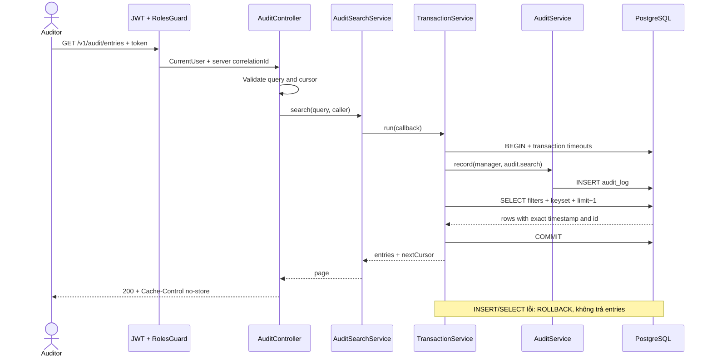
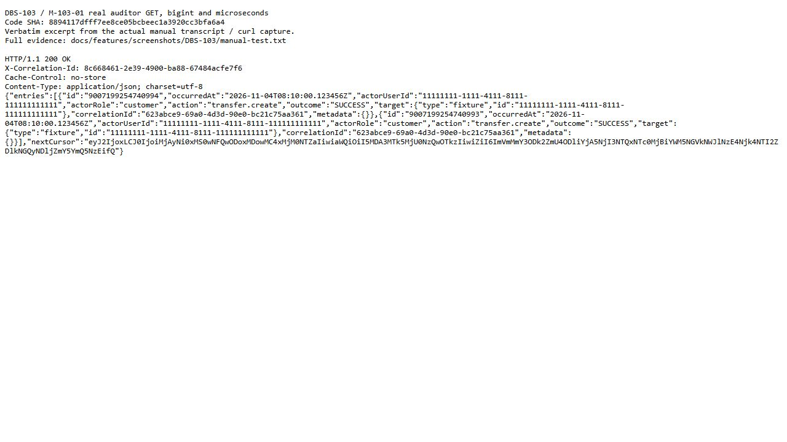
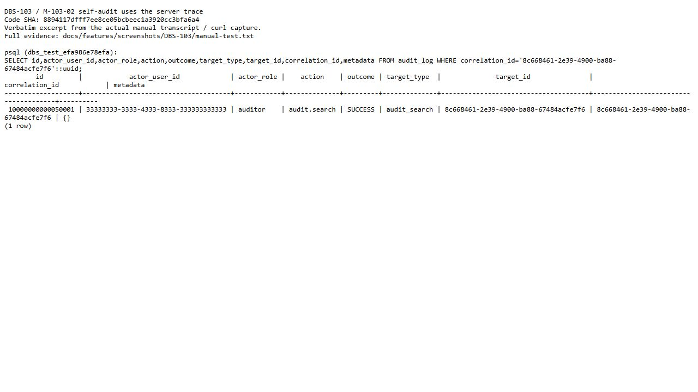
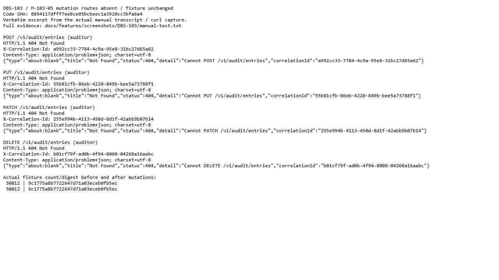
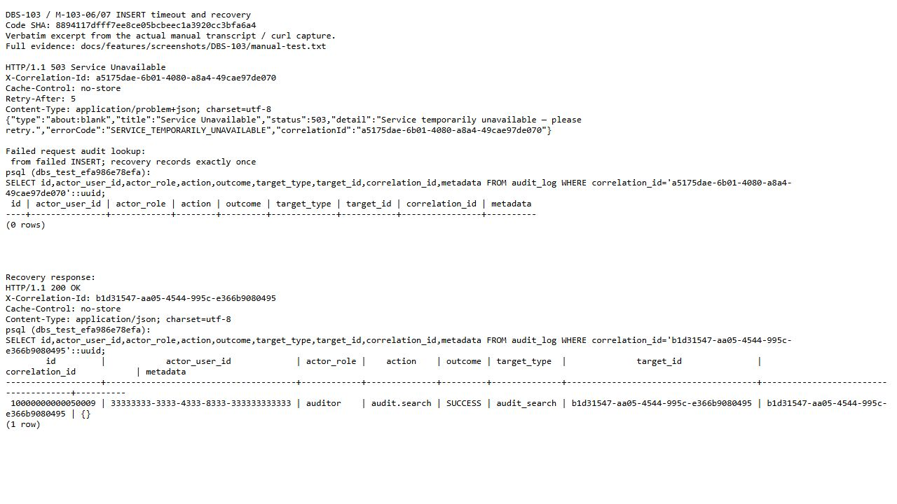
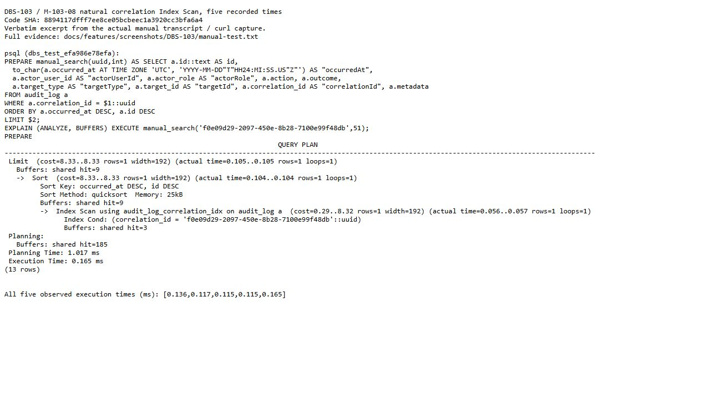

# DBS-103 · API tra cứu nhật ký kiểm toán

> **Status:** Implemented — G4 đã duyệt phạm vi bàn giao; các giới hạn và process DoD còn mở · **Vai:** Dev · **Dev review:** chưa phân công · **Nhánh:** `codex/DBS-103-audit-search` · **PR:** [#59](https://github.com/Lawliet119/digital-banking-simulator/pull/59) (Draft) · **Cập nhật:** 2026-11-06

## 1. Bối cảnh

### Ticket và nguồn yêu cầu

[Bảng công việc](https://docs.google.com/spreadsheets/d/18IHrZShDoZDc6bgnsi__ATyd99aeJxe4x4TWQ5WTz_w/edit?gid=1395280002#gid=1395280002), đọc ngày 2026-11-04 bằng `node .claude/skills/dbs-delivering-task/scripts/fetch-task.mjs DBS-103`:

| Cột | Giá trị trên board |
|---|---|
| Issue Key / Loại / Tuần | DBS-103 / Story / Tuần 4 |
| Tóm tắt | UC-8: GET /v1/audit/entries cho kiểm toán viên, chỉ đọc và tự ghi audit |
| Assignee (vai) / Ưu tiên / Status | Dev / High / In Progress (đọc lại ngày 2026-11-04; lượt đầu là To Do) |
| Deliverable / Demo | Demo 4 |
| Thực trạng | Chưa có API tra cứu nhật ký. Index audit_log (correlation_id), (actor_user_id, occurred_at DESC), (action, occurred_at DESC) đã có từ DBS-26. |

**Expect (nguyên văn):** Kiểm toán viên tra được nhật ký theo người, hành động, thời gian, correlationId.

**DoD (nguyên văn, đánh số):**

1. GET /v1/audit/entries lọc theo người/hành động/khoảng thời gian/correlationId, phân trang cursor; chỉ role auditor (và admin nếu quy định), vai khác → 403
2. Mỗi lần tra cứu tự ghi một dòng audit (action audit.search)
3. AC-8.1: auditor thử sửa/xóa dữ liệu qua API bị từ chối và DB không có quyền (kiểm cả bằng role ứng dụng khi có DBS-119)
4. Truy vấn theo correlationId dùng Index Scan, ≤ 10 ms (EXPLAIN)
5. PR đã merge vào main (CI xanh); Dev review; bảng «Đối chiếu test case» trong PR điền đủ

### Phụ thuộc và hiện trạng đã kiểm tra

Worktree sạch được fast-forward từ `991c13f` tới `origin/main` đã fetch: `7f3b7002755cfdfb534a59463c5f7282077ec3b0`. Không tạo commit hay gọi GitHub trước G3.

| Task | Board | Bằng chứng trong code / tác động tới phạm vi |
|---|---|---|
| DBS-56 | Done | [AuditService](../../backend/src/modules/audit/audit.service.ts) đã có `record(manager: EntityManager, input: AuditRecordInput): Promise<void>` và `recordDenied(input: Omit<AuditRecordInput, 'outcome'>): Promise<void>`. Ghi SQL parameterized, `record` dùng transaction của caller; `recordDenied` mở transaction riêng và từ chối gọi lồng. [Bàn giao DBS-56](DBS-56-audit-service-record.md). |
| DBS-51 | Done | [RolesGuard](../../backend/src/modules/identity/roles.guard.ts), `@Roles`, `@CurrentUser` đã có; [AppModule](../../backend/src/app.module.ts) đăng ký JWT guard rồi role guard. Vai trò từ Cognito groups, không có phân cấp admin tự bao gồm auditor. [Bàn giao DBS-51](DBS-51-roles-guard-current-user.md). |
| DBS-27 | Done | [Migration trigger](../../backend/src/database/migrations/1792627200002-AddAppendOnlyTriggers.ts) chặn UPDATE/DELETE/TRUNCATE của `audit_log`. Đây là lớp trigger, không chứng minh production ACL. [Bàn giao DBS-27](DBS-27-append-only-triggers.md). |
| DBS-26 | Done theo dependency của DBS-119 | [Migration audit](../../backend/src/database/migrations/1792627200001-CreateAuditLog.ts) đã có bảng, ba B-tree index và PK `bigint`; đủ nền cho truy vấn. [Bàn giao DBS-26](DBS-26-migration-audit-log.md). |
| DBS-119 (phụ thuộc một phần DoD #3) | To Do | `fetch-task.mjs DBS-119` ngày 2026-11-04 cho biết migration role chưa làm; còn chờ DBS-96 và DBS-116 đang In Progress. Không tìm thấy `CREATE ROLE` hoặc ba role production trong source migration. Không tự tạo bản thay thế của migration đó trong DBS-103. |
| DBS-114 / DBS-186 (thu hồi phiên, ngoài phạm vi) | Cả hai To Do, Dev | Fetch chính xác ngày 2026-11-04: DBS-114 phụ thuộc DBS-113 To Do, DBS-76 In Progress, DBS-50 Done; DBS-186 phụ thuộc DBS-114 To Do và DBS-75 Done. `JwtAuthGuard.canActivate()`/`IdentityService.lookupOrCreate()` hiện không đọc `sessions_revoked_at`. Owner triển khai là Dev nhận DBS-114; Dev nhận DBS-186 kiểm Redis down/flush, gồm cloud. Chỉ kiểm `SESSION_REVOKED` khi guard thật so `iat`/mốc thu hồi và fallback SQL đã có; không fake guard trong DBS-103. |

**Tài liệu sở hữu hành vi đã đọc:** [docs/02](../02_REQUIREMENTS_AND_DOMAIN_MODEL.md) UC-8, FR-AUD-01…04, AC-8.1/8.2; [docs/03](../03_HIGH_LEVEL_ARCHITECTURE.md) §6.6, §7, §8, §12; [database-design](../components/_shared/database-design.md) §4.7, §6, §8.1/8.3; [README audit](../../backend/src/modules/audit/README.md); ADR [02](../adr/0002-postgresql-ledger.md), [06](../adr/0006-cognito-ecs-fargate.md), [13](../adr/0013-one-app-app-role.md). Không thay đổi quyết định ADR, schema, `ErrorCode`, biến môi trường hoặc dependency ở Phase 1.

**Kiểm tra runtime hiện tại:** chạy Node với `ts-node/register`, `tsconfig-paths/register` và `reflect-metadata`, nạp `AuditModule`, `AuditService`, `modulesForRole('api')` rồi duyệt metadata Nest của module/controller/method. Exit 0; kết quả:

```text
AuditModule.controllers = []
AuditService.prototype = [record, recordDenied]
API routes = [GET health/live, GET health/ready, GET identity/me]
```

Đây là kiểm tra metadata code hiện tại có chạy, xác nhận chưa có route audit. Chưa chạy request HTTP của endpoint chưa tồn tại; chưa có hành vi tra cứu/phân trang/phân quyền audit để nhận là đạt. Audit module hiện được nạp chung cho api/worker vì là thư viện ghi; endpoint mới chỉ phục vụ HTTP theo ADR-13.

### Baseline trước G1

Baseline chung chạy trên chính main `7f3b700`, dùng cho cả hai worktree DBS-103 và DBS-86 trước khi có thay đổi code. Các tiến trình đã kết thúc; kết quả cuối sau `npm ci` dưới đây.

| Kiểm tra | Kết quả quan sát ngày 2026-11-04 |
|---|---|
| `docker compose up -d` | Đã thành công sau khi khởi động Docker Desktop; PostgreSQL và Valkey healthy. |
| Chuẩn hóa cài đặt local | Lượt đầu `node_modules` thiếu `redis` và `@aws-sdk/client-sqs` đã có trong lockfile; `npm ci` đã thành công, 941 packages, không sửa manifest/lockfile/source. |
| `npm run lint:check` | Đạt sau `npm ci`, exit 0. |
| `npm run typecheck` | Đạt sau `npm ci`, exit 0. |
| `npm test` | Đạt sau `npm ci`: 54/54 suites, 820/820 tests, 0 skipped; 60.704 giây. |
| `npm run test:e2e` | Sau `npm ci`, chạy riêng E2E vẫn thất bại: 12 suites pass, 1 fail; 134 tests pass, 1 fail / 135, 0 skipped; 110.491 giây. Ca `dev-auth-bootstrap` deployed-environment control gặp `spawnSync ETIMEDOUT` ở 25 giây trên main trước thay đổi. Chưa kết luận nguyên nhân hoặc sửa lỗi. |

**Baseline đang đỏ:** E2E lặp lại cùng timeout sau cài lại dependency; không coi unit/typecheck hoặc runtime inventory xanh là thay thế. G1 cho phép tiếp tục thiết kế với hạn chế này; phải chốt cách xử lý trước implementation. Điều tra/sửa bootstrap timeout không nằm trong phạm vi API tra cứu đã duyệt.

**Chẩn đoán riêng, không sửa test:** chạy đúng fixture deployed-environment control của DBS-53 với deadline quan sát 60 giây. Tiến trình tự thoát mã 1 sau **41.615 giây**, có 5 lần báo kết nối DB thất bại, bản ghi `Application startup failed`, không có `invalidKeys` và không mở HTTP. Trong môi trường này, deadline 25 giây của test kết thúc trước khi quy trình retry DB hoàn tất. Kết quả này giải thích timeout đã quan sát, không biến baseline E2E thành xanh. Output đã lọc nằm ngoài source tại `C:\Users\Admin\.codex\tmp\dbs-103-86-20261104-g1\bootstrap-diagnostic.log`.

### Phạm vi đề xuất ở G1

- Bổ sung UC-8 `GET /v1/audit/entries`: bộ lọc theo người, hành động, thời gian và correlationId; cursor; kiểm vai auditor; tự ghi `audit.search` qua `AuditService`, chỉ trả kết quả sau khi audit thành công.
- Kiểm read-only bằng các endpoint ghi **đã có thật** khi triển khai; API audit không cung cấp thao tác sửa/xóa. Hiện main chưa có endpoint ghi nghiệp vụ: chỉ thử phương thức ghi lên đường dẫn chưa hỗ trợ không chứng minh toàn bộ AC-8.1. Phần kiểm auditor bị từ chối tại endpoint nghiệp vụ phải tích hợp khi các endpoint tương ứng được triển khai; không dựng stub để nhận AC-8.1.
- Đo truy vấn correlationId bằng `EXPLAIN (ANALYZE, BUFFERS)` trên PostgreSQL thật và dữ liệu fixture đại diện, báo plan và thời gian quan sát so với ≤ 10 ms. Chưa đo tại Phase 1.
- Tài liệu API/OpenAPI, test tự động, manual HTTP/SQL và bằng chứng sẽ được thiết kế sau G1; không miễn đường thành công của manual test.

### Backlog cùng module và phần ngoài phạm vi

| Dòng [BACKLOG](../BACKLOG.md) | Quyết định phạm vi đề xuất |
|---|---|
| BL-019 | Nhận phần API tra cứu UC-8 và audit lần tra cứu. Giữ lại các phần chưa giải quyết: production grants/full AC-8.1/8.2 (DBS-119 và task chuỗi nghiệp vụ), registry đóng `action/role/target.id`, thử tải pool `recordDenied`, audit đọc nhạy cảm của module risk. Khi triển khai chỉ cập nhật phần được giải quyết, không xóa cả dòng chứa các gap còn mở. |
| BL-005, BL-017 | Role/owner production và test ACL đúng role thuộc DBS-119/harness. Không nhận test bằng superuser hoặc role tự tạo là chứng minh production grants. |
| BL-020, BL-022, BL-137 | Theo dõi review/CI/merge các task nền trước; không xác minh lại qua GitHub trước G3, không xóa chỉ theo board Done. DBS-56 đã nằm trong main theo commit hiện tại nhưng review/CI là trạng thái cần owning task xác nhận. |
| BL-103, BL-107 | Tài khoản DB riêng, pipeline/secret rotation thuộc DBS-119 và Platform & Ops. Không đổi kết nối ứng dụng hoặc Terraform. |
| BL-130 | Audit `user.provisioned` thuộc identity/audit riêng; không thay ngoại lệ đã duyệt của DBS-52 trong task tra cứu. |
| BL-132 | `RolesGuard` hiện chỉ ghi log warn khi 403, chưa ghi audit DENIED. Giữ ngoài phạm vi DBS-103; không thay guard toàn cục. Test 403 của API tra cứu không được mô tả là đã đóng FR-AUD-02 cho mọi lần bị từ chối. |
| Chưa có BL riêng cho thu hồi phiên | Đã tìm `revok`, “thu hồi phiên”, DBS-114/115/186, AC-11.1 và NFR-SEC-02 trong BACKLOG: chưa có dòng cùng gap. Handoff Dev identity DBS-114/186 như bảng phụ thuộc; thêm dòng BL kế tiếp ở Phase 5 nếu gap còn mở, không nhận enum `SESSION_REVOKED` tồn tại là guard đã triển khai. |
| BL-041 | Chuỗi fraud/consumer theo ADR-14 thuộc task risk tương ứng; API tra cứu không tự tạo chuỗi event/audit chưa triển khai. |

Ngoài ra, không sửa producer chuyển tiền/thông báo, không triển khai whole-chain AC-8.2 thay các task đó; không tạo DB role hay sửa grants trước DBS-119; không thêm admin vào quyền auditor khi chưa được quy định; không sửa/xóa audit cũ. Không đọc generator hoặc nhãn holdout tại `load-tests/fraud-dataset/`.

### Câu hỏi / quyết định G1

1. **Vai được tra cứu:** đề xuất chỉ auditor theo docs/03 §6.6/§7 và nguyên tắc không phân cấp role trong `roles.ts`; token chỉ mang admin nhận 403. Nếu token có nhóm auditor thì được theo nhóm đó.
2. **Phần AC-8.1 cần role production:** đề xuất thực hiện phần API/trigger có nền thật, bàn giao kiểm quyền `dbs_api`/`dbs_migrator` sang DBS-119; ghi phần đó chưa chạy/chưa hoàn tất cho tới khi role thật được triển khai. Không coi DBS-103 đã đạt toàn bộ DoD #3 khi chưa có bằng chứng này.

**Quyết định ở G1:** người dùng trả lời **“duyệt g1” ngày 2026-11-04**, áp dụng DBS-103 và DBS-86. Chốt auditor-only; production roles/full AC-8.1 chờ DBS-119; BL-132 ngoài phạm vi. Baseline E2E đỏ được ghi nhận để tiếp tục **thiết kế**, phải chốt xử lý trước implementation. Chưa duyệt G2/G3 hoặc viết code. Board đã là In Progress ở lượt đọc lại ngày 2026-11-04; agent chỉ đọc sheet, không suy luận người đã đổi trạng thái. Chưa có quyền commit, push, tạo PR hoặc đổi trạng thái chung.

## 2. Hành vi

### Quyền và bộ lọc

`GET /v1/audit/entries` dùng JWT guard toàn cục rồi `@Roles('auditor')`; token chỉ có customer/operator/admin → 403 `FORBIDDEN`. Vai trò không lấy từ query/header/body. Auditor được tra các actor khác, không áp ownership của tài khoản khách lên nhật ký toàn hệ thống. Không có endpoint sửa/xóa audit. Response thành công có `Cache-Control: no-store`.

| Query (đều tùy chọn) | Chấp nhận / từ chối |
|---|---|
| `actorUserId`, `correlationId` | UUID chuẩn 36 ký tự, không giới hạn riêng UUIDv4; chuẩn hóa chữ thường. Không nhận chuỗi rỗng, array/object hoặc `null` dạng text. Actor hệ thống NULL vẫn thấy khi không lọc actor. |
| `action` | So khớp chính xác, phân biệt hoa thường; 1–128 ký tự, không chứa control character và không chỉ toàn khoảng trắng. Không trim hoặc đổi hoa thường. Đây là tham số SQL, không phải câu SQL/registry action mới. |
| `from`, `to` | UTC dạng `YYYY-MM-DDTHH:mm:ss[.1–6 chữ số]Z`, năm 1970–9999, ngày thực trong lịch, không leap second/offset/infinity. Chuẩn hóa phần lẻ thành 6 chữ số; `from` bao gồm, `to` loại trừ. Có cả hai thì `from < to`; có một thì chỉ áp một cận. Không tự đặt cutoff lịch sử khi bỏ trống. |
| `limit` | Chuỗi số nguyên thập phân chuẩn `1`…`100`; mặc định 50. `0`, `101`, `01`, âm, số mũ/thập phân hoặc rỗng → 400. Không có OFFSET/total count. |
| `cursor` | Token base64url chuẩn không padding, tối đa 512 ký tự; object chính xác `{v,t,id,f}`. `v=1`; `t` là UTC 6 chữ số phần lẻ hợp lệ như trên; `id` là chuỗi nguyên dương chuẩn ≤ `9223372036854775807`; `f` là SHA-256 lowercase hex của bộ lọc chuẩn hóa. Sai cấu trúc/version/hash, key thừa, payload quá dài hoặc đổi bộ lọc → 400. |

Chỉ nhận bảy field trên, mỗi field tối đa một giá trị scalar string; unknown field, repeated key, array/nested query và cursor lỗi đều 400. Lỗi dùng `BadRequestException({errors:[thông báo cố định]})`; không echo giá trị đầu vào hay tên field lạ. Không thêm `ErrorCode`: validation 400 hiện chưa có mã trong enum. Các cận thời gian/giá trị được kiểm trước SQL; lệnh vẫn chịu `statement_timeout` và `lock_timeout` hiện có.

### Cursor, độ chính xác và dữ liệu thay đổi

Đặt alias bảng `FROM audit_log a`; sắp xếp **`a.occurred_at DESC, a.id DESC`**, trang sau dùng `(a.occurred_at,a.id) < ($timestamp::timestamptz,$id::bigint)`, lấy `limit+1` để xác định còn trang. Qualify cột bảng trong WHERE/ORDER/cursor: `a.id` vẫn là bigint, không bị output alias `id` đã cast text lấn trong ORDER BY. Cursor lấy timestamp và id của **dòng cuối thực sự trả**, không lấy dòng sentinel. `id` giữ string/`bigint`; timestamp lấy từ SQL bằng `to_char(a.occurred_at AT TIME ZONE 'UTC','YYYY-MM-DD"T"HH24:MI:SS.US"Z"')`, không đi qua JS `Date`, epoch number hay `toISOString()`.

`f = SHA256(JSON.stringify({actorUserId,action,from,to,correlationId}))` theo đúng thứ tự key, field vắng dùng `null`; không gồm `limit` để cho phép đổi cỡ trang. Token chỉ là vị trí, **không cấp quyền**; không cần secret/HMAC mới vì auditor đã có quyền trên mọi dòng và dịch chuyển vị trí không mở thêm dữ liệu. Role guard chạy trước việc parse token.

Đây là keyset trên nhật ký đang cập nhật, không cam kết snapshot xuyên nhiều HTTP request. Các dòng mới hơn cursor (kể cả audit.search của trang kế) không chen vào phần đã đi qua; dòng commit muộn ở phía trước cursor có thể cần tra lại từ đầu. Không duplicate các dòng cũ khi đi tuần tự với cùng bộ lọc, kể cả hai timestamp cùng microsecond và id > 2^53. Không dùng session/cache hoặc hứa thấy mọi transaction chưa commit ở trang đầu.

### Request/response và tự ghi audit

Ví dụ dưới là dữ liệu fixture thiết kế, **chưa phải kết quả chạy**:

```http
GET /v1/audit/entries?actorUserId=11111111-1111-4111-8111-111111111111&action=transfer.create&from=2026-11-04T08%3A00%3A00Z&to=2026-11-04T09%3A00%3A00Z&correlationId=623abce9-69a0-4d3d-90e0-bc21c75aa361&limit=2
Authorization: Bearer <auditor access token>
```

```json
{
  "entries": [
    {
      "id": "9007199254740994",
      "occurredAt": "2026-11-04T08:10:00.123456Z",
      "actorUserId": "11111111-1111-4111-8111-111111111111",
      "actorRole": "customer",
      "action": "transfer.create",
      "outcome": "SUCCESS",
      "target": {"type": "transfer", "id": "22222222-2222-4222-8222-222222222222"},
      "correlationId": "623abce9-69a0-4d3d-90e0-bc21c75aa361",
      "metadata": {}
    },
    {
      "id": "9007199254740993",
      "occurredAt": "2026-11-04T08:10:00.123456Z",
      "actorUserId": "11111111-1111-4111-8111-111111111111",
      "actorRole": "customer",
      "action": "transfer.create",
      "outcome": "SUCCESS",
      "target": {"type": "transfer", "id": "33333333-3333-4333-8333-333333333333"},
      "correlationId": "623abce9-69a0-4d3d-90e0-bc21c75aa361",
      "metadata": {}
    }
  ],
  "nextCursor": "eyJ2IjoxLCJ0IjoiMjAyNi0xMS0wNFQwODoxMDowMC4xMjM0NTZaIiwiaWQiOiI5MDA3MTk5MjU0NzQwOTkzIiwiZiI6ImVmMmY3ODk2ZmU4ODliYjA5NjI3NTQxNTc0MjBiYWM5NGVkNWJlNzE4Njk4NTI2ZDlkNGQyNDljZmY5YmQ5NzEifQ"
}
```

Trang kế giữ nguyên bộ lọc, thêm cursor trên. Nếu không còn dòng sentinel thì `nextCursor:null`; không có kết quả → `{"entries":[],"nextCursor":null}`. Chỉ trả các cột audit qua DTO; không JOIN `users.cognito_sub`, hồ sơ khách hay fraud flags. Metadata lịch sử được trả cho auditor như dữ liệu nhật ký, không được ghi lại vào log. Giới hạn PII trong các field text lịch sử vẫn thuộc phần registry của BL-019; task này không tự sửa lịch sử.

Mỗi request **đã xác thực, đúng vai và bộ lọc hợp lệ**, kể cả trang rỗng/trang sau, mở một `TransactionService.run`: `AuditService.record` action cố định `audit.search`, role cố định `auditor`, actor=`CurrentUser.userId`, outcome=`SUCCESS`, target=`{type:'audit_search',id:serverCorrelationId}`, metadata=`{}`, rồi SELECT bằng chính manager. `correlationId` là id request **do server sinh**, không lấy từ filter `correlationId` hay header client. Không lưu filter, raw action, cursor, token hoặc query string vào audit/log. Truy vấn không lọc có thể thấy chính dòng audit.search vừa INSERT; nó cũng tuân bộ lọc/sắp xếp như dòng khác.

Chỉ trả body sau COMMIT. INSERT/SELECT lỗi trước commit → rollback, không trả entries; không `catch` lỗi audit để tiếp tục. Retry transaction có sẵn chỉ tạo một dòng committed cho request thành công; gửi lại HTTP là lần tra cứu mới và ghi dòng mới. Nếu mất kết nối đúng lúc COMMIT, trạng thái commit có thể chưa biết; không hứa mọi lỗi HTTP đều có 0 dòng audit. Request 400/401/403 chưa chạy query không ghi `audit.search`; DENIED toàn cục của 403 vẫn là BL-132 ngoài phạm vi đã duyệt.

| Kết quả lỗi | HTTP / `errorCode` / dữ liệu |
|---|---|
| Không có/sai token; token hết hạn | 401 / `UNAUTHENTICATED` hoặc `TOKEN_EXPIRED` từ guard hiện có. |
| Thu hồi phiên | **Chưa hỗ trợ ở guard hiện tại**, chờ DBS-114/186 như §1; không mô tả 401 `SESSION_REVOKED` là hành vi đã có của DBS-103. |
| Role không được phép | 403 / `FORBIDDEN`; không tiết lộ vai trò cần có. |
| Query/cursor không hợp lệ | 400 / không có `errorCode`; fixed errors, `application/problem+json`, có server `correlationId`. |
| PostgreSQL `55P03`, `57014`, lỗi transient đã được nhận diện | 503 / `SERVICE_TEMPORARILY_UNAVAILABLE`, `Retry-After: 5`; không entries. |
| Lỗi SQL/metadata không transient | 500 / không có `errorCode`; detail chung của filter, không SQL/stack/query/PII. |
| POST/PUT/PATCH/DELETE đường audit không được cung cấp | 404 route không tồn tại / không có `errorCode`; không thay dữ liệu. Không tạo endpoint giả để trả 403. |

Ví dụ validation:

```json
{"type":"about:blank","title":"Bad Request","status":400,"detail":"Request validation failed","errors":["limit must be an integer from 1 to 100"],"correlationId":"6bb56455-9c1a-4b62-bf43-a70c3d810964"}
```

## 3. Kiến trúc

| Thành phần | Trách nhiệm / ranh giới |
|---|---|
| `audit/AuditModule` hiện có | Giữ nguyên writer `AuditService`, dùng chung api/worker; không thêm controller/query provider/IdentityModule vào module này. |
| `audit/AuditHttpModule` mới | Import AuditModule; chứa AuditController và AuditSearchService. Export qua index audit để `modules/index.ts` đăng ký **chỉ trong apiModules**. Worker vẫn nhận writer, không khởi tạo HTTP/query/Identity providers; không mở listener. |
| AuditController mới | `@Roles('auditor')`, `@ApiBearerAuth('access-token')`, OpenAPI bảy query/DTO response/error thực. Gọi `@CurrentUser`, lấy server correlation từ request, `Cache-Control:no-store`. Không truy cập DB trực tiếp. |
| AuditSearchQueryPipe/helper mới | `transform(raw:unknown): ParsedAuditSearchQuery`; total validation và chuẩn hóa §2. Param dùng interface/`unknown` (runtime Object), nên global ValidationPipe không tự chuyển array/string trước custom pipe. Swagger khai báo query rõ bằng `@ApiQuery`; không dùng DTO không có decorator rồi kỳ vọng whitelist tự hoạt động. |
| AuditSearchService mới | `search(query:ParsedAuditSearchQuery, caller:{userId:string;correlationId:string}):Promise<AuditEntriesPage>`; không export service này cho module khác. Gọi writer trước SELECT, map DTO/cursor và chỉ resolve sau commit. Role audit luôn auditor vì API đã yêu cầu role đó, kể cả JWT có nhiều groups. |
| SQL/cursor helper nội bộ | Tạo SQL từ các fragment cố định, mọi value qua `$n`; limit+1, UUID/timestamp/bigint cast ở **param**, không cast cột lọc làm mất index. Encoder dùng Buffer/base64url và SHA-256 của Node, không dependency/env mới. |
| Manual session helper (mới, test-only) | Giữ admin URL ban đầu trong bộ nhớ, tạo DB tạm/migrate/seed, mở **AppModule thật + configureHttpApp**. Normal shutdown/Ctrl+C/setup lỗi cùng đi qua finally: thử close app; trong finally tiếp theo khôi phục admin URL rồi drop đúng DB tạm; close lỗi không được bỏ qua bước drop. Không fake auth/DB, không log URL/credentials, không đóng gói vào image. |

**Interface giữ nguyên:** `AuditService.record(manager:EntityManager,input:AuditRecordInput):Promise<void>`; `recordDenied(input:Omit<AuditRecordInput,'outcome'>):Promise<void>`; `TransactionService.run<T>(fn:(manager:EntityManager)=>Promise<T>,options?:TransactionOptions):Promise<T>`; `modulesForRole(role?:AppRole):ModuleRef[]`. Không đổi `AuditRecordInput`, `AuditReason`, contract event hoặc module ownership.

**Người gọi đã grep:** `AuditModule` đang được `modules/index.ts`, `modules.spec.ts`, `audit.module.spec.ts` dùng; thêm AuditHttpModule tại registration và test tương ứng. `AuditService` hiện có manual `test/manual/audit-record.manual.ts`, unit audit và `test/db/audit.service.db-spec.ts`; caller mới là query service, không đổi các caller cũ. `modulesForRole` được AppModule và module tests gọi. Đã phối hợp DBS-86: task đó chỉ thêm ownership/audit caller trong accounts, dùng nguyên writer contract; hai task không chỉnh chung AuditService hoặc RolesGuard.

**Dữ liệu:** chỉ đọc/INSERT `audit_log`; đọc tất cả cột audit qua projection tường minh. Không UPDATE/DELETE/TRUNCATE, không sửa schema/index. UUID string, id string; timestamp do SQL format giữ microsecond. `a.occurred_at` và `a.id` gốc vẫn dùng cho WHERE/ORDER, không sắp theo alias output text. Không đọc bảng khác module trong query service; JWT guard vẫn tự resolve `users` theo contract đã có.

SQL tương ứng ví dụ chỉ lọc correlationId (schema/pagination khác tự ghép bằng fragment đã biết):

```sql
SELECT a.id::text AS id,
  to_char(a.occurred_at AT TIME ZONE 'UTC', 'YYYY-MM-DD"T"HH24:MI:SS.US"Z"') AS "occurredAt",
  a.actor_user_id AS "actorUserId", a.actor_role AS "actorRole", a.action, a.outcome,
  a.target_type AS "targetType", a.target_id AS "targetId", a.correlation_id AS "correlationId", a.metadata
FROM audit_log a
WHERE a.correlation_id = $1::uuid
ORDER BY a.occurred_at DESC, a.id DESC
LIMIT $2;
```

`$2 = limit+1`, tối đa 101. Mọi fragment filter cũng qualify `a.actor_user_id`, `a.action`, `a.occurred_at`, `a.correlation_id`; thêm cursor bằng `(a.occurred_at,a.id) < ($n::timestamptz,$n1::bigint)`. Truy vấn kế hoạch dùng đúng projection/param/order/limit của service, planner tự chọn; Index Scan `audit_log_correlation_idx` có thể nằm dưới Sort. Không `enable_seqscan=off` hay đổi query đơn giản để làm đẹp bằng chứng. Chọn fixture ≥50.000 dòng với correlation target chỉ khớp một dòng; đo bằng EXPLAIN (ANALYZE, BUFFERS), so Execution Time ≤10 ms ở môi trường được ghi. Không nhận local fixture là đo RDS/endpoint latency dưới tải.

**Transaction:** READ COMMITTED như hiện tại, timeout/retry hiện có. Parse trước BEGIN; INSERT audit rồi SELECT/mapping/cursor trong cùng callback; không network/Redis/SQS hoặc nested transaction, không `recordDenied` bên trong. Mapping lỗi cũng làm rollback. Sau commit mới controller trả response. Audit search là GET có ghi audit theo yêu cầu UC-8, không phải transaction DB read-only.



**Tài liệu cần cập nhật khi implementation được duyệt:** README audit/backend, docs/03 §6.6/§7 nếu bổ sung contract query, database-design §4.7 status (không đổi schema/ACL), threat-model T22 chỉ phần chứng minh được, feature index và BL-019/handoff. Không ghi T22/full AC-8.1 là đã kiểm khi thiếu production roles. §7 vẫn chưa lập trước G2.

## 4. Test cases tự động

Các case dưới là thiết kế đã được duyệt; kết quả từng case và test thực hiện ở §8. Unit kiểm parser/cursor/SQL mapping; HTTP+service integration ở `test/db/*.db-spec.ts`, dùng `createTempDatabase`/`migrate`, real TransactionService/AuditService/AppModule và token từ `createDevTokenIssuer`. Không dùng `startLocalAuthApp` để chứng minh audit FK vì helper đó fake IdentityService. Testcontainers fail rõ khi thiếu Docker; không `.skip/.only/.todo`. TC-103-06R và phần production roles của TC-103-17 vẫn chưa chạy, không được đếm thành test skip hoặc acceptance đã đạt.

| ID | Truy vết | Lớp | Given · When · Then | `errorCode` / SQLSTATE |
|---|---|---|---|---|
| TC-103-01 | DoD #1 | unit | Mỗi filter hợp lệ, UUID uppercase, thời gian 0/1/6 chữ số phần lẻ; giới hạn 1/100/default50 → chuẩn hóa đúng, from inclusive/to exclusive. | — |
| TC-103-02 | DoD #1 | unit + HTTP/PG | UUID/range/calendar sai (2026-02-29, leap second, >6 fraction, offset), from=to/from>to, limit0/101/01/decimal; unknown/repeated/array/nested query →400, không audit.search. | Vắng mã; fixed errors |
| TC-103-03 | DoD #1 | unit + HTTP/PG | Cursor hỏng base64/JSON/key/version/oversize, id0/>bigintmax, timestamp mất chuẩn, hash sai/đổi filter →400; đổi limit được. Không echo input. | Vắng mã |
| TC-103-04 | DoD #1, FR-AUD-03 | HTTP/PG | Fixture trộn actor/action/time/correlation → từng filter và kết hợp trả đúng tập; absent actor filter thấy system actor NULL; ngày/microsecond biên không lọt sai. | — |
| TC-103-05 | DoD #1, #2 | HTTP/PG | Auditor tra một correlation không tồn tại →200 entries[], nextCursor null nhưng đúng 1 audit.search committed. | — |
| TC-103-06 | DoD #1 | HTTP/PG | Không token, token sửa chữ ký/hết hạn →401, không entries/audit.search. Không seed mốc thu hồi rồi giả định guard đã kiểm. | UNAUTHENTICATED / TOKEN_EXPIRED |
| TC-103-06R | NFR-SEC-02, AC-11.1 / handoff | HTTP/PG, **chưa chạy: chờ DBS-114/186** | Sau khi guard thật so `iat` với `sessions_revoked_at` và SQL fallback đã triển khai: token bị thu hồi không vào query service; Dev identity DBS-114 kiểm request kế tiếp, Dev DBS-186 kiểm cả Redis chết/flush. Không viết fake guard hoặc test skip trong task này. | SESSION_REVOKED khi dependency thật có; hiện chưa đạt |
| TC-103-07 | DoD #1, AC-8.1 | HTTP/PG | Customer/operator/admin-only →403; query/header/body tự xưng auditor không vượt guard; token có nhóm auditor+admin →200, audit actor_role=auditor. | FORBIDDEN cho sai vai |
| TC-103-08 | DoD #1 | PG + HTTP | Cùng timestamp có cả ID khác độ dài `9`/`10` và `9999999999999999`/`10000000000000000`, thêm cặp cùng millisecond khác microsecond .123456/.123455; đi hết trang limit1/2/100 → thứ tự bigint chính xác (10 trước9, 10000000000000000 trước9999999999999999), không mất/duplicate, cursor lấy dòng cuối trả. Seed explicit id bằng `OVERRIDING SYSTEM VALUE` chỉ trong DB tạm, set sequence sau max fixture trước HTTP/audit.search. | — |
| TC-103-09 | DoD #1, #2 | PG + HTTP | Sau trang đầu INSERT dòng mới hơn và gửi tiếp trang; không lặp dòng/trôi offset, audit.search mới không chen trang sau. Chứng minh live-keyset, không nhận là snapshot dưới mọi late commit. | — |
| TC-103-10 | DoD #2, FR-AUD-02 | HTTP/PG | Request hợp lệ có client X-Correlation-Id bằng trace filter → audit đúng actor users.id, roleauditor/action/outcome/target/meta{}; correlation là id server header, khác id filter/client. Mỗi trang/HTTP retry mới có một dòng riêng. | — |
| TC-103-11 | DoD #2, BR-09 | unit + HTTP/PG | Một connection giữ SHARE lock audit_log (SELECT vẫn chạy); HTTP query INSERT bị lock_timeout →503, không entries, 0 audit theo correlation lỗi trước commit; thả lock và gọi mới →200 +1audit. Unit xác nhận writer chạy trước SELECT/cùng manager. | SERVICE_TEMPORARILY_UNAVAILABLE / 55P03 |
| TC-103-12 | DoD #2, BR-09 | PG | Role **test-only** có INSERT audit nhưng thiếu SELECT; query service INSERT thành công rồi SELECT42501 → transaction rollback, không audit committed. Đây là fault injection, không thay production-role acceptance. | 42501; HTTP map500 không mã |
| TC-103-13 | DoD #2, FR-AUD-02 | HTTP/PG | Promise.all 10 request thực với pool≥12, actor/token khác nhau →10 response/10 audit rows, ids server riêng và không lẫn actor/correlation; không sleep. | — |
| TC-103-14 | DoD #1, NFR-SEC-03 | HTTP/PG | Action `transfer.create' OR 1=1 --` (hợp giới hạn text), hostile cursor/filter → chỉ exact match hoặc400, không trả tất cả; SQL không nối value. Response lỗi/log không chứa SQL/token/raw query/cursor/PII probe. | Không mã400/500; SQL parameterized |
| TC-103-15 | DoD #1, BR-13 | HTTP/PG | Auditor response chỉ DTO audit, idstring chính xác, timestamp6fraction, actor nullable; không cognito_sub/user profile/fraud_flag join; Cache-Control no-store. Sai vai không thấy field audit nào. | FORBIDDEN với sai vai |
| TC-103-16 | DoD #3, AC-8.1 | HTTP/PG | Auditor POST/PUT/PATCH/DELETE audit/entries →404, không đổi dòng; đối chiếu guard ở **endpoint ghi thật nếu có** trước G3. Không tạo endpoint mẫu để nhận toàn AC-8.1. | Vắng mã404 |
| TC-103-17 | DoD #3, AC-8.1 | PG/handoff | Lớp trigger đã có bằng DBS-27 TC-27-01…12; chạy regression thực. Quyền dbs_api/dbs_migrator **chưa chạy, chờ DBS-119**; phải assert SQLSTATE42501 và phân biệt ACL/trigger khi có role thật. Không tạo test skip nhận xanh. | 42501; phần roles chưa đạt |
| TC-103-18 | DoD #4 | PG | ≥50k audit rows, correlation target khớp1; EXPLAIN query **của service** có projection/order/limit51, plan chứa Index Scan audit_log_correlation_idx; 5 lượt warm độc lập ghi Execution Time, từng lượt≤10ms. Không ép planner; vượt ngưỡng là chưa đạt và phải báo. | — |
| TC-103-19 | DoD #1, ADR-13 | Nest DI + PG bootstrap | api/both đăng ký AuditHttpModule; worker chỉ writer AuditModule, không controller/query service/Identity providers. Khởi động worker thật, ghi AuditService vẫn được, không HTTP listener. | — |
| TC-103-20 | DoD #1, #2 | OpenAPI | /docs-json của app thật có route/7query/roleauditor/Bearer, id+timestampstring, response/error như §2; không route mutation audit hoặc roleadmin ngầm. | — |
| TC-103-21 | Manual lifecycle §5 / isolation | PG + process thật | (a) Spawn session helper với real DB/AppModule, đợi ready, gửi shutdown `quit` qua stdin (cùng cleanup path với Ctrl+C), child exit0 và admin query xác nhận temp DB mất. (b) Giữ cổng thật bằng Node net.Server, cho helper tạo DB rồi listen đúng cổng đó → EADDRINUSE thật, exit khác0; admin query xác nhận DB helper đã tạo cũng mất. DB quản trị/control còn nguyên; env admin được khôi phục trước drop, không in URL. Close app lỗi vẫn phải thử drop qua finally. Không mock kết quả pg_database hoặc AppModule. | EADDRINUSE ở process setup lỗi; không phải mã API |
| Quy trình | DoD #5 | bàn giao | Đối chiếu từng TC/test ở §8; Dev khác review, CI xanh và merge chỉ xác nhận bằng evidence thật. Chưa có PR/quyền push. | Chưa đạt |

**Security checklist:**

| Yêu cầu | Điểm thực thi / bằng chứng dự kiến |
|---|---|
| Đúng vai ở endpoint | Controller + global guards; TC-103-06/07/20. Revocation chưa có: TC-103-06R bàn giao DBS-114/186, không nhận NFR-SEC-02 đã kiểm. |
| Ownership ở account-scoped query | Không áp dụng: auditor tra audit toàn hệ thống, không mở tài nguyên khách theo accountId. DTO không JOIN dữ liệu khách; TC-103-15. |
| Idempotency key theo user | Không áp dụng cho GET tra cứu; mỗi request là audit riêng, không sửa số dư; TC-103-10. |
| Rejection/DENIED audit | Audit lần tra cứu TC-103-10/11/12; global DENIED403 là BL-132 đã duyệt ngoài phạm vi. Không có money rejection REJECTED trong API này. |
| Khách không thấy fraud flags | Roleguard+projection; TC-103-07/15. |
| Lỗi/log không lộ SQL, token, PII; có correlation | QueryPipe + ProblemDetailsFilter/logging hiện có; TC-103-02/03/10/11/14. |
| SQL parameterized | Query builder/EntityManager; TC-103-14 và kiểm review SQL. |
| TLS/secrets | Không thêm config/secret, không thay validation TLS baseline; giữ regression config hiện có. Local fixture không được nhận là kiểm TLS trên RDS. |
| Chỉ đọc / production grants | TC-103-16/17; full AC-8.1/T22 còn handoff DBS-119. |

## 5. Test thủ công

**Manual đã thực hiện trên final source/test SHA ở §8; M05 một phần và M09 chưa chạy được nêu riêng.** Chạy Git Bash để transcript UTF-8; Docker Compose thật, Node24/npm đã có; không sửa `.env`/secrets. Dùng `DATABASE_URL` local đã được operator cấu hình và `REDIS_URL` Compose. [Session helper](../../backend/test/manual/audit-search-session.ts) triển khai theo G3, boot AppModule thực, seed và quản lý lifecycle; người chạy gọi curl/psql để quan sát kết quả. Các lượt automated lifecycle có evidence riêng, không thay manual.

Session helper dùng `createTempDatabase`/`migrate`; tạo đúng database `dbs_test_<12hex>` riêng, không migrate/drop database dùng chung. SQL seed chỉ `users`/`audit_log` (ghi nhãn **seed SQL**), không seed balances/ledger/transfers. Có ≥50.000 dòng phân bố correlation; 3 dòng precision/tie theo ví dụ §2; một correlation sort riêng chứa cặp ID `9`/`10` và `9999999999999999`/`10000000000000000` cùng timestamp; correlation perf `f0e09d29-2097-450e-8b28-7100e99f48db` khớp1 dòng. Chèn explicit id bằng `OVERRIDING SYSTEM VALUE`, rồi `setval(pg_get_serial_sequence('audit_log','id'),(SELECT max(id) FROM audit_log),true)` trên **DB tạm** trước request đầu để audit.search không đụng id fixture. Dữ liệu audit là fixture, không phải chứng minh chuỗi chuyển tiền thực.

Giữ `adminUrl` ban đầu trong bộ nhớ; sau khi `createTempDatabase()` trả handle, mọi migrate/seed/boot/listen đều nằm trong try/finally. Ghi DB name ra state file ngay khi có handle để observer kiểm cleanup kể cả setup lỗi. Chỉ sau đó đổi DATABASE_URL sang db.url trước dynamic-import AppModule. Normal shutdown (`quit` qua stdin), Ctrl+C và setup lỗi dùng chung cleanup: **thử `app.close()`; trong finally kế tiếp khôi phục `process.env.DATABASE_URL=adminUrl`, rồi gọi `db.drop()`**. Nếu close lỗi vẫn thử drop; cleanup lỗi phải exit khác0 và báo DB name còn cần xử lý, không im lặng nhận sạch hoặc in URL/credentials. Signal handler chỉ yêu cầu shutdown, không gọi process.exit trước finally. Chỉ bind API vào127.0.0.1; test có thể dùng `--port 0` cho cổng động.

Chuẩn bị từ `backend/` (đường dẫn Git Bash Windows chuyển bằng `cygpath` khi đi qua env/Node; DATABASE_URL không đưa vào transcript):

```bash
docker compose up -d
export NODE_ENV=test APP_ROLE=api AUTH_MODE=local
export REDIS_URL=redis://localhost:6379
DBS103_KEYS=$(mktemp -d)
DBS103_STATE=$(mktemp -d)
DBS103_KEYS_WIN=$(cygpath -m "$DBS103_KEYS")
DBS103_STATE_WIN=$(cygpath -m "$DBS103_STATE")
npm run auth:dev-keys -- --dir "$DBS103_KEYS_WIN"
export AUTH_LOCAL_JWKS_PATH="$DBS103_KEYS_WIN/jwks.json"
DBS103_AUDITOR_TOKEN=$(npm run --silent auth:dev-token -- --dir "$DBS103_KEYS_WIN" --role auditor)
DBS103_CUSTOMER_TOKEN=$(npm run --silent auth:dev-token -- --dir "$DBS103_KEYS_WIN" --role customer)
DBS103_ADMIN_TOKEN=$(npm run --silent auth:dev-token -- --dir "$DBS103_KEYS_WIN" --role admin)
```

Không `set -x`, không echo token hay curl `-v`. Tạo transcript `docs/features/screenshots/DBS-103/manual-test.txt` với SHA commit cuối đổi code ở dòng đầu; ghi lệnh dưới dạng dùng biến token, chỉ tee **response/log đã kiểm không có secret**. Mỗi lần test lại vì code đổi phải chạy lại toàn bộ bước. Các terminal dùng cùng STATE path/DB name; refresh token bằng CLI nếu quá15phút. Lệnh khởi động helper (terminal A, giữ stdin mở):

```bash
node -r ts-node/register -r tsconfig-paths/register test/manual/audit-search-session.ts \
  --port 3103 --db-name-file "$DBS103_STATE_WIN/database-name.txt"
```

Terminal B đọc DB name, kiểm `^dbs_test_[0-9a-f]{12}$` trước mọi lệnh DB. Các lệnh `docker compose exec ... psql -U banking` giả định user Compose mặc định; nếu local dùng user khác, thay đúng user đã cấu hình và ghi tên user, không ghi password. Endpoint dùng `http://127.0.0.1:3103`.

| Bước | Thao tác thực | Kết quả mong đợi / evidence |
|---|---|---|
| M-103-01 | GET query đầy đủ ở §2 bằng auditor token; curl `--get --data-urlencode` từng field, `-D "$DBS103_STATE_WIN/headers.txt" -o "$DBS103_STATE_WIN/body.json"`; cat response header/body vào transcript. Mở /docs, kiểm Authorize và /docs-json (không chụp ô chứa token). | 200, Cache-Control no-store; 2 idstring >2^53 và timestamp .123456 giữ nguyên, nextCursor có; Swagger đúng contract. Ảnh `01-search.png`. |
| M-103-02 | Lấy X-Correlation-Id **response**; psql `SELECT id,actor_user_id,actor_role,action,outcome,target_type,target_id,correlation_id,metadata FROM audit_log WHERE correlation_id=:'corr'::uuid;` với `psql -v corr=<id>`. So với users cho dev-auditor; kiểm DB snapshot các fixture. | Đúng1 dòng audit.search/SUCCESS/roleauditor, actor users.id, target_id=servercorr, meta{}; khác trace filter. Ảnh `02-self-audit.png`. |
| M-103-03 | Node đọc body.json, lấy nextCursor (không tự viết token), gửi page tiếp cùng bộ lọc bằng `--data-urlencode "cursor=$DBS103_CURSOR"`; lặp đến null. Tra mới correlation sort helper đã in, limit1 (không tái dùng cursor của filter cũ), đi đủ4 dòng; sau đó tra correlation không tồn tại hợp lệ. | Đủ3 precision fixture không duplicate/mất id; cặp khác độ dài ra thứ tự 10000000000000000,9999999999999999,10,9; .123455 không rơi qua cận; emptypage200+nextCursor null vẫn có1audit. |
| M-103-04 | Gửi thiếu token; customer và admin-only; auditor gửi limit101, from2026-02-29, repeated limit, cursor sửa1ký tự, unknownquery; nhập action `transfer.create' OR 1=1 --` bằng data-urlencode. | 401 UNAUTHENTICATED;403 FORBIDDEN;400 fixederrors không mã; SQL hostile chỉ exactmatch/empty, không mở rộng dữ liệu. Không audit.search cho request validation/role fail. |
| M-103-05 | Auditor gửi POST/PUT/PATCH/DELETE /v1/audit/entries; so count/hash fixture trước/sau bằng psql. Rà lại route inventory của final code: nếu chưa có endpoint ghi nghiệp vụ thật thì ghi phần đó chưa chạy, không dùng endpoint mẫu. | 404 route absent, không mutation; không nhận toàn AC8.1. Ảnh `03-read-only.png`. |
| M-103-06 | Terminal C: psql vào **DB tạm**, `BEGIN; LOCK TABLE audit_log IN SHARE MODE; SELECT count(*) FROM audit_log;` rồi giữ transaction mở tại prompt. Terminal B gọi GET auditor đã warm ở bước1, lưu header/body; không in token. Sau response lỗi, terminal C `ROLLBACK;`. | SHARE lock vẫn cho SELECT control, nhưng INSERT audit bị lock_timeout≈2s; HTTP503 SERVICE_TEMPORARILY_UNAVAILABLE +Retry-After5, không entries. Không tăng timeout/đổi guard để chạy. |
| M-103-07 | Sau thả lock, psql count theo server correlation của request503, rồi gửi lại GET mới và kiểm audit theo correlation mới. | Request lỗi trước commit có0audit; recovery200+1audit. Ảnh `04-fail-closed-recovery.png`. |
| M-103-08 | GET correlation perf khớp1 dòng, limit50; psql chạy EXPLAIN **SQL thực của service** với cùng projection/order và limit51 như khối bên dưới. ANALYZE fixture, chạy1lượt warm-up rồi5lượt ghi rawplan/time. | Có Index Scan audit_log_correlation_idx (có thể dưới Sort), cả5 Execution Time≤10ms; ghi version PG/rowcount/CPU/local và từng số, không gọi là RDS/load acceptance. Ảnh `05-explain.png`; nếu vượt thì chưa đạt, không ép planner hoặc chọn lọc chỉ lượt nhanh. |
| M-103-09 | Với migration DBS119 thật khi có: kết nối dbs_api thử UPDATE/DELETE audit/ledger/transfers; migrator kiểm trigger, guard role trước mỗi lệnh. **Hiện chưa chạy: chờ DBS-119.** | SQLSTATE42501, phân biệt permission denied ACL với trigger RAISE; không dùng role thử để nhận production acceptance. Hạn chế G1 vẫn mở. |
| M-103-10 | Ctrl+C session A; helper chạy finally đóng app, khôi phục admin URL rồi db.drop. Từ server admin `SELECT datname FROM pg_database WHERE datname=:'temp_name';` theo đúng state file; so DB quản trị/control trước/sau, không dùng pattern drop. | App dừng, đúng DB tạm mất, DB quản trị/control còn. Nếu cleanup lỗi phải ghi không đạt/exit khác0, không nhận sạch. |
| M-103-11 | Sau bước10, terminal C giữ cổng3103 thật bằng `node -e 'require("node:net").createServer().listen(3103,"127.0.0.1");process.stdin.resume()'`. Chạy lại helper với port3103 và state file `setup-failure-db.txt` riêng: helper tạo/migrate DB rồi listen thất bại EADDRINUSE. Dùng admin psql kiểm DB name trong state file không còn; Ctrl+C process giữ cổng. | Setup lỗi thật exit khác0; finally khôi phục admin URL/drop đúng DB mới; không để DB tạm mồ côi, không ảnh hưởng DB khác. Giữ raw output và kết quả pg_database; không mock setup thất bại. |

Ví dụ curl bước1 (các biến token/state từ chuẩn bị, không ghi header Authorization vào output):

```bash
curl -sS --get 'http://127.0.0.1:3103/v1/audit/entries' \
  -H "Authorization: Bearer $DBS103_AUDITOR_TOKEN" \
  --data-urlencode 'actorUserId=11111111-1111-4111-8111-111111111111' \
  --data-urlencode 'action=transfer.create' \
  --data-urlencode 'from=2026-11-04T08:00:00Z' \
  --data-urlencode 'to=2026-11-04T09:00:00Z' \
  --data-urlencode 'correlationId=623abce9-69a0-4d3d-90e0-bc21c75aa361' \
  --data-urlencode 'limit=2' \
  -D "$DBS103_STATE_WIN/headers.txt" -o "$DBS103_STATE_WIN/body.json"
cat "$DBS103_STATE/headers.txt" "$DBS103_STATE/body.json"
```

Bước8 dùng psql trên DB tạm; SQL body này phải đối chiếu query builder final trước chạy (có thay đổi thì sửa kịch bản và ghi deviation theo gate):

```sql
ANALYZE audit_log;
PREPARE audit_search_explain(uuid,integer) AS
SELECT a.id::text AS id,
  to_char(a.occurred_at AT TIME ZONE 'UTC', 'YYYY-MM-DD"T"HH24:MI:SS.US"Z"') AS "occurredAt",
  a.actor_user_id AS "actorUserId", a.actor_role AS "actorRole", a.action, a.outcome,
  a.target_type AS "targetType", a.target_id AS "targetId", a.correlation_id AS "correlationId", a.metadata
FROM audit_log a WHERE a.correlation_id=$1::uuid
ORDER BY a.occurred_at DESC,a.id DESC LIMIT $2;
EXPLAIN (ANALYZE,BUFFERS,FORMAT JSON)
EXECUTE audit_search_explain('f0e09d29-2097-450e-8b28-7100e99f48db',51);
```

Nếu dependency/manual endpoint thật còn thiếu khi bàn giao, ghi đúng bước **chưa chạy** và BL-ID; không giảm câu test hay tạo stub để đổi thành đạt. Chưa miễn manual success. Baseline bootstrap timeout của §1 đã được xử lý bằng P0 test-only được duyệt G3, có baseline xanh trước production; không dùng targeted suite/driver thay cho kiểm đầy đủ ở §8.

## 6. Domain review (AI)

**Reviewer:** subagent độc lập `gpt-6-astra`, ngày 2026-11-04, không có lịch sử task khi bắt đầu review. **Vòng 1:** 3 phát hiện (blocking 1, should-fix 2, minor 0), **Verdict: REVISE** · [trả lời nguyên văn vòng 1](screenshots/DBS-103/domain-review.md). Sau khi sửa §1–§5, reviewer kiểm lại toàn bộ phần thay đổi và kết luận **0 phát hiện còn mở, Verdict: APPROVE** · [trả lời nguyên văn vòng 2](screenshots/DBS-103/domain-review-round2.md). Đây là phê duyệt thiết kế, chưa phải bằng chứng implementation/test đã đạt.

| # | Mức | Phát hiện | Xử lý |
|---|---|---|---|
| 1 | blocking | Output alias id cast text làm ORDER BY id sai thứ tự so bigint cursor. | **Đã sửa §2/§3/§4/§5:** FROM audit_log a; qualify ORDER/filter/cursor bằng cột a.*, projection mới casttext; TC-103-08/manual có cặp9/10 và9999999999999999/10000000000000000, seed OVERRIDING SYSTEM VALUE trong DB tạm và advance sequence. |
| 2 | should-fix | Guard hiện chưa kiểm sessions_revoked_at; không thể nhận SESSION_REVOKED bằng seed users. | **Đã sửa §1/§2/§4:** fetch114/186 ToDo/Dev, ghi dependency/handoff và chưa có BL riêng; TC-103-06 chỉ invalid/expired, TC-103-06R pending implementation thật của identity. Không stub/mở scope. |
| 3 | should-fix | db.drop đọc DATABASE_URL hiện thời, nên env còn trỏ vào DB cần drop sẽ cleanup lỗi. | **Đã sửa §3/§4/§5:** giữ adminUrl, finally close app rồi restore admin env trước drop, close lỗi vẫn thử drop; TC-103-21 và M-103-10/11 kiểm DB thực sau normal shutdown lẫn setup EADDRINUSE thật. Không in URL/credentials. |

**Quyết định ở G2:** người dùng trả lời **“duyệt g2” ngày 2026-11-04** cho DBS-103 và DBS-86, sau domain review vòng2 **APPROVE**, 0 finding còn mở. §2–5 được giữ nguyên làm thiết kế đã duyệt. Cho phép lập §7, chưa cho viết production code/test mới hoặc commit/GitHub; G3 chưa duyệt.

## 7. Kế hoạch triển khai

### Điều kiện bắt đầu và thứ tự

**Kế hoạch đã được duyệt G3 ngày 2026-11-05.** Cột đỏ trong bảng dưới giữ dự kiến lúc lập kế hoạch; evidence thực thi nằm ở §8. Người dùng đã cho phép local commit sau bước xanh, giữ attribution; chưa có quyền push/PR/board/merge.

**Bước 0 đã được duyệt cùng G3 và thực hiện trước production:** positive-control của `backend/test/dev-auth-bootstrap.e2e-spec.ts` trỏ DB không thể kết nối từ `db.internal:5432` sang `127.0.0.1:1`, giữ kiểm validation/TLS và timeout25000ms, thêm assert startup failure thật/không HTTP listener. Không đổi code ứng dụng hoặc retry. Red timeout cũ giữ ở §1; sau patch targeted4/4 và cả bốn baseline command đều xanh.

Điều phối viên tạo worktree `C:/Users/Admin/.codex/worktrees/dbs-parallel-20261102/baseline`, nhánh `codex/DBS-103-86-baseline` từ main đã refresh `a9e607b`, chỉ sửa một testfile; sau baseline xanh mới tạo shared commit `b93ab08a17259d5051568fb739f46d655ed67a9f` và fast-forward hai feature branch, giữ docs chưa commit. Baseline dùng chung: lint/typecheck exit0, unit55suites/826tests và E2E13suites/135tests đều đạt,0skip. Main mới có RiskModule/migration nền đã được giữ nguyên; không đọc vùng dữ liệu fraud. Production chỉ bắt đầu sau thông báo baseline xanh này.

Các path tính từ root worktree, lệnh npm chạy tại `backend/`. File chưa có được ghi **(mới)**, đã kiểm bằng `Test-Path`; file helper/harness hiện có chỉ được dùng, không sửa trừ bước0 đã nêu.

| Bước | File / việc thực hiện | Test viết trước | Đỏ thực tế / trạng thái | Lệnh chứng minh | Commit local / trạng thái |
|---|---|---|---|---|---|
| 0 — CONDITIONAL | Shared baseline worktree/nhánh mới như trên; `backend/test/dev-auth-bootstrap.e2e-spec.ts`: đúng1file, URL/comment và củng cố control assert đã mô tả; ghi proof/counts vào `screenshots/DBS-103/verification.txt` (mới). | Control hiện có + assert startup failure thật/không listener, không tạo case lặp implementation. | **Đã quan sát trước sửa:** control `spawnSync ETIMEDOUT`25s trên main; diagnostic loopback1 exit1 sau11660ms như trên. **Sau G3:** targeted P0 4/4, baseline unit826/E2E135 xanh rồi mới commit shared và triển khai production; xem §8. | `npm run test:e2e -- --runInBand --runTestsByPath test/dev-auth-bootstrap.e2e-spec.ts`; sau đó đủ4 baseline ở bước5 trước shared commit/fast-forward/bước1. | `test(identity): make deployed auth control fail fast` — một shared local commit, chỉ sau G3 và fullbaseline xanh |
| 1 | `backend/src/modules/audit/audit-search.query.spec.ts` (mới), rồi `audit-search.query.ts` (mới): types request/page, QueryPipe, cursor codec và SQL builder trong **một file**; không tách thêm registry/cursor framework. | TC-103-01/02/03, phần precision/query của08 và injection14: scalar/unknown/repeated, calendar/range, limit, exactkeys/version/hash, bigint bounds, alias a.*, param-only values. | **Đã chạy:** TS2307 thiếu helper (contract-red,0tests) rồi78/78query unit xanh; raw và commit b65f19a ở §8. | `npm test -- --runInBand --runTestsByPath src/modules/audit/audit-search.query.spec.ts` | `feat(audit): validate search filters and exact cursors` |
| 2 | `backend/test/support/audit-search-fixtures.ts` (mới); `backend/src/modules/audit/audit-search.service.spec.ts` (mới); `backend/test/db/audit-search.db-spec.ts` (mới); rồi `backend/src/modules/audit/audit-search.service.ts` (mới). Fixture chỉ DB tạm, SQL seed users/audit, OVERRIDING SYSTEM VALUE và setvalmax, ≥50k dòng. Service đọc + self-audit cùng manager, writer trước SELECT, return sau commit. | TC-103-04/05/08/09/10/11/12/13/14/18 ở tầng service/PG; unit kiểm cùng manager/order/không trả sau writer lỗi. Real PG kiểm rollback SELECT42501 bằng role test-only, SHARE-lock timeout/recovery, numeric sort khác độ dài, concurrency10, query thật EXPLAIN5lượt. | **Đã chạy:** behavioral-red unit5/5 vàPG11/11 do thiếu audit/query/propagation; sau implementation unit5/5 vàPG11/11 xanh. TC18 siết exact plan node theo review, giữ mọi lượt đo; xem §8. | `npm test -- --runInBand --runTestsByPath src/modules/audit/audit-search.service.spec.ts`; `npm run test:db -- --runInBand --runTestsByPath test/db/audit-search.db-spec.ts` | `feat(audit): search and record access atomically` |
| 3 | Viết trước `backend/test/db/audit-search.http.db-spec.ts` (mới), `backend/src/modules/audit/audit-http.module.spec.ts` (mới), cập nhật `backend/src/modules/modules.spec.ts`. Sau đó thêm `audit-search.dto.ts`, `audit.controller.ts`, `audit-http.module.ts` (**mới**, cùng thư mục audit); cập nhật `audit/index.ts`, `modules/index.ts`. DTO Swagger chỉ tường minh schema response, không thêm query DTO trùng validator. Controller/api module nối query service thật; AuditModule writer không đổi. | TC-103-02/03/04/05/06/07/08/09/10/11/13/14/15/16/19/20 trên HTTP + PG thật. Ma trận auth/role, multi-group, servercorr/PII/logging/no-store, unsupported mutations, OpenAPI. TC19: DI matrix api/both/worker; boot `src/main.ts` APP_ROLEworker thật, không listener; worker AppModule context thật vẫn gọi writer được và không khởi tạo query/controller/Identity providers. | **Đã chạy:** HTTP41lỗi/1đạt do route404; unit/module contract-red. Sau wiring HTTP42/42 vàmodule15/15 xanh. MIME regression1lỗi/41đạt được sửa, giữ raw §8. | `npm test -- --runInBand --runTestsByPath src/modules/audit/audit-http.module.spec.ts src/modules/modules.spec.ts`; `npm run test:db -- --runInBand --runTestsByPath test/db/audit-search.http.db-spec.ts` | `feat(audit): expose auditor search in the api role` |
| 4 | `backend/test/db/audit-search-session.db-spec.ts` (mới) viết trước; rồi `backend/test/manual/audit-search-session.ts` (mới), dùng lại fixture của bước2 và temp-database/dev-auth helpers hiện có. Capture adminUrl trong memory; cleanup finally close app → restore env → drop dù close/setup lỗi; stdinquit và Ctrl+C chung shutdown path, không exit sớm/log secret. | TC-103-21 normal shutdown và setup EADDRINUSE **thật**, pg_database xác nhận đúng DB tạm mất, DB quản trị/control còn; test child dùng spawn async/bounded readiness, không dùng sleep để đoán ready. | **Đã chạy:** contract-red khi thiếu helper; sau implementation2/2lifecycle realprocess xanh, normalquit vàEADDRINUSE đều xác nhận tempDBmất/controlDBcòn. Không dùng lỗi thiếu file thay proof cleanup. | `npm run test:db -- --runInBand --runTestsByPath test/db/audit-search-session.db-spec.ts` | `test(audit): add isolated manual search sessions` |
| 5 | Full verification final code; ghi raw/counts vào `docs/features/screenshots/DBS-103/verification.txt` (mới), không sửa source ngoài allowlist khi kiểm. Chạy E2E riêng sau unit để tránh tranh chấp CPU đã gặp. | Tất cả21TC triển khai; TC06R và phần production roles của17 giữ handoff chưa chạy, không viết skip để đếm xanh. Regression audit writer/append-only/roles/modules/bootstrap giữ nguyên assertions. | **Đã chạy đủ sáu lệnh xanh trên final SHA ở §8.** Bất kỳ lỗi/race/≤10ms không đạt đều phải xử lý thật hoặc báo gate phụ, không rerun chọn riêng kết quả đẹp. | Lần lượt `npm run lint:check`, `npm run typecheck`, `npm test -- --runInBand`, `npm run test:e2e -- --runInBand`, `npm run test:db -- --runInBand`, `npm run build`. | Không commit chỉ để chạy lại test. Nếu phải sửa code, quay lại bước sở hữu và chạy lại chứng minh liên quan. |
| 6 | Manual toàn §5 trên commit cuối đổi code; tạo `manual-test.txt`, `01-search.png`, `02-self-audit.png`, `03-read-only.png`, `04-fail-closed-recovery.png`, `05-explain.png` (**mới**, dưới screenshots/DBS-103). Chụp output thật, giữ nguồn raw và SHA. | M-103-01…11; M09 production roles còn chờ119, M05 endpoint ghi thật thiếu phải nêu rõ. Success, bad role/input, precision pages, selfaudit, SHARE-lock503/recovery, EXPLAIN50k/5time, cleanup success+setupfail. | **Đã chạy trên8894117:**9bước đạt, M05 một phần, M09 chưa chạy; đủ5PNG. Ctrl+C cleanup đạt nhưng PTY wrapper exit1 do interrupt được giữ đúng thực tế ở §8. | `node -r ts-node/register -r tsconfig-paths/register test/manual/audit-search-session.ts --port 3103 --db-name-file <state-file-outside-repo>`; các `curl`/`psql`/CLI ở §5. | Evidence chờ commit docs sau final validation; source/test giữ `8894117` |
| 7 | Cập nhật đúng7 reference docs trong allowlist bên dưới và feature doc §8/§9; giữ2 raw domain reviews nguyên văn. Feature index, BACKLOG, threatmodel chỉ ghi phần đã chứng minh. TC/DoD chưa đạt đều có BL row đúng nguồn/owner/closing condition, gồm114/186,119 và quy trình. | Sweep DoD/TC/manual/files và link checker; không thêm test soi lại prose. | **Đã hoàn thiện docs/evidence:** manual9đạt/1partial/1pending; inventory34path đúng allowlist, link197files/0broken và whitespace sạch. Không nhận gap đã bàn giao là hoàn tất. | Kiểm diff với allowlist; scoped `check-doc-links.mjs` như phần validation dưới; JSON/cursor example vẫn hợp lệ. | `docs(audit): document search and remaining acceptance` |

**Chi tiết boot HTTP ở bước 3/4:** fixture HTTP và manual session gọi `configureHttpApp(app, settings)` rồi `setupSwagger(app)` từ `backend/src/app.setup.ts` như bootstrap hiện tại ở môi trường test/dev. Chỉ gọi `configureHttpApp` chưa tạo `/docs` hoặc `/docs-json`; TC-103-20 và M-103-01 kiểm OpenAPI thật, không schema/route giả. File `app.setup.ts` chỉ được tái dùng, không sửa.

**Điều phối chung:** dùng duy nhất tên commit P0 `test(identity): make deployed auth control fail fast` ở cả hai kế hoạch. Khi cập nhật BACKLOG ở Phase 5, điều phối viên đọc main và hai nhánh, cấp BL-ID mới theo thứ tự không trùng và cập nhật cùng gap vào row hiện có. Bốn file docs dùng chung (`docs/03_HIGH_LEVEL_ARCHITECTURE.md`, `docs/security/threat-model.md`, `docs/features/README.md`, `docs/BACKLOG.md`) được đối chiếu hai diff trước bàn giao, giữ đầy đủ thay đổi của mỗi task.

**Kiểm tích hợp hai feature:** sau khi từng nhánh xanh, điều phối viên dùng worktree tạm ở ngoài hai worktree delivery, áp bản diff source/test đã duyệt của hai nhánh và chạy targeted HTTP/PostgreSQL ownership cùng module/worker matrix. Chỉ kiểm sự tương thích của hợp hai allowlist; không sửa thêm file ngoài kế hoạch trong nhánh delivery hoặc merge vào main. Lưu hai SHA nguồn và kết quả vào verification của mỗi task. Nếu phát hiện xung đột hành vi, viết test tái hiện và xử lý trong phạm vi được duyệt hoặc trình gate phụ.

### Allowlist file đã kiểm

**34 path cụ thể:** 11 file tracked đã có (gồm1 file bước0 có điều kiện), 13 code/test file mới, 3 file tài liệu thiết kế/review đã có trong worktree nhưng chưa commit, 7 evidence file mới. Path không có trong bảng phải xin gate phụ trước khi sửa. Không đổi manifest/lockfile, env, migration, ADR, event contract, AuditService writer, TransactionService hoặc shared temp-database helper.

| Nhóm | File được phép chạm sau G3 / bước |
|---|---|
| Preflight có điều kiện (1 tracked) | `backend/test/dev-auth-bootstrap.e2e-spec.ts` — bước0, chỉ khi được duyệt riêng cùngG3. |
| Production mới (5) | `backend/src/modules/audit/audit-search.query.ts` **(mới)**; `audit-search.service.ts` **(mới)**; `audit-search.dto.ts` **(mới)**; `audit.controller.ts` **(mới)**; `audit-http.module.ts` **(mới)** — năm path cùng thư mục audit, bước1–3. |
| Registration/unit tracked (3) | `backend/src/modules/audit/index.ts`; `backend/src/modules/index.ts`; `backend/src/modules/modules.spec.ts` — bước3. |
| Unit mới (3) | `backend/src/modules/audit/audit-search.query.spec.ts` **(mới)**; `backend/src/modules/audit/audit-search.service.spec.ts` **(mới)**; `backend/src/modules/audit/audit-http.module.spec.ts` **(mới)** — bước1–3. |
| PostgreSQL/HTTP/process tests mới (3) | `backend/test/db/audit-search.db-spec.ts` **(mới)**; `backend/test/db/audit-search.http.db-spec.ts` **(mới)**; `backend/test/db/audit-search-session.db-spec.ts` **(mới)** — bước2–4. |
| Fixture/manual helper mới (2) | `backend/test/support/audit-search-fixtures.ts` **(mới)**; `backend/test/manual/audit-search-session.ts` **(mới)** — bước2/4; không đóng gói vào dist theo tsconfig.build hiện có. |
| Reference docs tracked (7) | `backend/src/modules/audit/README.md`; `backend/README.md`; `docs/03_HIGH_LEVEL_ARCHITECTURE.md`; `docs/components/_shared/database-design.md`; `docs/security/threat-model.md`; `docs/features/README.md`; `docs/BACKLOG.md` — bước7. |
| Thiết kế/review đã có (3) | `docs/features/DBS-103-audit-search.md` — cập nhật thực tế từng bước; `docs/features/screenshots/DBS-103/domain-review.md`, `domain-review-round2.md` — giữ raw nguyên văn, chỉ đưa vào delivery khi được commit. |
| Evidence text mới (2) | `docs/features/screenshots/DBS-103/manual-test.txt` **(mới)**; `docs/features/screenshots/DBS-103/verification.txt` **(mới)** — bước0/5/6. |
| Evidence ảnh mới (5) | `docs/features/screenshots/DBS-103/01-search.png` **(mới)**; `02-self-audit.png` **(mới)**; `03-read-only.png` **(mới)**; `04-fail-closed-recovery.png` **(mới)**; `05-explain.png` **(mới)** — cùng thư mục, bước6. |

### Sweep DoD, case, bảo mật và giới hạn

Sweep đã thực hiện ở Phase3; chưa phải kết quả triển khai. **5/5 DoD có tuyến xử lý;21/21TC chính có bước;06R có handoff riêng;9/9 security row có kiểm hoặc ngoài phạm vi tường minh;11/11 bước manual có kế hoạch/evidence hoặc handoff.34/34 file trong allowlist có bước; không còn file/helper/tài liệu được nhắc mà chưa phân loại.**

| Hạng mục quét | Bước nhận / giới hạn giữ nguyên |
|---|---|
| DoD #1: filters/cursor/auditor403 | 1–3; TC01–09/14–16/19–20. Query exactbound, optionaltime khôngcutoff; idstring/timestampUS, a.id numeric ORDER, livekeyset không snapshot. |
| DoD #2: audit.search fail-closed | 2–3; TC05/10–13 và manual02/06/07. Commit ambiguity không hứa0audit cho mọi mất kết nối; global DENIED403 vẫnBL132 ngoài phạm vi. |
| DoD #3 / AC8.1 | 3/5/6: TC16, regressiontrigger27 trong fullDB; TC17 phần productionroles và M09 **chờ119**. Endpoint ghi thật chưa có không dựngsample; hạn chế có BL ở bước7. |
| DoD #4: IndexScan≤10ms | 2/5/6: TC18 và M08 querybuilder thật với ≥50k, ORDER/limit101-or-limit+1 phù hợp request; fixtureperf dùnglimit50/51,5lượt warm≤10ms. Không épplanner hoặc nhận localperf là RDS/load. |
| DoD #5: đối chiếu/review/CI/merge | 7: bảngTC/BLcho phần quytrình chưađạt; Dev khácreview/CI/merge là việc sau quyền PR/G4, không tự sửa board/merge. |
| TC01–03 | Bước1unit, bước3HTTP; lỗi400 không thêm ErrorCode/echo rawinput. |
| TC04/05/08/09 | Bước2PG, bước3HTTP; dữ liệuNULLactor, timebounds, UUID, microsecond và mixedlengthIDs/sequence advance. |
| TC06/07 | Bước3 guard thật/role matrix; TC06R thu hồi phiên **handoffDev114/186, chưachạy**, không thêmfakeguard. |
| TC10–15 | Bước2/3 realPG+HTTP, SQLparameterized/auditprivacy, đúngservercorr, pool≥12 cho10request, same-manager/rollback, DTO/nocache. |
| TC16/17 | Bước3/5; mutationroutes404, existingappendonlyregression; roles thật pending119. Không sửa migration/grants để đóng hạng mục thiếu. |
| TC18/19/20/21 | Lần lượt bước2/5/6 perf, bước3worker, bước3OpenAPI, bước4/6lifecycle; giữ writer contract shared và CLIdevtokens thật. |
| Security9row §4 | Role:3; ownership:khôngápdụngglobal-auditor; idempotency:khôngápdụngGET; auditing:2/3 vàBL132; frauddata:3; error/logprivacy:1–3; SQLparam:1/2/3; TLS/secrets:regressionconfig5/khôngsửaconfig; read-only/ACL:3/5/119handoff. |
| Helper/source đã có, chỉ dùng | `AuditService`, `TransactionService`, guards/CurrentUser, `configureHttpApp`, `createTempDatabase/migrate`, dev-auth CLI/`createDevTokenIssuer`, `src/main.ts`, Jestconfig và scriptlinkchecker. Không sửa các file owning những interface này; `startLocalAuthApp` fakeIdentity không dùng làm acceptance audit FK. |
| Tài liệu chỉ đọc | docs/02, ADR02/06/13, CONTRIBUTING, skill/refs/template, các feature26/27/51/52/53/56 đã đọc làm nguồn; không fact thay đổi nên không sửa. Không thaydatabase schema/eventcontract/risk source. |
| Backlog §1 | BL019 chỉ đóng phầnAPI, giữcácgapcòn; BL005/017/103/107→119; BL130provisioning/132DENIED/041riskgiữngoài; BL020/022/137processnền không xóa theo suy luận. Revocation114/186 chưaBLriêng thì thêmnextfree ở7; kết quả/quytrình103chưađạt cũng phải cóBL, không đặtIDtrước khiđọcthật. |
| Manual/evidence | Bước6 nhận01–08/10–11;09handoff119; bước7 đối chiếu screenshots/rawSHA/redaction và mọi bướcchưachạy. MissingPNGnào phải gọi đúng tên ởG4, không thayảnh giả. |

**Validation tài liệu:** chạy từ worktree root: `node C:/Users/Admin/.codex/tmp/dbs-103-86-20261104-g3/check-doc-links-scoped.mjs`. Đây là copy ngoài repo của `.claude/skills/dbs-delivering-task/scripts/check-doc-links.mjs`, do điều phối viên đã tạo; chỉ thêm Git pathspec exclusions ở lệnh ls-files trước mọi read để loại `load-tests/fraud-dataset/**` và mọi nested `**/fraud-dataset/**`, giữ nguyên toàn bộ thuật toán link/anchor/image. Không sửa repo/skill hoặc quét vùngniêmphong; báo kết quả đúng phạm vi đã kiểm. Mermaid §3 đã được điều phối viên render bằng mmdc12.2.0 và xem PNG ở G2, chưa thaydiagram; chỉ chạy lại nếu diagram đổi.

**Kết quả kiểm kế hoạch G3:** inventory trên worktree xác nhận đủ 34 path không trùng: 11 tracked, 13 code/test mới, 3 tài liệu/review đã chuẩn bị và 7 evidence mới. Không thiếu file hiện có hoặc có file mới bất ngờ. Checker link/anchor/image có loại trừ fraud đã chạy: **191 files checked, 0 broken link(s)**; diff whitespace sạch. Chưa chạy test implementation hoặc ghi một kết quả đỏ dự kiến thành kết quả thật.

### Rủi ro, lùi thay đổi và quyết định G3

- Lỗi sắp alias text đã được review: test mixedlength + qualify a.* là điều kiện bắt buộc, không bỏ để đơn giản hóa. Nếu code cần Date/Number ở marker thì quay lại thiết kế; không giảm độ chính xác.
- Chạy child/E2E dưới CPU cao từng gây timeout; chạy theo baseline đã ghi, giữ timeout25s, thu metadata/counts thật. Bước0 không chữa mọi lỗi bootstrap và không cho phép nhận suite còn đỏ là xanh.
- Nếu query thật không có IndexScan hoặc vượt10ms, chưa đạt; đo/giải thích trước, cần index/schema/đổi DoD thì gate phụ. Không tự thêm dependency/config/index hoặc chỉnh ngưỡng.
- Cleanup cần admin URL khôi phục trongfinally; testsuccess+setupfailthật là bắt buộc. Cleanup còn lỗi phải giữ DB name/exit khác0 để xử lý đúng DB, không xóa diện rộng.
- Rollback feature bằng hoàn tác các commit đã được duyệt trên nhánh feature: bỏ đăng ký AuditHttpModule và file feature tương ứng, giữ AuditModule writer. Không có migration/data change cần rollback; audit lịch sử vẫn giữ. Phối hợp trước khi áp patchpreflight hoặc đụng file mà taskkhác đang sửa.

**Quyết định ở G3:** người dùng trả lời **«duyệt g3»** ngày 2026-11-05 cho cả hai task, gồm P0 test-only dùng chung và quyền tạo commit cục bộ sau các bước xanh. Không có quyền push/PR/board/merge. Đã bắt đầu P0; chỉ triển khai production sau khi baseline dùng chung xanh.

## 8. Kết quả

### Source và kiểm tra tự động

**Final source/test SHA:** `8894117dfff7ee8ce05bcbeec1a3920cc3bfa6a4`, nhánh `codex/DBS-103-audit-search`. Commit source/test đã có cục bộ; chưa push, PR, Dev review, CI hoặc merge. G1/G2/G3 đã duyệt, status giữ **Plan approved** đến G4. [Verification](screenshots/DBS-103/verification.txt) chứa các lượt TDD và targeted thật; điều phối viên bổ sung raw full checks/final manual trước G4.

| Lệnh từ `backend/`, trên final SHA | Kết quả local |
|---|---|
| `npm run lint:check` | Exit0 |
| `npm run typecheck` | Exit0 |
| `npm test -- --runInBand` | **58/58 suites, 912/912 tests đạt,0skipped**,58.666s |
| `npm run test:e2e -- --runInBand` | **13/13 suites,135/135 tests đạt,0skipped**,96.752s |
| `npm run test:db -- --runInBand` | **21/21 suites,401/401 tests đạt,0skipped**,314.827s; PostgreSQL thật |
| `npm run build` | Exit0 |

Targeted trước full: query/service unit83/83, module/unit15/15, service PG11/11, HTTP42/42 và lifecycle2/2 đều đạt,0skip. Module/unit15 gồm regression hiện hữu, không phải15case mới. Các số đếm là từng lệnh, không cộng chồng để suy ra test độc lập. Local full checks không phải GitHub CI hay AWS acceptance.

**TDD/commit:** `b65f19a` query/cursor/SQL; `5ba77b9` atomic service/fixture/PG; `0a6d054` HTTP/module/OpenAPI; `29e5449` manual-session/lifecycle; `8894117` siết exact plan node. Contract-red thiếu helper/module chỉ có0tests run được ghi riêng; bằng chứng behavioral-red thực gồm unit5/5 vàPG11/11 lỗi do thiếu audit/query/propagation, HTTP41lỗi/1đạt do route404. OpenAPI MIME có1lỗi/41đạt trước khi sửa error content từ mặc định JSON sang problem+json. Không dùng các lỗi import để nhận rollback hoặc HTTP behavior đã được thử.

TC18 sau review dùng traversal của plan thật, yêu cầu cùng node `Node Type='Index Scan'` và `Index Name='audit_log_correlation_idx'`; negative control Bitmap Index Scan không được chấp nhận. Lượt targeted cuối giữ50061rows, warm-up0.067ms, năm warm executions **0.055/0.064/0.060/0.053/0.053ms**, đều≤10ms. Lượt trước **0.083/0.084/0.090/0.078/0.079ms** được giữ nguyên trong raw evidence, không chọn lọc một lượt nhanh. SQL là projection/order/limit+1 của service, không ép planner; đây là DB fixture local, chưa chứng minh RDS hoặc latency HTTP dưới tải. Manual M08 chạy riêng trên50022rows, năm warm executions **0.136/0.117/0.115/0.115/0.165ms** đều đạt; raw plan giữ trong transcript dưới đây.

### Đối chiếu test case

Nguồn: [UQ — query unit](../../backend/src/modules/audit/audit-search.query.spec.ts), [US — service unit](../../backend/src/modules/audit/audit-search.service.spec.ts), [PG — service PostgreSQL](../../backend/test/db/audit-search.db-spec.ts), [HTTP — real AppModule/JWT/PG](../../backend/test/db/audit-search.http.db-spec.ts), [Session — subprocess/PG lifecycle](../../backend/test/db/audit-search-session.db-spec.ts), [Module unit](../../backend/src/modules/audit/audit-http.module.spec.ts), [Role registration](../../backend/src/modules/modules.spec.ts), [Append-only regression](../../backend/test/db/append-only.db-spec.ts).

| ID | Test thực hiện / độ sâu | Kết quả |
|---|---|---|
| TC-103-01 | UQ `defaults`, `normalizes the valid UTC calendar`, `normalizes UUIDs`; limit1/100/default50, from/to tùy chọn | Đạt |
| TC-103-02 | UQ invalid query/UUID/action/calendar/limit/interval; HTTP rejects invalid/unknown/repeated/nested query, audit count không tăng | Đạt;400 không mã, không echo probe |
| TC-103-03 | UQ filter fingerprint/exact payload/bigintmax/canonical; HTTP damaged cursor/changed filters/change-limit control | Đạt;400 trước self-audit, đổi limit được |
| TC-103-04 | PG `each filter and their combination`; HTTP combined/independent filters, upper UUID, cận microsecond và actorNULL | Đạt, real rows |
| TC-103-05 | US/PG empty lookup và HTTP empty result; observer thấy đúng1self-audit committed | Đạt |
| TC-103-06 | HTTP missing/altered-signature/expired token, audit count không tăng | Đạt;401 UNAUTHENTICATED/TOKEN_EXPIRED |
| TC-103-06R | Không fake guard, không test skip; guard hiện chưa so iat với sessions_revoked_at | **Chưa chạy**, bàn giao DBS-114/186 |
| TC-103-07 | HTTP customer/operator/admin403 với query/header/body tự xưng auditor; auditor+admin200, audit roleauditor | Đạt;FORBIDDEN cho sai vai |
| TC-103-08 | PG và HTTP pages limit1/2/100 với9/10,16/17digitIDs và .123456/.123455; US marker cuối trả không phải sentinel | Đạt; thứ tựbigint vàmicrosecond chính xác, không mất/lặp |
| TC-103-09 | PG/HTTP insert newer row sau page1, tiếp cursor cũ qua older rows và các self-audit mới | Đạt trong live-keyset contract; không nhận snapshot xuyên request |
| TC-103-10 | US cùng manager/order/commit gate; PG committed row; HTTP servercorr khácfilter/client, mỗi page/retry một audit | Đạt; actor users.id, roleauditor, target servercorr, metadata{} |
| TC-103-11 | PG SHARE-lock choSELECT control nhưng INSERT55P03; HTTP503+Retry-After5,0audit trước commit, recovery200+1audit | Đạt, real lock/timeout/recovery |
| TC-103-12 | PG role test-only INSERT được, SELECT42501; quan sát writer đã INSERT rồi transaction rollback,0row committed | Đạt phần fault injection; không phải production-role acceptance |
| TC-103-13 | PG10actors và HTTP Promise.all10JWTusers với pool≥12; row/correlation/actor kiểm đủ10 | Đạt, không đơn giản hóa thành1request |
| TC-103-14 | UQ SQLparameterization; PG hostile action exact match; HTTP concrete Pino stream không chứa SQL/token/rawquery/cursor/PIIprobe | Đạt; guard/logger thật, không log filters |
| TC-103-15 | HTTP exact DTO keys, target, actor nullable, stringid/UTC6, no-store và sai vai không thấy entries | Đạt |
| TC-103-16 | HTTP POST/PUT/PATCH/DELETE audit/entries404; audit count/hash trước/sau giống nhau | Đạt cho route audit; API ghi nghiệp vụ thật còn thiếu, chưa nhận toànAC-8.1 |
| TC-103-17 | FullDB chạy append-only TC-27 thực, ownerNOSUPERUSER và SQLSTATE42501+RAISEcontext | **Một phần:** trigger đạt; dbs_api/dbs_migrator ACL chưa chạy, chờ DBS-119 |
| TC-103-18 | PG actual SQL/≥50k/correlation1hit, exactsame-node IndexScan,1warm-up+5warm≤10ms | Đạt ở PG local; raw mọi lượt giữ trong verification |
| TC-103-19 | Module/registration unit choapi/both/worker; HTTP suite spawn realworker khônglistener, actual worker context thiếuquery/controller/Identity nhưngwritercommit được | Đạt |
| TC-103-20 | HTTP `/docs`/`docs-json`,7query/Bearer/x-roles, DTOstrings,200JSON và400/401/403/500/503problem+json refs | Đạt; MIME regression được tái hiện rồi sửa |
| TC-103-21 | Session realprocess/AppModule/PG: ready+health→quit và realEADDRINUSE sau tạoDB; admin query tempDBmất/controlDBcòn | Đạt hai lifecycle paths; không thay manualM10/M11 bằng test tự động |
| Quy trình | Dev khác review, remoteCI và merge chưa có, chưa được phép push/PR | **Chưa đạt DoD#5** |

Tổng21TC chính:20đạt trong độ sâu đã duyệt,TC17chưa hoàn tất phầnproductionroles; TC06R làhandoff bổ sung chưa chạy. Không có case được gắn skip để che dependency. DoD1/2 đạt implementation và automated evidence; DoD3 còn productionroles/APIghi thực; DoD4 có đoPGlocal; DoD5 còn quy trình.

### Manual và ảnh

Manual chạy trên **`8894117dfff7ee8ce05bcbeec1a3920cc3bfa6a4`**, giữ nguyên ở dòng1 của [manual-test.txt](screenshots/DBS-103/manual-test.txt). Dùng AppModule thật, local JWT, Git Bash/curl và psql trên DB tạm `dbs_test_efa986e78efa`. **Seed SQL** chỉ users/audit_log với50012dòng fixture; không phải dữ liệu của flow chuyển tiền thật. Kết quả: **9/11bước đạt, M05 một phần, M09 chưa chạy**. M10 đạt mục tiêu dọn DB nhưng PTY wrapper exit1 do Ctrl+C; không suy ra helper đã thoát bình thường với0.

| Bước | Lệnh / thao tác thực và phản hồi rút gọn | Kết quả |
|---|---|---|
| M-103-01 | `curl --get /v1/audit/entries` với5filter vàlimit của§2, roleauditor →200/no-store; page1 cóID9007199254740994/9007199254740993 và `.123456`. Đã xem SwaggerUI `/docs`: Authorize, GET route,7query và error problem+json; `/docs-json` giữ raw schema | Đạt; ảnh01-search |
| M-103-02 | psql `SELECT ... FROM audit_log WHERE correlation_id='8c668461-2e39-4900-ba88-67484acfe7f6'::uuid` →1row; actor33333333-3333-4333-8333-333333333333 từdev-auditor, roleauditor/actionaudit.search/SUCCESS, target/audit correlation đúngserver, metadata{} | Đạt; ảnh02-self-audit |
| M-103-03 | Gửi nextCursor cùngfilter →page2 chỉ9007199254740995 ở `.123455`, cursor null. Limit1 trên sortcorrelation đi đủ `10000000000000000,9999999999999999,10,9`; correlation trống200/entries[]/nextCursornull vẫn1audit | Đạt; không lặp/mất precision fixture |
| M-103-04 | curl thiếu token401/UNAUTHENTICATED; customer/admin-only403/FORBIDDEN; limit101, ngày2026-02-29, repeatedlimit, cursorhỏng, unknownquery400 khôngmã. psql theo từngservercorr lỗi đều0audit; SQL-looking action chỉ exactmatch/empty200 | Đạt |
| M-103-05 | Auditor POST/PUT/PATCH/DELETE audit/entries đều404. psql count/digest fixture trước/sau đều50012/`9c1775a8b7722647d71a03eceb0fb5ec`. Route ghi account/ledger thật chưa có để thử auditor ở đó | **Một phần:** audit routes đạt; kiểm APIghi nghiệp vụ chưa chạy, BL-019. Ảnh03-read-only |
| M-103-06 | TerminalC psql `BEGIN; LOCK TABLE audit_log IN SHARE MODE; SELECT count(*) FROM audit_log;` →SELECT vẫn50020. Giữlock và curlGET →503/SERVICE_TEMPORARILY_UNAVAILABLE, Retry-After5, servercorr `a5175dae-6b01-4080-a8a4-49cae97de070`; sau đó `ROLLBACK` | Đạt; raw TerminalC được giữ nguyên trong transcript |
| M-103-07 | psql theo failedauditcorr `a5175dae-6b01-4080-a8a4-49cae97de070` →0row. Sau thảlock, curlGET200, psql theo `b1d31547-aa05-4544-995c-e366b9080495` →1audit.search/SUCCESS | Đạt; ảnh04-fail-closed-recovery |
| M-103-08 | GET selectivecorr200/1entry; psql actualprojection/order/limit51 củaservice, ANALYZE rồi1warm-up+5EXPLAIN. PostgreSQL17.11 local,50022rows/1hit, Index Scan `audit_log_correlation_idx` dướiSort; warm-up0.114ms, nămwarm0.136/0.117/0.115/0.115/0.165ms | Đạt tại local; ảnh05-explain. Host i5-12500H/16logicalCPUs; không phải RDS/load acceptance |
| M-103-09 | Không có productionroles thật từDBS-119 để kết nối/kiểmACL; không thay bằng role fault-injection củaTC12 | **Chưa chạy**, BL-019 và các rowroles hiện hữu |
| M-103-10 | Ctrl+C sessionhelper →emit `audit-search-cleaned` cho `dbs_test_efa986e78efa`; adminpsql thấy temporary0/controlbanking1. **PTY wrapper exit1 sau interrupt**, không ghi thành normalhelperexit0; normalquit/exit0 có automatedTC21 riêng | Đạt mục tiêu shutdown/cleanup; giữ rõ giới hạn exitstatus |
| M-103-11 | Process giữcổng3103 thật; helper mới tạoDB/migrate/seed rồi EADDRINUSE, exit1, emitcleaned cho `dbs_test_4d82298f03b3`; adminpsql temporary0/control1. Process giữcổng đãstop vàxác minhPID | Đạt setup-failure cleanup |

Năm ảnh dưới chụp browser viewer hiển thị **trích nguyên văn raw curl/psql**, kèm SHA và đường dẫn transcript; đây là ảnh quan sát output của manual. Swagger UI được mở/kiểm thật riêng ở M01. Ảnh gốc JPEG được decode sang PNG, giữ nguyên pixels; không thay response bằng kết quả được dựng lại.











**Phạm vi và lệch:** source/test thay đổi nằm trong16file feature + mộtP0sharedtest đã duyệt; không sửa schema, event, ADR, ErrorCode, env, dependency hoặc money rule. Main refresh giữ RiskModule và các migration có sẵn. Review sửa Swagger error MIME và siết TC18 exact node trong allowlist, không đổi design/DoD. Đối chiếu cuối: đúng34path của §7, gồm17file source/test/P0 đã commit và17file docs/evidence staged;0path ngoài scope hoặc workbook. Link checker197files/0broken, whitespace sạch. Diagram UC-8 cập nhật ở docs03 đã render và được mở kiểm.

**Bàn giao trong [BACKLOG](../BACKLOG.md):** đã có BL-143/144 và BL-019 đã được cập nhật với nguồn DBS-103; không xóa backlog row nào. Các gap sau còn mở:

| Gap / BL | Người nhận và điều kiện đóng |
|---|---|
| **BL-019**, cùng các row production roles hiện hữu BL-005/017/103/107 | Dev DBS-119 triển khai grants thật và kiểm TC17/M09 bằng dbs_api/dbs_migrator; Dev endpoint ghi thật kiểm auditor bị chặn tại route đó khi có. Full AC-8.1 chưa đạt. Row bỏ phần thiếu API UC-8 đã xử lý, giữ registry/action text, sensitive reads khác và tải pool recordDenied |
| **BL-143** | Dev DBS-114 triển khai so iat với sessions_revoked_at và fallback SQL; Dev DBS-186 kiểm thu hồi phiên cả Redis chết/flush và cloud. TC06R hiện chưa chạy, không fake guard hoặc test skip |
| **BL-144** | Một Dev khác review DBS-103, chạy/đối chiếu CI trên PR thật rồi merge theo quy trình. DoD5 hiện chưa đạt; local xanh và AI review không thay independent Dev review hoặc CI |
| **BL-132 / BL-130**, ngoài phạm vi | Global RolesGuard403 chưa ghi DENIED; provisioning user chưa audit. Không đóng bằng việc audit.search hoặc role403 test đã đạt |

**Tích hợp tài liệu khi hai PR được review/merge:** đã đối chiếu bốn diff dùng chung. Giữ đồng thời diagram/contract UC-8 của DBS-103 và ownership/transaction boundary của DBS-86 trong docs03; T22 cùng T11/T12 trong threat model; cả hai dòng feature index. BL-019 là cùng một row: khi hợp hai thay đổi, giữ API UC-8 và primitive DENIED đã có, chỉ giữ grants/full AC-8.1/registry/load/sensitive reads còn thiếu; không trả phần API đã xử lý về trạng thái thiếu. Giữ BL-143/144 và BL-145/146 không trùng ID. Đây là lưu ý cho Dev review/merge, chưa có merge main hoặc CI remote.

### Phê duyệt G4 và công bố ngày 2026-11-06

Đã push nhánh và mở [Draft PR #59](https://github.com/Lawliet119/digital-banking-simulator/pull/59). Chưa có bằng chứng CI xanh, Dev review hoặc merge; conflict với main mới vẫn chờ xử lý theo BL-144.

Người dùng trả lời **«duyệt g4»**, chấp nhận kết quả và từng giới hạn đã nêu trong bàn giao G4, cho phép push nhánh và mở Draft PR. Status chuyển thành **Implemented** cho phạm vi G1–G3; không đánh dấu toàn bộ DoD hoàn tất. Source/test giữ nguyên SHA đã chạy manual; chỉ sửa tài liệu sau G4.

Fetch trước công bố xác nhận `origin/main` đã tới `2df7d0a` (thêm DBS-60/62/77). `git merge-tree --write-tree --name-only --no-messages HEAD origin/main` phát hiện conflict ở: `backend/src/modules/index.ts`, `docs/BACKLOG.md`, `docs/features/README.md`. Không rebase/merge source sau G4; kiểm thử đã lưu áp dụng cho source SHA và base `a9e607b` đã công bố, chưa chứng minh tích hợp với main mới. Dev xử lý conflict và chạy lại verification trước review/merge, theo BL-144. Hai PR vẫn cần giữ các thay đổi tài liệu dùng chung của cả hai task.

## 9. Tài liệu đã cập nhật

| Tài liệu | Fact đã cập nhật |
|---|---|
| [README audit](../../backend/src/modules/audit/README.md) | Public exports, writer/HTTP module split, auditor-only query/cursor/precision, audit transaction, error/privacy và acceptance còn thiếu |
| [README backend](../../backend/README.md#11-tra-cứu-nhật-ký-kiểm-toán) | Cách lấy auditor token/gọi API, sessionhelper và đường dẫn manual, phân biệt local với CI/cloud |
| [Database design §4.7/§7](../components/_shared/database-design.md#47-auditlog) | Writer/query đã có, SQLnumeric/microsecond, transactionselfaudit, naturalIndexScanlocal; schema/grants giữ nguyên |
| [Architecture](../03_HIGH_LEVEL_ARCHITECTURE.md) | API UC-8/current contract, actor/role/correlation, cursor và boundary self-audit; giữ productiongrants/sessionrevocation pending |
| [Threat model](../security/threat-model.md) | T22 ghi phần HTTP audit đã có evidence, giữ full AC-8.1 chưa đạt do production ACL và endpoint ghi thật còn thiếu |
| [Feature index](README.md) | Thêm DBS-103 với status Plan approved và handoff còn mở |
| [BACKLOG](../BACKLOG.md) | Cập nhật BL-019, thêm BL-143/144; không xóa row nào |
| Tài liệu feature này | G3approved/P0sharedbaseline, commit/TDD/fullchecks, đối chiếuTC, manual9đạt/1mộtphần/1chưachạy và5ảnh; giữ design/rawreviews lịch sử |

Bốn tài liệu dùng chung do điều phối viên cập nhật và đối chiếu hai nhánh. Raw manual có finalSHA dòngđầu; hai raw domain reviews giữ nguyên văn. Điều phối viên đã xác nhận link/image sweep197files/0broken, staged inventory17docs/evidence và tổngdiff34path, protected-artifact scan sạch; source/test không đổi sau `8894117`.

## Checklist G4

G4 đã duyệt ngày 2026-11-06; status **Implemented** trong phạm vi đã duyệt. Người dùng chấp nhận các giới hạn M05/M09/TC06R/TC17 và quy trình được nêu tên; không nhận toàn DoD đã đạt. Checklist dưới đây ghi kết quả tại thời điểm trình G4.

- [x] 20/21 TC chính đạt trong độ sâu đã duyệt; TC17 partial production roles và TC06R handoff chưa chạy; 0 case bị đơn giản hóa hoặc skip để nhận đạt.
- [x] Manual trên final source/test SHA `8894117`: 9 bước đạt, M05 một phần/M09 chưa chạy nêu rõ. M10 Ctrl+C cleanup đạt nhưng PTY wrapper exit1 được giữ nguyên, không nhận normal exit0.
- [x] Đủ 5 PNG và manual-test.txt có SHA dòng1; scan không thấy raw JWT/header Authorization/credential URL/AWS ARN. Nguồn ảnh trích raw curl/psql được nêu rõ.
- [x] Tổngdiff34path khớp §7;17docs/evidence staged đúng scope,0file lạ/workbook/secret; P0 và local commits có phê duyệt G3. Source/test không đổi sau manual.
- [x] Chạy đủ sáu lệnh local trên finalsource/testSHA, có số đếm và0skipped; không nhận làGitHubCI.
- [x] Tài liệu cập nhật đúng fact; scoped link/image checker197files/0broken sau khi đủ5ảnh, diff whitespace sạch; status Plan approved trước G4. Staged inventory cuối đã xác nhận; diagram docs03 cũng render/kiểm đạt.
- [x] Handoff/DoD chưa đạt có tại §8 và BACKLOG: BL-019/143/144; BL-132/130 và các row production roles tiếp tục ngoài phạm vi. Không xóa row nào.
