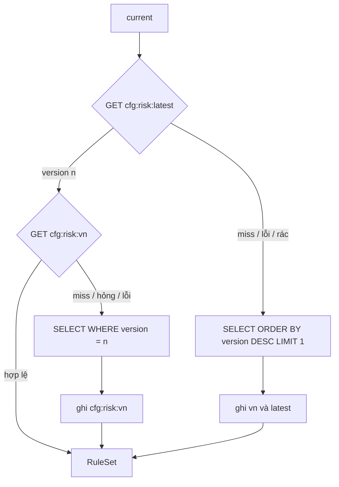

# DBS-110 · Cấu hình luật: cfg:risk:latest (TTL 60 giây) và cfg:risk:v{n} bất biến

> **Status:** Implemented (G1–G4 agent tự duyệt) · **Vai:** #4 Fraud · **Nhánh:** `feat/DBS-110-rule-set-repository` · **PR:** — · **Cập nhật:** 2026-11-09

## 1. Bối cảnh

- **Task:** Task, Tuần 4, High, P5. **Expect:** Đổi cấu hình luật có hiệu lực sau tối đa 60 giây, không phụ thuộc Redis sống.
- **DoD:**
  1. `RuleSetRepository`: đọc phiên bản hiện hành qua `cfg:risk:latest` (TTL 60 giây), nội dung qua `cfg:risk:v{n}` (TTL dài vì bất biến); miss hoặc Redis lỗi → đọc Postgres.
  2. Test: thêm phiên bản mới → worker dùng phiên bản mới sau ≤ 60 giây; tắt Redis vẫn đọc đúng.
  3. Mỗi cờ ghi `rule_set_version` đã dùng.
  4. PR đã merge vào main (CI xanh); Dev review; bảng «Đối chiếu test case» trong PR điền đủ.
  5. Cấu hình thêm khối `ai.*` (provider, model, rubric, threshold trong (0,1], weight nguyên ≥ 0, maxAdmissionDelayMs, requestTimeoutMs); mặc định `rule_only`. Ghi rõ: chuyển về `rule_only` có hiệu lực sau tối đa 60 giây cộng admission, không phải ngắt egress tức thì; `ai.*` hỏng khi đọc ra → vẫn chấm luật, `ai_status = CONFIG_INVALID`, không đẩy DLQ.
- **Phụ thuộc:** DBS-58 (`risk_rule_sets`, seed v1) và DBS-76 (`RedisClient`) có trên `main`.
- **Đã có:** bảng `risk_rule_sets (version PK, config jsonb, created_by, created_at)` append-only, seed v1 ở dạng **phẳng** (`R1: {enabled, weight, maxTransfers, windowMinutes}`) trong khi các luật đọc `params.thresholds`; `ScoringService` nhận `ScoringConfig` đã chuẩn hóa.
- **Ngoài phạm vi:** tạo phiên bản (UC-12 API, kiểm lúc ghi), nối vào consumer (DBS-111), ghi `rule_set_version` vào cờ (DBS-111), tích hợp OpenAI. Chính sách lỗi luật của consumer (BL-046).
- **Backlog lấy vào:** BL-184 H4 (ánh xạ khóa phẳng vào `thresholds`) và H9 (`minAmountExclusive` giữ là chuỗi).
- **Quyết định ở G1 (agent tự quyết):**
  1. `parseRuleSet` nghiêm với phần nền (ngưỡng, trọng số, đủ 6 luật, tổng trọng số vừa `int`) và **khoan dung với `ai.*`**: khối hỏng không ném lỗi mà đánh dấu `aiConfigInvalid`, `ScoringService` ghi `CONFIG_INVALID` (ADR-14 §2.7 mục 7b).
  2. `sameOwnerExempt` ở R5/R6 phải là `true`: code luật luôn miễn, nên một phiên bản đặt `false` bị từ chối thay vì bị lờ đi âm thầm.
  3. Một phiên bản đã phân tích được nhớ trong bộ nhớ theo số phiên bản (bất biến) để không đọc lại nội dung từ Redis mỗi sự kiện; `latest` vẫn đọc mỗi lần.
  4. `mode` lạ (ví dụ `hybrid`) giữ nguyên chuỗi để `ScoringService` rơi về `rule_only` và đếm `risk_unsupported_mode_total`.

## 2. Hành vi

`RuleSetRepository.current(): Promise<RuleSet>` (gọi **trước** transaction của consumer):

| Tình huống | Kết quả |
|---|---|
| Cache nguội | `SELECT version, config … ORDER BY version DESC LIMIT 1`, ghi `cfg:risk:v{n}` (7 ngày) và `cfg:risk:latest = n` (60 giây) |
| `latest` còn, nội dung còn | Trả từ cache, không chạm PostgreSQL |
| Có phiên bản mới | Dùng được khi `latest` hết hạn: tối đa 60 giây sau khi ghi (đó là hợp đồng) |
| `latest` còn nhưng nội dung mất hoặc hỏng | Đọc phiên bản đó từ PostgreSQL, ghi lại |
| `latest` không phải số phiên bản hợp lệ | Bỏ qua, đọc PostgreSQL |
| Redis lỗi, timeout, breaker mở | Mọi lần đọc từ PostgreSQL, tức thì và đúng; tăng `risk_config_redis_fallback_total` |
| Phiên bản lưu không dùng được (thiếu luật, ngưỡng sai…) | `InvalidRuleSetError` nêu **tên trường**, không nêu giá trị |
| Không có phiên bản nào | `InvalidRuleSetError` |
| Lỗi PostgreSQL | Ném nguyên lỗi |

`RuleSet` = `ScoringConfig` + `version` + `aiConfigInvalid`; mỗi luật là `{enabled, weight, thresholds}` với mọi khóa số/chuỗi còn lại của JSON phẳng nằm trong `thresholds`. `ai` chỉ có khi `mode = rules_with_external_ai` và khối hợp lệ: provider `openai`, model `^[A-Za-z0-9_.:-]{1,128}$`, rubric không rỗng, `threshold` ∈ (0,1], `weight` nguyên ≥ 0 và tổng với trọng số luật vừa `int`, `maxAdmissionDelayMs` và `requestTimeoutMs` nguyên dương.

**Thời gian hiệu lực khi chuyển về `rule_only`:** phiên bản mới được dùng sau tối đa 60 giây; một lời gọi AI đã chọn cấu hình cũ còn bị giới hạn thêm bởi `ai.maxAdmissionDelayMs` trước khi gửi, và nếu đã gửi thì chạy tới `ai.requestTimeoutMs`. Đây **không** phải ngắt egress tức thì (ADR-14 §2.7).

## 3. Kiến trúc

- **Vị trí:** `modules/risk/config/` (`rule-set.ts` thuần, `rule-set.repository.ts`), `risk.metrics.ts` thêm counter. Chạy ở `worker`.
- **Interface cung cấp:** `new RuleSetRepository({ redis, db, metrics }).current()`; `parseRuleSet(version, raw)`; `InvalidRuleSetError`. `redis` chỉ cần `get`/`set`; `db` chỉ cần `query`.
- **Dữ liệu:** chỉ `SELECT` từ `risk_rule_sets`. Không đổi schema, env, dependency.
- **Redis:** `cfg:risk:latest` (TTL 60), `cfg:risk:v{n}` (TTL 604800, mức tối đa của `RedisClient`). Ghi cache chỉ là cố gắng, lỗi chỉ làm lần đọc sau chậm hơn.

## 4. Test cases tự động

| ID | DoD | Lớp | Given · When · Then |
|---|---|---|---|
| TC-110-01 | 1, 2 | unit (`rule-set.spec.ts`, `rule-set.repository.spec.ts`) + db + services | Ánh xạ seed phẳng sang `thresholds`; cache nguội/ấm; phiên bản mới chỉ có hiệu lực khi `latest` hết hạn; nội dung hỏng/mất, `latest` rác → PostgreSQL; khóa Redis đúng TTL (`latest` ≤ 60 s, nội dung > 1 ngày) |
| TC-110-02 | 2, 5 | unit + services (Valkey pause/resume) | Redis tắt → đọc đúng từ PostgreSQL ngay (phiên bản mới thấy tức thì); bật lại dùng cache; `ai.*` hỏng (20 kiểu) → `aiConfigInvalid`, không ném; `rule_only` bỏ qua `ai.*`; `mode` lạ giữ nguyên |
| TC-110-03 | 2, 5 | unit + db | Phần nền hỏng → `InvalidRuleSetError` nêu trường không nêu giá trị; không có phiên bản; lỗi PostgreSQL ném nguyên |
| TC-110-04 | 3 | db | Phiên bản trả về là giá trị được `fraud_flags.rule_set_version` chấp nhận (FK), và phiên bản không tồn tại bị từ chối |
| TC-110-05 | 1 | db | Seed v1 đi qua `ScoringService` cho đúng điểm (R6: 30, LOW); tắt R6 ở v2 (công tắc khẩn cấp) cho 0 điểm |
| Quy trình | 4 | — | CI, Dev review, merge |

**Phần DoD #3 chưa thuộc task này:** ghi `rule_set_version` vào cờ là việc của consumer (DBS-111); task này chỉ bảo đảm repository trả đúng số phiên bản và FK nhận nó (TC-110-04).

## 5. Test thủ công

`backend/test/manual/rule-set-repository.manual.ts`: Valkey của compose (container `dbs-valkey-1`) + PostgreSQL tạm.

| Bước | Việc làm | Mong đợi |
|---|---|---|
| M-110-01 | `current()` lần đầu | Phiên bản 1 từ PostgreSQL; `cfg:risk:latest = "1"` và `cfg:risk:v1` có trong Valkey |
| M-110-02 | Thêm v2 (R1 weight 55); đọc lại; `PEXPIRE cfg:risk:latest 1`; đọc lại | Lần đầu vẫn v1 (trong cửa sổ cache), sau khi `latest` hết hạn là v2 |
| M-110-03 | `docker pause` Valkey, thêm v3, đọc | Đọc v3 từ PostgreSQL ngay |

## 6. Domain review

Agent tự phản biện (Techlead waiver: không dùng subagent):

| # | Mức | Phát hiện | Xử lý |
|---|---|---|---|
| 1 | blocking | Seed phẳng ≠ `params.thresholds`: luật sẽ ném lỗi mọi sự kiện | `parseRuleSet` ánh xạ; TC-110-05 chấm điểm bằng seed thật |
| 2 | blocking | `ai.*` hỏng bị coi như lỗi luật làm mọi sự kiện vào DLQ | Khoan dung riêng cho `ai.*`, TC-110-02 |
| 3 | should-fix | Giá trị cấu hình lọt vào thông điệp lỗi/log | Lỗi chỉ nêu trường (TC-110-03) |
| 4 | should-fix | `sameOwnerExempt: false` bị bỏ qua âm thầm | Từ chối phiên bản |
| 5 | minor | Cache hỏng làm sập scoring | Mọi giá trị cache hỏng quay về PostgreSQL |

## 7. Kế hoạch triển khai

| Bước | File | Test trước | Lệnh chứng minh | Commit |
|---|---|---|---|---|
| 1 | `config/rule-set.ts` | TC-110-01..03 (parse) | `npm test -- risk/config/rule-set.spec` | `feat(risk): RuleSetRepository and rule set parser …` |
| 2 | `config/rule-set.repository.ts`, `risk.metrics.ts` | TC-110-01..03 (repository) | `npm test -- rule-set.repository` | cùng bước 1 |
| 3 | `test/db/rule-set-repository.db-spec.ts` | TC-110-04, 05 | `npm run test:db -- rule-set-repository` | cùng bước 1 |
| 4 | `test/services/rule-set-repository.services-spec.ts`, CI | TC-110-01..03 (Valkey) | `npm run test:services -- --runInBand --runTestsByPath test/services/rule-set-repository.services-spec.ts` | `test(risk): rule set repository on Valkey …` |
| 5 | manual, docs, BACKLOG | M-110-01..03 | script manual | `docs(risk): DBS-110 handover` |

Rủi ro: cấu hình hỏng chặn scoring (lỗi được nêu rõ trường, consumer xử lý theo BL-046). Lùi: revert PR.

## 8. Kết quả

- **Lệnh kiểm tra** (code cuối `951d8de`, sau rebase lên main có #105): `lint:check` và `typecheck` sạch; unit 84 suite / 1.628 test xanh; e2e 15 suite / 153 test xanh; `test:db` `rule-set-repository` + `transfer-facts` 17/17; `test:services` `rule-set-repository` 4/4 trên Valkey + PostgreSQL thật (chạy trước rebase, không đổi file). Suite `db` đầy đủ và `services` còn lại chạy ở CI. Không có `.skip`/`.only`.
- **Đối chiếu test case:**

| ID | Test | Đạt? |
|---|---|---|
| TC-110-01 | `rule-set.spec.ts` (ánh xạ seed), `rule-set.repository.spec.ts` (nguội/ấm/mới/hỏng/rác), `rule-set-repository.services-spec.ts` (TTL `latest` ≤ 60 s, nội dung > 1 ngày, phiên bản mới sau khi `latest` hết hạn qua `PEXPIRE`) | đạt (60 giây thật được mô phỏng bằng `PEXPIRE 1 ms`, không chờ 60 giây) |
| TC-110-02 | `rule-set.spec.ts` (20 kiểu `ai.*` hỏng, `rule_only` bỏ qua, mode lạ), `rule-set.repository.spec.ts`, services-spec (Valkey pause/resume) | đạt |
| TC-110-03 | `rule-set.spec.ts` (13 kiểu phần nền hỏng, thông điệp không lộ giá trị, tổng trọng số), `rule-set.repository.spec.ts`, `rule-set-repository.db-spec.ts` | đạt |
| TC-110-04 | `rule-set-repository.db-spec.ts` › TC-110-04 | đạt cho phần repository; việc **ghi** `rule_set_version` vào cờ thuộc DBS-111 |
| TC-110-05 | `rule-set-repository.db-spec.ts` (seed v1 → điểm 30 LOW; v2 tắt R6 → 0) | đạt |

- **Test thủ công** (commit `951d8de`, output ở [manual-test.txt](screenshots/DBS-110/manual-test.txt)): M-110-01, M-110-02, M-110-03 đạt (dùng Valkey của compose, `docker pause`/`unpause`).
- **Ảnh chụp:** không có PNG; bằng chứng là output text (Techlead waiver).
- **Lệch so với kế hoạch:** thêm `test/db/rule-set-repository.db-spec.ts` và bước CI cho services-spec (đã nằm trong §7); không lệch khác.
- **Bàn giao:** BL-188: API tạo phiên bản (UC-12) phải gọi `parseRuleSet` cùng kiểm giá trị từng luật (R2: `historyDays = 30`, bội số tối đa 2 chữ số thập phân; R3: `minAmountExclusive` là chuỗi) trước khi ghi, để phiên bản hỏng bị chặn từ đầu thay vì vào DLQ khi đọc. DBS-111 phải ghi `RuleSet.version` vào `fraud_flags.rule_set_version` và ánh xạ `aiConfigInvalid` thành `ai_status = CONFIG_INVALID`.

## 9. Tài liệu đã cập nhật

`backend/src/modules/risk/README.md`, `docs/BACKLOG.md` (BL-184 H4 phần ánh xạ và H9 đóng, thêm BL-188), `docs/features/README.md`, `.github/workflows/ci.yml`.
