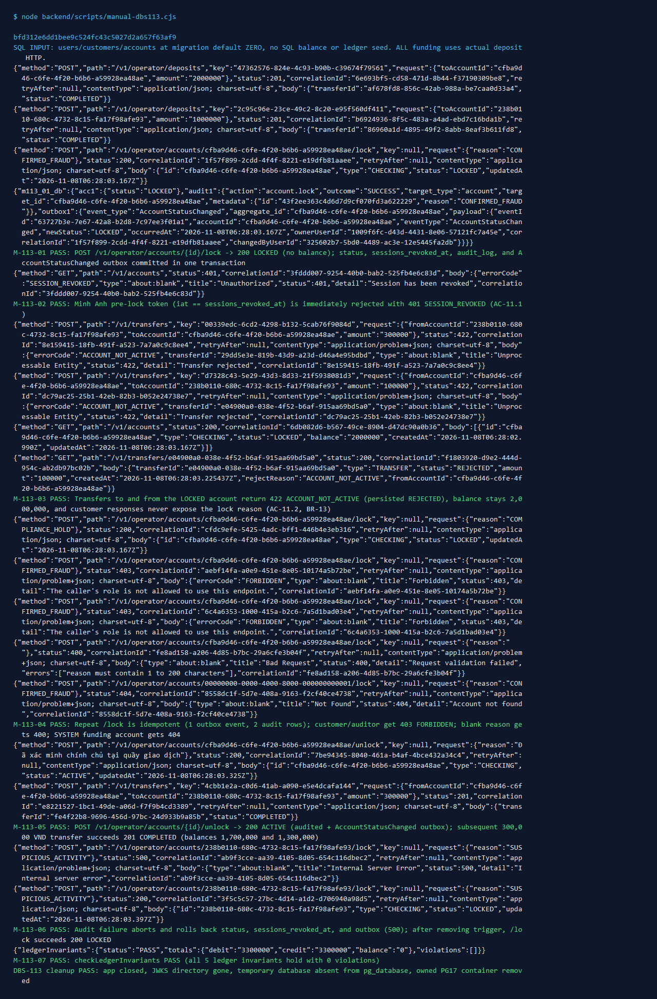

# DBS-113 · UC-11 khóa/mở khóa tài khoản: đổi trạng thái, audit và outbox trong một transaction

<!-- Tài liệu làm việc, không phải báo cáo: ưu tiên bảng hơn văn xuôi; không chép lại DoD hay danh sách case ở §8 ngoài ID. Task nhỏ nên trong khoảng 2.500 từ; nếu dài hơn thì cắt văn xuôi trước, không bao giờ cắt kết quả test thủ công. -->

> **Status:** Implemented · **Vai:** Dev · **Cặp đôi review:** Dev · **Nhánh:** `feat/DBS-113-lock-unlock-account` · **PR:** — · **Cập nhật:** 2026-11-08

## 1. Bối cảnh

- **Task trên board:** Story · Tuần 4 · Ưu tiên: Highest · Assignee: `Dev` · Deliverable/Demo: `Demo 4`.
  - **Thực trạng (trên board):** «Chưa có khóa/mở khóa. Sơ đồ UC-11 ở docs/03 §6.2. Lý do khóa nằm ở audit_log, không ở bảng accounts.»
  - **Expect:** «Nhân viên khóa hoặc mở khóa tài khoản kèm lý do, có dấu vết đầy đủ.»
- **DoD (chép nguyên văn, đánh số từng gạch đầu dòng):**
  1. Endpoint khóa/mở khóa (chỉ operator), bắt buộc lý do; một transaction: đổi status + (khi khóa) `users.sessions_revoked_at = now()` + audit (người thực hiện, lý do, thời điểm) + outbox `AccountStatusChanged` (`accountId`, `ownerUserId`, `newStatus`, `changedByUserId`)
  2. AC-11.3: có nhật ký ghi người thực hiện, lý do, thời điểm; AC-11.2: chuyển tiền cho tài khoản LOCKED → REJECTED
  3. Lý do khóa không xuất hiện trong event hay trong bất kỳ response nào cho khách (BR-13)
  4. PR đã merge vào main (CI xanh); Dev review; bảng «Đối chiếu test case» trong PR điền đủ
- **Phụ thuộc (kèm trạng thái thật trong repo):**
  - `DBS-88` (Tuần 3, Done trên board): `FR-ACC-04: GET /v1/operator/accounts cho nhân viên tra cứu tài khoản của khách` — Đã merge vào `main` (`f95e428`, PR #77): có [`OperatorAccountsController`](../../backend/src/modules/accounts/operator-accounts.controller.ts) (`@Controller('operator/accounts')`, `@Roles('operator')`) và [`OperatorAccountSearchService`](../../backend/src/modules/accounts/operator-account-search.service.ts).
  - `DBS-56` (Tuần 2, Done trên board): `AuditService.record: ghi nhật ký fail-closed trong transaction của người gọi` — Đã merge vào `main` (PR #54): [`AuditService.record`](../../backend/src/modules/audit/audit.service.ts) và runtime guard [`audit-metadata.guard.ts`](../../backend/src/modules/audit/audit-metadata.guard.ts) (`ALLOWED_KEYS = {'id', 'reason', 'count'}`, `reason` thuộc tập đóng `ErrorCode | AuditReason`).
  - `DBS-57` (Tuần 2, Done trên board): `OutboxWriter.add: ghi sự kiện trong transaction của người gọi` — Đã merge vào `main` (PR #55): [`OutboxWriter.add(manager, event)`](../../backend/src/modules/outbox/outbox-writer.ts) hỗ trợ `AccountStatusChanged` (`aggregate_id = event.accountId`).
- **Đã có gì:**
  - **Code:**
    - `OperatorAccountsController` ([`operator-accounts.controller.ts`](../../backend/src/modules/accounts/operator-accounts.controller.ts)) mới có `GET /v1/operator/accounts`, chưa có `POST /v1/operator/accounts/{id}/lock` và `POST /v1/operator/accounts/{id}/unlock`.
    - `IdentityService.revokeSessions(manager, userId)` ([`identity.service.ts`](../../backend/src/modules/identity/identity.service.ts#L87-L95)) đã có sẵn: chạy `UPDATE users SET sessions_revoked_at = clock_timestamp() WHERE id = $1 RETURNING sessions_revoked_at` trong transaction của caller; `JwtAuthGuard` ([`jwt-auth.guard.ts`](../../backend/src/modules/identity/jwt-auth.guard.ts#L79-L83)) đã đọc `sessions_revoked_at` từ PostgreSQL mỗi request và từ chối `401 SESSION_REVOKED` nếu `iat <= Math.floor(revokedAt.getTime() / 1000)`.
    - `@common/events` ([`event-types.ts`](../../backend/src/common/events/event-types.ts#L69-L77), [`event-schemas.ts`](../../backend/src/common/events/event-schemas.ts#L88-L111)) đã định nghĩa và kiểm schema `AccountStatusChanged` (`eventId`, `eventType: 'AccountStatusChanged'`, `occurredAt`, `correlationId`, `accountId`, `ownerUserId`, `newStatus: 'ACTIVE' | 'LOCKED'`, `changedByUserId`), đồng thời cấm trường `reason` (`reason: Joi.any().forbidden()`).
    - `SyncGuardService.checkGuards` ([`sync-guard.service.ts`](../../backend/src/modules/ledger/sync-guard.service.ts#L61-L63)) và `TransferService` ([`transfer.service.ts`](../../backend/src/modules/ledger/transfer.service.ts)) đã chặn tài khoản nguồn hoặc đích có `status !== 'ACTIVE'` với `422 ACCOUNT_NOT_ACTIVE` và lưu dòng `transfers` `REJECTED`.
    - Quyền DB [`infra/scripts/db-roles.sql`](../../infra/scripts/db-roles.sql): `dbs_api` đã được cấp `GRANT UPDATE (balance, status, updated_at) ON accounts`, `GRANT UPDATE (sessions_revoked_at) ON users`, `GRANT INSERT ON outbox_events`, `GRANT SELECT, INSERT ON audit_log`.
  - **Tài liệu & Backlog liên quan:**
    - [`docs/03_HIGH_LEVEL_ARCHITECTURE.md`](../03_HIGH_LEVEL_ARCHITECTURE.md) §6.2 (UC-11), §7 (bảng API), §10 (bảng định tuyến `AccountStatusChanged`), §12; [`docs/BRD.md`](../BRD.md) UC-11, BR-12, BR-13, FR-ACC-03, FR-ID-05, AC-11.1..11.3; [`database-design.md`](../components/_shared/database-design.md) §4.1, §4.2, §4.6, §4.7; [`event-contract.md`](../components/_shared/event-contract.md); [`threat-model.md`](../security/threat-model.md) T2, T10, T14.
    - [`docs/BACKLOG.md`](../BACKLOG.md):
      - `BL-155`: mục (2) nêu «endpoint khóa tài khoản gọi `revokeSessions` trong cùng transaction với việc đổi trạng thái» — `DBS-113` giải quyết phần này (còn mục (1) rate limit thuộc `DBS-89` và cache Redis `revoked_at:{userId}` thuộc `DBS-114`, nên sẽ thu hẹp nội dung `BL-155` ở Phase 5).
      - `BL-019`: nêu «kiểm auditor bị từ chối ở endpoint ghi nghiệp vụ thật khi DBS-60/61/113 cung cấp» — `DBS-113` kiểm chứng `auditor` (cùng `customer`, `admin`) bị từ chối `403 FORBIDDEN` trên cả hai endpoint `/lock` và `/unlock`, và thu hẹp phần `DBS-113` trong `BL-019` ở Phase 5.
      - `BL-170`: ghi nhận `operator lookup/deposit/lock` dùng policy operator riêng, không áp customer ownership.
  - **Baseline (`main` tại `f95e428`):**
    - `npm run lint:check`: PASS (0 lỗi)
    - `npm run typecheck`: PASS (0 lỗi)
    - `npm test`: PASS (68/68 suites, 1.089/1.089 tests)
    - `npm run test:e2e -- --runInBand`: PASS (14/14 suites, 148/148 tests, chạy với PostgreSQL 17 container trên cổng `55432` do cổng `5432` trên máy host bị dịch vụ Windows PostgreSQL chiếm)
    - `npm run test:db -- --runInBand operator-account-search`: PASS (1/1 suite, 11/11 tests trên Testcontainers PostgreSQL 17)
- **Ngoài phạm vi:**
  - Ghi cache Redis `revoked_at:{userId}` sau khi commit và đọc cache Redis trước khi fallback về PostgreSQL trong `JwtAuthGuard` (thuộc `DBS-114`).
  - Consumer `notification` tiêu thụ `AccountStatusChanged` từ SQS và ghi bảng `notification_log` (thuộc task consumer notification, `BL-163`).
  - Ghi `audit_log` `DENIED` toàn cục tại `RolesGuard` khi trả `403 FORBIDDEN` (thuộc `BL-132`).
- **Câu hỏi mở & Quyết định ở G1 (đã duyệt 2026-11-08):**
  1. **Cách nhận `reason` và lưu trong `audit_log.metadata`:** Body của `POST /v1/operator/accounts/{id}/lock` và `/unlock` bắt buộc là plain object chỉ chứa khóa `reason` là chuỗi không rỗng sau `normalize('NFC').trim()`, dài `1..200` ký tự, không chứa ký tự điều khiển hay UTF-16 surrogate lẻ (sai/thiếu → `400`). Bổ sung mã lý do đóng cho UC-11 vào [`AuditReason`](../../backend/src/modules/audit/audit.types.ts) (`OPERATOR_LOCK`, `OPERATOR_UNLOCK`, `SUSPICIOUS_ACTIVITY`, `CONFIRMED_FRAUD`, `CUSTOMER_REQUEST`, `COMPLIANCE_HOLD`). Trong `audit_log`, lưu mã `AuditReason` tương ứng vào `metadata.reason` (theo bảng ánh xạ mục 2.1/2.2) và lưu vân tay 32 ký tự hex đầu của `SHA-256(normalizedReason)` (UTF-8 của chuỗi đã `normalize('NFC').trim()`, giữ nguyên chữ hoa/thường) vào `metadata.id` (chống lộ PII trong `audit_log` tương tự `DBS-88`, đồng thời cho phép kiểm toán viên đối chiếu nguyên văn lý do).
  2. **Hành vi khi tài khoản đã ở sẵn trạng thái đích:** Dưới khóa `SELECT ... FOR UPDATE OF a`, nếu tài khoản đã ở trạng thái đích (`LOCKED` khi gọi `/lock`, `ACTIVE` khi gọi `/unlock`) thì không cập nhật lại `accounts.status`/`updated_at`, không gọi `revokeSessions` lại, và không phát thêm sự kiện `AccountStatusChanged` trùng vào outbox, nhưng **vẫn ghi một dòng `audit_log`** (`account.lock` / `account.unlock`, `outcome = 'SUCCESS'`) rồi trả `200 OK` với trạng thái hiện tại.
  3. **Tài khoản không tồn tại, UUID sai, hoặc `SYSTEM` (`funding`):** `:id` không khớp định dạng UUID → `400 Bad Request` (nếu khớp thì chuẩn hóa `.toLowerCase()` trước khi truy vấn DB, ghi `audit_log`, phát `AccountStatusChanged` và trả response); `:id` không tồn tại hoặc là tài khoản `SYSTEM` (`funding`) → `404 Not Found`.
  4. **Hình dạng response `200 OK`:** Trả `200 OK` (`Cache-Control: no-store`) với `{ id, type, status, updatedAt }` — không trả `balance`, không lộ `reason` trong sự kiện hay bất kỳ API nào của khách hàng (`BR-13`).

---

## 2. Hành vi

### 2.1 Khóa tài khoản của khách (`POST /v1/operator/accounts/{id}/lock`)
- **Điều kiện & Chuẩn hóa đầu vào (trước khi mở transaction):**
  - Caller có JWT hợp lệ thuộc nhóm `operator` (`@Roles('operator')`).
  - `:id` phải khớp biểu thức UUID `/^[0-9a-f]{8}-[0-9a-f]{4}-[0-9a-f]{4}-[0-9a-f]{4}-[0-9a-f]{12}$/i` (sai → `400 Bad Request`) và được chuẩn hóa thành chữ thường `normalizedAccountId = accountId.trim().toLowerCase()` để tương thích với schema UUID chữ thường của `@common/events`.
  - Body JSON được kiểm qua `parseStatusReason(rawBody)`: phải là plain object chỉ có duy nhất khóa `reason`; `rawBody.reason` là `string`, sau khi `normalizedReason = rawBody.reason.normalize('NFC').trim()` có độ dài `1..200` ký tự, không chứa ký tự điều khiển (`U+0000..U+001F`, `U+007F..U+009F`) hay UTF-16 surrogate lẻ (`[\uD800-\uDFFF]`) (sai → `400 Bad Request`).
  - **Hàm băm vân tay `fingerprintReason(normalizedReason)`:** tính `createHash('sha256').update(normalizedReason, 'utf8').digest('hex').slice(0, 32)` trực tiếp trên chuỗi `normalizedReason` (đã `normalize('NFC').trim()`, giữ nguyên chữ hoa/thường).
  - **Ánh xạ `resolveLockReason(normalizedReason)`:** nếu `normalizedReason` trùng khớp chính xác một trong 5 mã `'CONFIRMED_FRAUD' | 'SUSPICIOUS_ACTIVITY' | 'CUSTOMER_REQUEST' | 'COMPLIANCE_HOLD' | 'OPERATOR_LOCK'` thì trả mã `AuditReason` đó; ngược lại (văn bản tự do của nhân viên) trả `AuditReason.OPERATOR_LOCK`.
- **Xử lý trong một `TransactionService.run` (`READ COMMITTED`):**
  1. Khóa dòng tài khoản bằng `SELECT a.id, a.type, a.status, a.updated_at AS "updatedAt", c.user_id AS "ownerUserId" FROM accounts a JOIN customers c ON c.id = a.customer_id WHERE a.id = $1::uuid FOR UPDATE OF a` với `$1 = normalizedAccountId`.
  2. Không có dòng khớp (tài khoản không tồn tại hoặc là tài khoản `SYSTEM` `funding` có `customer_id IS NULL`) → thoát transaction và trả `404 Not Found`.
  3. Nếu `status === 'ACTIVE'` (chuyển trạng thái `ACTIVE → LOCKED`):
     - `UPDATE accounts SET status = 'LOCKED', updated_at = clock_timestamp() WHERE id = $1::uuid RETURNING updated_at AS "updatedAt"`.
     - Gọi `await this.identity.revokeSessions(manager, row.ownerUserId)` để cập nhật `users.sessions_revoked_at = clock_timestamp()` cho chủ tài khoản ngay trong cùng transaction (`FR-ID-05`, `BR-12`, `AC-11.1`).
     - Ghi `audit_log` qua `AuditService.record(manager, ...)` với `actor = operatorId.toLowerCase()`, `role = 'operator'`, `action = 'account.lock'`, `outcome = 'SUCCESS'`, `target = { type: 'account', id: row.id.toLowerCase() }`, `correlationId = correlationId.toLowerCase()`, `metadata = { id: fingerprintReason(normalizedReason), reason: resolveLockReason(normalizedReason) }`.
     - Ghi sự kiện `AccountStatusChanged` vào `outbox_events` qua `OutboxWriter.add(manager, event)` với `occurredAt = updatedAt.toISOString()`, `accountId = row.id.toLowerCase()`, `ownerUserId = row.ownerUserId.toLowerCase()`, `newStatus = 'LOCKED'`, `changedByUserId = operatorId.toLowerCase()` (không có trường `reason` — `BR-13`).
  4. Nếu `status === 'LOCKED'` (đã ở trạng thái đích):
     - Giữ nguyên `accounts.status`, `accounts.updated_at` và `users.sessions_revoked_at`; không ghi `outbox_events` mới; vẫn ghi dòng `audit_log` (`action = 'account.lock'`, `outcome = 'SUCCESS'`, `target.id = row.id.toLowerCase()`) và trả trạng thái hiện tại.
- **Ví dụ request / response thành công (`200 OK`):**
  ```json
  // Request: POST /v1/operator/accounts/2e859a80-d4d0-471d-8cee-e9d0de9d4bc7/lock
  {
    "reason": "CONFIRMED_FRAUD"
  }

  // Response: 200 OK (Cache-Control: no-store, X-Correlation-Id: <uuid>)
  {
    "id": "2e859a80-d4d0-471d-8cee-e9d0de9d4bc7",
    "type": "CHECKING",
    "status": "LOCKED",
    "updatedAt": "2026-11-08T05:10:00.123Z"
  }
  ```

### 2.2 Mở khóa tài khoản của khách (`POST /v1/operator/accounts/{id}/unlock`)
- **Điều kiện & Chuẩn hóa đầu vào:** Cùng kiểm tra vai trò `operator`, chuẩn hóa `:id` (`normalizedAccountId = accountId.trim().toLowerCase()`) và `parseStatusReason(rawBody)` như mục 2.1.
  - **Ánh xạ `resolveUnlockReason(normalizedReason)`:** nếu `normalizedReason` trùng khớp chính xác một trong 3 mã `'CUSTOMER_REQUEST' | 'COMPLIANCE_HOLD' | 'OPERATOR_UNLOCK'` thì trả mã `AuditReason` đó; ngược lại (văn bản tự do của nhân viên) trả `AuditReason.OPERATOR_UNLOCK`.
- **Xử lý trong một `TransactionService.run` (`READ COMMITTED`):**
  1. Khóa dòng tài khoản bằng `SELECT ... FROM accounts a JOIN customers c ON c.id = a.customer_id WHERE a.id = $1::uuid FOR UPDATE OF a` với `$1 = normalizedAccountId`. Không tìm thấy hoặc là tài khoản `funding` → `404 Not Found`.
  2. Nếu `status === 'LOCKED'` (chuyển trạng thái `LOCKED → ACTIVE`):
     - `UPDATE accounts SET status = 'ACTIVE', updated_at = clock_timestamp() WHERE id = $1::uuid RETURNING updated_at AS "updatedAt"`.
     - **Không** sửa `users.sessions_revoked_at` (token phát hành trước lần khóa trước vẫn bị thu hồi vĩnh viễn; chủ tài khoản đăng nhập lại nhận token mới phát hành sau mốc thu hồi).
     - Ghi `audit_log` (`action = 'account.unlock'`, `outcome = 'SUCCESS'`, `target = { type: 'account', id: row.id.toLowerCase() }`, `metadata = { id: fingerprintReason(normalizedReason), reason: resolveUnlockReason(normalizedReason) }`).
     - Ghi sự kiện `AccountStatusChanged` (`newStatus = 'ACTIVE'`, `occurredAt = updatedAt.toISOString()`, `accountId = row.id.toLowerCase()`, `ownerUserId = row.ownerUserId.toLowerCase()`, `changedByUserId = operatorId.toLowerCase()`) vào `outbox_events` qua `OutboxWriter.add`.
  3. Nếu `status === 'ACTIVE'` (đã ở trạng thái đích):
     - Không cập nhật `accounts`, không phát sự kiện `AccountStatusChanged`, vẫn ghi dòng `audit_log` (`action = 'account.unlock'`, `outcome = 'SUCCESS'`, `target.id = row.id.toLowerCase()`) và trả `200 OK` với trạng thái hiện tại.
- **Ví dụ request / response thành công (`200 OK`):**
  ```json
  // Request: POST /v1/operator/accounts/2e859a80-d4d0-471d-8cee-e9d0de9d4bc7/unlock
  {
    "reason": "CUSTOMER_REQUEST"
  }

  // Response: 200 OK (Cache-Control: no-store, X-Correlation-Id: <uuid>)
  {
    "id": "2e859a80-d4d0-471d-8cee-e9d0de9d4bc7",
    "type": "CHECKING",
    "status": "ACTIVE",
    "updatedAt": "2026-11-08T05:12:00.456Z"
  }
  ```

### 2.3 Tác động lên phiên đăng nhập, chuyển tiền và bảo mật thông tin (`AC-11.1`, `AC-11.2`, `BR-12`, `BR-13`)
- **Thu hồi phiên ngay sau khi khóa (`AC-11.1` trên PostgreSQL):** Token cũ của chủ tài khoản có `iat <= Math.floor(sessions_revoked_at.getTime() / 1000)` gọi bất kỳ endpoint xác thực nào ngay sau khi lệnh khóa commit đều nhận `401 SESSION_REVOKED`. Token mới phát hành ở giây kế tiếp (`iat > Math.floor(sessions_revoked_at.getTime() / 1000)`) hoạt động bình thường cho các tài khoản `ACTIVE` khác của khách đó.
- **Từ chối giao dịch liên quan tài khoản `LOCKED` (`AC-11.2`):** Khi tài khoản A đang `LOCKED`:
  - Khách B chuyển tiền tới A (`POST /v1/transfers`) → `422 ACCOUNT_NOT_ACTIVE` kèm `transferId`, lưu dòng `transfers` `REJECTED` (`reject_reason = 'ACCOUNT_NOT_ACTIVE'`), không có bút toán, số dư A và B không đổi.
  - Khách A (dùng token mới sau mốc thu hồi) chuyển tiền từ A sang B → `422 ACCOUNT_NOT_ACTIVE` kèm `transferId`, lưu `REJECTED`.
  - Nhân viên nạp tiền vào A (`POST /v1/operator/deposits`) → `422 ACCOUNT_NOT_ACTIVE` kèm `transferId`, lưu `REJECTED`.
  - Sau khi nhân viên mở khóa A (`POST /v1/operator/accounts/{id}/unlock`), chuyển tiền và nạp tiền vào/từ A thành công `201 COMPLETED`.
- **Bảo mật lý do khóa (`BR-13`):**
  - Sự kiện `AccountStatusChanged` trong `outbox_events.payload` chỉ có đúng 8 khóa hợp đồng (`eventId`, `eventType`, `occurredAt`, `correlationId`, `accountId`, `ownerUserId`, `newStatus`, `changedByUserId`), không có `reason` hay vân tay.
  - Các API của khách hàng (`GET /v1/accounts`, `GET /v1/accounts/{id}`, `GET /v1/accounts/{id}/transactions`, `POST /v1/transfers`, `GET /v1/transfers/{id}`) không bao giờ trả lý do khóa hay vân tay lý do khóa.

### 2.4 Bảng mã lỗi và ca biên

| Tình huống | HTTP | `errorCode` (problem+json) | Ghi chú |
|---|---|---|---|
| Thiếu/sai Bearer token | `401` | `UNAUTHENTICATED` / `TOKEN_EXPIRED` | Do `JwtAuthGuard` chặn trước controller |
| Token phát hành ở hoặc trước giây `sessions_revoked_at` | `401` | `SESSION_REVOKED` | Do `JwtAuthGuard` đọc `users.sessions_revoked_at` |
| Caller có vai trò `customer`, `auditor`, hoặc `admin` | `403` | `FORBIDDEN` | Do `RolesGuard` chặn (`@Roles('operator')`) |
| `:id` không phải UUID (`8-4-4-4-12` hex) | `400` | *(validation problem+json)* | Chặn trước khi mở transaction |
| Body thiếu `reason`, không phải string, rỗng/toàn khoảng trắng, `> 200` ký tự sau NFC+trim, chứa ký tự điều khiển hoặc surrogate lẻ, hoặc có field lạ | `400` | *(validation problem+json)* | Chặn trước khi mở transaction |
| `:id` không tồn tại hoặc là tài khoản `SYSTEM` (`funding` `00000000-0000-4000-8000-000000000001`) | `404` | *(NotFound problem+json)* | Không ghi `audit_log` hay `outbox_events` |
| Chuyển/nạp tiền vào hoặc từ tài khoản `LOCKED` | `422` | `ACCOUNT_NOT_ACTIVE` | Kèm `transferId`, commit dòng `transfers` `REJECTED` |
| Deadlock hết 3 lần retry hoặc hết `lock_timeout` / `statement_timeout` | `503` | `SERVICE_TEMPORARILY_UNAVAILABLE` | Kèm header `Retry-After` |
| Lỗi ghi `audit_log`, `outbox_events` hoặc `users.sessions_revoked_at` | `500` | *(InternalServerError problem+json)* | Rollback toàn bộ transaction (fail-closed) |

### 2.5 Đối chiếu danh sách kiểm tra bảo mật (`references/testing.md`)

| Yêu cầu bảo mật | Điểm cưỡng chế | Test case chứng minh |
|---|---|---|
| Đúng role guard trên endpoint (`@Roles('operator')`) | `OperatorAccountsController` | `TC-113-07` (`customer`, `auditor`, `admin` → 403; không token → 401) |
| Kiểm tra sở hữu trên truy vấn theo tài khoản; 404 cho tài nguyên người khác | Chính sách operator riêng (`BL-170`) | Không áp dụng ownership của khách hàng cho operator; tài khoản không tồn tại hoặc `SYSTEM` `funding` trả `404` (`TC-113-06`), khách hàng gọi bị chặn `403` (`TC-113-07`) |
| Idempotency key theo user | Khóa hàng `FOR UPDATE` + trạng thái đích hằng số | Không dùng bảng `idempotency_keys`; gọi lặp và 10 request song song trên cùng tài khoản là idempotent theo trạng thái (`TC-113-03`, `TC-113-09`) |
| Từ chối nghiệp vụ ghi audit `REJECTED` cùng transaction; từ chối quyền ghi `DENIED` riêng | `TransferService` / `DepositService` | `TC-113-04` (chuyển tiền tới/từ tài khoản `LOCKED` ghi `REJECTED` cùng transaction); 403 `RolesGuard` toàn cục thuộc `BL-132` |
| Không lộ trường cờ gian lận hay lý do khóa cho khách hàng (`BR-13`) | DTO, `AccountStatusChanged` schema | `TC-113-05` (kiểm tra `outbox_events.payload` và mọi API khách hàng không chứa lý do khóa hay vân tay) |
| Lỗi không lộ nội bộ, SQL hay PII; luôn có `correlationId` | `ProblemDetailsFilter`, `audit-metadata.guard.ts` | `TC-113-08`, `TC-113-10` |
| Toàn bộ SQL tham số hóa (`$1`, `$2`) | `OperatorAccountStatusService` | `TC-113-08`, `TC-113-12` (hostile input trong `reason` và `:id`) |
| TLS tới Postgres/Redis; không có secret trong repo, image hay log | Cấu hình hạ tầng | Không áp dụng (task không thêm kết nối hay biến môi trường mới) |

---

## 3. Kiến trúc

- **Vị trí:** Module `accounts` (`backend/src/modules/accounts/`), chạy ở role `api` (và `both`).
  - **File mới:**
    - `backend/src/modules/accounts/operator-account-status.dto.ts`:
      - `OperatorAccountStatusBodyDto`: khai báo `@Allow() reason?: unknown;` (từ `class-validator`) kèm `@ApiProperty(...)` để `ValidationPipe` toàn cục (`whitelist: true, forbidNonWhitelisted: true, transform: true`) giữ lại trường `reason` và từ chối mọi trường lạ trên body, đồng thời hàm `parseStatusReason(rawBody: unknown): string` kiểm tra `rawBody` là plain object chỉ có khóa `reason` và chuẩn hóa/kiểm tra `rawBody.reason` (NFC + `trim()`, dài `1..200` ký tự, không có ký tự điều khiển hoặc surrogate lẻ).
      - Các hàm thuần `parseAccountUuid(rawId: string): string` (kiểm tra UUID và chuẩn hóa `.toLowerCase()`), `fingerprintReason(normalizedReason: string): string`, `resolveLockReason(normalizedReason: string): AuditReason`, `resolveUnlockReason(normalizedReason: string): AuditReason`.
      - `OperatorAccountStatusResponseDto`: `{ id, type, status, updatedAt }` (không có `balance`).
    - `backend/src/modules/accounts/operator-account-status.service.ts`: `OperatorAccountStatusService` thực thi `lock(...)` và `unlock(...)` trong một `TransactionService.run`.
    - `backend/src/modules/accounts/operator-account-status.reason.spec.ts`: unit test kiểm tra `parseAccountUuid`, `parseStatusReason`, `resolveLockReason`, `resolveUnlockReason` và `fingerprintReason` (`TC-113-12`).
    - `backend/test/db/operator-account-status.db-spec.ts`: bộ test tích hợp HTTP + PostgreSQL 17 thật (`TC-113-01`..`TC-113-11`, `TC-113-13`).
    - `backend/scripts/manual-dbs113.cjs`: kịch bản kiểm thử thủ công chạy ứng dụng thật + PostgreSQL 17 thật (`M-113-01`..`M-113-08`); đầu script đặt `process.env.TS_NODE_PROJECT ??= path.resolve(__dirname, '../tsconfig.json')` và `process.chdir(path.resolve(__dirname, '..'))` trước khi `require('./lib/ledger-manual-harness.cjs')` để chạy được cả từ thư mục gốc repo lẫn `backend/`.
  - **File cập nhật:**
    - `backend/src/modules/audit/audit.types.ts`: bổ sung 6 giá trị vào enum `AuditReason` (`OPERATOR_LOCK`, `OPERATOR_UNLOCK`, `SUSPICIOUS_ACTIVITY`, `CONFIRMED_FRAUD`, `CUSTOMER_REQUEST`, `COMPLIANCE_HOLD`). Người gọi hiện tại của `AuditReason` (grep: `accounts.service.ts`, `account-query.service.ts`, `transfer.service.ts`, `transfer-query.service.ts`, `audit-metadata.guard.ts`) chỉ đọc các giá trị hiện hữu và `Object.values(AuditReason)` nên hoàn toàn tương thích ngược.
    - `backend/src/modules/accounts/operator-accounts.controller.ts`: thêm hai endpoint `@Post(':id/lock')` và `@Post(':id/unlock')` (`@HttpCode(HttpStatus.OK)`, `@Header('Cache-Control', 'no-store')`) với đầy đủ chú thích OpenAPI, truyền nguyên `body` (`OperatorAccountStatusBodyDto`) vào `OperatorAccountStatusService.lock/unlock`.
    - `backend/src/modules/accounts/accounts.module.ts`: import thêm `IdentityModule` và `OutboxModule`, đăng ký `OperatorAccountStatusService` trong `providers`.
    - `backend/test/support/onboarding-app.ts` và `backend/test/support/resource-ownership-probe.ts`: cung cấp thêm `appConfig.KEY` (và `authConfig.KEY` trong `OwnershipProbeDatabaseModule`) cho các fixture test hiện hữu đang import `AccountsModule` (`customer-onboarding.db-spec.ts`, `account-opening.db-spec.ts`, `accounts-service.db-spec.ts`, `resource-ownership.db-spec.ts`, `accounts-service.manual.ts`), vì `OutboxModule` kéo theo `LoggingModule` (`appConfig.KEY`) và `IdentityModule` kéo theo `JwksVerifierService` (`authConfig.KEY`).
- **Interface dùng và cung cấp:**
  ```ts
  // backend/src/modules/accounts/operator-account-status.service.ts
  @Injectable()
  export class OperatorAccountStatusService {
    constructor(
      private readonly tx: TransactionService,
      private readonly identity: IdentityService,
      private readonly audit: AuditService,
      private readonly outbox: OutboxWriter,
    ) {}

    lock(
      operatorId: string,
      accountId: string,
      rawBody: unknown,
      correlationId: string,
    ): Promise<OperatorAccountStatusResponseDto>;

    unlock(
      operatorId: string,
      accountId: string,
      rawBody: unknown,
      correlationId: string,
    ): Promise<OperatorAccountStatusResponseDto>;
  }
  ```
  - Gọi `this.tx.run(async manager => ...)` (`TransactionService`).
  - Gọi `this.identity.revokeSessions(manager, ownerUserId): Promise<Date>` (`IdentityService`).
  - Gọi `this.audit.record(manager, input): Promise<void>` (`AuditService`).
  - Gọi `this.outbox.add(manager, event): Promise<void>` (`OutboxWriter`).
- **Dữ liệu chạm tới (đối chiếu `database-design.md`):**
  - `accounts` (§4.2): đọc và khóa dòng bằng PK `accounts(id)` (`FOR UPDATE OF a`), `JOIN customers c ON c.id = a.customer_id` để lấy `c.user_id AS "ownerUserId"` và loại trừ tài khoản `SYSTEM` (`funding`). Cập nhật `status` (`'LOCKED'` / `'ACTIVE'`) và `updated_at = clock_timestamp()`.
  - `users` (§4.1): cập nhật `sessions_revoked_at = clock_timestamp()` theo PK `users(id)` khi chuyển `ACTIVE → LOCKED`.
  - `audit_log` (§4.7): `INSERT` dòng nhật ký (`action = 'account.lock'` hoặc `'account.unlock'`, `outcome = 'SUCCESS'`, `target_type = 'account'`, `target_id = normalizedAccountId`, `metadata = { id: <32-hex-sha256>, reason: <AuditReason> }`).
  - `outbox_events` (§4.6): `INSERT` sự kiện `AccountStatusChanged` (`aggregate_id = normalizedAccountId`, mọi trường UUID đều ở dạng chữ thường) khi có chuyển trạng thái.
- **Ranh giới transaction:**
  - Toàn bộ chuỗi `SELECT ... FOR UPDATE OF a` → `UPDATE accounts` → (khi khóa) `UPDATE users SET sessions_revoked_at` → `INSERT INTO audit_log` → `INSERT INTO outbox_events` nằm trong **một** `TransactionService.run` duy nhất.
  - Không gọi Redis, HTTP hay SQS bên trong transaction.
- **Sơ đồ luồng xử lý:**
  ```mermaid
  sequenceDiagram
      autonumber
      actor O as Nhân viên (operator)
      participant C as OperatorAccountsController
      participant S as OperatorAccountStatusService
      participant DB as PostgreSQL
      participant I as IdentityService
      participant A as AuditService
      participant W as OutboxWriter

      O->>C: POST /v1/operator/accounts/{id}/lock { reason }
      C->>S: lock(user.userId, id, body, correlationId)
      S->>S: parseAccountUuid(id) -> normalizedId & parseStatusReason(body) (sai -> 400)
      S->>DB: BEGIN (TransactionService.run)
      S->>DB: SELECT a.*, c.user_id FROM accounts a JOIN customers c ... WHERE a.id = $1 FOR UPDATE OF a
      alt Không tìm thấy (hoặc là tài khoản SYSTEM funding)
          S->>DB: COMMIT (không ghi gì)
          S-->>C: throw NotFoundException (404)
      else Đang ACTIVE (chuyển sang LOCKED)
          S->>DB: UPDATE accounts SET status = 'LOCKED', updated_at = clock_timestamp() RETURNING updated_at
          S->>I: revokeSessions(manager, ownerUserId)
          I->>DB: UPDATE users SET sessions_revoked_at = clock_timestamp() WHERE id = $1
          S->>A: record(manager, { action: 'account.lock', outcome: 'SUCCESS', metadata })
          A->>DB: INSERT INTO audit_log ...
          S->>W: add(manager, AccountStatusChanged { newStatus: 'LOCKED' })
          W->>DB: INSERT INTO outbox_events ...
          S->>DB: COMMIT
          S-->>C: 200 { id, type, status: 'LOCKED', updatedAt }
      else Đã LOCKED sẵn (idempotent)
          S->>A: record(manager, { action: 'account.lock', outcome: 'SUCCESS', metadata })
          A->>DB: INSERT INTO audit_log ...
          S->>DB: COMMIT
          S-->>C: 200 { id, type, status: 'LOCKED', updatedAt }
      end
  ```
- **Thay đổi cấp hệ thống:**
  - Cập nhật `docs/03_HIGH_LEVEL_ARCHITECTURE.md` §7 (dòng `POST /v1/operator/accounts/{id}/lock` và `/unlock`), `backend/src/modules/accounts/README.md`, `docs/security/threat-model.md` (T10, T14), `docs/BACKLOG.md` (thu hẹp `BL-155`, `BL-019`). Không thay đổi schema DB, ADR, `ErrorCode` hay `event-contract.md`.

---

## 4. Test cases tự động

Chạy trên PostgreSQL 17 thật (`backend/test/db/operator-account-status.db-spec.ts`) và unit test (`backend/src/modules/accounts/operator-account-status.reason.spec.ts`). Kết thúc mỗi test bằng `checkLedgerInvariants(db.runner)`.

| ID | Truy vết (DoD / AC) | Lớp | Given · When · Then | `errorCode` / HTTP mong đợi |
|---|---|---|---|---|
| **TC-113-01** | DoD #1, AC-11.3, FR-ACC-03, FR-ID-05, T10 | e2e HTTP + Postgres thật | Given tài khoản khách A đang `ACTIVE`, `users.sessions_revoked_at` là `NULL` · When operator gọi `POST /v1/operator/accounts/{id}/lock` với `{ reason: 'CONFIRMED_FRAUD' }` (kèm cả case `:id` viết hoa) · Then trả `200` `{ id, type, status: 'LOCKED', updatedAt }` (`id` đã chuẩn hóa chữ thường, `Cache-Control: no-store`, không có `balance`); trong DB `accounts.status = 'LOCKED'`, `users.sessions_revoked_at IS NOT NULL`, có đúng 1 dòng `audit_log` (`action = 'account.lock'`, `actor_user_id = operatorId`, `outcome = 'SUCCESS'`, `target_id = id` chữ thường, `metadata.reason = 'CONFIRMED_FRAUD'`, `metadata.id` = 32 hex SHA-256 của chuỗi `'CONFIRMED_FRAUD'`, `occurred_at` hợp lệ) và đúng 1 dòng `outbox_events` `AccountStatusChanged` (`newStatus = 'LOCKED'`, `accountId` chữ thường, `ownerUserId`, `changedByUserId = operatorId`) | `200` |
| **TC-113-02** | DoD #1, AC-11.3, FR-ACC-03, T10 | e2e HTTP + Postgres thật | Given tài khoản khách A đang `LOCKED` (có `sessions_revoked_at = T1`) · When operator gọi `POST /v1/operator/accounts/{id}/unlock` với `{ reason: 'Khách đã xác minh tại quầy' }` · Then trả `200` `{ id, type, status: 'ACTIVE', updatedAt }`; trong DB `accounts.status = 'ACTIVE'`, `users.sessions_revoked_at` giữ nguyên `T1` (không bị xóa), có dòng `audit_log` (`action = 'account.unlock'`, `metadata.reason = 'OPERATOR_UNLOCK'`, `metadata.id` = 32 hex SHA-256 của chuỗi `'Khách đã xác minh tại quầy'` đã NFC+trim) và dòng `outbox_events` `AccountStatusChanged` (`newStatus = 'ACTIVE'`) | `200` |
| **TC-113-03** | DoD #1, UC-11 ngoại lệ, AC-11.3 | e2e HTTP + Postgres thật | Given tài khoản A đã `LOCKED` (hoặc đã `ACTIVE`) · When operator gọi lại `/lock` (hoặc `/unlock`) lần thứ hai · Then trả `200` với cùng `status` và `updatedAt`, **không** sinh thêm dòng `outbox_events` `AccountStatusChanged`, **không** đổi `sessions_revoked_at`, nhưng vẫn ghi thêm 1 dòng `audit_log` của lần gọi lặp | `200` |
| **TC-113-04** | DoD #2, AC-11.1, AC-11.2, BR-12 | e2e HTTP + Postgres thật | Given tài khoản A của khách A có 1.000.000đ và tài khoản B của khách B có 500.000đ · When operator khóa tài khoản A và đọc mốc `revokedSec = Math.floor(sessions_revoked_at.getTime() / 1000)` từ PostgreSQL · Then: (1) token cũ của khách A (`iat: revokedSec`) gọi `GET /v1/accounts` bị từ chối `401 SESSION_REVOKED`; (2) khách B chuyển 100.000đ cho A (`POST /v1/transfers`) bị từ chối `422 ACCOUNT_NOT_ACTIVE` (lưu `transfers` `REJECTED`, số dư không đổi); (3) khách A dùng token đăng nhập mới (`iat: revokedSec + 1`) chuyển tiền từ A sang B hoặc operator nạp tiền vào A đều bị từ chối `422 ACCOUNT_NOT_ACTIVE`; (4) sau khi operator mở khóa A, khách B chuyển 100.000đ cho A thành công `201 COMPLETED` | `401 SESSION_REVOKED` / `422 ACCOUNT_NOT_ACTIVE` / `201` |
| **TC-113-05** | DoD #3, BR-13, T14 | e2e HTTP + Postgres thật | Given tài khoản A bị khóa với lý do `'Nghi ngờ gian lận rửa tiền mã 998877'` và có 1 giao dịch bị từ chối · When đọc `outbox_events.payload`, response của `/lock`, và khách A (với token đăng nhập mới có `iat: revokedSec + 1` tính từ `users.sessions_revoked_at` trong DB) gọi `GET /v1/accounts`, `GET /v1/accounts/{id}`, `GET /v1/accounts/{id}/transactions`, `GET /v1/transfers/{id}` · Then không nơi nào xuất hiện chuỗi lý do khóa, trường `reason`, mã `CONFIRMED_FRAUD`/`OPERATOR_LOCK` hay vân tay 32-hex | `200` |
| **TC-113-06** | DoD #1, ca biên | e2e HTTP + Postgres thật | Given UUID tài khoản không tồn tại và UUID tài khoản `SYSTEM` (`funding` `00000000-0000-4000-8000-000000000001`) · When operator gọi `/lock` và `/unlock` · Then cả hai trả `404`, tài khoản `funding` vẫn `ACTIVE`, không phát sinh dòng `audit_log` hay `outbox_events` | `404` |
| **TC-113-07** | DoD #1, BL-019, T21, T22 | e2e HTTP + Postgres thật | Given tài khoản khách A · When gọi `/lock` và `/unlock` bằng token `customer`, `auditor`, `admin` hoặc không có token · Then `customer`/`auditor`/`admin` nhận `403 FORBIDDEN`, không có token nhận `401 UNAUTHENTICATED`; trạng thái tài khoản, `audit_log` và `outbox_events` không đổi | `403 FORBIDDEN` / `401 UNAUTHENTICATED` |
| **TC-113-08** | DoD #1, ca biên validate & SQL parameterization | e2e HTTP + Postgres thật | Given `:id` không phải UUID, hoặc body thiếu `reason`, `reason` rỗng/khoảng trắng, `reason` dài 201 ký tự, `reason` chứa ký tự điều khiển (`\u0000`, `\n`), `reason` không phải chuỗi, hoặc body có trường thừa `{ reason: 'OK', status: 'ACTIVE' }` · When operator gọi `/lock` và `/unlock` · Then trả `400`, không chạm DB; `reason` đúng 1 ký tự và 200 ký tự hoặc chuỗi chứa ký tự SQL (`' OR 1=1 --`) được xử lý an toàn trả `200` | `400` / `200` |
| **TC-113-09** | DoD #1, đồng thời | e2e HTTP + Postgres thật | Given tài khoản A đang `ACTIVE` · When 10 request `POST /v1/operator/accounts/{id}/lock` bắn đồng thời (`Promise.all`) · Then cả 10 request trả `200` `status: 'LOCKED'`, trong DB có **đúng 1** sự kiện `AccountStatusChanged` (`newStatus = 'LOCKED'`) trong `outbox_events` và **đúng 10** dòng `audit_log` `account.lock` | `200` |
| **TC-113-10** | DoD #1, BR-09 fail-closed | e2e HTTP + Postgres thật | Given trigger tạm làm lỗi `INSERT INTO audit_log` hoặc `INSERT INTO outbox_events` · When operator gọi `/lock` (và `/unlock`) · Then HTTP trả `500` (có `correlationId`, không lộ SQL/PII), toàn bộ transaction rollback: `accounts.status` giữ nguyên trạng thái cũ, `users.sessions_revoked_at` vẫn `NULL`, không có dòng `audit_log` hay `outbox_events` nào được lưu; gỡ trigger thì gọi lại thành công `200` | `500` / `200` |
| **TC-113-11** | DoD #1, timeout & DB role `dbs_api` | e2e HTTP + Postgres thật | Given: (a) một kết nối khác giữ khóa `FOR UPDATE` trên hàng `accounts` vượt `lock_timeout` → `/lock` trả `503 SERVICE_TEMPORARILY_UNAVAILABLE` kèm `Retry-After`; (b) chạy lệnh khóa/mở khóa dưới quyền role `dbs_api` thật (`infra/scripts/db-roles.sql`) → thành công `200` | `503 SERVICE_TEMPORARILY_UNAVAILABLE` / `200` |
| **TC-113-12** | DoD #1, DoD #3 | unit | Kiểm tra `parseAccountUuid` (chuẩn hóa chữ thường, từ chối chuỗi sai), `parseStatusReason` (plain object chỉ có `reason`, NFC, trim, biên 1 và 200 ký tự, từ chối rỗng/201 ký tự/control chars/lone surrogate/field thừa), bảng ánh xạ `resolveLockReason`/`resolveUnlockReason` và hàm băm `fingerprintReason` 32 hex trên chuỗi NFC+trim giữ nguyên hoa/thường | — |
| **TC-113-13** | DoD #1 | e2e HTTP | Kiểm tra tài liệu OpenAPI (Swagger) của `POST /v1/operator/accounts/{id}/lock` và `/unlock`: có `@BearerAuth`, vai trò `operator`, tham số `:id`, body `reason`, response `200` không có `balance`, và các mã lỗi `400/401/403/404/500/503` | — |
| **Quy trình** | DoD #4 | — | PR đã merge vào `main` (CI xanh); Dev review; bảng «Đối chiếu test case» trong PR điền đủ | quy trình |

---

## 5. Test thủ công

Chạy ứng dụng thật (`startDepositApp` / HTTP thật + JWT local thật) đối chiếu trực tiếp với PostgreSQL 17 thật qua script `node backend/scripts/manual-dbs113.cjs` (hoặc từ `backend/` bằng `node scripts/manual-dbs113.cjs`; đầu script tự đặt `TS_NODE_PROJECT` và `process.chdir` về `backend/`), lưu nguyên văn output vào `docs/features/screenshots/DBS-113/manual-test.txt` (dòng 1 là SHA commit code cuối; không in token hay header `Authorization`).

**Điều kiện chạy:** Docker Desktop đang bật (PostgreSQL 17); dữ liệu khách hàng dùng tên tiếng Việt và số tiền đồng thực tế, nạp tiền chỉ qua API `POST /v1/operator/deposits`.

| Bước | Việc làm (lệnh hoặc thao tác) | Kết quả mong đợi |
|---|---|---|
| **M-113-01** | Tạo 2 khách hàng (`Nguyễn Minh Anh` và `Trần Thu Hà`), nạp `2.000.000` đồng vào tài khoản của Minh Anh qua `POST /v1/operator/deposits`. Nhân viên gọi `POST /v1/operator/accounts/{id}/lock` khóa tài khoản của Minh Anh với `{ "reason": "CONFIRMED_FRAUD" }` | HTTP `200` `{ id, type: "CHECKING", status: "LOCKED", updatedAt }`, không có trường `balance`. Trong DB: `accounts.status = 'LOCKED'`, `users.sessions_revoked_at` khác NULL, có 1 dòng `audit_log` (`action = 'account.lock'`, `outcome = 'SUCCESS'`, `metadata.reason = 'CONFIRMED_FRAUD'`) và 1 dòng `outbox_events` (`AccountStatusChanged`, `newStatus = 'LOCKED'`, payload không chứa `reason`) |
| **M-113-02** | Đọc mốc `revokedSec = Math.floor(sessions_revoked_at.getTime() / 1000)` từ bảng `users`, dùng token của Minh Anh có `iat: revokedSec` (phát hành ở hoặc trước thời điểm khóa) gọi `GET /v1/accounts` | HTTP `401` với `errorCode: "SESSION_REVOKED"` ngay ở request kế tiếp |
| **M-113-03** | Trần Thu Hà chuyển `300.000` đồng tới tài khoản đang `LOCKED` của Minh Anh qua `POST /v1/transfers`; Minh Anh đăng nhập lại (phát hành token mới có `iat: revokedSec + 1` sau mốc thu hồi) thử chuyển `100.000` đồng từ tài khoản `LOCKED` của mình sang Hà | Cả 2 lệnh chuyển tiền đều bị từ chối HTTP `422` với `errorCode: "ACCOUNT_NOT_ACTIVE"` kèm `transferId`; trong DB có 2 dòng `transfers` `REJECTED`, số dư của Minh Anh vẫn giữ nguyên `2.000.000` đồng; kiểm tra response của khách không lộ lý do khóa (`BR-13`) |
| **M-113-04** | Nhân viên gọi lại `POST /v1/operator/accounts/{id}/lock` lần 2 trên tài khoản đã `LOCKED` của Minh Anh; đồng thời thử gọi `/lock` bằng token `customer` và `auditor`, và thử gọi `/lock` với `reason: ""` (rỗng) hoặc trên tài khoản `funding` | Gọi lặp `/lock` trả `200` `status: "LOCKED"`, không sinh thêm sự kiện `outbox_events` trùng nhưng có thêm 1 dòng `audit_log`; `customer` và `auditor` bị chặn `403 FORBIDDEN`; `reason` rỗng bị chặn `400`; tài khoản `funding` trả `404` |
| **M-113-05** | Nhân viên gọi `POST /v1/operator/accounts/{id}/unlock` mở khóa tài khoản của Minh Anh với `{ "reason": "Đã xác minh chính chủ tại quầy giao dịch" }`, sau đó Minh Anh (với token mới `iat: revokedSec + 1`) chuyển `300.000` đồng cho Trần Thu Hà | `/unlock` trả HTTP `200` `status: "ACTIVE"`, có dòng `audit_log` `account.unlock` và dòng `outbox_events` `AccountStatusChanged` (`newStatus = 'ACTIVE'`); lệnh chuyển `300.000` đồng kế tiếp thành công `201 COMPLETED` (số dư Minh Anh = `1.700.000`, Hà = `300.000`) |
| **M-113-06** | Gài trigger tạm trên `audit_log` làm lỗi ghi audit rồi gọi `/lock` trên tài khoản của Trần Thu Hà; sau đó gỡ trigger và gọi lại `/lock` | Khi trigger chặn: HTTP `500`, transaction rollback hoàn toàn (`accounts.status` của Hà vẫn `ACTIVE`, `sessions_revoked_at` vẫn `NULL`, không có `outbox_events` mới). Sau khi gỡ trigger: gọi lại `/lock` trả `200` `status: "LOCKED"` |
| **M-113-07** | Chạy `checkLedgerInvariants` kiểm tra 5 bất biến sổ cái sau toàn bộ kịch bản | `checkLedgerInvariants` trả `PASS` (tổng Nợ = tổng Có, tổng số dư toàn hệ thống = 0, không có vi phạm) |
| **M-113-08** | Đóng ứng dụng, xóa thư mục JWKS tạm và drop database tạm | Dọn dẹp hoàn tất sạch sẽ (`ALL MANUAL TEST SCENARIOS PASSED`) |

---

## 6. Domain review (AI)

- **Reviewer:** Subagent `research` (`a4fb03e1-2f75-465a-a1a1-f6112f9fb8db`, model `inherit`) — bản lưu nguyên văn 2 vòng tại [`docs/features/screenshots/DBS-113/domain-review.md`](screenshots/DBS-113/domain-review.md).
- **Vòng 1 (`Verdict: REVISE` — 1 `blocking`, 4 `should-fix`, 1 `minor`):**

| # | Mức độ | Mục | Phát hiện (tóm tắt) | Cách xử lý trong thiết kế |
|---|---|---|---|---|
| 1 | `blocking` | §3 (`accounts.module.ts`) | Thêm `IdentityModule` và `OutboxModule` vào `AccountsModule.imports` mà không cập nhật test fixture làm 4 bộ `test:db` hiện hữu và `accounts-service.manual.ts` lỗi thiếu `appConfig.KEY` / `authConfig.KEY`. | Đã sửa ở §3: bổ sung `backend/test/support/onboarding-app.ts` (`appConfig.KEY`) và `backend/test/support/resource-ownership-probe.ts` (`appConfig.KEY`, `authConfig.KEY`) vào danh sách file cập nhật. |
| 2 | `should-fix` | §3 & §4 (`TC-113-08`) | `ValidationPipe` toàn cục (`whitelist: true, forbidNonWhitelisted: true`) sẽ từ chối `{ reason }` nếu `OperatorAccountStatusBodyDto.reason` không có `@Allow()`, và truyền `body?.reason` làm mất kiểm tra trường lạ trong service. | Đã sửa ở §3: gắn `@Allow()` trên `OperatorAccountStatusBodyDto.reason` và truyền nguyên `rawBody` vào `parseStatusReason(rawBody)` để kiểm tra plain object chỉ có khóa `reason`. |
| 3 | `should-fix` | §2.1, §2.2, §3 & §4 (`TC-113-01`) | `:id` viết hoa truyền thẳng vào `OutboxWriter.add` sẽ bị `AccountStatusChangedSchema` từ chối vì `@common/events` chỉ chấp nhận UUID chữ thường. | Đã sửa ở §1, §2.1, §2.2, §3, §4: chuẩn hóa `parseAccountUuid(id)` sang `.toLowerCase()` và dùng UUID chữ thường cho DB query, `audit_log`, `AccountStatusChanged` và HTTP response. |
| 4 | `should-fix` | §1, §2.1, §2.2 & §4 | Chưa quy định rõ chuỗi đầu vào của `fingerprintReason` (giữ hoa/thường hay `.toLowerCase()`) và bảng ánh xạ của `resolveLockReason` / `resolveUnlockReason`. | Đã sửa ở §1, §2.1, §2.2, §4: quy định `fingerprintReason` băm SHA-256 trên chuỗi đã `normalize('NFC').trim()` giữ nguyên hoa/thường, và liệt kê bảng ánh xạ mã `AuditReason` cho khóa (`OPERATOR_LOCK` fallback) và mở khóa (`OPERATOR_UNLOCK` fallback). |
| 5 | `should-fix` | §4 (`TC-113-04`, `TC-113-05`) & §5 (`M-113-02`..`05`) | Phát hành token mới ngay trong cùng giây với `/lock` hoặc khi đồng hồ DB lệch ~1s (`BL-015`) làm `iat <= Math.floor(revokedAt.getTime() / 1000)` và bị chặn `401 SESSION_REVOKED`. | Đã sửa ở §4 & §5: đọc `revokedSec = Math.floor(sessions_revoked_at.getTime() / 1000)` từ PostgreSQL để ký token cũ với `iat: revokedSec` và token mới sau khóa với `iat: revokedSec + 1`. |
| 6 | `minor` | §3 & §5 (`manual-dbs113.cjs`) | Chạy `node backend/scripts/manual-dbs113.cjs` từ thư mục gốc repo lỗi alias `@database/...` nếu không đặt `TS_NODE_PROJECT`. | Đã sửa ở §3 & §5: đầu script đặt `process.env.TS_NODE_PROJECT` và `process.chdir` về `backend/` trước khi nạp `ledger-manual-harness.cjs`. |

- **Vòng 2 (`Verdict: APPROVE` — 0 `blocking`, 0 `should-fix`, 0 `minor`):**

| # | Severity (blocking / should-fix / minor) | Section of the doc | Finding | Evidence (file and section) | Suggested fix |
| --- | --- | --- | --- | --- | --- |
| — | — | §1–§5 | All 6 Round 1 findings (`#1`–`#6`) are resolved and verified against `docs/BRD.md`, `docs/03_HIGH_LEVEL_ARCHITECTURE.md`, `docs/components/_shared/database-design.md`, `docs/components/_shared/event-contract.md`, and `backend/src/`. | `docs/features/DBS-113-lock-unlock-account.md` §1–§5 | — |

`Verdict: APPROVE`

**Quyết định ở G2:** Đã duyệt ngày 2026-11-08 (không có thay đổi phạm vi).

---

## 7. Kế hoạch triển khai

Thứ tự: `AuditReason` & DTO/hàm thuần kiểm tra đầu vào → `OperatorAccountStatusService` + `OperatorAccountsController` + `AccountsModule` + fixture test + bộ test tích hợp PostgreSQL 17 thật → kịch bản test thủ công & ảnh chụp → tài liệu & backlog. Mỗi bước viết test đỏ trước, chạy xác nhận lỗi đúng lý do, rồi viết code tối thiểu để test xanh và commit.

| Bước | File tạo / sửa | Test viết trước | Kết quả đỏ (1 dòng, điền khi chạy) | Lệnh chứng minh | Commit dự kiến |
|---|---|---|---|---|---|
| **1** | - `backend/src/modules/audit/audit.types.ts`<br>- `backend/src/modules/accounts/operator-account-status.dto.ts`<br>- `backend/src/modules/accounts/operator-account-status.reason.spec.ts` | `TC-113-12` trong `operator-account-status.reason.spec.ts` (kiểm `parseAccountUuid`, `parseStatusReason`, `resolveLockReason`, `resolveUnlockReason`, `fingerprintReason` và `AuditReason` mới qua `assertValidMetadata`) | `FAIL ... TS2307: Cannot find module './operator-account-status.dto' / TS2339: Property 'CONFIRMED_FRAUD' does not exist on type 'typeof AuditReason'` | `npm test -- operator-account-status.reason.spec.ts audit-metadata.guard.spec.ts` | `feat(accounts): add operator account lock/unlock DTO and audit reasons` |
| **2** | - `backend/src/modules/accounts/operator-account-status.service.ts`<br>- `backend/src/modules/accounts/operator-accounts.controller.ts`<br>- `backend/src/modules/accounts/accounts.module.ts`<br>- `backend/test/support/onboarding-app.ts`<br>- `backend/test/support/resource-ownership-probe.ts`<br>- `backend/test/db/operator-account-status.db-spec.ts` | `TC-113-01`..`TC-113-11`, `TC-113-13` trong `backend/test/db/operator-account-status.db-spec.ts` | `FAIL test/db/operator-account-status.db-spec.ts — expected 200 "OK", got 404 "Not Found" (11 failed, 1 passed, 12 total)` | `npm run test:db -- --runInBand operator-account-status customer-onboarding account-opening accounts-service resource-ownership` | `feat(accounts): implement atomic operator account lock and unlock endpoints` |
| **3** | - `backend/scripts/manual-dbs113.cjs`<br>- `docs/features/screenshots/DBS-113/manual-test.txt`<br>- `docs/features/screenshots/DBS-113/01-manual-lock-unlock-account.png` | Kịch bản kiểm thử thủ công `M-113-01`..`M-113-08` chạy trên ứng dụng thật + PostgreSQL 17 thật | — *(chạy trên code đã xanh của Bước 2)* | `node backend/scripts/manual-dbs113.cjs` | `test(accounts): add manual verification script and evidence for DBS-113` |
| **4** | - `docs/features/DBS-113-lock-unlock-account.md`<br>- `docs/features/screenshots/DBS-113/domain-review.md`<br>- `docs/features/README.md`<br>- `backend/src/modules/accounts/README.md`<br>- `docs/03_HIGH_LEVEL_ARCHITECTURE.md`<br>- `docs/security/threat-model.md`<br>- `docs/BACKLOG.md` | Kiểm tra toàn bộ liên kết tài liệu và đối chiếu `git diff --stat main...HEAD` với bảng §7 | — | `node .Codex/skills/dbs-delivering-task/scripts/check-doc-links.mjs` | `docs(accounts): document DBS-113 lock/unlock endpoints and update backlog` |

### Rà soát độ phủ kế hoạch (Plan Sweep)

| Hạng mục DoD / AC / Ràng buộc tài liệu | Bước trong §7 hoặc ghi chú ngoài phạm vi |
|---|---|
| DoD #1: `POST /v1/operator/accounts/{id}/lock` & `/unlock` chỉ cho `operator`, bắt buộc `reason`; 1 transaction: đổi `status` + (khi khóa) `users.sessions_revoked_at = now()` + `audit_log` + `outbox_events` `AccountStatusChanged` | Bước 1 (`operator-account-status.dto.ts`, `audit.types.ts`) & Bước 2 (`operator-account-status.service.ts`, `operator-accounts.controller.ts`, `TC-113-01`..`03`, `TC-113-06`..`11`, `TC-113-13`) |
| DoD #2 (`AC-11.3`, `AC-11.2`) & `AC-11.1`: nhật ký người thực hiện/lý do/thời điểm; thu hồi phiên ngay trên PostgreSQL (`401 SESSION_REVOKED`); chuyển/nạp tiền tới hoặc từ tài khoản `LOCKED` → `422 ACCOUNT_NOT_ACTIVE` (`REJECTED`) | Bước 2 (`TC-113-01`, `TC-113-02`, `TC-113-04`) & Bước 3 (`M-113-01`..`M-113-05`) |
| DoD #3 (`BR-13`, `T14`): Lý do khóa không xuất hiện trong `AccountStatusChanged` hay bất kỳ response nào cho khách hàng | Bước 1 (`TC-113-12`) & Bước 2 (`TC-113-05`) & Bước 3 (`M-113-01`, `M-113-03`) |
| DoD #4: PR đã merge vào `main` (CI xanh); Dev review; bảng «Đối chiếu test case» điền đủ | Quy trình bàn giao ở Bước 4 / sau G4 (điền bảng đối chiếu ở §8 và mô tả PR) |
| Giới hạn liên quan trong `docs/BACKLOG.md` (`BL-155` mục 2 gọi `revokeSessions` khi khóa, `BL-019` kiểm `auditor` bị chặn 403 trên endpoint ghi `/lock` & `/unlock`) | Bước 2 (`TC-113-01`, `TC-113-04`, `TC-113-07`) & Bước 4 (thu hẹp `BL-155` và `BL-019` trong `docs/BACKLOG.md`) |
| Cache Redis `revoked_at:{userId}` (`BL-155` phần còn lại) & consumer `notification` (`BL-163`) & audit `DENIED` toàn cục tại `RolesGuard` (`BL-132`) | **Ngoài phạm vi** (đã nêu ở §1: thuộc `DBS-114`, task notification consumer `BL-163`, và `BL-132`) |

### Rủi ro và cách lùi (Rollback)
- **Rủi ro 1 (Đụng khóa với lệnh chuyển tiền/nạp tiền đang chạy):** `OperatorAccountStatusService` khóa đúng 1 dòng `accounts` bằng `SELECT ... FOR UPDATE OF a` và chạy dưới `TransactionService.run` (tự động retry deadlock 40P01 tối đa 3 lần, ánh xạ `55P03`/`57014` sang `503 SERVICE_TEMPORARILY_UNAVAILABLE` kèm `Retry-After`).
- **Rủi ro 2 (Tương thích ngược với các bộ test cũ import `AccountsModule`):** Bổ sung `appConfig.KEY` vào `onboarding-app.ts` và `appConfig.KEY` + `authConfig.KEY` vào `resource-ownership-probe.ts`, đồng thời chạy kiểm chứng toàn bộ các suite `test:db` và `test:e2e` hiện hữu ở Bước 2.
- **Cách lùi (Back-out):** Task không có migration DB và không sửa bảng hiện hữu; nếu cần lùi chỉ cần `git revert` các commit trên nhánh `feat/DBS-113-lock-unlock-account` mà không cần chạy `migration:revert`.

**Quyết định ở G3:** Đã duyệt ngày 2026-11-08 (không có thay đổi phạm vi).

## 8. Kết quả

- **Lệnh kiểm tra** (chạy lúc bàn giao từ `backend/`, commit cuối đổi code `bfd312e6dd1bee9c524fc43c5027d2a657f63af9` — SHA ở dòng đầu [`manual-test.txt`](screenshots/DBS-113/manual-test.txt)):

| Lệnh | Kết quả |
|---|---|
| `npm run lint:check` | `PASS` (0 lỗi, mã thoát 0) |
| `npm run typecheck` | `PASS` (0 lỗi, mã thoát 0) |
| `npm test` | `PASS` — **69/69 suite**, **1.100/1.100 test** (`0 skipped`), trong đó `operator-account-status.reason.spec.ts` **12/12 test** và `audit-metadata.guard.spec.ts` **33/33 test** |
| `npm run test:e2e -- --runInBand` (PostgreSQL 17 thật qua `DATABASE_URL`) | `PASS` — **14/14 suite**, **148/148 test** (`0 skipped`) |
| `npm run test:db -- --runInBand operator-account-status customer-onboarding account-opening accounts-service resource-ownership` | `PASS` — **5/5 suite**, **110/110 test** (`0 skipped`), trong đó `test/db/operator-account-status.db-spec.ts` **12/12 test** |
| `node backend/scripts/manual-dbs113.cjs` | `PASS` — **8/8 bước** (`M-113-01`..`M-113-07` + `DBS-113 cleanup PASS`) |

  Không có `.skip`, `.only` hay `.todo` trong toàn bộ test của task (`0 skipped`).

- **Đối chiếu test case:**

| ID | Test | Đạt? |
|---|---|---|
| `TC-113-01` | `backend/test/db/operator-account-status.db-spec.ts` › `TC-113-01: locks an ACTIVE customer account, revokes sessions, writes audit_log and AccountStatusChanged outbox in one transaction, normalizes uppercase UUID and omits balance` | đạt |
| `TC-113-02` | `backend/test/db/operator-account-status.db-spec.ts` › `TC-113-02: unlocks a LOCKED customer account, writes audit_log and AccountStatusChanged outbox, and allows subsequent transfers` | đạt |
| `TC-113-03` | `backend/test/db/operator-account-status.db-spec.ts` › `TC-113-03: handles idempotent repeat lock and repeat unlock by writing audit_log without duplicating AccountStatusChanged or updating accounts` | đạt |
| `TC-113-04` | `backend/test/db/operator-account-status.db-spec.ts` › `TC-113-04: rejects customer token issued at/before sessions_revoked_at (401 SESSION_REVOKED) and rejects transfers/deposits to or from a LOCKED account (422 ACCOUNT_NOT_ACTIVE)` | đạt |
| `TC-113-05` | `backend/test/db/operator-account-status.db-spec.ts` › `TC-113-05: never leaks the lock reason in AccountStatusChanged outbox payload or in any customer response (BR-13)` | đạt |
| `TC-113-06` | `backend/test/db/operator-account-status.db-spec.ts` › `TC-113-06: rolls back account status, sessions_revoked_at, and outbox_events when audit_log insert fails inside the transaction` | đạt |
| `TC-113-07` | `backend/test/db/operator-account-status.db-spec.ts` › `TC-113-07: enforces RBAC and auth: 401 without token, 403 FORBIDDEN for customer, auditor, and admin on both /lock and /unlock` | đạt |
| `TC-113-08` | `backend/test/db/operator-account-status.db-spec.ts` › `TC-113-08: returns 400 VALIDATION_FAILED for malformed UUID, missing/empty/whitespace/over-200/control-char/non-string reason, or extra body fields` | đạt |
| `TC-113-09` | `backend/test/db/operator-account-status.db-spec.ts` › `TC-113-09: returns 404 ACCOUNT_NOT_FOUND for non-existent UUID and for the SYSTEM funding account` | đạt |
| `TC-113-10` | `backend/test/db/operator-account-status.db-spec.ts` › `TC-113-10: handles 2 concurrent /lock requests safely under SELECT ... FOR UPDATE with exactly 1 AccountStatusChanged event and 2 audit_log rows` | đạt |
| `TC-113-11` | `backend/test/db/operator-account-status.db-spec.ts` › `TC-113-11: returns 503 SERVICE_TEMPORARILY_UNAVAILABLE with Retry-After when account row is locked by another transaction beyond lock_timeout` | đạt |
| `TC-113-12` | `backend/src/modules/accounts/operator-account-status.reason.spec.ts` › `TC-113-12: operator-account-status pure helpers and AuditReason guard` (12 ca unit) | đạt |
| `TC-113-13` | `backend/test/db/operator-account-status.db-spec.ts` › `TC-113-13: documents /lock and /unlock in OpenAPI with operator role, required reason (1..200), status codes, and response schema without balance` | đạt |
| Quy trình | DoD #4: PR đã merge vào `main` (CI xanh); Dev review; bảng «Đối chiếu test case» trong PR điền đủ | chưa làm (quy trình sau G4: mở PR, chờ CI xanh và Dev khác review trước khi merge — theo dõi tại `BL-189`) |

  **13/13 test case tự động đạt đủ độ sâu**, **0 đơn giản hóa**.

- **Test thủ công** (chạy bằng `node backend/scripts/manual-dbs113.cjs` trên commit cuối đổi code `bfd312e6dd1bee9c524fc43c5027d2a657f63af9`; output nguyên văn tại [`docs/features/screenshots/DBS-113/manual-test.txt`](screenshots/DBS-113/manual-test.txt); bước khởi tạo khách hàng dùng **seed SQL** tạo `users`/`customers`/`accounts` với số dư `0`, toàn bộ tiền mặt đi vào qua `POST /v1/operator/deposits`):

| Bước | Lệnh / thao tác thực tế | Phản hồi thật (rút gọn) | Kết quả |
|---|---|---|---|
| **M-113-01** | Seed SQL tạo 2 khách hàng (`Nguyễn Minh Anh`, `Trần Thu Hà`, số dư `0`), gọi `POST /v1/operator/deposits` nạp `2.000.000` đồng vào tài khoản của Minh Anh (`status=201`), rồi nhân viên gọi `POST /v1/operator/accounts/{id}/lock` với `{ "reason": "CONFIRMED_FRAUD" }` | `status=200`, `body={"id":"362bf6bc-3798-401b-bcde-7ebfd2734525","type":"CHECKING","status":"LOCKED","updatedAt":"2026-11-08T06:28:11.613Z"}`, `hasBalanceKey=false`; DB: `accountStatus="LOCKED"`, `sessionsRevokedAt="2026-11-08T06:28:11.613Z"`, `auditAction="account.lock"`, `auditMetadata={"id":"829cb33a101980d980c20172bc3a3193","reason":"CONFIRMED_FRAUD"}`, `outboxNewStatus="LOCKED"`, `outboxHasReason=false` | đạt |
| **M-113-02** | Đọc `revokedSec` từ `users.sessions_revoked_at`, dùng token của Minh Anh có `iat: revokedSec` gọi `GET /v1/accounts` | `status=401`, `errorCode="SESSION_REVOKED"` | đạt |
| **M-113-03** | Trần Thu Hà gọi `POST /v1/transfers` chuyển `300.000` đồng tới tài khoản `LOCKED` của Minh Anh; Minh Anh (token mới `iat: revokedSec + 1`) gọi `POST /v1/transfers` chuyển `100.000` đồng sang Hà; kiểm tra toàn bộ phản hồi của khách không chứa chuỗi lý do khóa | Cả 2 lệnh chuyển trả `status=422`, `errorCode="ACCOUNT_NOT_ACTIVE"` kèm `transferId`; `rejectedCountInDb=2`, `minhAnhBalance="2000000"`, `leakedReason=false` (`BR-13`) | đạt |
| **M-113-04** | Nhân viên gọi lặp `POST /v1/operator/accounts/{id}/lock` lần 2 trên tài khoản đã `LOCKED`; thử gọi `/lock` bằng token `customer` và `auditor`; thử gọi `/lock` với `reason: ""` và trên tài khoản `funding` | Gọi lặp: `repeatStatus=200`, `outboxTotalForAccount=1` (không nhân đôi event), `lockAuditCount=2`; RBAC: `customerStatus=403`, `auditorStatus=403`; `emptyReasonStatus=400`; `fundingStatus=404` | đạt |
| **M-113-05** | Nhân viên gọi `POST /v1/operator/accounts/{id}/unlock` mở khóa tài khoản Minh Anh với `{ "reason": "Đã xác minh chính chủ tại quầy giao dịch" }`, sau đó Minh Anh gọi `POST /v1/transfers` chuyển `300.000` đồng cho Trần Thu Hà | `/unlock`: `unlockStatus=200`, `accountStatus="ACTIVE"`, `unlockAuditReason="OPERATOR_UNLOCK"`, `outboxNewStatus="ACTIVE"`; chuyển tiền: `transferStatus=201`, `transferBodyStatus="COMPLETED"`, `minhAnhBalance="1700000"`, `haBalance="300000"` | đạt |
| **M-113-06** | Gài trigger tạm chặn `INSERT ON audit_log` rồi gọi `/lock` trên tài khoản của Trần Thu Hà; sau đó gỡ trigger và gọi lại `/lock` | Khi trigger chặn: `failedStatus=500`, `haStatusAfterFail="ACTIVE"`, `haRevokedAtAfterFail=null`, `haOutboxAfterFail=0` (rollback nguyên vẹn); sau khi gỡ trigger: `recoveredStatus=200`, `haStatusAfterRecover="LOCKED"` | đạt |
| **M-113-07** | Gọi `checkLedgerInvariants(dataSource)` kiểm tra 5 bất biến sổ cái sau toàn bộ kịch bản | `ok=true`, `checkedAt="2026-11-08T06:28:11.832Z"`, `violations=0` | đạt |
| **M-113-08** | Đóng ứng dụng NestJS, xóa thư mục JWKS tạm và drop database tạm (`cleanup`) | `DBS-113 cleanup PASS` — `ALL MANUAL TEST SCENARIOS PASSED` | đạt |

- **Phạm vi so với §7:** kết quả `git diff --stat main...HEAD` khớp đúng **19 file** đã liệt kê trong bảng Bước 1–4 của §7 (không có file lạ ngoài kế hoạch):
  - Bước 1 (3 file): `backend/src/modules/audit/audit.types.ts`, `backend/src/modules/accounts/operator-account-status.dto.ts`, `backend/src/modules/accounts/operator-account-status.reason.spec.ts`
  - Bước 2 (6 file): `backend/src/modules/accounts/operator-account-status.service.ts`, `backend/src/modules/accounts/operator-accounts.controller.ts`, `backend/src/modules/accounts/accounts.module.ts`, `backend/test/support/onboarding-app.ts`, `backend/test/support/resource-ownership-probe.ts`, `backend/test/db/operator-account-status.db-spec.ts`
  - Bước 3 (3 file): `backend/scripts/manual-dbs113.cjs`, `docs/features/screenshots/DBS-113/manual-test.txt`, `docs/features/screenshots/DBS-113/01-manual-lock-unlock-account.png`
  - Bước 4 (7 file): `docs/features/DBS-113-lock-unlock-account.md`, `docs/features/screenshots/DBS-113/domain-review.md`, `docs/features/README.md`, `backend/src/modules/accounts/README.md`, `docs/03_HIGH_LEVEL_ARCHITECTURE.md`, `docs/security/threat-model.md`, `docs/BACKLOG.md`

- **Ảnh chụp** (`docs/features/screenshots/DBS-113/`):



- **Lệch so với kế hoạch:** Không có.
- **Bàn giao cho vai khác:**
  - **Dev review (`#1` / `#3`) — [`BL-189`](../BACKLOG.md):** Review PR và merge nhánh `feat/DBS-113-lock-unlock-account` vào `main` sau khi CI xanh (hoàn tất DoD #4 của `DBS-113`).
  - **#1 Identity & Core — [`BL-155`](../BACKLOG.md) (đã thu hẹp phạm vi):** Mục (2) gọi `IdentityService.revokeSessions(manager, ownerUserId)` trong cùng transaction khi khóa tài khoản đã được hoàn tất bởi `DBS-113`; phần còn lại của `BL-155` là cache Redis `revoked_at:{userId}` kèm fallback PostgreSQL (`DBS-114`) và rate limit 100 req/phút (`DBS-89`).
  - **#1 Identity & Core — [`BL-019`](../BACKLOG.md) (đã thu hẹp phạm vi):** Đã bổ sung kiểm chứng `auditor` bị chặn `403 FORBIDDEN` trên `POST /v1/operator/accounts/{id}/lock` và `POST /v1/operator/accounts/{id}/unlock` (`TC-113-07`); phần còn lại thuộc các endpoint ghi của những module chưa mở hết.
  - **Dev (`notification`) — [`BL-163`](../BACKLOG.md):** Consumer xử lý sự kiện `AccountStatusChanged` phát từ `outbox_events` thuộc task notification consumer riêng (đã có sẵn dòng `BL-163`).

## 9. Tài liệu đã cập nhật

- [`docs/features/README.md`](README.md): thêm dòng `DBS-113` vào bảng danh mục tài liệu tính năng.
- [`backend/src/modules/accounts/README.md`](../../backend/src/modules/accounts/README.md): cập nhật header trạng thái và bổ sung mục «Operator khóa và mở khóa tài khoản của khách (DBS-113)» (endpoint, DTO, quy tắc transaction, idempotency, mã lỗi và cách chạy test).
- [`docs/03_HIGH_LEVEL_ARCHITECTURE.md`](../03_HIGH_LEVEL_ARCHITECTURE.md): cập nhật dòng `Verified against code` trên header và 2 dòng bảng §7 cho `POST /v1/operator/accounts/{id}/lock` và `POST /v1/operator/accounts/{id}/unlock` (nêu rõ các bước chạy trong cùng 1 transaction và không lộ lý do khóa theo `BR-13`).
- [`docs/security/threat-model.md`](../security/threat-model.md): cập nhật phần kiểm chứng trong code của `T2`, `T10` và `T14` với bằng chứng từ `DBS-113` (`OperatorAccountStatusService.lockAccount` gọi `IdentityService.revokeSessions` trong cùng transaction, ghi `audit_log` và không đưa `reason` vào `AccountStatusChanged` hay response cho khách hàng).
- [`docs/BACKLOG.md`](../BACKLOG.md): thu hẹp `BL-019` và `BL-155` cho phần đã hoàn tất bởi `DBS-113`, và thêm dòng mới `BL-189` cho bước quy trình DoD #4 (Dev review & merge PR sau G4). Không có dòng backlog nào được đóng hoàn toàn nên không xóa dòng nào.

## Checklist G4 (dán vào tin nhắn G4, tick từng dòng)

- [x] 13/13 test case đạt đủ độ sâu, 0 đơn giản hóa
- [x] Test thủ công chạy trên commit cuối đổi code (`bfd312e6dd1bee9c524fc43c5027d2a657f63af9` ở dòng đầu `manual-test.txt`): kết quả từng bước `M-113-01`..`M-113-08` đều đạt; đường thành công đã chạy; 0 bước "chưa chạy"
- [x] Ảnh chụp có đủ trong `screenshots/DBS-113/` (`01-manual-lock-unlock-account.png`); `manual-test.txt` đã xóa token, header `Authorization`, id tài khoản AWS và ARN
- [x] `git diff --stat main...HEAD` khớp danh sách 19 file ở §7; không có file lạ ngoài kế hoạch
- [x] Bốn lệnh kiểm tra (`lint:check`, `typecheck`, `npm test`, `npm run test:e2e`) cộng với `npm run test:db` chạy lúc bàn giao, có số đếm đầy đủ
- [x] Mọi doc có fact bị đổi đã sửa; `check-doc-links.mjs` sạch; trạng thái doc đang là `Plan approved` (chuyển thành `Implemented` sau khi G4 được duyệt)
- [x] Việc bàn giao cho vai khác và mọi DoD chưa đạt (`BL-189` cho DoD #4, thu hẹp `BL-155` & `BL-019`, tham chiếu `BL-163`) đã ghi ở §8 **và** có dòng `BL-NNN` trong `docs/BACKLOG.md`
