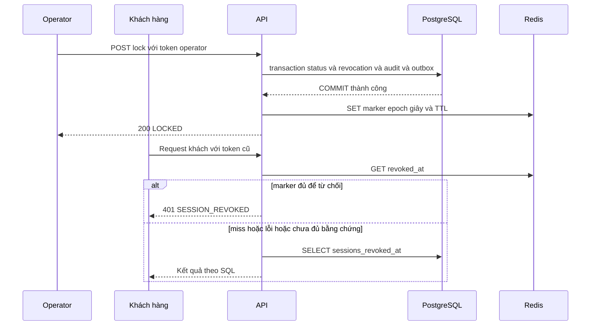
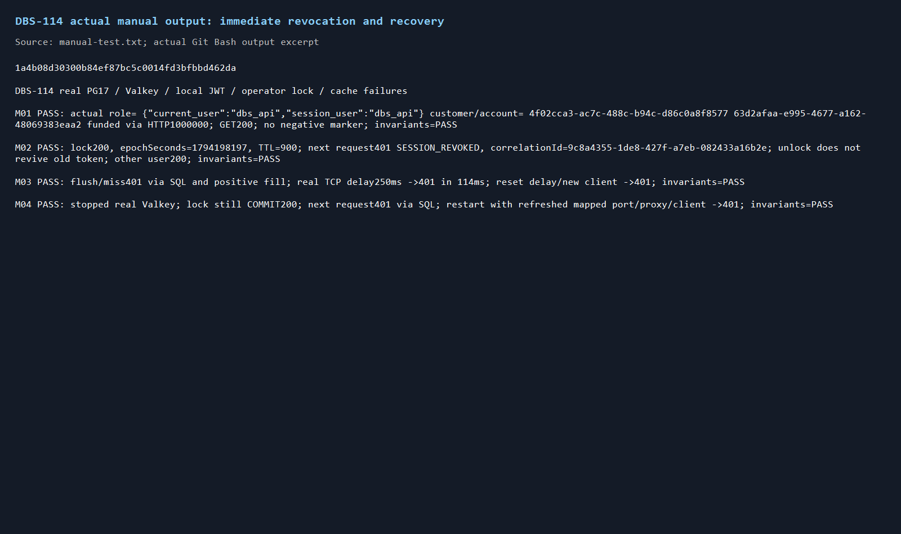
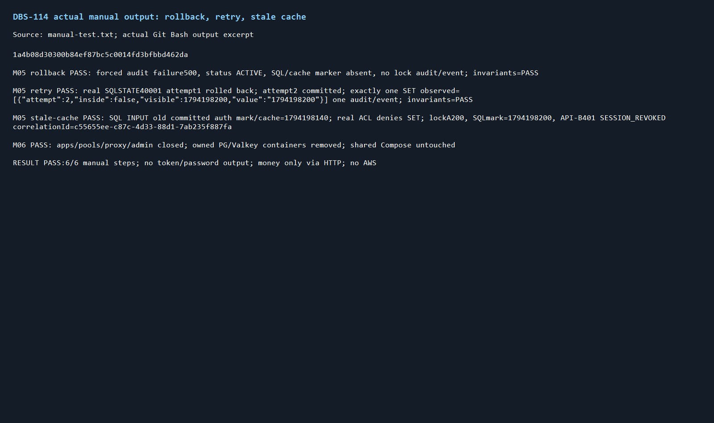
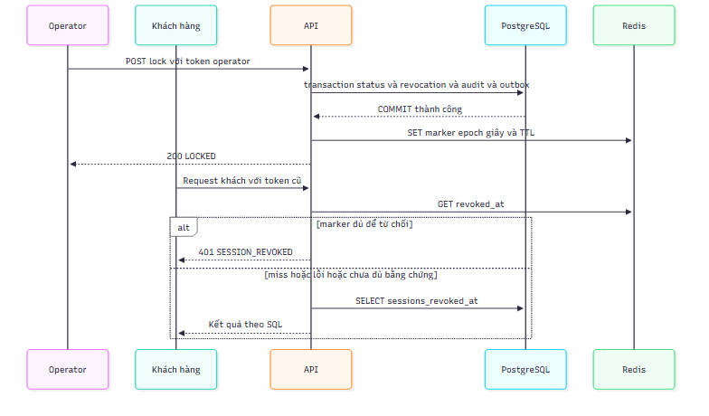
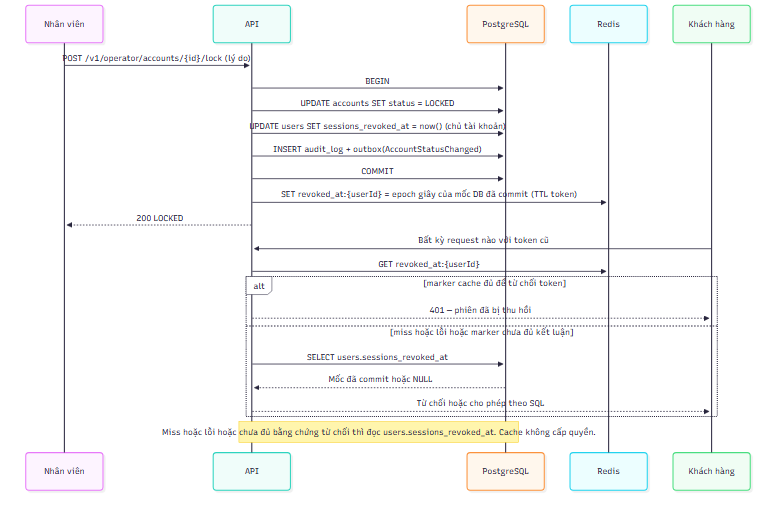

# DBS-114 · Thu hồi phiên qua Redis và PostgreSQL

> **Status:** Implemented · **Vai:** Dev · **Nhánh:** `feat/DBS-114-session-revocation` · **PR:** [tra cứu theo nhánh](https://github.com/Lawliet119/digital-banking-simulator/pulls?q=is%3Apr+head%3Afeat%2FDBS-114-session-revocation) · **Cập nhật:** 2026-11-09

## 1. Bối cảnh

Story Tuần4, Highest, Demo4. Sheet ghi **Done**, nhưng main9520b8b chưa có cache revoked_at; không có commit/nhánh remote mang114 hoặc revok. User yêu cầu hoàn thiện114, phạm vi là phần DoD còn thiếu, không làm lại phần SQL đã có. Agent không tự sửa board.

Expect nguyên văn: «Khóa tài khoản thì chủ tài khoản mất quyền ngay ở request kế tiếp.»

DoD nguyên văn:
1. Guard so iat của token với mốc thu hồi: ưu tiên Redis, miss hoặc Redis lỗi/chậm → đọc users.sessions_revoked_at từ Postgres, kết quả như nhau (test)
2. SET revoked_at:{userId} chỉ sau COMMIT, không trong transaction
3. AC-11.1: khách đang đăng nhập bị từ chối SESSION_REVOKED ở request kế tiếp, không chờ token hết hạn
4. PR đã merge vào main (CI xanh); Dev review; bảng «Đối chiếu test case» trong PR điền đủ

DBS-113/76/50 Done và code có trên main. Fetch-task còn nhận nhầm UC-11 là issue không tìm thấy; đây là use case trong BRD, không phải dependency chưa làm. Nhánh trực tiếp từ main9520b8b, không dựa trên136/122 đang review.

Đã đọc skill/CLAUDE, testing/module notes/manual/task kinds, CONTRIBUTING5/5b; ADR-06/12, docs/03§6.2/9, BRD BR-12/AC-11.1/NFR-SEC-02. Source guard đã đọc SQL và so iat theo giây, từ chối cùng giây; IdentityService.revokeSessions chỉ UPDATE trong transaction; OperatorAccountStatusService chưa có bước cache sau commit, IdentityModule không import Redis. sessions_revoked_at không bị xóa khi unlock.

Baseline main9520b8b: Compose3service chạy; lint/typecheck/build đạt; unit88suites1652/1652(114.791s), e2e15suites153/153(129.967s). Suite account-status PG thật12/12(12.991s) xác nhận khóa tài khoản và SQL guard đã từ chối phiên cũ. Chưa sửa production.

Phạm vi: cache marker bằng libs/redis đã có, guard ưu tiên cache an toàn và fallbackSQL, publish sauCOMMIT của endpoint khóa, test PG+Valkey/proxy thật cho slow/down/flush/rollback/stale cache. Không đổi schema, JWT/JWKS/role, tiền, event, ErrorCode, env hoặc dependency. Không dựng AWS/Cognito mới.

BL-155 nhận phần cache114 và chạy lại test rate-limit hiện có để xác nhận phần DBS-89, chỉ xóa row khi cả hai phần có bằng chứng. BL-169 được nhắc trong feature103 nhưng không còn row ở BACKLOG main; không mở lại phần SQL auditor đã có. Kiểm Redis local trong114, cloud/redrive riêng DBS-186 được ghi bàn giao khi chưa chạy. BL-132 audit deny toàn cục không thuộc114; BL-103/195 RDS role thật/rotation ngoài phạm vi. Các docs cũ nói endpointlock chưa có được đồng bộ với113 đã triển khai.

Câu hỏi thiết kế cần chốt: cache có thể cũ nếu SET sauCOMMIT lỗi hoặc fill cũ về muộn; không được dùng cached marker cũ để cho phép token mới hơn marker mà chưa đọc Postgres. Ưu tiên Redis để từ chối token chắc chắn đã revoked; nhánh chưa đủ bằng chứng phải đọc nguồn SQL. Bảo đảm AC-11.1 cao hơn tối ưu query cho phiên còn hợp lệ.

**G1 qua — agent tự quyết:** hoàn thiện phần Redis còn thiếu dù sheetDone; không sửa trạng thái sheet, đề nghị user đưa vềIn Progress trong lúc làm. Dùng cache chỉ làm bằng chứng từ chối, không negative-cacheNULL hoặc cho phép chỉ từ marker cũ. Giữ format epoch giây và TTL ACCESS_TOKEN_TTL_SECONDS đúng ADR-12. Cache hỏng/chậm/miss hoặc marker chưa đủ kết luận đều đọc SQL. Không thêm dependency/env/schema/ADR, không triển khai DBS-186 cloud. Baseline xanh, dependency/source/scope/backlog đã có bằng chứng.

## 2. Hành vi

Sau JWT/JWKS hợp lệ và resolve userId, guard lấy iat nguyên không âm (claim không phù hợp xử lý an toàn như0), đọc Redis qua libs/redis timeout≤50ms/breaker. `revoked_at:{userId}` là chuỗi epoch giây chuẩn, không NULL/negative cache; TTL=`ACCESS_TOKEN_TTL_SECONDS`(mặc định900). Value sai định dạng/phạm vi là miss, không log key/value/token. iat≤marker thì401SESSION_REVOKED kể cả cùng giây. iat>marker, miss hoặc lỗi đều đọc `users.sessions_revoked_at`; SQL vẫn là nguồn sự thật. SQL lỗi không biến thành401 hoặc cho qua: giữ ProblemDetails503 khi transient. Chỉ bỏ đọc SQL trên đường chắc chắn từ chối; không bỏ SQL để cho phép từ cache có thể cũ.

Khi SQL trả marker khácNULL từ dữ liệu đã commit, có thể điền lại Redis sau câu SELECT/transaction đọc đã kết thúc; NULL không được cache. Cache fill lỗi không thay kết quả kiểm phiên SQL. Marker epoch được kiểm số nguyên dương, không quá253402300799 giây (Date year9999), không nhận JSON/scientific notation/fraction/whitespace. Không sửa marker SQL khi đọc.

Endpoint lock giữ transaction hiện tại: status+revokeSessions+audit+outbox. Callback trả nội bộ `{response,revocation?}` thay vì ghi Redis/giữ biến ngoài callback. `await tx.run` xong mới gọi `IdentityService.publishRevocation(userId,revokedAt)` rồi trả DTO cũ; cache lỗi bị giới hạn50ms và không rollback/giả báo transaction thất bại. Retry chỉ publish outcome của attempt đã commit; rollback không publish. Đã LOCKED hoặc unlock không tạo mốc mới, không xóa mốc/cache cũ để hồi sinh token. Redis ghi nhầm thứ tự có thể làm marker cũ trở lại nhưng **không cho phép token**: nhánh iat>cache luôn kiểm SQL mới nhất.

Publish cache trong `activeTransactionContext` là lỗi lập trình TypeError trước I/O, bảo vệ quy tắc không network trong transaction/retry. Không đổi SQLrevoke clock_timestamp, tiền, event hay audit. BR-12/AC-11.1: request kế tiếp sau khi endpointlock trả200 phải401 ngay dù token còn hạn; unlock không phục hồi token cũ, token ở giây sau marker dùng được các tài khoản ACTIVE.

## 3. Kiến trúc

`SessionRevocationCache` nội bộ identity bọc RedisClient.get/set và authConfig.accessTokenTtlSeconds, không mở driver Redis trực tiếp. `SessionRevocationModule` global, import RedisModule/export cacheprovider, đăng ký trong apiModules cho api/both. Pattern tương tự RateLimitModule global. IdentityModule hiện tại không bị import Redis/config/socket mới trong các fixture SQL-only; IdentityService inject cache optional, thiếu cache vẫn đọcSQL an toàn. Runtime AppModule/role wiring phải có test chứng minh modulecache được nạp; không dùng optional để nhận cache production đã chạy khi chưa chứng minh.

Một globalcacheprovider giúp IdentityService trong AccountsModule và APP_GUARD dùng cùng cache, tránh hai instance IdentityModule static/dynamic có cache khác nhau. Export module qua identity/index.ts; giữ service/cache internal. Thêm option `revocation?:{redisUrl:string}` cho test/support/deposit-app.ts để import đúng production cachemodule và override redisConfig tới proxy local; các fixture cũ không bật option này giữ SQL baseline, không giả guard/service. Helper mới dùng option cache cho **toàn bộ** test114.

IdentityService.sessionsRevokedAt(userId,issuedAt?) ưu tiên marker chắc chắn từ chối; còn lại query committed SQL, fill positive ngoài transaction. IdentityService.publishRevocation chỉ publish marker đã commit, không đổi revokeSessions(manager,userId). Guard truyền iat để quyết định fast reject. OperatorAccountStatusService.changeStatus async nhận outcome cuối của tx rồi publish ngoài context; không biến ngoài retry. Public response/OpenAPI không thêm field.

Callers đã tìm: JwtAuthGuard là caller runtime của sessionsRevokedAt; operator status gọi revokeSessions; direct unit constructor IdentityService chỉ có tx/DataSource nên cacheoptional; support deposit-app/onboarding/roles/local-auth và identity.e2e dùng IdentityModule, không bị ép kết nối Redis trong JWT-only/SQL-only tests. modulesForRole và index tests cần thêm modulecache, không thay API module cũ.

PG17 và Valkey riêng, proxy latency thật, actual LOGIN dbs_api (credential ngẫu nhiên trong container riêng). Fixture startDepositApp JWT/guards/accounts/ledger thật; customer mở account và deposit qua HTTP, không seed tiền bằng SQL. Admin Redis chỉ INPUT lỗi/TTL/ACL trong Valkey riêng; ownerPG chỉ hậu kiểm, auth-state INPUT hoặc trigger lỗi audit, không sửa balance/ledger. Hai APIinstance có JWKS/key riêng: mint token cùngsub bằng issuer tương ứng, không dùng tokenA cho verifierB.

## 4. Test tự động

| ID | DoD/AC | Given–When–Then, lớp |
|---|---|---|
| TC-114-01 |DoD1–3,AC-11.1 |PG+Valkey HTTP thật: warm customer, lock200, marker epoch/TTL900; nextrequest401SESSION_REVOKED/correlationId dù token còn hạn; spy chỉ đếm query thật chứng minh cached reject không SELECT markerSQL |
| TC-114-02 |DoD2 |Giữ row account bằng connectionowner, POSTlock chờLock, GETredisNULL trong lúc transaction chưa commit; thả row, HTTP200 rồi marker đúng SQL visible; observer SET ghi nhận activeContextfalse và SQL đã commit qua connection khác |
| TC-114-03 |DoD2 |Trigger audit failure sau update/revoke: HTTP500, status/mốc/audit/outbox rollback, không marker Redis và không SET; checkerPASS |
| TC-114-04 |DoD1 |Flush key/Valkey, token cũ vẫn401 từ SQL và cache được fill lại; không negativecacheNULL cho user chưa từng revoke |
| TC-114-05 |DoD1 |Proxy thật delay250ms: GET/SETtimeout/breaker; token cũ401 trong ngân sách≤1500ms; reset delay/fresh client chứng minh hồi phục |
| TC-114-06 |DoD1 |Stop Valkey thật: khóa200 vẫn commit và oldtoken401SQL; restart/waitready/newAPIclient truy cậpRedis lại, still401 |
| TC-114-07 |DoD1–3 |2APIinstance/sharedPGRedis: INPUT marker SQL+Redis cũ hợp lệ, warm validtokenB; ACLValkey cấm SET (GET vẫn được), lockAcommit200; B không tin cache cũ, SQL mới nhất→401. RestoreACL finally. Không Redis/DB mock |
| TC-114-08 |DoD1 |Cached timestampinvalid→fallbackSQL401; cacheNULL không sinh marker0; iat trước/bằng/giây sau mốc đúng; unlock không hồi sinh tokencũ |
| TC-114-09 |DoD2 |Unit publish trong activeTransactionContext→TypeError trước SET; SQL read fallback finished before fill; cache read/write failures don't allow session |
| TC-114-10 |Wiring |Unit modulesForRole api/both có globalcachemodule, worker không; integration app dùngproduction module thật+DI TTL lấy authconfig. Không sửa fixture JWT-only thành fake revocation |
| TC-114-11 |DoD2,retry |PG thật: sequence không rollback + trigger audit raise40001 ở attempt đầu sau revoke; attempt sau commit, sequence=2, audit/event chỉ1; SET observer chỉ1lần, activeContextfalse và SQLmarkercommitted đúng attempt cuối. Grant sequenceUSAGE chỉ instrumentation trong cluster fixture riêng, không đổi quyền production |
| TC-114-12 |BR-12,phân tách user |Hai customer HTTP thật cùng API, khóaA→A401;Bvẫn200, cachekeyBkhông sinhNULLmarker, keyAđúngmốcSQL. Bổ sung phase4 để kiểm Redis keykhông lẫn user; không mở rộng API |
| Regression |BL-155 |Rate-limit.services test HTTP10/phút/customer và100/IP hiện có + guard/accountstatus/audit-searchPG cũ; không claim đã chạy trước output |
| Quy trình |DoD4 |CI exactHEAD, Dev review/merge/mapping; chưa nhận trước bằng chứng |

Không mock DB/guard/Identity trong test bảo vệ phiên. Spy chỉ quan sát hoặc gate một lệnh thật, không đổi kết quả SQL. Error public theoSESSION_REVOKED/HTTP503/500 đúngfilter; lỗiRedis quaadapter không lộSQL/URL/token. Kiểm invariants PG thật sau mỗi kịch bản có funds. Case200/401 phải khác vai operator/customer thật. Không endpointmới/ErrorCode/role mới.

## 5. Manual

`node scripts/manual-dbs114.cjs` từbackend quaGitBash; rawdòngđầu sourceSHA. Driver độc lập Jest, dùngHTTP/SQL/Valkey/proxy thật và cleanupfinally, không AWS.

| Bước | Hành động | Quan sát |
|---|---|---|
| M01 |PrivatePG/Valkey,actualAPIrole, customer onboarding/open/deposit;GET trước lock |200, chưa marker,checkerPASS |
| M02 |Operator lock;đọcepoch/TTL/SQLvàtokenrequestngay;unlock rồi thửoldtoken |200lock,401SESSION_REVOKED/correlation,TTL≤900,unlock không revive |
| M03 |Xóa marker/flush,delayproxy250ms,thửtoken cũ;reset delay/client |401SQL cả miss/slow, trongbudget,cache phục hồi |
| M04 |StopValkey;lockuser mới;GET oldtoken;restartValkey/newclient |lockcommit200,dữ liệuSQL đúng,401fallback,recovery401 |
| M05 |Audit trigger rollback; trigger40001attemptđầu rồiretry; haiAPI với stale cache+ACL−SET |rollback không cache, retry chỉ1SETsauattempt2commit;commit khi cacheSETfail vẫn từ chối ởAPIB;restoreACL/trigger/sequence |
| M06 |CloseAPI/pools/proxy/admin/ownedcontainers |Không fixtureleak,Compose giữ nguyên |

Chưa kiểm AWS/Cognito thật/failover ElastiCache/cloudDBS-186; localhost không thay TLScloud hoặc triển khai. Không tắt daemonDocker chung. Mức test networkdùngValkey container riêng stop/start, không ảnh hưởngdịch vụCompose.

## 6. Domain review

Review độc lập gpt-6-astra vòng1:0blocking,1should-fix,0minor, **REVISE**. [Raw vòng1](screenshots/DBS-114/domain-review-r1.md).

| # | Mức | Phát hiện | Xử lý |
|---|---|---|---|
| 1 |should-fix |Thiếu kiểm retry sau khi đã revoke rồi rollback attempt đầu |Đã bổ sung TC-114-11 và M05: sequence+trigger40001 PostgreSQL thật, chỉ1SET sau attempt2commit; chưa sửa production; gửi review lại phần thay đổi |

Review vòng2 gpt-6-astra: finding1 đã xử lý, không còn finding cần sửa. [Raw final](screenshots/DBS-114/domain-review.md). **Verdict: APPROVE**. G2 qua — agent tự quyết giữ thiết kế an toàn đã duyệt và bổ sung testretry thật;0blocking mở,0should-fix mở,0minor. Tại G2 chuyển Design approved.

## 7. Kế hoạch

1. Viết unit cache mới và unitmodulewiring/guardiat trước; đỏ vìmodule/cache chưa có. Viết services testcase01–08 thật trướchelper. Commands unit targeted và `npm run test:db -- --runInBand --runTestsByPath test/db/session-revocation-cache.db-spec.ts`. Không nhận compile missinghelper là bằng chứng bug SQL đã có.
2. Thêm cache/globalmodule, optionalinjectionIdentity, guardiat vàpostcommitoutcomeAccounts; testhelperprivatePG/Valkey/HTTP/proxy. Chạy targetunit/service + DBaccountstatus/auditsearch, rate-limitservices. Source commit xanh `feat(identity): cache committed session revocations (DBS-114)`.
3. Full lint/typecheck/build/unit/e2e/DB, manual6 trên sourceSHA cuối; raw/2ảnh+renderdiagramQA. Khôngnớiassertion/hạguard đểxanh.
4. Docs moduleIdentity/accounts/README, sharedapi-design/database-design cacheformat+docs03§6.2/9thực trạng, featureindex/BACKLOG (BL-155đóngnếuđủproof;BLprocess/cloud mới). G4→pushPR→CIexactHEAD trongPR, khôngmerge/board.

Files: backend/src/modules/identity/session-revocation-cache.ts và spec,session-revocation.module.ts,identity.service.ts,jwt-auth.guard.ts,index.ts,README.md; backend/src/modules/accounts/operator-account-status.service.ts,README.md; backend/src/modules/index.ts,modules.spec.ts; backend/test/support/deposit-app.ts,session-revocation.ts; backend/test/db/session-revocation-cache.db-spec.ts; backend/src/modules/identity/jwt-auth.guard.spec.ts/identity.service.spec.ts nếucaller cần kiểm mới; backend/scripts/manual-dbs114.cjs; backend/README.md; docs/03_HIGH_LEVEL_ARCHITECTURE.md; docs/components/_shared/database-design.md,api-design.md; feature114/index/screenshots; docs/BACKLOG.md. Không đổi libs/redis/ADR/schema/env/dependencies/workflow trong kế hoạch; cần làm khác thì ghi extra gate trước.

Rủi ro: stale cache cho qua token, fillNULL che revocation, SETtrướccommit, mock mất SQL/rollback, modulecache khôngđược runtime nạp, thư việnRedis socketleak. Giảm bằng Redis chỉ reject, fallbackSQLchoadmission, positive-only cache, asyncoutcomeaftertx, activeContextguard, actualrole+PG/Valkey+2API, wiring và finally. Backout revert cache/wiring/postcommit vàgiữPGguardhiệncó,không xóa mốcSQL/khôngmởkhóa hayđổi tiền.

## 8. Quyết định và kết quả

**Gate phụ thiết kế (agent tự quyết, trước sửa):** chọn cache chỉ đủđể từchối thay vìcho phép chỉ từcachehit, vì staleRedis+SETfail cóthểbỏquathu hồi mới; đánhđổiphiên hợp lệ vẫn đọcSQL, khônghứa loại mọiSQLread. Đây là cụthểhóa PGnguồnsựthật/AC-11.1, khôngđảoquyếtđịnhADR-06/12; giữepochgiây/TTL900 và khôngcachedữliệugốc. Docs03P-1được ghiđúnggiới hạn. Globalcachemodule chỉHTTP (nhưRateLimitModule), Identityserviceoptionalcache đểfixturesSQL vàworker khôngmởsocketRedis mới; integration/wiringphải chứng minh productionAPIcache thực sự được nạp. Không thêmgói,env,ErrorCode,publicpayload hay schema.

Đã implement trong source commit `1a4b08d30300b84ef87bc5c0014fd3bfbbd462da`; chưa push trước G4. Không đổi code sau manual.

Kiểm TDD: unit cache/module ban đầu đỏ TS2307/2305 vì chưa có API, DB đỏ missinghelper0case chạy, không nhận là lỗiSQL. Bổ sung testiat lỗi trước khi giữ phiên bản guard phòng vệ: Infinity/NaN/1000.5/quáMAXSAFE từng cho qua mốc thu hồi (4failure),iat−1 không chuẩn hóa0(1failure); sau đó đưa guard về rule iat nguyên không âm đã thiết kế. Đây là test đơn vị claims đã được verifier chuyển vào, không nhận Cognito thực tế đã phát token lỗi.

Chẩn đoán fixture recovery: run đầu5case đạt,4case chưa đạt do admin không kết nối lại sau stop/start Valkey. Đã tái hiện Docker Desktop đổi cổng mapped32815→32816 trên cùng container. Sửa fixture đọc lại docker port và dựng proxy/admin mới; giữ test stop/start thật, không rerun mù hoặc skip. Hai APIfixture mint token với cùng sub **và iat** của phiên cũ bằng JWKS riêng, không nhầm token đăng nhập mới sau lock với token cũ.

**Gate phụ tên suite (agent tự quyết, trước đổi file):** kiểm git index phát hiện session-revocation.db-spec.ts đã là suite PostgreSQL cũ từ commit65, trùng tên với suite Redis mới. Chọn giữ nguyên toàn bộ suite cũ và tách phần mới sang session-revocation-cache.db-spec.ts, thay vì thay thế coverage cũ hoặc ghép hai fixture trong một file. Copy nội dung test mới trước khi restore đúng HEAD của file cũ (working tree đầu task sạch, không có thay đổi user ở file này). Cập nhật file/command trong §7, chạy cả suite cũ lẫn mới ở fullDB; không bỏ case nào của baseline.

**G3 qua — agent tự quyết:** đã sweep DoD/AC/ADR/BL và caller, mọi bullet cóTC hoặc bàn giao. Chọn đặt suite PG+Valkey mới trong test/db để CI test:db tự khám phá, như suite money-flow đã dùng Valkey; CI services hiện chạy từng file explicit nên tên services mới sẽ không tự chạy. Không sửa workflow hoặc requiredcheck. Lệnh proving: unit cache/guard/module; test:db session-revocation + operator-account-status + audit-searchHTTP; test:services rate-limit hiện có; fullbaseline/unit/e2e/DB; manual GitBash trên sourceSHA cuối. Commit source xanh, sauđó docs/evidence; rủi ro/backout ở§7. Không câu hỏi chưa giải quyết.

### Kết quả thực thi cuối

Lint, typecheck, build đều exit0. Full unit **89 suites, 1678/1678** (125.687s); full e2e **15 suites, 153/153** (138.435s); full DB **53 suites, 812/812** (744.98s). Không skip/only/todo trong test mới. Đã đọc toàn bộ output; WARN/ERROR trong các case fault injection là dự kiến, tất cả suite pass. Target mới 10/10 DB (21.807s); suite mới cùng SQL cũ 15/15 (27.396s); rate-limit services 9/9 (28.709s), đủ đóng BL-155. Bằng chứng lệnh và tổng kết: [verification.txt](screenshots/DBS-114/verification.txt).

| TC | Test chứng minh | Độ sâu |
|---|---|---|
| 01–08,11,12 | `backend/test/db/session-revocation-cache.db-spec.ts`, 10 case có ID tương ứng | Đạt: PG17, Valkey, HTTP, actual dbs_api; proxy/down/ACL/rollback/retry thật |
| 09 | `session-revocation-cache.spec.ts`: transaction context, read/write errors; DB02–04 bổ trợ committed read/fill | Đạt |
| 10 | `modules.spec.ts` role wiring và toàn bộ DB mới import production SessionRevocationModule | Đạt |
| Regression | Full unit/e2e/DB, SQL revocation cũ giữ nguyên 5 test; rate-limit services 9/9 | Đạt |
| DoD4 quy trình | PR/CI exact head sau push; Dev review và merge do nhóm thực hiện | Chưa hoàn tất trước G4, BL-206 |

Manual `node scripts/manual-dbs114.cjs` qua Git Bash trên SHA trên: **6/6 đạt**, output thật tại [manual-test.txt](screenshots/DBS-114/manual-test.txt). M01 actual current_user/session_user=dbs_api; onboarding/open/deposit 1000000 qua HTTP, GET200, không negative cache. M02 lock200, marker epoch giây, TTL900, request tiếp401 SESSION_REVOKED có correlationId, unlock không hồi sinh token; user khác vẫn200. M03 flush/miss401 qua SQL, proxy delay250ms vẫn401 trong **114ms**, phục hồi client thành công. M04 stop Valkey thật: lock vẫn commit200, token cũ401, restart đọc lại mapped port rồi client mới phục hồi. M05 lỗi audit500 rollback cả SQL/cache/audit/event; retry SQLSTATE40001 chỉ SET một lần sau attempt2 commit (outside transaction, SQL visible); hai API với stale cache và ACL cấm SET vẫn từ chối401. M06 đóng app/pool/proxy/admin/container riêng, không động Compose chung. Invariant checker đạt sau các bước có tiền. SQL INPUT chỉ auth-state cũ hoặc trigger lỗi, không seed money.

Ảnh lấy từ output thật, không dựng lại giao diện; đã xem đủ bốn ảnh để kiểm chữ và luồng:

Phạm vi diff so origin/main khớp §7; giữ nguyên suite SQL cũ. Không dependency/env/schema/ADR/workflow thay đổi. Gate phụ và lỗi fixture đã ghi phía trên; không giảm assertion để xanh. Lint từng báo async không await ở fixture Docker, đã sửa dùng execFile promisified, rồi chạy lại toàn bộ baseline xanh.

Bàn giao: **BL-206** cho Dev review, CI exact head và merge; **BL-207** cho Platform/Dev kiểm chứng AWS/Cognito/ElastiCache/ECS/RDS, TLS/failover (DBS-186). **Chưa chạy cloud** vì đây là phạm vi local, không có triển khai cloud trong task; local JWT/JWKS thật không thay thế Cognito thật. Không tự merge hoặc đổi sheet. Giới hạn được chấp nhận: phiên có thể hợp lệ vẫn đọc SQL; cache chỉ giúp từ chối nhanh token đã revoked để stale cache không làm mất an toàn.

## 9. Tài liệu

Đồng bộ README backend, Identity, Accounts; docs/03 §6.2 và bảng Redis; shared database-design và api-design (whole-second comparison, publish sau commit, SQL fallback); feature index và feature này. BACKLOG xóa **BL-155** sau đủ cả cache và rate-limit proof, thêm **BL-206/207** cho quy trình và cloud chưa chạy. Domain review hai vòng, manual raw, verification và bốn PNG ở screenshots/DBS-114.

## Checklist G4

- [x] 12/12 nhóm TC đạt đúng độ sâu; 0 đơn giản hóa; DoD4 quy trình bàn giao BL-206.
- [x] Manual 6/6 trên source SHA1a4b08d, đường thành công đã chạy, cloud chưa chạy và lý do ghi rõ.
- [x] Đủ bốn PNG và manual-test.txt; không token, Authorization, AWS account ID hoặc ARN trong bằng chứng.
- [x] Diff so main khớp §7; gate phụ tên suite và lựa chọn cache an toàn ghi §8.
- [x] Lint/typecheck/build, unit1678, e2e153, DB812 và services9 đều đạt.
- [x] Docs fact đã đồng bộ; check-doc-links sạch322 file; status Plan approved tại tự kiểm, đổi Implemented sau G4.
- [x] Bàn giao/DoD chưa đạt có BL-206/207; backlog đã giải quyết BL-155 đã xóa.

**G4 qua — agent tự quyết:** bằng chứng local và domain review đủ, không có câu hỏi chưa giải quyết. Mở PR sau commit docs; kiểm CI exact head và ghi kết quả thật trong PR. Review/merge thuộc Dev khác, trạng thái sheet do user cập nhật.
