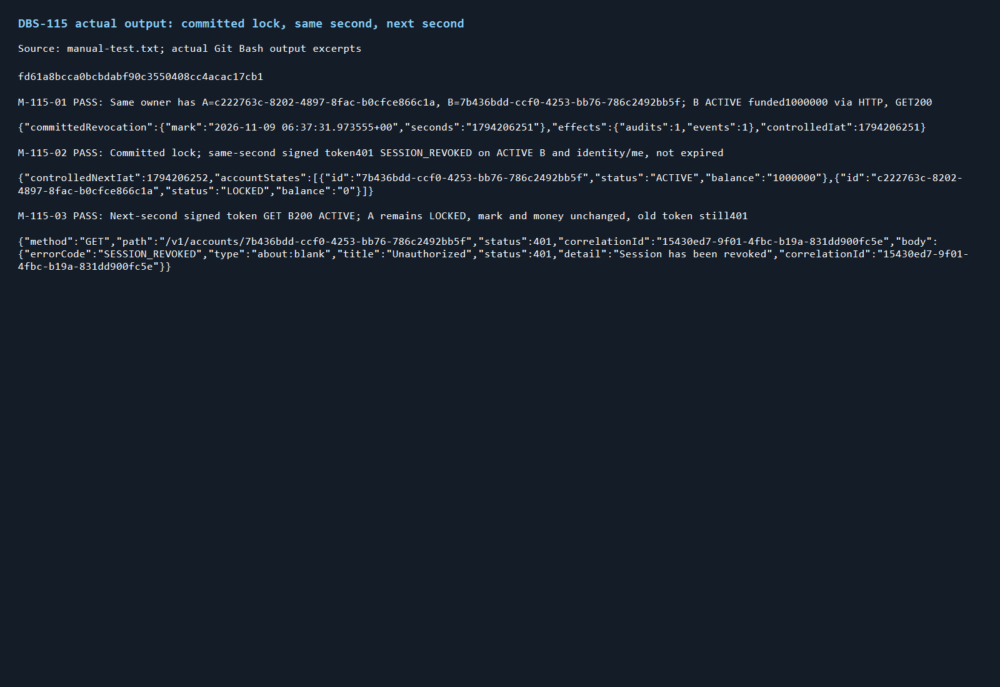
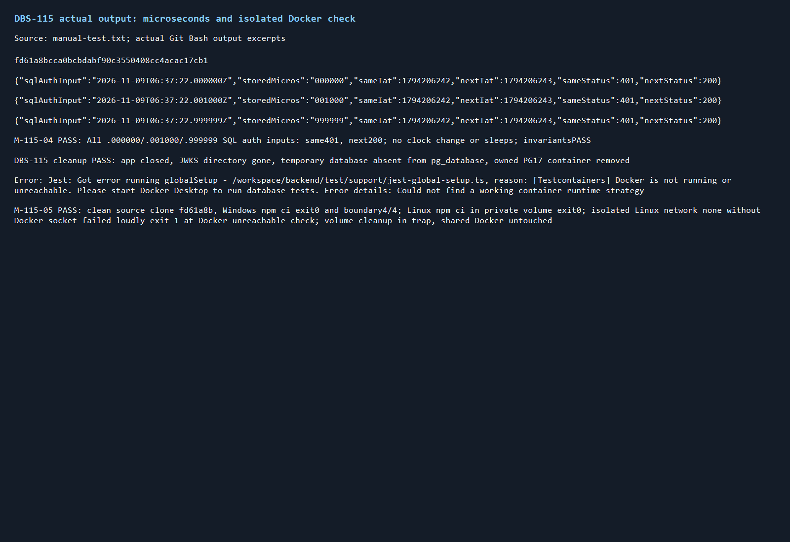

# DBS-115 · Token cùng giây với mốc thu hồi

> **Status:** Implemented · **Vai:** Dev · **Nhánh:** `test/DBS-115-same-second-revocation` · **PR:** [tra cứu theo nhánh](https://github.com/Lawliet119/digital-banking-simulator/pulls?q=is%3Apr+head%3Atest%2FDBS-115-same-second-revocation) · **Cập nhật:** 2026-11-09

## 1. Bối cảnh

Task Tuần4, High, Demo4; sheet ghi **Done**, source chưa có feature doc hoặc commit DBS-115. Expect nguyên văn: «Không có khe hở trong cùng một giây.»

DoD nguyên văn:

1. Test: token có iat bằng đúng giây của sessions_revoked_at bị từ chối SESSION_REVOKED
2. Token phát hành ở giây kế tiếp được chấp nhận (khi tài khoản khác còn ACTIVE)
3. Ghi quy tắc so sánh (≤ hay <) vào 02-architecture của identity
4. PR đã merge vào main (CI xanh); Dev review; bảng «Đối chiếu test case» trong PR điền đủ

Ghi chú board nguyên văn: «[Cập nhật 11/10] Không còn file 02-architecture, 03-feature, 04-test-cases, 05-backlog theo component. Test case ghi trong PR (bảng Đối chiếu DoD/AC); thiết kế, công thức, quy tắc ghi vào docs/03 hoặc docs/components/_shared.»

Phụ thuộc DBS-114: sheet Done; main9520b8b có SQL revocation/guard và endpoint lock từ DBS-113, cache Redis bổ sung ở PR #116 chưa merge. Phạm vi thu hẹp của115 kiểm công thức chung trên đường SQL đã có thật, không dựa interface cache mới, không giả lập dependency. Nhánh trực tiếp origin/main9520b8b. Redis miss/down/stale, cache wiring và cloud được bàn giao114/186, không tuyên bố đã kiểm ở115.

Đã chạy code: `test/db/session-revocation.db-spec.ts` và `operator-account-status.db-spec.ts` đạt17/17 (24.359s). Guard đã dùng `iat <= Math.floor(revokedAt.getTime()/1000)`; unit có cùng giây/giây sau và DBS-113 có HTTP lock/401. Còn thiếu bài Focus riêng chứng minh cùng một chủ có tài khoản khác ACTIVE, ma trận phần lẻ giây và sensitivity khi phép so sánh bị đổi sai. Không có bug runtime đã tái hiện, không sửa production để tạo thay đổi hình thức.

Baseline: lint/typecheck/build exit0; unit88suites1652/1652(120.792s), e2e15suites153/153(140.884s), 0 skipped. Đã đọc toàn bộ output, các WARN fault injection dự kiến, mọi lệnh exit0. Docker ban đầu chưa chạy, đã khởi động Docker Desktop và Compose3service, không bỏ qua test. Đã đọc SKILL/CLAUDE, references testing/manual/module-notes/task-kinds/team/docs-style, CONTRIBUTING§5/5b, ADR06/12, docs03§6.2/12, BRD BR-12/AC-11.1/NFR-SEC-02, schema users và event AccountStatusChanged, threat modelT2, feature113.

BL-155 phần Redis do114/PR116 giải quyết, không xóa trong115; BL-132 audit DENIED403 và kiểm chứng đồng hồ/Cognito/Redis trên cloud (DBS-186) ngoài phạm vi. Không đổi schema/env/dependency/ADR/ErrorCode, guard production, JWT verification hoặc luật tiền.

**Quyết định ở G1 (agent tự quyết):** phạm vi là test Focus và công thức SQL dùng chung đã hoạt động trên main; không cần stack114 hoặc thay production khi chưa có bug. Dependency Redis chưa merge được nêu rõ, không nhận coverage cache từ SQL-only fixture. SheetDone không thay thế evidence; user đưa115 về In Progress khi bổ sung, agent không sửa board. Baseline xanh, phạm vi thu hẹp có ích và đủ cho hai biên của115. G1 qua.

## 2. Hành vi

Đặt `R = floor(epoch_seconds(users.sessions_revoked_at))`, cùng một nguồn PostgreSQL; `iat` là số nguyên giây trong JWT đã xác minh. Có mốc thì **từ chối khi `iat <= R`**, chấp nhận về mặt phiên khi `iat > R`. Không dùng `<`, không ceil/round, không trộn đơn vị ms với giây. MốcNULL giữ hành vi hiện có. Chấp nhận phiên không bỏ qua role, ownership hoặc trạng thái account trong luồng tiền.

Ví dụ mốc `2026-11-09T06:00:00.999999Z`: iat1794204000 bị401 SESSION_REVOKED; iat1794204001 qua guard. Test tính số từ DB, không hardcode ví dụ này. Cùng chủ có accountA LOCKED và accountB ACTIVE: token cùng giây gọi GET accountB vẫn401; token giây sau nhận200 với đúng idB/statusACTIVE/balance chuỗi. Không tuyên bố GET accountA phải403/422: đọc accountLOCKED vẫn được theo API hiện có; chuyển tiền phải kiểm ACTIVE trong ledger, không mở rộng task này.

Error401 phải có errorCode SESSION_REVOKED, status401, correlationId trùng header; không token/SQL/khóa riêng trong output. Thành công đọc account không lộ thông tin gian lận. Thời gian token đầu vào được ký bằng dev issuer thật/JWKS thật; iat có thể được điều khiển tới R+1 để kiểm biên mà không ngủ hay sửa đồng hồ máy. Đây không phải bằng chứng Cognito thật đã cấp token ở tương lai. Cùng giây được kiểm cả đầu giây `.000000`, `.001000` và cuối giây `.999999` (phần microsecond SQL giữ nguyên, pgDate chỉ có ms).

## 3. Kiến trúc

Không đổi production. API role dùng nguyên `startDepositApp(databaseUrl)` với IdentityModule, JwtAuthGuard, RolesGuard, AccountsModule, audit/outbox thật và cấu hình JWKS riêng. Temp database migrate thật từ helpers hiện có; globalSetup tự tạo PG17 khi không có DATABASE_URL. Không mock guard/service/DB. Không thay symbolexport hoặc caller production.

File test mới `backend/test/db/session-revocation-boundary.db-spec.ts`; không sửa hai suite cũ của114/113. Khách onboarding và mở hai account qua HTTP; operator POSTlockA thực hiện transaction SQL status/revocation/audit/outbox. Test đọc mốc đã commit bằng SELECT, mintJWT đúngsub với iatR/R+1 và dùng GET accountB. Các hàng kiểm phần lẻ giây chỉ UPDATE **auth INPUT** `users.sessions_revoked_at` trong DB riêng, ghi rõ seedSQL; không sửa money/accountbalance/ledger/audit/outbox. Mỗi case kiểm invariants. Mốcfraction dùng databaseclock trừ10giây để inputtoken không hết hạn/không phụ thuộc timing, không chỉnh giờ máy hoặc timezone.

Manual driver mới `backend/scripts/manual-dbs115.cjs` dùng ledger-manual-harness có thật: seedSQL user/customer/account0 được ghi rõ, tiền nếu có chỉ nạp qua depositHTTP; tạo accountB qua HTTP. Driver dùng fetch thật, SQL hậu kiểm, không Jest. Cleanup kiểm app/JWKS/DB/container thật như harness, không dừng Docker chung.

Luồng: HTTP lockA → transaction status/revoke/audit/outbox → COMMIT → SELECT mốc → JWT R → GET B401; JWT R+1 → GET B200. Không thêm Mermaid vì dùng nguyên luồng đã mô tả ở docs03§6.2, không có thành phần hoặc ranh giới mới.

Để chứng minh bài kiểm bắt đúng lỗi, **mutation tạm trong working tree riêng, sau baseline và G3**, không commit: lưu chính xác bytesguard, thay duy nhất `issuedAt <= Math.floor` thành `<`; chạy chỉ suite mới, phải đỏ401expected/200actual. Restore bytes trong finally, xác minh guard không có diff. Tương tự floor→ceil phải làm tokenR+1 bị401 ở phần lẻ >0. Không chạy test khác song song lúc mutation; nếu không đúng mẫu guard thì fail trước sửa. Production guard cuối giữ nguyên main.

## 4. Test cases tự động

| ID | DoD/AC | Lớp | Given–When–Then | Mã lỗi |
|---|---|---|---|---|
| TC-115-01 | DoD1/2, AC-11.1,BR-12 | HTTP/JWT/PG thật | Cùng khách có A/B ACTIVE, operator lockA200 và SQL có audit/event; đọcR. JWTR gọiGETB401, JWTR+1 gọiGETB200 với idB/statusACTIVE; A cònLOCKED, mốc không đổi; checkerPASS | SESSION_REVOKED |
| TC-115-02a/b/c | DoD1/2, microsecond | HTTP/JWT/PG thật | SQL INPUT authmarker ở `.000000`, `.001000`, `.999999` trong DBriêng, cùng khách có BACTIVE; mỗi hàng JWTR401 và JWTR+1 GETB200; phần lẻ SQL được xác nhận bằng to_char; checkerPASS | SESSION_REVOKED |
| TC-115-03 | Độ nhạy DoD1 | Mutation tạm + HTTP/PG | Đổi duy nhất ≤thành<: suite mới phải đỏ tại cùng giây; restoreexactbytes, chạy xanh | Cần401, mutant trả200 |
| TC-115-04 | Độ nhạy DoD2 | Mutation tạm + HTTP/PG | Đổi floor→ceil: hàngfraction>0 phải đỏ tại giây kế tiếp; restoreexactbytes, chạy xanh | Cần200, mutant trả401 |
| TC-115-05 | DoD3 | Docs/code | Công thức nguồn docs03§6.2 và sharedAPI khớp guard; check-doc-links sạch, không dựng lại02-architecture đã bỏ | Không áp dụng |
| TC-115-06 | Harness | Cleanclone/negative environment | Clone sạch codecommit, npmci, suite mới thật xanh; chuẩn bị npmciLinux vào volume dependencies riêng rồi chạy Node/Jest trong container Linux `--network none`, mount sourceclone và dependencies read-only, **không mount Docker socket/named pipe**, khôngDATABASE_URL và DOCKER_HOST=tcp://127.0.0.1:1; phải exit khác0 và lỗi từ assertDockerAvailable, khôngskip/falsegreen; daemon chung không bị tắt, volume riêng cleanupfinally | Docker not running or unreachable |
| Quy trình | DoD4 | CI/Dev | CIheadcuối6/6, Devreview/merge vàmapping trongPR; chưa nhận trước evidence | Không áp dụng |

Security: role/ownership dùng controller/service thật (TC01/02 đọc B cùngowner); lỗi cóerrorCode/correlationId và khônglộfraud/token (TC01/02); SQL parameterized cho sub/id/mốc, không thêm inputAPI; idempotency khôngápdụng cho GET/authmarker, không đổi producer; audit/outbox của lock kiểm nguyên transaction hiện có (TC01). TLS/cloud không đổi, chưa chạy, bàn giao186; không đổi threatmodel thành Đã kiểm toàn bộT2 vì cache/cloud cònngoài115.

## 5. Test thủ công

| Bước | Thao tác | Kết quả mong đợi |
|---|---|---|
| M-115-01 | `node scripts/manual-dbs115.cjs` quaGitBash, realPG17/app/JWKS; khách Nguyễn Minh Anh mởB quaHTTP cùngowner vớiA, nạp1triệu vàoB quaoperatorHTTP, GETB trướclock | BACTIVE/balance1000000; invariantPASS |
| M-115-02 | Operator POSTlockA, SELECT mốc/audit/outbox; minttokenR GETB vàidentity/me | lock200, cả2GET401 SESSION_REVOKED/correlationId, token còn hạn |
| M-115-03 | MinttokenR+1 GETB; SQLkiểmA/B/mốc/sốdư | GET200idB/ACTIVE, ALOCKED, khôngxóa mốc hoặc đổi tiền; invariantPASS |
| M-115-04 | SQL INPUT authmarker lầnlượt `.000000`/`.001000`/`.999999`; tokenR401, tokenR+1 GETB200 | Đủ3phầnlẻ, rawgiátrịSQL/iat/status/mãlỗi, khôngsleep; invariantPASS |
| M-115-05 | Từclone sạch sourcecommit chạy npmci và suite mới. Chuẩn bị `docker run --rm --mount type=bind,source=<clone>,target=/workspace,readonly --mount type=volume,source=<volume-riêng>,target=/workspace/backend/node_modules --workdir /workspace/backend node:24-bookworm-slim npm ci`. Negative dùng thêm `--network none --env NODE_ENV=test --env DOCKER_HOST=tcp://127.0.0.1:1`, giữ hai mount nhưng dependencies `readonly`, chạy `npm run test:db -- --runInBand --runTestsByPath test/db/session-revocation-boundary.db-spec.ts` (khôngsocketmount/khôngDATABASE_URL). `docker volume rm <volume-riêng>` trongfinally | Clean4/4; negativeDocker exit≠0 và đúng thông báo Docker not running or unreachable, không skip; nếu lỗi runtime khác thì chưa chứng minh, phải điều tra; khôngtắtDockerchung |
| Cleanup | Harness đóngapp/pool/JWKS/database/container sởhữu | Hậukiểm khôngrò fixture |

Chưa chạy Cognito/AWS/Redis114, không cần bí mật AWS. Dòng đầu manual-test.txt là sourceSHA; node driver output thật nối thêm kết quảcleanclone/negativeDocker từ GitBash. M-115-05 là kiểm harness, không thay đường thành công HTTP.

## 6. Domain review

Vòng1 review độc lập gpt-6-astra:0blocking,1should-fix,0minor, Verdict REVISE. [Raw vòng1](screenshots/DBS-115/domain-review-r1.md). Finding: DOCKER_HOST giả trên Windows không bảo đảm Docker unreachable vì Testcontainers fallback named pipe. Đã đọc source strategy và sửa TC06/M05 sang container Linux networknone, không mount socket/namedpipe, chỉ sourceclone read-only; assert rõ đúng lỗiDocker, không nhận lỗi runtime khác là đạt.

Vòng2 cùng reviewer kiểm lại phần thay đổi: **Verdict: APPROVE**, không còn finding mở. [Raw final](screenshots/DBS-115/domain-review.md). Quyết định ở G2 (agent tự quyết): giữ phạm vi SQL và công thức hiện có, thực hiện negativeDocker trong môi trường cô lập thực sự, không tắtdaemonchung. CácDoD cóTC/manual, phù hợpADR06/12/CONTRIBUTING. G2 qua.

Review bổ sung sau khi chuẩn bị dependency Linux ở volume riêng (gate phụ §8): cùng reviewer gpt-6-astra kiểm lại TC06/M05 và thực thi, **Verdict: APPROVE**,0finding mở. Raw final vẫn đúng nguyên văn bảng rỗng và APPROVE đã lưu.

## 7. Kế hoạch triển khai

| Bước | Files | Test trước / chứng minh | Commit |
|---|---|---|---|
| 1 | `backend/test/db/session-revocation-boundary.db-spec.ts` | Viết TC01/02a–c trước; runtime đã đúng nên green đầu là characterization, không bịa bug/red. Chạy `npm run test:db -- --runInBand --runTestsByPath test/db/session-revocation-boundary.db-spec.ts`. Sau đó mutation `<`/ceil phải đỏ đúng nguyên nhân và restore bytes; không commit mutant | `test(identity): verify same-second revocation boundaries (DBS-115)` |
| 2 | `backend/scripts/manual-dbs115.cjs` | Driver độc lập Jest, M01–04+cleanup, nguồn sharedmanualharness có sẵn; lint/typecheck/build/target và guard cũ phải xanh trước commit; manual trên SHA sau commit | Cùng commit test xanh |
| 3 | Không đổi helper/config/workflow/package | Final lint/typecheck/build/unit/e2e/DB; clone sạch từ sourceSHA, npmci, suite mới4/4; Dockerisolatednegative đúng error, raw GitBash. Không chạy mutation cùng baseline. Khôngseedtiền SQL | Không commit runtime artifacts/clone/node_modules |
| 4 | `docs/03_HIGH_LEVEL_ARCHITECTURE.md`§6.2; `docs/components/_shared/api-design.md` SESSION_REVOKED; `docs/security/threat-model.md`T2; feature/index/BACKLOG/screenshots | Ghi công thức≤floor, ví dụ/ý nghĩa tài khoảnkhácACTIVE, T2 chỉ xác nhậnSQLboundary; checklinks, raw/PNG từoutputthật. Không sửa READMEIdentity để tránh xung đột fact cache trong114, link nguồn docs03 đã có | `docs(identity): record DBS-115 boundary evidence and handoff` |

Rủi ro: so sánh khác đơn vị hoặc mất phần lẻ, test dương do tokenexpiry, mutation sót, seedtiền, Dockerstrategyfallback, đánh đồng token mới với unlock. Chặn bằng SQLfloor/to_char6digit, exp900/iatđiềukhiển, restorefinally+gitdiffguard, HTTPfunding/checker, isolatedDocker, SQLhậukiểmA/B. Backout chỉ revert test/manual/docs của115; production guard chưađổi, khôngxóamốcSQL hoặc đổi trạng tháitài khoản.

Quyết định ở G3 (agent tự quyết): sweep DoD/AC/ADR/limitations xong, mỗi bullet cóTC hoặc bàn giao. Suite mới được CI test:db tựkhámphá; không sửa requiredchecks, không chạm suite cũ/114. Fileguard chỉ mutationthử nghiệm và restorebyteexact, không thay production cuối. ReservePR #117 (review và merge 2026-11-09; dòng BL-208 cũ đã xóa) (review/merge/CI) vàBL-222 (cache/Cognito/cloudboundary chưa chạy); BL202–207 đã dànhcho cácPR trước, không dùngtrùng. G3 qua.

## 8. Kết quả

Characterization suite mới4/4 xanh trên main (7.506s), đúng dự kiến task chỉ tăng kiểm chứng, không tái hiện bug runtime. Đã chạy TC03 mutant `<`: exit1, **4failed/0passed**, mỗi case401expected nhưng200actual. TC04 mutantceil: exit1, **3failed/1passed**, các mốc có phần lẻ tokenR+1 cần200 nhưng401; đầu giây `.000000` vẫnpass. Đã restore bytes guard trongfinally sau mỗi mutant; `git diff --exit-code` guard sạch. Khôngskip/pending trong mutation, không nhận mutation là code đã triển khai. Green lại cùng17test cũ21/21 (13.698s), lint/typecheck/build exit0; commit source fd61a8b.

**Gate phụ môi trường M05 (agent tự quyết, trước sửa cách chạy):** clone Windows sạch đãnpmci vàsuite4/4 (13.139s). Lần chạy Linux cô lập chỉmount node_modules Windows báo `Module ts-jest ... not found`, chưa tớiDockercheck nên **không đạt** negativeDocker. Không sửa production/Jest hay nhận lỗi runtime này là PASS. Chọn chuẩn bị dependency Linux bằng `npm ci` trong một volume Docker riêng, mount cùng clone read-only; sau đó gắn volume dependencies read-only vào run `--network none` khôngsocket, kiểm đúng thông báo assertDockerAvailable. Đây là sửa môi trường OS đúng loại, không đổi package/lock/dependency hoặc test. Containerprep/run đều `--rm`; volume riêng phải remove trongfinally. Ghi lệnh bổ sung ở§5; không tắtDockerchung. Lần gọi shell ban đầu vướng quote PowerShell, parsefail trước thực thi; chuyển sang filebash tạm UTF8 ngoài repo, không coi là test ứng dụng.

### Kiểm chứng bàn giao

Unit cuối **88 suites1652/1652(152.075s)**, e2e **15 suites153/153(156.225s)**; lint/typecheck/build exit0 ở green step trước sourcecommit, source không đổi sau đó. Full DB **53 suites806/806(848.752s), exit0**. [Lệnh và bằng chứng tổng kết](screenshots/DBS-115/verification.txt). Mọi output đã có đều được đọc; các WARN do fault injection trong suite cũ là dự kiến. Khôngskip/only/todo trong test mới.

| ID | Bằng chứng | Kết quả |
|---|---|---|
| TC-115-01 | session-revocation-boundary.db-spec.ts case01 và M02/03, realHTTP/JWT/PG | Đạt |
| TC-115-02a/b/c | it.each000000/001000/999999 và M04, SQL xác nhận6digit | Đạt3/3 |
| TC-115-03 | Mutant `<`,4failed tại401expected/200actual, guard restorebyteexact | Đạt độ nhạy |
| TC-115-04 | Mutantceil,3failed tại200expected/401actual, `.000000` vẫnpass, guard restorebyteexact | Đạt độ nhạy |
| TC-115-05 | Công thức docs03/sharedAPI, threatmodelT2 đúng phạm vi; linkcheck322file0broken | Đạt |
| TC-115-06 | Clone fd61a8b sạch, npmci,4/4; Linuxdeps riêng + networknone/noDocker socket, exit1 tại assertDockerAvailable | Đạt |
| DoD4 quy trình | Chờ CIexactHEAD/Devreview/merge sauG4 | PR #117 (review và merge 2026-11-09; dòng BL-208 cũ đã xóa) |

Manual trên **`fd61a8bcca0bcbdabf90c3550408cc4acac17cb1`**, chưa thay code sau manual: [raw manual-test.txt](screenshots/DBS-115/manual-test.txt). **M01–05 và cleanup đạt6/6**, không đơn giản hóa:

- M01: SQLINPUT user/customer/A0 theo sharedharness, B mởHTTP; deposit1000000HTTP201; GETB200/ACTIVE/balancechuỗi1000000, invariantPASS.
- M02: POSTlockA200, mốc SQL`2026-11-09 06:37:31.973555+00`,R1794206251; audit/event mỗi1. Token iatR còn hạn gọiGETB/identityme đều401 SESSION_REVOKED, CID B`15430ed7-9f01-4fbc-b19a-831dd900fc5e` trùngheader/body.
- M03: tokeniat1794206252 GETB200/ACTIVE/balance1000000, ALOCKED/balance0, mốcSQLgiữnguyên, oldtokenvẫn401; invariantPASS.
- M04: **seedSQL auth INPUT** `2026-11-09T06:37:22.000000Z`, `.001000Z`, `.999999Z`; SQLto_charUS khớp từnggiátrị,iat1794206242 bị401,iat1794206243 nhận200/BACTIVE; khôngđổi đồnghồ hayseedtiền; invariantPASS.
- M05: gitclone local khônghardlink đúngsourceSHA, statusclean,npmciWindows exit0,suite4/4(13.139s). Linuxnpmci riêng958packages exit0; isolatedJestexit1 đúng lỗi **Docker is not running or unreachable**, khôngvào testcase/khôngskip. LỗiWindowsdeps-on-Linux banđầu lưu trongraw và đã giải thích, không tính là PASS. Containerprep/run tựxóa, hậukiểm volume riêng khôngcòn; Compose3service cònchạy.
- Cleanup: app đóng,JWKS mất,tempDB khôngcòn trongpg_database, ownedPG17container đãremoved. Clone ngoài repo khôngcommit.

Hai ảnh trích từ output thật, đã xem bằng view_image để kiểm chữ, không dựng lại response:

Diff cuối chỉ hai file test/manual mới và docs đã nêu§7; guard, helper, dependency, schema, workflow giữ nguyên main. Khônggiảm assertion đểxanh. Bàn giao **PR #117 (review và merge 2026-11-09; dòng BL-208 cũ đã xóa)** cho Devreview/CIexactHEAD/merge; **BL-222** cho Dev114/186 vàPlatform kiểmcachehit/miss/fallback vàCognito thật/clockcloud. **Chưa chạy Redis114 hoặcAWS/Cognito thật**, do sourcecache chưamerge vàtask115 chỉ kiểmSQLcomparison; controlled signediat khôngthay issuanceCognito. Agent không sửa board hoặcmerge.

## 9. Tài liệu đã cập nhật

Đã ghi công thức chuẩn ở docs03§6.2, đồng bộ mô tả SESSION_REVOKED trong sharedapi-design, threatmodelT2 chỉ ghi phần SQL/boundary đã kiểm. Featureindex thêm115. BACKLOG thêm PR #117 (review và merge 2026-11-09; dòng BL-208 cũ đã xóa) quy trình review/merge/CI và BL-222 cache/Cognito/cloudboundary chưa chạy; giữ nguyên BL-155, không nhận đã đóng cache từ testSQL. Không dựng lại02-architecture đã bỏ; không đổiADR hoặc thêm Mermaid.

## Checklist G4

- [x] 8/8 nhómTC đạt đủ độ sâu (TC02a/b/c tính3),0 đơn giản hóa; DoD4 quy trình ghiPR #117 (review và merge 2026-11-09; dòng BL-208 cũ đã xóa).
- [x] ManualM01–05+cleanup6/6 trên sourceSHAfd61a8b ở dòng đầu raw; đường thành công thật đã chạy. Chưa chạy Redis114/Cognito/cloud, lý do vàBL-222 ghi rõ.
- [x] Hai PNG đủ và đã xem; manual-test.txt không JWT/Authorization/AWS accountID/ARN. NegativeDocker đúng lỗi, không nhận runtimefailure trước đó làPASS.
- [x] Diff origin/main khớp§7; chỉtest/manual vàdocs; guard/helper/schema/env/package/workflow khôngđổi. Gate phụ Linuxdeps đã ghi trước thay đổi môi trường.
- [x] Lint/typecheck/build exit0; unit1652, e2e153, DB806; target4/4 và regression21/21; cleanclone4/4.
- [x] Docs fact đã đồng bộ, checklinks322file0broken; statusPlanapproved tại tựkiểm, chuyểnImplemented sauG4.
- [x] Mọi giới hạn/DoD chưa hoàn tất cóBL-222; khôngxóa BL-155 do115 khônghoànthiệncache.

**Quyết định ở G4 (agent tự quyết):** tất cả điều kiện bàn giao local đã cóoutput/file thực tế và domainreview APPROVE; không có câu hỏi mở. G4 qua. Commitdocs, push và mởPR sau đây; CI chỉ ghi xanh khi đủ6check đúnghead. Khôngmerge và khôngđổi sheet; user đưaInReview, Devkhácreview/merge.
