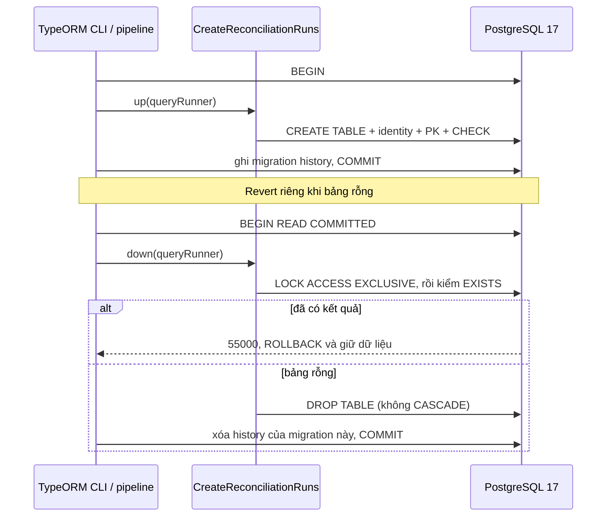
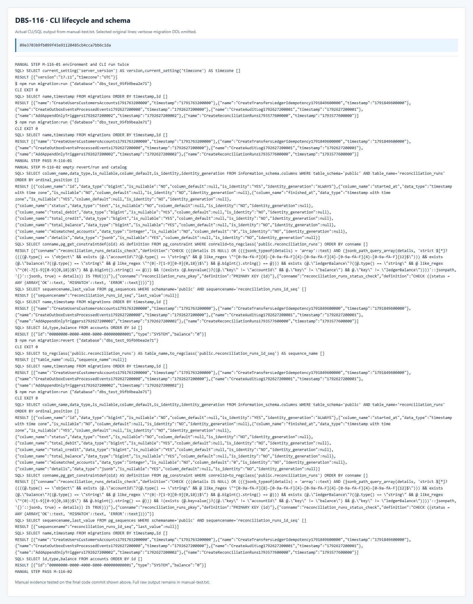
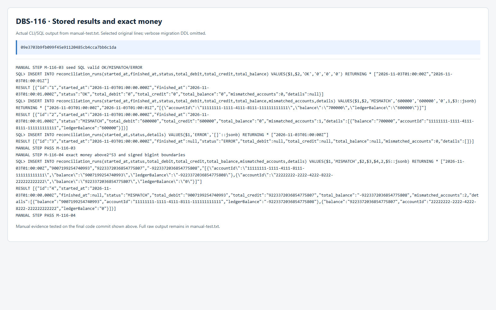
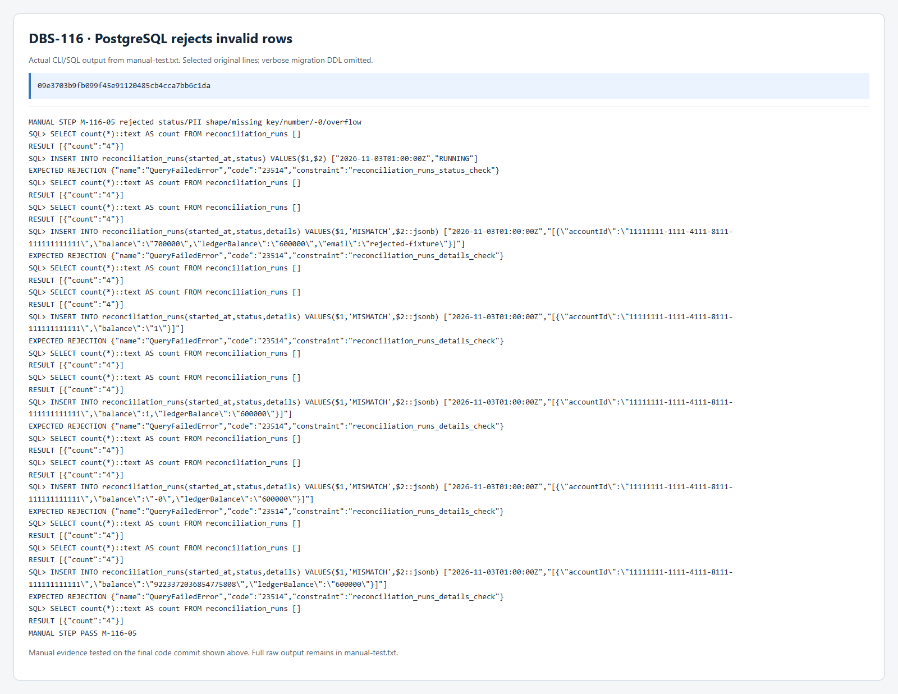
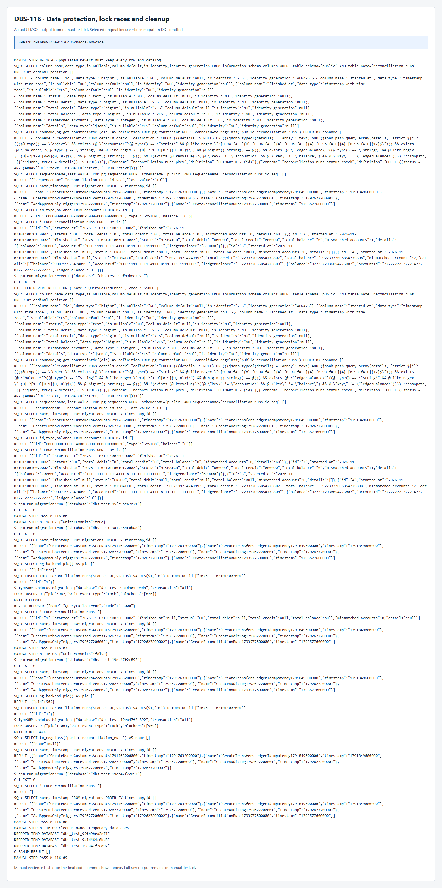

# DBS-116 · Migration `reconciliation_runs`

> **Status:** Implemented (G4 đã duyệt; Draft PR chờ Dev review/merge) · **Vai:** Dev · **Cặp đôi review:** chưa chỉ định · **Nhánh:** `codex/DBS-116-reconciliation-runs` · **PR:** [#53](https://github.com/Lawliet119/digital-banking-simulator/pull/53) · **Cập nhật:** 2026-11-03

## 1. Bối cảnh

### Task trên board

Đọc trực tiếp bằng Google Drive/Sheets ngày 2026-11-02: [Tuần 4, hàng A19:K19](https://docs.google.com/spreadsheets/d/18IHrZShDoZDc6bgnsi__ATyd99aeJxe4x4TWQ5WTz_w/edit?gid=1395280002&range=A19:K19). Đây là dữ liệu nguồn hiện tại; bảng không bị chỉnh sửa trong đợt khảo sát.

| Trường | Giá trị |
|---|---|
| Issue Key | DBS-116 |
| Loại / tuần | Task / Tuần 4 |
| Assignee (vai) / ưu tiên | Dev / High |
| Status trên board | In Progress (đọc lại bằng fetch-task.mjs ngày 2026-11-03; agent không sửa board) |
| Deliverable / Demo | Demo1 |
| Phụ thuộc | DBS-21 — Done trên board; migration và DB tests đã có trong base |

**Expect (nguyên văn):** Kết quả đối soát có chỗ lưu để tra lại.

**DoD (nguyên văn, đánh số các gạch đầu dòng):**

1. reconciliation_runs: started_at, finished_at, status OK|MISMATCH|ERROR, total_debit, total_credit, total_balance, mismatched_accounts, details jsonb
2. details chỉ chứa id và hai con số, không dữ liệu cá nhân; migration revert được
3. PR đã merge vào main (CI xanh); Dev review; bảng «Đối chiếu test case» trong PR điền đủ

### Thực trạng khi chốt G1 và phụ thuộc thực tế

- Tại G1, worktree riêng được tạo từ `origin/main` sau fresh fetch ngày 2026-11-02, base `991c13fbab2f22db47bae8ab581fb4c694806c38`. Không có thay đổi của người dùng bị ghi đè; khi đó chưa commit, push, tạo PR hoặc sửa board. Trạng thái bàn giao hiện tại ở §8.
- **DBS-21 có implementation thật:** [migration](../../backend/src/database/migrations/1791849600000-CreateTransfersLedgerIdempotency.ts), [DB schema tests](../../backend/test/db/ledger-schema.db-spec.ts), [revert tests](../../backend/test/db/migration-revert.db-spec.ts) và [feature doc](DBS-21-migration-transfers-ledger-idempotency.md). Migration tạo `transfers`, `ledger_entries`, `idempotency_keys` và `v_transfer_facts`. Đây là bằng chứng source; kết quả chạy baseline ghi riêng bên dưới.
- Schema mục tiêu đã chốt trong [database-design §4.9](../components/_shared/database-design.md): khóa `id` bigint identity; `started_at` bắt buộc; `finished_at` cho phép NULL; trạng thái text với CHECK `OK`, `MISMATCH`, `ERROR`; ba tổng tiền bigint cho phép NULL; `mismatched_accounts` int bắt buộc mặc định 0; `details` jsonb. Các tổng và số dư phải giữ chính xác, không đổi thành JavaScript `number`.
- Tìm trong migration, module ledger, tests và tài liệu hiện hành chưa có migration hoặc bảng `reconciliation_runs` được triển khai. [Ledger README](../../backend/src/modules/ledger/README.md) xác nhận checker chỉ đọc theo yêu cầu, chưa có scheduler hoặc persistence kết quả. Chưa coi việc đọc source là đã kiểm schema của database đang chạy; probe runtime sẽ bổ sung khi PostgreSQL sẵn sàng.
- [DBS-69](DBS-69-ledger-invariants.md) đã cung cấp [checker](../../backend/test/support/invariants.ts) và [SQL bất biến](../../backend/test/support/invariants.sql), nhưng không ghi kết quả đối soát. Không sửa checker để hoàn thành riêng task migration này.
- [Migration datasource](../../backend/src/database/data-source.ts) tự nạp migration qua glob; [database tạm](../../backend/test/support/temp-database.ts) và [PostgreSQL Testcontainers](../../backend/test/support/postgres.container.ts) đã có. Không cần thêm production dependency, entity/service export hoặc API mới.
- Mẫu `down` bảo vệ dữ liệu đã có ở [migration audit](../../backend/src/database/migrations/1792627200001-CreateAuditLog.ts): từ chối ngoài transaction hoặc isolation không phù hợp, khóa bảng trước khi kiểm rỗng. [database-design §11](../components/_shared/database-design.md#11-migration-và-dữ-liệu-khởi-tạo) yêu cầu `down` có DROP phải từ chối nếu bảng đã có dữ liệu.

Nguồn quy tắc: [docs/02](../02_REQUIREMENTS_AND_DOMAIN_MODEL.md) AC-5.9, NFR-COR-02; [docs/03](../03_HIGH_LEVEL_ARCHITECTURE.md) §8.2; [database-design](../components/_shared/database-design.md) §4.9, §6, §8, §10–12; [ADR-02](../adr/0002-postgresql-ledger.md); [module notes](../../.claude/skills/dbs-delivering-task/references/module-notes.md), [task kinds](../../.claude/skills/dbs-delivering-task/references/task-kinds.md), [testing](../../.claude/skills/dbs-delivering-task/references/testing.md), [manual testing](../../.claude/skills/dbs-delivering-task/references/manual-testing.md).

### Baseline và xác minh runtime

Lịch sử baseline ngày 2026-11-02: bốn worktree cùng base commit, chưa thay đổi production code. Agent điều phối chạy trên worktree DBS-103 cùng base `991c13f`, sau `npm ci --no-audit --no-fund` thành công (941 packages, không đổi lockfile). Bản `node_modules` ở checkout main ban đầu thiếu `redis` và `@aws-sdk/client-sqs`, khiến lint/typecheck/unit không đạt (47 suites, 751 tests đạt nhưng 3 suites không nạp được); không nhận lần chạy đó là baseline xanh. Bảng dưới ghi lần chạy trên worktree đã cài sạch.

| Kiểm tra | Kết quả |
|---|---|
| `docker compose up -d` | Thành công; Docker 29.5.2, PostgreSQL 17, Valkey 8 và ElasticMQ hoạt động |
| `npm run lint:check` | Đạt, exit 0 |
| `npm run typecheck` | Đạt, exit 0 |
| `npm test -- --runInBand` | Đạt: 50 suites, 770 tests, 0 skipped |
| `npm run test:e2e -- --runInBand` | Tiến trình dừng với exit `-1073740791` (`0xC0000409`) trước tổng kết suites; chưa xác định nguyên nhân, không kết luận suite đạt |
| `npm run test:db -- --runInBand` | Tiến trình dừng với exit `-1073740791` (`0xC0000409`) trước tổng kết; PostgreSQL Testcontainers đã khởi động và được dọn sau khi tiến trình kết thúc. Không có kết quả suite để nhận đạt. |
| Probe schema runtime | Chưa chạy; chỉ dùng database tạm, không thay đổi database phát triển |

**DBS-116 đủ dependency để triển khai độc lập, nhưng baseline chưa xanh do tiến trình e2e bị dừng. Chưa được xây trên baseline đỏ:** cần xác minh/khắc phục lỗi chạy e2e và có kết quả baseline phù hợp trước production code; đây là điều kiện môi trường/verification, không biến DBS-116 thành task phụ thuộc API khác.

**Kiểm tra lại ngày 2026-11-03 trên worktree DBS-116:** cài dependency bằng cùng lockfile (941 packages), fetch xác nhận main vẫn `991c13f`; Docker được khởi động lại và PostgreSQL17.11/UTC đã kiểm qua kết nối pg thật. Gọi npm bằng `node.exe .../npm-cli.js` giữ npm lifecycle thay vì gọi Jest trực tiếp. Lượt app-guard đầu khi Docker chưa sẵn trả ECONNREFUSED/exit1; đây là lỗi điều kiện chạy, không là kết quả suite đạt. Sau khi PostgreSQL sẵn: full E2E **13 suites: 12 đạt, 1 không đạt; 135 tests: 134 đạt, 1 không đạt, 0 skip**. Ca không đạt `dev-auth-bootstrap.e2e-spec.ts` › `control: the deployed environment alone passes validation` bị `spawnSync ETIMEDOUT` ở deadline25s. Chạy lại riêng file đó vẫn **3 đạt/1 không đạt** cùng nguyên nhân. Full DB suite trên PostgreSQL Testcontainers **16 suites / 325 tests đạt, 0 skip**, exit0 sau258.706s; có MaxListenersExceededWarning của harness, không bỏ test hoặc thay giới hạn để che cảnh báo. Container/database tạm đã được dọn. Chưa tái hiện exit0xC0000409 ở lượt này; không suy ra đã sửa nguyên nhân cũ. Chưa sửa test nền hoặc tăng timeout để nhận xanh.

Probe nhỏ, không đổi app/tests/env files: `dns.lookup('db.internal')` trả EAI_AGAIN sau11060ms; pg.Client với SSL bật và connectionTimeoutMillis5000 đến cùng fixture mất5009ms rồi timeout, còn127.0.0.1:1 trả ECONNREFUSED sau5ms. DatabaseModule giữ5 attempts/delay2000ms/timeout5000ms; nếu mỗi attempt timeout, riêng kết nối cần khoảng33s, vượt parent25s. Đây là căn cứ đề xuất chỉnh fixture test tại §2.4; chưa thay file hoặc nhận baseline đã đạt.

### Phạm vi đề xuất

| Hạng mục | Phạm vi DBS-116 |
|---|---|
| Lưu kết quả | Tạo đúng bảng `reconciliation_runs` và các cột của schema đã chốt |
| Tính đúng dữ liệu | Ràng buộc schema, trạng thái và yêu cầu `details` chỉ có ID cùng hai con số; cách biểu diễn/kiểm JSON cụ thể trình ở G2 |
| Revert | Run → revert → run khi bảng rỗng; từ chối phá dữ liệu nếu đã có kết quả; kiểm cả khi có ghi đồng thời |
| Kiểm thử | DB tests trên PostgreSQL thật; manual bằng CLI migration, kiểm schema và chèn hàng hợp lệ/sai trong database tạm |
| Dữ liệu manual | Hàng `reconciliation_runs` là đầu vào trực tiếp của đối tượng đang kiểm; ghi rõ seed SQL. Không cần tạo/sửa số dư hoặc bút toán |
| Tài liệu | Feature doc, cập nhật fact về migration trong tài liệu DB/module và evidence tại Phase 5 |

### Ngoài phạm vi, rủi ro và backlog liên quan

- Không triển khai `notification_log`, job đối soát/scheduler, thuật toán phát hiện lệch, metrics/alarm hoặc API xem kết quả. Job và việc ghi kết quả thuộc DBS-117; việc có bảng không chứng minh job đã chạy đúng.
- Không cấp role/grant production, sửa Terraform hay xác nhận quyền AWS/RDS. DBS-119 nhận ma trận quyền và sequence của bảng mới; task migration này không nhận hoàn thành phần đó.
- Không tự thêm index theo truy vấn chưa tồn tại: database-design §6.1 chưa chỉ định index cho bảng này. Task job/cleanup bổ sung theo truy vấn thật khi cần.
- Không áp `forbid_mutation` mặc định: thiết kế giữ kết quả 90 ngày rồi job worker dọn, khác bảng ledger/audit giữ vĩnh viễn. Ma trận quyền hiện ghi worker INSERT nhưng chưa DELETE trong khi vòng đời cần cleanup; làm rõ ở DBS-119/job cleanup, không mở rộng task116 thành task phân quyền.
- Tổng `SUM(bigint)` của checker hiện dùng numeric để không tràn, còn cột tổng của schema đối soát là bigint. Giữ schema đã chốt trong116; cách job xử lý tổng vượt miền và ghi `ERROR` cần DBS-117 quyết định, không đổi quy tắc tiền ở task này.
- [BACKLOG](../BACKLOG.md): BL-002, BL-003, BL-004, BL-007 và BL-122 thuộc luồng nạp/chuyển tiền; BL-006 thuộc đủ cặp bút toán/`balance_after`; BL-008 là lint tiền; BL-015 là flake thời gian ở test migration cũ. Đều ngoài phạm vi, không xóa nhờ thêm bảng mới.
- BL-005, BL-017, BL-019, BL-103 và BL-107 liên quan quyền/role hoặc dịch vụ audit; BL-110 là các giới hạn pipeline migration; BL-127 là tích hợp checker vào money test/load/worker. DBS-116 không đóng các gap đó; chỉ bàn giao schema mới để các task tiếp dùng.
- DoD #3 là quy trình Dev review, GitHub CI và merge. Chưa thực hiện; không tự commit/push/PR/merge hay sửa status sheet. Phần còn thiếu sẽ được truy vết vào backlog khi bàn giao nếu vẫn chưa đạt.

### Câu hỏi mở / đề xuất ở G1

1. **Đề xuất duyệt phạm vi migration và kiểm thử đầy đủ như trên**, tách job DBS-117, quyền DBS-119 và cleanup khỏi116. Thực hiện cả đường thành công, hàng sai bị DB từ chối và revert bảo vệ dữ liệu trên PostgreSQL thật; không miễn manual.
2. **Đề xuất diễn giải DoD `details` là một hợp đồng dữ liệu cần được bảo vệ khi ghi**, thay vì chỉ ghi chú cho producer. Cấu trúc JSON, biểu diễn số chính xác và các ràng buộc cụ thể được trình để duyệt ở G2; không tự thay schema ở bước khảo sát.
3. Board đã được người quản lý chuyển **In Progress**, xác minh qua fetch-task ngày 2026-11-03; agent không chỉnh sheet.

**Quyết định ở G1 (2026-11-02):** sau khi nhận đề xuất phạm vi và các task còn chờ dependency, người dùng trả lời «thế thực hiện DBS-116». Chấp thuận tiếp tục riêng DBS-116 theo phạm vi trên; ba task còn lại chưa triển khai. Đây là duyệt G1, chưa duyệt G2/G3, chưa cấp quyền commit, push, PR hoặc sửa board. Baseline còn đỏ vẫn phải được giải quyết trước production code.

## 2. Hành vi

### 2.1 Hợp đồng lưu trữ

Không có API hoặc scheduler mới. Migration thêm đúng 9 cột trong database-design §4.9, không đổi bảng khác, không seed kết quả mẫu vào database ứng dụng.

| Cột | Hợp đồng |
|---|---|
| `id` | bigint `GENERATED ALWAYS AS IDENTITY`, PK `reconciliation_runs_pkey`; caller bỏ cột này khi INSERT; driver trả string |
| `started_at` | timestamptz NOT NULL, không có DEFAULT; caller cung cấp thời điểm bắt đầu |
| `finished_at` | timestamptz, cho phép SQL NULL |
| `status` | text NOT NULL, không DEFAULT; chỉ `OK`, `MISMATCH`, `ERROR`; CHECK `reconciliation_runs_status_check` |
| `total_debit`, `total_credit`, `total_balance` | bigint nullable; miền `[-9223372036854775808, 9223372036854775807]`; 0 và số âm giữ đúng schema nguồn, không thêm CHECK dương |
| `mismatched_accounts` | int NOT NULL DEFAULT 0; giữ nguyên schema nguồn, không thêm quan hệ với độ dài details |
| `details` | jsonb nullable; CHECK `reconciliation_runs_details_check` bảo vệ cấu trúc §2.2 |

Không thêm trạng thái `RUNNING`, tự tính tổng, ép `OK` phải có tổng bằng nhau, ép thứ tự hai timestamp, hoặc ép `mismatched_accounts` bằng số phần tử. Đây là kết quả do DBS-117 tính; bảng chỉ giữ hợp đồng kiểu/giá trị đã chốt. SQL NULL có nghĩa chưa có thông tin, khác JSON `null`. Cả `ERROR` với các tổng/details NULL và bản ghi đã xong có đủ số liệu đều được lưu.

Ví dụ INSERT hợp lệ (seed SQL chỉ trong database tạm):

```sql
INSERT INTO reconciliation_runs
  (started_at, finished_at, status, total_debit, total_credit,
   total_balance, mismatched_accounts, details)
VALUES
  ('2026-11-02T08:00:00Z', '2026-11-02T08:00:01Z', 'MISMATCH',
   600000, 600000, 0, 1,
   '[{"accountId":"11111111-1111-4111-8111-111111111111",
      "balance":"700000","ledgerBalance":"600000"}]'::jsonb)
RETURNING id, status, total_balance, details;
```

Không tạo customer/account/ledger fixture cho ví dụ này: accountId trong kết quả là snapshot ID, không có FK hoặc truy vấn sang bảng accounts. Tính tồn tại/chính xác của kết quả được kiểm ở DBS-117.

### 2.2 `details`: ID và hai con số, không có ô văn bản tự do

Chấp nhận SQL NULL hoặc mảng JSON, kể cả `[]`. Mỗi phần tử là object đóng, **đúng ba khóa bắt buộc** `accountId`, `balance`, `ledgerBalance`; không cho khóa thừa kể cả giá trị NULL, object/mảng lồng, hoặc phần tử scalar. UUID dùng dạng 8-4-4-4-12 ký tự hex, chấp nhận chữ hoa/thường. Hai số là **chuỗi thập phân nguyên chuẩn** trong miền signed bigint: `0` hoặc dấu trừ tùy chọn cùng chữ số đầu 1–9; không khoảng trắng, dấu `+`, `-0`, số 0 đầu, số thập phân hoặc dạng mũ. JSON number bị từ chối để producer JavaScript không âm thầm làm tròn trước khi gửi.

Ví dụ `"9007199254740993"`, `"9223372036854775807"`, `"-9223372036854775808"` được giữ chính xác; `"9223372036854775808"` hoặc `"-9223372036854775809"` bị từ chối. Không ép hai số phải khác nhau hoặc ID không lặp; DoD chỉ quy định dữ liệu được lưu, không giao migration tính kết quả. Các khóa `name`, `email`, `accountNumber`, `error`, `stack` bị từ chối; không nhét thông báo lỗi của job vào details. Hợp đồng chỉ chặn loại/khóa dữ liệu ngoài allowlist, không xác minh UUID thực sự thuộc tài khoản nào.

**Đề xuất CHECK trực tiếp bằng JSONPath của PostgreSQL 17**, không thêm SQL function, trigger hoặc thư viện. Lọc các phần tử hợp lệ rồi so lại với toàn mảng; chỉ chấp nhận khi kết quả là TRUE:

```sql
CHECK (details IS NULL OR ((
  jsonb_typeof(details) = 'array'
  AND jsonb_path_query_array(details, 'strict $[*] ? (
    @.type() == "object"
    && exists (@.accountId ? (
      @.type() == "string"
      && @ like_regex "^[0-9a-fA-F]{8}-[0-9a-fA-F]{4}-[0-9a-fA-F]{4}-[0-9a-fA-F]{4}-[0-9a-fA-F]{12}$"))
    && exists (@.balance ? (
      @.type() == "string" && @ like_regex "^(0|-?[1-9][0-9]{0,18})$"
      && @.bigint().string() == @))
    && exists (@.ledgerBalance ? (
      @.type() == "string" && @ like_regex "^(0|-?[1-9][0-9]{0,18})$"
      && @.bigint().string() == @))
    && !exists (@.keyvalue() ? (
      @.key != "accountId" && @.key != "balance" && @.key != "ledgerBalance"))
  )'::jsonpath, '{}'::jsonb, true) = details
) IS TRUE))
```

`strict` tránh tự bung mảng lồng. `bigint()` kiểm miền nguyên 64 bit; so chuỗi sau chuyển đổi giữ biểu diễn chuẩn, không qua `double`/JavaScript number. `silent=true` làm lỗi JSONPath/conversion thành kết quả không đạt; `IS TRUE` chặn trường hợp SQL NULL vô tình vượt CHECK. JSONB đã chuẩn hóa thứ tự khóa và khóa trùng khi parse; constraint bảo vệ giá trị **được lưu**, không phục hồi khóa trùng đã bị JSONB loại. Cơ sở kỹ thuật: [PostgreSQL 17 JSONPath methods và error suppression](https://www.postgresql.org/docs/17/functions-json.html). Đã thử biểu thức bằng SELECT read-only trên PG17 trong giai đoạn thiết kế: 12 mẫu chấp nhận/từ chối đúng kỳ vọng; đây không thay test migration sau G3.

### 2.3 Lỗi và revert

| Điều kiện | Kết quả |
|---|---|
| status ngoài allowlist | SQLSTATE `23514`, constraint `reconciliation_runs_status_check` |
| details sai bất kỳ yêu cầu §2.2, kể cả JSON null | `23514`, constraint `reconciliation_runs_details_check`; INSERT/UPDATE không lưu hàng sai |
| NULL ở started_at/status/mismatched_accounts | `23502` cùng tên cột |
| PK trùng qua `OVERRIDING SYSTEM VALUE` | `23505`, constraint `reconciliation_runs_pkey` |
| Tự gán id khi không OVERRIDING | `428C9` từ identity ALWAYS |
| Tổng tiền vượt bigint / count vượt int | `22003`; chuỗi không phải số nguyên như `'1.5'` gửi vào bigint → `22P02` |
| down ngoài transaction hoặc không READ COMMITTED | từ chối `55000`, trước DDL |
| down thấy bất kỳ hàng nào sau khi khóa bảng | từ chối `55000`, giữ bảng, dữ liệu, sequence và migration history |
| down trên bảng rỗng trong transaction READ COMMITTED | DROP đúng bảng mới và identity sequence phụ thuộc; migration cũ và dữ liệu bảng khác giữ nguyên; up tiếp theo thành công |

Không có HTTP/ErrorCode mới. DDL lỗi không được bắt rồi bỏ qua. Không dùng `IF NOT EXISTS` để che schema trùng/sai; nếu tên bảng đã tồn tại, up lỗi `42P07` và rollback, lịch sử migration không ghi thành công.

### 2.4 Đề xuất bổ sung để khôi phục baseline test

Trình G2 nhận một thay đổi test-only trong [dev-auth-bootstrap.e2e-spec.ts](../../backend/test/dev-auth-bootstrap.e2e-spec.ts): đổi duy nhất `deployed.DATABASE_URL` từ hostname DNS giả `db.internal:5432` sang fixture từ chối kết nối nhanh `127.0.0.1:1`. Giữ TLS bật, toàn bộ input deployed khác, retry production và deadline25s. Cùng file đã dùng127.0.0.1:1 cho TC-53-12b. Control vẫn chạy entrypoint thật và phải đi qua validate cấu hình trước khi thất bại ở kết nối DB; không bỏ assertion, không bỏ test và không tắt auth/TLS.

Đây là điều chỉnh fixture cho lỗi baseline đã tái hiện, không phải thay hành vi ứng dụng hoặc nới deadline. Chưa được duyệt ở G1; chỉ triển khai nếu người dùng chấp thuận bổ sung này ở G2 và nó nằm trong kế hoạch G3. Sau sửa cần chạy control/file đầy đủ và full E2E; không dùng probe ngắn thay kết quả suite. Không có workflow sản phẩm mới cần manual riêng; manual migration §5 và regression driver27 vẫn giữ đầy đủ.

## 3. Kiến trúc

- **Vị trí:** migration `backend/src/database/migrations/1793577600000-CreateReconciliationRuns.ts`, class/name `CreateReconciliationRuns1793577600000`; sở hữu bảng của ledger. Đây là DDL pipeline/CLI, không thêm provider hay chạy job trong role api/worker.
- **Interface mới:** `up(queryRunner: QueryRunner): Promise<void>` và `down(queryRunner: QueryRunner): Promise<void>` theo `MigrationInterface`, giống migration hiện có. Không đổi exported symbol/caller. `createMigrationDataSource(url: string | undefined): DataSource` nạp class mới qua glob; caller hiện có gồm CLI datasource mặc định, DB tests/support và manual migration drivers. Không sửa factory/harness.
- **Dữ liệu:** duy nhất bảng `public.reconciliation_runs`, identity sequence, PK và hai CHECK nêu ở §2. Không FK, trigger, function, index ngoài PK, grant, seed hoặc bảng phụ. Không sửa `notification_log`/accounts/ledger/audit. So với schema nguồn, thêm tên constraint tường minh và CHECK details để thực thi DoD; giữ nguyên 9 cột, kiểu, nullability và DEFAULT.
- **Transaction:** `up` chạy dưới transaction của TypeORM (`all` như cấu hình hiện có); DDL lỗi rollback toàn bộ lần migration. `down` bắt buộc QueryRunner có transaction, kiểm isolation READ COMMITTED; `LOCK TABLE public.reconciliation_runs IN ACCESS EXCLUSIVE MODE`; ở câu lệnh kế tiếp kiểm `EXISTS`; nếu có hàng thì RAISE `55000`, nếu rỗng mới DROP. Không CASCADE. INSERT đang chờ/đang commit không thể bị mất do snapshot cũ hoặc khoảng hở kiểm-rồi-drop. Không dùng TransactionService, Redis/HTTP/SQS hoặc retry riêng.
- **Lựa chọn:** SQL function riêng dễ viết loop nhưng thêm object phải version/revert và bề mặt quyền không cần thiết. JSONPath đã có trên PG17 và thực hiện được hợp đồng bằng một named CHECK; chọn cách trực tiếp. Mức giới hạn bigint theo schema nguồn; thay numeric hoặc cách job ghi ERROR khi tổng vượt miền là việc DBS-117, chưa đổi ở116.
- **Tài liệu nguồn cần cập nhật sau triển khai:** database-design header/§4.9 (hợp đồng details và constraint thực tế)/§11 (tên migration), ledger README (schema đã có nhưng job vẫn chưa có), backend README phần migration, feature index. Không đổi ADR, event contract, env var, ErrorCode hoặc quy tắc chuyển tiền.

**Tương thích các caller migration hiện có:** nhận trong scope hai file [append-only.db-spec.ts](../../backend/test/db/append-only.db-spec.ts) và [append-only.manual.ts](../../backend/test/manual/append-only.manual.ts). Cả hai đang coi migration27 là bản cuối; thêm116 vào glob sẽ làm revert một lần nhắm sai migration. Fixture dành riêng27 dùng `migrateThrough(url, 'AddAppendOnlyTriggers1792627200002')` hiện có. Các bước dùng CLI thật chạy latest rồi đọc history; hoàn tác lần lượt suffix mới hơn bằng migration down thật cho đến khi27 là HEAD, xác nhận mục tiêu trước khi revert27. Không sửa glob, không sửa bảng migrations bằng SQL và không bỏ assertion về trigger/dữ liệu/sequence. Nếu suffix có dữ liệu làm down từ chối, driver dừng lỗi thay vì xóa dữ liệu. Giữ kiểm latest đầy đủ ở TC-116-18/25; TC-27-10/11/12 và driver27 vẫn chứng minh chính27 được gỡ rồi tạo lại. Không sửa migration27 hoặc production datasource, không thay fixture tiền của driver27 đã có.

**File nền bổ sung cần duyệt:** duy nhất fixture địa chỉ trong `backend/test/dev-auth-bootstrap.e2e-spec.ts` theo §2.4; không sửa module identity/database hoặc cấu hình runtime. Đây là phần chuẩn bị baseline, tách khỏi production migration trong kế hoạch G3.



## 4. Test cases tự động

Tất cả case hành vi chạy trên PostgreSQL 17 thật, database tạm riêng; không mock constraints/lock/CLI. Dự kiến `backend/test/db/reconciliation-schema.db-spec.ts` và `reconciliation-migration-revert.db-spec.ts`. Dữ liệu là seed SQL của chính bảng đang kiểm; không tạo balances/ledger. Mỗi hàng lỗi xuất phát từ một hàng hợp lệ và chỉ đổi một điều kiện; kiểm SQLSTATE cùng constraint/column, không kiểm câu chữ lỗi.

| ID | Truy vết | Given · When · Then | Lỗi mong đợi |
|---|---|---|---|
| TC-116-01 | DoD1, database-design §4.9 | Migrate DB trống; kiểm đủ 9 cột đúng danh sách §2.1, thứ tự/kiểu, nullable, defaults, identity ALWAYS, PK và hai CHECK đúng định nghĩa; không extra index/trigger/function | — |
| TC-116-02 | DoD1 | INSERT bỏ id/count → trả id string khác nhau, count 0; started_at không tự có DEFAULT | — |
| TC-116-03 | DoD1 | Mỗi status OK/MISMATCH/ERROR được lưu; ERROR với finished_at/totals/details SQL NULL vẫn được chấp nhận | — |
| TC-116-04 | DoD1 | status RUNNING/chuỗi rỗng/chữ thường → từ chối từng mẫu | 23514/status_check |
| TC-116-05 | DoD1 | NULL từng cột bắt buộc started_at/status/mismatched_accounts → từ chối đúng cột | 23502 |
| TC-116-06 | DoD1 | Nhập timestamp có offset +07:00; đọc cùng instant UTC; finished_at NULL được giữ | — |
| TC-116-07 | DoD1, tiền chính xác | Ba tổng round-trip 0, signed min/max và 9007199254740993 bằng string, không number; NULL giữ nguyên | — |
| TC-116-08 | DoD1 | Từng cột tổng vượt min/max, count ngoài int → từ chối; tổng nhận chuỗi '1.5' → từ chối | 22003; 22P02 |
| TC-116-09 | DoD1 | Gán id thường bị chặn; PK duplicate dùng OVERRIDING bị chặn | 428C9; 23505/pkey |
| TC-116-10 | DoD2 | details SQL NULL, [], object hợp lệ, nhiều object; UUID chữ hoa/thường, tiền 0/âm/>2^53/min/max → giữ nguyên chính xác | — |
| TC-116-11 | DoD2 | Top-level JSON null/object/string/number/boolean hoặc mảng lồng/scalar/null element → từ chối từng mẫu | 23514/details_check |
| TC-116-12 | DoD2 | Thiếu từng khóa, UUID sai, UUID NULL/số/object/array → từ chối | 23514/details_check |
| TC-116-13 | DoD2 | Thêm name/email/accountNumber/error/stack hoặc khóa lạ giá trị NULL/nested PII; UPDATE từ hàng hợp lệ sang payload đó → từ chối, hàng cũ nguyên vẹn | 23514/details_check |
| TC-116-14 | DoD2 | Từng trường tiền là JSON number, NULL, bool, object, array; chuỗi rỗng/khoảng trắng/+1/-0/01/1.5/1e3/nội dung SQL → từ chối | 23514/details_check |
| TC-116-15 | DoD2 | Từng trường tiền vượt hai biên int64 hoặc quá dài → 23514, không lọt CHECK do NULL và không thoát bằng lỗi conversion | 23514/details_check |
| TC-116-16 | DoD2 | Mảng [hợp lệ, sai, hợp lệ] → từ chối toàn hàng; object đúng ba khóa vẫn được chấp nhận bất kể thứ tự khóa | 23514/details_check; — |
| TC-116-17 | DoD1, giới hạn scope | count khác length, ID không tồn tại/lặp, hai số bằng nhau, thời điểm hoàn tất trước bắt đầu vẫn theo schema nguồn; không tự thêm FK/cross-field CHECK | — |
| TC-116-18 | DoD2 revert | CLI thật run → run lần nữa không pending → revert → run trên DB rỗng; history/sequence đúng; migrations và dữ liệu cũ còn nguyên | — |
| TC-116-19 | DoD2 revert | Có một kết quả đã commit; CLI revert thất bại; đối chiếu row/sequence/history không đổi | 55000 |
| TC-116-20 | DoD2 race | A INSERT chưa commit; B down chờ lock (xác minh pg_stat_activity); A COMMIT → B nhận55000 và giữ hàng/history | 55000 |
| TC-116-21 | DoD2 race | Như20 nhưng A ROLLBACK → B lấy lock, thấy rỗng và revert thành công; migrate lại chạy được | — |
| TC-116-22 | DoD2 race | A down giữ ACCESS EXCLUSIVE trước; B INSERT bị chặn; A DROP/COMMIT → B không được báo INSERT thành công, bảng không bị tái tạo âm thầm | 42P01 phía INSERT |
| TC-116-23 | DoD2 snapshot | down ngoài transaction → từ chối; transaction REPEATABLE READ/SERIALIZABLE có snapshot cũ → từ chối trước DDL dù B đã ghi hàng | 55000 |
| TC-116-24 | DoD2 | down trực tiếp trong READ COMMITTED với bảng rỗng → thành công; up sau đó thành công | — |
| TC-116-25 | DoD1/2 rollback | Bảng cùng tên đã tồn tại trước up; migrate lỗi, history không ghi116, bảng đối chứng và migrations cũ còn nguyên | 42P07 |
| TC-116-26 | DoD2, hồi quy migration caller | TC-27-10/11/12 và driver27 xác nhận history HEAD=27 ngay trước revert27; sau down đủ sáu trigger/function biến mất, dữ liệu/sequence giữ nguyên; sau up chúng trở lại. Khi chạy CLI latest có116, suffix được hoàn tác bằng down thật trước khi nhắm27; không nhận lifecycle116 là chứng minh27 | — |
| TC-116-27 | Baseline, bổ sung cần duyệt G2 | Sau thay địa chỉ fixture §2.4, chạy control và toàn bộ4 case DBS-53 bootstrap rồi full E2E; control không còn chờ DNS, ba case từ chối local auth vẫn giữ assertions hiện tại; không sửa deadline hoặc retry production | Control không có invalidKeys; 3 ca còn lại vẫn từ chối đúng cấu hình |
| Quy trình | DoD3 | Dev khác review, bảng TC đầy đủ, CI thật xanh và merge; thực hiện sau các gate/ủy quyền tương ứng | Chưa thực hiện |

Các case race dùng hai connection và kiểm trạng thái chờ lock bằng pg_stat_activity có deadline; không dựa vào sleep hay rerun đến xanh. Transaction lỗi được rollback trước phép đối chiếu; cleanup chỉ DROP database tạm do helper tạo. Không có `.skip`, `.only`, `.todo`. Chạy toàn baseline và DB suites liên quan sau triển khai; baseline đỏ ở §1 cần giải quyết trước viết code.

**Security checklist:** PII/kiểu tiền được kiểm bởi TC10–16; dữ liệu SQL được truyền parameters (TC14 có chuỗi hostile). Role guard, ownership, idempotency, audit DENIED/REJECTED, customer DTO và HTTP problem details không áp dụng vì không có endpoint/service nghiệp vụ. Không nhận test bằng role owner/superuser là kiểm quyền production; grant/DB role thuộc DBS-119. TLS/secret config hiện có được dùng lại, không tắt TLS hay thêm env; transcript phải che URL/password. Không chạy business money flow nên invariant checker không thay được hoặc cần cho các test schema này.

## 5. Test thủ công

**Điều kiện:** baseline xanh; PostgreSQL 17 thật (Compose hoặc Testcontainers), Node/npm của repo, dependencies cài theo lockfile; chạy Git Bash từ `backend/`. Không cần API, Cognito token, Redis, SQS hay dữ liệu nạp/chuyển. Dự kiến driver manual `test/manual/reconciliation-runs.manual.ts` tạo database tạm bằng helper sẵn có, chạy **CLI npm migration thật** với DATABASE_URL trỏ database đó và thực hiện các SQL dưới đây; nó không gọi Jest hoặc coi unit test là manual. Driver in từng command/response/SQLSTATE và redacts credentials, cuối cùng DROP đúng database nó tạo. Interface driver và file cụ thể sẽ vào kế hoạch G3, chưa có implementation ở G2.

Lệnh vận hành dự kiến: `npx ts-node -r tsconfig-paths/register test/manual/reconciliation-runs.manual.ts`. Giữ stdout/stderr UTF-8 tại `docs/features/screenshots/DBS-116/manual-test.txt`; dòng đầu là SHA cuối đổi code được dùng để chạy. Mỗi bước dưới đây phải có output thật, không dựng trước.

| Bước | Hành động thực tế trong lần chạy manual | Kết quả mong đợi |
|---|---|---|
| M-116-01 | Tạo DB tạm; in `SHOW server_version; SHOW timezone`; chạy `npm run migration:run`, lần hai chạy lại; đọc `SELECT name FROM migrations ORDER BY timestamp` | PG17/UTC;116 áp dụng đúng một lần, lần hai không có migration pending |
| M-116-02 | CLI `migration:revert` khi bảng mới rỗng; đọc `to_regclass`; CLI `migration:run`; kiểm cột qua information_schema, constraints qua pg_constraint và identity/sequence | Revert chỉ bỏ116; run tạo lại đủ schema §2, không làm mất bảng trước |
| M-116-03 | Seed SQL ba hàng OK/MISMATCH/ERROR bằng parameters, gồm ví dụ §2.1, details SQL NULL và []; SELECT lại id/timestamp/totals/details | Bản ghi và count default đúng; không tạo dữ liệu cá nhân hoặc sửa balances |
| M-116-04 | INSERT riêng giá trị tiền9007199254740993 và signed min/max vào tổng/details; SELECT so bằng chuỗi | Chính xác từng chữ số, không làm tròn |
| M-116-05 | INSERT status RUNNING; lần lượt details thêm email, thiếu khóa, tiền JSON number, -0, overflow; dùng savepoint hoặc autocommit riêng từng mẫu, đọc SQLSTATE và tên constraint | 23514 đúng constraint; mỗi mẫu bị từ chối, row count không tăng |
| M-116-06 | CLI `migration:revert` khi các hàng03/04 đã commit; SELECT lại rows, identity sequence và history | Exit khác0/55000; dữ liệu và history còn nguyên |
| M-116-07 | Trên DB tạm rỗng khác đã migrate: A BEGIN/INSERT; B chạy down chờ lock, in pg_stat_activity; A COMMIT; B trả lỗi; SELECT rows/history | Race không làm mất INSERT; B55000, hàng vẫn còn |
| M-116-08 | Trên DB tạm rỗng khác: lặp07 nhưng A ROLLBACK; B revert thành công; chạy CLI migration:run lại | Phục hồi thành công; không bỏ qua lỗi bằng cách xóa dữ liệu đã commit |
| M-116-09 | In kết quả từng bước và cleanup từng database tạm do driver tạo | Không để lại database tạm; không đụng database banking/dev; không có password/token trong evidence |
| M-116-10 | Chạy lại `npx ts-node -r tsconfig-paths/register test/manual/append-only.manual.ts` đã điều chỉnh tương thích trong database tạm của driver; giữ fixture/ngoại lệ seed SQL hiện có của DBS-27, không thêm fixture tiền mới | History in27 đúng trước revert, đủ sáu trigger được gỡ/phục hồi; rows/sequence được giữ; driver tự dọn DB tạm. Không dùng kết quả này thay manual116 |

Giữ ảnh thật: `01-schema-cli.png` (M01–02), `02-valid-precision.png` (M03–04), `03-rejections.png` (M05), `04-revert-race.png` (M06–08). Các tên ảnh và kịch bản này đã chốt ở G2; ảnh và kết quả thực thi hiện tại được ghi ở §8. Chạy lại toàn kịch bản trên mã cuối sau mọi thay đổi production code.

## 6. Domain review (AI)

Reviewer độc lập được khởi chạy bằng cấu hình model `gpt-6-astra`, reasoning `xhigh`, ngày 2026-11-03. Vòng 1 có 2 phát hiện: blocking0, should-fix1, minor1; `Verdict: REVISE`. Đã sửa cả hai; vòng 2 review lại các phần thay đổi có 0 phát hiện còn lại và `Verdict: APPROVE`. Phần bổ sung fixture baseline §2.4/§3/TC-116-27 được review riêng vòng3: 0 phát hiện, `Verdict: APPROVE`. [Phản hồi nguyên văn cả ba vòng](screenshots/DBS-116/domain-review.md), giữ nguyên văn trong code fence để bảo toàn các link có tọa độ dòng của reviewer mà không diễn giải chúng thành đường dẫn file khác.

| # | Mức | Phát hiện | Xử lý |
|---|---|---|---|
| 1 | should-fix | Caller test/manual27 giả định27 là migration cuối | Đã sửa thiết kế §3, thêm TC-116-26 và M-116-10; hai file test/manual27 nằm trong scope tương thích, giữ coverage latest và assertion về đúng migration |
| 2 | minor | Ghi10 cột thay vì9 | Đã sửa §2.1, §3 và TC-116-01; không thêm cột |

Validation bổ sung: Mermaid CLI lần đầu báo lỗi ký tự `;` trong sequence message; đã đổi thành dấu phẩy và render SVG thành công bằng Mermaid CLI. Đây là sửa sơ đồ, không đổi hành vi. Link checker kiểm 186 file, 0 link hỏng.

**Quyết định ở G2 (2026-11-03):** người dùng trả lời «duyệt g2» sau khi được trình hai đề xuất. Đã duyệt thiết kế migration9 cột, details closed objects/tiền string, down bảo vệ dữ liệu, tương thích test/manual27 và thay một dòng fixture deployed DNS ở §2.4. Không đổi production auth/TLS/retry/deadline; chưa có quyền viết production code trước G3 hoặc tự commit/push/PR/board/merge.

## 7. Kế hoạch triển khai

**Phạm vi và điều kiện:** chỉ triển khai sau khi G3 được duyệt, trên nhánh `codex/DBS-116-reconciliation-runs`, base `991c13f`. Bước1 khôi phục baseline đã được duyệt ở G2; chỉ viết production migration sau khi baseline xanh. Mỗi nhóm hành vi theo vòng test đỏ → mã tối thiểu → test xanh; lưu output thật trong `verification.txt`, không ghi trước một lỗi dự kiến là đã chạy. Các tên commit là mốc đề xuất, chưa phải quyền tạo commit.

| Bước | File | Test viết trước / oracle | Kết quả đỏ | Lệnh chứng minh, chạy từ backend | Commit dự kiến |
|---|---|---|---|---|---|
| 1. Khôi phục baseline | `backend/test/dev-auth-bootstrap.e2e-spec.ts` | TC-116-27: giữ4 case hiện có; đổi duy nhất deployed fixture sang127.0.0.1:1, giữ TLS/deadline/retry/assertions | Đã tái hiện: fullE2E134/135 và riêng file3/4; control bị spawnSync ETIMEDOUT25s (§1) | `npm run test:e2e -- --runInBand --runTestsByPath test/dev-auth-bootstrap.e2e-spec.ts`, rồi lint/typecheck/unit/fullE2E; DB baseline325/325 đã có trên cùng source | `test(identity): remove DNS dependency from bootstrap control` |
| 2. Migration và DB tests | `backend/src/database/migrations/1793577600000-CreateReconciliationRuns.ts`; `backend/test/db/reconciliation-schema.db-spec.ts`; `backend/test/db/reconciliation-migration-revert.db-spec.ts` | TC-116-01…25: lần lượt schema/status/precision, details closed objects, rồi down/lifecycle/lock/snapshot/atomic rollback; viết và chạy test cho mỗi nhóm trước phần mã tương ứng | Đã chạy: 109/109 đỏ do thiếu bảng/migration (42P01, catalog rỗng, TARGET chưa tồn tại); sau implementation 109/109 xanh, output ở §8 | `npm run test:db -- --runInBand reconciliation-`; mỗi case SQLSTATE/constraint đúng §4; tiền và concurrency trên PG17 thật | `feat(ledger): add reconciliation run storage migration` |
| 3. Tương thích migration27 | `backend/test/db/append-only.db-spec.ts`; `backend/test/manual/append-only.manual.ts` | TC-116-26 / TC-27-10/11/12: trước khi sửa fixture, chạy bản cũ khi116 tồn tại để thấy mục tiêu revert sai; giữ assertion row/index/sequence/trigger. Sau sửa, chứng minh HEAD27 trước down và đủ6 trigger bị gỡ/phục hồi | Đã chạy: 3/3 case đỏ do HEAD là116 thay vì27; sau sửa prefix/suffix, full file25/25 xanh. Không nhận lifecycle116 là test27 xanh | `npm run test:db -- --runInBand --runTestsByPath test/db/append-only.db-spec.ts`; driver27 chạy ở bước6 | `test(database): keep append-only lifecycle scoped to its migration` |
| 4. Driver vận hành116 | `backend/test/manual/reconciliation-runs.manual.ts` | Dùng các oracle DB đã viết ở bước2; thực hiện M-116-01…09 bằng CLI và SQL thật, không tạo unit test chỉ kiểm việc ghép chuỗi/lệnh. Không thêm hành vi production | Oracle migration đã đỏ trước mã ở bước2; driver chưa có trước G3, không ghi kết quả manual giả | lint/typecheck/build cho driver; chạy driver thật ở bước6 sau khi chốt mã | `test(ledger): add reconciliation migration operator driver` |
| 5. Kiểm tra tự động cuối | Không thêm file ngoài các bước1–4; output ở `docs/features/screenshots/DBS-116/verification.txt` | Đủ TC-116-01…27 và regression; giữ toàn bộ assertion, không skip/only/todo | Đã chạy đủ6 lệnh, tất cả exit0; unit770/E2E135/DB434. Một lượt PowerShell bị dừng0xC0000409 được giữ nguyên và giải thích ở §8, không tính là xanh | Lần lượt `npm run lint:check`, `npm run typecheck`, `npm test -- --runInBand`, `npm run test:e2e -- --runInBand`, `npm run test:db -- --runInBand`, `npm run build` | Không commit chỉ để đánh dấu một lần chạy |
| 6. Manual trên mã cuối | Driver116/27 ở trên; `docs/features/screenshots/DBS-116/manual-test.txt` và4 PNG đúng tên §5 | M-116-01…10: operator CLI run/run/revert/run, hàng đúng/sai, precision, data guard và hai race commit/rollback; chạy lại driver27 với fixture đã có, không thêm seed tiền mới | Đã chạy lại10/10 thành công trên commit code `09e3703`, có4 ảnh và raw transcript; cả6 kiểm tra nền trong driver27 đều đạt. Mọi sửa code sau đó buộc chạy lại toàn §5 | Git Bash: `npx ts-node -r tsconfig-paths/register test/manual/reconciliation-runs.manual.ts`, rồi `npx ts-node -r tsconfig-paths/register test/manual/append-only.manual.ts`; giữ UTF-8 output đã che secrets | Code đã chốt ở `09e3703`; docs/evidence được commit riêng sau manual |
| 7. Docs, bàn giao và sweep cuối | Feature doc này; raw review/evidence116; `docs/components/_shared/database-design.md`; `backend/src/modules/ledger/README.md`; `backend/README.md`; `docs/features/README.md`; `docs/BACKLOG.md` | TC table §8 khớp đủ27 ID; M table khớp10 bước. Đối chiếu fact schema9 cột, details, down và job chưa có. Mọi DoD/handoff chưa đạt có BL cụ thể | Đã cập nhật docs, bảng27 TC/10 bước và BL-165 và BL-166; link/whitespace sạch. Trạng thái giữ Plan approved; chưa nhận CI/merge | Link checker từ root; `git diff --check`; diff/status đối chiếu allowlist; quét evidence không token/URL chứa mật khẩu; trình G4 | `docs(ledger): record reconciliation migration verification` sau khi evidence đủ |

**Chi tiết bắt buộc khi thực hiện.**

- Bước2 chỉ thêm DDL của bảng9 cột, PK/identity và2 CHECK đã duyệt. `down` kiểm transaction/isolation, LOCK ACCESS EXCLUSIVE rồi dùng statement mới kiểm rỗng trước DROP không CASCADE. Test READ UNCOMMITTED cũng bị từ chối như các isolation không phải READ COMMITTED; không thay helper/factory để che lỗi.
- Test mới dùng `createTempDatabase`, `migrate`/`migrateThrough` và `attempt` hiện có, không sửa chữ ký hoặc file helper. Direct down tests và CLI tests đều dùng migration class thật. Hai connection của race phải quan sát pg_stat_activity đang chờ lock với deadline, luôn rollback/release trong finally.
- Bước3 chọn prefix27 bằng helper hiện có cho fixture riêng27. Sau CLI latest, đọc history và undo suffix mới hơn bằng down thật đến HEAD27 trước khi kiểm27; assert mục tiêu tại từng lượt. Giữ coverage CLI latest ở116; không đổi glob, sửa history bằng SQL hoặc xóa kết quả đã commit để ép revert.
- Driver116 cấp DATABASE_URL riêng cho child CLI từ database tạm do helper tạo, không in giá trị URL; không sửa .env hay database banking. Tiền gửi/đọc bằng string, không Number/parseInt. Mỗi tình huống lifecycle/race/recovery dùng database tạm độc lập; driver dọn đúng tên helper cấp kể cả khi lỗi.
- Manual transcript phải mang SHA cuối thay code. Khi chưa được ủy quyền commit, chỉ được kiểm thử working tree và ghi rõ chưa đạt điều kiện final-SHA của G4. Quyền commit local và kết quả thực hiện được ghi cuối §7 và ở §8; việc chuẩn bị G4 chưa cho phép push, PR, sửa board hoặc merge.
- Docs cập nhật database-design header/§4.9/§11/điểm4§13; ledger README bỏ câu bảng chưa có nhưng vẫn ghi scheduler chưa có; backend README mục6; feature index giữ Plan approved đến G4. BACKLOG dùng ID trống kế tiếp tại lúc viết, ghi handoff DBS-117 (SUM numeric vượt bigint/cách báo ERROR), DBS-119/quyền sequence và cleanup90 ngày; phần trùng gap cũ chỉ thêm nguồn116, không xóa nguyên dòng chưa đóng. DoD3 Dev review/CI/merge chưa đạt phải được theo dõi riêng.

**Plan sweep — đối chiếu DoD và mọi giới hạn đã nêu.**

| Nguồn / yêu cầu | Dòng kế hoạch hoặc ranh giới rõ ràng |
|---|---|
| DoD1: schema, status và tiền chính xác | Bước2, TC-116-01…09/17; bước6 M-116-01…04 |
| DoD2: details không PII, revert và bảo toàn dữ liệu | Bước2 TC-116-10…25; bước3 TC-116-26; bước6 M-116-05…10 |
| DoD3: TC table, Dev review, CI và merge | Bước7 ghi TC/evidence/BL; CI/PR chỉ sau ủy quyền/gate tương ứng; Dev khác review, agent không merge |
| G2 bổ sung fixture DNS | Bước1, TC-116-27; không sửa runtime auth/TLS/retry/deadline |
| Caller migrate latest/undoLast và manual27 | Bước3 cùng hai file đã duyệt; không sửa datasource/helper hay migration27 |
| Không có index/FK/trigger/function/grant mới; totals nullable/signed; details không tính nghiệp vụ | Bước2 giữ nguyên §2; không thêm liên kết status/time/count, không đụng accounts/ledger/audit |
| SUM numeric vượt bigint, semantic count/details và lịch job | Không triển khai DBS-117; bước7 ghi bàn giao có BL, không đổi schema hoặc checker |
| Retention90 ngày nhưng worker hiện chỉ INSERT, sequence privileges | Không tự cấp quyền/cleanup; bước7 bàn giao DBS-119/job cleanup và theo dõi gap |
| BL-002/003/004/007/122, BL-006/008 | Ngoài scope: nghiệp vụ/event/hash, đủ cặp/balance_after, lint tiền; không xóa backlog hoặc sửa checker nhờ thêm bảng |
| BL-005/017/019/103/107 và BL-110 | Ngoài scope: roles/view/audit/pipeline/RDS; không nhận full AC-8.1/8.2 hay đóng cả dòng; chỉ bổ sung nguồn nếu đúng handoff116 |
| BL-015/112 và MaxListenersExceededWarning | Không sửa clock/cooldown/listener để qua baseline; nếu tái hiện thì ghi rõ lỗi và xử lý phạm vi trước khi đi tiếp |
| BL-127/128 | Không tích hợp scheduler/load/image CLI của checker; bảng mới không là bằng chứng job hay AWS chạy |
| Secrets, money fixtures, ảnh và final SHA | Bước5–7; không seed số dư/ledger mới, không .env, không log connection URL;4 PNG từ output thật; thiếu commit thì báo đúng hạn chế |
| Artifact không thuộc danh sách | Dừng để thống nhất thay đổi §7 trước khi sửa; file tạm/runtime ignored không là deliverable |

**Kết quả sweep hiện tại:** 27/27 TC và10/10 bước manual có nơi thực hiện; đủ3 DoD và các giới hạn §1–§6 có plan row hoặc ngoài scope. Một production migration, hai DB test mới, một manual driver mới, ba file test/manual hiện có và các docs/evidence liệt kê trên là toàn bộ allowlist; không thêm dependency, API, event, ErrorCode, env hoặc Terraform.

**Rủi ro và cách lùi:** JSONPath error/UNKNOWN phải thành CHECK23514, không cho NULL bypass; kiểm từng mẫu và cả mảng có phần tử sai. Revert có thể chờ writer nhưng không được mất hàng; chờ lock có deadline ở test, rollback khi lỗi. Regression27 phải nhắm đúng migration trước down và chứng minh trigger thật. Rollback vận hành ưu tiên giữ bảng và dùng app cũ; chỉ down trên bảng rỗng, không xóa dữ liệu để rollback. Nếu baseline còn đỏ sau đổi fixture hoặc có lỗi ngoài kế hoạch, giữ nguyên bằng chứng và chưa viết tiếp production code.

**Quyết định ở G3 (2026-11-03):** người dùng trả lời «duyệt g3». Đã được phép triển khai đúng §7, gồm fixture baseline và phần tương thích27. Người dùng không thêm «và commit local», nên giữ mọi thay đổi chưa commit; không push, PR, board hoặc merge. Manual trên working tree phải ghi rõ snapshot chưa commit và chưa được nhận là bằng chứng final-SHA của G4.

**Ủy quyền chuẩn bị G4 (2026-11-03):** sau đề nghị tạo commit local rồi chạy lại toàn bộ manual trên SHA cuối, người dùng trả lời «chuẩn bị g4». Đã được phép thực hiện các bước local cần thiết này và chốt docs/evidence để trình G4. Commit code là `09e3703b9fb099f45e91120485cb4cca7bb6c1da`; không hiểu yêu cầu chuẩn bị là đã duyệt G4 hoặc cho phép push/PR/board/merge.

**Quyết định ở G4 (2026-11-03):** người dùng trả lời «duyệt g4». Đã duyệt kết quả, tài liệu, bảng27 TC, manual10/10 trên code SHA cuối và4 ảnh; cho phép push nhánh và mở Draft PR. Đã mở [Draft PR #53](https://github.com/Lawliet119/digital-banking-simulator/pull/53). Dev khác tiếp nhận review/merge; người quản lý cập nhật board, agent không thực hiện hai việc đó.

## 8. Kết quả

Đã triển khai và chốt commit code `09e3703b9fb099f45e91120485cb4cca7bb6c1da` trên base `991c13f`; docs/evidence được chốt bằng commit riêng, không đổi code sau manual. G4 đã duyệt; đã push và mở [Draft PR #53](https://github.com/Lawliet119/digital-banking-simulator/pull/53). Migration đã kiểm trên PostgreSQL17 thật. [Output xác minh](screenshots/DBS-116/verification.txt) giữ cả lượt đỏ, xanh và bằng chứng working tree trước commit; [manual-test.txt](screenshots/DBS-116/manual-test.txt) là lượt chạy lại trên commit code cuối.

**TDD và automated:** trước code, hai file mới đỏ109/109 do bảng/migration chưa tồn tại (42P01, catalog rỗng hoặc thiếu migration TARGET). Sau migration,109/109 đạt. Bổ sung oracle HEAD27 làm TC-27-10/11/12 đỏ3/3 khi HEAD đang là116; sau sửa prefix và hoàn tác suffix đúng class, full file25/25 đạt. Lượt TDD lọc3 case có22 case không được chọn bởi CLI, không có `.skip` trong source. Lint/typecheck/build cuối đều đạt; unit50 suites/770 tests, E2E13 suites/135 tests và full DB18 suites/434 tests đều exit0, không skip. Một lượt qua pipeline PowerShell dừng mã0xC0000409 trước tổng kết unit; chưa xác định nguyên nhân cũ và không nhận lượt đó là suite xanh. Lượt ghi trực tiếp qua file handle giữ nguyên npm lifecycle đã hoàn tất; raw output/mã thoát/thời lượng nằm trong verification.txt. Cảnh báo MaxListenersExceededWarning của harness có từ baseline; không đổi listener limit hoặc test để che cảnh báo.

**GitHub CI:** trạng thái sáu job của HEAD hiện hành được theo dõi tại [Checks của PR #53](https://github.com/Lawliet119/digital-banking-simulator/pull/53/checks). Phần GitHub CI trong mô tả PR được cập nhật sau khi đối chiếu chính xác HEAD, run và kết luận từng job. Các số đếm ở đoạn trên là kết quả local; Dev review và merge vẫn được theo dõi riêng tại BL-137.

**Đối chiếu case:** schema = [reconciliation-schema.db-spec.ts](../../backend/test/db/reconciliation-schema.db-spec.ts); lifecycle = [reconciliation-migration-revert.db-spec.ts](../../backend/test/db/reconciliation-migration-revert.db-spec.ts); compat = [append-only.db-spec.ts](../../backend/test/db/append-only.db-spec.ts); bootstrap = [dev-auth-bootstrap.e2e-spec.ts](../../backend/test/dev-auth-bootstrap.e2e-spec.ts). Các dòng dưới là automated đã thực thi; kiểm tra toàn suite và manual được báo riêng.

| ID | Test | Kết quả |
|---|---|---|
| TC-116-01 | schema › TC-116-01 | đạt trên SHA09e3703: Đủ9 cột/PK/2 CHECK/identity; không object ngoài scope |
| TC-116-02 | schema › TC-116-02 | đạt trên SHA09e3703: ID string và count default0 |
| TC-116-03 | schema › TC-116-03 | đạt trên SHA09e3703: 3 status và các trường nullable |
| TC-116-04 | schema › TC-116-04 | đạt trên SHA09e3703: Status sai bị23514 đúng constraint |
| TC-116-05 | schema › TC-116-05 | đạt trên SHA09e3703: NOT NULL từng cột đúng23502/column |
| TC-116-06 | schema › TC-116-06 | đạt trên SHA09e3703: Timestamp offset giữ instant |
| TC-116-07 | schema › TC-116-07 | đạt trên SHA09e3703: 3 tổng signed bigint/string chính xác |
| TC-116-08 | schema › TC-116-08 | đạt trên SHA09e3703: Biên bigint/int và decimal input |
| TC-116-09 | schema › TC-116-09 | đạt trên SHA09e3703: Identity ALWAYS và PK trùng |
| TC-116-10 | schema › TC-116-10 | đạt trên SHA09e3703: SQL NULL/[]/mảng hợp lệ, tiền >2^53/min/max |
| TC-116-11 | schema › TC-116-11 | đạt trên SHA09e3703: Top-level/element sai đều bị từ chối |
| TC-116-12 | schema › TC-116-12 | đạt trên SHA09e3703: Thiếu từng khóa và UUID sai |
| TC-116-13 | schema › TC-116-13 | đạt trên SHA09e3703: Khóa thừa/nested PII, UPDATE giữ row cũ |
| TC-116-14 | schema › TC-116-14 | đạt trên SHA09e3703: Hai trường tiền sai kiểu/format/hostile input |
| TC-116-15 | schema › TC-116-15 | đạt trên SHA09e3703: Overflow không lọt qua SQL/JSON unknown |
| TC-116-16 | schema › TC-116-16 | đạt trên SHA09e3703: Một phần tử sai làm từ chối cả mảng |
| TC-116-17 | schema › TC-116-17 | đạt trên SHA09e3703: Không thêm FK/cross-field rule chưa duyệt |
| TC-116-18 | lifecycle › TC-116-18 | đạt trên SHA09e3703: CLI run/run/revert/run và giữ schema nền |
| TC-116-19 | lifecycle › TC-116-19 | đạt trên SHA09e3703: Row đã commit ngăn down, giữ history/sequence |
| TC-116-20 | lifecycle › TC-116-20 | đạt trên SHA09e3703: Writer COMMIT khi revert chờ lock:55000, row còn |
| TC-116-21 | lifecycle › TC-116-21 | đạt trên SHA09e3703: Writer ROLLBACK: revert và migrate lại thành công |
| TC-116-22 | lifecycle › TC-116-22 | đạt trên SHA09e3703: Writer sau down bị chặn, sau DROP nhận42P01 |
| TC-116-23 | lifecycle › TC-116-23 | đạt trên SHA09e3703: Ngoài transaction/RR/SERIALIZABLE/RU đều từ chối |
| TC-116-24 | lifecycle › TC-116-24 | đạt trên SHA09e3703: Direct down/up READ COMMITTED trên bảng rỗng |
| TC-116-25 | lifecycle › TC-116-25 | đạt trên SHA09e3703: Up lỗi42P07 atomic và recovery |
| TC-116-26 | compat › TC-27-10/11/12 | đạt trên SHA09e3703: 25/25 test legacy đạt sau sửa prefix/CLI suffix |
| TC-116-27 | bootstrap › 4 case DBS-53 | đạt trên SHA09e3703: Fixture đã sửa;4/4 và fullE2E135/135 đạt |

**Manual/evidence:** đã chạy lại toàn bộ M-116-01…10 bằng driver và PostgreSQL riêng trên commit code cuối, không dùng Jest thay cho manual SQL/CLI. [Transcript đầy đủ](screenshots/DBS-116/manual-test.txt) có dòng đầu đúng `09e3703b9fb099f45e91120485cb4cca7bb6c1da`; cả10 bước thành công và code không đổi sau đó. Lượt chạy working tree trước commit, với SHA256 snapshot `c01adce648f5026d6261121ff709914f50e8e8c0d1db684b6ed08ee2c8e38937`, đã được chuyển nguyên nội dung sang verification.txt để giữ lịch sử, không dùng thay cho lượt final-SHA. Output lưu UTF-8; chỉ chuẩn hóa xuống dòng và bỏ khoảng trắng cuối dòng, không đổi lệnh, kết quả, mã lỗi hoặc số đếm. Bản output trước chuẩn hóa được giữ ngoài worktree; transcript không có connection URL/password, token, Authorization header, AWS account ID hoặc ARN.

| Bước | Lệnh/hành động đã thực hiện | Kết quả quan sát |
|---|---|---|
| M-116-01 | CLI migration:run hai lần; SHOW version/timezone và history | đạt trên SHA09e3703: PG17.11/UTC, exit0,116 xuất hiện một lần |
| M-116-02 | CLI revert rỗng → run; SELECT catalog/history/funding | đạt trên SHA09e3703: Bảng/sequence biến mất rồi trở lại; đủ9 cột/3 constraints, nền giữ nguyên |
| M-116-03 | Seed SQL OK/MISMATCH/ERROR, SELECT lại bằng parameters | đạt trên SHA09e3703: 3 row hợp lệ; count default0, SQL NULL và[] đúng |
| M-116-04 | Seed/SELECT tiền >2^53 và hai biên signed bigint | đạt trên SHA09e3703: 9007199254740993/min/max giữ nguyên dạng string |
| M-116-05 | 6 INSERT sai: status, extra key, thiếu key, JSON number, -0, overflow | đạt trên SHA09e3703: Từng mẫu23514 đúng constraint; count vẫn4 |
| M-116-06 | CLI revert khi4 row đã commit; factory down và đối chiếu snapshot | đạt trên SHA09e3703: CLI exit1/SQL55000; rows/catalog/sequence/history không đổi |
| M-116-07 | Writer INSERT chưa commit; quan sát B chờ Lock rồi A COMMIT | đạt trên SHA09e3703: B55000; row đã commit và history còn nguyên |
| M-116-08 | Lặp race nhưng A ROLLBACK; B revert rồi CLI run lại | đạt trên SHA09e3703: Revert thành công, history bỏ116 rồi khôi phục, bảng rỗng |
| M-116-09 | DROP đúng3 DB tạm của driver và dừng private container | đạt trên SHA09e3703: Không còn DB fixture; không ghi banking/dev |
| M-116-10 | Chạy append-only.manual.ts thật trên private fixture, gồm cả6 check nền | đạt trên SHA09e3703: M-27-01…08 đều PASS; DB/role cleanup rỗng, exit0 |

Trên final code SHA, driver116 hoàn tất trong44.891s; driver27 hoàn tất trong548.225s và tự chạy lại cả6 kiểm tra nền: DB18 suites/434 tests, unit50 suites/770 tests, E2E13 suites/135 tests, lint, typecheck và build đều đạt, không skip. Verification.txt cũng giữ lượt operator sơ bộ bị dừng để sửa ngân sách của runner tạm và lượt working tree hoàn tất trước commit. Lượt final-SHA hoàn tất cả10 bước; không tăng deadline, sửa assertions hoặc bỏ bước của project. Fixture DB/role/container đã dọn; chỉ ba service Compose vốn có còn chạy.

**Ảnh đã có và đã kiểm tra:** bốn ảnh đã chụp lại từ trình xem các dòng CLI/SQL của lượt final-SHA, đều hiển thị code SHA `09e3703`. Chỉ chọn các dòng để dễ đọc; DDL dài và toàn bộ output vẫn có trong transcript. Không còn nhãn WORKING_TREE trên ảnh bàn giao.









**Phạm vi so với §7:** không có deviation; đủ20 file deliverable trong allowlist (7 code/test/driver, 6 docs, 3 raw evidence và4 PNG), không có file ngoài kế hoạch. Script ghi log tạm bên ngoài worktree dùng file handle để thu output/mã thoát, không đổi test, timeout hoặc source runtime. Không sửa helper/datasource, .env, dependency, event, API, ErrorCode hoặc quy tắc tiền.

**Bàn giao:** BL-160 theo dõi review của [PR #53](https://github.com/Lawliet119/digital-banking-simulator/pull/53), [Checks trên HEAD hiện hành](https://github.com/Lawliet119/digital-banking-simulator/pull/53/checks) và Dev review/merge; commit code, manual final-SHA và bảng TC đã có. BL-138 giao DBS-117 xử lý numeric overflow và ngữ nghĩa kết quả; BL-139 giao DBS-119/job cleanup kiểm quyền thực/identity/retention90 ngày. Không xóa backlog cũ hoặc nhận quyền production từ test superuser.

**Bàn giao sau G4:** 27/27 TC automated đạt đủ độ sâu, không đơn giản hóa; manual10/10 đã chạy trên commit cuối đổi code. Bốn PNG và raw transcript đã có. Diff từ main đến nhánh bàn giao gồm đúng20 file ở §7 (7 code/test/driver, 6 docs, 3 raw evidence, 4 PNG); không có artifact được bảo vệ hoặc thay đổi ngoài kế hoạch. [Draft PR #53](https://github.com/Lawliet119/digital-banking-simulator/pull/53) đã mở sau phê duyệt G4. Kết quả CI trên HEAD cuối xem Checks và mô tả PR; Dev review/merge còn chờ tại BL-137. Agent không merge hoặc sửa board.

## 9. Tài liệu đã cập nhật

Feature doc này và raw review/evidence; database-design header/§4.9/§11/điểm4§13; ledger README; backend README mục6; feature index; BACKLOG thêm BL-165 và BL-166, không xóa dòng cũ. Source/tests/driver được liệt kê trong §7; trạng thái chuyển Implemented sau khi người dùng duyệt G4, còn chờ Dev review/merge.

## Checklist G4

- [x] 27/27 test case đạt đủ độ sâu; 0 đơn giản hóa, 0 chưa làm ở phần automated.
- [x] Manual M-116-01…10 thành công trên commit code cuối `09e3703b9fb099f45e91120485cb4cca7bb6c1da`, SHA ở dòng đầu transcript; đã chạy đường thành công, từ chối, bảo toàn dữ liệu và phục hồi.
- [x] Đủ4 ảnh và manual-test.txt; đã kiểm không có token, Authorization header, password/connection URL, AWS account ID hoặc ARN trong bằng chứng.
- [x] Diff main...HEAD khớp20 file trong §7; không có file ngoài kế hoạch, Jira workbook, .env hoặc Terraform state.
- [x] Sáu kiểm tra nền được chạy lại lúc bàn giao trên code SHA cuối: DB434, unit770, E2E135 đều đạt; lint/typecheck/build đạt, không skip.
- [x] Docs có fact thay đổi đã cập nhật; link checker186 file/0 link hỏng; trạng thái chuyển Implemented sau phê duyệt G4.
- [x] Mọi DoD/handoff còn thiếu được ghi ở §8 và BL-165 và BL-166; CI theo Checks của HEAD hiện hành, Dev review/merge và quyền production còn được xác minh riêng.
