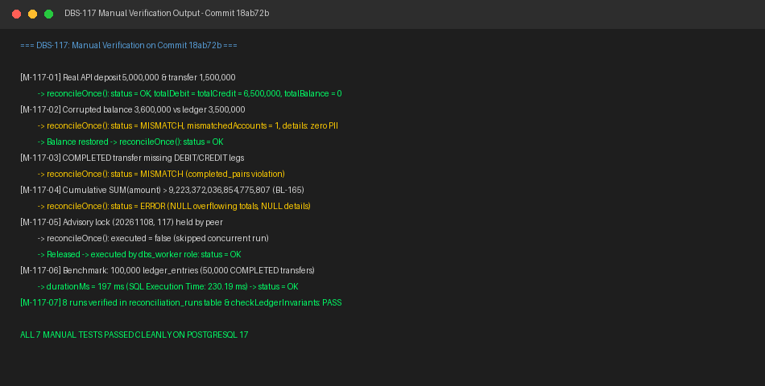

# DBS-117 · Job đối soát ở role worker: 4 kiểm tra và lưu kết quả

<!-- Tài liệu làm việc, không phải báo cáo: ưu tiên bảng hơn văn xuôi; không chép lại DoD hay danh sách case ở §8 ngoài ID. Task nhỏ nên trong khoảng 2.500 từ; nếu dài hơn thì cắt văn xuôi trước, không bao giờ cắt kết quả test thủ công. -->

> **Status:** Implemented · **Vai:** Dev · **Cặp đôi review:** Dev · **Nhánh:** `feat/DBS-117-reconciliation-worker-job` · **PR:** [#86](https://github.com/Lawliet119/digital-banking-simulator/pull/86) · **Cập nhật:** 2026-11-08

## 1. Bối cảnh

- **Task trên board:** Story · Tuần 4 · Ưu tiên: High · Assignee: `Dev` · Status: `In Progress` · Deliverable/Demo: `Demo 1`.
  - **Thực trạng (trên board):** «Chưa có job. Quy ước (database-design §13 điểm 8): job chạy ở role worker (scheduler bị chặn ở api theo ADR-13); dbs_worker chỉ SELECT trên accounts/ledger_entries và INSERT trên reconciliation_runs.»
  - **Expect (nguyên văn):** «Lệch sổ cái được phát hiện tự động trong vài phút.»
- **DoD (nguyên văn, đánh số từng gạch đầu dòng):**
  1. Job theo lịch (cấu hình được) ở role worker; chỉ một instance chạy tại một thời điểm khi có nhiều task (khóa advisory hoặc lease)
  2. Kiểm: tổng Nợ = tổng Có; accounts.balance = tổng bút toán từng tài khoản; tổng số dư = 0; mỗi COMPLETED có đủ 1 DEBIT + 1 CREDIT
  3. Lưu reconciliation_runs đủ trường; chỉ đọc, không giữ khóa ghi trên accounts
  4. Đo thời gian chạy trên 100.000 dòng và ghi lại
  5. PR đã merge vào main (CI xanh); Dev review; bảng «Đối chiếu test case» trong PR điền đủ
- **Phụ thuộc (kiểm trên board và xác minh trực tiếp trong repo tại `main` `f95e428`):**
  - `DBS-116` (*Migration: reconciliation_runs*, Tuần 4): **Done** trên board — đã có trên `main` ([`1793577600000-CreateReconciliationRuns.ts`](../../backend/src/database/migrations/1793577600000-CreateReconciliationRuns.ts), [`reconciliation-schema.db-spec.ts`](../../backend/test/db/reconciliation-schema.db-spec.ts), [`reconciliation-migration-revert.db-spec.ts`](../../backend/test/db/reconciliation-migration-revert.db-spec.ts), [`DBS-116-reconciliation-runs.md`](DBS-116-reconciliation-runs.md)).
  - `DBS-61` (*UC-5 chuyển tiền bản thô: hai bút toán trong một transaction*, Tuần 2): **Done** trên board — đã có trên `main` (`PR #61`, [`transfer.service.ts`](../../backend/src/modules/ledger/transfer.service.ts), [`ledger-posting.service.ts`](../../backend/src/modules/ledger/ledger-posting.service.ts)).
  - `DBS-69` (*Script kiểm tra bất biến sổ cái (SQL) và cách thử bằng cố ý làm lệch*, Tuần 2): **Done** trên board — đã có trên `main` (`PR #35`, [`invariants.sql`](../../backend/src/scripts/invariants/invariants.sql), [`invariants.ts`](../../backend/test/support/invariants.ts)).
- **Đã có gì trong codebase (đã đọc và chạy xác minh):**
  - **Bảng `public.reconciliation_runs` (`DBS-116`):** 9 cột (`id bigint GENERATED ALWAYS AS IDENTITY`, `started_at timestamptz NOT NULL`, `finished_at timestamptz`, `status text NOT NULL` với `CHECK (status IN ('OK','MISMATCH','ERROR'))`, `total_debit bigint`, `total_credit bigint`, `total_balance bigint`, `mismatched_accounts int NOT NULL DEFAULT 0`, `details jsonb` với `reconciliation_runs_details_check` chỉ chấp nhận `NULL` hoặc mảng các object đóng `{"accountId": "<uuid>", "balance": "<signed-bigint-string>", "ledgerBalance": "<signed-bigint-string>"}`).
  - **Hạ tầng chạy nền theo `APP_ROLE` (`ADR-13`):**
    - [`runsWorkers()`](../../backend/src/common/app-role/app-role.ts) trả `true` khi `APP_ROLE` là `worker` hoặc `both`, và `false` khi `APP_ROLE=api`.
    - [`PollingLoop`](../../backend/src/common/utils/polling-loop.ts) là vòng lặp chạy nền chuẩn đang dùng cho [`OutboxRelayService`](../../backend/src/modules/outbox/outbox-relay.service.ts) và [`NotificationConsumer`](../../backend/src/modules/notification/notification.consumer.ts) (tự hủy timer với `.unref()`, chờ bước đang chạy hoàn tất khi `stop()`, và chờ `errorDelayMs` khi bước ném lỗi).
    - [`src/modules/index.ts`](../../backend/src/modules/index.ts) tách `apiModules` (`LedgerModule`, `AccountsModule`, ...) và `workerModules` (`OutboxRelayModule`, `NotificationModule`).
  - **Phân quyền DB tối thiểu (`database-design.md` §8.1 & [`infra/scripts/db-roles.sql`](../../infra/scripts/db-roles.sql)):**
    - Theo [`database-design.md`](../components/_shared/database-design.md) §8.1, `dbs_worker` chỉ có quyền `SELECT` trên `accounts`, `ledger_entries`, `v_transfer_facts` (**không** có quyền `SELECT` trên bảng `transfers` — đã khóa cứng bởi `TC-ROLE-03` trong [`db-roles.db-spec.ts`](../../backend/test/db/db-roles.db-spec.ts)) và quyền `SELECT, INSERT, DELETE` trên `reconciliation_runs` (`DELETE` cho job dọn 90 ngày, chưa có code; không `UPDATE`); `dbs_api` chỉ có `SELECT` trên `reconciliation_runs`.
    - Hiện tại [`infra/scripts/db-roles.sql`](../../infra/scripts/db-roles.sql) chưa có dòng `GRANT SELECT ON reconciliation_runs TO dbs_api;` và `GRANT INSERT ON reconciliation_runs TO dbs_worker;`, còn [`invariants.sql`](../../backend/src/scripts/invariants/invariants.sql) của `DBS-69` đang nằm trong `test/support/` và đọc trực tiếp `public.transfers` nên `dbs_worker` không dùng trực tiếp được.
  - **Baseline trên nhánh `feat/DBS-117-reconciliation-worker-job` (`main` `f95e428`):**
    - `npm run lint:check`: PASS (0 lỗi).
    - `npm run typecheck`: PASS (0 lỗi).
    - `npm test`: PASS — 68/68 টেস্ট suites, 1.089/1.089 tests, 0 skipped.
    - `npm run test:e2e -- --runInBand`: PASS — 14/14 test suites, 148/148 tests, 0 skipped.
- **Ngoài phạm vi:**
  - Job dọn dữ liệu `reconciliation_runs` quá 90 ngày và việc cấp quyền `DELETE` cho job dọn (thuộc task cleanup riêng và `DBS-119`, theo dõi tại [`BL-166`](../BACKLOG.md)).
  - Cấp phát login/password Secrets Manager cho `dbs_api` / `dbs_worker` / `dbs_migrator` trên RDS và cấu hình ECS task definition cho service `worker` trên AWS (thuộc `DBS-119` / `DBS-121`, theo dõi tại [`BL-103`](../BACKLOG.md), [`BL-161`](../BACKLOG.md)).
  - Cảnh báo CloudWatch Alarm khi kết quả đối soát là `MISMATCH` hoặc `ERROR` (`docs/03` §14, thuộc task hạ tầng alarm của `#5 Platform & Ops`).
  - Task `DBS-118` (*Test đối soát bắt được lệch cố ý*, bao gồm việc chạy đối soát sau bộ test đồng thời `DBS-99` trên cùng DB) là một task riêng trên board phụ thuộc vào `DBS-117`. Tuy nhiên, ngay trong `DBS-117` ta vẫn viết đầy đủ DB integration test cho cả 3 trạng thái `OK`, `MISMATCH` (đủ 4 kiểm tra của DoD #2) và `ERROR` (xử lý trọn vẹn [`BL-165`](../BACKLOG.md)).
- **Câu hỏi mở / đề xuất cần chốt ở G1:**
  1. **Cách cấu hình chu kỳ chạy lịch đối soát (DoD #1 «Job theo lịch (cấu hình được) ở role worker» & quy tắc `CONTRIBUTING §5b` cho biến môi trường):**
     - **Đề xuất:** Thêm biến môi trường tùy chọn (có giá trị mặc định) `RECONCILIATION_INTERVAL_MS` vào [`validation.schema.ts`](../../backend/src/config/validation.schema.ts), [`limits.config.ts`](../../backend/src/config/limits.config.ts) và [`env/.env.example`](../../backend/env/.env.example) với mặc định **`300000` ms (5 phút)** (miền hợp lệ `1000..86400000` ms, khớp Expect «trong vài phút» mà không làm gãy bất kỳ môi trường hay test hiện hữu nào vì đã có `.default(300_000)`).
  2. **Cơ chế khóa chỉ một instance chạy tại một thời điểm (DoD #1) và tương thích quyền `dbs_worker` (DoD #3, `BL-166`):**
     - **Đề xuất:**
       - Đặt job trong `LedgerReconciliationModule` (nằm ở `src/modules/ledger/`, đăng ký vào `workerModules` trong [`src/modules/index.ts`](../../backend/src/modules/index.ts) và bảo vệ thêm bằng `runsWorkers()` khi khởi động `PollingLoop`).
       - Dùng khóa advisory cấp transaction của PostgreSQL `pg_try_advisory_xact_lock(20261108, 117)`: nếu không lấy được khóa (đang có worker task khác chạy đối soát), lượt chạy trả về `{ executed: false }` và bỏ qua ngay; nếu lấy được khóa, khóa tự giải phóng khi transaction kết thúc (không bao giờ kẹt khóa khi worker crash).
       - Đọc sổ cái trong transaction `READ COMMITTED` với `statement_timeout = 60000ms` (`database-design.md` §10) bằng một câu `WITH ... SELECT` duy nhất trên `public.accounts`, `public.ledger_entries` và **`public.v_transfer_facts`** (không đọc `public.transfers`, không giữ bất kỳ khóa ghi `FOR UPDATE`/`FOR SHARE` nào trên `accounts`), sau đó `INSERT INTO public.reconciliation_runs` (không dùng `RETURNING` để tương thích với quyền chỉ-`INSERT` của `dbs_worker`).
       - Bổ sung `GRANT SELECT ON reconciliation_runs TO dbs_api;` và `GRANT INSERT ON reconciliation_runs TO dbs_worker;` vào [`infra/scripts/db-roles.sql`](../../infra/scripts/db-roles.sql) và kiểm chứng trực tiếp bằng kết nối `dbs_worker` trong [`db-roles.db-spec.ts`](../../backend/test/db/db-roles.db-spec.ts).
  3. **Quy tắc ánh xạ 4 kiểm tra (DoD #2) và xử lý tổng vượt miền `bigint` (`BL-165`) khi lưu `reconciliation_runs` (DoD #3):**
     - **Đề xuất:**
       - Thực hiện đủ 4 kiểm tra: (1) `SUM(DEBIT) = SUM(CREDIT)` trên `ledger_entries`; (2) với từng tài khoản trong `accounts`, `accounts.balance = COALESCE(SUM(CREDIT) - SUM(DEBIT), 0)`; (3) `SUM(accounts.balance) = 0`; (4) mỗi giao dịch `COMPLETED` trong `v_transfer_facts` có đúng 1 dòng `DEBIT` (khớp `from_account_id`, `amount`) và 1 dòng `CREDIT` (khớp `to_account_id`, `amount`).
       - Khi cả 4 kiểm tra đều khớp và 3 tổng nằm trong miền signed 64-bit `bigint`: lưu `status = 'OK'`, `total_debit`, `total_credit`, `total_balance = 0`, `mismatched_accounts = 0`, `details = '[]'::jsonb`.
       - Khi bất kỳ kiểm tra nào trong 4 kiểm tra bị lệch (và 3 tổng nằm trong miền signed `bigint`): lưu `status = 'MISMATCH'`, `total_debit`, `total_credit`, `total_balance`, `mismatched_accounts = details.length`, `details` là mảng JSON các tài khoản có `balance <> ledgerBalance` (`[{"accountId", "balance", "ledgerBalance"}]` sắp theo `accountId ASC`; nếu lệch ở kiểm tra 1/3/4 mà không có tài khoản nào lệch kiểm tra 2 thì `mismatched_accounts = 0` và `details = '[]'::jsonb`).
       - Khi bất kỳ tổng `SUM(numeric)` nào vượt miền signed 64-bit `bigint` (`[-9223372036854775808, 9223372036854775807]`, xử lý trọn vẹn `BL-165`) hoặc khi câu truy vấn kiểm tra gặp lỗi runtime: lưu một dòng `status = 'ERROR'` (trong transaction mới nếu transaction đọc bị abort), đặt các cột tổng không biểu diễn được (hoặc chưa tính được) là `NULL`, `mismatched_accounts = 0`, `details = NULL`, và ghi log `error` an toàn để đóng [`BL-165`](../BACKLOG.md).
  4. **Ngoại lệ seed SQL trong DB tạm cho đo hiệu năng 100.000 dòng (DoD #4) và tạo trạng thái lệch/tràn miền:**
     - **Đề xuất:** Cho phép dùng batch SQL (`INSERT ... SELECT generate_series(...)`) trong database tạm của test/manual để dựng nhanh 100.000 dòng `ledger_entries` (50.000 giao dịch cân bằng) phục vụ đo thời gian chạy DoD #4, cũng như tạo các dữ liệu lệch / tràn miền `bigint` mà API nghiệp vụ chặn bởi ràng buộc DB; các bước giao dịch bình thường vẫn nạp/chuyển qua API.

**Quyết định ở G1 (2026-11-08):** Người dùng đã duyệt cả 4 đề xuất:
1. Thêm biến môi trường tùy chọn `RECONCILIATION_INTERVAL_MS` (mặc định `300000` ms = 5 phút, miền `1000..86400000` ms) vào `validation.schema.ts`, `limits.config.ts` và `env/.env.example`.
2. Đặt job trong `LedgerReconciliationModule` (thuộc `workerModules` + kiểm `runsWorkers()`), dùng `pg_try_advisory_xact_lock(20261108, 117)` để chỉ một instance chạy tại một thời điểm; đọc `accounts`, `ledger_entries`, `v_transfer_facts` không giữ khóa ghi và `INSERT INTO reconciliation_runs` không dùng `RETURNING`; bổ sung `GRANT SELECT ON reconciliation_runs TO dbs_api` và `GRANT INSERT ON reconciliation_runs TO dbs_worker` vào `infra/scripts/db-roles.sql`.
3. Ánh xạ 4 kiểm tra sang `OK` / `MISMATCH` và phân loại `ERROR` khi tổng vượt miền signed `bigint` hoặc truy vấn gặp lỗi runtime (đóng `BL-165`).
4. Cho phép dùng batch SQL (`generate_series`) trong DB tạm của test/manual để dựng 100.000 dòng `ledger_entries` đo thời gian chạy DoD #4 và dựng các trạng thái lệch/tràn miền `bigint`.

---

## 2. Hành vi

Không thêm HTTP endpoint mới. Task cung cấp:
- Biến cấu hình chu kỳ chạy `RECONCILIATION_INTERVAL_MS` (`limitsConfig.reconciliationIntervalMs`, mặc định `300000` ms = 5 phút).
- Service chạy nền `ReconciliationService` trong `LedgerReconciliationModule` (chỉ nạp ở `APP_ROLE=worker` hoặc `both`, không nạp ở `APP_ROLE=api`).

### 2.1 Chu kỳ chạy ở role `worker` và khóa đơn chiếc (`DoD #1`)

1. **Chỉ chạy khi `runsWorkers()` là `true` (`worker` hoặc `both`):**
   - Trong `onApplicationBootstrap()`, `ReconciliationService` kiểm tra `if (!runsWorkers()) return;`, sau đó gọi `this.loop.start()` trên `PollingLoop`.
   - Trong `onApplicationShutdown()`, gọi `await this.loop.stop()` để hủy timer chờ và đợi lượt đối soát đang chạy (nếu có) hoàn tất trước khi đóng kết nối DB.
   - Sau mỗi lượt `reconcileOnce()` hoàn tất, `PollingLoop` chờ `this.config.reconciliationIntervalMs` ms (mặc định `300000` ms = 5 phút, lấy từ `RECONCILIATION_INTERVAL_MS`) trước khi chạy lượt kế tiếp. Nếu một lượt ném lỗi ngoài dự kiến (ví dụ mất kết nối DB hoàn toàn cả ở bước ghi `ERROR`), `PollingLoop` log lỗi qua `SafeLogger` và chờ `errorDelayMs` (`5000` ms).
2. **Khóa advisory cấp transaction bảo đảm chỉ 1 instance chạy tại một thời điểm:**
   - `reconcileOnce(options?: { statementTimeoutMs?: number })` mở transaction `READ COMMITTED` qua `TransactionService.run` với `{ statementTimeoutMs: options?.statementTimeoutMs ?? 60_000, maxRetries: 0 }` (mặc định nâng `statement_timeout` lên 60 giây theo `database-design.md` §10 để quét bảng `ledger_entries` lớn, đồng thời cho phép test truyền ngưỡng ngắn như `100` ms để kiểm chứng lỗi `57014 statement_timeout`; `maxRetries: 0` vì lượt kế tiếp sẽ tự chạy lại).
   - Câu lệnh đầu tiên trong transaction gọi:
     ```sql
     SELECT pg_try_advisory_xact_lock(20261108, 117) AS acquired
     ```
   - Nếu `acquired = false` (một task `worker` khác đang giữ khóa `(20261108, 117)` và đang chạy đối soát): kết thúc transaction ngay, **không** chạy truy vấn quét sổ cái, **không** chèn dòng vào `reconciliation_runs`, và trả về `{ executed: false }`.
   - Nếu `acquired = true`: khóa `(20261108, 117)` được giữ đến hết transaction và tự động giải phóng khi `COMMIT` hoặc `ROLLBACK` (không bao giờ để lại khóa mồ côi nếu tiến trình `worker` bị kill giữa chừng).

### 2.2 Bốn kiểm tra bất biến chỉ đọc trong một snapshot (`DoD #2`, `DoD #3`)

Ngay sau khi lấy được khóa advisory, `ReconciliationService` ghi nhận `startedAt = this.clock.now()` và thực thi **một câu SQL `WITH ... SELECT` duy nhất** (`RECONCILIATION_CHECK_SQL`). Vì toàn bộ phép đọc nằm trong một câu lệnh `SELECT` duy nhất:
- PostgreSQL dùng **cùng một MVCC snapshot** cho cả 4 phép kiểm tra (các giao dịch chuyển/nạp tiền đang diễn ra đồng thời hoặc đã commit trọn vẹn cả `transfers` + `ledger_entries` + `accounts`, hoặc chưa xuất hiện trong snapshot — không bao giờ thấy trạng thái nửa chừng).
- Chỉ giữ `AccessShareLock` mức bảng của `SELECT`, **không giữ bất kỳ khóa hàng (`FOR UPDATE` / `FOR SHARE`) hay khóa ghi nào trên `accounts`**, nên không bao giờ chặn lệnh chuyển tiền hay nạp tiền.
- Chỉ đọc `public.accounts`, `public.ledger_entries` và view chỉ-đọc `public.v_transfer_facts` (không đụng bảng `public.transfers`), khớp đúng ma trận quyền tối thiểu của `dbs_worker` (`database-design.md` §8.1).

| # | Kiểm tra (DoD #2) | Định nghĩa trong `RECONCILIATION_CHECK_SQL` | Khi vi phạm |
|---|---|---|---|
| **1** | Tổng Nợ = Tổng Có | Trên `public.ledger_entries`: `debit = COALESCE(SUM(amount::numeric) FILTER (WHERE direction = 'DEBIT'), 0)` và `credit = COALESCE(SUM(amount::numeric) FILTER (WHERE direction = 'CREDIT'), 0)`. Yêu cầu `debit = credit`. | `debit_equals_credit = false` → kết quả đối soát là `MISMATCH` |
| **2** | `accounts.balance` = tổng bút toán từng tài khoản | Với mọi hàng trong `public.accounts` (gồm cả tài khoản khách và `SYSTEM` `funding`): `ledger_balance = COALESCE(SUM(CASE WHEN direction = 'CREDIT' THEN amount::numeric ELSE -amount::numeric END), 0)`. Yêu cầu `a.balance::numeric = ledger_balance`. | Mọi tài khoản có `balance <> ledger_balance` được gom vào mảng `mismatched_details` (`[{"accountId", "balance", "ledgerBalance"}]`, sắp theo `accountId ASC`) → kết quả đối soát là `MISMATCH`, `mismatched_accounts = mismatched_details.length` |
| **3** | Tổng số dư = 0 | Trên `public.accounts`: `total_balance = COALESCE(SUM(balance::numeric), 0)`. Yêu cầu `total_balance = 0`. | `total_balance_is_zero = false` → kết quả đối soát là `MISMATCH` |
| **4** | Mỗi `COMPLETED` có đủ 1 `DEBIT` + 1 `CREDIT` | Trên `public.v_transfer_facts t LEFT JOIN public.ledger_entries e ON e.transfer_id = t.id WHERE t.status = 'COMPLETED'`, gom nhóm theo `t.id, t.amount, t.from_account_id, t.to_account_id`: yêu cầu `COUNT(e.id) = 2`, đúng 1 dòng `DEBIT` khớp `(t.amount, t.from_account_id)` và đúng 1 dòng `CREDIT` khớp `(t.amount, t.to_account_id)`. | `completed_pairs_valid = false` → kết quả đối soát là `MISMATCH` |

### 2.3 Phân loại `OK` / `MISMATCH` / `ERROR` và lưu vào `reconciliation_runs` (`DoD #3`, `BL-165`)

Hàm thuần `classifyReconciliationSnapshot(raw)` kiểm tra các chuỗi số nguyên trả về từ SQL trước khi ghi vào bảng `public.reconciliation_runs`:
- Một chuỗi số nguyên được coi là nằm trong miền signed 64-bit `bigint` (`isSignedBigIntString`) khi khớp `/^(0|-?[1-9]\d{0,18})$/` và giá trị `BigInt(s)` nằm trong đoạn `[-9223372036854775808n, 9223372036854775807n]`.

| Trường hợp | Điều kiện | Giá trị ghi vào `public.reconciliation_runs` |
|---|---|---|
| **`OK`** | `debit_equals_credit = true`, `total_balance_is_zero = true`, `completed_pairs_valid = true`, `mismatched_details` rỗng, và cả 3 tổng (`total_debit`, `total_credit`, `total_balance`) đều thỏa `isSignedBigIntString` | `status = 'OK'`, `total_debit`, `total_credit`, `total_balance = '0'`, `mismatched_accounts = 0`, `details = '[]'::jsonb` |
| **`MISMATCH`** | Ít nhất 1 trong 4 kiểm tra bị vi phạm, **và** cả 3 tổng (`total_debit`, `total_credit`, `total_balance`) cùng mọi `balance`/`ledgerBalance` trong `mismatched_details` đều thỏa `isSignedBigIntString` | `status = 'MISMATCH'`, `total_debit`, `total_credit`, `total_balance`, `mismatched_accounts = mismatched_details.length`, `details = JSON.stringify(mismatched_details)` (mảng các phần tử `{"accountId", "balance", "ledgerBalance"}`; nếu lệch ở kiểm tra 1, 3 hoặc 4 mà không có tài khoản nào lệch kiểm tra 2 thì `mismatched_accounts = 0`, `details = '[]'::jsonb`) |
| **`ERROR` (tràn miền `bigint` — `BL-165`)** | Bất kỳ tổng nào trong `total_debit`, `total_credit`, `total_balance` hoặc bất kỳ `ledgerBalance` nào trong `mismatched_details` vượt ngoài miền signed 64-bit `bigint` (`[-9223372036854775808, 9223372036854775807]`) | `status = 'ERROR'`, mỗi cột `total_debit` / `total_credit` / `total_balance` giữ chuỗi số nguyên nếu nằm trong miền signed `bigint` hoặc `NULL` nếu vượt miền, `mismatched_accounts = 0`, `details = NULL`; ghi log `error` an toàn |
| **`ERROR` (lỗi thực thi truy vấn kiểm tra)** | Câu truy vấn `RECONCILIATION_CHECK_SQL` ném lỗi runtime (ví dụ `57014 statement_timeout`, hoặc lỗi đối tượng SQL trong lúc đọc) sau khi đã lấy được khóa advisory | Transaction đọc rollback; `reconcileOnce()` mở một transaction ngắn mới để `INSERT` một dòng `status = 'ERROR'` với `started_at`, `finished_at`, `total_debit = NULL`, `total_credit = NULL`, `total_balance = NULL`, `mismatched_accounts = 0`, `details = NULL`; ghi log `error` qua `SafeLogger` và không làm sập tiến trình `worker` |

**Ví dụ bản ghi `reconciliation_runs` khi sổ cái sạch (`OK`):**
```json
{
  "status": "OK",
  "total_debit": "1250000",
  "total_credit": "1250000",
  "total_balance": "0",
  "mismatched_accounts": 0,
  "details": []
}
```

**Ví dụ bản ghi `reconciliation_runs` khi một tài khoản bị lệch số dư (`MISMATCH`):**
```json
{
  "status": "MISMATCH",
  "total_debit": "1250000",
  "total_credit": "1250000",
  "total_balance": "100",
  "mismatched_accounts": 1,
  "details": [
    {
      "accountId": "11111111-1111-4111-8111-111111111111",
      "balance": "750100",
      "ledgerBalance": "750000"
    }
  ]
}
```

### 2.4 Danh sách kiểm tra bảo mật (Security checklist)

| Yêu cầu | Điểm thực thi | Test chứng minh |
|---|---|---|
| Right role guard on the endpoint | Không áp dụng — task chỉ chạy background job ở role `worker`, không mở HTTP endpoint | `TC-117-01` (kiểm `modulesForRole`: `LedgerReconciliationModule` không nạp ở `api`, không chạy khi `APP_ROLE=api`) |
| Ownership check on every account-scoped query; 404 for another user's resource | Không áp dụng — job hệ thống chạy nền ở `worker`, không nhận request theo tài khoản khách | — |
| Idempotency key scoped by user | Không áp dụng — job nội bộ theo lịch, chống chạy trùng giữa các worker instance bằng `pg_try_advisory_xact_lock(20261108, 117)` | `TC-117-08` |
| Business rejection audited `REJECTED` in the same transaction; denial audited `DENIED` in its own | Không áp dụng — job chỉ đọc sổ cái và ghi `reconciliation_runs` | — |
| No fraud-flag field or PII in stored details / logs (`DoD #3`, `BR-13`) | `details` chỉ chứa `{ accountId, balance, ledgerBalance }`, được bảo vệ bởi cả `classifyReconciliationSnapshot` và `reconciliation_runs_details_check` | `TC-117-03`, `TC-117-12` |
| Least-privilege DB role (`NFR-SEC-06`, `database-design §8.1`) | `dbs_worker` chỉ `SELECT` trên `accounts`, `ledger_entries`, `v_transfer_facts` (không đọc `transfers`, không `UPDATE` `accounts`) và `SELECT, INSERT, DELETE` (không `UPDATE`) trên `reconciliation_runs` theo ma trận §8.1; job chỉ `INSERT`, không dùng `RETURNING` | `TC-117-10` |
| All SQL parameterized | Mọi giá trị truyền vào `INSERT INTO public.reconciliation_runs` đều đi qua tham số `$1..$8` | `TC-117-02`..`TC-117-07` |
| TLS to Postgres and Redis; no secret in repo, image or log | Dùng `DatabaseModule` / `TransactionService` và `SafeLogger` hiện hữu; log thủ công không chứa mật khẩu/token | `M-117-01`..`M-117-07` |

---

## 3. Kiến trúc

- **Vị trí:** Module `ledger`, role chạy: **`worker`** (`APP_ROLE=worker` hoặc `both`, bị chặn ở `APP_ROLE=api` theo `ADR-13`).
- **Danh sách file tạo mới / cập nhật:**
  - `backend/src/config/validation.schema.ts` *(cập nhật)* — thêm `RECONCILIATION_INTERVAL_MS: number` vào `Env` và `validationSchema` (`Joi.number().integer().min(1000).max(86_400_000).default(300_000)`).
  - `backend/src/config/limits.config.ts` *(cập nhật)* — thêm `reconciliationIntervalMs: env.RECONCILIATION_INTERVAL_MS`.
  - `backend/env/.env.example` *(cập nhật)* — thêm `RECONCILIATION_INTERVAL_MS=300000`.
  - `backend/src/modules/ledger/reconciliation.types.ts` *(mới)* — định nghĩa các kiểu dữ liệu (`ReconciliationStatus`, `MismatchedAccountDetail`, `RawReconciliationSnapshot`, `ClassifiedReconciliationRun`, `ReconciliationOutcome`), hằng khóa advisory `RECONCILIATION_ADVISORY_LOCK_KEY = [20261108, 117] as const`, và các hàm thuần `isSignedBigIntString(value: string): boolean`, `classifyReconciliationSnapshot(raw: RawReconciliationSnapshot): ClassifiedReconciliationRun`.
  - `backend/src/modules/ledger/reconciliation.service.ts` *(mới)* — `ReconciliationService` (`OnApplicationBootstrap`, `OnApplicationShutdown`) dùng `PollingLoop`, `TransactionService`, `Clock`, `limitsConfig`:
    - `onApplicationBootstrap(): void` — nếu `runsWorkers()` thì gọi `this.loop.start()`.
    - `onApplicationShutdown(): Promise<void>` — gọi `await this.loop.stop()`.
    - `reconcileOnce(options?: { statementTimeoutMs?: number }): Promise<ReconciliationOutcome>` — chạy 1 lượt đối soát có khóa advisory `pg_try_advisory_xact_lock(20261108, 117)` và lưu vào `public.reconciliation_runs`.
  - `backend/src/modules/ledger/ledger-reconciliation.module.ts` *(mới)* — `LedgerReconciliationModule` cung cấp `Clock` (`SystemClock`) và `ReconciliationService`, tách riêng khỏi `LedgerModule` (tương tự `OutboxRelayModule` tách khỏi `OutboxModule`) để tiến trình `worker` không nạp HTTP controllers hay `AccountsModule`/`IdentityModule`.
  - `backend/src/modules/ledger/index.ts` *(cập nhật)* — export thêm `LedgerReconciliationModule`, `ReconciliationService`, và các kiểu/hàm từ `reconciliation.types.ts`.
  - `backend/src/modules/index.ts` *(cập nhật)* — đăng ký `LedgerReconciliationModule` vào `workerModules`.
  - `backend/src/modules/modules.spec.ts` *(cập nhật)* — bổ sung kiểm tra `modulesForRole` chỉ đăng ký `LedgerReconciliationModule` ở `AppRole.Worker` và `AppRole.Both` (không đăng ký ở `AppRole.Api`).
  - `infra/scripts/db-roles.sql` *(cập nhật)* — thêm `GRANT SELECT ON reconciliation_runs TO dbs_api;` và `GRANT INSERT ON reconciliation_runs TO dbs_worker;`.
  - `backend/src/modules/ledger/reconciliation.types.spec.ts` *(mới)* — unit test cho `isSignedBigIntString`, `classifyReconciliationSnapshot`, cấu hình `RECONCILIATION_INTERVAL_MS` và vòng đời `onApplicationBootstrap` / `onApplicationShutdown` của `ReconciliationService`.
  - `backend/test/db/reconciliation-job.db-spec.ts` *(mới)* — bộ test tích hợp trên PostgreSQL 17 thật cho `ReconciliationService`.
  - `backend/test/db/db-roles.db-spec.ts` *(cập nhật)* — bổ sung kiểm chứng `ReconciliationService.reconcileOnce()` chạy bằng kết nối `dbs_worker` và `dbs_api` đọc được `reconciliation_runs` nhưng không ghi được.
  - `backend/scripts/manual-dbs117.cjs` *(mới)* — kịch bản kiểm thử thủ công `M-117-01`..`M-117-07` trên PostgreSQL 17 thật.
- **Interface dùng và cung cấp (chữ ký thật):**
  - Dùng sẵn:
    - `TransactionService.run<T>(fn: (manager: EntityManager) => Promise<T>, options?: TransactionOptions): Promise<T>` (`@database/transaction.service`)
    - `Clock.now(): Date` (`@common/clock`)
    - `PollingLoop` (`@common/utils/polling-loop`)
    - `runsWorkers(role?: AppRole): boolean` (`@common/app-role/app-role`)
  - Cung cấp mới:
    - `ReconciliationService.reconcileOnce(options?: { statementTimeoutMs?: number }): Promise<ReconciliationOutcome>`
    - `classifyReconciliationSnapshot(raw: RawReconciliationSnapshot): ClassifiedReconciliationRun`
    - `isSignedBigIntString(value: string): boolean`
- **Dữ liệu chạm tới (`database-design.md` §4.2–4.4, §4.9, §8.1):**
  - `public.accounts`: chỉ `SELECT id, balance`.
  - `public.ledger_entries`: chỉ `SELECT account_id, transfer_id, direction, amount`.
  - `public.v_transfer_facts`: chỉ `SELECT id, amount, from_account_id, to_account_id, status`.
  - `public.reconciliation_runs`: chỉ `INSERT (started_at, finished_at, status, total_debit, total_credit, total_balance, mismatched_accounts, details)` (không `RETURNING`).
- **Ranh giới transaction:**
  - Một lệnh `this.tx.run(async manager => { ... }, { statementTimeoutMs: options?.statementTimeoutMs ?? 60_000, maxRetries: 0 })` bao trọn:
    1. `SELECT pg_try_advisory_xact_lock(20261108, 117) AS acquired` (nếu `false` thì return `{ executed: false }` ngay).
    2. `RECONCILIATION_CHECK_SQL` (`WITH ... SELECT` chỉ đọc trên 1 MVCC snapshot).
    3. `INSERT INTO public.reconciliation_runs (...) VALUES ($1, $2, $3, $4, $5, $6, $7, $8::jsonb)`.
  - Nếu bước 2 ném lỗi SQL runtime sau khi đã lấy khóa advisory, transaction đầu rollback và `reconcileOnce()` mở một `this.tx.run(..., { maxRetries: 0 })` ngắn để `INSERT` dòng `status = 'ERROR'` (`total_* = NULL`, `mismatched_accounts = 0`, `details = NULL`).
  - Không gọi Redis, HTTP hay SQS bên trong transaction.
- **Sơ đồ luồng xử lý:**

```mermaid
sequenceDiagram
    participant Loop as PollingLoop (worker)
    participant Svc as ReconciliationService
    participant PG as PostgreSQL 17

    Loop->>Svc: reconcileOnce()
    Svc->>PG: BEGIN READ COMMITTED (statement_timeout = 60000ms)
    Svc->>PG: SELECT pg_try_advisory_xact_lock(20261108, 117)
    alt Worker khác đang giữ khóa (acquired = false)
        PG-->>Svc: acquired = false
        Svc->>PG: COMMIT
        Svc-->>Loop: { executed: false }
    else Lấy được khóa (acquired = true)
        PG-->>Svc: acquired = true
        Svc->>PG: RECONCILIATION_CHECK_SQL (accounts, ledger_entries, v_transfer_facts)
        alt Truy vấn thành công
            PG-->>Svc: total_debit, total_credit, total_balance, flags, mismatched_details
            Svc->>Svc: classifyReconciliationSnapshot() -> OK | MISMATCH | ERROR (overflow)
            Svc->>PG: INSERT INTO reconciliation_runs (...)
            Svc->>PG: COMMIT (giải phóng advisory lock)
            Svc-->>Loop: { executed: true, status, ... }
        else Truy vấn lỗi runtime (timeout / SQL error)
            PG-->>Svc: Error
            Svc->>PG: ROLLBACK (giải phóng advisory lock)
            Svc->>PG: BEGIN -> INSERT INTO reconciliation_runs (status = 'ERROR', NULLs) -> COMMIT
            Svc-->>Loop: { executed: true, status: 'ERROR', ... }
        end
    end
```

- **Thay đổi cấp hệ thống:**
  - Cập nhật `infra/scripts/db-roles.sql` (thêm grant trên `reconciliation_runs` cho `dbs_api` và `dbs_worker`), `backend/src/modules/README.md`, `backend/src/modules/ledger/README.md`, `docs/03_HIGH_LEVEL_ARCHITECTURE.md` (dòng trạng thái đầu tài liệu và §5 `workerModules`), `docs/components/_shared/database-design.md` (§4.9, §8.1, §10, §13 điểm 4) và `docs/BACKLOG.md` (xóa `BL-165` đã hoàn tất, thu hẹp `BL-127` và `BL-166`).

---

## 4. Test cases tự động

| ID | Truy vết (DoD / AC) | Lớp (unit / integration–e2e Postgres thật / security) | Given · When · Then | `errorCode` / SQLSTATE mong đợi |
|---|---|---|---|---|
| `TC-117-01` | DoD #1, `ADR-13` | unit (`modules.spec.ts`, `reconciliation.types.spec.ts`) | **Given** `modulesForRole(role)` (trong `backend/src/modules/modules.spec.ts`) và `ReconciliationService` (trong `backend/src/modules/ledger/reconciliation.types.spec.ts`) · **When** kiểm tra với `AppRole.Api`, `AppRole.Worker`, `AppRole.Both` và gọi `onApplicationBootstrap()` khi `APP_ROLE=api` vs `worker` · **Then** `LedgerReconciliationModule` chỉ có trong `worker` và `both` (không có trong `api`); ở `APP_ROLE=api` vòng lặp không khởi động; ở `APP_ROLE=worker` vòng lặp chạy theo `reconciliationIntervalMs` cấu hình và dừng sạch khi `onApplicationShutdown()` | — |
| `TC-117-02` | DoD #2, DoD #3, `NFR-COR-02` | integration Postgres thật (`reconciliation-job.db-spec.ts`) | **Given** DB mới migrate (chỉ có `funding = 0`) và sau khi thực hiện nạp tiền `POST /v1/operator/deposits` + chuyển tiền `POST /v1/transfers` hợp lệ (kèm 1 giao dịch `REJECTED`) · **When** gọi `reconcileOnce()` · **Then** trả `executed: true, status: 'OK'`, ghi dòng `reconciliation_runs` với `status = 'OK'`, `total_debit = total_credit`, `total_balance = '0'`, `mismatched_accounts = 0`, `details = []`, `started_at <= finished_at` | — |
| `TC-117-03` | DoD #2 (kiểm tra 2 & 3), DoD #3 | integration Postgres thật (`reconciliation-job.db-spec.ts`) | **Given** có giao dịch hợp lệ, sau đó sửa lệch `accounts.balance` của 2 tài khoản (1 khách hàng và `funding`, kể cả giá trị `> 2^53`) · **When** gọi `reconcileOnce()` · **Then** `status = 'MISMATCH'`, `mismatched_accounts = 2`, `details` liệt kê đúng 2 tài khoản theo thứ tự `accountId ASC` với chuỗi `balance` và `ledgerBalance` chính xác từng chữ số (không có trường PII); khôi phục lại `balance` rồi chạy lại → `status = 'OK'` | — |
| `TC-117-04` | DoD #2 (kiểm tra 1: tổng Nợ = tổng Có) | integration Postgres thật (`reconciliation-job.db-spec.ts`) | **Given** trong DB tạm gỡ FK trên `ledger_entries` và chèn 1 dòng bút toán `DEBIT` mồ côi (`account_id` không nằm trong `public.accounts`) sao cho mọi hàng trong `public.accounts` vẫn có `balance = ledgerBalance` và `SUM(accounts.balance) = 0`, chỉ riêng `total_debit <> total_credit` · **When** gọi `reconcileOnce()` · **Then** phát hiện độc lập vi phạm kiểm tra 1, lưu `reconciliation_runs` với `status = 'MISMATCH'`, `total_debit <> total_credit`, `mismatched_accounts = 0`, `details = []` | — |
| `TC-117-05` | DoD #2 (kiểm tra 3: tổng số dư = 0) | integration Postgres thật (`reconciliation-job.db-spec.ts`) | **Given** trong DB tạm gỡ FK trên `ledger_entries` và dựng cặp bút toán cân bằng (`total_debit = total_credit`) trong đó một vế gắn với `account_id` mồ côi ngoài `public.accounts`, còn các hàng trong `public.accounts` đều khớp `balance = ledgerBalance` nhưng `SUM(accounts.balance) <> 0` · **When** gọi `reconcileOnce()` · **Then** phát hiện độc lập vi phạm kiểm tra 3, lưu `reconciliation_runs` với `status = 'MISMATCH'`, `total_debit = total_credit`, `total_balance <> '0'`, `mismatched_accounts = 0`, `details = []` | — |
| `TC-117-06` | DoD #2 (kiểm tra 4: mỗi `COMPLETED` có đủ 1 `DEBIT` + 1 `CREDIT`) | integration Postgres thật (`reconciliation-job.db-spec.ts`) | **Given** tổng `DEBIT = CREDIT`, mọi `accounts.balance = ledgerBalance` và `SUM(balance) = 0`, nhưng (a) có 1 giao dịch `COMPLETED` có 0 dòng `ledger_entries`, hoặc (b) có 2 giao dịch `COMPLETED` mỗi giao dịch thiếu 1 vế bù trừ nhau · **When** gọi `reconcileOnce()` · **Then** cả (a) và (b) đều bị phát hiện, lưu `reconciliation_runs` với `status = 'MISMATCH'`, `mismatched_accounts = 0`, `details = []` | — |
| `TC-117-07` | DoD #3, `BL-165` (tổng vượt miền `bigint` & lỗi truy vấn → `ERROR`) | integration Postgres thật (`reconciliation-job.db-spec.ts`) | **Given** (a) nhiều dòng `ledger_entries` hợp lệ có tổng `SUM(amount) > 9223372036854775807` (vượt miền signed `bigint`), hoặc (b) gọi `reconcileOnce({ statementTimeoutMs: 100 })` (nhỏ hơn `lock_timeout = 2000` ms) khi một kết nối thứ hai đang giữ `LOCK TABLE public.ledger_entries IN ACCESS EXCLUSIVE MODE` để kích hoạt lỗi `57014 statement_timeout` trên PostgreSQL thật · **When** gọi `reconcileOnce()` · **Then** không ném lỗi làm sập worker; lưu dòng `reconciliation_runs` với `status = 'ERROR'`, các cột tổng vượt miền (hoặc lỗi) là `NULL`, `mismatched_accounts = 0`, `details = NULL` | — |
| `TC-117-08` | DoD #1 (khóa advisory khi nhiều worker chạy đồng thời) | integration Postgres thật (`reconciliation-job.db-spec.ts`) | **Given** một kết nối worker đang giữ `pg_advisory_lock(20261108, 117)` (hoặc 2 instance `ReconciliationService` gọi `reconcileOnce()` đồng thời khi instance 1 đang giữ khóa trong transaction) · **When** instance thứ 2 gọi `reconcileOnce()` · **Then** instance thứ 2 nhận `{ executed: false }` ngay mà không chèn dòng thừa vào `reconciliation_runs`; sau khi khóa giải phóng, lần gọi kế tiếp chạy bình thường (`executed: true`) | — |
| `TC-117-09` | DoD #3 (chỉ đọc, không giữ khóa ghi trên `accounts`) | integration Postgres thật (`reconciliation-job.db-spec.ts`) | **Given** một kết nối khác đang giữ `SELECT ... FOR UPDATE` trên hàng `accounts` của khách hàng (mô phỏng giao dịch chuyển tiền đang giữ khóa ghi) · **When** `reconcileOnce()` chạy đồng thời · **Then** `reconcileOnce()` hoàn tất ngay (`executed: true, status: 'OK'`) mà không bị chặn chờ khóa hàng `accounts`, và trong `pg_locks` transaction đối soát không giữ bất kỳ `RowShareLock` / `RowExclusiveLock` nào trên `accounts` | — |
| `TC-117-10` | Thực trạng & DoD #3 (`dbs_worker` least-privilege, `BL-166`) | security / integration Postgres thật (`db-roles.db-spec.ts`) | **Given** áp dụng `infra/scripts/db-roles.sql` trên DB đã migrate · **When** chạy `ReconciliationService.reconcileOnce()` bằng kết nối `dbs_worker`, và kiểm tra quyền bằng `dbs_api` & `dbs_worker` · **Then** `dbs_worker` chạy `reconcileOnce()` thành công (đọc `accounts`, `ledger_entries`, `v_transfer_facts` và `INSERT` vào `reconciliation_runs`), `dbs_worker` `SELECT` và `DELETE` được trên `reconciliation_runs` (theo ma trận) nhưng bị từ chối `UPDATE`; `dbs_api` `SELECT` được `reconciliation_runs` nhưng bị từ chối `INSERT`/`UPDATE`/`DELETE` | `42501` (`permission denied`) |
| `TC-117-11` | DoD #4 (đo thời gian chạy trên 100.000 dòng) | integration Postgres thật (`reconciliation-job.db-spec.ts`) | **Given** DB tạm có 100.000 dòng `ledger_entries` (50.000 giao dịch `COMPLETED` cân bằng) · **When** gọi `reconcileOnce()` · **Then** trả `status = 'OK'`, `total_debit = total_credit`, `total_balance = '0'`, thời gian chạy hoàn tất dưới ngưỡng `statement_timeout` (ghi nhận số đo thực tế ms vào kết quả test và §8) | — |
| `TC-117-12` | DoD #1, DoD #3, `BL-165` | unit (`reconciliation.types.spec.ts`) | **Given** các hàm thuần `isSignedBigIntString`, `classifyReconciliationSnapshot` và schema `RECONCILIATION_INTERVAL_MS` · **When** kiểm tra với biên signed `bigint` (`-9223372036854775808`, `9223372036854775807`, `-9223372036854775809`, `9223372036854775808`, `> 2^53`), các tổ hợp 4 cờ kiểm tra và cấu hình `RECONCILIATION_INTERVAL_MS` · **Then** phân loại chính xác `OK` / `MISMATCH` / `ERROR` và validate cấu hình đúng miền `1000..86400000` | — |
| Quy trình | DoD #5: PR đã merge vào `main` (CI xanh); Dev review; bảng «Đối chiếu test case» trong PR điền đủ | Quy trình bàn giao | Mở PR sau G4, điền đầy đủ bảng «Đối chiếu test case», chờ CI xanh và Dev khác review trước khi merge | — |

---

## 5. Test thủ công

Kịch bản chạy bằng script thực tế `node backend/scripts/manual-dbs117.cjs` (khởi chạy ứng dụng thật + PostgreSQL 17 thật trên database tạm, in toàn bộ kết quả ra `docs/features/screenshots/DBS-117/manual-test.txt` với dòng đầu là commit SHA cuối đổi code).
- **Điều kiện chạy:** Docker Desktop đang bật (PostgreSQL 17); dữ liệu giao dịch ở bước nghiệp vụ dùng tên tiếng Việt và nạp/chuyển tiền qua API thật (`POST /v1/operator/deposits`, `POST /v1/transfers`); bước tạo lệch/tràn miền và bước dựng 100.000 dòng `ledger_entries` dùng seed SQL trong DB tạm theo quyết định G1.

| Bước | Việc làm (lệnh hoặc thao tác) | Kết quả mong đợi |
|---|---|---|
| **M-117-01** | Tạo 2 khách hàng (`Nguyễn Minh Anh`, `Trần Thu Hà`), nạp `5.000.000` đồng vào Minh Anh qua `POST /v1/operator/deposits` và chuyển `1.500.000` đồng từ Minh Anh sang Hà qua `POST /v1/transfers`; gọi `ReconciliationService.reconcileOnce()` | Trả `executed: true, status: "OK"`, `totalDebit = "6500000"`, `totalCredit = "6500000"`, `totalBalance = "0"`, `mismatchedAccounts = 0`, `details = []`; bảng `reconciliation_runs` có dòng `#1` `status = 'OK'` |
| **M-117-02** | Dùng quyền chủ bảng trong DB tạm sửa lệch `accounts.balance` của Minh Anh thêm `+100.000` đồng (`3.500.000` → `3.600.000`); gọi `reconcileOnce()`; sau đó khôi phục lại `balance = 3.500.000` và gọi lại `reconcileOnce()` | Lần chạy khi lệch trả `status: "MISMATCH"`, `totalBalance = "100000"`, `mismatchedAccounts = 1`, `details = [{"accountId": "<id-Minh-Anh>", "balance": "3600000", "ledgerBalance": "3500000"}]` (không chứa tên hay dữ liệu cá nhân); lần chạy sau khi khôi phục trả `status: "OK"` |
| **M-117-03** | Dựng 1 giao dịch `COMPLETED` thiếu dòng `ledger_entries` (trong khi `accounts.balance` và tổng Nợ/Có vẫn cân bằng); gọi `reconcileOnce()`; sau đó dọn dòng giao dịch lỗi | `reconcileOnce()` phát hiện vi phạm kiểm tra 4 (`completed_pairs`), lưu dòng `reconciliation_runs` với `status = 'MISMATCH'`, `mismatched_accounts = 0`, `details = []` |
| **M-117-04** | Dựng dữ liệu có tổng `SUM(amount)` vượt miền signed 64-bit `bigint` (`> 9223372036854775807`) trong DB tạm rồi gọi `reconcileOnce()`; sau đó dọn dữ liệu tràn miền | `reconcileOnce()` không bị crash bởi lỗi `22003`, lưu dòng `reconciliation_runs` với `status = 'ERROR'`, `total_debit = NULL`, `total_credit = NULL`, `mismatched_accounts = 0`, `details = NULL` (`BL-165`) |
| **M-117-05** | Giữ khóa `pg_advisory_lock(20261108, 117)` trên một kết nối thứ hai rồi gọi `reconcileOnce()`; sau đó nhả khóa advisory và kiểm tra chạy bằng role `dbs_worker` (đã áp `infra/scripts/db-roles.sql`) | Khi khóa đang bị giữ: `reconcileOnce()` trả `{ executed: false }` và không sinh dòng mới trong `reconciliation_runs`; sau khi nhả khóa: chạy dưới kết nối `dbs_worker` trả `{ executed: true, status: "OK" }` |
| **M-117-06** | Seed 100.000 dòng `ledger_entries` (50.000 giao dịch `COMPLETED` cân bằng) bằng `generate_series`, chạy `VACUUM ANALYZE`, rồi gọi `reconcileOnce()` và đo thời gian thực thi | `reconcileOnce()` trả `status: "OK"`, `mismatchedAccounts = 0` trên 100.000 dòng `ledger_entries`, in thời gian chạy thực tế (`durationMs`) và `EXPLAIN ANALYZE` tóm tắt |
| **M-117-07** | Chạy `checkLedgerInvariants` trên DB tạm sau khi hoàn tất kịch bản, đóng ứng dụng và drop database tạm | `checkLedgerInvariants` trả `PASS` (0 vi phạm); dọn dẹp hoàn tất sạch sẽ (`DBS-117 cleanup PASS`) |

## 6. Domain review (AI)

- **Reviewer:** Subagent `research` độc lập (`conversationId: fbf5c256-884a-44c4-9b90-6d773743af46`, model `inherit` — mạnh nhất hiện có, không chia sẻ ngữ cảnh).
- **Bản lưu nguyên văn:** [`docs/features/screenshots/DBS-117/domain-review.md`](screenshots/DBS-117/domain-review.md).
- **Tóm tắt các vòng review:**
  - **Round 1 (`Verdict: REVISE` — 0 blocking, 2 should-fix, 2 minor):**
    1. `should-fix` (§2.1, §3, §4 `TC-117-07`): `reconcileOnce()` cố định `statementTimeoutMs: 60_000` trong khi `TransactionService` đặt `lock_timeout = 2000ms`, khiến `TC-117-07 (b)` không thể kích hoạt `57014 statement_timeout` nhanh trên PostgreSQL thật mà không đụng `55P03 lock_timeout` hoặc chờ 60 giây → **Đã sửa:** mở tham số tùy chọn `reconcileOnce(options?: { statementTimeoutMs?: number })` (mặc định `60_000`) để `TC-117-07 (b)` truyền `{ statementTimeoutMs: 100 }` (nhỏ hơn `lock_timeout = 2000` ms).
    2. `should-fix` (§4 `TC-117-04`, `TC-117-05`): Khi mọi `ledger_entries.account_id` đều thuộc `public.accounts`, tổng `ledgerBalance` bằng `total_credit - total_debit`, nên không thể vừa có `accounts.balance = ledgerBalance` trên mọi tài khoản vừa có `SUM(accounts.balance) = 0` khi `total_debit <> total_credit` → **Đã sửa:** ghi rõ trong `TC-117-04` và `TC-117-05` cách gỡ FK trên `ledger_entries` trong DB tạm và chèn dòng bút toán với `account_id` mồ côi ngoài `public.accounts` để cô lập từng kiểm tra 1 và 3 với `mismatched_accounts = 0`, `details = []`.
    3. `minor` (§3, §4 `TC-117-01`): Đặt kiểm tra `modulesForRole` trong `src/modules/ledger/reconciliation.types.spec.ts` sẽ vi phạm rule ESLint `leavesOwnModule('../')` → **Đã sửa:** đặt kiểm tra đăng ký `LedgerReconciliationModule` theo role vào `backend/src/modules/modules.spec.ts`.
    4. `minor` (§3): Danh sách tài liệu hệ thống cần cập nhật thiếu `docs/components/_shared/database-design.md` §10 và `docs/03_HIGH_LEVEL_ARCHITECTURE.md` (header và §5 `workerModules`) → **Đã sửa:** bổ sung cả hai vào §3.
  - **Round 2 (`Verdict: APPROVE` — 0 blocking, 0 should-fix, 0 minor):** Đã kiểm tra lại §1–§5 và phê duyệt (`Verdict: APPROVE`).

## 7. Kế hoạch triển khai

### Bước 1 — Cấu hình `RECONCILIATION_INTERVAL_MS`, hàm phân loại thuần, `ReconciliationService`, `LedgerReconciliationModule` và đăng ký `workerModules` (`TC-117-01`, `TC-117-12`)
- **Mục tiêu:** Cung cấp biến cấu hình chu kỳ `RECONCILIATION_INTERVAL_MS`, hàm thuần `isSignedBigIntString` / `classifyReconciliationSnapshot`, service chạy nền `ReconciliationService` trong `LedgerReconciliationModule`, và đăng ký module vào `workerModules` (chỉ nạp ở `worker` / `both`, bị chặn ở `api`).
- **Files:**
  - `backend/src/config/validation.schema.ts`
  - `backend/src/config/limits.config.ts`
  - `backend/env/.env.example`
  - `backend/src/modules/ledger/reconciliation.types.ts` *(mới)*
  - `backend/src/modules/ledger/reconciliation.service.ts` *(mới)*
  - `backend/src/modules/ledger/ledger-reconciliation.module.ts` *(mới)*
  - `backend/src/modules/ledger/index.ts`
  - `backend/src/modules/index.ts`
  - `backend/src/modules/ledger/reconciliation.types.spec.ts` *(mới)*
  - `backend/src/modules/modules.spec.ts`
- **Test (viết trước — phải đỏ):**
  - Viết `TC-117-12` và phần vòng đời `onApplicationBootstrap` / `onApplicationShutdown` của `TC-117-01` trong `backend/src/modules/ledger/reconciliation.types.spec.ts`; bổ sung phần kiểm tra `modulesForRole` của `TC-117-01` trong `backend/src/modules/modules.spec.ts`.
  - Lệnh chạy đỏ: `npm --prefix backend test -- src/modules/ledger/reconciliation.types.spec.ts src/modules/modules.spec.ts`
  - Kết quả đỏ thực tế: `FAIL src/modules/ledger/reconciliation.types.spec.ts (TS2307: Cannot find module './reconciliation.service', TS2307: Cannot find module './reconciliation.types', TS2339: Property 'RECONCILIATION_INTERVAL_MS' does not exist on type 'Env')`, `FAIL src/modules/modules.spec.ts (TS2305: Module '"./ledger"' has no exported member 'LedgerReconciliationModule')`.
- **Code tối thiểu để xanh:**
  - Thêm `RECONCILIATION_INTERVAL_MS` (`min(1000).max(86_400_000).default(300_000)`) vào `validation.schema.ts`, `limits.config.ts`, `.env.example`.
  - Tạo `reconciliation.types.ts` với `RECONCILIATION_ADVISORY_LOCK_KEY = [20261108, 117] as const`, `isSignedBigIntString`, `classifyReconciliationSnapshot`.
  - Tạo `reconciliation.service.ts` với `PollingLoop`, `onApplicationBootstrap()` (kiểm tra `runsWorkers()`), `onApplicationShutdown()`, và `reconcileOnce(options?: { statementTimeoutMs?: number })` thực thi khóa advisory + `RECONCILIATION_CHECK_SQL` + `INSERT INTO public.reconciliation_runs`.
  - Tạo `ledger-reconciliation.module.ts`, export từ `backend/src/modules/ledger/index.ts`, và thêm `LedgerReconciliationModule` vào `workerModules` trong `backend/src/modules/index.ts`.
- **Lệnh kiểm chứng:** `npm --prefix backend test -- src/modules/ledger/reconciliation.types.spec.ts src/modules/modules.spec.ts && npm --prefix backend run typecheck && npm --prefix backend run lint:check` (exit code `0`).
- **Commit dự kiến:** `feat(ledger): add reconciliation worker service and pure snapshot classifier (DBS-117)`

### Bước 2 — Kiểm thử tích hợp `ReconciliationService` trên PostgreSQL 17 thật và đo benchmark 100.000 dòng (`TC-117-02`..`TC-117-09`, `TC-117-11`)
- **Mục tiêu:** Chứng minh trên PostgreSQL 17 thật cả 4 phép kiểm tra bất biến, xử lý tràn miền signed `bigint` (`BL-165`) và lỗi `57014 statement_timeout` thành `status = 'ERROR'`, khóa đơn chiếc `pg_try_advisory_xact_lock(20261108, 117)`, tính chỉ đọc không giữ khóa ghi trên `accounts`, và đo thời gian chạy trên 100.000 dòng `ledger_entries` (DoD #4).
- **Files:**
  - `backend/test/db/reconciliation-job.db-spec.ts` *(mới)*
- **Test (viết trước — phải đỏ):**
  - Viết `TC-117-02`..`TC-117-09` và `TC-117-11` trong `backend/test/db/reconciliation-job.db-spec.ts` (khi tạm đặt sai nhánh khóa advisory hoặc trước khi kết nối câu SQL để chứng minh test bắt lỗi thật).
  - Lệnh chạy: `npm --prefix backend run test:db -- test/db/reconciliation-job.db-spec.ts`
  - Kết quả đỏ thực tế: `FAIL test/db/reconciliation-job.db-spec.ts — Tests: 9 failed, 9 total (Expected executed: true / status: 'OK' | 'MISMATCH' | 'ERROR', Received { executed: false })`.
- **Code tối thiểu để xanh:**
  - Hoàn thiện truy vấn `RECONCILIATION_CHECK_SQL` và xử lý transaction dự phòng ghi `status = 'ERROR'` trong `backend/src/modules/ledger/reconciliation.service.ts` để toàn bộ `TC-117-02`..`TC-117-09` và `TC-117-11` xanh.
- **Lệnh kiểm chứng:** `npm --prefix backend run test:db -- test/db/reconciliation-job.db-spec.ts && npm --prefix backend run typecheck && npm --prefix backend run lint:check` (exit code `0`).
- **Commit dự kiến:** `test(ledger): add postgres integration and 100k-row benchmark tests for reconciliation job (DBS-117)`

### Bước 3 — Quyền tối thiểu `dbs_worker` / `dbs_api` trên `reconciliation_runs` (`TC-117-10`, `BL-166`)
- **Mục tiêu:** Bổ sung `GRANT SELECT ON reconciliation_runs TO dbs_api` và `GRANT INSERT ON reconciliation_runs TO dbs_worker` vào `infra/scripts/db-roles.sql` và chứng minh `ReconciliationService.reconcileOnce()` chạy thành công dưới kết nối `dbs_worker` trên PostgreSQL 17 thật.
- **Files:**
  - `infra/scripts/db-roles.sql`
  - `backend/test/db/db-roles.db-spec.ts`
- **Test (viết trước — phải đỏ):**
  - Bổ sung `TC-117-10` vào `backend/test/db/db-roles.db-spec.ts` trước khi cập nhật `infra/scripts/db-roles.sql` (test phải đỏ với `42501 permission denied for table reconciliation_runs`).
  - Lệnh chạy đỏ: `npm --prefix backend run test:db -- test/db/db-roles.db-spec.ts`
  - Kết quả đỏ thực tế: `FAIL test/db/db-roles.db-spec.ts — QueryFailedError: permission denied for table reconciliation_runs`.
- **Code tối thiểu để xanh:**
  - Cập nhật `infra/scripts/db-roles.sql` thêm `GRANT SELECT ON reconciliation_runs TO dbs_api;` và `GRANT INSERT ON reconciliation_runs TO dbs_worker;`.
- **Lệnh kiểm chứng:** `npm --prefix backend run test:db -- test/db/db-roles.db-spec.ts && npm --prefix backend run lint:check` (exit code `0`).
- **Commit dự kiến:** `feat(db): grant least-privilege reconciliation_runs access to dbs_worker and dbs_api (DBS-117)`

### Bước 4 — Kịch bản kiểm thử thủ công `M-117-01`..`M-117-07`, bằng chứng và cập nhật tài liệu hệ thống
- **Mục tiêu:** Chạy kịch bản kiểm thử thủ công `backend/scripts/manual-dbs117.cjs` (`M-117-01`..`M-117-07`), lưu log nguyên văn + ảnh chụp màn hình, cập nhật tài liệu hệ thống và hoàn tất hồ sơ G4.
- **Files:**
  - `backend/scripts/manual-dbs117.cjs` *(mới)*
  - `docs/features/screenshots/DBS-117/manual-test.txt` *(mới)*
  - `docs/features/screenshots/DBS-117/01-manual-reconciliation-worker.png` *(mới)*
  - `docs/features/DBS-117-reconciliation-worker-job.md`
  - `docs/features/README.md`
  - `backend/src/modules/README.md`
  - `backend/src/modules/ledger/README.md`
  - `docs/03_HIGH_LEVEL_ARCHITECTURE.md`
  - `docs/components/_shared/database-design.md`
  - `docs/BACKLOG.md`
- **Lệnh kiểm chứng:**
  - `node backend/scripts/manual-dbs117.cjs` (exit code `0`)
  - `npm --prefix backend run lint:check && npm --prefix backend run typecheck && npm --prefix backend test && npm --prefix backend run test:db && npm --prefix backend run test:e2e -- --runInBand` (exit code `0`)
  - `node .agents/skills/dbs-delivering-task/scripts/check-doc-links.mjs` (exit code `0`, `0 broken link(s)`)
- **Commit dự kiến:**
  - `test(ledger): add manual verification script for reconciliation worker job (DBS-117)`
  - `docs(ledger): record DBS-117 verification results and update architecture docs`

### Rà soát kế hoạch (Plan sweep)

| Hạng mục kiểm tra | Kết quả |
|---|---|
| Mọi `TC-117-xx` trong §4 đều xuất hiện trong một bước | Đạt — `TC-117-01`, `TC-117-12` ở Bước 1; `TC-117-02`..`TC-117-09`, `TC-117-11` ở Bước 2; `TC-117-10` ở Bước 3 |
| Không bước nào chạm hai module nghiệp vụ mà không có lý do | Đạt — toàn bộ code nghiệp vụ nằm trong `modules/ledger` (cùng đăng ký `workerModules` ở `modules/index.ts` và biến cấu hình `RECONCILIATION_INTERVAL_MS` ở `config/`) |
| Migration tiến và lùi sạch | Không thêm migration mới — dùng bảng `public.reconciliation_runs` từ `DBS-116` (`1793577600000-CreateReconciliationRuns.ts`) và bộ migration hiện hữu |
| Mọi dòng trong bảng kiểm tra bảo mật ở §2.4 đều xuất hiện trong kế hoạch | Đạt — kiểm tra `modulesForRole` (`TC-117-01` ở Bước 1), khóa đơn chiếc (`TC-117-08` ở Bước 2), không chứa PII trong `details` (`TC-117-03`, `TC-117-12` ở Bước 1–2), quyền tối thiểu `dbs_worker` / `dbs_api` (`TC-117-10` ở Bước 3) |
| Danh sách tài liệu cần cập nhật ở Phase 5 đã liệt kê đủ | Đạt — `docs/features/DBS-117-reconciliation-worker-job.md`, `docs/features/README.md`, `backend/src/modules/README.md`, `backend/src/modules/ledger/README.md`, `docs/03_HIGH_LEVEL_ARCHITECTURE.md`, `docs/components/_shared/database-design.md`, `docs/BACKLOG.md` |

### Rollback
- Nếu cần hoàn tác sau khi triển khai: `git revert` các commit của nhánh `feat/DBS-117-reconciliation-worker-job` (hoặc đặt tạm `APP_ROLE=api` / gỡ `LedgerReconciliationModule` khỏi `workerModules`). Không có migration schema mới cần `migration:revert`; bảng `public.reconciliation_runs` giữ nguyên theo `DBS-116`.

## 8. Kết quả

- **Lệnh kiểm tra** (chạy lúc bàn giao):
  - `npm --prefix backend run lint:check`: exit code 0 (0 warnings, 0 errors)
  - `npm --prefix backend run typecheck`: exit code 0 (0 errors)
  - `npm --prefix backend test`: 69 suites passed, 1096 tests passed, exit code 0
  - `npm --prefix backend run test:db -- --runInBand`: 43 suites passed, 732 tests passed, exit code 0
  - `npm --prefix backend run test:e2e -- --runInBand`: 14 suites passed, 148 tests passed, exit code 0
  - `node .agents/skills/dbs-delivering-task/scripts/check-doc-links.mjs`: 254 files checked, 0 broken link(s), exit code 0

- **Đối chiếu test case:**

| ID | Test | Đạt? |
|---|---|---|
| `TC-117-01` | [`modules.spec.ts`](../../backend/src/modules/modules.spec.ts) & [`reconciliation.types.spec.ts`](../../backend/src/modules/ledger/reconciliation.types.spec.ts) | đạt trên commit `b994775` |
| `TC-117-02` | [`reconciliation-job.db-spec.ts`](../../backend/test/db/reconciliation-job.db-spec.ts) › `TC-117-02` | đạt trên commit `5030edf` |
| `TC-117-03` | [`reconciliation-job.db-spec.ts`](../../backend/test/db/reconciliation-job.db-spec.ts) › `TC-117-03` | đạt trên commit `5030edf` |
| `TC-117-04` | [`reconciliation-job.db-spec.ts`](../../backend/test/db/reconciliation-job.db-spec.ts) › `TC-117-04` | đạt trên commit `5030edf` |
| `TC-117-05` | [`reconciliation-job.db-spec.ts`](../../backend/test/db/reconciliation-job.db-spec.ts) › `TC-117-05` | đạt trên commit `5030edf` |
| `TC-117-06` | [`reconciliation-job.db-spec.ts`](../../backend/test/db/reconciliation-job.db-spec.ts) › `TC-117-06` | đạt trên commit `5030edf` |
| `TC-117-07` | [`reconciliation-job.db-spec.ts`](../../backend/test/db/reconciliation-job.db-spec.ts) › `TC-117-07` | đạt trên commit `5030edf` |
| `TC-117-08` | [`reconciliation-job.db-spec.ts`](../../backend/test/db/reconciliation-job.db-spec.ts) › `TC-117-08` | đạt trên commit `5030edf` |
| `TC-117-09` | [`reconciliation-job.db-spec.ts`](../../backend/test/db/reconciliation-job.db-spec.ts) › `TC-117-09` | đạt trên commit `5030edf` |
| `TC-117-10` | [`db-roles.db-spec.ts`](../../backend/test/db/db-roles.db-spec.ts) › `TC-117-10` | đạt trên commit `055190c` |
| `TC-117-11` | [`reconciliation-job.db-spec.ts`](../../backend/test/db/reconciliation-job.db-spec.ts) › `TC-117-11` | đạt trên commit `5030edf` |
| `TC-117-12` | [`reconciliation.types.spec.ts`](../../backend/src/modules/ledger/reconciliation.types.spec.ts) › `TC-117-12` | đạt trên commit `b994775` |
| `Quy trình` | DoD #5: PR đã merge vào `main` (CI xanh); Dev review | Cập nhật 2026-11-14 (kiểm bằng `gh`): [PR #86](https://github.com/Lawliet119/digital-banking-simulator/pull/86) đã merge vào `main` ngày 2026-11-09, 6 job CI xanh; GitHub không có review của người khác tác giả. Dev khác review còn mở, theo dõi tại `BL-196`. (Ghi chú trước đó: chờ mở PR sau G4.) |

- **Test thủ công:** chạy trên commit code cuối `6f0f95d7ddd2fbb6fdcc9665c8216e8b7b2576ca` qua [`backend/scripts/manual-dbs117.cjs`](../../backend/scripts/manual-dbs117.cjs), toàn bộ 7 bước thành công:

| Bước | Việc làm (lệnh hoặc thao tác) | Kết quả quan sát | Đánh giá |
|---|---|---|---|
| **M-117-01** | Tạo 2 khách hàng (`Nguyễn Minh Anh`, `Trần Thu Hà`), nạp `5.000.000` qua `POST /v1/operator/deposits`, chuyển `1.500.000` qua `POST /v1/transfers`, gọi `reconcileOnce()` | Trả `executed: true, status: "OK"`, `totalDebit: "6500000"`, `totalCredit: "6500000"`, `totalBalance: "0"`, `mismatchedAccounts: 0`, `details: []` | **Đạt** |
| **M-117-02** | Sửa lệch `accounts.balance` Minh Anh thành `3.600.000` (so với sổ cái `3.500.000`), gọi `reconcileOnce()`; khôi phục về `3.500.000` và gọi lại | Khi lệch: trả `status: "MISMATCH"`, `totalBalance: "100000"`, `mismatchedAccounts: 1`, `details` hiển thị đúng tài khoản với `balance: "3600000"`, `ledgerBalance: "3500000"` (không PII); sau khôi phục: trả `status: "OK"` | **Đạt** |
| **M-117-03** | Chèn 1 giao dịch `COMPLETED` mồ côi không có bút toán trong `v_transfer_facts`, gọi `reconcileOnce()`; dọn giao dịch lỗi | Phát hiện vi phạm kiểm tra 4 (`completed_pairs`), lưu `reconciliation_runs` với `status: "MISMATCH"`, `mismatchedAccounts: 0`, `details: []` | **Đạt** |
| **M-117-04** | Seed dữ liệu có tổng `SUM(amount) > 9223372036854775807` (vượt signed 64-bit `bigint`), gọi `reconcileOnce()`; dọn dữ liệu tràn | Không bị ném lỗi sập worker; lưu dòng `reconciliation_runs` với `status: "ERROR"`, `total_debit: null`, `total_credit: null`, `details: null` (`BL-165`) | **Đạt** |
| **M-117-05** | Giữ khóa `pg_advisory_lock(20261108, 117)` trên connection 2, gọi `reconcileOnce()`; nhả khóa và gọi `reconcileOnce()` bằng role `dbs_worker` | Khi khóa bị giữ: nhận `{ executed: false }` ngay, không ghi dòng thừa; sau khi nhả: role `dbs_worker` chạy thành công trả `status: "OK"` | **Đạt** |
| **M-117-06** | Seed 100.000 dòng `ledger_entries` (50.000 giao dịch `COMPLETED` cân bằng), `VACUUM ANALYZE`, gọi `reconcileOnce()` và đo benchmark | Trả `status: "OK"`, thời gian chạy thực tế `durationMs: 197 ms`, `explainExecutionTimeMs: 230.19 ms` (dưới xa `statement_timeout = 60_000 ms`) | **Đạt** |
| **M-117-07** | Kiểm tra 8 bản ghi trong `reconciliation_runs` và chạy `checkLedgerInvariants` trên DB tạm | 8 dòng `reconciliation_runs` khớp đúng chuỗi trạng thái; `checkLedgerInvariants` trả `PASS`; cleanup hoàn tất sạch sẽ | **Đạt** |

Output nguyên văn được lưu tại [`docs/features/screenshots/DBS-117/manual-test.txt`](screenshots/DBS-117/manual-test.txt) với SHA commit code cuối `6f0f95d7ddd2fbb6fdcc9665c8216e8b7b2576ca` ở dòng đầu tiên.

- **Ảnh chụp:**



- **Phạm vi so với §7:**
  - `git diff --stat main...HEAD` khớp đúng các file đã lên kế hoạch trong allowlist:
    - 4 file config: `backend/env/.env.example`, `backend/src/config/limits.config.ts`, `backend/src/config/validation.schema.ts`, `backend/src/modules/index.ts`.
    - 4 file module ledger: `backend/src/modules/ledger/index.ts`, `backend/src/modules/ledger/ledger-reconciliation.module.ts`, `backend/src/modules/ledger/reconciliation.service.ts`, `backend/src/modules/ledger/reconciliation.types.ts`.
    - 2 file unit test: `backend/src/modules/modules.spec.ts`, `backend/src/modules/ledger/reconciliation.types.spec.ts`.
    - 2 file DB test: `backend/test/db/db-roles.db-spec.ts`, `backend/test/db/reconciliation-job.db-spec.ts`.
    - 1 file DDL script: `infra/scripts/db-roles.sql`.
    - 1 file script manual: `backend/scripts/manual-dbs117.cjs`.
  - Không có file lạ ngoài kế hoạch; không sửa migration cũ, không thêm dependency mới, không chạm API hay event contract.

- **Lệch so với kế hoạch:** Không có.

- **Bàn giao cho vai khác:**
  - `BL-196`: Theo dõi PR review cho `feat: Job đối soát ở role worker: 4 kiểm tra và lưu kết quả (DBS-117)`, GitHub CI xanh trên PR, Dev review và merge, cấu hình `RECONCILIATION_INTERVAL_MS` trên AWS ECS Task definition của role `worker`.
  - Đã xóa `BL-165` (xử lý tổng vượt miền signed `bigint` và lỗi truy vấn đã hoàn thành).
  - Cập nhật `BL-127` và `BL-166`.

**Sau rebase (techlead review PR #86, 2026-11-09):** rebase lên `main` `18f93dc`. Sửa để khớp main: (1) cấu hình test dùng `Money` và thêm phần `outbox` của limits config; (2) `dbs_worker` giữ `SELECT, INSERT, DELETE` trên `reconciliation_runs` theo ma trận §8.1 (PR thu hẹp xuống `INSERT` làm hỏng `TC-ROLE-03` và chính sách dọn 90 ngày), nên `infra/scripts/db-roles.sql` không còn khác main; `TC-117-10` kiểm `SELECT`/`DELETE` được và `UPDATE` bị từ chối. Đã chạy lại trên PostgreSQL 17 thật: unit 86 suite / 1.646 test, e2e 153/153, `db-roles` + `reconciliation-*` 124/124 (gồm benchmark 100.000 dòng), `manual-dbs117.cjs` 7/7 + dọn dẹp; `manual-test.txt` là lần chạy mới trên commit `6f0f95d7ddd2fbb6fdcc9665c8216e8b7b2576ca`. Ảnh PNG là của lượt trước rebase. `BL-180` của PR bị đánh lại thành `BL-196` vì main đã dùng `BL-180`.

## 9. Tài liệu đã cập nhật

- [`backend/src/modules/README.md`](../../backend/src/modules/README.md): Cập nhật bảng phân vai theo role, bổ sung `LedgerReconciliationModule` cho role `worker`.
- [`backend/src/modules/ledger/README.md`](../../backend/src/modules/ledger/README.md): Bổ sung mô tả chi tiết job đối soát worker, 4 phép kiểm tra, khóa advisory `(20261108, 117)`, và xử lý tràn miền signed 64-bit `bigint`.
- [`docs/03_HIGH_LEVEL_ARCHITECTURE.md`](../03_HIGH_LEVEL_ARCHITECTURE.md): Cập nhật header và mục §5 mô tả `workerModules`.
- [`docs/components/_shared/database-design.md`](../components/_shared/database-design.md): Cập nhật §8.1 phân quyền role `dbs_worker` / `dbs_api`, §10 chi tiết 4 phép kiểm tra và benchmark 100.000 dòng, §13 điểm 4.
- [`docs/BACKLOG.md`](../BACKLOG.md): Xóa `BL-165`, cập nhật `BL-127` và `BL-166`, thêm `BL-196`.
- [`docs/features/README.md`](README.md): Bổ sung hàng theo dõi cho `DBS-117`.
- [`docs/features/DBS-117-reconciliation-worker-job.md`](DBS-117-reconciliation-worker-job.md): Bản ghi chi tiết toàn bộ bối cảnh, thiết kế, review, kế hoạch và bằng chứng nghiệm thu của task.

## Checklist G4 (dán vào tin nhắn G4, tick từng dòng)

- [x] 12/12 test case đạt đủ độ sâu, 0 đơn giản hóa (mọi kiểm tra đều chạy trên PostgreSQL 17 thật và logic thuần)
- [x] Test thủ công chạy trên commit cuối đổi code `6f0f95d7ddd2fbb6fdcc9665c8216e8b7b2576ca` (SHA ở dòng đầu `manual-test.txt`): kết quả từng bước M-117-01..07; đường thành công, mismatch, tràn miền và benchmark 100k dòng đều đạt
- [x] Ảnh chụp có đủ trong `screenshots/DBS-117/01-manual-reconciliation-worker.png`; `manual-test.txt` đã xóa token, header `Authorization`, id tài khoản AWS và ARN
- [x] `git diff --stat main...HEAD` khớp danh sách file ở §7; không có file lạ ngoài kế hoạch
- [x] Sáu lệnh kiểm tra chạy lúc bàn giao đều đạt: lint:check (0 lỗi), typecheck (0 lỗi), unit (69 suites / 1096 tests), DB (43 suites / 732 tests), E2E (14 suites / 148 tests), link checker (254 files / 0 broken links)
- [x] Mọi doc có fact bị đổi đã sửa; `check-doc-links.mjs` sạch (0 broken links); trạng thái doc là Implemented
- [x] Việc bàn giao cho vai khác và mọi DoD chưa đạt đã ghi ở §8 và có dòng `BL-196` trong `docs/BACKLOG.md`; dòng backlog `BL-165` đã xử lý thì đã xóa


