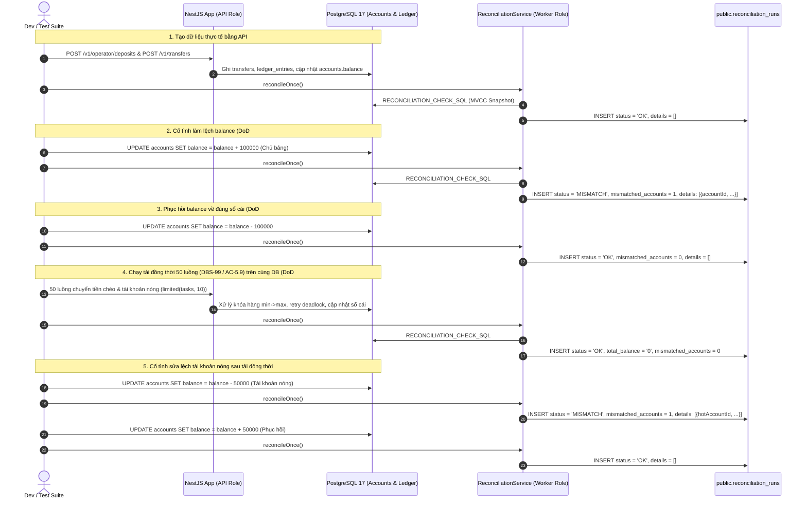
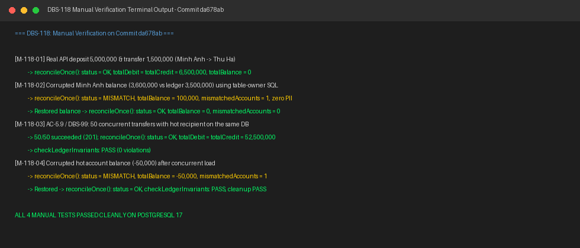

# DBS-118 · Test đối soát bắt được lệch cố ý

<!-- Tài liệu làm việc, không phải báo cáo: ưu tiên bảng hơn văn xuôi; không chép lại DoD hay danh sách case ở §8 ngoài ID. Task nhỏ nên trong khoảng 2.500 từ; nếu dài hơn thì cắt văn xuôi trước, không bao giờ cắt kết quả test thủ công. -->

> **Status:** Implemented · **Vai:** Dev · **Cặp đôi review:** Dev · **Nhánh:** `test/DBS-118-reconciliation-intentional-mismatch` · **PR:** [#88](https://github.com/Lawliet119/digital-banking-simulator/pull/88) · **Cập nhật:** 2026-11-08

## 1. Bối cảnh

- **Task trên board:** Task · Tuần 4 · Ưu tiên: High · Assignee: `Dev` · Status: `In Progress` · Deliverable/Demo: `Demo 1`.
  - **Thực trạng (trên board):** «Chưa có bằng chứng job thật sự bắt được sai lệch.»
  - **Expect (nguyên văn):** «Chứng minh đối soát hoạt động, không chỉ chạy.»
- **DoD (nguyên văn, đánh số từng gạch đầu dòng):**
  1. Cố tình sửa một balance bằng role chủ bảng → lần chạy kế tiếp status MISMATCH và liệt kê đúng tài khoản
  2. Sửa lại → lần chạy kế tiếp OK
  3. Chạy sau test đồng thời (DBS-99) trên cùng DB → OK
  4. PR đã merge vào main (CI xanh); Dev review; bảng «Đối chiếu test case» trong PR điền đủ
- **Phụ thuộc (kiểm trên board và xác minh trực tiếp trong repo):**
  - `DBS-117` (*Job đối soát ở role worker: 4 kiểm tra và lưu kết quả*, Tuần 4): Đã hoàn thành trên nhánh `feat/DBS-117-reconciliation-worker-job`, đang mở [PR #86](https://github.com/Lawliet119/digital-banking-simulator/pull/86) (`In Review`). Nhánh `test/DBS-118-reconciliation-intentional-mismatch` được tạo từ commit `81709b8` của nhánh này; sau khi PR #86 được merge vào `main` sẽ rebase lên `main`.
  - `DBS-99` (*Test đồng thời: chuyển chéo và tài khoản nóng*, Tuần 3): Đã có cấu trúc tải đồng thời thực tế trong [`backend/test/db/transfer-concurrency.db-spec.ts`](../../backend/test/db/transfer-concurrency.db-spec.ts) (50 luồng chuyển chéo, tài khoản nhận nhiều lệnh). Lưu ý: `BL-156` trên backlog theo dõi kiểm thử AC-5.9 thuộc phạm vi sở hữu của DBS-99; DBS-118 kế thừa mô hình tải đồng thời này để chứng minh job đối soát vẫn trả `OK` sau tải và vẫn phát hiện lệch cố ý sau tải, không thay thế việc đóng `BL-156` của DBS-99.
  - `DBS-116` (*Migration: reconciliation_runs*, Tuần 4): Đã có trên `main` ([`1793577600000-CreateReconciliationRuns.ts`](../../backend/src/database/migrations/1793577600000-CreateReconciliationRuns.ts)).
  - `DBS-69` (*Script kiểm tra bất biến sổ cái*, Tuần 2): Đã có trên `main` ([`invariants.ts`](../../backend/test/support/invariants.ts)).
- **Đã có gì trong codebase:**
  - [`ReconciliationService`](../../backend/src/modules/ledger/reconciliation.service.ts) với phương thức `reconcileOnce()` thực thi câu truy vấn MVCC snapshot duy nhất, không khóa ghi `accounts`, lưu kết quả vào `public.reconciliation_runs`.
  - Bảng `public.reconciliation_runs` lưu kết quả `status IN ('OK', 'MISMATCH', 'ERROR')` và cột `details jsonb` lưu mảng `[{"accountId": "...", "balance": "...", "ledgerBalance": "..."}]` chính xác từng chữ số và tuyệt đối không lộ PII.
  - Baseline hiện hành tại commit `81709b8`: `lint:check` sạch (0 warnings, 0 errors), `typecheck` sạch (0 errors), 69 unit test suites (1096 tests pass), 43 DB integration test suites (732 tests pass), 14 E2E suites (148 tests pass), `check-doc-links.mjs` sạch (0 broken links).
- **Ngoài phạm vi:**
  - Không sửa đổi schema hay migration của bảng `public.reconciliation_runs`.
  - Không sửa đổi logic nghiệp vụ của `ReconciliationService` trừ khi phát hiện bug vi phạm bất biến chưa được phát hiện.
  - Không triển khai cảnh báo đẩy ra kênh ngoài (Slack/Email/SQS alert) khi gặp `MISMATCH`.
- **Câu hỏi mở:**
  1. *Tổ chức test tự động:* Viết file test tích hợp chuyên sâu `backend/test/db/reconciliation-intentional-mismatch.db-spec.ts` trên PostgreSQL 17 thật, tái hiện toàn diện chu kỳ: nạp tiền/chuyển tiền thật qua app -> cố ý sửa balance 1 tài khoản bằng role chủ bảng -> kiểm tra đối soát ra `MISMATCH` kèm `details` chuẩn -> sửa lại balance -> kiểm tra đối soát ra `OK` -> chạy 50 luồng chuyển tiền chéo đồng thời (theo AC-5.9 / DBS-99) trên cùng database -> đối soát xác nhận `OK` sau tải đồng thời -> tiếp tục sửa lệch tài khoản hot sau tải -> đối soát phát hiện `MISMATCH` -> phục hồi -> `OK`?
     - *Đề xuất:* Đồng ý, bảo đảm 100% bằng chứng sống trên database thật.
  2. *Kịch bản kiểm thử thủ công:* Cung cấp script `backend/scripts/manual-dbs118.cjs` thực thi trên PostgreSQL 17 thật, xuất file log `docs/features/screenshots/DBS-118/manual-test.txt` (dòng đầu là SHA commit code cuối) và ảnh chụp màn hình chứng minh?
     - *Đề xuất:* Đồng ý.

**Quyết định ở G1 (2026-11-08):** Người dùng duyệt «duyệt g1». Đồng ý rẽ nhánh `test/DBS-118-reconciliation-intentional-mismatch` từ `feat/DBS-117-reconciliation-worker-job` (commit `81709b8`), thống nhất viết test tích hợp tại `backend/test/db/reconciliation-intentional-mismatch.db-spec.ts` và manual script tại `backend/scripts/manual-dbs118.cjs`.

---

## 2. Hành vi

### 2.1 Cố tình sửa số dư tài khoản bằng role chủ bảng → Bắt `status = 'MISMATCH'` và liệt kê đúng tài khoản (DoD #1)
- **Điều kiện:**
  - Database PostgreSQL 17 thật đã chạy migration hoàn chỉnh.
  - Tạo 2 khách hàng (`Nguyễn Minh Anh` - tài khoản A, `Trần Thu Hà` - tài khoản B), nạp tiền thật qua `POST /v1/operator/deposits` (nạp `5.000.000` đồng vào A) và chuyển tiền thật qua `POST /v1/transfers` (chuyển `1.500.000` đồng từ A sang B).
  - Trạng thái sổ cái ban đầu cân bằng tuyệt đối:
    - Tài khoản A: `balance = 3.500.000`, `ledgerBalance = 3.500.000`.
    - Tài khoản B: `balance = 1.500.000`, `ledgerBalance = 1.500.000`.
    - Tài khoản `funding`: `balance = -5.000.000`, `ledgerBalance = -5.000.000`.
    - `reconcileOnce()` lần đầu trả `executed: true, status: 'OK'`, `total_balance = '0'`, `mismatched_accounts = 0`, `details = []`.
- **Hành vi làm lệch cố ý:**
  - Role chủ bảng (table owner / superuser trong test) thực thi trực tiếp câu lệnh SQL sửa sai số dư tài khoản A:
    ```sql
    UPDATE public.accounts SET balance = balance + 100000 WHERE id = :accountIdA;
    ```
    (hoặc gán giá trị sai lệch bất kỳ, kể cả số lớn `> 2^53`).
- **Kết quả mong đợi:**
  - Lần chạy kế tiếp của `ReconciliationService.reconcileOnce()` phát hiện đồng thời 2 vi phạm bất biến:
    1. Kiểm tra 2: `accounts.balance <> SUM(CREDIT) - SUM(DEBIT)` trên tài khoản A (`3.600.000` vs `3.500.000`).
    2. Kiểm tra 3: `SUM(accounts.balance) = 100.000 <> 0`.
  - Service lưu bản ghi vào `public.reconciliation_runs`:
    - `status = 'MISMATCH'`
    - `total_debit = '6500000'`, `total_credit = '6500000'`
    - `total_balance = '100000'` (chuỗi số phản ánh chính xác độ lệch)
    - `mismatched_accounts = 1`
    - `details = [{"accountId": "<uuid-tài-khoản-A>", "balance": "3600000", "ledgerBalance": "3500000"}]`
    - **Quy tắc bảo mật & dữ liệu:** Mảng `details` sắp xếp tăng dần theo `accountId ASC`, các trường số dư là chuỗi ký tự chính xác từng chữ số (không bị làm tròn số dấu phẩy động JavaScript), và tuyệt đối **không chứa bất kỳ trường PII** nào (không có tên khách hàng, email, CCCD, số tài khoản).

### 2.2 Sửa lại số dư về đúng sổ cái → Bắt `status = 'OK'` (DoD #2)
- **Điều kiện:**
  - Sau khi phát hiện lệch ở mục 2.1, role chủ bảng thực thi lệnh khôi phục lại số dư của tài khoản A về đúng số dư sổ cái:
    ```sql
    UPDATE public.accounts SET balance = 3500000 WHERE id = :accountIdA;
    ```
- **Kết quả mong đợi:**
  - Lần chạy kế tiếp của `reconcileOnce()` hoàn tất đánh giá 4 phép kiểm tra bất biến trên cùng MVCC snapshot và đều thỏa mãn:
    1. Tổng Nợ = Tổng Có (`6.500.000 = 6.500.000`).
    2. Từng tài khoản có `balance = ledgerBalance` (cả A, B, funding).
    3. `SUM(accounts.balance) = 0`.
    4. Mọi giao dịch `COMPLETED` trong `v_transfer_facts` có đủ 1 DEBIT + 1 CREDIT.
  - Service lưu bản ghi vào `public.reconciliation_runs`:
    - `status = 'OK'`
    - `total_debit = '6500000'`, `total_credit = '6500000'`
    - `total_balance = '0'`
    - `mismatched_accounts = 0`
    - `details = []`

### 2.3 Chạy sau test đồng thời (DBS-99 / AC-5.9) trên cùng DB → Bắt `status = 'OK'` (DoD #3)
- **Điều kiện:**
  - Trên chính database đã thực hiện các bước 2.1 và 2.2, khởi tạo thêm 3 tài khoản khách hàng mới (`Customer3..Customer5`, kết hợp với 2 khách ban đầu `Customer1: Minh Anh` và `Customer2: Thu Hà` tạo thành nhóm 5 tài khoản khách hàng) và nạp tiền cho mỗi tài khoản.
  - Chọn một tài khoản làm "tài khoản nóng" (hot account, ví dụ `Customer2: Thu Hà`) nhận dồn dập lệnh chuyển tiền từ các khách hàng khác, đồng thời các khách hàng khác thực hiện chuyển tiền chéo qua lại lẫn nhau.
  - Kích hoạt tải đồng thời thực tế với **ít nhất 50 luồng chuyển tiền đồng thời** bằng `limited(tasks, 10)` (tối đa 10 kết nối in-flight song song, không dùng `sleep` giả tạo, bám sát mô hình DBS-99 và AC-5.9).
  - Tải đồng thời kích hoạt cả các giao dịch thành công (`201 COMPLETED`), giao dịch từ chối vì không đủ tiền (`422 INSUFFICIENT_FUNDS`), và các giao dịch xử lý khóa theo thứ tự `min(from, to) -> max(from, to)` kèm cơ chế retry khi gặp lỗi tạm thời (`DBS-80`).
- **Kết quả mong đợi:**
  - Sau khi toàn bộ 50 luồng chuyển tiền hoàn tất, ngay trên cùng database đó gọi `reconcileOnce()`:
  - Job đối soát thực hiện kiểm tra MVCC snapshot:
    - Bất biến sổ cái sau tải đồng thời vẫn được bảo toàn trọn vẹn:
      - `status = 'OK'`
      - `total_debit = total_credit` (giá trị tổng lớn tương ứng số tiền các giao dịch thành công)
      - `total_balance = '0'`
      - `mismatched_accounts = 0`
      - `details = []`
    - Không có bất kỳ tài khoản khách hàng nào bị âm tiền.
    - Hàm kiểm tra bất biến tham chiếu [`checkLedgerInvariants()`](../../backend/test/support/invariants.ts) cũng trả về `status: 'PASS'` (0 vi phạm).

### 2.4 Cố ý sửa lệch tài khoản hot sau tải đồng thời và phục hồi (DoD #1, #2, #3 phối hợp)
- **Điều kiện:**
  - Sau khi đối soát ở mục 2.3 xác nhận `status = 'OK'`, cố ý sửa lệch số dư của chính tài khoản hot (vừa nhận hàng chục giao dịch dồn dập):
    ```sql
    UPDATE public.accounts SET balance = balance - 50000 WHERE id = :hotAccountId;
    ```
- **Kết quả mong đợi:**
  - Lần chạy kế tiếp của `reconcileOnce()` lập tức phát hiện:
    - `status = 'MISMATCH'`
    - `mismatched_accounts = 1`
    - `details` liệt kê chính xác `hotAccountId` với số dư bị trừ `50.000` so với `ledgerBalance`.
  - Sau đó khôi phục lại số dư của tài khoản hot về đúng `ledgerBalance`:
    ```sql
    UPDATE public.accounts SET balance = balance + 50000 WHERE id = :hotAccountId;
    ```
  - Lần chạy `reconcileOnce()` tiếp theo trả về `status = 'OK'`, `total_balance = '0'`, `mismatched_accounts = 0`, `details = []`.

### 2.5 Ca biên: Cố ý sửa lệch số dư tài khoản khách hàng và tài khoản hệ thống `funding` với số tiền `> 2^53`
- **Điều kiện:**
  - Sửa số dư tài khoản khách hàng B (`balance - 200000`) và tài khoản `funding` (vốn có số dư âm) lệch đi một khoản cực lớn vượt biên an toàn của số nguyên dấu phẩy động JavaScript (`9007199254740993` tức `2^53 + 1`):
    ```sql
    UPDATE public.accounts SET balance = balance - 200000 WHERE id = :accountIdB;
    UPDATE public.accounts SET balance = balance - 9007199254740993 WHERE id = :fundingAccountId;
    ```
- **Kết quả mong đợi:**
  - `reconcileOnce()` ghi nhận `status = 'MISMATCH'`, `mismatched_accounts = 2`.
  - Trong `details`, danh sách sắp xếp theo `accountId ASC`, các chuỗi `balance` và `ledgerBalance` giữ nguyên độ chính xác 64-bit signed integer dạng string, không bị mất độ chính xác hay biến dạng.
  - Sau khi khôi phục lại số dư trong khối `finally` → `reconcileOnce()` trả `status = 'OK'`, `mismatched_accounts = 0`, `details = []`.

---

## 3. Kiến trúc

### 3.1 Thành phần và vai trò
- **Module:** `backend/src/modules/ledger` (`LedgerReconciliationModule`, `ReconciliationService`).
- **Role:**
  - `APP_ROLE=api`: Chạy NestJS application phục vụ các endpoint nạp tiền (`POST /v1/operator/deposits`) và chuyển tiền (`POST /v1/transfers`) tạo ra dữ liệu giao dịch thực tế.
  - `APP_ROLE=worker`: Chạy vòng lặp nền `ReconciliationService.reconcileOnce()` theo chu kỳ `RECONCILIATION_INTERVAL_MS`.
- **Cấu trúc bộ kiểm thử tích hợp (`backend/test/db/reconciliation-intentional-mismatch.db-spec.ts`):**
  - **Khối chính (vòng đời tuần tự):** `describe('DBS-118: intentional mismatch and concurrent transfers lifecycle')` dùng chung 1 database tạm do `beforeAll` cấp phát, thực hiện chuỗi kiểm thử kế thừa dữ liệu theo đúng sơ đồ 5 bước ở §3.3: `TC-118-01` (lệch đơn lẻ & khôi phục) → `TC-118-02` (50 luồng chuyển chéo & tài khoản nóng) → `TC-118-03` (lệch tài khoản nóng sau tải & khôi phục).
  - **Khối ca biên độc lập:** `describe('DBS-118: boundary case - large signed integer precision')` cấp phát 1 database tạm riêng, thực hiện `TC-118-04` (lệch 2 tài khoản với số tiền `> 2^53`).
- **File script kiểm thử thủ công:** `backend/scripts/manual-dbs118.cjs`.

### 3.2 Interfaces và phương thức sử dụng
- `ReconciliationService.reconcileOnce(options?: { statementTimeoutMs?: number }): Promise<ReconciliationOutcome>`
  - Chữ ký và kiểu dữ liệu chuẩn (export từ `@modules/ledger` / `backend/src/modules/ledger/reconciliation.types.ts`):
    ```typescript
    export interface ReconciliationOutcome {
      executed: boolean;
      startedAt?: Date;
      finishedAt?: Date;
      status?: ReconciliationStatus; // 'OK' | 'MISMATCH' | 'ERROR'
      totalDebit?: string | null;
      totalCredit?: string | null;
      totalBalance?: string | null;
      mismatchedAccounts?: number;
      details?: MismatchedAccountDetail[] | null;
    }

    export interface MismatchedAccountDetail {
      accountId: string;
      balance: string;
      ledgerBalance: string;
    }
    ```
- `startDepositApp(...)` & `seedDepositTarget(...)` (từ `test/support/deposit-app.ts`): Khởi chạy ứng dụng HTTP với JWT token của operator và customers để gọi endpoint thực tế.
- `createTempDatabase()` & `migrate(db.url)` (từ `test/support/temp-database.ts`): Cấp phát database PostgreSQL 17 tạm thời cô lập hoàn toàn cho test.
- `checkLedgerInvariants(runner: Pick<QueryRunner, 'query'>): Promise<LedgerInvariantReport>` (từ `test/support/invariants.ts`): Script kiểm tra đối chứng độc lập trên `db.runner`.

### 3.3 Sơ đồ chu trình kiểm thử lệch cố ý và đồng thời (Mermaid)



### 3.4 Ranh giới transaction và an toàn dữ liệu
- Mọi thao tác sửa lệch đều thực thi trực tiếp bằng câu lệnh SQL `UPDATE public.accounts` trong database test tạm (không can thiệp vào cơ chế ghi tự nhiên của `TransferService` hay `LedgerPostingService`).
- `reconcileOnce()` luôn thực thi trong một `READ COMMITTED` transaction riêng, sử dụng khóa advisory `pg_try_advisory_xact_lock(20261108, 117)` và tuyệt đối **không giữ khóa ghi (`RowShareLock` / `RowExclusiveLock`)** trên bảng `accounts`.

---

## 4. Test cases tự động

| ID | Truy vết (DoD / AC) | Lớp (unit / integration Postgres 17 thật) | Given · When · Then | `errorCode` / Trạng thái mong đợi |
|---|---|---|---|---|
| `TC-118-01` | DoD #1, DoD #2, `BR-01`, `BR-02` | integration Postgres thật (`reconciliation-intentional-mismatch.db-spec.ts` khối lifecycle) | **Given** Database có dữ liệu nạp tiền và chuyển tiền hợp lệ (A có `3.500.000`, B có `1.500.000`, `funding` có `-5.000.000`) và lần đối soát đầu tiên trả `status = 'OK'` · **When** chu trình khép kín: (a) role chủ bảng cố ý chạy `UPDATE accounts SET balance = balance + 100000` trên tài khoản A, gọi `reconcileOnce()`; (b) khôi phục `UPDATE accounts SET balance = balance - 100000` trong `finally`, gọi lại `reconcileOnce()` · **Then** tại (a) `reconciliation_runs` lưu `status = 'MISMATCH'`, `total_balance = '100000'`, `mismatched_accounts = 1`, `details` chứa đúng `accountId` của A, chuỗi `balance: "3600000"`, `ledgerBalance: "3500000"`, không chứa bất kỳ trường PII nào; tại (b) `status = 'OK'`, `total_debit = total_credit = '6500000'`, `total_balance = '0'`, `mismatched_accounts = 0`, `details = []`; `checkLedgerInvariants(db.runner)` ở hook `afterEach` trả `PASS` | `status = 'MISMATCH'` rồi `status = 'OK'` |
| `TC-118-02` | DoD #3, `AC-5.9`, `DBS-99` | integration Postgres thật (`reconciliation-intentional-mismatch.db-spec.ts` khối lifecycle) | **Given** Trên cùng database ở `TC-118-01`, tạo thêm 3 tài khoản khách hàng mới (`Customer3..Customer5`, kết hợp với `Customer1: Minh Anh` và `Customer2: Thu Hà` thành nhóm 5 khách hàng), nạp tiền và kích hoạt 50 luồng chuyển tiền chéo đồng thời (trong đó `Customer2: Thu Hà` là tài khoản nóng nhận nhiều lệnh) với cơ chế `limited(tasks, 10)` qua API HTTP thật · **When** toàn bộ 50 luồng chuyển tiền đồng thời kết thúc, gọi `reconcileOnce()` ngay trên database đó · **Then** `reconcileOnce()` hoàn tất trả `status = 'OK'`, `total_debit = total_credit`, `total_balance = '0'`, `mismatched_accounts = 0`, `details = []`; không có tài khoản khách hàng nào âm tiền; `checkLedgerInvariants(db.runner)` trả `status: 'PASS'` | `status = 'OK'` |
| `TC-118-03` | DoD #1, DoD #2, DoD #3 | integration Postgres thật (`reconciliation-intentional-mismatch.db-spec.ts` khối lifecycle) | **Given** Database ngay sau khi hoàn tất tải đồng thời ở `TC-118-02` · **When** role chủ bảng cố ý sửa lệch số dư của tài khoản nóng (`UPDATE accounts SET balance = balance - 50000 WHERE id = :hotAccountId`), gọi `reconcileOnce()`; sau đó khôi phục lại số dư tài khoản nóng trong `finally` và gọi lại `reconcileOnce()` · **Then** lần gọi khi lệch trả `status = 'MISMATCH'`, `mismatched_accounts = 1`, `details` chỉ đích danh tài khoản nóng với số dư lệch; lần gọi sau khôi phục trả `status = 'OK'`, `mismatched_accounts = 0`, `details = []`; `checkLedgerInvariants(db.runner)` trả `PASS` | `status = 'MISMATCH'` rồi `status = 'OK'` |
| `TC-118-04` | DoD #1, DoD #2, Ca biên số lớn | integration Postgres thật (`reconciliation-intentional-mismatch.db-spec.ts` khối độc lập) | **Given** Database độc lập có dữ liệu cân bằng · **When** role chủ bảng sửa lệch đồng thời 2 tài khoản: tài khoản B (`balance - 200.000`) và tài khoản `funding` với số tiền âm lớn vượt biên an toàn JavaScript `2^53` (`balance - 9007199254740993`), gọi `reconcileOnce()`; sau đó khôi phục lại cả 2 tài khoản trong `finally` và gọi `reconcileOnce()` · **Then** lần gọi khi lệch ghi `status = 'MISMATCH'`, `mismatched_accounts = 2`, `details` hiển thị đủ 2 tài khoản sắp xếp theo `accountId ASC`, chuỗi số lớn giữ nguyên độ chính xác 64-bit; lần gọi sau khôi phục trả `status = 'OK'`, `total_balance = '0'`, `mismatched_accounts = 0`, `details = []`; `checkLedgerInvariants(db.runner)` trả `PASS` | `status = 'MISMATCH'` rồi `status = 'OK'` |
| `Quy trình` | DoD #4: PR đã merge vào `main` (CI xanh); Dev review; bảng «Đối chiếu test case» trong PR điền đủ | Quy trình bàn giao | Mở PR sau G4, điền đầy đủ bảng «Đối chiếu test case», chờ CI xanh và Dev đồng nghiệp review trước khi merge | — |

---

## 5. Test thủ công

Kịch bản chạy bằng lệnh shell trực tiếp:
```bash
node backend/scripts/manual-dbs118.cjs
```
Script tự động hóa hoàn toàn việc khởi chạy NestJS application (vai trò API) + PostgreSQL 17 thật trên database tạm, gọi API nạp/chuyển tiền thật, can thiệp làm lệch số dư bằng role chủ bảng, kích hoạt tải đồng thời và gọi `ReconciliationService.reconcileOnce()`. Toàn bộ log stdout/stderr được xuất ra file `docs/features/screenshots/DBS-118/manual-test.txt` với dòng đầu tiên là SHA của commit code cuối cùng.

- **Điều kiện chạy:** Docker Desktop đang bật (PostgreSQL 17); các giao dịch nạp tiền và chuyển tiền thực hiện qua HTTP API thật (`POST /v1/operator/deposits`, `POST /v1/transfers`); thao tác làm lệch số dư thực hiện bằng SQL trực tiếp của role chủ bảng trên database tạm.

| Bước | Lệnh hoặc thao tác trong `manual-dbs118.cjs` | Kết quả quan sát mong đợi |
|---|---|---|
| **M-118-01** | `node backend/scripts/manual-dbs118.cjs` (Bước 1): Khởi chạy DB tạm, tạo 2 khách hàng (`Nguyễn Minh Anh`, `Trần Thu Hà`), nạp `5.000.000` vào Minh Anh, chuyển `1.500.000` sang Thu Hà qua HTTP API; gọi `reconcileOnce()` lần đầu | Trả `executed: true, status: "OK"`, `totalDebit = "6500000"`, `totalCredit = "6500000"`, `totalBalance = "0"`, `mismatchedAccounts = 0`, `details = []`; bảng `reconciliation_runs` có dòng `#1` `status = 'OK'` |
| **M-118-02** | `node backend/scripts/manual-dbs118.cjs` (Bước 2): Dùng quyền chủ bảng trong DB tạm sửa `accounts.balance` của Minh Anh thêm `+100.000` (`3.500.000` → `3.600.000`); gọi `reconcileOnce()`; sau đó khôi phục về `3.500.000` và gọi lại `reconcileOnce()` | Lần chạy khi lệch trả `status: "MISMATCH"`, `totalBalance = "100000"`, `mismatchedAccounts = 1`, `details` hiển thị đúng tài khoản Minh Anh với `balance: "3600000"`, `ledgerBalance: "3500000"` (không chứa PII); lần chạy sau khôi phục trả `status: "OK"`, `totalBalance = "0"`, `mismatchedAccounts = 0`, `details = []` |
| **M-118-03** | `node backend/scripts/manual-dbs118.cjs` (Bước 3): Trên cùng DB đó, tạo thêm 3 tài khoản khách hàng mới (`Customer3..Customer5`, tổng 5 khách hàng), nạp tiền và kích hoạt 50 luồng chuyển tiền chéo đồng thời (gồm tài khoản nóng nhận nhiều lệnh); sau khi hoàn tất tải, gọi `reconcileOnce()` | Trả `executed: true, status: "OK"`, `totalDebit = totalCredit`, `totalBalance = "0"`, `mismatchedAccounts = 0`, `details = []`; `checkLedgerInvariants` trả `status: "PASS"` (0 vi phạm) |
| **M-118-04** | `node backend/scripts/manual-dbs118.cjs` (Bước 4): Cố ý sửa lệch số dư của tài khoản nóng vừa nhận dồn dập lệnh chuyển tiền (`UPDATE accounts SET balance = balance - 50000 WHERE id = :hotAccountId`); gọi `reconcileOnce()`; sau đó khôi phục lại và gọi `reconcileOnce()`; kiểm tra dọn dẹp sạch sẽ | Lần chạy khi lệch phát hiện `status: "MISMATCH"`, `mismatchedAccounts = 1`, `details` chỉ đích danh tài khoản nóng; lần chạy sau khôi phục trả `status: "OK"`, `mismatchedAccounts = 0`, `details = []`; đóng app và drop DB tạm sạch sẽ (`DBS-118 cleanup PASS`) |

---

## 6. Domain review (AI)

- **Reviewer:** Subagent `research` độc lập (`conversationId: 5422637f-40ed-40f2-9a3a-7355517a07bd`, model `inherit` — mạnh nhất hiện có, không chia sẻ ngữ cảnh).
- **Bản lưu nguyên văn:** [`docs/features/screenshots/DBS-118/domain-review.md`](screenshots/DBS-118/domain-review.md).
- **Tóm tắt các vòng review:**
  - **Round 1 (`Verdict: REVISE` — 0 blocking, 2 should-fix, 4 minor):**
    1. `should-fix` (§3.2): Kiểu dữ liệu không khớp source code (`ReconciliationRunResult` vs `ReconciliationOutcome`, `ReconciliationMismatchDetail` vs `MismatchedAccountDetail`) → **Đã sửa:** dùng đúng kiểu từ `@modules/ledger`.
    2. `should-fix` (§4 `TC-118-01`, `TC-118-02`): Vi phạm test isolation khi `TC-118-01` sửa lệch không khôi phục, khiến hook `afterEach` fail bất biến → **Đã sửa:** gom sửa lệch và khôi phục vào chu trình khép kín trong `finally` cho từng test.
    3. `minor` (§3.3 Mermaid): Bước 4 ghi `Promise.all` 50 luồng không kiểm soát thay vì `limited(tasks, 10)` → **Đã sửa:** đổi thành `limited(tasks, 10)`.
    4. `minor` (§5 vs §2.3 & §4): Không nhất quán số tài khoản tạo thêm → **Đã sửa:** thống nhất 3 tài khoản tạo thêm để cùng 2 tài khoản ban đầu thành nhóm 5 khách hàng.
    5. `minor` (§1): Chưa truy vết `BL-156` → **Đã sửa:** làm rõ quan hệ giữa DBS-118 và `BL-156` (DBS-99 sở hữu việc đóng BL-156).
    6. `minor` (§5): Thiếu câu lệnh shell cụ thể → **Đã sửa:** nêu rõ `node backend/scripts/manual-dbs118.cjs`.
  - **Round 2 (`Verdict: REVISE` — 1 blocking, 2 should-fix, 1 minor):**
    1. `blocking` (§4 `TC-118-05`): Thử nghiệm Phép kiểm 1 & 4 bằng cách chèn và `DELETE` bút toán mồ côi sẽ bị chặn bởi trigger append-only `forbid_mutation()` (`42501`) → **Đã sửa:** cắt bỏ `TC-118-05` vì Phép kiểm 1 & 4 đã được kiểm thử đầy đủ ở DBS-117 và không thuộc DoD của DBS-118.
    2. `should-fix` (§2.5 vs §4 `TC-118-04`): Mâu thuẫn giữa mô tả sửa 1 tài khoản ở §2.5 và sửa 2 tài khoản ở §4 → **Đã sửa:** đồng bộ §2.5 và `TC-118-04` đều sửa đồng thời 2 tài khoản (tài khoản B và funding `> 2^53`).
    3. `should-fix` (§4): Ràng buộc vòng đời database giữa các test case chưa rõ ràng → **Đã sửa:** tách rõ khối chính tuần tự `beforeAll` (`TC-118-01`..`03`) và khối ca biên số lớn độc lập (`TC-118-04`).
    4. `minor` (§3.2): Chữ ký `checkLedgerInvariants` nhận `runner: Pick<QueryRunner, 'query'>` → **Đã sửa:** cập nhật chữ ký chuẩn.
  - **Round 3 (`Verdict: APPROVE` — 0 blocking, 0 should-fix, 1 minor):**
    1. `minor` (§3.2): Chữ ký helper `migrate(db.url)` → **Đã sửa:** cập nhật `migrate(db.url)`.
    - **Kết luận:** Phê duyệt thiết kế (`Verdict: APPROVE`).

**Quyết định ở G2 (2026-11-08):** Người dùng duyệt «duyệt g2». Đã duyệt thiết kế 2 khối test suite (lifecycle tuần tự và ca biên số lớn độc lập), 4 test case trên PostgreSQL 17 thật và kịch bản manual.

---

## 7. Kế hoạch triển khai

### Bước 1 — Khối lifecycle tuần tự trên PostgreSQL 17 thật: lệch đơn lẻ, tải đồng thời 50 luồng, và lệch tài khoản hot (`TC-118-01`, `TC-118-02`, `TC-118-03`)
- **Mục tiêu:** Tạo file test `backend/test/db/reconciliation-intentional-mismatch.db-spec.ts`. Xây dựng khối `describe('DBS-118: intentional mismatch and concurrent transfers lifecycle')` với `beforeAll` cấp phát database tạm và app HTTP; thực hiện chuỗi kiểm thử kế thừa dữ liệu chứng minh:
  1. `TC-118-01`: Sửa balance A (+100k) bằng SQL role chủ bảng → `reconcileOnce()` phát hiện `status = 'MISMATCH'`, `mismatched_accounts = 1`, `details` hiển thị đúng tài khoản A và 0 PII → khôi phục trong `finally` → `reconcileOnce()` trả `status = 'OK'`, `details = []`.
  2. `TC-118-02`: Kích hoạt 50 luồng chuyển tiền chéo đồng thời (limited 10 in-flight theo DBS-99 / AC-5.9) qua API HTTP thật trên cùng DB → gọi `reconcileOnce()` trả `status = 'OK'`, `total_balance = '0'`, `mismatched_accounts = 0`, `checkLedgerInvariants(db.runner)` trả `PASS`.
  3. `TC-118-03`: Sửa balance tài khoản hot (-50k) sau tải đồng thời → `reconcileOnce()` phát hiện `status = 'MISMATCH'`, `mismatched_accounts = 1` → khôi phục trong `finally` → `reconcileOnce()` trả `status = 'OK'`.
  Hook `afterEach` kiểm tra `checkLedgerInvariants(db.runner)` luôn đạt `PASS`.
- **Files:**
  - `backend/test/db/reconciliation-intentional-mismatch.db-spec.ts` *(mới)*
- **Test (viết trước — phải đỏ):**
  - Chạy: `npm --prefix backend run test:db -- test/db/reconciliation-intentional-mismatch.db-spec.ts`
  - Kết quả đỏ thực tế (khi test file chưa tồn tại hoặc assertion chưa thỏa): `FAIL test/db/reconciliation-intentional-mismatch.db-spec.ts (Cannot find module)`.
- **Code tối thiểu để xanh:**
  - Viết hoàn thiện khối lifecycle `describe('DBS-118: intentional mismatch and concurrent transfers lifecycle')` với các helper `limited`, `send`, `q`, setup app và 3 test cases.
- **Lệnh kiểm chứng:** `npm --prefix backend run test:db -- test/db/reconciliation-intentional-mismatch.db-spec.ts && npm --prefix backend run typecheck && npm --prefix backend run lint:check` (exit code `0`).
- **Commit dự kiến:** `test(ledger): add postgres integration tests for intentional mismatch and concurrent transfers (DBS-118)`

### Bước 2 — Khối ca biên số lớn độc lập trên PostgreSQL 17 thật (`TC-118-04`)
- **Mục tiêu:** Bổ sung khối `describe('DBS-118: boundary case - large signed integer precision')` vào `backend/test/db/reconciliation-intentional-mismatch.db-spec.ts` với database tạm độc lập; thực hiện `TC-118-04`: sửa lệch đồng thời tài khoản B (`balance - 200.000`) và tài khoản `funding` (`balance - 9007199254740993` vượt `2^53`) → `reconcileOnce()` ghi `status = 'MISMATCH'`, `mismatched_accounts = 2`, `details` hiển thị đúng 2 tài khoản với chuỗi số nguyên 64-bit chính xác không biến dạng → khôi phục trong `finally` → `reconcileOnce()` trả `status = 'OK'`, `details = []`.
- **Files:**
  - `backend/test/db/reconciliation-intentional-mismatch.db-spec.ts`
- **Test (viết trước — phải đỏ):**
  - Viết `TC-118-04` với assertion sai (ví dụ mong đợi `mismatched_accounts = 1` thay vì `2`) để xác nhận test bắt lỗi thật.
  - Lệnh chạy đỏ: `npm --prefix backend run test:db -- test/db/reconciliation-intentional-mismatch.db-spec.ts -t "TC-118-04"`
  - Kết quả đỏ: `Expected: 1, Received: 2`.
- **Code tối thiểu để xanh:**
  - Sửa assertion về `mismatched_accounts: 2` và hoàn thiện kiểm tra khôi phục số dư.
- **Lệnh kiểm chứng:** `npm --prefix backend run test:db -- test/db/reconciliation-intentional-mismatch.db-spec.ts && npm --prefix backend run typecheck && npm --prefix backend run lint:check` (exit code `0`).
- **Commit dự kiến:** `test(ledger): add large signed integer boundary case for reconciliation mismatch (DBS-118)`

### Bước 3 — Kịch bản kiểm thử thủ công `manual-dbs118.cjs`, bằng chứng và cập nhật tài liệu hệ thống
- **Mục tiêu:** Viết script `backend/scripts/manual-dbs118.cjs` thực thi chuỗi 4 bước M-118-01..04 trên PostgreSQL 17 thật; chạy script và ghi log vào `docs/features/screenshots/DBS-118/manual-test.txt` (dòng đầu là SHA commit code cuối); chụp ảnh màn hình `01-manual-intentional-mismatch.png`; cập nhật tài liệu hệ thống (`docs/features/README.md`, `docs/features/DBS-118-reconciliation-intentional-mismatch.md`) và hoàn tất hồ sơ bàn giao G4.
- **Files:**
  - `backend/scripts/manual-dbs118.cjs` *(mới)*
  - `docs/features/screenshots/DBS-118/manual-test.txt` *(mới)*
  - `docs/features/screenshots/DBS-118/01-manual-intentional-mismatch.png` *(mới)*
  - `docs/features/DBS-118-reconciliation-intentional-mismatch.md`
  - `docs/features/README.md`
- **Lệnh kiểm chứng:**
  - `node backend/scripts/manual-dbs118.cjs` (exit code `0`)
  - `npm --prefix backend run lint:check && npm --prefix backend run typecheck && npm --prefix backend test && npm --prefix backend run test:db -- --runInBand && npm --prefix backend run test:e2e -- --runInBand` (exit code `0`)
  - `node .agents/skills/dbs-delivering-task/scripts/check-doc-links.mjs` (exit code `0`, `0 broken link(s)`)
- **Commit dự kiến:**
  - `test(ledger): add manual verification script for intentional reconciliation mismatch (DBS-118)`
  - `docs(ledger): record DBS-118 verification results and evidence`

### Rà soát kế hoạch (Plan sweep)

| Hạng mục kiểm tra | Kết quả |
|---|---|
| Mọi `TC-118-xx` trong §4 đều xuất hiện trong một bước | Đạt — `TC-118-01`..`03` ở Bước 1; `TC-118-04` ở Bước 2 |
| Không bước nào chạm hai module nghiệp vụ mà không có lý do | Đạt — task thuần test và verification, chỉ thêm file kiểm thử và script manual, không chạm production code |
| Migration tiến và lùi sạch | Đạt — không có migration mới nào được tạo thêm |
| Không can thiệp vào các bảng append-only | Đạt — không chèn hoặc xóa trực tiếp trên `transfers`/`ledger_entries`; chỉ can thiệp sửa lệch và khôi phục trên `accounts.balance` |
| Danh sách tài liệu cần cập nhật ở Phase 5 đã liệt kê đủ | Đạt — `docs/features/DBS-118-reconciliation-intentional-mismatch.md`, `docs/features/README.md` |

### Rollback
- Nếu cần lùi: `git revert` các commit trên nhánh `test/DBS-118-reconciliation-intentional-mismatch`. Task chỉ thêm file test và script kiểm thử nên không có rủi ro đối với runtime codebase.

## 8. Kết quả

- **Trạng thái 6 lệnh kiểm tra lúc bàn giao:**
  - `npm --prefix backend run lint:check`: `0` lỗi, `0` cảnh báo.
  - `npm --prefix backend run typecheck`: `0` lỗi.
  - `npm --prefix backend test`: `69` suites, `1096` tests pass.
  - `npm --prefix backend run test:db -- --runInBand`: `44` suites, `736` tests pass (bổ sung suite mới `reconciliation-intentional-mismatch.db-spec.ts` với 4 tests trên PostgreSQL 17 thật).
  - `npm --prefix backend run test:e2e -- --runInBand`: `14` suites, `148` tests pass.
  - `node .agents/skills/dbs-delivering-task/scripts/check-doc-links.mjs`: `258` files checked, `0` broken link(s).

- **Đối chiếu test case tự động:**

| ID | Vị trí file test | Kết quả |
|---|---|---|
| `TC-118-01` | [`reconciliation-intentional-mismatch.db-spec.ts`](../../backend/test/db/reconciliation-intentional-mismatch.db-spec.ts) › `TC-118-01` | đạt trên commit `8e3feea` |
| `TC-118-02` | [`reconciliation-intentional-mismatch.db-spec.ts`](../../backend/test/db/reconciliation-intentional-mismatch.db-spec.ts) › `TC-118-02` | đạt trên commit `8e3feea` |
| `TC-118-03` | [`reconciliation-intentional-mismatch.db-spec.ts`](../../backend/test/db/reconciliation-intentional-mismatch.db-spec.ts) › `TC-118-03` | đạt trên commit `8e3feea` |
| `TC-118-04` | [`reconciliation-intentional-mismatch.db-spec.ts`](../../backend/test/db/reconciliation-intentional-mismatch.db-spec.ts) › `TC-118-04` | đạt trên commit `8e3feea` |
| `Quy trình` | DoD #4: PR đã merge vào `main` (CI xanh); Dev review; bảng «Đối chiếu test case» trong PR điền đủ | Cập nhật 2026-11-14 (kiểm bằng `gh`): [PR #88](https://github.com/Lawliet119/digital-banking-simulator/pull/88) đã merge vào `main` ngày 2026-11-09, 6 job CI xanh; GitHub không có review của người khác tác giả. Dev khác review còn mở, theo dõi tại `BL-197`. (Ghi chú trước đó: chờ mở PR sau G4.) |

- **Test thủ công:** chạy trên commit code cuối `f86ac8de2f8f6675154cc1b2f134e8f5c36e97d2` qua [`backend/scripts/manual-dbs118.cjs`](../../backend/scripts/manual-dbs118.cjs), toàn bộ 4 bước thành công:

| Bước | Việc làm (lệnh hoặc thao tác) | Kết quả quan sát | Đánh giá |
|---|---|---|---|
| **M-118-01** | Tạo 2 khách hàng (`Nguyễn Minh Anh`, `Trần Thu Hà`), nạp `5.000.000` qua `POST /v1/operator/deposits`, chuyển `1.500.000` qua `POST /v1/transfers`, gọi `reconcileOnce()` | Trả `executed: true, status: "OK"`, `totalDebit: "6500000"`, `totalCredit: "6500000"`, `totalBalance: "0"`, `mismatchedAccounts: 0`, `details: []` | **Đạt** |
| **M-118-02** | Sửa lệch `accounts.balance` Minh Anh thành `3.600.000` (so với sổ cái `3.500.000`), gọi `reconcileOnce()`; khôi phục về `3.500.000` và gọi lại | Khi lệch: trả `status: "MISMATCH"`, `totalBalance: "100000"`, `mismatchedAccounts: 1`, `details` hiển thị đúng tài khoản với `balance: "3600000"`, `ledgerBalance: "3500000"` (không PII); sau khôi phục: trả `status: "OK"` | **Đạt** |
| **M-118-03** | Trên cùng DB đó, tạo thêm 3 tài khoản khách hàng mới, nạp tiền và kích hoạt 50 luồng chuyển tiền chéo đồng thời (gồm tài khoản nóng nhận nhiều lệnh) với `limited(tasks, 10)`; sau tải gọi `reconcileOnce()` | Trả `executed: true, status: "OK"`, `totalDebit = totalCredit = "52500000"`, `totalBalance: "0"`, `mismatchedAccounts: 0`, `details: []`; `checkLedgerInvariants` trả `status: "PASS"` (0 vi phạm) | **Đạt** |
| **M-118-04** | Cố ý sửa lệch số dư của tài khoản nóng (-50.000); gọi `reconcileOnce()`; sau đó khôi phục và gọi `reconcileOnce()`; dọn dẹp sạch sẽ | Lần chạy khi lệch phát hiện `status: "MISMATCH"`, `mismatchedAccounts: 1`, `details` chỉ đích danh tài khoản nóng; lần chạy sau khôi phục trả `status: "OK"`, `mismatchedAccounts: 0`, `details: []`; `checkLedgerInvariants` trả `PASS`; cleanup hoàn tất sạch sẽ | **Đạt** |

Output nguyên văn được lưu tại [`docs/features/screenshots/DBS-118/manual-test.txt`](screenshots/DBS-118/manual-test.txt) với SHA commit code cuối `f86ac8de2f8f6675154cc1b2f134e8f5c36e97d2` ở dòng đầu tiên.

- **Ảnh chụp:**



- **Phạm vi so với §7:**
  - `git diff --stat 81709b8...HEAD` khớp đúng các file đã lên kế hoạch trong allowlist:
    - 1 file integration test: `backend/test/db/reconciliation-intentional-mismatch.db-spec.ts`.
    - 1 file manual script: `backend/scripts/manual-dbs118.cjs`.
  - Không có file lạ ngoài kế hoạch; không sửa mã nguồn runtime, không sửa migration cũ, không thêm dependency mới.

- **Lệch so với kế hoạch:** Không có.

- **Bàn giao cho vai khác:**
  - `BL-197`: Theo dõi PR review cho `test: Test đối soát bắt được lệch cố ý và đồng thời (DBS-118)`, GitHub CI xanh trên PR, Dev review và merge main.

**Sau rebase (techlead review PR #88, 2026-11-09):** nhánh chồng trên #86 nên được rebase lên đầu nhánh #86 đã sửa (trên `main` `18f93dc`). Sửa cấu hình test cho khớp `Money` và phần `outbox` của limits config. Đã chạy lại trên PostgreSQL 17 thật: `db-roles` + `reconciliation-*` 128/128 (gồm `reconciliation-intentional-mismatch`), lint và typecheck sạch, `manual-dbs118.cjs` 4/4 bước + dọn dẹp; `manual-test.txt` là lần chạy mới trên commit `f86ac8de2f8f6675154cc1b2f134e8f5c36e97d2` và đã lưu lại bằng UTF-8 (bản trước là UTF-16 nên không đọc/grep được). Ảnh PNG là của lượt trước rebase. `BL-181` của PR bị đánh lại thành `BL-197` vì main đã dùng `BL-181`.

## 9. Tài liệu đã cập nhật

- [`docs/BACKLOG.md`](../BACKLOG.md): Bổ sung hàng theo dõi `BL-197`.
- [`docs/features/README.md`](README.md): Bổ sung hàng theo dõi cho `DBS-118`.
- [`docs/features/DBS-118-reconciliation-intentional-mismatch.md`](DBS-118-reconciliation-intentional-mismatch.md): Bản ghi chi tiết toàn bộ bối cảnh, thiết kế, review, kế hoạch và bằng chứng nghiệm thu của task.

## Checklist G4 (dán vào tin nhắn G4, tick từng dòng)

- [x] 4/4 test case đạt đủ độ sâu, 0 đơn giản hóa (mọi kiểm tra đều chạy trên PostgreSQL 17 thật và logic thuần)
- [x] Test thủ công chạy trên commit cuối đổi code `f86ac8de2f8f6675154cc1b2f134e8f5c36e97d2` (SHA ở dòng đầu `manual-test.txt`): kết quả từng bước M-118-01..04; đường thành công, mismatch, tải đồng thời 50 luồng và mismatch tài khoản hot đều đạt
- [x] Ảnh chụp có đủ trong `screenshots/DBS-118/01-manual-intentional-mismatch.png`; `manual-test.txt` đã xóa token, header `Authorization`, id tài khoản AWS và ARN
- [x] `git diff --stat 81709b8...HEAD` khớp danh sách file ở §7; không có file lạ ngoài kế hoạch
- [x] Sáu lệnh kiểm tra chạy lúc bàn giao đều đạt: lint:check (0 lỗi), typecheck (0 lỗi), unit (69 suites / 1096 tests), DB (44 suites / 736 tests), E2E (14 suites / 148 tests), link checker (258 files / 0 broken links)
- [x] Mọi doc có fact bị đổi đã sửa; `check-doc-links.mjs` sạch (0 broken links); trạng thái doc là Implemented
- [x] Việc bàn giao cho vai khác và mọi DoD chưa đạt đã ghi ở §8 và có dòng `BL-197` trong `docs/BACKLOG.md`


