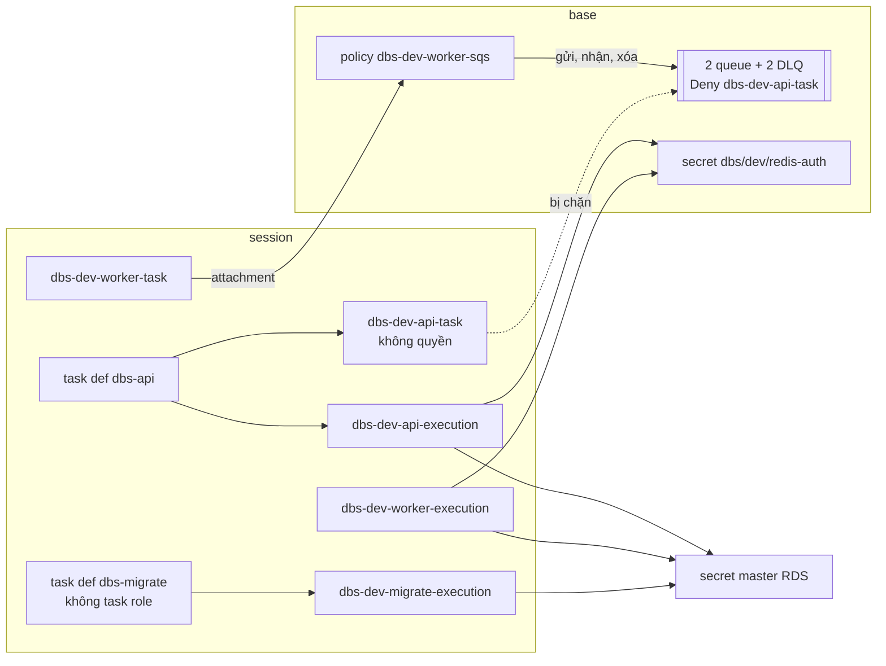

# DBS-120 · ECS task role riêng cho api và worker với quyền tối thiểu

> **Status:** Draft · **Vai:** #5 Platform & Ops · **Cặp đôi review:** Dev · **Nhánh:** `chore/DBS-120-ecs-task-roles` (từ `main` 17b011e) · **PR:** — · **Cập nhật:** 2026-11-11

## 1. Bối cảnh

- **Task trên board:** Task, Tuần 4, Ưu tiên High, Deliverable P3, Status "To Do" (cần chuyển "In Progress"). **Expect:** Một tiến trình bị xâm nhập không có quyền ngoài phạm vi của nó.
- **Thực trạng trên board:** Task chưa có IAM role riêng. api không cần SQS (chỉ ghi outbox); worker gửi/nhận/xóa trên 2 queue và DLQ.
- **DoD** (nguyên văn, đánh số):
  1. Task role api: không quyền SQS, chỉ đọc secret của mình; task role worker: SQS đúng 2 queue + DLQ, đọc secret của mình
  2. Task execution role tách khỏi task role
  3. Kiểm bằng thử gọi trái quyền (api gửi SQS → AccessDenied)
  4. PR đã merge vào main (CI xanh); Dev review; bảng «Đối chiếu test case» trong PR điền đủ
- **Phụ thuộc** (board và repo khớp):

| Task | Board | Trong repo |
|---|---|---|
| DBS-34 ECS cluster, service api, ALB | Done | `envs/dev/session/ecs.tf`, `iam.tf` trên `main` |
| DBS-73 hai queue SQS + DLQ | Done | `envs/dev/base/sqs.tf` trên `main`; 4 queue có thật trên AWS (`aws sqs list-queues`), policy `dbs-dev-worker-sqs` có thật, `AttachmentCount = 0` |

- **Đã có gì** (đọc file và kiểm bằng lệnh AWS chỉ đọc, 2026-11-11):

| Role / policy | Ở đâu | Quyền hiện tại | Dùng bởi |
|---|---|---|---|
| `dbs-dev-api-execution` | `session/iam.tf:16` | `pull-image-and-write-logs` (`iam.tf:24`): `ecr:GetAuthorizationToken` trên `*`; `ecr:BatchGetImage`, `GetDownloadUrlForLayer`, `BatchCheckLayerAvailability` trên repo `dbs-api`; `logs:CreateLogStream`, `PutLogEvents` trên `/dbs/dev/api:*`. `read-db-master-secret` (`iam.tf:56`): `secretsmanager:GetSecretValue` trên secret master RDS, `kms:Decrypt` trên CMK `alias/dbs-dev` khi `kms:ViaService = secretsmanager`. `read-redis-auth-secret` (`iam.tf:80`): `GetSecretValue` trên `dbs/dev/redis-auth` | task def `dbs-api` (`ecs.tf:20`) **và** `dbs-migrate` (`ecs.tf:86`) |
| `dbs-dev-api-task` | `session/iam.tf:97` | không policy, không attachment | `dbs-api` (`ecs.tf:21`) **và** `dbs-migrate` (`ecs.tf:87`) |
| Trust của cả hai role | `session/iam.tf:1` | `sts:AssumeRole` cho `ecs-tasks.amazonaws.com`, `aws:SourceAccount` = tài khoản | — |
| `dbs-dev-worker-sqs` (managed) | `base/sqs.tf:51`, output `worker_sqs_policy_arn` (`base/outputs.tf:134`) | `SendMessage`, `ReceiveMessage`, `DeleteMessage`, `ChangeMessageVisibility`, `GetQueueAttributes` trên 2 queue chính; `SendMessage` trên 2 DLQ | chưa gắn role nào (BL-113) |
| Queue policy `DenyApiTaskRole` | `base/sqs.tf:91` | `Deny sqs:*` trên 4 queue cho `aws:PrincipalArn` = `role/dbs-dev-api-task` (`sqs.tf:105`) | chặn thêm một lớp |
| `iam:PassRole` của `dbs-github-deploy` | `base/deploy_role.tf:32`, `:113` | đúng 2 ARN `dbs-dev-api-execution`, `dbs-dev-api-task`, điều kiện `iam:PassedToService = ecs-tasks` | `deploy.sh`, `migrate.sh` đăng ký revision mới (giữ nguyên role của revision cũ) |

  - **Secret:** RDS master (session, `aws_db_instance.main.master_user_secret[0]`, đọc ở `ecs.tf:59-60`, `:113-114` qua `DB_USER`, `DB_PASSWORD`); `dbs/dev/redis-auth` (`base/redis_auth.tf:4`, đọc ở `ecs.tf:62` qua `REDIS_AUTH_TOKEN`); `dbs/dev/demo-accounts` (script seed Cognito, không task nào đọc). Không dùng SSM Parameter Store.
  - **Queue:** `dbs-dev-risk-events`, `dbs-dev-notification-events`, `dbs-dev-risk-events-dlq`, `dbs-dev-notification-events-dlq` (`base/sqs.tf:12`, `:20`), ARN qua output `sqs_queue_arns`, `sqs_dlq_arns`.
  - **App cần gì** (`backend/src/config/validation.schema.ts`): mọi role cần `DATABASE_URL` (`:101`) và `REDIS_URL` (`:138`), nên api và worker cần cả secret DB lẫn Redis; worker cần thêm `SQS_*_QUEUE_URL` (`:156-161`, không phải secret). Migration chỉ cần `DB_*` (`ecs.tf:202-215`). Mã app **không** gọi Secrets Manager hay KMS: SDK AWS duy nhất là `@aws-sdk/client-sqs` (`backend/package.json:66`, `libs/sqs/sqs.client.ts`); secret do ECS agent đọc bằng execution role và đưa vào biến môi trường. `OPENAI_API_KEY` (`:221`) chưa có secret trên AWS (BL-043).
  - **Trên AWS hiện giờ:** stack `session` đã destroy (không cluster, không role `dbs-dev-api-*`); `base` có queue, secret Redis, log group `/dbs/dev/api`, SG `dbs-dev-api`; role `dbs-github-deploy` chưa có trên tài khoản (BL-105, BL-109).
  - Tài liệu: docs/03 §12 dòng "Quyền tối thiểu", §13; ADR-13 (`APP_ROLE`, hai service một image); threat-model T9, T23 (`T23` đang "Thiết kế", trỏ DBS-120); feature doc [DBS-34](DBS-34-terraform-ecs-alb.md), [DBS-67](DBS-67-rds-tls-secrets.md), [DBS-68](DBS-68-migration-step.md), [DBS-73](DBS-73-terraform-sqs.md), [DBS-75](DBS-75-terraform-valkey.md), [DBS-38](DBS-38-auto-deploy-ecs.md).
- **Baseline** (`chore/DBS-120-ecs-task-roles` = `main` 17b011e, Terraform 1.16.6): `terraform fmt -check -recursive` sạch (exit 0); `init -backend=false` và `validate` đạt cả ba stack; `terraform test`: bootstrap **9 passed, 0 failed**, `base` **43 passed, 0 failed**, `session` **24 passed, 0 failed**. Không có code backend thay đổi nên không chạy baseline backend.
- **Dòng BACKLOG liên quan:**

| Dòng | Quyết định |
|---|---|
| BL-113 (gắn `dbs-dev-worker-sqs` vào role task worker; giữ tên role api khớp queue policy) | **Nhận**, xóa dòng trong PR này |
| BL-103 (DB credentials riêng cho từng role; đổi api, worker, `dbs-migrate` sang role riêng kèm execution role riêng và `iam:PassRole`) | **Nhận phần IAM** (execution role riêng, migrate có role riêng, PassRole cho migrate); phần secret/login DB `dbs_api`, `dbs_worker`, `dbs_migrator` giữ ở BL-103, sửa mô tả dòng |
| BL-105 (OIDC thật của role deploy, `environment:`) | Không nhận: không đổi trust OIDC; ghi rõ ở §8 |
| BL-114, BL-119, BL-161 (service worker, URL queue vào task def, SG/Redis cho worker) | Không nhận: DBS-121 |
| BL-107, BL-109, BL-195 (xoay mật khẩu master, chạy migrate thật, owner view) | Không nhận: không liên quan quyền IAM của task |
| BL-101, BL-027 (role cho script seed Cognito, quyền state) | Không nhận: không phải role của ECS task |
| BL-043 (secret `OPENAI_API_KEY`) | Không nhận; khi có secret này, chỉ execution role worker được đọc (ghi ở §3) |

- **Ngoài phạm vi:** service, task definition và log group của worker (DBS-121); secret và login DB riêng cho từng tiến trình (BL-103); quyền `iam:PassRole` và `ecs:UpdateService` cho service worker trong role deploy (DBS-121, khi có service để deploy); OIDC thật (BL-105); WAF (BL-037).
- **Câu hỏi mở** và **Quyết định ở G1** (agent tự quyết):
  1. **Tạo role worker khi chưa có service worker?** Có. DBS-121 phụ thuộc DBS-120 (board), BL-113 giao việc gắn policy cho task này. Role không có task chạy thì không cấp gì cho ai; đây không phải stub vì role là sản phẩm của chính DBS-120. Output `worker_task_role_arn`, `worker_execution_role_arn` cho DBS-121.
  2. **"Đọc secret của mình" nằm ở role nào?** Ở **execution role của từng service**. Lý do: app không gọi Secrets Manager (đã grep), secret đi vào container qua `secrets` của task definition, do ECS agent đọc bằng execution role. Cho task role quyền `GetSecretValue` là thêm quyền mà mã app không dùng, trái Expect. Vậy: task role api và worker **không có** quyền Secrets Manager hay KMS; mỗi service có execution role riêng, chỉ `GetSecretValue` đúng các secret mà task definition của nó tham chiếu. Ghi diễn giải này trong PR cho reviewer.
  3. **Tách execution role theo service?** Có: `dbs-dev-api-execution` (giữ tên), `dbs-dev-worker-execution`, `dbs-dev-migrate-execution`. Hôm nay api và worker đọc cùng hai secret, nhưng `dbs-migrate` không cần secret Redis mà vẫn đọc được (dùng chung role với api). Tách cũng là chỗ để BL-103 (secret DB riêng) và BL-043 (khóa OpenAI chỉ cho worker) gắn vào mà không mở rộng role của service khác.
  4. **Task `dbs-migrate` dùng task role nào?** **Không có task role** (bỏ `task_role_arn`). Migration chỉ nói chuyện với PostgreSQL, không gọi API AWS nào, nên container không cần credential AWS. Cách này chặt hơn một role rỗng và không cần thêm PassRole. `render-task-definition.py` chỉ chép khóa có trong revision cũ nên vẫn chạy (kiểm ở Phase 4).
  5. **Tên role api** giữ `dbs-dev-api-task` để queue policy `Deny` ở `base/sqs.tf:105` vẫn khớp (bàn giao của DBS-73). Có test khóa tên này.
  6. **Log của worker:** execution role worker được ghi log vào log group `/dbs/dev/worker` (ARN dựng theo quy ước tên); DBS-121 tạo log group đó. Ghi dòng BL cho DBS-121 để tên khớp.
  7. **Role deploy:** thêm `dbs-dev-migrate-execution` vào `iam:PassRole` (migrate.sh đăng ký revision mới với role mới); **không** thêm role worker lúc này (chưa có gì để deploy; DBS-121 thêm cùng `ecs:UpdateService` cho service worker).
  8. **Kiểm DoD 3 thế nào?** Không assume được task role từ máy (trust chỉ `ecs-tasks`), ECS Exec cần thêm quyền `ssmmessages:*` vào task role nên bị loại. Chọn hai lớp: (a) `aws iam simulate-principal-policy` trên role thật, có `--resource-policy` của queue, cho ma trận quyền đầy đủ; (b) **gọi thật**: một task Fargate tạm `dbs-probe` (image `public.ecr.aws/aws-cli/aws-cli`, như M-34-07 của DBS-34) chạy dưới task role api thì `aws sqs send-message` trả `AccessDenied`; dưới task role worker thì gửi, nhận, xóa được. Cần dựng stack `session` (desired_count 0, không chạy app) rồi destroy ngay: ước tính khoảng 40 phút bật, ≈ 0,10 USD (RDS, Valkey, ALB, IPv4 theo docs/03 §13.2), task probe ≈ 0,01 USD. Nếu RDS không dựng được, phương án lùi là `apply -target` chỉ phần IAM và cluster (miễn phí) và kiểm execution role bằng `simulate-custom-policy` trên policy lấy từ `terraform plan`.
  9. **Lệch vai:** không có; task Terraform, vai #5, baseline Terraform.

**Tự kiểm G1** (2026-11-11): DoD và Expect chép nguyên văn từ `fetch-task.mjs DBS-120`; trong và ngoài phạm vi ghi rõ ở trên; "Thực trạng" kiểm bằng đọc Terraform và lệnh AWS chỉ đọc (`iam list-roles`, `iam list-policies --scope Local`, `sqs list-queues`, `secretsmanager list-secrets`, `ecs list-clusters`, `logs describe-log-groups`); hai phụ thuộc Done và có trong `main`; baseline xanh (9/43/24); mọi dòng BACKLOG cùng chủ đề đã nhận hoặc nêu tên. **G1 qua.**

## 2. Hành vi

Không có API; hệ thống là ma trận "principal → hành động → kết quả" trên AWS.

**Role sau task này:**

| Role | Loại | Quyền | Gắn vào |
|---|---|---|---|
| `dbs-dev-api-task` | task | **không có** (không inline, không attachment); queue policy `Deny sqs:*` | task def `dbs-api` |
| `dbs-dev-worker-task` | task | đúng một attachment: managed policy `dbs-dev-worker-sqs` (lấy ARN qua `terraform_remote_state`); không inline | chưa gắn task def nào (DBS-121) |
| `dbs-dev-api-execution` | execution | kéo image `dbs-api`, ghi log `/dbs/dev/api`, `GetSecretValue` đúng {secret master RDS, `dbs/dev/redis-auth`}, `kms:Decrypt` CMK qua Secrets Manager | task def `dbs-api` |
| `dbs-dev-worker-execution` | execution | kéo image `dbs-api`, ghi log `/dbs/dev/worker`, `GetSecretValue` đúng {secret master RDS, `dbs/dev/redis-auth`}, `kms:Decrypt` CMK qua Secrets Manager | chưa gắn (DBS-121) |
| `dbs-dev-migrate-execution` | execution | kéo image `dbs-api`, ghi log `/dbs/dev/api` (stream `migrate/`), `GetSecretValue` đúng {secret master RDS}, `kms:Decrypt` CMK qua Secrets Manager | task def `dbs-migrate` (không task role) |

Cả năm role tin đúng `ecs-tasks.amazonaws.com` với `aws:SourceAccount` = tài khoản; năm tên khác nhau; không role nào có `*` trong `Action` hay `Resource` của Secrets Manager, KMS, SQS.

**Ma trận chấp nhận và từ chối** (kết quả `simulate-principal-policy` mong đợi; `AccessDenied` khi gọi thật):

| Principal | Hành động | Tài nguyên | Kết quả |
|---|---|---|---|
| task api | `sqs:SendMessage`, `ReceiveMessage`, `DeleteMessage`, `GetQueueAttributes` | 2 queue chính, 2 DLQ | `explicitDeny` (queue policy) · thật: `AccessDenied` |
| task api | `secretsmanager:GetSecretValue` | `dbs/dev/redis-auth`, secret master | `implicitDeny` · thật: `AccessDeniedException` |
| task api | `kms:Decrypt` | CMK | `implicitDeny` |
| task worker | `SendMessage`, `ReceiveMessage`, `DeleteMessage`, `ChangeMessageVisibility`, `GetQueueAttributes` | `dbs-dev-risk-events`, `dbs-dev-notification-events` | `allowed` · thật: có `MessageId`, nhận và xóa được |
| task worker | `SendMessage` | 2 DLQ | `allowed` (consumer đẩy message sai schema, hợp đồng event) |
| task worker | `ReceiveMessage`, `DeleteMessage`, `PurgeQueue` | 2 DLQ | `implicitDeny` (redrive là việc của Ops) · thật: `AccessDenied` |
| task worker | `PurgeQueue`, `DeleteQueue`, `SetQueueAttributes`, `CreateQueue` | queue chính | `implicitDeny` |
| task worker | `SendMessage` | queue không thuộc dự án (ARN `dbs-dev-other`) | `implicitDeny` |
| task worker | `secretsmanager:GetSecretValue`, `kms:Decrypt` | secret Redis, secret master, CMK | `implicitDeny` |
| execution api, worker | `GetSecretValue` | secret master, `dbs/dev/redis-auth` | `allowed` |
| execution api, worker, migrate | `GetSecretValue` | `dbs/dev/demo-accounts` | `implicitDeny` |
| execution migrate | `GetSecretValue` | `dbs/dev/redis-auth` | `implicitDeny` |
| execution migrate | `GetSecretValue` | secret master | `allowed` |
| mọi execution role | `kms:Decrypt` không qua Secrets Manager (không có `kms:ViaService`) | CMK | `implicitDeny` |
| mọi execution role | `sqs:SendMessage` | queue chính | `implicitDeny` |
| execution worker | `logs:PutLogEvents` | `/dbs/dev/api` | `implicitDeny` (chỉ log group của mình) |
| role deploy | `iam:PassRole` cho `ecs-tasks` | `dbs-dev-migrate-execution` | `allowed`; `dbs-dev-worker-*` → `implicitDeny` tới DBS-121 |

**Ca biên:**
- Task def `dbs-migrate` không có `taskRoleArn`: container không lấy được credential (`aws sts get-caller-identity` trong container sẽ lỗi "Unable to locate credentials"); migration vẫn chạy vì không gọi AWS.
- Mỗi `valueFrom` trong `secrets` của một task def phải nằm trong tập `GetSecretValue` của execution role của chính nó; thiếu thì task không khởi động (`ResourceInitializationError`), thừa là quyền dư. Test kiểm hai chiều.
- Đổi tên role api thì queue policy hết khớp: test khóa tên `dbs-dev-api-task` ở `session` và chuỗi ARN ở `base`.

## 3. Kiến trúc

- **Vị trí:** `infra/terraform/envs/dev/session/iam.tf` (thêm role worker, migrate; tách policy kéo image và log thành từng role), `session/ecs.tf` (`dbs-migrate` đổi execution role, bỏ task role), `session/outputs.tf` (thêm `worker_task_role_arn`, `worker_execution_role_arn`), `session/tests/session.tftest.hcl` (override ARN role mới, thêm `worker_sqs_policy_arn` vào base mock), `base/deploy_role.tf` (PassRole thêm migrate execution), `base/tests/deploy_role.tftest.hcl`. Không đổi code backend, không đổi `base/sqs.tf`.
- **Interface dùng:** output base `worker_sqs_policy_arn`, `redis_auth_secret_arn`, `kms_key_arn`, `ecr_repository_arn`, `api_log_group_arn`; `aws_db_instance.main.master_user_secret[0].secret_arn`. **Cung cấp** cho DBS-121: output session `worker_task_role_arn`, `worker_execution_role_arn`; log group phải tên `/dbs/dev/worker`.
- **Người dùng của symbol bị đổi:** `aws_iam_role.execution`, `aws_iam_role.task` được tham chiếu ở `session/ecs.tf` (4 chỗ) và `session/tests/session.tftest.hcl` (override, run `task_definition`, `iam`, `db_secret_policy`, `redis_secret_policy`, `migrate_task_definition`). Chuỗi tên role ở `base/sqs.tf:105`, `base/deploy_role.tf:33-34`, `base/tests/sqs.tftest.hcl:154`, `base/tests/deploy_role.tftest.hcl:69`. Giữ địa chỉ resource của role api (hoặc dùng `moved` nếu đổi tên địa chỉ; session bị destroy mỗi phiên nên không có rủi ro state).
- **Dữ liệu:** không chạm database.
- **Ranh giới transaction:** không áp dụng.
- **Sơ đồ:**

- **Thay đổi cấp hệ thống:** không ADR mới (đúng docs/03 §12 "IAM role riêng cho task API và worker"). Phase 5 sửa: threat-model T23 (và T9) sang "Đã kiểm" kèm bằng chứng; `infra/terraform/README.md` bảng IAM (dòng nói policy chưa gắn) và mục migration (task migrate dùng role riêng); docs/03 §12 nếu cần nêu execution role theo service.

## 4. Test cases tự động

Tất cả là `terraform test` với `mock_provider` (không cần credential), chạy bằng `terraform test` trong thư mục stack.

| ID | Truy vết | Lớp | Given · When · Then | Mong đợi |
|---|---|---|---|---|
| TC-120-01 | DoD 1 (api) | tf test session | plan session · không `aws_iam_role_policy` hay `aws_iam_role_policy_attachment` nào có `role` = role api task; tên role = `dbs-dev-api-task` | đúng |
| TC-120-02 | DoD 1 (api) | grep tĩnh (lệnh ghi ở §8, như M-34-02b của DBS-34) | `grep -n 'aws_iam_role.task' envs/dev/session/*.tf` chỉ ra `ecs.tf` (task def `dbs-api`) và `outputs.tf`, không có `aws_iam_role_policy*` nào | đúng |
| TC-120-03 | DoD 1 (worker) | tf test session | role `dbs-dev-worker-task` có đúng một `aws_iam_role_policy_attachment` với `policy_arn` = output base `worker_sqs_policy_arn`; không inline policy | đúng |
| TC-120-04 | DoD 1 (worker) | tf test base (TC-73-05 giữ nguyên) | policy `dbs-dev-worker-sqs` chỉ có action `sqs:*` liệt kê trên đúng 2 ARN queue + `SendMessage` trên 2 DLQ | đúng (chạy lại, không sửa) |
| TC-120-05 | DoD 1 (secret của mình) | tf test session | tập `Resource` của `GetSecretValue` trên execution api = {secret master, secret Redis}; worker = {secret master, secret Redis}; migrate = {secret master} | đúng, không `*` |
| TC-120-06 | DoD 1 (secret của mình) | tf test session | với `dbs-api` và `dbs-migrate`: mọi ARN (bỏ hậu tố `:key::`) trong `secrets[].valueFrom` thuộc tập `GetSecretValue` của execution role gắn với task def đó, và ngược lại | bằng nhau |
| TC-120-07 | DoD 1 | tf test session | `kms:Decrypt` của mỗi execution role chỉ trên CMK và có `kms:ViaService = secretsmanager.ap-southeast-1.amazonaws.com`; task role không có action `secretsmanager:*`, `kms:*` | đúng |
| TC-120-08 | DoD 2 | tf test session | `dbs-api`: execution = api execution, task = api task, hai ARN khác nhau; `dbs-migrate`: execution = migrate execution, `task_role_arn` null; năm tên role đôi một khác nhau | đúng |
| TC-120-09 | DoD 2 | tf test session | trust policy của năm role: `Principal.Service = ecs-tasks.amazonaws.com`, `aws:SourceAccount` = `account_id` | đúng |
| TC-120-10 | DoD 1 (log) | tf test session | log statement: api, migrate execution trên `/dbs/dev/api:*`; worker execution trên `arn:aws:logs:…:log-group:/dbs/dev/worker:*`; ECR pull chỉ trên ARN repo | đúng |
| TC-120-11 | DoD 2 (deploy truyền role) | tf test base | `iam:PassRole` của role deploy = đúng {api execution, api task, migrate execution}, điều kiện `ecs-tasks`; không chứa `dbs-dev-worker-*` | đúng |
| TC-120-12 | DoD 1 (worker) | tf test session | output `worker_task_role_arn`, `worker_execution_role_arn` bằng ARN role tương ứng | đúng |
| TC-120-13 | DoD 3 | thủ công | ma trận §2 trên AWS thật | xem M-120-04…07 |
| — | DoD 4 | quy trình | PR merge, CI xanh, Dev review, bảng đối chiếu | không có test |

## 5. Test thủ công

Điều kiện: profile `dbs-admin`, `ap-southeast-1`, budget alarm có; image không cần (desired_count 0). Lệnh chạy trong bash, output thô vào `screenshots/DBS-120/manual-test.txt`, xóa id tài khoản và ARN trước khi commit.

| Bước | Việc làm | Kết quả mong đợi |
|---|---|---|
| M-120-01 | `aws sts get-caller-identity`; `aws budgets describe-budgets`; `terraform plan` ở `envs/dev/session` (`-var image_tag=<sha main>`) | đúng tài khoản; plan tạo đủ 5 role, 1 attachment, các inline policy theo §2; không xóa gì ngoài session |
| M-120-02 | `terraform apply` session (sau khi kiểm plan; agent ghi giờ bắt đầu) | apply xong; `aws iam list-attached-role-policies --role-name dbs-dev-worker-task` = `dbs-dev-worker-sqs`; `list-role-policies` và `list-attached-role-policies` của `dbs-dev-api-task` rỗng |
| M-120-03 | `aws ecs describe-task-definition` cho `dbs-api` và `dbs-migrate` | `dbs-api`: hai role api khác nhau; `dbs-migrate`: execution migrate, không `taskRoleArn` |
| M-120-04 | `simulate-principal-policy` cho task api: 4 action SQS × 4 queue, kèm `--resource-policy` của queue; `GetSecretValue` 2 secret; `kms:Decrypt` | SQS `explicitDeny`; secret và KMS `implicitDeny` |
| M-120-05 | `simulate-principal-policy` cho task worker theo bảng §2 (cho phép và từ chối) | đúng từng ô của bảng |
| M-120-06 | `simulate-principal-policy` cho ba execution role (secret của mình, secret của role khác, `demo-accounts`, KMS không qua Secrets Manager, log group khác) | đúng từng ô của bảng |
| M-120-07 | **Gọi thật, bị từ chối:** đăng ký task def tạm `dbs-probe` (image `public.ecr.aws/aws-cli/aws-cli`, execution role api, log `/dbs/dev/api` prefix `probe`, task role `dbs-dev-api-task`), `run-task` ở public subnet với SG `dbs-dev-api`, lệnh `sqs send-message` tới `dbs-dev-risk-events` rồi `secretsmanager get-secret-value dbs/dev/redis-auth` | log: `AccessDenied` cho SQS, `AccessDeniedException` cho secret; task thoát khác 0 |
| M-120-08 | **Gọi thật, được phép và ca biên:** cùng probe với task role `dbs-dev-worker-task`: `send-message` tới `dbs-dev-risk-events` (body `{"probe":"DBS-120"}`), `receive-message`, `delete-message`, rồi `receive-message` trên `dbs-dev-risk-events-dlq` | có `MessageId`; nhận và xóa được; DLQ `AccessDenied`; `get-queue-attributes` cho thấy queue chính về 0 message |
| M-120-09 | **Down:** deregister và xóa revision `dbs-probe`; `terraform destroy` session; kiểm còn sót: load balancer, RDS, ElastiCache, task ECS, Elastic IP, ENI `available`, role `dbs-dev-*-task`/`*-execution` | không còn gì của session; queue và policy base vẫn còn; ghi giờ tắt và chi phí ngày hôm sau (Cost Explorer) |
