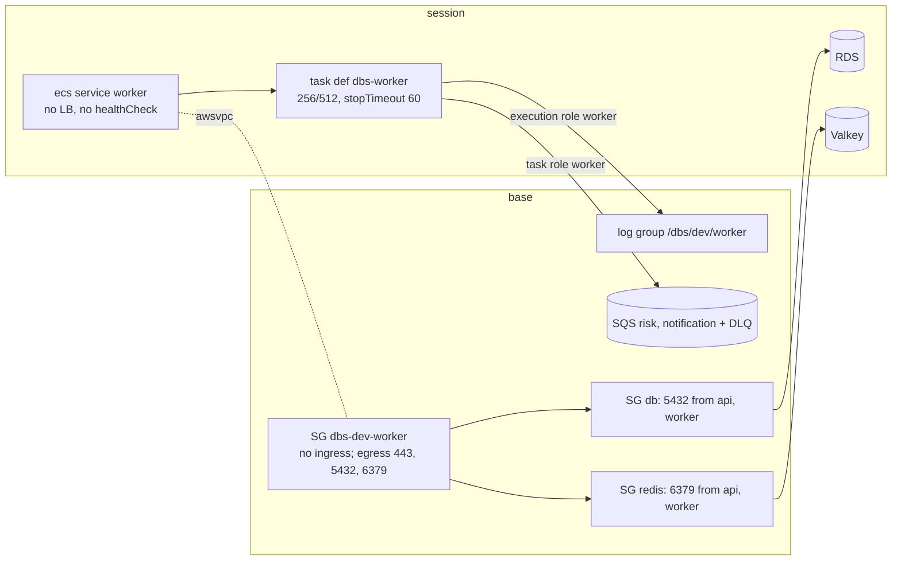

# DBS-121 · Dựng service worker (APP_ROLE=worker) trên ECS

> **Status:** Implemented một phần (G4 tự duyệt 2026-11-12; DoD 2 và nhóm B của test thủ công chưa đạt, BL-244) · **Vai:** #5 Platform & Ops · **Cặp đôi review:** Dev · **Nhánh:** `feat/DBS-121-worker-service` (từ `origin/chore/DBS-120-ecs-task-roles` 18b8163) · **PR:** — · **Cập nhật:** 2026-11-12
>
> **Phụ thuộc PR #146 (DBS-120):** nhánh này xây trên `chore/DBS-120-ecs-task-roles` vì cần hai role worker (`worker_task`, `worker_execution`), policy `dbs-dev-worker-sqs` và danh sách bàn giao BL-242. PR của DBS-121 chỉ nên mở/merge sau khi PR #146 vào `main` (hoặc dùng PR #146 làm nhánh nền), nếu không diff sẽ lẫn commit của DBS-120.

## 1. Bối cảnh

- **Task trên board:** Task, Tuần 4, Ưu tiên High, Deliverable P3, Status "To Do" (cần chuyển "In Progress"). Vai board: #5 Platform & Ops, khớp loại việc (Terraform). **Expect:** Phần bất đồng bộ chạy trên cloud.
- **Thực trạng trên board:** ECS hiện chỉ có service api. Worker chạy relay, risk, notification, job đối soát và job dọn dẹp; health check của worker cần cách riêng (Dockerfile cố ý không có HEALTHCHECK). [Cập nhật 11/10] docs/03 §4, §13.3: worker không có health check HTTP; ECS thay task khi tiến trình thoát; worker treo phát hiện qua alarm tuổi outbox và tuổi message.
- **DoD** (nguyên văn, đánh số):
  1. Service worker (APP_ROLE=worker) thuộc nhóm «xóa hằng ngày»; kiểm tra sức khỏe worker (cách nào do ADR-13/Dockerfile quy định) và log về CloudWatch
  2. Chuyển tiền trên cloud → message vào đúng queue → consumer xử lý → cờ xuất hiện (kiểm tay có ghi lại)
  3. Tắt/bật task worker không ảnh hưởng api
  4. PR đã merge vào main (CI xanh); Dev review; bảng «Đối chiếu test case» trong PR điền đủ
- **Phụ thuộc** (board và repo):

| Task | Board | Trong repo |
|---|---|---|
| DBS-120 role riêng cho api và worker | To Do | **Có trong nhánh nền** `origin/chore/DBS-120-ecs-task-roles` (PR #146, chưa merge): `session/iam.tf` có `worker_task`, `worker_execution`, output ARN; `base/sqs.tf` có policy `dbs-dev-worker-sqs`. Chưa có trên `main` |
| DBS-67 Secrets Manager, CA bundle trong image | Done | `session/ecs.tf` api dùng `DB_*`, `DATABASE_SSL_CA_PATH`; Dockerfile có CA |
| DBS-73 hai queue + DLQ | Done | `base/sqs.tf`; output `sqs_risk_queue_url`, `sqs_notification_queue_url` |

- **Đã có gì:** `session/ecs.tf` (cluster, `dbs-api`, `dbs-migrate`, service api), `session/iam.tf` (role worker, log group worker chỉ là ARN dựng theo tên), `base/logs.tf` (chỉ `/dbs/dev/api`), `base/security_groups.tf` + `rds_network.tf` + `redis_network.tf` (SG db, redis chỉ nhận từ SG api), `base/deploy_role.tf` (PassRole và UpdateService chỉ cho api/migrate). Code backend: `main.ts` (role worker dùng `createApplicationContext`, `setInterval` giữ tiến trình sống, `enableShutdownHooks`, lỗi khởi động thoát khác 0), `validation.schema.ts` (mọi role cần `DATABASE_URL`, `REDIS_URL`, `COGNITO_*`, `TRUST_PROXY_HOPS` ở staging; worker cần thêm `SQS_RISK_QUEUE_URL`, `SQS_NOTIFICATION_QUEUE_URL`). ADR-13 và Dockerfile: không HEALTHCHECK, worker không mở cổng.
- **Baseline** (Terraform 1.16.6, chạy `-parallelism=1`, `GOMAXPROCS=2`, `GOMEMLIMIT=1500MiB` vì lần đầu `terraform test` bị OOM-kill exit 137 trên máy 8 GB): `base` **43 passed, 0 failed**; `session` **27 passed, 0 failed** (doc DBS-120 ghi 24, số thật đo hôm nay là 27). Có động tới `backend/src/config/connection-pool.spec.ts` (đọc `session/variables.tf`), chạy riêng spec đó (`npx jest --config ./test/jest-unit.js src/config/connection-pool.spec.ts`, dùng `node_modules` của checkout chính qua symlink không commit): baseline **4 passed**; không chạy toàn bộ bốn lệnh backend (không đổi code ứng dụng; máy không có docker cho e2e Testcontainers).
- **Tình trạng AWS lúc bắt đầu** (lệnh chỉ đọc, profile `dbs-admin`): ECR `dbs-api` **không có image**; không cluster ECS, RDS, Valkey, ALB; log group chỉ `/dbs/dev/api`; role `dbs-*` chỉ `dbs-github-ecr-push`. Máy này **không có `docker`** và việc tải image gốc/CA ngoài repo bị cấm trong lượt làm này, nên chưa có image để chạy task thật (xem §5).
- **Dòng BACKLOG liên quan:**

| Dòng | Quyết định |
|---|---|
| BL-242 (log group worker, PassRole/UpdateService, gắn role vào task def, kiểm execution role bằng task thật) | **Nhận** (1), (2), (3 phần Terraform); phần "task thật" thành BL mới (chưa chạy); sửa dòng |
| BL-114 (URL queue vào task def worker) | **Nhận**, xóa dòng |
| BL-119 (SG redis cho worker) | **Nhận**, xóa dòng |
| BL-161 (hạ tầng nửa bất đồng bộ) | **Nhận (1)** (service, SG, ingress RDS/Redis, log group, biến SQS); (2)–(5) giữ; sửa dòng |
| BL-182 (`stopTimeout` ≥ 35 s, alarm tuổi outbox) | **Nhận `stopTimeout`**; alarm giữ; sửa dòng |
| BL-234 (`deployment_maximum_percent`, số task worker thật) | **Nhận một phần**: worker `max 100%`, tổng task api + worker ≤ 6 do `variables.tf` chặn; phần api giữ; sửa dòng |
| BL-103, BL-115, BL-043, BL-241, BL-243 | Không nhận: secret DB riêng, biến DLQ, khóa OpenAI, allow-list queue policy, kiểm role DBS-120 |

- **Ngoài phạm vi:** alarm DLQ/tuổi outbox/tuổi message (BL-051, BL-117, BL-163), `deploy.sh` cập nhật worker khi deploy (BL mới), secret DB riêng cho `dbs_worker` (BL-103), biến URL DLQ (BL-115), WAF, CI/CD.
- **Câu hỏi mở** và **Quyết định ở G1** (agent tự quyết, người dùng vắng, Claude audit duyệt):
  1. **Health check của worker theo cách nào?** Theo ADR-13 và docs/03 §13.3: **không** `healthCheck` container, không `portMappings`, không load balancer; container `essential = true` nên ECS thay task khi tiến trình thoát (lỗi khởi động ra `exit 1` ở `main.ts`). Worker treo phát hiện qua alarm (BL-161 (3)), không phải ở task này. Test khóa: task def không có `healthCheck`, không `portMappings`, service không `load_balancer`.
  2. **Image/tag:** dùng cùng `var.image_tag` và repo `dbs-api` với api (ADR-13). Service worker **không** `ignore_changes[task_definition]` (deploy.sh chỉ chạy cho api; nhóm xóa hằng ngày nên mỗi phiên dựng theo `image_tag`). BL mới: `deploy.sh` lăn worker cùng image khi deploy.
  3. **`desired_count` worker mặc định 0**, tối đa 2 (docs/03 §13.1: 1–2 task), và `desired_count + worker_desired_count ≤ 6` (74 kết nối dùng được của `db.t4g.micro`, `số task × 10 + 5`, trạng thái ổn định). Giống api: mặc định 0 vì không task nào chạy được khi thiếu DB, Valkey, image. **Khoảng hở còn lại:** api vẫn lăn 200% (BL-234): api 5 + worker 1 khi deploy tới 11 task, 115 > 74; không siết `desired_count` của api ở đây (đổi hành vi task khác), giữ ở BL-234 và nêu ở §8. Test `connection-pool.spec.ts` được mở rộng để đếm worker (TC-121-15).
  4. **Triển khai worker:** `deployment_minimum_healthy_percent = 0`, `deployment_maximum_percent = 100` để không bao giờ có hai worker song song nhân đôi kết nối (khoảng trống xử lý ngắn chấp nhận được vì outbox giữ sự kiện; ADR-03). Có `deployment_circuit_breaker` rollback.
  5. **`stopTimeout` = 60 s** (Fargate tối đa 120): một lô relay có thể tới 25 s (BL-182), cộng chỗ cho consumer đang xử lý; mặc định 30 s không đủ.
  6. **Log group `/dbs/dev/worker` ở `base`**, giữ qua `destroy session` (như `/dbs/dev/api`), retention 7 ngày; ARN lấy từ output của `base` thay vì dựng chuỗi trong `session/iam.tf`.
  7. **SG riêng `dbs-dev-worker`** ở `base`: không ingress nào; egress 443 (AWS API, SQS, ECR, Secrets Manager, logs), 5432 tới SG db, 6379 tới SG redis. SG db và SG redis nhận thêm nguồn từ SG worker và chỉ hai nguồn đó.
  8. **Task chạy ở public subnet có IP công khai** (ADR-10), không NAT.
  9. **Role deploy:** thêm PassRole cho `dbs-dev-worker-task`, `dbs-dev-worker-execution`, `Describe/UpdateService` trên `service/dbs-dev/worker`, `TagResource` cho `dbs-worker:*` theo BL-242. Chưa có script dùng (BL mới thêm hỗ trợ worker vào `deploy.sh`; quyền này gắn với BL đó), nhưng cấp theo bàn giao BL-242 đã duyệt ở DBS-120; ghi rõ trong §8 là quyền chưa có người dùng.
  10. **Test thủ công trên AWS:** người dùng cho phép (profile `dbs-admin`, destroy ngay sau khi xong). **Nhưng không có image trong ECR và máy không có docker**, nên kịch bản đầy đủ (chuyển tiền → cờ) chỉ viết sẵn ở §5, trạng thái **chưa chạy**; nhóm B chưa chạy được. Nhóm A của §5 (không cần image) có thể chạy được; nhóm B (task thật, chuyển tiền → cờ) chờ image. Dòng BACKLOG ghi điều kiện.

## 2. Hành vi

Không có API; hệ thống là hạ tầng. Hành vi mong đợi của service sau `terraform apply` ở stack `session` với `worker_desired_count = 1`:

| Điều kiện | Kết quả |
|---|---|
| Task khởi động | Chạy image `dbs-api:<image_tag>` với `APP_ROLE=worker`, không mở cổng, log `Worker started — no HTTP listener` ra `/dbs/dev/worker` (stream `worker/worker/<task-id>`) |
| Thiếu biến bắt buộc hoặc DB không nối được (TypeORM thử lại 5 lần) | Tiến trình thoát khác 0 (`Application startup failed` kèm `invalidKeys`, không kèm giá trị), ECS thay task; circuit breaker dừng sau ít nhất 3 lần khởi động lỗi: rollback về revision trước nếu có, ở lần dựng đầu tiên (không có revision trước) deployment chỉ bị đánh dấu FAILED |
| Redis không nối được | Khởi động **không** lỗi (`RedisClient` kết nối lazy, thử lại mỗi 1 s, đường dự phòng Postgres); worker vẫn RUNNING, hiện ở `redis_fallback_total` và alarm "Redis không truy cập được > 1 phút" (docs/03 §14), không phải ở việc ECS thay task |
| Tiến trình worker chết | Container `essential`, ECS chạy task mới (cùng `desired_count`) |
| Worker treo (còn tiến trình, không xử lý) | **Không** phát hiện bởi ECS; alarm tuổi outbox và tuổi message (BL-161 (3)) |
| `worker_desired_count` đổi 0 ↔ 1 | Chỉ service worker thay đổi; service api, ALB, task def api không đổi; api vẫn nhận chuyển tiền, outbox tích lũy khi worker tắt và được xả khi bật lại (ADR-03) |
| Dừng task (SIGTERM) | ECS chờ `stopTimeout` 60 s trước SIGKILL; `enableShutdownHooks` bật. Thứ tự hủy module của Nest (`SqsClient.onModuleDestroy` trước vòng lặp relay/consumer dừng ở `onApplicationShutdown`) có thể làm lệnh gửi/xóa đang dở lỗi: không mất tiền vì SQS giao ít nhất một lần và `processed_events` khử trùng (ADR-03); việc đổi thứ tự là của Dev backend (BL mới) |
| `terraform destroy` stack `session` | Xóa service, task def, SG tham chiếu không bị ảnh hưởng (SG, log group nằm ở `base`) |

Biến môi trường của task worker (không bí mật): `NODE_ENV`, `APP_ROLE=worker`, `AWS_REGION`, `LOG_LEVEL=log`, `TRUST_PROXY_HOPS=1` (schema bắt buộc ở staging/production dù không có HTTP), `COGNITO_USER_POOL_ID`, `COGNITO_CLIENT_ID`, `COGNITO_ISSUER` (schema bắt buộc ở staging/production), `DB_HOST/PORT/NAME`, `DATABASE_SSL=true`, `DATABASE_SSL_CA_PATH`, `REDIS_HOST/PORT`, `SQS_RISK_QUEUE_URL`, `SQS_NOTIFICATION_QUEUE_URL`. **Không** `SQS_ENDPOINT`, không `PORT`. Bí mật qua `secrets` (ECS đọc bằng execution role worker): `DB_USER`, `DB_PASSWORD`, `REDIS_AUTH_TOKEN`.

## 3. Kiến trúc

- **Vị trí:** `infra/terraform/envs/dev/base` (log group, SG worker, luật SG, deploy role) và `session` (task def, service, biến, output); role IAM đã có từ DBS-120.
- **Interface mới:** output `base`: `worker_security_group_id`, `worker_log_group_name`, `worker_log_group_arn`; output `session`: `worker_service_name`, `worker_task_definition_arn`; biến `session`: `worker_desired_count`. Đổi `local.worker_log_group_arn` của `session/iam.tf` sang output của `base` (grep: dùng một chỗ, `iam.tf:154`). Không ai khác gọi.
- **Dữ liệu:** không đụng DB. SG: thêm hai `aws_vpc_security_group_ingress_rule` (db, redis từ SG worker).
- **Ranh giới:** `base` (miễn phí/kept) chứa log group, SG; `session` (xóa hằng ngày) chứa task def và service worker.



- **Thay đổi cấp hệ thống:** docs/03 §13.2 (số task dev: tổng api + worker ≤ 6, worker ≤ 2) và §13.3 (dòng Deploy: thêm mô tả service worker), `infra/terraform/README.md` (mục worker, thứ tự apply `base` trước), `docs/security/threat-model.md` (T9: task worker đã có service; không đổi trạng thái), `docs/BACKLOG.md`, `docs/features/README.md`, `docs/components/_shared/database-design.md` §6.4 (số task worker dev ≤ 2, tổng ≤ 6), `backend/src/config/connection-pool.spec.ts` (đếm worker).
- **Không sửa `description` của SG `dbs-dev-db` và `dbs-dev-redis`** ("ingress only from the api tasks" sẽ lỗi thời nhưng `description` là ForceNew: sửa sẽ thay SG và RDS/Valkey mất SG); cập nhật ý nghĩa ở comment trên file. Test và plan khẳng định không replace hai SG này.
- **Tag chi phí:** `default_tags` của provider phủ task def và service; service worker đặt `propagate_tags = "TASK_DEFINITION"` để task Fargate mang tag `project/env/owner` (api chưa có, ghi BL nhỏ).

## 4. Test cases tự động

Terraform test với `mock_provider` (không cần credential); `session/tests/worker.tftest.hcl`, `base/tests/worker.tftest.hcl`; một test Python cho `render-task-definition.py` với container `worker`.

| ID | Truy vết | Lớp | Given · When · Then | Lỗi mong đợi |
|---|---|---|---|---|
| TC-121-01 | DoD 1 (ADR-13) | terraform test | task def `dbs-worker`: `APP_ROLE=worker`, không `portMappings`, không `healthCheck`, `essential`, cpu 256, mem 512, `stopTimeout` ≥ 35 | — |
| TC-121-02 | DoD 1, 2; BL-114 | terraform test | env có hai URL SQS của `base`, không `SQS_ENDPOINT`, `DATABASE_SSL=true`, đủ `DB_*`, `REDIS_*`, `COGNITO_*`, `TRUST_PROXY_HOPS`; không có `DB_PASSWORD`/`REDIS_AUTH_TOKEN` trong `environment` | — |
| TC-121-03 | DoD 1 (DBS-120) | terraform test | `execution_role_arn` = `worker_execution`, `task_role_arn` = `worker_task`, khác role api | — |
| TC-121-04 | DoD 1 | terraform test | `secrets` của task def = đúng tập `GetSecretValue` của execution role worker (cùng cách TC-120-06) | — |
| TC-121-05 | DoD 1 (log) | terraform test | `logConfiguration`: `awslogs`, group = output `worker_log_group_name` của `base`, region, stream prefix `worker`; ARN log trong policy execution role worker khớp group đó | — |
| TC-121-06 | DoD 1 (nhóm xóa hằng ngày) | terraform test | service `worker` thuộc stack `session`, cluster `dbs-dev`, `FARGATE`, SG `worker`, subnet public, `assign_public_ip`, không `load_balancer`, không `health_check_grace_period_seconds`, circuit breaker bật, min 0 / max 100 | — |
| TC-121-07 | DoD 3 | terraform test | `worker_desired_count` 0 → 1: `desired_count` api và task def api giữ nguyên; service api không phụ thuộc worker | — |
| TC-121-08 | DoD 1 | terraform test | `worker_desired_count` = 3 bị từ chối; `desired_count` 6 + worker 1 bị từ chối; 5 + 1 chấp nhận; mặc định 0 | validation |
| TC-121-09 | DoD 1 (log, nhóm base) | terraform test (`base`) | log group `/dbs/dev/worker`, retention 7, output tên và ARN | — |
| TC-121-10 | BL-119 | terraform test (`base`) | SG worker: không ingress rule nào trỏ tới nó; egress đúng 443 (0.0.0.0/0), 5432 tới SG db, 6379 tới SG redis; ingress db và redis từ SG worker bằng `referenced_security_group_id`, không CIDR; nguồn ingress của db và redis đúng {api, worker}; `description` của SG db và redis không đổi (ForceNew) | — |
| TC-121-11 | BL-242 (2) | terraform test (`base`) | role deploy: PassRole cho hai role worker (chỉ `ecs-tasks`), `Describe/UpdateService` trên `service/dbs-dev/worker`, `TagResource` `dbs-worker:*`; không `*`; không `iam:*` | — |
| TC-121-12 | BL-242 / DoD 1 | python unittest | `render-task-definition.py --container worker` đổi image container `worker`, giữ `stopTimeout`, `secrets`, role, không đổi container khác; từ chối khi không có container đó | exit ≠ 0 |
| TC-121-15 | DoD 1 (pool) | jest (unit) | `connection-pool.spec.ts` đọc `variables.tf`: tổng `desired_count + worker_desired_count` tối đa × `DATABASE_POOL_MAX` + 5 ≤ 74 | — |
| TC-121-13 | DoD 2 | thủ công (§5) | chuyển tiền → outbox → queue → consumer → cờ | — |
| TC-121-14 | DoD 4 | quy trình | PR merge, CI xanh, Dev review, bảng đối chiếu | — |

## 5. Test thủ công

**Trạng thái: nhóm A đã chạy (2026-11-12, xem §8); nhóm B chưa chạy.** Người dùng cho phép thao tác AWS miễn là `destroy` ngay sau khi xong. Kịch bản chia hai nhóm:

- **Nhóm A, không cần image** (M-121-01 đến M-121-05): kiểm hạ tầng thật (log group, SG, task def, service `desiredCount 0`, ngưỡng cấu hình) rồi destroy; ≈ 0,08 USD/giờ (RDS 0,025, ALB 0,03, Valkey 0,016, IP của ALB; không task Fargate), chỉ cần ≈ 20–30 phút.
- **Nhóm B, cần image** (M-121-06 đến M-121-13): task worker thật, chuyển tiền → cờ, tắt/bật worker, phục hồi. **Chặn bởi thiếu image** trong ECR `dbs-api`: máy này không có docker, và tải image gốc cùng CA ngoài repo bị cấm lượt này. Cần một máy có docker đẩy image hoặc workflow Image của CI chạy trên `main`. DoD 2 và BL-242 (3) chưa đạt cho tới khi nhóm B chạy.

Điều kiện: profile `dbs-admin` (`ap-southeast-1`); `<SHA>` = SHA 40 ký tự (nhóm A dùng SHA bất kỳ đúng định dạng, task def chỉ giữ chuỗi image; nhóm B phải có trong ECR); `AWS_PAGER=""`. Lệnh `terraform` của `session` luôn đủ biến, kể cả api (mặc định `desired_count` = 0 sẽ kéo api về 0 nếu quên):

```
terraform apply -var account_id=<account> -var state_bucket=<bucket> -var image_tag=<SHA> -var desired_count=<0|1> -var worker_desired_count=<0|1>
```

Chi phí nhóm B (ADR-11): ≈ 0,14 USD/giờ khi cả stack bật (RDS 0,025, ALB 0,03, Valkey 0,016, Fargate api + worker 0,047, IPv4 công khai 0,02); một phiên ≈ 1 giờ ≈ 0,15 USD. Quên tắt ≈ 3,4 USD/ngày. Không dùng `-target` ở `session`: task def và service kéo theo RDS, Valkey, ALB, nên dựng cả stack rồi `terraform destroy` cả stack.

Khách demo (nhóm B): `seed-cognito.sh` chỉ tạo operator, auditor, admin. Tạo **hai** khách A và B bằng `aws cognito-idp admin-create-user --message-action SUPPRESS` (email `<tên>.demo@dbs.invalid`) rồi `admin-set-user-password --permanent` (mật khẩu thử đọc từ stdin, không ghi vào lệnh hay file), không gán nhóm (app coi là khách); lấy token bằng `initiate-auth --auth-flow USER_PASSWORD_AUTH --cli-input-json file:///dev/stdin` và cấp lại mỗi 15 phút (access token hết hạn sau 15 phút); mỗi khách mở tối đa 3 tài khoản, nên "tài khoản mới" ở các bước dưới là tài khoản thứ 1, 2, 3 của khách A, gửi tới tài khoản của khách B (khác chủ); `POST /v1/customers/me`, `POST /v1/accounts`; nạp tiền bằng `POST /v1/operator/deposits` với token operator và `Idempotency-Key`. Cuối phiên `admin-delete-user` cả hai khách (pool nằm ở `base`, sống qua `destroy session`).

Ngưỡng đạt (docs/03 §14): tuổi outbox chưa gửi cũ nhất < 10 s (EMF `outbox_oldest_unpublished_age_seconds`, namespace `DBS/Backend`, chỉ có dữ liệu khi worker chạy; alarm > 30 s); giao dịch → cờ p95 < 5 s (một mẫu: `fraud_flags.created_at − transfers.created_at`); DLQ = 0 và tuổi message cũ nhất < 60 s (`AWS/SQS` `ApproximateNumberOfMessagesVisible`, `ApproximateAgeOfOldestMessage`).

| Bước | Việc làm | Kết quả mong đợi |
|---|---|---|
| M-121-01 | **Sạch trước khi làm** (chỉ đọc): `aws sts get-caller-identity`; `aws ecs list-clusters`; `aws rds describe-db-instances`; `aws elasticache describe-replication-groups`; `aws elbv2 describe-load-balancers`; `aws ec2 describe-nat-gateways`; `aws ec2 describe-addresses`; `aws ecr describe-images --repository-name dbs-api` | Không cluster/RDS/Valkey/ALB/NAT/Elastic IP (đã đúng lúc bắt đầu, §1); ECR có `<SHA>` chỉ bắt buộc cho nhóm B |
| M-121-02 | `terraform plan -lock=false` ở `base` (backend thật) | Thêm: log group `/dbs/dev/worker`, SG `dbs-dev-worker`, 3 luật egress, 2 luật ingress (db, redis), outputs; **role deploy `dbs-github-deploy` và policy cũng hiện là thêm mới** vì chưa có trên tài khoản (BL-105, BL-109); **không replace hay destroy** `aws_security_group.db` và `.redis` |
| M-121-03 | Apply `base` **chỉ phần worker** (miễn phí): `-target` `aws_cloudwatch_log_group.worker`, `aws_security_group.worker`, `aws_vpc_security_group_egress_rule.worker_https`, `.worker_to_db`, `.worker_to_redis`, `aws_vpc_security_group_ingress_rule.db_from_worker`, `.redis_from_worker`. **Không** có `aws_iam_role_policy.deploy` (nó kéo theo việc tạo role OIDC `dbs-github-deploy`, quyết định thuộc BL-105) | `aws logs describe-log-groups --log-group-name-prefix /dbs/dev/worker`: 1 dòng, retention 7; `describe-security-groups`: SG worker không `IpPermissions`; SG db và redis có đúng 2 nguồn (api, worker); `terraform output worker_security_group_id worker_log_group_name worker_log_group_arn` in ra giá trị |
| M-121-04 | Chỉ sau M-121-03: `terraform plan` rồi `apply` `session` với `worker_desired_count=0`, `desired_count=0` | Plan tạo **cả stack**; `aws ecs describe-services`: service `worker` ACTIVE, `desiredCount 0`, `launchType FARGATE`, không `loadBalancers`; `describe-task-definition dbs-worker`: không `portMappings`, không `healthCheck`, `stopTimeout 60`, `APP_ROLE=worker`, hai URL SQS đúng queue, secrets trỏ ARN secret master RDS và redis-auth, `logConfiguration` group `/dbs/dev/worker`, role đúng `dbs-dev-worker-*` |
| M-121-05 | **Destroy ngay nhóm A:** `terraform destroy` cả `session`; kiểm sạch như M-121-13 | Không cluster/RDS/Valkey/ALB/NAT/ENI `available`; log group và SG worker (ở `base`) còn |
| M-121-06 | Dựng lại như M-121-04 với `image_tag=<SHA có trong ECR>`, `desired_count=1`, `worker_desired_count=0`; migration bằng `.github/scripts/migrate.sh`; tạo khách demo và nạp tiền | api `/health/ready` qua ALB = 200; service worker `runningCount 0` |
| M-121-07 | `apply` với `worker_desired_count=1`, `desired_count=1`; chờ `runningCount 1`; `aws logs tail /dbs/dev/worker --since 10m` | Task RUNNING (lần đầu execution role worker kéo image, đọc secret, ghi log bằng task thật, BL-242 (3)); log có `Worker started — no HTTP listener`, không `startup failed`; `describe-tasks`: `healthStatus` = `UNKNOWN` (không healthCheck); stream `worker/worker/<task-id>` |
| M-121-08 | **Đường thành công (DoD 2, AC-9.1):** khách A mở tài khoản trong vòng 1 giờ, nạp 21 triệu, chuyển 20 triệu sang tài khoản của khách B (khác chủ), ghi `correlationId`; `GET /v1/operator/fraud-flags` bằng token operator; `aws logs tail /dbs/dev/worker`; metric `AWS/SQS` hai queue | Đúng 1 cờ `MEDIUM`, điểm 65, nêu R3 và R6; log worker có `correlationId` ở consumer risk (`Risk decision recorded`) và notification (`Notification sent (simulated)`); relay chỉ log khi lỗi nên chứng minh bước relay bằng `NumberOfMessagesSent` và, tùy chọn, `GET /v1/audit/entries?correlationId=` (token auditor) thấy `transfer`, `notification.sent`, `fraud.flagged`; tuổi outbox < 10 s, giao dịch → cờ < 5 s, DLQ = 0, `NumberOfMessagesSent` ≥ 1 trên queue risk và notification |
| M-121-09 | **Rejection của luật:** khách A mở tài khoản thứ 2, nạp 5 triệu, chuyển 4,6 triệu (≥ 90% số dư, ≤ 10 triệu) sang tài khoản khác chủ: chỉ R6 khớp | Không có cờ mới (30 < 40) **và** có bằng chứng event đã được tiêu thụ: log consumer risk với `correlationId` đó hoặc `NumberOfMessagesDeleted` của queue risk tăng; DLQ = 0 |
| M-121-10 | **DoD 3:** `apply` với `worker_desired_count=0` (và `desired_count=1`); `GET /health/ready`; chuyển tiền kiểu AC-9.1 từ tài khoản thứ 3 của khách A trong lúc worker tắt; `aws ecs describe-services` api | api `runningCount` giữ nguyên, `/health/ready` 200, chuyển tiền 201; `outbox_oldest_unpublished_age_seconds` **không có điểm dữ liệu** khi worker tắt (chỉ tiến trình worker đăng ký gauge) và **chưa có cờ** cho giao dịch đó; bật lại `worker_desired_count=1`: đúng 1 cờ `MEDIUM` trong < 60 s tính từ lúc task `RUNNING` (dòng log `Worker started`) tới `createdAt` của cờ, tuổi outbox về < 10 s |
| M-121-11 | **Phục hồi:** `aws ecs stop-task` task worker | ECS tạo task mới RUNNING; api không đổi |
| M-121-12 | **Rejection hạ tầng:** `nc -vz -w5 <IP công khai của task worker đang RUNNING> 3000` và 443; rồi đăng ký bản sao `dbs-worker` thiếu `SQS_RISK_QUEUE_URL` và `update-service` | `nc` timeout (worker không nhận cổng nào); revision thiếu biến: task thoát, log `Application startup failed` có `invalidKeys` chứa `SQS_RISK_QUEUE_URL`, không có giá trị; sau ≥ 3 lần lỗi circuit breaker rollback về revision tốt (đưa lại `update-service` về revision cũ nếu cần) |
| M-121-13 | **Destroy ngay và chứng minh sạch:** `terraform destroy` **cả** stack `session` (giữ `base`); `admin-delete-user` hai khách demo; `deregister-task-definition` rồi `delete-task-definitions` cho revision `dbs-worker` thử ở M-121-12 và các revision `dbs-migrate` do `migrate.sh` đăng ký ngoài Terraform; chỉ đọc: như M-121-01 cộng `aws ec2 describe-network-interfaces --filters Name=status,Values=available`, `aws cognito-idp list-users` | Không cluster, RDS, Valkey, ALB, NAT, Elastic IP, ENI `available`, không revision ACTIVE nào ngoài Terraform; chỉ còn user operator/auditor/admin của seed; ghi chi phí hôm sau từ `infra/scripts/cost-report.py` |

## 6. Domain review (AI)

**Reviewer:** subagent mới, chỉ đọc, model opus, 2026-11-12, ba lượt · **Kết quả:** lượt 1: 16 phát hiện (5 blocking, 7 should-fix, 4 minor), REVISE; lượt 2: 8 (2 blocking, 2 should-fix, 4 minor), REVISE; lượt 3: 8 (0 blocking, 4 should-fix, 4 minor), **Verdict: APPROVE** · [trả lời nguyên văn cả ba lượt](screenshots/DBS-121/domain-review.md)

| # | Lượt | Mức | Phát hiện | Xử lý |
|---|---|---|---|---|
| 1.1 | 1 | blocking | `-target aws_iam_role_policy.deploy` tạo cả role OIDC chưa có | đã sửa §5 M-121-02/03: bỏ khỏi `-target`, nêu BL-105 |
| 1.2 | 1 | blocking | `session` plan trước khi `base` có output mới sẽ lỗi; plan tạo cả stack | đã sửa §5: base trước, M-121-04 nêu cả stack |
| 1.3 | 1 | blocking | `desired_count` api mặc định 0 bị kéo về 0 khi apply | đã sửa §5: lệnh apply đủ biến |
| 1.4 | 1 | blocking | Công thức tạo cờ sai | đã sửa: AC-9.1 (R3 + R6 = 65) |
| 1.5 | 1 | blocking | Không quan sát được outbox (RDS private, image không psql) | đã sửa: đo bằng metric, cờ, log; probe psql tùy chọn |
| 1.6 | 1 | should-fix | Redis chết không làm worker thoát | đã sửa §2 |
| 1.7 | 1 | should-fix | Trần 6 task bỏ qua lăn api 200% | không sửa trần api; nêu ở §1 Q3, giữ BL-234 |
| 1.8 | 1 | should-fix | `connection-pool.spec.ts` không đếm worker | đã sửa: TC-121-15, §3, baseline đã chạy |
| 1.9 | 1 | should-fix | Thứ tự hủy module làm lệnh dở lỗi khi SIGTERM | sửa lời ở §2; **chuyển Dev backend** (BL mới, §8) |
| 1.10 | 1 | should-fix | Ngưỡng không lấy từ docs/03 §14 | đã sửa §5 (ngưỡng đạt) |
| 1.11 | 1 | should-fix | `-target` khi destroy để lại RDS | đã sửa: destroy cả stack |
| 1.12 | 1 | should-fix | Thiếu bước rejection hạ tầng | đã sửa: M-121-12 |
| 1.13 | 1 | minor | Quyền deploy worker chưa có script dùng | giữ theo BL-242, gắn BL mới deploy.sh (§1 Q9) |
| 1.14 | 1 | minor | `healthStatus` là `UNKNOWN` | đã sửa M-121-07 |
| 1.15 | 1 | minor | Chi phí lệch ADR-11 | đã sửa §5 |
| 1.16 | 1 | minor | Task Fargate không tag | đã sửa: `propagate_tags` ở worker (§3); api thành BL nhỏ |
| 2.1 | 2 | blocking | Rejection R6 sai | đã sửa M-121-09: 5 triệu, 4,6 triệu, có bằng chứng tiêu thụ |
| 2.2 | 2 | blocking | Gauge outbox không có dữ liệu khi worker tắt | đã sửa M-121-10 |
| 2.3 | 2 | should-fix | Không có test thủ công không cần image | đã sửa: nhóm A/B; DoD 2 chưa đạt tới khi có image (§8) |
| 2.4 | 2 | should-fix | Không có cách tạo khách | đã sửa §5 |
| 2.5–2.8 | 2 | minor | `nc` vào task lỗi; output không phải `-target`; `description` SG ForceNew; baseline | đã sửa |
| 3.1–3.3 | 3 | should-fix | Relay không log khi thành công; số khách; tạo khách `SUPPRESS`/token | đã sửa §5 |
| 3.4 | 3 | should-fix | Baseline spec chưa ghi kết quả | đã chạy: 4 passed (§1) |
| 3.5–3.8 | 3 | minor | Dọn revision tay; Q10 mâu thuẫn; mốc 60 s; chi phí nhóm A | đã sửa |

**Quyết định ở G2** (agent tự quyết, Claude audit duyệt): giữ phạm vi như §1; không sửa trần api (BL-234); nhóm B của test thủ công chưa chạy do thiếu image, ghi BACKLOG.

## 7. Kế hoạch triển khai

Chạy `terraform test` tuần tự, từng stack một, với `-parallelism=1 GOMAXPROCS=2 GOMEMLIMIT=1500MiB` (máy 8 GB, lần đầu bị OOM-kill). Kết quả đỏ điền khi chạy.

**Kết quả `terraform plan` mong đợi (G3):** `base`: +1 log group, +1 SG, +3 egress rule, +2 ingress rule, ~1 role policy `deploy` (sửa tại chỗ), 0 destroy, 0 replace `db`/`redis`; `session`: +1 task def `dbs-worker`, +1 service `worker`, ~0 api; không destroy.

| Bước | File | Test viết trước | Kết quả đỏ | Lệnh chứng minh | Commit |
|---|---|---|---|---|---|
| 1 | `base/logs.tf`, `base/worker_network.tf` (mới), `base/outputs.tf`; comment trong `rds_network.tf`, `redis_network.tf` | `base/tests/worker.tftest.hcl` TC-121-09, 10 | điền | `terraform test -filter=tests/worker.tftest.hcl` ở `base`, rồi toàn bộ | `feat(infra): worker log group and security group (DBS-121)` |
| 2 | `base/deploy_role.tf`; `base/tests/deploy_role.tftest.hcl` (đổi hai assertion "không worker") | TC-121-11 | điền | `terraform test` ở `base` | `feat(infra): deploy role may pass and update the worker (DBS-121)` |
| 3 | `session/variables.tf`, `ecs.tf`, `iam.tf`, `outputs.tf`; `session/tests/session.tftest.hcl` (override_data của `base`) | `session/tests/worker.tftest.hcl` TC-121-01..08 | điền | `terraform test` ở `session` | `feat(infra): ECS worker service and task definition (DBS-121)` |
| 4 | `backend/src/config/connection-pool.spec.ts`, `session/variables.tf` (đã ở bước 3), `docs/components/_shared/database-design.md` §6.4, `docs/03` §13.2 | TC-121-15 | điền | `npx jest --config ./test/jest-unit.js src/config/connection-pool.spec.ts` | `test(config): connection pool spec counts the worker (DBS-121)` |
| 5 | `.github/scripts/tests/test_render_task_definition.py` | TC-121-12 | điền (nếu render đã hỗ trợ `--container worker` thì test xanh ngay: ghi rõ là test khóa hành vi, không red) | `python3 -m unittest .github/scripts/tests/test_render_task_definition.py` | `test(ci): render-task-definition keeps worker settings (DBS-121)` |
| 6 | `infra/terraform/README.md`, `docs/03` §13.3, `docs/security/threat-model.md`, `docs/BACKLOG.md`, `docs/features/README.md`, feature doc §8–§9 | `check-doc-links.mjs` | — | `node .claude/skills/dbs-delivering-task/scripts/check-doc-links.mjs` | `docs: DBS-121 worker service` |
| 7 | (không file) test thủ công nhóm A trên AWS nếu được phép, bằng chứng ở `screenshots/DBS-121/manual-test.txt` | M-121-01..05 | — | theo §5 | `docs(features): DBS-121 manual test evidence` |

Phạm vi sweep: mọi file hoặc quy tắc nêu trong DoD và hạn chế của docs (log group, SG redis BL-119, URL SQS BL-114, PassRole BL-242, `stopTimeout` BL-182, pool BL-234) đều có dòng ở trên hoặc nằm ngoài phạm vi ở §1. Cập nhật BACKLOG: xóa BL-114, BL-119; sửa BL-161, BL-182, BL-234, BL-242; thêm BL mới (nhóm B chưa chạy, `deploy.sh` worker, alarm worker treo đã có ở BL-161, thứ tự hủy module SQS cho Dev, `propagate_tags` api).

Rủi ro và cách lùi: `terraform apply` chỉ chạy `-target` nhóm miễn phí ở `base`; mọi thay đổi `base` đều có thể `destroy -target` ngược (log group, SG, luật). Lùi code: revert commit. **Quyết định ở G3** (agent tự quyết): làm đúng bảng trên; thay đổi lệch ghi ở §8.

## 8. Kết quả

- **Lệnh kiểm tra** (tuần tự, `-parallelism=1 GOMAXPROCS=2 GOMEMLIMIT=1500MiB`, `terraform 1.16.6`): `terraform fmt -check -recursive` sạch ở `base` và `session`; `base`: **45 passed, 0 failed** (baseline 43, +2 run của `worker.tftest.hcl`; `deploy_role.tftest.hcl` đổi assertion); `session`: **35 passed, 0 failed** (baseline 27, +8 run); jest `connection-pool.spec.ts`: **5 passed** (baseline 4); `python3 .github/scripts/tests/test_render_task_definition.py`: **11 tests OK**; `check-doc-links.mjs`: 0 broken link. Không `.skip/.only/.todo`. Không chạy bốn lệnh backend đầy đủ (không đổi code ứng dụng; không có docker cho e2e Testcontainers).
- **Kết quả đỏ** (chạy trước khi viết code): `base/worker.tftest.hcl`: `Reference to undeclared resource aws_cloudwatch_log_group.worker`; `deploy_role.tftest.hcl`: 3 assertion `Test assertion failed` (PassRole, TagResource, service worker); `session/worker.tftest.hcl`: `aws_ecs_task_definition.worker has not been declared`. TC-121-12 và TC-121-15 là test khóa hành vi, xanh ngay vì script đã hỗ trợ `--container` và `worker.tf` đã có hai trần (ghi trung thực, không phải red).
- **Đối chiếu test case:**

| ID | Test | Đạt? |
|---|---|---|
| TC-121-01 | `session/tests/worker.tftest.hcl` › `worker_task_definition` | đạt |
| TC-121-02 | cùng run (env có SQS, đúng tập tên, không `SQS_ENDPOINT`/`PORT`) | đạt |
| TC-121-03 | cùng run (role worker khác role api) | đạt |
| TC-121-04 | cùng run (secrets = tập `GetSecretValue`) | đạt |
| TC-121-05 | cùng run (log group, prefix, ARN trong policy) | đạt |
| TC-121-06 | `worker_service` | đạt |
| TC-121-07 | `worker_off_api_unchanged`, `worker_on_api_unchanged` (mức plan/apply mock; không phải chạy thật, xem M-121-10) | đơn giản hóa (không chạy thật trên AWS) |
| TC-121-08 | `worker_default_is_zero`, `rejects_three_workers`, `rejects_total_above_six`, `accepts_five_plus_one` | đạt |
| TC-121-09 | `base/tests/worker.tftest.hcl` › `worker_log_group` | đạt |
| TC-121-10 | `worker_security_group` (gồm `description` không đổi) | đạt |
| TC-121-11 | `base/tests/deploy_role.tftest.hcl` › `deploy_policy` | đạt |
| TC-121-12 | `test_render_task_definition.py` › `test_worker_revision_keeps_its_settings` | đạt (test khóa) |
| TC-121-13 | M-121-06..08 | **chưa làm** (thiếu image, BL-244) |
| TC-121-14 | quy trình (merge, CI, Dev review) | chưa làm, chờ PR |
| TC-121-15 | `connection-pool.spec.ts` › TC-121-15 | đạt (test khóa) |

- **Test thủ công** (output thô: [manual-test.txt](screenshots/DBS-121/manual-test.txt), SHA 93deb95; máy không có `gh`/docker; ảnh chụp không áp dụng vì là lệnh CLI, bằng chứng là văn bản):

| Bước | Kết quả |
|---|---|
| M-121-01 | **đạt**: tài khoản sạch lúc bắt đầu (không cluster, RDS, Valkey, ALB; ECR rỗng; chỉ `/dbs/dev/api`) |
| M-121-02 | **đạt** (chỉ `base`): plan `9 to add, 0 to change, 0 to destroy`; hai dòng thêm là role/policy deploy chưa có trên tài khoản; không replace SG db/redis. Plan của `session` chạy ở M-121-04 |
| M-121-03 | **đạt**: apply 7 `-target` của worker; log group retention 7, SG worker `IpPermissions` 0 và egress 3, SG db và redis đúng 2 nguồn; 3 output đọc được |
| M-121-04 | **đạt một phần** (lệch kế hoạch, xem dưới): `-target=aws_ecs_service.worker` cùng 3 policy IAM thay vì cả stack (không dựng ALB/api). Service `worker` ACTIVE, desired 0, không load balancer, 0/100%, circuit breaker; task def đúng cấu hình (không portMappings/healthCheck, `stopTimeout` 60, secrets, log, URL SQS); role/policy đúng |
| M-121-05 | **đạt**: `terraform destroy` 11 resource; chứng minh sạch lúc 13:45Z (cluster, RDS, Valkey, ALB, NAT, EIP, ENI `available`, task def ACTIVE, role `dbs-dev-*` rỗng). Chi phí ước tính ≈ 0,01 USD (≈ 15 phút RDS + Valkey) |
| M-121-06..12 | **chưa chạy (thiếu image trong ECR `dbs-api`, máy không có docker, tải ngoài repo bị cấm)**: task worker thật, chuyển tiền → cờ, tắt/bật worker, kill task, revision thiếu biến |
| M-121-13 | **một phần**: destroy và chứng minh sạch đã làm sau nhóm A; không có khách Cognito để xóa |

- **Phạm vi so với §7:** các file trong §7 đều có; thêm `docs/features/screenshots/DBS-121/*`, `backend/src/config/connection-pool.spec.ts` (đúng kế hoạch). Log group và SG gộp trong `base/worker.tf` thay vì `logs.tf`/`worker_network.tf`; biến `worker_desired_count` và output nằm trong `session/worker.tf` (không sửa `variables.tf`, `outputs.tf`, `ecs.tf`) để dễ đọc và để lệnh shell đơn giản; `connection-pool.spec.ts` đọc `worker.tf`.
- **Lệch so với kế hoạch** (agent tự duyệt, gate phụ):
  1. M-121-04 dùng `-target=aws_ecs_service.worker` (kéo RDS, Valkey, cluster, task def, 2 role) cộng 3 policy IAM, **không** dựng cả stack, để không tốn ALB; lý do chi phí, người dùng yêu cầu `-target` rõ. Hệ quả: chưa kiểm `/health/ready` qua ALB (thuộc nhóm B).
  2. Quyền deploy worker (PassRole, UpdateService) trên role `dbs-github-deploy` được code nhưng **chưa apply** (role chưa có trên tài khoản, BL-105): người dùng quyết khi nào dựng role OIDC.
  3. Đã apply thay đổi `base` của nhánh chưa merge (7 resource miễn phí) vào state thật. Nếu PR bị bỏ, phải `terraform destroy -target` các địa chỉ đó.
- **Bàn giao và BACKLOG:** BL-244 (nhóm B chưa chạy, DoD 2 chưa đạt; #5), BL-245 (`deploy.sh` cho worker; #5), BL-246 (thứ tự hủy module SQS khi SIGTERM; Dev), BL-247 (`propagate_tags` api; #5). Đã sửa BL-161, BL-182, BL-234, BL-242; đã xóa BL-114, BL-119.
- **Khoảng hở còn lại:** api vẫn lăn 200% (BL-234): api 5 + worker 1 khi deploy tới 11 task, 115 > 74 kết nối dùng được; worker treo chưa có alarm (BL-161); credential master RDS vào worker (BL-103).

## 9. Tài liệu đã cập nhật

`infra/terraform/README.md` (mục «Service worker», đổi câu SQS), `docs/03_HIGH_LEVEL_ARCHITECTURE.md` (§13.2, §13.3), `docs/components/_shared/database-design.md` §6.4 (số task worker), `docs/features/README.md`, `docs/BACKLOG.md` (thêm BL-244..247; sửa BL-161, 182, 234, 242; xóa BL-114, BL-119). Không đổi threat-model: T9 giữ trạng thái «Một phần» (queue policy allow-list vẫn là BL-241).

## Checklist G4 (tự duyệt, Claude audit)

- [x] 12 test case đạt đủ độ sâu (TC-121-01..06, 08..12, 15 tính run Terraform; 01–05 chung một run), 1 đơn giản hóa (TC-121-07), TC-121-13 và 14 chưa làm
- [ ] Test thủ công: nhóm A chạy trên AWS (SHA code 93deb95); **đường thành công DoD 2 chưa chạy** (nhóm B, thiếu image): chưa đạt DoD
- [x] `manual-test.txt` đã che id tài khoản; ảnh chụp không áp dụng (văn bản); token/Authorization không có
- [x] Diff khớp §7, lệch ghi ở §8
- [x] Lệnh kiểm tra chạy lúc bàn giao, có số đếm
- [x] `check-doc-links.mjs` sạch; trạng thái doc ghi Implemented một phần
- [x] Bàn giao và DoD chưa đạt đã có BL-244..247; BL-114, BL-119 đã xóa
