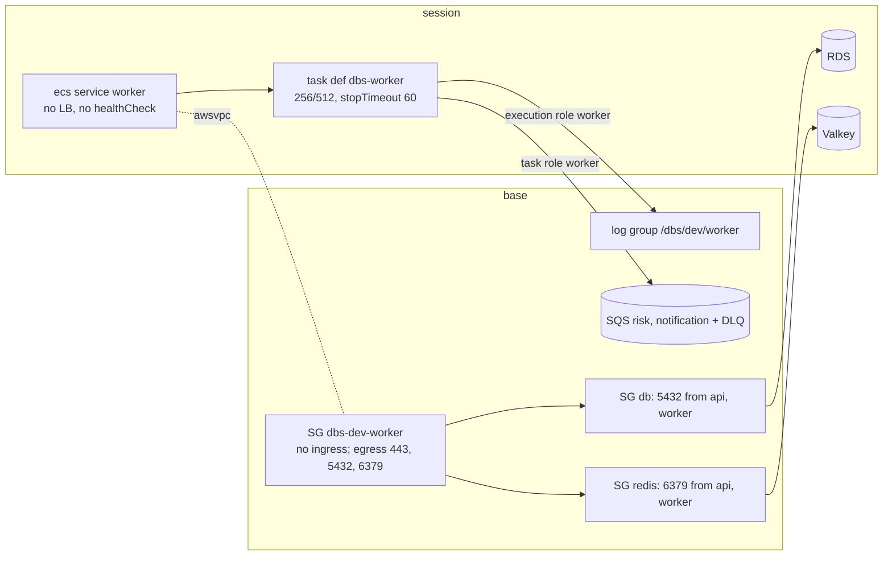

# DBS-121 · Dựng service worker (APP_ROLE=worker) trên ECS

> **Status:** Draft (đang làm, đến G2) · **Vai:** #5 Platform & Ops · **Cặp đôi review:** Dev · **Nhánh:** `feat/DBS-121-worker-service` (từ `origin/chore/DBS-120-ecs-task-roles` 18b8163) · **PR:** — · **Cập nhật:** 2026-11-12
>
> **Phụ thuộc PR #146 (DBS-120):** nhánh này xây trên `chore/DBS-120-ecs-task-roles` vì cần hai role worker (`worker_task`, `worker_execution`), policy `dbs-dev-worker-sqs` và danh sách bàn giao BL-242. PR của DBS-121 chỉ nên mở/merge sau khi PR #146 vào `main` (hoặc dùng PR #146 làm nhánh nền), nếu không diff sẽ lẫn commit của DBS-120.

## 1. Bối cảnh

- **Task trên board:** Task, Tuần 4, Ưu tiên High, Deliverable P3, Status "To Do" (cần chuyển "In Progress"). Vai board: #5 Platform & Ops, khớp loại việc (Terraform). **Expect:** Phần bất đồng bộ chạy trên cloud.
- **Thực trạng trên board:** ECS hiện chỉ có service api. Worker chạy relay, risk, notification, job đối soát và job dọn dẹp; health check của worker cần cách riêng (Dockerfile cố ý không có HEALTHCHECK). [Cập nhật 11/10] docs/03 §4, §13.3: worker không có health check HTTP; ECS thay task khi tiến trình thoát; worker treo phát hiện qua alarm tuổi outbox và tuổi message.
- **DoD** (nguyên văn, đánh số):
  1. Service worker (APP_ROLE=worker) thuộc nhóm «xóa hằng ngày»; kiểm tra sức khỏe worker (cách nào do ADR-13/Dockerfile quy định) và log về CloudWatch
  2. Chuyển tiền trên cloud → message vào đúng queue → consumer xử lý → cờ xuất hiện (kiểm tay có ghi lại)
  3. Tắt/bật task worker không ảnh hưởng api
  4. PR đã merge vào main (CI xanh); Dev review; bảng «Đối chiếu test case» trong PR điền đủ
- **Phụ thuộc** (board và repo):

| Task | Board | Trong repo |
|---|---|---|
| DBS-120 role riêng cho api và worker | To Do | **Có trong nhánh nền** `origin/chore/DBS-120-ecs-task-roles` (PR #146, chưa merge): `session/iam.tf` có `worker_task`, `worker_execution`, output ARN; `base/sqs.tf` có policy `dbs-dev-worker-sqs`. Chưa có trên `main` |
| DBS-67 Secrets Manager, CA bundle trong image | Done | `session/ecs.tf` api dùng `DB_*`, `DATABASE_SSL_CA_PATH`; Dockerfile có CA |
| DBS-73 hai queue + DLQ | Done | `base/sqs.tf`; output `sqs_risk_queue_url`, `sqs_notification_queue_url` |

- **Đã có gì:** `session/ecs.tf` (cluster, `dbs-api`, `dbs-migrate`, service api), `session/iam.tf` (role worker, log group worker chỉ là ARN dựng theo tên), `base/logs.tf` (chỉ `/dbs/dev/api`), `base/security_groups.tf` + `rds_network.tf` + `redis_network.tf` (SG db, redis chỉ nhận từ SG api), `base/deploy_role.tf` (PassRole và UpdateService chỉ cho api/migrate). Code backend: `main.ts` (role worker dùng `createApplicationContext`, `setInterval` giữ tiến trình sống, `enableShutdownHooks`, lỗi khởi động thoát khác 0), `validation.schema.ts` (mọi role cần `DATABASE_URL`, `REDIS_URL`, `COGNITO_*`, `TRUST_PROXY_HOPS` ở staging; worker cần thêm `SQS_RISK_QUEUE_URL`, `SQS_NOTIFICATION_QUEUE_URL`). ADR-13 và Dockerfile: không HEALTHCHECK, worker không mở cổng.
- **Baseline** (Terraform 1.16.6, chạy `-parallelism=1`, `GOMAXPROCS=2`, `GOMEMLIMIT=1500MiB` vì lần đầu `terraform test` bị OOM-kill exit 137 trên máy 8 GB): `base` **43 passed, 0 failed**; `session` **27 passed, 0 failed** (doc DBS-120 ghi 24, số thật đo hôm nay là 27). Không đổi code backend nên không chạy baseline backend.
- **Tình trạng AWS lúc bắt đầu** (lệnh chỉ đọc, profile `dbs-admin`): ECR `dbs-api` **không có image**; không cluster ECS, RDS, Valkey, ALB; log group chỉ `/dbs/dev/api`; role `dbs-*` chỉ `dbs-github-ecr-push`. Máy này **không có `docker`** và việc tải image gốc/CA ngoài repo bị cấm trong lượt làm này, nên chưa có image để chạy task thật (xem §5).
- **Dòng BACKLOG liên quan:**

| Dòng | Quyết định |
|---|---|
| BL-242 (log group worker, PassRole/UpdateService, gắn role vào task def, kiểm execution role bằng task thật) | **Nhận** (1), (2), (3 phần Terraform); phần "task thật" thành BL mới (chưa chạy); sửa dòng |
| BL-114 (URL queue vào task def worker) | **Nhận**, xóa dòng |
| BL-119 (SG redis cho worker) | **Nhận**, xóa dòng |
| BL-161 (hạ tầng nửa bất đồng bộ) | **Nhận (1)** (service, SG, ingress RDS/Redis, log group, biến SQS); (2)–(5) giữ; sửa dòng |
| BL-182 (`stopTimeout` ≥ 35 s, alarm tuổi outbox) | **Nhận `stopTimeout`**; alarm giữ; sửa dòng |
| BL-234 (`deployment_maximum_percent`, số task worker thật) | **Nhận một phần**: worker `max 100%`, tổng task api + worker ≤ 6 do `variables.tf` chặn; phần api giữ; sửa dòng |
| BL-103, BL-115, BL-043, BL-241, BL-243 | Không nhận: secret DB riêng, biến DLQ, khóa OpenAI, allow-list queue policy, kiểm role DBS-120 |

- **Ngoài phạm vi:** alarm DLQ/tuổi outbox/tuổi message (BL-051, BL-117, BL-163), `deploy.sh` cập nhật worker khi deploy (BL mới), secret DB riêng cho `dbs_worker` (BL-103), biến URL DLQ (BL-115), WAF, CI/CD.
- **Câu hỏi mở** và **Quyết định ở G1** (agent tự quyết, người dùng vắng, Claude audit duyệt):
  1. **Health check của worker theo cách nào?** Theo ADR-13 và docs/03 §13.3: **không** `healthCheck` container, không `portMappings`, không load balancer; container `essential = true` nên ECS thay task khi tiến trình thoát (lỗi khởi động ra `exit 1` ở `main.ts`). Worker treo phát hiện qua alarm (BL-161 (3)), không phải ở task này. Test khóa: task def không có `healthCheck`, không `portMappings`, service không `load_balancer`.
  2. **Image/tag:** dùng cùng `var.image_tag` và repo `dbs-api` với api (ADR-13). Service worker **không** `ignore_changes[task_definition]` (deploy.sh chỉ chạy cho api; nhóm xóa hằng ngày nên mỗi phiên dựng theo `image_tag`). BL mới: `deploy.sh` lăn worker cùng image khi deploy.
  3. **`desired_count` worker mặc định 0**, tối đa 2 (docs/03 §13.1: 1–2 task), và `desired_count + worker_desired_count ≤ 6` (74 kết nối dùng được của `db.t4g.micro`, mỗi task 10 + 5). Giống api: không task nào chạy được khi thiếu DB, Valkey, image.
  4. **Triển khai worker:** `deployment_minimum_healthy_percent = 0`, `deployment_maximum_percent = 100` để không bao giờ có hai worker song song nhân đôi kết nối (khoảng trống xử lý ngắn chấp nhận được vì outbox giữ sự kiện; ADR-03). Có `deployment_circuit_breaker` rollback.
  5. **`stopTimeout` = 60 s** (Fargate tối đa 120): một lô relay có thể tới 25 s (BL-182), cộng chỗ cho consumer đang xử lý; mặc định 30 s không đủ.
  6. **Log group `/dbs/dev/worker` ở `base`**, giữ qua `destroy session` (như `/dbs/dev/api`), retention 7 ngày; ARN lấy từ output của `base` thay vì dựng chuỗi trong `session/iam.tf`.
  7. **SG riêng `dbs-dev-worker`** ở `base`: không ingress nào; egress 443 (AWS API, SQS, ECR, Secrets Manager, logs), 5432 tới SG db, 6379 tới SG redis. SG db và SG redis nhận thêm nguồn từ SG worker và chỉ hai nguồn đó.
  8. **Task chạy ở public subnet có IP công khai** (ADR-10), không NAT.
  9. **Role deploy:** thêm PassRole cho `dbs-dev-worker-task`, `dbs-dev-worker-execution`, `Describe/UpdateService` trên `service/dbs-dev/worker`, `TagResource` cho `dbs-worker:*` theo BL-242. Chưa có script dùng (BL mới), nhưng cấp theo bàn giao đã duyệt ở DBS-120; ghi rõ trong §8 là quyền chờ người dùng.
  10. **Test thủ công trên AWS:** người dùng cho phép (profile `dbs-admin`, destroy ngay sau khi xong). **Nhưng không có image trong ECR và máy không có docker**, nên kịch bản đầy đủ (chuyển tiền → cờ) chỉ viết sẵn ở §5, trạng thái **chưa chạy**; chỉ chạy được phần chỉ đọc (`terraform plan` với state thật). Dòng BACKLOG ghi điều kiện.

## 2. Hành vi

Không có API; hệ thống là hạ tầng. Hành vi mong đợi của service sau `terraform apply` ở stack `session` với `worker_desired_count = 1`:

| Điều kiện | Kết quả |
|---|---|
| Task khởi động | Chạy image `dbs-api:<image_tag>` với `APP_ROLE=worker`, không mở cổng, log `Worker started — no HTTP listener` ra `/dbs/dev/worker` (stream `worker/worker/<task-id>`) |
| Thiếu biến bắt buộc, DB hoặc Redis không nối được | Tiến trình thoát khác 0 (`Application startup failed`), ECS thay task; circuit breaker rollback nếu mọi lần khởi động lỗi |
| Tiến trình worker chết | Container `essential`, ECS chạy task mới (cùng `desired_count`) |
| Worker treo (còn tiến trình, không xử lý) | **Không** phát hiện bởi ECS; alarm tuổi outbox và tuổi message (BL-161 (3)) |
| `worker_desired_count` đổi 0 ↔ 1 | Chỉ service worker thay đổi; service api, ALB, task def api không đổi; api vẫn nhận chuyển tiền, outbox tích lũy khi worker tắt và được xả khi bật lại (ADR-03) |
| Dừng task (SIGTERM) | ECS chờ `stopTimeout` 60 s trước SIGKILL; `enableShutdownHooks` cho consumer và relay kết thúc lô |
| `terraform destroy` stack `session` | Xóa service, task def, SG tham chiếu không bị ảnh hưởng (SG, log group nằm ở `base`) |

Biến môi trường của task worker (không bí mật): `NODE_ENV`, `APP_ROLE=worker`, `AWS_REGION`, `LOG_LEVEL=log`, `TRUST_PROXY_HOPS=1` (schema bắt buộc ở staging/production dù không có HTTP), `COGNITO_USER_POOL_ID`, `COGNITO_CLIENT_ID`, `COGNITO_ISSUER` (schema bắt buộc ở staging/production), `DB_HOST/PORT/NAME`, `DATABASE_SSL=true`, `DATABASE_SSL_CA_PATH`, `REDIS_HOST/PORT`, `SQS_RISK_QUEUE_URL`, `SQS_NOTIFICATION_QUEUE_URL`. **Không** `SQS_ENDPOINT`, không `PORT`. Bí mật qua `secrets` (ECS đọc bằng execution role worker): `DB_USER`, `DB_PASSWORD`, `REDIS_AUTH_TOKEN`.

## 3. Kiến trúc

- **Vị trí:** `infra/terraform/envs/dev/base` (log group, SG worker, luật SG, deploy role) và `session` (task def, service, biến, output); role IAM đã có từ DBS-120.
- **Interface mới:** output `base`: `worker_security_group_id`, `worker_log_group_name`, `worker_log_group_arn`; output `session`: `worker_service_name`, `worker_task_definition_arn`; biến `session`: `worker_desired_count`. Đổi `local.worker_log_group_arn` của `session/iam.tf` sang output của `base` (grep: dùng một chỗ, `iam.tf:154`). Không ai khác gọi.
- **Dữ liệu:** không đụng DB. SG: thêm hai `aws_vpc_security_group_ingress_rule` (db, redis từ SG worker).
- **Ranh giới:** `base` (miễn phí/kept) chứa log group, SG; `session` (xóa hằng ngày) chứa task def và service worker.

- **Thay đổi cấp hệ thống:** docs/03 §13.3 (dòng Deploy: thêm mô tả service worker), `infra/terraform/README.md` (mục worker, thứ tự apply `base` trước), `docs/security/threat-model.md` (T9: task worker đã có service; không đổi trạng thái), `docs/BACKLOG.md`, `docs/features/README.md`.

## 4. Test cases tự động

Terraform test với `mock_provider` (không cần credential); `session/tests/worker.tftest.hcl`, `base/tests/worker.tftest.hcl`; một test Python cho `render-task-definition.py` với container `worker`.

| ID | Truy vết | Lớp | Given · When · Then | Lỗi mong đợi |
|---|---|---|---|---|
| TC-121-01 | DoD 1 (ADR-13) | terraform test | task def `dbs-worker`: `APP_ROLE=worker`, không `portMappings`, không `healthCheck`, `essential`, cpu 256, mem 512, `stopTimeout` ≥ 35 | — |
| TC-121-02 | DoD 1, 2; BL-114 | terraform test | env có hai URL SQS của `base`, không `SQS_ENDPOINT`, `DATABASE_SSL=true`, đủ `DB_*`, `REDIS_*`, `COGNITO_*`, `TRUST_PROXY_HOPS`; không có `DB_PASSWORD`/`REDIS_AUTH_TOKEN` trong `environment` | — |
| TC-121-03 | DoD 1 (DBS-120) | terraform test | `execution_role_arn` = `worker_execution`, `task_role_arn` = `worker_task`, khác role api | — |
| TC-121-04 | DoD 1 | terraform test | `secrets` của task def = đúng tập `GetSecretValue` của execution role worker (cùng cách TC-120-06) | — |
| TC-121-05 | DoD 1 (log) | terraform test | `logConfiguration`: `awslogs`, group = output `worker_log_group_name` của `base`, region, stream prefix `worker`; ARN log trong policy execution role worker khớp group đó | — |
| TC-121-06 | DoD 1 (nhóm xóa hằng ngày) | terraform test | service `worker` thuộc stack `session`, cluster `dbs-dev`, `FARGATE`, SG `worker`, subnet public, `assign_public_ip`, không `load_balancer`, không `health_check_grace_period_seconds`, circuit breaker bật, min 0 / max 100 | — |
| TC-121-07 | DoD 3 | terraform test | `worker_desired_count` 0 → 1: `desired_count` api và task def api giữ nguyên; service api không phụ thuộc worker | — |
| TC-121-08 | DoD 1 | terraform test | `worker_desired_count` = 3 bị từ chối; `desired_count` 6 + worker 1 bị từ chối; 5 + 1 chấp nhận; mặc định 0 | validation |
| TC-121-09 | DoD 1 (log, nhóm base) | terraform test (`base`) | log group `/dbs/dev/worker`, retention 7, output tên và ARN | — |
| TC-121-10 | BL-119 | terraform test (`base`) | SG worker: không ingress rule nào trỏ tới nó; egress đúng 443 (0.0.0.0/0), 5432 tới SG db, 6379 tới SG redis; ingress db và redis từ SG worker bằng `referenced_security_group_id`, không CIDR; nguồn ingress của db và redis đúng {api, worker} | — |
| TC-121-11 | BL-242 (2) | terraform test (`base`) | role deploy: PassRole cho hai role worker (chỉ `ecs-tasks`), `Describe/UpdateService` trên `service/dbs-dev/worker`, `TagResource` `dbs-worker:*`; không `*`; không `iam:*` | — |
| TC-121-12 | BL-242 / DoD 1 | python unittest | `render-task-definition.py --container worker` đổi image container `worker`, giữ `stopTimeout`, `secrets`, role, không đổi container khác; từ chối khi không có container đó | exit ≠ 0 |
| TC-121-13 | DoD 2 | thủ công (§5) | chuyển tiền → outbox → queue → consumer → cờ | — |
| TC-121-14 | DoD 4 | quy trình | PR merge, CI xanh, Dev review, bảng đối chiếu | — |

## 5. Test thủ công

**Trạng thái: chưa chạy** (trừ M-121-02, chỉ đọc). Lý do ở §1 quyết định 10 và §8. Người dùng đã cho phép thao tác AWS miễn là `destroy` ngay sau khi xong; phần còn lại **chặn bởi thiếu image** trong ECR `dbs-api` (cần máy có docker hoặc workflow Image của CI chạy trên `main`).

Điều kiện: profile `dbs-admin` (`ap-southeast-1`); `image_tag` = SHA 40 ký tự đã có trong ECR; Cognito và user demo qua `infra/scripts/seed-cognito.sh`; `AWS_PAGER=""`. Chi phí dự kiến ≈ 0,15–0,25 USD cho một giờ (RDS ≈ 0,029, Valkey ≈ 0,019, ALB ≈ 0,025, hai task Fargate nhỏ ≈ 0,03, IPv4 công khai theo task; ADR-11). Quên tắt: ≈ 4–6 USD/ngày.

| Bước | Việc làm | Kết quả mong đợi |
|---|---|---|
| M-121-01 | **Sạch trước khi làm** (chỉ đọc): `aws sts get-caller-identity`; `aws ecs list-clusters`; `aws rds describe-db-instances`; `aws elasticache describe-replication-groups`; `aws elbv2 describe-load-balancers`; `aws ec2 describe-nat-gateways`; `aws ecr describe-images --repository-name dbs-api` | Không cluster/RDS/Valkey/ALB; không NAT; ECR có image `image_tag` (nếu chưa: dừng, ghi chưa chạy) |
| M-121-02 | `terraform plan -lock=false` ở `base` (backend thật) và `session` với `-var worker_desired_count=1` | `base`: thêm log group, SG worker, 3 luật egress, 2 luật ingress, sửa role deploy policy (không destroy); `session`: thêm task def `dbs-worker` và service `worker` (thêm, không sửa api) |
| M-121-03 | Apply `base` bằng `-target` (miễn phí): `aws_cloudwatch_log_group.worker`, `aws_security_group.worker`, `aws_vpc_security_group_egress_rule.worker_https`, `.worker_to_db`, `.worker_to_redis`, `aws_vpc_security_group_ingress_rule.db_from_worker`, `.redis_from_worker`, `aws_iam_role_policy.deploy` | `aws logs describe-log-groups --log-group-name-prefix /dbs/dev/worker` có 1 dòng retention 7; SG worker không `IpPermissions`; SG db và redis có 2 nguồn (api, worker) |
| M-121-04 | Dựng `session`: `terraform apply -var worker_desired_count=0 …` (đầy đủ stack; RDS, Valkey, ALB là điều kiện của api và migrate) rồi chạy `.github/scripts/migrate.sh` hoặc task `dbs-migrate`, seed qua API nạp tiền; `/health/ready` qua ALB = 200 | Service `worker` ACTIVE, `desiredCount 0`, `runningCount 0`; api 200 |
| M-121-05 | `terraform apply -var worker_desired_count=1`; `aws ecs describe-services` chờ `runningCount 1`; `aws logs tail /dbs/dev/worker --since 10m` | Task RUNNING (lần đầu execution role worker kéo image, đọc secret, ghi log bằng task thật, BL-242 (3)); log có `Worker started — no HTTP listener`, không `startup failed`; `ecs describe-tasks` không có `healthStatus` (không healthCheck) |
| M-121-06 | **Đường thành công (DoD 2):** đăng nhập khách demo, `POST /v1/transfers` một khoản lớn hơn ngưỡng R1/R3 để sinh cờ (số tiền theo `docs/demos/` hoặc BRD §2.1), ghi `correlationId`; rồi `aws sqs get-queue-attributes` hai queue, `aws logs tail /dbs/dev/worker`, `GET /v1/operator/fraud-flags` bằng token operator | Outbox có dòng, `published_at` được đặt trong vài giây; log relay và notification có cùng `correlationId`; DLQ = 0; cờ xuất hiện cho giao dịch đó (hoặc ghi rõ trạng thái consumer risk của build; docs/03 §4 ghi consumer scoring có thể chưa nối) |
| M-121-07 | **DoD 3:** `terraform apply -var worker_desired_count=0`; gọi `GET /health/ready` và một `POST /v1/transfers` mới; xem `ecs describe-services` api | api `runningCount` không đổi, `/health/ready` 200, chuyển tiền 201; outbox có dòng `published_at IS NULL` tăng. Bật lại `worker_desired_count=1`: outbox được xả (đếm dòng chưa gửi về 0) |
| M-121-08 | **Phục hồi:** `aws ecs stop-task` task worker | ECS tạo task mới (RUNNING < 3 phút), api không bị ảnh hưởng |
| M-121-09 | **Rejection:** `aws ec2 describe-security-groups` SG worker; thử kết nối từ ngoài tới task worker | Không `IpPermissions`; không có cổng nào nhận |
| M-121-10 | **Destroy ngay:** `terraform destroy` stack `session` (hoặc `-target` nhóm đã dựng), giữ `base` | Hoàn tất không lỗi |
| M-121-11 | **Chứng minh sạch** (chỉ đọc) và chi phí | Như M-121-01 (không cluster, RDS, Valkey, ALB, NAT, ENI `available`, Elastic IP); ghi chi phí hôm sau từ `infra/scripts/cost-report.py` |

## 6. Domain review (AI)

(điền sau khi review)

## 7. Kế hoạch triển khai

(điền ở Phase 3)

## 8. Kết quả

(điền ở Phase 4–5)

## 9. Tài liệu đã cập nhật

(điền ở Phase 5)
