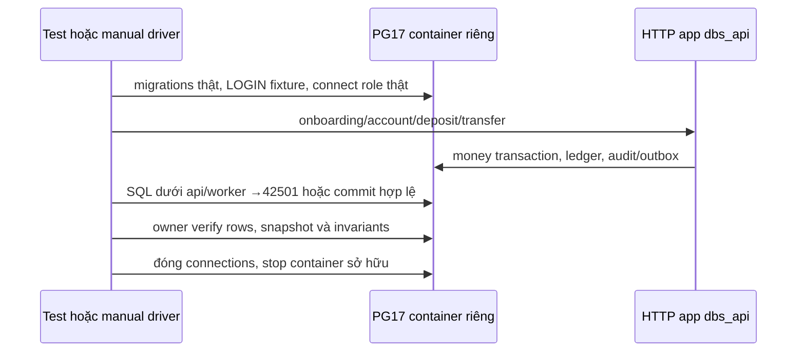
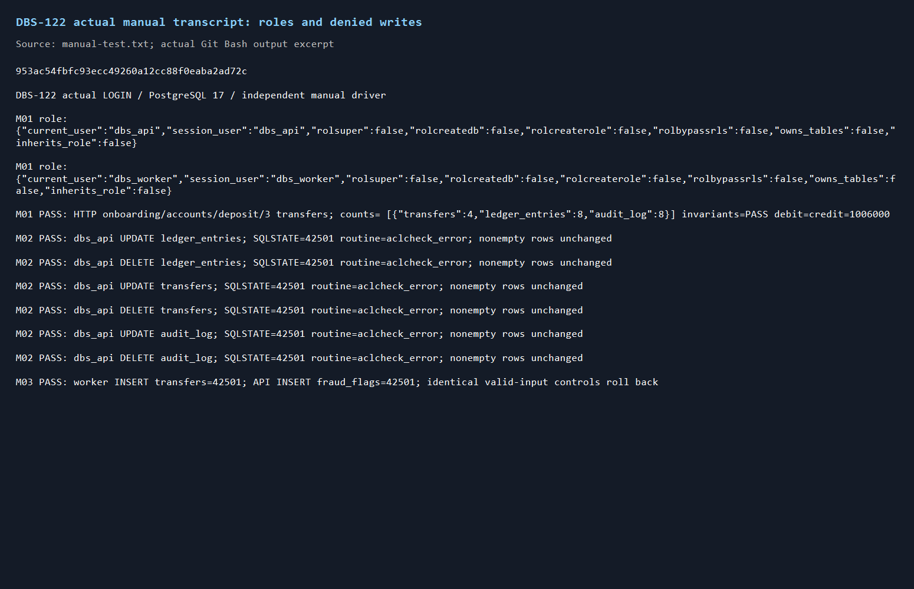
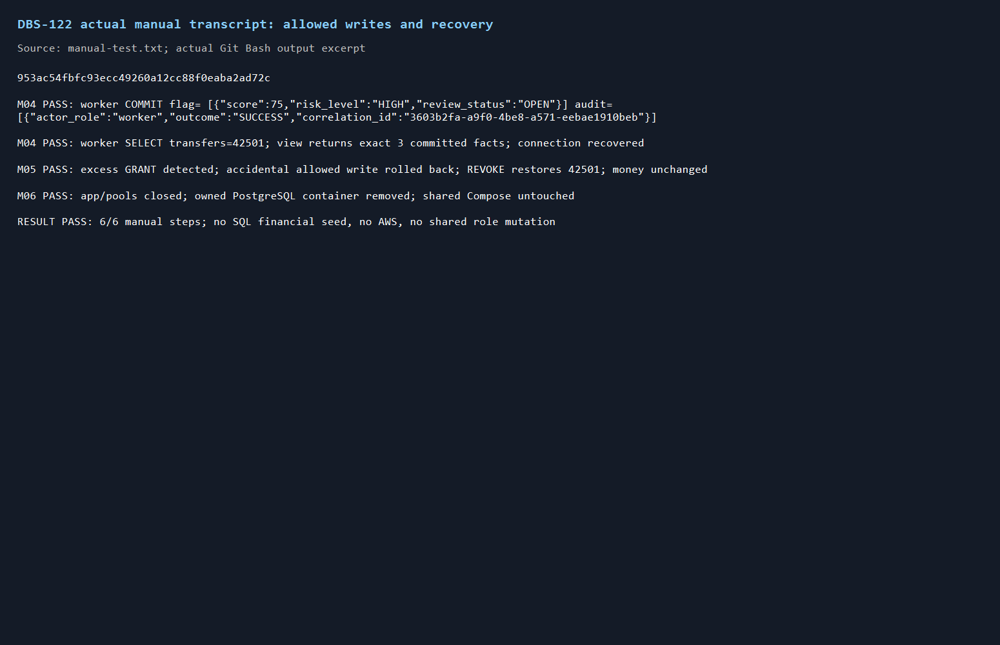

# DBS-122 · Kiểm chứng quyền DB của API và worker

> **Status:** Implemented · **Vai:** Dev · **Nhánh:** `test/DBS-122-db-role-permissions` · **PR:** [tra theo nhánh](https://github.com/Lawliet119/digital-banking-simulator/pulls?q=is%3Apr+head%3Atest%2FDBS-122-db-role-permissions) · **Cập nhật:** 2026-11-09

## 1. Bối cảnh và G1

Task Tuần4, Dev, High, In Progress, P3. **Expect nguyên văn:** «Bằng chứng tự động cho «không ai sửa được sổ cái».»

**DoD nguyên văn:**
1. dbs_api: UPDATE/DELETE ledger_entries, transfers, audit_log → lỗi; dbs_worker: INSERT transfers → lỗi; dbs_api không INSERT fraud_flags
2. dbs_worker INSERT được audit_log và fraud_flags, không SELECT được transfers (chỉ view v_transfer_facts)
3. Chạy trong CI trên Postgres thật
4. PR đã merge vào main (CI xanh); Dev review; bảng «Đối chiếu test case» trong PR điền đủ

Phụ thuộc DBS-119 trên sheet In Review nhưng đã merge PR99, commitf266837; DBS-39 Done, helper PostgreSQL17 đã có. Nhánh tạo trực tiếp từ main8c59f8d. Đã đọc skill/CLAUDE, testing/task-kinds/manual-testing/module-notes, CONTRIBUTING5/5b, BRD NFR-SEC-06/AC-8.1, database-design8.1–8.3, migration roles và script SQL.

**Thực trạng đã chạy:** `db-roles.db-spec.ts` có9 case passing, gồm nhiều thao tác cấm API và worker đọc view, nhưng chưa kiểm trực tiếp worker INSERT transfers, API INSERT fraud_flags, worker INSERT fraud_flags/audit với đầu vào hợp lệ; helper denied hiện chỉ so thông báo. Task122 bổ sung coverage riêng theo DoD, không sao chép toàn bộ test119.

**Baseline trên main8c59f8d:** Docker ban đầu tắt; đã mở Docker Desktop và `docker compose up -d`,3 service chạy. Lint/typecheck/build đạt; unit88suites1657/1657(94.599s), e2e15suites153/153(101.012s), role suite1199/9(6.100s). Không skip hoặc nhận Docker lỗi là xanh.

**Phạm vi:** test PostgreSQL quyền thật, SQLSTATE42501, role đăng nhập thực không phải superuser/chủ bảng, dữ liệu có hàng thực, kiểm đối chứng allow/deny, chứng minh view. Giữ test119 nguyên vẹn, dùng migration thật và helper39. Không sửa quyền production, migration/schema, ứng dụng, event, env hoặc dependency. Không triển khai RiskConsumer chưa có; cờ/audit là SQL INPUT của phép thử ACL, không nhận là kết quả thuật toán fraud.

**Backlog:** BL-005/017 đã được119 đóng, không mở lại. BL-019 còn registry/auditor HTTP/pool measurement ngoài phạm vi; BL-103/107/195 là provisioning/Secrets Manager/RDS thật của Ops, không nhận test container chứng minh RDS. BL-194/196/197 là quy trình review các task khác, giữ nguyên.

**Quyết định G1 (agent tự quyết):** (1) Bổ sung suite122 riêng vì coverage119 còn thiếu đúng các quyền trong DoD; (2) dùng PostgreSQL container riêng cho suite122, không ALTER LOGIN/password của cluster CI/Compose chung, không thay credential runtime; (3) tiền setup chỉ qua HTTP deposit/transfer thật bằng dbs_api, không SQL balance/ledger seed; (4) không dừng Docker daemon chung để thử thiếu Docker; sẽ kiểm guard bằng injected runtime failure và ghi rõ chưa chạy stop-daemon thật; (5) chạy lại suite từ clean clone local sau source commit, tái sử dụng dependencies đã cài. Không có waiver Techlead, không cần human gate.

**G1 qua:** task/DoD/dependency/baseline/scope đã có bằng chứng. Sheet đã In Progress nên không chỉnh trạng thái.

## 2. Hành vi

Role thật `dbs_api`, `dbs_worker` đăng nhập qua kết nối riêng; assert current_user=session_user đúng tên, NOSUPERUSER/NOCREATEDB/NOCREATEROLE/NOBYPASSRLS, không sở hữu bảng hoặc thừa kế role khác. Migration gốc tạo role NOLOGIN; fixture chỉ bật LOGIN và mật khẩu ngẫu nhiên trong container sở hữu riêng, không cấp GRANT mới cho test passing bình thường.

API setup thật mở hai account qua onboarding/open API, nạp1000000 rồi tạo3 transfer1000/2000/3000. Mọi tiền setup qua HTTP với connection dbs_api; checker bất biến PASS, không SQL seed số dư/dòng sổ. Dữ liệu transfer/ledger/audit có hàng thật trước khi thử sửa/xóa.

API UPDATE/DELETE đúng các hàng đó phải lỗi42501 từ ACL, không chấp nhận lỗi constraint, syntax, FK hoặc trigger append-only thay cho thiếu quyền. Worker INSERT transfers dùng VALUES hợp lệ, không SELECT từ bảng cấm và không RETURNING đòi quyền SELECT ngoài INSERT. API INSERT fraud_flags dùng transfer thật và rule_set_version1 có sẵn; worker positive control cùng dữ liệu trong transaction rollback chứng minh đầu vào hợp lệ, không lấy23505 làm bằng chứng thiếu quyền.

Worker ghi được cờ OPEN(score75,risk_levelHIGH,version1) và audit phù hợp bằng quyền I thật, commit rồi owner đọc lại để chứng minh persistence. Worker không có SELECT audit_log nên không dùng RETURNING trên audit; target_id/correlation_id xác định dòng. Đây là SQL INPUT cho phép thử ACL, không giả lập RiskConsumer. Worker SELECT transfers phải42501; SELECT view v_transfer_facts phải trả đúng dữ liệu transfer đã commit, không chỉ SELECT1 trên view rỗng.

Mỗi thao tác bị cấm dùng QueryRunner riêng: BEGIN → câu SQL → ROLLBACK trong finally kể cả khi lệnh bất ngờ được phép. Sau rollback kiểm kết nối vẫn dùng được và hàng/số dư không đổi. Assertion kiểm SQLSTATE42501 và không có `forbid_mutation` trong nơi phát sinh lỗi, kèm kiểm has_table_privilege/has_any_column_privilege trước thao tác.

**Negative control:** owner tạm GRANT INSERT fraud_flags cho API **chỉ trong container fixture**. Cùng SQL hợp lệ khi đó chạy được nhưng assertion deny phải phát hiện là lỗi test; luôn ROLLBACK dữ liệu và REVOKE ở finally. Thử lại cùng SQL sau khôi phục phải42501. Chứng minh suite bắt được cấp quyền thừa, không chỉ luôn trả xanh. Không thay grant migration hoặc DB dùng chung.

Không có endpoint/DTO mới, không thay auth/ownership/ErrorCode. Kết quả test ghi role/nhãn thao tác/SQLSTATE/count/UUID, không log mật khẩu, URI, token, query chứa secret. TLS/RDS/cloud ngoài scope; fixture TCP localhost thuộc Testcontainers.

## 3. Kiến trúc

File mới `backend/test/support/db-role-permissions.ts`: fixture dùng `assertDockerAvailable`, `awaitContainerStart`, STARTUP_TIMEOUT_MS của helper39 và PostgreSqlContainer17. Giữ handle riêng, không ghi globalThis.__POSTGRES_CONTAINER__ hoặc process.env.DATABASE_URL của Jest globalSetup. `migrate(url)` chạy migration thật trên container riêng; kết nối owner chỉ để setup/verify, app dùng dbs_api, worker query dùng dbs_worker. Close app → đóng role/owner sources → stop đúng container trong finally, kể cả setup lỗi.

Fixture API dự kiến `createRolePermissionsFixture():Promise<{owner,api,worker,app,accounts,transfers,close}>`; hỗ trợ `expectAclDenied(source,sql,args)` trả SQLSTATE42501 hoặc throw nếu lệnh được phép/lỗi khác; `moneySnapshot()` so đúng transfers/ledger/balances và `checkLedgerInvariants(owner)`. Không đổi export production hoặc helper119. Password randomBytes(24).hex chỉ nội bộ, tên role allowlist cố định; không lấy identifier từ request.

Suite mới `backend/test/db/db-role-permissions.db-spec.ts` được regex test:db hiện có khám phá tự động, job db CI dùng Docker runner cho container riêng. Không sửa workflow/check names. Manual driver `backend/scripts/manual-dbs122.cjs` gọi cùng fixture/query assertion nhưng tự chạy hành động và assert kết quả ngoài Jest; không chạy Jest rồi gọi đó là test tay.

## 4. Test cases

Toàn bộ case chạy trên PostgreSQL17 thật; không mock query/grant. Sau mỗi case kiểm bất biến và dữ liệu tiền không đổi so với setup. Case audit/flag được phép ghi chỉ thay metadata bảng tương ứng, không sửa money snapshot.

| ID | DoD/AC | Given–When–Then | Mã |
|---|---|---|---|
| TC-122-01 | DoD1/2,NFR-SEC-06 | Đăng nhập api/worker thật; current/session user và cờ đặc quyền/ownership/membership đúng, data setup qua HTTP | — |
| TC-122-02 | DoD1,AC-8.1 |6 ca độc lập UPDATE/DELETE trên nonempty ledger_entries/transfers/audit_log bằng API; ACL từ chối, rollback không đổi hàng |42501 |
| TC-122-03 | DoD1 |Worker INSERT transfer với VALUES hợp lệ; không SELECT nguồn hoặc RETURNING; không sinh orphan row |42501 |
| TC-122-04 | DoD1 |Worker rollback positive control flag hợp lệ; API INSERT cùng payload bị chặn trước khi ghi |42501 |
| TC-122-05 | DoD2 |Worker commit fraud_flag+audit; owner đọc được đúng dòng, flag OPEN và audit đúng CID | — |
| TC-122-06 | DoD2 |Worker SELECT transfers bị chặn; view trả đúng3 transfer thực và không cần cấp SELECT bảng gốc |42501/SELECT thành công |
| TC-122-07 | Độ tin cậy chứng cứ |Tạm GRANT API INSERT flag trong fixture; assertion deny phải báo được phép; rollback/revoke; testdeny lại42501 |negative control |
| TC-122-08 | Fail rõ khi Docker lỗi |Helper39 nhận runtime getter rejected, phải throw lỗi Docker actionable; không skip hoặc dùng DB mock thay |runtime error |
| Quy trình | DoD3/4 |Test:db CI thật, mapping đủ, Dev review/merge; chưa nhận hoàn thành trước bằng chứng |pending |

TC02 là6 parameterized cases, TC03..07 một case mỗi loại, TC01 vàTC08 riêng: dự kiến13 cases. Không mở rộng HTTP ownership framework/PII registry/metric hoặc mutation của migrator đã có119.

## 5. Test thủ công

`node scripts/manual-dbs122.cjs` từ backend, Docker đang chạy. Fixture tự tạo PostgreSQL17 riêng và LOGIN credential trong RAM. Dòng đầu raw là SHA chạy, stdout không chứa credential/token. Owner setup chỉ provisioning/grant và đọc kiểm chứng; tiền chỉ qua API thật.

| Bước | Hành động | Kết quả quan sát |
|---|---|---|
| M01 |Connect role và setup HTTP thật; in safe current_user/session_user và số hàng/bất biến |api/worker không phải superuser/owner; money PASS |
| M02 |6 UPDATE/DELETE API trên dữ liệu có thật |6 SQLSTATE42501 từ ACL; snapshot không đổi |
| M03 |Worker INSERT transfer và API INSERT flag; worker rollback valid-input control |42501 đúng lớp kiểm tra, không data hỏng |
| M04 |Worker INSERT flag/audit commit; SELECT view; thửSELECT transfers; chạySQL saurollback |dòng thực tồn tại, view đúng, SELECT bảng42501; connection phục hồi |
| M05 |Fault grant INSERT api rồi rollback/revoke |deny assertion phát hiện cấp quyền thừa; khôi phục42501 và money invariant PASS |
| M06 |finally close app/connections/container |không handle/container fixture rò |

Sau source commit chạy suite từ clean clone local, dùng junction node_modules tới dependency đã cài (không sửa thư mục dependency). Thử Docker unavailable qua injected runtime getter của helper39. **Chưa chạy:** tắt Docker daemon thật vì ảnh hưởng container chung; không claim mô phỏng getter là outage daemon thật. Đây là giới hạn test-harness ngoài DoD SQL ACL, ghi trong PR/G4. Không chạy RDS/AWS, giữ BL-103/195.

## 6. Domain review và G2

Reviewer độc lập `dbs122_design_review`, model kế thừa GPT-6, 2026-11-09: 0 blocking, 0 should-fix, 0 minor. **Verdict: APPROVE**. [Trả lời nguyên văn](screenshots/DBS-122/domain-review.md).

**G2 qua — agent tự quyết:** giữ thiết kế container riêng/actual LOGIN và valid-input control; đã đối chiếu TC01–08/M01–06 với toàn bộ DoD, database-design8 và CONTRIBUTING5/5b. Không có câu hỏi mở.

## 7. Kế hoạch và G3

1. Viết suite13case gọi fixture/assertion trước; chạy red khi support chưa tồn tại, ghi đúng lỗi harness chứ không gọi đó là lỗi ACL production. Không có bug quyền đã tái hiện; task này bổ sung chứng cứ theo DoD.
2. Thêm support fixture/ACL assertion tối thiểu, chạy xanh trên quyền migration thật. Negative control trong container riêng chứng minh assertion báo sai khi cấp thừa quyền, không sửa migration để ép đỏ.
3. Thêm manual driver6bước, lint/typecheck và bộ test liên quan119/122; chạy unit/e2e appropriate sau thay đổi. Commit green `test(database): verify runtime DB role boundaries (DBS-122)`.
4. Sau commit, chạy clean clone target suite; manual6bước trên final codeSHA; raw/screenshot. Cập nhật database-design8 dòng evidence, backend README, feature index, backlog process, PR mapping/verification.
5. Tự kiểm G4, push và PR sẵn sàng review sau G4; CI exactHEAD và Dev review/merge pending công khai. Không merge hoặc sửaboard.

Red đã chạy trước helper: TS2307 `Cannot find module '../support/db-role-permissions'`,0 test thực thi. Đây là harness chưa tồn tại, không phải lỗi ACL production. Sau helper:13/13 xanh,14.305s. Có sửa lỗi TypeScript ở adapter checker (DataSource.query khác overload QueryRunner); dùng QueryRunner riêng và release ở finally, không đổi checker. TC03 thêm positive control cùng INSERT bằng API trong rollback để loại trừ FK/check failure; cùng phạm vi valid-input control ở §2, không seed dữ liệu tiền.

Files: `backend/test/db/db-role-permissions.db-spec.ts`, `backend/test/support/db-role-permissions.ts`, `backend/scripts/manual-dbs122.cjs`, feature doc/screenshots122, `docs/components/_shared/database-design.md`, `backend/README.md`, `docs/features/README.md`, `docs/BACKLOG.md`. Không thay production source hoặc workflow; nếu assertion phát hiện lỗi thật phải ghi gate phụ trước sửa grant/schema.

Rủi ro: lẫn admin với runtime, input constraint che lỗi permission, test trên bảng rỗng, role cluster bị thay credential, bad GRANT để sót. Giảm bằng actual LOGIN và attrs, valid-input control, nonempty rows, container riêng, finally ROLLBACK/REVOKE/cleanup. Lùi bằng bỏ các file test/helper/driver mới; không có migration revert hoặc xóa dữ liệu chung.

## 8. Kết quả và G4

**G3 qua — agent tự quyết:** đã sweep DoD, giới hạn docs/BACKLOG và danh sách file §7; không có yêu cầu chưa được gán test hoặc ghi ngoài phạm vi. Lệnh chứng minh bước1/2: `npm run test:db -- --runInBand --runTestsByPath test/db/db-role-permissions.db-spec.ts`; bước3: lint:check/typecheck/build/unit/e2e và hai suite119/122; bước4: cùng target suite từ clone sạch và `node scripts/manual-dbs122.cjs`. Commit source xanh rồi commit docs/evidence. Không có thay đổi dependency, env, contract hoặc quyền production.

**Source commit cuối:** `953ac54fbfc93ecc49260a12cc88f0eaba2ad72c`. Không đổi source sau test tay.

| Kiểm tra | Kết quả thật |
|---|---|
| Target suite122 |13/13,14.305s, PostgreSQL17 thật |
| Clone sạch của source commit, junction dependencies đã cài |13/13,16.810s; không chép env hoặc thay dependency |
| lint:check/typecheck/build |đạt |
| Unit toàn bộ |88suites1657/1657,108.375s |
| E2E toàn bộ |15suites153/153,115.768s |
| DB toàn bộ |53suites815/815,767.450s;0skip |
| Liên kết docs |319files,0link hỏng; `git diff --check` sạch |

**Đối chiếu test case:** mọi case ở lớp integration/security, DB thật; không đơn giản hóa.

| ID | Test trong `db-role-permissions.db-spec.ts` | Kết quả |
|---|---|---|
| TC-122-01 |actual LOGIN không đặc quyền; HTTP tạo dữ liệu thật |đạt |
| TC-122-02 |6 `API UPDATE/DELETE ... denied by ACL` |đạt6/6;42501/aclcheck_error, rows không đổi |
| TC-122-03 |`worker cannot INSERT transfers` |đạt; positive control API rollback |
| TC-122-04 |`API cannot INSERT fraud_flags` |đạt; positive control worker rollback |
| TC-122-05 |`worker can commit fraud_flags and audit_log` |đạt; owner đọc persistence/CID |
| TC-122-06 |`worker cannot SELECT transfers; view returns exact ...` |đạt;3dòng đúng toàn bộ7cột |
| TC-122-07 |`negative control detects excess GRANT` |đạt; phát hiện được phép, rollback/revoke/deny lại |
| TC-122-08 |`injected unavailable Docker fails clearly` |đạt; chỉ mô phỏng runtime getter |
| DoD3/4 quy trình |CI trên HEAD, Dev review/merge |kết quả CI cập nhật trực tiếp trong PR; Dev review/merge BL-202 |

**Test tay:** lệnh `node scripts/manual-dbs122.cjs`, raw [manual-test.txt](screenshots/DBS-122/manual-test.txt), dòng đầu SHA source ở trên. Không SQL seed tiền. Flag/audit INSERT là INPUT của phép thử ACL, không nhận là RiskConsumer output.

| Bước | Phản hồi thật | Kết quả |
|---|---|---|
| M01 |current_user=session_user đúng api/worker; mọi flag đặc quyền/owner/membership false;4transfers,8ledger,8audit;debit=credit1006000 |đạt |
| M02 |6SQLSTATE42501 routine=aclcheck_error; dữ liệu nonempty không đổi |đạt |
| M03 |worker INSERT transfer/API INSERT flag42501, cùng input positive controls rollback |đạt |
| M04 |flag75/HIGH/OPEN và worker audit SUCCESS commit đúng CID; view3facts, SELECT transfers42501; connection phục hồi |đạt |
| M05 |cấp thừa INSERT bị assertion phát hiện, data rollback, REVOKE rồi42501; money PASS |đạt |
| M06 |app/pools đóng, docker ps -aq đúng containerID trả rỗng; Compose chung giữ nguyên |đạt |

Ảnh từ raw đã chạy (đã mở kiểm hình, không tái dựng kết quả):

Sơ đồ §3 đã render bằng mermaid-cli và mở kiểm [ảnh render](screenshots/DBS-122/03-architecture.png).

**Phạm vi:** chỉ các file trong §7. Không đổi production/migration/workflow/grant. Lệnh build ban đầu bị gọi nhầm cờ Jest `--runInBand`, báo unknown option; đã chạy lại đúng `npm run build` và đạt. Đây là lỗi lệnh kiểm, không phải app/build hỏng.

**Kiểm lại quy tắc shell trước G4:** lượt manual đầu chạy Node từ PowerShell và ghi UTF8 bằng .NET, không UTF16. `manual-testing.md` yêu cầu Git Bash; agent tự quyết chạy lại đủ6bước từ Git Bash trên cùng sourceSHA, thay raw/ảnh bằng lượt đó trước bàn giao. Không đổi source hoặc giảm case. PR sau G4 mở ở trạng thái sẵn sàng review theo Phase5 của skill; không mở sớm trong giai đoạn code.

**Bàn giao/chưa chạy:** BL-202 cho CI/Dev review/merge; BL-203 cho Docker daemon thật unavailable (không tắt daemon dùng chung). RDS thật/provisioning/rotation giữ BL-103/107/195. Không nhận kiểm localhost thay thế quyền AWS/RDS. Không có waiver Techlead.

### Tự kiểm G4

- [x]13/13 case đạt đủ độ sâu,0 đơn giản hóa; toàn bộ DB815/unit1657/e2e153 xanh. [Bản ghi kiểm tra](screenshots/DBS-122/verification.txt).
- [x]Manual6/6 từ Git Bash trên commit cuối đổi code953ac54, SHA dòng đầu raw; đủ thành công/từ chối/phục hồi.
- [x]Đủ2ảnh output và raw UTF8; đã quét, không token/Authorization/password/AWS id/ARN. Ảnh sơ đồ bổ sung đã render/visual QA.
- [x]Diff nguồn từ main và diff toàn bộ working tree khớp §7; không file lạ, không sửa production/workflow.
- [x]Lint/typecheck/build/unit/e2e/DB đã chạy và đọc output;0skip trong suite mới.
- [x]Docs fact cập nhật,319file/0link hỏng; trạng thái Plan approved tại thời điểm tự kiểm, đổi Implemented sau G4 qua.
- [x]Bàn giao/giới hạn BL-202/203 và BL-103/107/195 nêu rõ; không tự merge hoặc sửa sheet.

**Quyết định G4 (agent tự quyết):** local đầy đủ đã xanh, không còn finding thiết kế hoặc lỗi kiểm chứng. G4 qua; mở PR để CI chứng minh trên Linux exactHEAD và Dev review độc lập. Không nhận merge/review đã hoàn tất. Chưa chạy outage Docker daemon thật hoặc RDS thật; không ảnh manual nào còn thiếu. Kết quả CI động ghi trong PR để không tạo vòng commit tài liệu làm đổi HEAD đang kiểm.

## 9. Tài liệu

Đã cập nhật [database-design8](../components/_shared/database-design.md#81-ba-role-postgres), [backend README](../../backend/README.md), [feature index](README.md), [BACKLOG](../BACKLOG.md) thêm BL-202/203; không xóa backlog task khác. Feature doc và evidence122 lưu trong PR.
