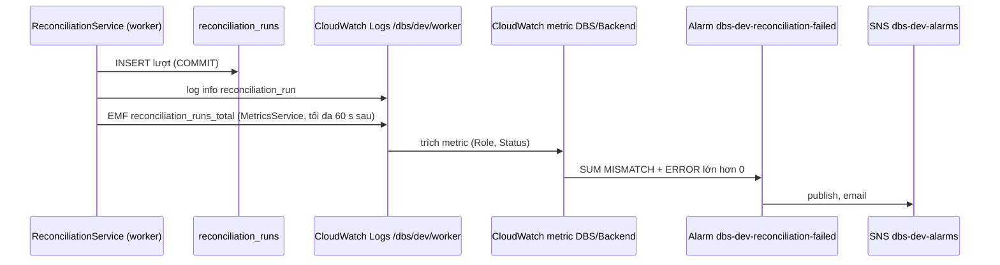

# DBS-123 · Metric và alarm CloudWatch khi đối soát MISMATCH hoặc ERROR

> **Status:** Implemented một phần (G4 tự duyệt 2026-11-14; DoD 2 đạt một phần, DoD 3 chưa: BL-274, BL-279) · **Vai:** #5 Platform & Ops · **Cặp đôi review:** Dev · **Nhánh:** `feat/DBS-123-reconciliation-alarms` (từ `origin/main` 44f50d8) · **PR:** — · **Cập nhật:** 2026-11-14

## 1. Bối cảnh

- **Task trên board:** Task, Tuần 4, Ưu tiên Medium, Deliverable P3, Status "To Do" (cần chuyển "In Progress"). Vai board #5 Platform & Ops, khớp loại việc (Terraform + một thay đổi nhỏ ở code). **Thực trạng (board):** «Job đối soát chưa phát tín hiệu ra ngoài.» **Expect:** «Lệch sổ cái làm nhóm biết trong vài phút.»
- **DoD** (nguyên văn, đánh số):
  1. Job phát metric/log có cấu trúc cho mỗi lần chạy; alarm khi MISMATCH hoặc ERROR gửi SNS email
  2. Gây MISMATCH có chủ ý trên môi trường dev → alarm bật ≤ 5 phút
  3. PR đã merge vào main (CI xanh); Dev review; bảng «Đối chiếu test case» trong PR điền đủ
- **Phụ thuộc:** DBS-117 (Done, job đối soát, [DBS-117](DBS-117-reconciliation-worker-job.md)); DBS-121 (board To Do, **đã merge vào `main`**, [DBS-121](DBS-121-worker-service.md)). Cả hai có trong nhánh nền.
- **Thực trạng trong repo (đã chạy/đọc code, khác board):** phần lớn DoD 1 **đã có trên `main`** nhờ BL-127 (PR #166) và BL-051/117 (PR #160): `reconciliation.metrics.ts` đếm `reconciliation_runs_total{status}` mỗi lượt đã ghi `reconciliation_runs`; `MetricsService` xuất thành `DBS/Backend` `{Role, Status}`; `base/alarms.tf` có topic SNS `dbs-dev-alarms` và đăng ký email theo biến `alarm_email`; `session/alarms.tf` có alarm `dbs-dev-reconciliation-failed` (`SUM(METRICS()) > 0`, 300 s, `notBreaching`). **Chưa có:** (a) log có cấu trúc cho **mỗi** lượt (chỉ MISMATCH/ERROR có `warn`/`error`, lượt OK im lặng); (b) chu kỳ job ở dev là mặc định 300 s nên "≤ 5 phút" **không được bảo đảm** (lệch ngay sau một lượt chờ tới 300 s, cộng ≤ 60 s ghi metric, cộng chu kỳ alarm); (c) bằng chứng kích alarm trên AWS.
- **Baseline:** `terraform test -parallelism=1` (GOMAXPROCS=2 GOMEMLIMIT=1500MiB): `base` 45 passed; `session` 67 passed (sau thay đổi này, trước đó 65). Backend: `npm run lint:check`, `typecheck` và `npm test` chạy trên bản cài đủ phụ thuộc đặt ngoài repo (`node_modules` dùng chung của checkout chính thiếu `prom-client`, `ioredis`, `opossum`, `redis`, `@aws-sdk/*`; không commit `backend/node_modules`); spec ledger + metrics 113 passed. Không có docker nên không chạy `test:e2e`/`test:db` (cần Testcontainers/Postgres).
- **Dòng BACKLOG liên quan:** BL-127 (đã có metric và alarm; còn "kích hoạt thử alarm trên AWS" → **nhận một phần**, sửa dòng); BL-196 (job đối soát chưa chạy trên AWS) → nêu, giữ; BL-051, BL-117, BL-182 (alarm khác) → không liên quan; BL-247..250 (DBS-121) → không đụng.
- **Ngoài phạm vi:** alarm "job đối soát ngừng chạy" (BL mới), kênh email thật (`alarm_email` thuộc người quản lý tài khoản), dựng cả phiên session để chạy job thật.
- **Câu hỏi mở / Quyết định ở G1** (agent tự quyết; người dùng vắng):
  1. **Làm lại metric và alarm không?** Không: đã có trên `main` và có test (`reconciliation.metrics.spec.ts`, `alarms.tftest.hcl`). Task này chỉ lấp ba khoảng hở (a)(b)(c) ở trên.
  2. **Log mỗi lượt:** một dòng `log` ở `ReconciliationService.reconcileOnce`, chỉ số lượng (status, `durationMs`, `mismatchedAccounts`), không id tài khoản, không số dư.
  3. **Chu kỳ:** biến `reconciliation_interval_ms` (mặc định 60 000, nhận 10 000..300 000) → env `RECONCILIATION_INTERVAL_MS` của task worker (`session/worker.tf`). Đường thật tới alarm: chờ lượt kế (60 s cộng thời gian chạy một lượt, vài trăm ms ở dev; trần `statement_timeout` 60 s) + ≤ 60 s tới lượt ghi metric (`METRICS_FLUSH_MS`) + ingest của CloudWatch (vài chục giây) + đánh giá alarm mỗi phút (cửa sổ 300 s, 1 điểm là đủ) ≈ 3-4 phút ở dev, **không phải bảo đảm cứng** nếu một lượt chạy lâu. 
  4. **Kiểm trên AWS:** phiên session đang **down** (không RDS, ECS, Valkey, ALB); dựng cả phiên chỉ để kích alarm là tốn kém và cần chạy migration/role DB bằng task một lần. Quyết định: `terraform apply -target` đúng một alarm `dbs-dev-reconciliation-failed` (≈ 0,20 USD/tháng vì biểu thức tính theo 2 metric, tính theo giờ), rồi đưa **đúng dòng EMF mà `MetricsService` thật sinh ra** (driver chạy `ReconciliationService` thật với snapshot cho sẵn) vào log group `/dbs/dev/worker` bằng `logs put-log-events`; CloudWatch trích metric như với `awslogs`. Giữ nguyên namespace thật `DBS/Backend` (đổi namespace sẽ không kiểm đúng alarm thật); dòng giả nằm ở stream `manual/DBS-123-<giờ>` của `/dbs/dev/worker`, giờ ghi ở `manual-test.txt`; kiểm bằng M-123-02b trước khi ghi dòng MISMATCH (kết quả ở §8). Không chứng minh được "job thật trên task thật" và "thư email": ghi **chưa chạy** ở §8 và BL.
  5. **Tiền:** không tạo số dư hay ledger; snapshot trong driver là dữ liệu vào của thứ được kiểm (CONTRIBUTING §5b không bị chạm: không đổi đường ghi tiền).

## 2. Hành vi

| Điều kiện | Kết quả |
|---|---|
| Job chạy xong một lượt (đã ghi `reconciliation_runs`), status OK, MISMATCH hoặc ERROR | 1 dòng log `info` JSON, trường chính (pino thêm `level`, `time`, `context`) `{"event":"reconciliation_run","status":"OK","durationMs":250,"mismatchedAccounts":0,"message":"Ledger reconciliation run finished"}` và `reconciliation_runs_total{Role=worker,Status=…}` tăng 1 (đã có, BL-127); metric ghi tối đa 60 s sau (`METRICS_FLUSH_MS`) |
| MISMATCH: dòng log `warn` (đã có, có `mismatchedAccounts`, tổng) cộng dòng `info` ở trên | `Status=MISMATCH` |
| Truy vấn lỗi sau khi giữ khóa → job ghi lượt ERROR | dòng `info` với `status:"ERROR"`, `mismatchedAccounts:0` |
| Lượt không giữ được advisory lock (worker khác đang chạy) | **không** log, **không** đếm, không ghi dòng |
| Alarm `dbs-dev-reconciliation-failed` | `SUM(reconciliation_runs_total{Status=MISMATCH} + {Status=ERROR})` trong 300 s `> 0` → ALARM → publish `dbs-dev-alarms` (SNS, email nếu đã đăng ký và xác nhận). OK không tham gia. Thiếu dữ liệu = `notBreaching` |
| Lỗi **trước** khi giữ khóa (DB không nối được, lệnh khóa lỗi) | `runOnce` ném lỗi: **không** dòng `reconciliation_runs`, **không** metric, **không** dòng `reconciliation_run`; chỉ `Ledger reconciliation loop failed` rồi thử lại sau 5 s. Alarm này **không** bắt ca này; "job ngừng chạy" (BL) phải bắt |
| Đã giữ khóa, truy vấn lỗi, rồi **không ghi nổi** dòng ERROR | log `Ledger reconciliation query failed; recording ERROR run`, sau đó `loop failed`; cũng không dòng, không metric, không alarm |
| Task worker khởi động ở AWS | env `RECONCILIATION_INTERVAL_MS=60000` (hoặc giá trị biến). Giá trị ngoài 10 000..300 000 bị `terraform plan` từ chối |

Ca biên: log chứa id tài khoản hoặc số dư (cấm: PII/dữ liệu tiền chi tiết ở log chung, chỉ có ở bảng); chu kỳ 5 s (từ chối), 301 000 (từ chối). Thư "OK" của alarm = 5 phút không có sự kiện mới, không phải "đã sửa" (ghi ở `session/alarms.tf`).

## 3. Kiến trúc

- **Vị trí:** role `worker`. `backend/src/modules/ledger/reconciliation.service.ts` (`reconcileOnce`), `infra/terraform/envs/dev/session/worker.tf`. Metric và alarm: không đổi (đã có).
- **Interface:** không đổi chữ ký. `ReconciliationService.reconcileOnce(options?)` vẫn trả `ReconciliationOutcome`; người gọi (grep): `PollingLoop` nội bộ, `test/db/reconciliation-*.db-spec.ts`, `test/db/db-roles.db-spec.ts`, `reconciliation.metrics.spec.ts`.
- **Dữ liệu:** không bảng/cột mới; log nằm sau COMMIT của lượt (cùng chỗ `countReconciliationRun`), không gọi gì trong transaction.
- **Sơ đồ:**

- **Thay đổi cấp hệ thống:** `docs/03` §14 (dòng "Xuất metric" nêu chu kỳ 60 s ở dev), `components/observability/01-concept-brief.md` (bảng alarm, bảng metric), `infra/terraform/README.md` (biến mới), BACKLOG.

## 4. Test cases tự động

| ID | Truy vết | Lớp | Given · When · Then | errorCode |
|---|---|---|---|---|
| TC-123-01 | DoD 1 | unit | lượt OK → đúng 1 dòng log `reconciliation_run` `status OK`, `durationMs`, `mismatchedAccounts 0` | — |
| TC-123-02 | DoD 1, DoD 2 | unit | lượt MISMATCH → dòng log có `status MISMATCH`, `mismatchedAccounts 1`, **không** chứa id tài khoản | — |
| TC-123-03 | DoD 1 | unit | truy vấn lỗi sau khi giữ khóa → lượt ERROR vẫn có dòng log `ERROR` | — |
| TC-123-03b | DoD 1 | unit | tổng vượt bigint (không ném lỗi) → status `ERROR`, vẫn đúng 1 dòng log | — |
| TC-123-04 | DoD 1 | unit | không giữ được khóa → không dòng log | — |
| TC-123-05 | DoD 2 | terraform test (mock) | task worker có `RECONCILIATION_INTERVAL_MS=60000`; tập env đúng danh sách | — |
| TC-123-06 | DoD 2 | terraform test | `reconciliation_interval_ms` 301000 và 5000 bị `terraform plan` từ chối | — |
| TC-123-07 | DoD 1 | đã có (BL-127) | `reconciliation_runs_total` đúng 1 lần mỗi lượt, nhãn cố định: `reconciliation.metrics.spec.ts` TC-127-M1..M5; alarm: `session/tests/alarms.tftest.hcl` `reconciliation_alarm` | — |
| TC-123-08 | DoD 3 | quy trình | PR merge, CI xanh, review Dev, bảng đối chiếu trong PR | — |

DoD 2 (alarm ≤ 5 phút trên dev) được chứng minh bằng test thủ công M-123-04 chứ không bằng test tự động.

## 5. Test thủ công

Điều kiện: profile `dbs-admin`, alarm đã `apply -target` ở stack `session`, `backend/` có đủ `node_modules`. Không cần docker, không cần RDS/ECS.

| Bước | Việc làm | Kết quả mong đợi |
|---|---|---|
| M-123-01 | `npx ts-node -r tsconfig-paths/register test/manual/reconciliation-emf.manual.ts MISMATCH` (job + `MetricsService` thật, snapshot lệch cho sẵn; log đi qua `ConsoleLogger` của Nest dạng chữ, JSON thật do pino ở worker thêm `level`, `time`, `context`) | có lời gọi log `warn` và `info reconciliation_run` (4 trường); 1 dòng EMF `reconciliation_runs_total=1` với `Status=MISMATCH`, `Role=worker` |
| M-123-02 | như trên với `OK` | dòng EMF `Status=OK` |
| M-123-02b | `aws sns list-subscriptions-by-topic` trên `dbs-dev-alarms` trước khi ghi dòng MISMATCH | biết ai nhận thông báo: không có email nào |
| M-123-03 | Tạo stream `manual/DBS-123-<giờ>` trong `/dbs/dev/worker`, ghi dòng OK (`put-log-events`, timestamp = bây giờ), chờ 4 phút, đọc trạng thái alarm | alarm **không** vào ALARM (trường hợp không báo nhầm) |
| M-123-04 | Chạy driver ngay trước khi ghi (timestamp EMF = bây giờ), ghi dòng MISMATCH, hỏi alarm mỗi 15 s; **hai lần** (lần hai sau khi alarm về OK, vị trí khác trong cửa sổ 300 s) | ALARM **≤ 3 phút** kể từ lúc ghi (5 phút trừ 60 s chờ lượt kế và 60 s chờ lượt ghi metric mà dòng giả bỏ qua; thời gian một lượt, vài trăm ms ở dev, bỏ qua). Giới hạn: mẫu nhỏ; timestamp EMF của dòng giả là "bây giờ", còn dòng thật mang đầu khoảng ghi (tới 60 s trước) nên vị trí trong cửa sổ 300 s có thể khác; không đo đường thật. Chỉ giữ dòng bắt đầu bằng `{"_aws"` của driver để ghi |
| M-123-05 | `describe-alarm-history` | có chuyển trạng thái sang ALARM và hành động publish tới `dbs-dev-alarms` |
| M-123-06 | nhận email từ topic | **chưa chạy** nếu `alarm_email` chưa đặt/chưa xác nhận (BL) |
| M-123-07 | job thật trên task worker thật gây MISMATCH bằng seed SQL | **chưa chạy** (phiên session down; BL) |

## 6. Domain review (AI)

**Reviewer:** subagent mới (`general-purpose`, model opus), read-only, 2026-11-14 · **Lượt 1:** 8 phát hiện (blocking 1, should-fix 4, minor 3), verdict REVISE · [trả lời nguyên văn](screenshots/DBS-123/domain-review.md). **Lượt 2** (chạy lại trên §1, §2, §4, §5, §7 đã sửa; trả lời không lưu riêng, nội dung các phát hiện xử lý ở dưới): 6 phát hiện (blocking 0, should-fix 1, minor 5), verdict REVISE vì còn should-fix, đã xử lý hết, không chạy lượt 3 (chỉ sửa chữ và thêm một bước kiểm đã thực hiện; ghi ở G2).

| # | Mức | Phát hiện | Xử lý |
|---|---|---|---|
| 1 | blocking | M-123-04 "≤ 5 phút" bằng dòng giả bỏ qua 2 độ trễ của đường thật, một mẫu không chứng minh DoD 2 | đã sửa §5: ngưỡng ≤ 3 phút từ lúc ghi, hai lần ghi ở vị trí khác nhau, giới hạn nêu rõ; DoD 2 ghi **đạt một phần** (BL-274) |
| 2 | should-fix | Script chạy không được (thiếu `tsconfig-paths`, stdout lẫn log Nest, timestamp EMF cũ, thiếu `create-log-stream`) | đã sửa §5 và script: driver chạy ngay trước mỗi lần ghi, chỉ giữ dòng `{"_aws"`, tạo stream |
| 3 | should-fix | Ca ERROR thường gặp (lỗi trước khóa) không có metric | đã sửa §2 (hai dòng mới) và thêm BL-275 |
| 4 | should-fix | Dòng giả vào namespace và topic thật | **không sửa**: kiểm đúng alarm thật cần namespace thật; thêm bước M-123-02b kiểm danh sách đăng ký topic; ghi thời điểm ở `manual-test.txt` |
| 5 | should-fix | Không bước dọn alarm `-target`; chi phí 0,10 sai | chi phí sửa 0,20 USD/tháng; **không dọn** theo chỉ đạo người điều phối (không destroy), ghi ở §8, BL-274 |
| 6 | minor | Cận thời gian bỏ qua thời gian một lượt | đã sửa §1 mục 3 |
| 7 | minor | TC-123-02 lỏng; thiếu ca ERROR do tràn bigint | đã sửa: `toEqual` bốn khóa; TC-123-03b |
| 8 | minor | Ví dụ log không phải dòng thật | đã sửa §2, §5 |
| L2-1 | should-fix | "không email nào" chưa được kiểm | đã làm: M-123-02b; thực tế topic có một đăng ký `sqs`, không email (BL-276) |
| L2-2..6 | minor | ngưỡng 3 phút bỏ qua thời gian lượt và timestamp EMF lùi; mô tả ca "không ghi nổi dòng ERROR" sai; thiếu lọc `{"_aws"`; thiếu TC-123-03b ở §4; ví dụ log thiếu trường pino | đã sửa §2, §4, §5 |

**Quyết định ở G2** (agent tự quyết): (1) giữ namespace thật cho thử alarm (đổi namespace sẽ không chứng minh alarm thật); (2) không chạy lượt review thứ ba vì lượt 2 không còn blocking và các sửa là chữ hoặc một bước kiểm đã chạy; (3) **lệch quy trình:** code (log mỗi lượt, biến chu kỳ) được viết trước §1–§5 vì phạm vi chỉ lộ ra sau khi `main` đổi (metric và alarm đã có); test vẫn viết trước từng phần code, §1–§5 và domain review hoàn tất trước khi chạy test thủ công và trước G3.

## 7. Kế hoạch triển khai

| Bước | File | Test viết trước | Đỏ | Lệnh chứng minh | Commit |
|---|---|---|---|---|---|
| 1 | `reconciliation.service.ts`, `reconciliation.run-log.spec.ts` | TC-123-01..04 | 3 failed (`Expected number of calls: 1, Received 0`) | `npx jest --config ./test/jest-unit.js src/modules/ledger` | `feat(ledger): log có cấu trúc … (DBS-123)` |
| 2 | `session/worker.tf`, `session/tests/worker.tftest.hcl` | TC-123-05, 06 | `terraform test` fail: không có `RECONCILIATION_INTERVAL_MS` | `terraform test -parallelism=1` | `infra(worker): chu kỳ đối soát 60 s …` |
| 3 | `backend/test/manual/reconciliation-emf.manual.ts` | M-123-01 | — | `ts-node …manual.ts MISMATCH` | `test(ledger): driver thủ công …` |
| 4 | AWS | M-123-03..05 | — | `apply -target` + script | (không commit; `manual-test.txt`) |
| 5 | docs, BACKLOG | — | — | `check-doc-links.mjs` | `docs: …` |

Rủi ro và lùi: alarm `-target` **không** bị xóa ở cuối (chỉ đạo của người điều phối: không destroy, chỉ stop; ≈ 0,20 USD/tháng, báo ở §8); chu kỳ 60 s tăng tải đọc `ledger_entries` (dev vài nghìn dòng; production đặt lại, BL). Lùi: bỏ biến → quay về 300 s. Alarm `-target` nằm ở state `session`: `terraform destroy` session sẽ xóa, lần dựng sau tạo lại.

## 8. Kết quả

- **Lệnh kiểm tra** (2026-11-14, trên `node_modules` cài đủ từ `package-lock.json` đặt ngoài repo): `npm run lint:check` sạch; `npm run typecheck` sạch; `npm test` (`--maxWorkers=2`) **124 suites, 2172 tests passed, 0 skipped**; spec mới 5 test (`reconciliation.run-log.spec.ts`). `terraform test -parallelism=1` ở `session`: **67 passed, 0 failed** (trước đổi: 65); `terraform fmt -check -recursive` sạch; `base` không đổi (45 passed ở baseline, không chạy lại). `test:e2e` và `test:db` **chưa chạy** (không docker): BL-278.
- **Đối chiếu test case:**

| ID | Test | Đạt? |
|---|---|---|
| TC-123-01 | `reconciliation.run-log.spec.ts` › TC-123-01 | đạt |
| TC-123-02 | › TC-123-02 (`toEqual` đúng 4 khóa, không id tài khoản) | đạt |
| TC-123-03, 03b | › TC-123-03, TC-123-03b | đạt |
| TC-123-04 | › TC-123-04 | đạt |
| TC-123-05, 06 | `session/tests/worker.tftest.hcl` › `worker_task_definition`, `rejects_reconciliation_interval_*` | đạt |
| TC-123-07 | `reconciliation.metrics.spec.ts`, `alarms.tftest.hcl` (đã có, chạy lại trong các lệnh trên) | đạt |
| TC-123-08 | quy trình | chưa làm (BL-279) |

  Mọi spec Jest ở đây dùng transaction giả (không Postgres): đơn giản hóa so với "Postgres thật" của skill, chấp nhận vì không đổi đường ghi tiền; BL-278.
- **Test thủ công** (SHA đầu `manual-test.txt` f375224; commit đổi code cuối 6e97a54 chỉ đổi định dạng driver; raw: [manual-test.txt](screenshots/DBS-123/manual-test.txt)). Lần chạy đầu bị cắt sau trial 1 vì tiến trình bị kill; phần còn lại chạy lại từ cùng alarm, nên có hai stream `manual/DBS-123-…`.

| Bước | Kết quả |
|---|---|
| M-123-01 | **đạt**: log `warn` + `info reconciliation_run` (4 trường), EMF `reconciliation_runs_total=1`, `Role=worker`, `Status=MISMATCH` |
| M-123-02 | **đạt**: EMF `Status=OK` |
| M-123-02b | **đạt**: topic `dbs-dev-alarms` có đúng một đăng ký, giao thức `sqs` (không email, chủ chưa rõ: BL-276) |
| M-123-03 | **đạt**: dòng OK, 4 phút, alarm giữ `OK` |
| M-123-04 | **đạt một phần**: trial 1 ALARM sau **90 s**, trial 2 sau **112 s** kể từ lúc ghi (ngưỡng ≤ 3 phút), bằng dòng EMF giả do `MetricsService` thật sinh; chưa đo cả đường thật (BL-274) |
| M-123-05 | **đạt**: lịch sử alarm có `OK→ALARM` rồi "Successfully executed action" tới `dbs-dev-alarms` (cả hai lần) |
| M-123-06 | **chưa chạy**: không có đăng ký email (BL-276) |
| M-123-07 | **chưa chạy**: session down, job thật trên task chưa chạy (BL-274) |

- **Phạm vi so với §7:** diff so với `origin/main` gồm `reconciliation.service.ts`, `reconciliation.run-log.spec.ts`, `reconciliation-emf.manual.ts`, `session/worker.tf`, `session/tests/worker.tftest.hcl`, cộng docs. Khớp §7, không file lạ.
- **Ảnh chụp:** không chụp (output dạng text); `manual-test.txt` thay thế, đã che id tài khoản; không có token hay header Authorization.
- **Lệch so với kế hoạch (agent tự duyệt):** (1) code viết trước §1–§5 (xem §6); (2) `apply -target` một alarm vào state `session` khi session down: `plan` 1 add 0 change 0 destroy; (3) alarm **không** bị destroy sau test (chỉ đạo người điều phối); chi phí ≈ 0,20 USD/tháng.
- **Trạng thái AWS cuối:** không tài nguyên tính giờ nào đang chạy (không ECS, RDS, Valkey, ALB, NAT). Còn lại: alarm `dbs-dev-reconciliation-failed` (gửi tới SNS `dbs-dev-alarms`), hai log stream `manual/DBS-123-…` trong `/dbs/dev/worker` (hết sau 7 ngày), điểm metric giả `Status=MISMATCH`/`OK` trong `DBS/Backend`.
- **Bàn giao:** BL-274 (job thật trên AWS), BL-275 (heartbeat, ca lỗi trước khóa), BL-276 (email, đăng ký `sqs` lạ), BL-277 (chu kỳ production), BL-278 (db-spec/CI), BL-279 (PR, review, board); BL-127 sửa lại.

## 9. Tài liệu đã cập nhật

`docs/03_HIGH_LEVEL_ARCHITECTURE.md` §14 (chu kỳ 60 s và alarm); `docs/components/observability/01-concept-brief.md` (dòng alarm đối soát); `infra/terraform/README.md` (biến `reconciliation_interval_ms`); `docs/features/README.md` (dòng DBS-123); `docs/BACKLOG.md`: thêm BL-274..279, sửa BL-127, không xóa dòng nào.

## Checklist G4

- [x] 12/13 test case đạt (TC-123-08 quy trình chưa làm); spec dùng transaction giả nêu ở §8
- [x] Test thủ công trên commit đổi code cuối; đường thành công (M-123-04) chạy; M-123-06, 07 chưa chạy, nêu ở §8
- [x] Không có ảnh chụp (output text); `manual-test.txt` đã che id tài khoản
- [x] Phạm vi diff khớp §7
- [x] lint, typecheck, test, terraform test có số đếm ở §8
- [x] Doc liên quan đã sửa; `check-doc-links.mjs` chạy sạch (xem báo cáo)
- [x] Bàn giao và DoD chưa đạt có BL-274..279
