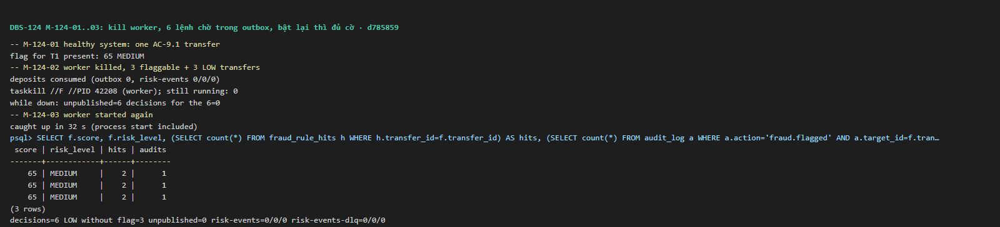
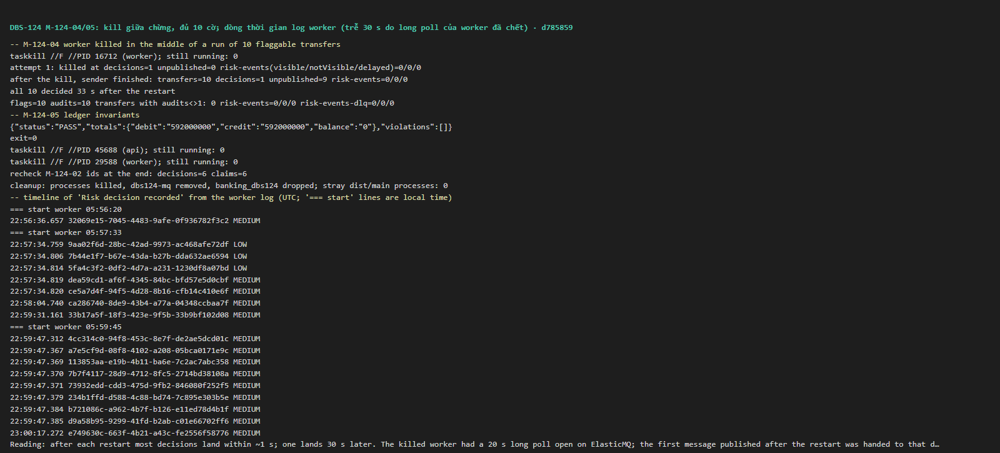

# DBS-124 · Test tắt/bật worker: sự kiện không mất, cờ vẫn xuất hiện

> **Status:** Implemented · **Vai:** Dev · **Cặp đôi review:** Dev khác · **Nhánh:** `test/DBS-124-worker-down-recovery` · **PR:** — · **Cập nhật:** 2026-11-10

## 1. Bối cảnh

- **Task trên board:** Task, Tuần 4, Demo 3. **Expect:** "Chứng minh không mất sự kiện khi worker chết."
- **DoD** (chép nguyên văn):
  1. Tắt worker, chuyển tiền N lần, bật lại → mọi cờ cần có vẫn xuất hiện, không trùng cờ
  2. Kịch bản Demo 3 (failure/recovery) có từng bước và kết quả mong đợi
  3. Bất biến đúng sau test (DBS-69)
  4. PR đã merge vào main (CI xanh); Dev review; bảng «Đối chiếu test case» trong PR điền đủ
- **Phụ thuộc:** DBS-111 (consumer risk, PR #124), DBS-91 (relay chịu sự cố), DBS-69 (`checkLedgerInvariants`). Tất cả có trên `main` 083ecee.
- **Đã có gì:**
  - DBS-91:
    - M-91-01: không worker, 21 sự kiện chờ; bật worker thì 21 message, 0 trùng.
    - M-91-04: kill cứng worker khi đang gửi.
    - TC-91-01: relay chết sau khi gửi, trước khi đánh dấu.
  - DBS-111:
    - TC-111-13: vòng lặp thật, gửi lại không thêm cờ.
    - M-111-07: tắt worker, một lệnh AC-9.1, bật lại thì cờ xuất hiện. Đây là kiểm tay một lệnh, không tự động và không có kịch bản chết giữa chừng.
  - "Demo 3" có nhắc ở ADR-03, docs/03 §17 (dòng "Failure / recovery") và feature doc DBS-91, 100, 101, 102, 104, nhưng **chưa có tài liệu kịch bản** riêng.
- **Baseline:** `main` 083ecee là code của PR #124, CI xanh 6 job. Trên cùng code đó: unit 1.770, e2e 163, `test:db` 892 (đo ở DBS-111).
- **Ngoài phạm vi:**
  - Consumer lỗi 5 lần dẫn tới DLQ, và runbook redrive: DBS-125.
  - Kill API giữa lệnh (AC-5.10): DBS-185.
  - Tắt Redis trong load test: DBS-100 đã có phần test; phần load là của #5.
  - Worker trên ECS: BL-161.
  - Thứ tự đến muộn hoặc đảo: DBS-112.
- **Quyết định ở G1** (agent tự quyết):
  1. **Kịch bản Demo 3** đặt ở `docs/demos/demo-3-failure-recovery.md` (thư mục mới, dùng chung), vì Demo 3 trải qua nhiều thành phần.
     - Có mục cho DBS-91 (relay), DBS-124 (worker và cờ), DBS-125 (DLQ, chờ task đó) và DBS-100 (Redis).
     - Link từ docs/03 §17, concept brief outbox, `docs/components/index.md` và sơ đồ thư mục ở `docs/README.md`.
  2. **Ba kiểu "worker chết", mỗi kiểu chứng minh một điều:**
     - **TC-124-01, dừng sạch:** gọi `onApplicationShutdown` (relay commit nốt sự kiện đang gửi; consumer ack nốt bước đang chạy), rồi dựng instance mới. Chứng minh **backlog được xử lý bù** sau khi worker vắng mặt.
     - **TC-124-02, chết sau commit, trước khi ack:** consumer thoát ngay sau khi transaction commit, message không bị xóa, SQS giao lại. Chứng minh lần giao lại không ghi thêm.
     - **M-124-04, kill cứng process thật giữa lúc xử lý:** message đã nhận nằm ẩn tới hết visibility timeout 30 s.

     Trường hợp relay chết sau khi gửi, trước khi đánh dấu đã có ở DBS-91 TC-91-01.

     Trạng thái khác giữa instance mới và một process mới thật:
     - Map `parked` của relay rỗng: đúng như process mới.
     - Cache phiên bản luật mới: đúng như process mới.
     - Generation cũ bị bỏ qua nhờ `invalidateCounters()`: đúng như process mới.
     - Bộ đếm Valkey vẫn còn: đúng như thật, vì Redis tồn tại độc lập với worker.
  3. Board ghi DBS-124 "Done" nhưng chưa có test: người dùng sửa board.

## 2. Hành vi

Không có API mới. Hệ thống phải giữ các tính chất sau (ADR-03, DBS-91, DBS-101, DBS-111):

| Tình huống | Kết quả |
|---|---|
| Worker tắt, khách chuyển N lần | Mọi lệnh 201; đúng N `TransferCompleted` của các transfer đó có `published_at IS NULL`; 0 decision |
| Bật worker mới | Relay đẩy hết; N decision; mỗi transfer đạt ngưỡng có đúng 1 cờ, 1 dòng audit `fraud.flagged` và 2 hit (R3, R6); transfer LOW không có cờ hay audit. `risk-events` cạn (số message hiện và ẩn đều 0); `risk-events-dlq` rỗng |
| Consumer commit xong rồi chết trước khi ack | Message được giao lại (≥ 2 lần `handle` cho đúng `eventId` đó); vẫn 1 decision, 1 cờ, 1 audit; DLQ rỗng |
| Sau mọi kịch bản | `checkLedgerInvariants` PASS |

"Không trùng cờ" không kiểm bằng số cờ: PK `fraud_flags` đã chặn sẵn, nên một lần xử lý trùng sẽ lộ ra thành message vào DLQ hoặc thêm audit. Vì vậy test kiểm **audit đúng 1, hit đúng 2, DLQ rỗng, queue cạn**.

**Dữ liệu:**
- Mỗi lệnh đi từ một **tài khoản nguồn mới, chỉ chuyển đúng một lần**, tới một người nhận mới.
- Người nhận không bao giờ chuyển ngược lại. Điều này loại trừ R1, R2, R4, R5.
- **Đạt ngưỡng:** nạp 21.000.000đ, chuyển 20.000.000đ → R3 + R6 = 65 MEDIUM.
- **LOW:** nạp 5.000.000đ, chuyển 1.000.000đ (20%, ≤ 10.000.000đ) → 0 điểm.
- Các lệnh nạp được làm **và được consumer xử lý xong** trước khi tắt worker, để chỉ còn đúng N sự kiện chờ.

## 3. Kiến trúc

- **Vị trí:**
  - `backend/test/services/worker-recovery.services-spec.ts`, kèm một bước CI trong job `e2e`.
  - `docs/demos/demo-3-failure-recovery.md`.
  - Không đổi code sản phẩm.
- **Interface dùng:**
  - `OutboxRelayService.onApplicationBootstrap()` và `onApplicationShutdown()`.
  - `RiskScoringConsumer` (qua `buildRiskConsumer` của DBS-111) và `OnlineFeatureProvider.invalidateCounters()`.
  - `GetQueueAttributesCommand` (`@aws-sdk/client-sqs`, đã là dependency) để đếm message trong queue.
- **Consumer test:**
  - TC-124-01: long poll 1 s, visibility mặc định của queue (30 s), giống `FastPollConsumer`.
  - TC-124-02, consumer "chết":
    - Visibility 2 s **chỉ ở consumer này**.
    - Đếm `handle` theo `eventId`.
    - "Chết" (ném lỗi sau khi `super.handle()` thành công) đúng một lần, **chỉ cho `eventId` của transfer đã chọn**.
    - Lệnh nạp của fixture được xử lý xong trước khi bật cơ chế chết.
- **Thay đổi cấp hệ thống:** thêm thư mục `docs/demos/`; cập nhật docs/03 §17 và ADR-03 §Hệ quả để trỏ tới tài liệu Demo 3.

## 4. Test cases tự động

| ID | Truy vết | Lớp | Given · When · Then |
|---|---|---|---|
| TC-124-01 | DoD #1, #3 (backlog sau khi dừng sạch) | services (PG + ElasticMQ + Valkey thật, HTTP thật, vòng lặp thật) | 12 tài khoản nguồn được nạp và các lệnh nạp đã được xử lý; tắt worker. 12 lệnh (6 đạt ngưỡng, 6 LOW) đều 201; đúng 12 `TransferCompleted` của 12 transfer đó chưa gửi; 0 decision. Bật worker **mới** → ≤ 60 s: 12 decision; đúng 6 cờ 65 MEDIUM trên đúng 6 transfer đạt ngưỡng, mỗi transfer 1 audit `fraud.flagged` và hit đúng {R3, R6}; 6 transfer LOW không có cờ hay audit; outbox chưa gửi 0; `risk-events` cạn; `risk-events-dlq` rỗng; bất biến PASS. Điều kiện chờ (có hạn) gồm **cả** số decision = 12 **và** ba thuộc tính queue = 0, vì ack chạy sau commit |
| TC-124-02 | DoD #1, #3 (chết sau commit) | services; relay và consumer của TC-124-01 đã dừng (`onApplicationShutdown`) trước khi consumer "chết" khởi động, để không ai khác nhận message đó | Một lệnh đạt ngưỡng; consumer chết đúng một lần sau khi commit `eventId` đó → `handle` cho `eventId` ≥ 2; 1 decision, 1 cờ, 1 audit; DLQ rỗng; bất biến PASS |
| quy trình | DoD #2 | tài liệu | `docs/demos/demo-3-failure-recovery.md` có từng bước, lệnh, kết quả mong đợi; chạy thật ở §5 |
| quy trình | DoD #4 | — | PR, CI, bảng đối chiếu |

## 5. Test thủ công (cũng là lần chạy Demo 3, phần worker)

Hai process thật: `npm run build`, rồi `node dist/main` với `APP_ROLE=api` và với `APP_ROLE=worker`.

**Chuẩn bị** (từ `backend/`):
- **ElasticMQ riêng** (công thức DBS-91, chạy từ thư mục gốc repo): `docker run -d --name dbs124-mq -p 9334:9324 -v "$PWD/infra/local/elasticmq.conf:/opt/elasticmq.conf:ro" softwaremill/elasticmq-native@sha256:e4580ab9ad1bd5cd37b4ba04911bc5ccc8cd2d9ab4de56ece65acee71c24e05c`. Biến cho cả hai process: `SQS_ENDPOINT=http://localhost:9334`, `SQS_RISK_QUEUE_URL=http://localhost:9334/000000000000/risk-events`, `SQS_NOTIFICATION_QUEUE_URL=…/notification-events`. Đếm queue (với `AWS_ACCESS_KEY_ID=local AWS_SECRET_ACCESS_KEY=local AWS_DEFAULT_REGION=us-east-1`) bằng `aws --endpoint-url http://localhost:9334 sqs get-queue-attributes --queue-url http://localhost:9334/000000000000/risk-events --attribute-names ApproximateNumberOfMessages ApproximateNumberOfMessagesNotVisible ApproximateNumberOfMessagesDelayed`, và lệnh tương tự với `risk-events-dlq` ("cạn" = cả ba bằng 0); không dùng `queue-census.ts` để đếm (nó chỉ thấy message hiện và làm ẩn message 30 s).
- DB riêng `banking_dbs124` trên `dbs63-fix-pg`, rồi `migration:run`.
- Process api: `RATE_LIMIT_TRANSFERS_PER_MINUTE=1000 RATE_LIMIT_REQUESTS_PER_IP_PER_MINUTE=10000`.
- Trước khi chạy: `powershell -Command "Get-CimInstance Win32_Process -Filter \"Name='node.exe'\" | ? CommandLine -match 'dist.main' | select ProcessId,CommandLine"` không trả process nào sót.
- Kill bằng PID Windows: `taskkill //F //PID $(cat /proc/<pid>/winpid)`, rồi `tasklist //FI "PID eq <winpid>"` xác nhận đã chết.
- Mỗi khách gọi `POST /v1/customers/me` rồi `POST /v1/accounts`. Token lấy bằng `auth:dev-token --sub` riêng.

| Bước | Việc làm | Kết quả mong đợi |
|---|---|---|
| M-124-01 | Chạy hai process; một lệnh đạt ngưỡng | Cờ xuất hiện |
| M-124-02 | Nạp cho 6 tài khoản mới, đợi các lệnh nạp được xử lý; kill worker (kiểm bằng `tasklist`); 3 lệnh đạt ngưỡng + 3 lệnh LOW | 6 lệnh 201; đúng 6 `TransferCompleted` chưa gửi; 0 decision mới |
| M-124-03 | Bật lại worker | ≤ 60 s: 6 decision mới, 3 cờ 65 MEDIUM, mỗi cờ 1 audit và 2 hit; outbox chưa gửi 0; `risk-events` cạn (ba thuộc tính = 0), `risk-events-dlq` 0 message. Phần lớn xong trong vài giây; một message có thể đến trễ ~30 s nếu worker bị kill lúc đang long poll (xem §8, lệch 1) |
| M-124-04 (kill giữa chừng) | Nạp cho 10 tài khoản mới, đợi xử lý xong. **Một script duy nhất**: gửi 10 lệnh đạt ngưỡng cách nhau 1 giây; trong lúc đó vòng lặp chặt đếm decision của loạt này và `taskkill` worker ngay khi số đó nằm trong 1..9; ngay lúc kill ghi số decision, số chưa gửi và `ApproximateNumberOfMessagesNotVisible`. Nếu lúc kill số decision là 0 hoặc 10 thì làm lại với tài khoản mới và ghi từng lần thử. Bật lại worker | Đủ 10 decision, 10 cờ, mỗi cờ 1 audit; queue cạn, DLQ 0. Thời gian chờ ≤ 60 s; khoảng chờ ~30 s chỉ xuất hiện khi lúc kill `NotVisible > 0` (message đã nhận mà chưa ack) |
| M-124-05 | `npm run --silent check:invariants` | PASS |

## 6. Domain review (AI)

**Reviewer:** subagent general-purpose, model Opus (effort medium), 2026-11-10.

**Vòng 1:** 12 phát hiện (blocking 1, should-fix 8, minor 3), verdict REVISE · [nguyên văn](screenshots/DBS-124/domain-review.md). **Vòng 2:** 12/12 đã xử lý; 2 should-fix và 2 minor mới, REVISE · [nguyên văn](screenshots/DBS-124/domain-review-r2.md). **Vòng 3:** 4/4 đã xử lý, 2 minor mới đã sửa, **APPROVE** · [nguyên văn](screenshots/DBS-124/domain-review-r3.md)

| # | Mức | Phát hiện | Xử lý |
|---|---|---|---|
| 1 | blocking | Cơ chế "chết" có thể rơi vào lệnh nạp | đã sửa §3: chỉ chết cho `eventId` của transfer đã chọn, các lệnh nạp xử lý xong trước |
| 2 | should-fix | Đếm cờ không chứng minh "không trùng" | đã sửa §2/§4/§5: kiểm audit, hit, DLQ, queue cạn |
| 3 | should-fix | Visibility 2 s cho mọi lần nhận gây flaky | đã sửa: 2 s chỉ ở TC-124-02, kiểm ≥ 2 |
| 4 | should-fix | Dừng sạch không phải là crash | đã sửa §1 QĐ2: ba kiểu chết và trạng thái khác nhau |
| 5 | should-fix | Cách gọi `taskkill` trong Git Bash | đã sửa §5 chuẩn bị |
| 6 | should-fix | Kill sau 300 ms không chạm đường risk | đã sửa M-124-04: kill khi 1..9 decision, chờ ≤ 60 s |
| 7 | should-fix | Dùng ElasticMQ chung | đã sửa: container riêng `dbs124-mq` |
| 8 | should-fix | Rate limit | đã sửa |
| 9 | should-fix | Chỗ đặt tài liệu Demo 3 | đã sửa QĐ1: `docs/demos/` |
| 10 | minor | Fixture phải loại trừ R4 | đã sửa §2 |
| 11 | minor | "≥ 12" lỏng | đã sửa: đúng 12, xử lý lệnh nạp trước |
| 12 | minor | Thiếu M-111-07; kết quả grep sai | đã sửa §1 |
| v2-1 | should-fix | `queue-census` không chứng minh queue cạn | đã sửa: `get-queue-attributes` ba thuộc tính |
| v2-2 | should-fix | Cửa sổ kill 1..9 khó bắt bằng tay | đã sửa M-124-04: một script, lệnh cách 1 s, ghi `NotVisible`, làm lại nếu trượt |
| v2-3 | minor | `tasklist` không thấy command line | đã sửa: `Get-CimInstance` |
| v2-4 | minor | Chờ queue cạn trong điều kiện; dừng instance trước | đã sửa TC-124-01/02 |
| v3-1 | minor | Lệnh `get-queue-attributes` thiếu `--queue-url` và biến AWS | đã sửa |
| v3-2 | minor | Bộ lọc `dist/main` sai | đã sửa: `-match 'dist.main'` (khớp cả `dist/main` và `dist\main`) |

**Quyết định ở G2:** không có quyết định riêng ngoài G1; vòng 3 APPROVE.

## 7. Kế hoạch triển khai

Task chỉ thêm test cho hành vi đã có (DBS-91, DBS-111), nên "đỏ" được chứng minh bằng đột biến: chạy spec với một lỗi cố ý trong code sản phẩm (ví dụ consumer bỏ dedup sớm và claim decision có `ON CONFLICT (transfer_id)` thay vì không target; relay đánh dấu đã gửi trước khi gửi) rồi khôi phục, ghi kết quả ở §8.

| Bước | File | Test viết trước | Kết quả đỏ (điền khi chạy) | Lệnh chứng minh | Commit |
|---|---|---|---|---|---|
| 1 | `backend/test/services/worker-recovery.services-spec.ts`, `.github/workflows/ci.yml` | TC-124-01, TC-124-02 | (đột biến) | `DATABASE_URL=… npm run test:services -- --runInBand --runTestsByPath test/services/worker-recovery.services-spec.ts` | `test(outbox): worker stop, crash and restart lose no flag (DBS-124)` |
| 2 | `docs/demos/demo-3-failure-recovery.md`, `docs/03_HIGH_LEVEL_ARCHITECTURE.md` §17, `docs/adr/0003-*.md`, `docs/components/outbox/01-concept-brief.md`, `docs/components/index.md`, `docs/README.md` | — | — | `check-doc-links.mjs` | `docs(demos): Demo 3 failure and recovery script (DBS-124)` |
| 3 | doc này, `docs/features/README.md`, `screenshots/DBS-124/` | — | — | toàn bộ lệnh kiểm tra | `docs(outbox): DBS-124 evidence` |

Quét DoD: #1 → TC-124-01/02, M-124-02..04; #2 → bước 2; #3 → TC + M-124-05; #4 quy trình. Không có dòng BACKLOG nào cho DBS-124. **Rủi ro:** test vòng lặp thật có thể chậm trên CI → mọi chờ có hạn 60 s và lỗi rõ. **Cách lùi:** chỉ có test và tài liệu.

**Quyết định ở G3** (agent tự quyết): không thêm test db-spec; cả hai kịch bản cần queue thật nên ở lớp services.

## 8. Kết quả

- **Lệnh kiểm tra** (từ `backend/`, code trên `d785859`):
  - `lint:check` và `typecheck` sạch.
  - `npm test`: 1.770 test đạt.
  - `test:services` `worker-recovery`: 2/2 đạt, 15,8 s.
  - Task chỉ thêm test và tài liệu, không đổi code sản phẩm hay schema. `test:e2e` (163) và `test:db` (892) không chạy lại tại máy: code sản phẩm giống hệt lần đo ở DBS-111 (`083ecee`). CI của PR chạy đủ cả hai.
  - `check-doc-links`: 0 link hỏng.
- **Chứng minh test bắt được lỗi.** Hành vi đã có từ DBS-91 và DBS-111, nên test xanh ngay lần đầu. Hai đột biến lên code sản phẩm, mỗi lần chạy xong đều khôi phục bằng `git checkout`:

| Đột biến | Ca đỏ |
|---|---|
| MA: bỏ cả ba lớp chống trùng (claim `processed_events` của `ConsumerBase`, dedup sớm, claim decision) | TC-124-02 |
| MB: relay bỏ qua queue `risk` nhưng vẫn đánh dấu đã gửi | TC-124-01, TC-124-02 |

- **Đối chiếu test case** (`backend/test/services/worker-recovery.services-spec.ts`):

| ID | Kết quả |
|---|---|
| TC-124-01 | đạt: 12 sự kiện chờ khi worker tắt; worker mới xử lý đủ 12 decision, 6 cờ 65 MEDIUM, mỗi cờ 1 audit và hit `R3,R6`; LOW không có audit; queue cạn; DLQ 0 |
| TC-124-02 | đạt: consumer chết sau commit, message được giao lại (≥ 2 lần `handle`); vẫn 1 decision, 1 cờ, 1 audit, 1 claim; DLQ 0 |
| DoD #2 | `docs/demos/demo-3-failure-recovery.md`, phần B chạy thật ở M-124 |

- **Test thủ công / Demo 3.** Chạy hai process `node dist/main` (api và worker) với ElasticMQ riêng `dbs124-mq` ở cổng 9334, PG và Valkey thật. Output thô ở [manual-test.txt](screenshots/DBS-124/manual-test.txt), dòng đầu là SHA `d785859`, cuối file có dòng thời gian từ log worker.

| Bước | Phản hồi thật (rút gọn) | Kết quả |
|---|---|---|
| M-124-01 | Cờ T1 `65 MEDIUM` | đạt |
| M-124-02 | Lệnh nạp xử lý xong (outbox 0, `risk-events 0/0/0`); `taskkill //F //PID 42208`, `still running: 0`; trong lúc worker tắt: `unpublished=6`, decision của 6 lệnh = 0 | đạt |
| M-124-03 | `caught up in 32 s`; 3 cờ `65 MEDIUM`, mỗi cờ 2 hit và 1 audit; decision 6, LOW không cờ 3; outbox 0; `risk-events 0/0/0`; DLQ `0/0/0` | đạt (sau khi sửa kết quả mong đợi, xem lệch 1) |
| M-124-04 | Lần thử 1: kill khi `decisions=1 unpublished=0 risk-events=0/0/0`; sau khi bộ gửi xong: 10 lệnh, 1 decision, 9 chưa gửi; bật lại thì `all 10 decided 33 s after the restart`; 10 cờ, 10 audit, 0 transfer có số audit khác 1; queue và DLQ `0/0/0` | đạt |
| M-124-05 | `PASS`, nợ = có = 592.000.000, balance 0 | đạt |

- **Phạm vi so với §7:** các file trong `git diff --stat` đều thuộc 3 bước của §7: spec, `ci.yml`, tài liệu Demo 3 kèm các link (`docs/03`, ADR-03, concept brief outbox, `components/index.md`, `docs/README.md`), doc này và `features/README.md`.
- **Ảnh chụp:**

- **Lệch so với kế hoạch:**
  1. **Lần chạy đầu của M-124-03** chỉ có 5/6 decision sau 30 s, nên không đạt mức "≤ 10 s" ở §5. Tôi giữ lại DB và log rồi chạy lại để tìm nguyên nhân:
     - 5 decision xong trong ~1 s, decision thứ 6 đến **đúng 30 s sau**; cuối cùng đủ 6/6.
     - Nguyên nhân: worker bị kill đang mở một long poll (≤ 20 s) với ElasticMQ. Message đầu tiên sau khi bật lại bị giao cho kết nối đã chết, ẩn hết visibility timeout 30 s, rồi mới được giao lại.
     - Đây là at-least-once đúng thiết kế: trễ chứ không mất. Không phải lỗi code. Khi dừng worker bằng SIGTERM (`enableShutdownHooks` ở `main.ts`) thì vòng lặp kết thúc long poll trước khi thoát, nên không có độ trễ này.
     - Quyết định (agent tự quyết, ghi trước khi chạy lại): sửa kết quả mong đợi của M-124-03 thành "≤ 60 s", kèm giải thích ở doc này và ở tài liệu Demo 3; chạy lại toàn bộ §5. Lần chạy lưu ở `manual-test.txt` là lần chạy lại.
  2. Script thủ công giữ log mọi lần khởi động worker và kiểm lại các transfer của M-124-02 ở cuối (`decisions=6 claims=6`), để có bằng chứng cho lệch 1.
- **Bàn giao cho vai khác:** không có. Phần C của Demo 3 (DLQ) thuộc DBS-125; kill API giữa lệnh thuộc DBS-185. Cả hai đã ghi trong tài liệu Demo 3.

## 9. Tài liệu đã cập nhật

- Mới: `docs/demos/demo-3-failure-recovery.md` (Demo 3, các phần A–D).
- `docs/03_HIGH_LEVEL_ARCHITECTURE.md` §17: link tới kịch bản.
- `docs/adr/0003-*.md` mục "Cách kiểm chứng": thêm dòng DBS-124.
- `docs/components/outbox/01-concept-brief.md`, `docs/components/index.md`: link Demo 3.
- `docs/README.md`: thêm thư mục `demos/` vào sơ đồ.
- `docs/features/README.md`: dòng DBS-124.
- BACKLOG: không thêm, không xóa.
