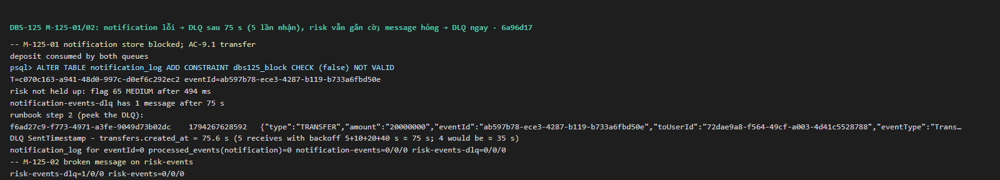
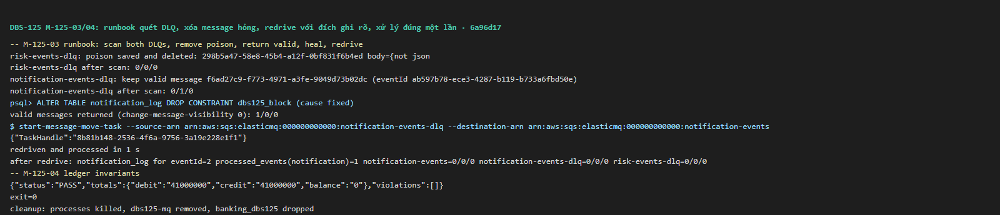

# DBS-125 · Test consumer lỗi 5 lần → DLQ, consumer khác không bị chặn

> **Status:** Implemented · **Vai:** Dev · **Cặp đôi review:** Dev khác · **Nhánh:** `feat/DBS-125-dlq-isolation-runbook` · **PR:** — · **Cập nhật:** 2026-11-10

## 1. Bối cảnh

- **Task trên board:** Task, Tuần 4, Demo 3. **Expect:** "DLQ hoạt động đúng như thiết kế."
- **DoD** (chép nguyên văn):
  1. Ép notification lỗi liên tục → message sang DLQ sau đúng 5 lần nhận; risk vẫn xử lý bình thường
  2. Message hỏng → DLQ ngay
  3. Có cách đọc/redrive message DLQ được ghi ở runbook
  4. PR đã merge vào main (CI xanh); Dev review; bảng «Đối chiếu test case» trong PR điền đủ
- **Phụ thuộc:** DBS-101 (`ConsumerBase`), DBS-102 (consumer notification), DBS-111 (consumer risk, PR #124). Tất cả có trên `main` de6db2f.
- **Đã có gì:**
  - TC-101-07/08/09 (`consumer-base.services-spec.ts`): khung consumer với **consumer test** chứng minh sai schema vào DLQ ở lần nhận đầu, lỗi tạm vào DLQ ở lần nhận thứ 5, và consumer lỗi không chạm message của consumer khác.
  - TC-104-02: message hỏng của notification thật vào DLQ ngay.
  - Hạ tầng (DBS-73): `maxReceiveCount = 5`, DLQ giữ 6 ngày, redrive bằng `start-message-move-task`. Quy tắc an toàn khi redrive ở DBS-73 §2 (ghi lại vào BL-051).
  - **Chưa có:** test mức hệ thống với notification **thật** lỗi liên tục trong khi risk **thật** chạy trên cùng sự kiện; thư mục và runbook DLQ.
  - Kiểm ngày 2026-11-10: ElasticMQ local nhận `start-message-move-task` (trả `TaskHandle`), nên runbook dùng được cùng một lệnh AWS CLI cho local và cloud.
- **Baseline** (`main` de6db2f, CI của PR #125 xanh 6 job): unit 1.770, e2e 163, `test:db` 892.
- **BACKLOG:**
  - BL-051 có phần "runbook redrive trong thời hạn retention…". Task này viết runbook và chạy thật trên ElasticMQ, nên **thu hẹp** BL-051. Phần alarm và lần chạy trên môi trường cloud vẫn là của #5.
  - BL-046 còn mục "DLQ của lỗi luật trên queue thật": TC-125-02 thêm message hỏng vào queue risk thật, nhưng lỗi **luật** vào DLQ trên queue thật vẫn chưa có; chỉ nêu tên.
- **Ngoài phạm vi:**
  - Alarm DLQ (DBS-163, BL-051).
  - Chạy runbook trên AWS (cần môi trường cloud, BL-161).
- **Quyết định ở G1** (agent tự quyết):
  1. **"Ép notification lỗi liên tục"** bằng subclass test của `NotificationConsumer`: `apply` ghi xong rồi ném lỗi. Hiệu ứng giống một lỗi DB tạm thời: transaction rollback, `processed_events` không giữ. Lỗi được bật theo **`fromAccountId` của tài khoản nguồn đã chọn**, với `type = TRANSFER`: biết được trước khi gửi request, nên không có cửa sổ race. `eventId` sinh ra trong outbox, chỉ đọc sau để kiểm. Sự kiện nạp tiền (`DEPOSIT`) không bị ảnh hưởng. Không sửa code sản phẩm.
  2. **Runbook** ở `docs/runbooks/dlq-redrive.md` (thư mục mới), chỉ dùng lệnh AWS CLI gốc:
     - **Xem DLQ (chỉ nhìn):** `receive-message --max-number-of-messages 10 --wait-time-seconds 5 --visibility-timeout 0 --attribute-names All --message-attribute-names All`. Chỉ đọc DLQ, không đọc queue chính. Không xóa bằng handle của lần xem này, vì mỗi lần nhận sau đó cấp handle mới; với visibility 0, các lần đọc cũng chỉ thấy lại tối đa 10 message đầu.
     - **Đếm:** `get-queue-attributes`.
     - **Quét để tách message hỏng trước khi redrive** (redrive chuyển **mọi** message, không lọc được):
       - `receive-message --max-number-of-messages 10 --wait-time-seconds 5 --visibility-timeout 1800` nhiều lần. 1800 s đủ dài cho cả lần quét; nếu một message được nhận lại thì chỉ giữ **handle mới nhất** theo `MessageId`;
       - mỗi message: lưu body và handle ra file;
       - message hỏng (không phải JSON hoặc sai schema): `delete-message` bằng **chính** handle đó;
       - message hợp lệ: **giữ ẩn** (không đổi visibility).
       - Dừng khi một lần nhận trả về rỗng **và** `ApproximateNumberOfMessages` = 0. Lúc đó message hợp lệ nằm trong `…NotVisible`.
       - Rồi trả message hợp lệ về bằng `change-message-visibility --visibility-timeout 0` với các handle đã lưu. **Bắt buộc**: không chờ hết visibility thay cho bước này (xem ghi chú ElasticMQ). Sau đó mới redrive.
       - Nếu sau khi quét không còn message hợp lệ thì **không redrive**.

       Nếu đổi visibility về 0 ngay trong lúc quét, message hợp lệ quay lên đầu hàng, vòng quét không dừng và không với tới message hỏng phía sau.
     - **ElasticMQ local** (đã thử 2026-11-10, image `softwaremill/elasticmq-native:latest` ngày 2026-04-05):
       - Thử với 1 message hỏng và 2 message hợp lệ: chỉ 2 message hợp lệ được chuyển, DLQ về 0. Lý do đúng: `delete-message` của ElasticMQ chỉ bỏ message khỏi `messagesById`, vẫn để nó trong hàng ưu tiên mà move task lấy ra. Chính lệnh `change-message-visibility 0` chạy **sau** các lệnh xóa đã dựng lại hàng từ `messagesById` và loại message đã xóa (`UpdateVisibilityTimeoutOps`, `filterNot`). Vì vậy bước trả về bằng visibility 0 là bắt buộc trên ElasticMQ.
       - Image đã thử: `softwaremill/elasticmq-native@sha256:e4580ab9ad1bd5cd37b4ba04911bc5ccc8cd2d9ab4de56ece65acee71c24e05c`. Test và CI kéo `:latest` không ghim, nên hành vi có thể đổi theo bản mới (BL-225).
       - **`list-message-move-tasks` làm ElasticMQ sập** (`scala.MatchError` ở `ListMessageMoveTasksRequest`, container thoát). Ở local, theo dõi bằng `get-queue-attributes`, không dùng lệnh này. Trên AWS lệnh này dùng bình thường.
     - **Redrive:** `start-message-move-task --source-arn <QueueArn của DLQ> --destination-arn <QueueArn của queue chính>`. Luôn ghi đích, vì message trong DLQ do `ConsumerBase` **gửi** (`SendMessage`) chứ không do SQS chuyển, nên AWS không biết "queue gốc" của chúng. ARN đọc bằng `get-queue-attributes --attribute-names QueueArn`, không tự ghép.
     - **Theo dõi và hủy:** `list-message-move-tasks`, `cancel-message-move-task`.
     - **Quyền:** chỉ Ops (worker bị từ chối đọc DLQ theo DBS-73).
     - **Quy tắc an toàn**, viết lại cho đúng với message do `ConsumerBase` ghi vào DLQ. Những message này chưa bao giờ commit `processed_events` (lỗi thì rollback, poison thì không claim), nên redrive không đụng cửa sổ dedup 7 ngày. Quy tắc "queue chính về 0 trong 24 giờ" và "mỗi message (theo `eventId`) chỉ redrive một lần" vẫn giữ.
     - Chưa chạy trên AWS (BL-161).
  3. **Demo 3 phần C** được điền bằng kịch bản §5.
  4. **Sửa số "khoảng 2,5 phút"** ở BL-051 và ADR-14: thời gian thật là ≈ 75–80 s, vì backoff 5/10/20/40 s thay thế visibility 30 s (`ConsumerBase.backOff`).
  5. Board ghi DBS-125 "Done" nhưng chưa có test: người dùng sửa board.

## 2. Hành vi

| Tình huống | Kết quả |
|---|---|
| Notification lỗi mọi lần với lệnh chuyển AC-9.1 từ tài khoản nguồn đã chọn (các sự kiện nạp đã xử lý xong trước) | `notification-events`: message đó được nhận đúng 5 lần; lần thứ 5 có `ApproximateReceiveCount = "5"` và `ConsumerBase` chuyển nó sang `notification-events-dlq`. DLQ có đúng 1 message **với `eventId` đó**, `notification_log` và `processed_events('notification')` của `eventId` = 0. **Cùng lúc** risk xử lý bình thường: 1 decision, cờ 65 MEDIUM; `risk-events-dlq` 0 |
| `"{not json"` và `{"eventType":"TransferCompleted"}` gửi vào mỗi queue, rồi một sự kiện hợp lệ | Mỗi message hỏng vào DLQ của chính queue đó ở lần nhận đầu: JSON hỏng thì `processBatch` không gọi handler; sai schema thì `PoisonMessageError` ở lần `handle` đầu. Sự kiện hợp lệ sau đó được xử lý ở cả hai consumer |
| Redrive DLQ notification (chỉ còn message hợp lệ) sau khi consumer đã lành | `start-message-move-task` với đích ghi rõ → message về `notification-events`; consumer lành `handle` đúng 1 lần cho `eventId`; `notification_log` có **đúng 2 dòng** (người gửi và người nhận); `processed_events` của `eventId` = 1; DLQ 0; queue chính cạn |

**Giới hạn 5 lần là của `ConsumerBase`** (`MAX_ATTEMPTS = 5`): nó chuyển message ở lần nhận thứ 5. Redrive của ElasticMQ (`maxReceiveCount = 5`) kiểm trước khi tăng số đếm nên chỉ chạy ở lần thứ 6, tức không bao giờ tới lượt. Vì vậy chỉ có một bản trong DLQ, trừ khi lệnh xóa trong `deadLetter` thất bại.

**Thời gian:**
- Production: backoff 5, 10, 20, 40 s thay thế visibility 30 s, nên message vào DLQ khoảng 75–80 s sau lần nhận đầu.
- Test: `retryBackoffSeconds = 0` và visibility 1 s, nên 5 lần nhận xong trong vài giây.
- Trong test chỉ có **một** poller notification, và không ai đọc trộm queue chính, nếu không số lần nhận sẽ tăng.

## 3. Kiến trúc

- **Vị trí:** không đổi code sản phẩm.
  - `backend/test/services/dlq-isolation.services-spec.ts`, kèm bước CI riêng trong job `e2e`.
  - `docs/runbooks/dlq-redrive.md` (mới).
  - `docs/demos/demo-3-failure-recovery.md` phần C.
- **Interface dùng:**
  - `NotificationConsumer`, subclass test:
    - `failFrom: Set<string>`: `apply` ném lỗi cho `TransferCompleted` có `type = TRANSFER` và `fromAccountId` nằm trong đó (đặt trước khi gửi request);
    - `retryBackoffSeconds = 0`;
    - `consumeOnce(1, 1)`;
    - đếm `handle` và ghi `ApproximateReceiveCount` theo `eventId`.
  - `RiskScoringConsumer` qua `buildRiskConsumer`.
  - `OutboxRelayService` chạy vòng lặp thật.
  - `@aws-sdk/client-sqs`: `GetQueueAttributesCommand` (gồm `QueueArn`), `PurgeQueueCommand`, `StartMessageMoveTaskCommand`, `ReceiveMessageCommand` (chỉ đọc DLQ). Không gọi `ListMessageMoveTasks`, vì nó làm ElasticMQ sập.
- **Độc lập giữa các test:** mỗi test bắt đầu bằng việc purge cả bốn queue và chờ hệ thống lặng (outbox 0, queue cạn). TC-125-03 tự dựng lại tình huống "message nằm trong DLQ", không dựa vào test trước.
- **Thay đổi cấp hệ thống:**
  - `docs/runbooks/` (sơ đồ ở `docs/README.md`).
  - Link runbook từ docs/03 §11 và concept brief outbox.
  - Sửa "2,5 phút" ở BL-051 và ADR-14.

## 4. Test cases tự động

| ID | Truy vết | Lớp | Given · When · Then |
|---|---|---|---|
| TC-125-01 | DoD #1 | services (PG + ElasticMQ + Valkey thật, HTTP thật, relay và hai consumer thật, một poller mỗi queue) | Fixture nạp đã xử lý xong; bật lỗi notification cho lệnh chuyển từ tài khoản nguồn đã chọn (AC-9.1) → `handle` notification của `eventId` đúng 5 lần, lần cuối `ApproximateReceiveCount = "5"`; `notification-events-dlq` có đúng 1 message với `eventId` đó; `notification-events` cạn; `notification_log`, `processed_events('notification')` của `eventId` = 0. Risk: 1 decision, cờ 65 MEDIUM, `risk-events-dlq` 0 |
| TC-125-02 | DoD #2 | services | Mỗi queue nhận `"{not json"`, `{"eventType":"TransferCompleted"}`, rồi một sự kiện hợp lệ → mỗi DLQ có đúng 2 message; handler không bao giờ được gọi cho message JSON hỏng; message sai schema chỉ được `handle` 1 lần; sự kiện hợp lệ được xử lý ở cả hai consumer (`notification_log` có dòng, `processed_events('risk')` có dòng) |
| TC-125-03 | DoD #3 | services, tự dựng lại tình huống | Lặp tình huống TC-125-01 để message vào DLQ; dừng consumer lỗi, chạy consumer lành; đọc `QueueArn` của hai queue; `StartMessageMoveTask` có đích ghi rõ → trong ≤ 30 s: consumer lành `handle` đúng 1 lần cho `eventId`; `notification_log` của `eventId` đúng 2 dòng; `processed_events('notification')` của `eventId` = 1; DLQ 0; queue chính cạn |
| quy trình | DoD #3 | tài liệu | Runbook đủ các bước ở QĐ G1-2; chạy thật ở §5 |
| quy trình | DoD #4 | — | PR, CI, bảng đối chiếu |

Mỗi test kết thúc bằng `checkLedgerInvariants` PASS.

## 5. Test thủ công (Demo 3 phần C, đồng thời chạy runbook)

Hai process thật (`node dist/main`, api và worker), ElasticMQ riêng `dbs125-mq` ở cổng 9334, DB `banking_dbs125`. Chuẩn bị như Demo 3.

**Ép notification lỗi mà không đổi code:** `ALTER TABLE notification_log ADD CONSTRAINT dbs125_block CHECK (false) NOT VALID`. Mọi INSERT mới vi phạm CHECK (`23514`), nên transaction rollback và message được retry. Không dùng `REVOKE` vì user `test` là superuser. "Chữa lành" bằng `DROP CONSTRAINT`.

| Bước | Việc làm | Kết quả mong đợi |
|---|---|---|
| M-125-01 | Tạo khách, nạp tiền; đợi `notification-events` và `risk-events` cạn; thêm constraint; một lệnh AC-9.1 | Lệnh 201; cờ 65 MEDIUM có ngay (risk không bị chặn). ≈ 75–80 s sau lệnh: đọc DLQ theo runbook thấy 1 message có `eventId` của lệnh; `notification_log` của `eventId` = 0. Bằng chứng 5 lần nhận: `SentTimestamp` của message DLQ − `transfers.created_at` ≈ 75 s (5 + 10 + 20 + 40), vì worker không log lỗi này |
| M-125-02 | Gửi `{not json` vào `risk-events` | `risk-events-dlq` có 1 message ngay |
| M-125-03 | Theo runbook: quét hai DLQ (nhận với visibility 1800, lưu body và handle mới nhất, xóa message hỏng bằng chính handle đó, giữ ẩn message hợp lệ; dừng khi nhận rỗng và số message hiện = 0; rồi trả message hợp lệ về bằng `change-message-visibility 0`); gỡ constraint; đọc `QueueArn`; `start-message-move-task` cho `notification-events-dlq` với đích ghi rõ; theo dõi bằng `get-queue-attributes` (không dùng `list-message-move-tasks` ở local) | `notification-events-dlq` về 0; `notification_log` của `eventId` đúng 2 dòng; `notification-events` và cả hai DLQ đều 0 |
| M-125-04 | `npm run --silent check:invariants` | PASS |

## 6. Domain review (AI)

**Reviewer:** subagent general-purpose, model Opus (effort medium), 2026-11-10.

**Vòng 1:** 10 phát hiện (blocking 1, should-fix 5, minor 4), verdict REVISE · [nguyên văn](screenshots/DBS-125/domain-review.md). **Vòng 2:** 10/10 đã xử lý, 2 should-fix mới, REVISE · [nguyên văn](screenshots/DBS-125/domain-review-r2.md). **Vòng 3:** 1 blocking, 1 should-fix mới, REVISE · [nguyên văn](screenshots/DBS-125/domain-review-r3.md). **Vòng 4:** R3-1 đã xử lý; 1 should-fix, 2 minor mới, REVISE · [nguyên văn](screenshots/DBS-125/domain-review-r4.md). **Vòng 5:** 3/3 đã xử lý, không có phát hiện mới, **APPROVE** · [nguyên văn](screenshots/DBS-125/domain-review-r5.md)

| # | Mức | Phát hiện | Xử lý |
|---|---|---|---|
| 1 | blocking | Redrive chuyển cả message hỏng; TC-125-03 phụ thuộc test trước | đã sửa: purge mỗi test, TC-125-03 tự dựng; runbook có bước tách message hỏng |
| 2 | should-fix | Phải ghi `--destination-arn` | đã sửa QĐ G1-2 và TC-125-03 |
| 3 | should-fix | Sự kiện nạp cũng vào DLQ; đếm không lọc `eventId` | đã sửa: lỗi chỉ cho `eventId` đã chọn, mọi đếm lọc theo `eventId` |
| 4 | should-fix | "Đúng một lần" chưa kiểm thật | đã sửa: 2 dòng `notification_log`, 1 `processed_events`, `handle` 1 lần |
| 5 | should-fix | Thời gian sai | đã sửa ≈ 75–80 s; QĐ G1-4 sửa BL-051 và ADR-14 |
| 6 | should-fix | Log worker không có lỗi để thấy | đã sửa M-125-01: dùng `SentTimestamp` và số đếm |
| 7 | minor | ElasticMQ redrive không bao giờ chạy; một poller | đã ghi §2 |
| 8 | minor | Tiền đề DBS-73 sai với message do `ConsumerBase` ghi | đã sửa QĐ G1-2 (lý do an toàn đúng, đối chiếu theo `eventId`) |
| 9 | minor | Lệnh đọc DLQ và quyền IAM | đã sửa QĐ G1-2 |
| 10 | minor | Định dạng ARN | đã sửa: đọc `QueueArn` |
| v2-1 | should-fix | Xóa message hỏng cần handle mới nhất; xem với visibility 0 không quét hết | đã sửa: tách "xem" và "quét", quét đến khi DLQ về 0 |
| v2-2 | should-fix | `failFor` theo `eventId` có race | đã sửa: lỗi theo `fromAccountId` biết trước |
| v3-1 | blocking | Vòng quét không dừng; bỏ sót message hỏng | đã sửa: giữ ẩn message hợp lệ tới khi quét xong, dừng khi nhận rỗng và số hiện = 0, rồi mới trả về |
| v3-2 | should-fix | ElasticMQ có thể redrive message đã xóa (đọc từ mã nguồn) | đã thử thật: không tái hiện. Phát hiện thêm `list-message-move-tasks` làm ElasticMQ sập; ghi vào runbook |
| v4-1 | should-fix | Lý do thật: `change-message-visibility 0` dựng lại hàng | đã sửa: bước trả về bằng visibility 0 bắt buộc; bỏ lựa chọn "đợi 300 s"; không còn message hợp lệ thì không redrive |
| v4-2 | minor | Handle cũ khi quét lâu | đã sửa: visibility 1800 s, giữ handle mới nhất theo `MessageId` |
| v4-3 | minor | Image ElasticMQ không ghim | đã ghi digest đã thử; BL-225 ghim image |

**Quyết định ở G2:** v3-2 bác bằng thí nghiệm trên ElasticMQ thật (lệnh và kết quả sẽ có ở `manual-test.txt`, bước "thí nghiệm runbook"); vòng 5 APPROVE.

## 7. Kế hoạch triển khai

Task chỉ thêm test và tài liệu cho hành vi đã có (DBS-101/102/111); "đỏ" chứng minh bằng đột biến lên code sản phẩm rồi khôi phục: (MA) `MAX_ATTEMPTS = 6` → TC-125-01 đỏ (đếm 6, không phải 5); (MB) `processBatch` retry thay vì dead-letter message JSON hỏng → TC-125-02 đỏ.

| Bước | File | Test viết trước | Kết quả đỏ (điền khi chạy) | Lệnh chứng minh | Commit |
|---|---|---|---|---|---|
| 1 | `backend/test/services/dlq-isolation.services-spec.ts`, `.github/workflows/ci.yml` | TC-125-01..03 | (đột biến) | `DATABASE_URL=… npm run test:services -- --runInBand --runTestsByPath test/services/dlq-isolation.services-spec.ts` | `test(messaging): failing notification dead-letters after five receives while risk keeps working (DBS-125)` |
| 2 | `docs/runbooks/dlq-redrive.md`, `docs/demos/demo-3-failure-recovery.md` (phần C), `docs/03_HIGH_LEVEL_ARCHITECTURE.md` §11, `docs/components/outbox/01-concept-brief.md`, `docs/README.md`, `docs/BACKLOG.md` (BL-051), `docs/adr/0014-*.md` | — | — | `check-doc-links.mjs` | `docs(runbooks): read and redrive a DLQ (DBS-125)` |
| 3 | doc này, `docs/features/README.md`, `screenshots/DBS-125/` | — | — | lệnh kiểm tra | `docs(messaging): DBS-125 evidence` |

Quét DoD: #1 → TC-125-01, M-125-01; #2 → TC-125-02, M-125-02; #3 → runbook + TC-125-03 + M-125-03; #4 quy trình. BL-051 thu hẹp (còn alarm, chạy trên cloud); BL-046 chỉ nêu tên; thêm BL-225 (ghim image ElasticMQ). **Rủi ro:** test vòng lặp thật chậm → mọi chờ có hạn. **Cách lùi:** chỉ test và tài liệu.

**Quyết định ở G3** (agent tự quyết): không viết script redrive riêng; lệnh AWS CLI gốc đủ cho cả local và cloud.

## 8. Kết quả

- **Lệnh kiểm tra** (từ `backend/`; code test trên `bdbf47d`, tài liệu trên `6a96d17`):
  - `lint:check` và `typecheck` sạch.
  - `npm test`: 1.770 test đạt.
  - `test:services` `dlq-isolation`: 3/3 đạt, 28 s.
  - Task không đổi code sản phẩm hay schema. `test:e2e` và `test:db` không chạy lại tại máy vì code giống `de6db2f`; CI của PR chạy đủ.
  - `check-doc-links`: 0 link hỏng.
- **Chứng minh test bắt được lỗi.** Hành vi đã có sẵn từ DBS-101/102/111. Tôi làm hỏng code sản phẩm theo hai cách, chạy lại spec, rồi khôi phục bằng `git checkout`:

| Đột biến | Ca đỏ |
|---|---|
| MA: `MAX_ATTEMPTS = 6` | TC-125-01 (sau khi thêm kiểm MessageId, xem lệch 1) |
| MB: `processBatch` trả `failed` thay vì gửi message không phải JSON vào DLQ | TC-125-02 |

- **Đối chiếu test case** (`backend/test/services/dlq-isolation.services-spec.ts`):

| ID | Kết quả |
|---|---|
| TC-125-01 | đạt: `handle` của `eventId` 5 lần, `ApproximateReceiveCount` lần lượt 1..5; DLQ có đúng 1 bản, là **bản sao của `ConsumerBase`** (MessageId mới); `notification_log` và `processed_events` của `eventId` bằng 0. Risk `handle` 1 lần, cờ 65 MEDIUM, risk DLQ 0 |
| TC-125-02 | đạt: mỗi DLQ có đúng `{not json` và `{"eventType":"TransferCompleted"}`; handler không bao giờ nhận message JSON hỏng; message sai schema được `handle` 1 lần; sự kiện hợp lệ được cả hai consumer xử lý (2 dòng `notification_log`, 1 cờ) |
| TC-125-03 | đạt: `StartMessageMoveTask` với ARN đọc từ `QueueArn` → consumer lành `handle` 1 lần, `notification_log` 2 dòng, `processed_events` 1, DLQ và queue chính cạn |
| DoD #3 | runbook `docs/runbooks/dlq-redrive.md`, chạy thật ở M-125-03 |

- **Test thủ công / Demo 3 phần C / runbook.** Chạy hai process `node dist/main` (api và worker), ElasticMQ riêng `dbs125-mq` (digest `sha256:e4580ab9…`), PG và Valkey thật. Output thô ở [manual-test.txt](screenshots/DBS-125/manual-test.txt), dòng đầu là SHA `6a96d17`.

| Bước | Phản hồi thật (rút gọn) | Kết quả |
|---|---|---|
| M-125-01 | Chặn `notification_log`; lệnh AC-9.1 → cờ `65 MEDIUM` sau 494 ms; `notification-events-dlq` có 1 message sau **75 s**; xem DLQ thấy đúng `eventId`; `SentTimestamp − transfers.created_at = 75.6 s` (5 lần nhận; nếu 4 lần chỉ ~35 s); `notification_log` 0, `processed_events` 0; risk DLQ `0/0/0` | đạt |
| M-125-02 | `{not json` vào `risk-events` → `risk-events-dlq=1/0/0` ngay | đạt |
| M-125-03 | Quét: xóa message hỏng ở risk DLQ (`0/0/0`), giữ message hợp lệ ở notification DLQ (`0/1/0`); gỡ constraint; trả message về (`1/0/0`); `start-message-move-task --source-arn …notification-events-dlq --destination-arn …notification-events` → `TaskHandle`; xử lý xong trong 1 s; `notification_log` 2 dòng, `processed_events` 1, cả ba queue `0/0/0` | đạt |
| M-125-04 | `PASS`, balance 0 | đạt |

- **Phạm vi so với §7:** các file trong `git diff --stat` đều thuộc 3 bước: spec, `ci.yml`, runbook, Demo 3 phần C, các link (docs/03 §17, concept brief outbox, `docs/README.md`), ADR-14 và BACKLOG (BL-051, BL-225), doc này và `features/README.md`.
- **Ảnh chụp:**

- **Lệch so với kế hoạch:**
  1. **MA lúc đầu không làm TC-125-01 đỏ.** Redrive của chính ElasticMQ (`maxReceiveCount = 5`, chạy ở lần nhận thứ 6) vẫn đưa message vào DLQ, và consumer không bao giờ thấy lần nhận đó. Hệ thống vẫn đúng DoD nhờ lớp dự phòng này, nhưng test không phân biệt được hai lớp. Đã thêm kiểm: message trong DLQ phải có MessageId khác mọi lần nhận ở queue chính, tức là bản sao của `ConsumerBase` chứ không phải message được chuyển nguyên. Sau đó MA đỏ đúng TC-125-01. Agent tự quyết, ghi trước khi chạy lại.
  2. **Thí nghiệm runbook trên ElasticMQ** (trong lúc review vòng 3):
     - `list-message-move-tasks` làm container dừng hẳn. Container dùng chung `dbs-elasticmq-1` của `docker compose` đã sập một lần vì lệnh này và được khởi động lại ngay; dữ liệu queue local không quan trọng.
     - Kết quả đã ghi vào runbook và BL-225.
- **Bàn giao cho vai khác:**
  - **BL-051** (Platform & Ops) còn: alarm DLQ và chạy runbook trên AWS thật.
  - **BL-225** (Platform & Ops): ghim image ElasticMQ.
  - **BL-046** còn: DLQ của lỗi **luật** trên queue thật, và metric.

## 9. Tài liệu đã cập nhật

- Mới: `docs/runbooks/dlq-redrive.md`.
- `docs/demos/demo-3-failure-recovery.md` phần C và bảng trạng thái.
- `docs/03_HIGH_LEVEL_ARCHITECTURE.md` §17: link runbook.
- `docs/components/outbox/01-concept-brief.md`: link runbook.
- `docs/README.md`: thêm thư mục `runbooks/`.
- `docs/adr/0014-fraud-rules-external-ai.md`: sửa "khoảng 2,5 phút" thành "khoảng 75–80 giây".
- `docs/BACKLOG.md`:
  - **thu hẹp BL-051** (runbook đã viết và chạy local; sửa thời gian 75–80 s);
  - **thêm BL-225**.
- `docs/features/README.md`: dòng DBS-125.
