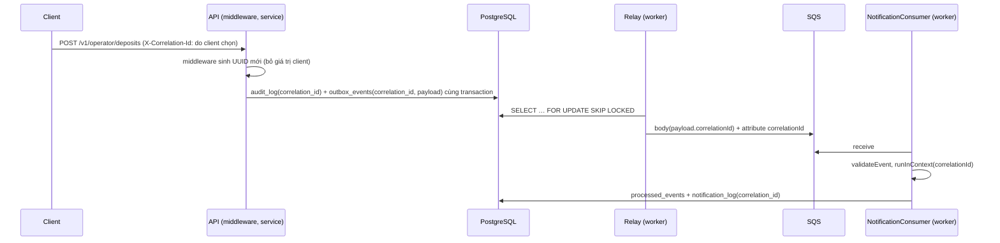

# DBS-134 · correlationId đi qua outbox → message SQS → consumer

> **Status:** Plan approved · **Vai:** Dev · **Cặp đôi review:** Dev khác (theo team.md) · **Nhánh:** `feat/DBS-134-correlation-id-propagation` · **PR:** — · **Cập nhật:** 2026-11-09

## 1. Bối cảnh

- **Task trên board:** Story, Tuần 5, Demo 4. **Expect:** «Một mã nối được toàn bộ chuỗi xử lý của một giao dịch.»
- **DoD (chép nguyên văn):**
  1. correlationId do server sinh ở request, lưu vào outbox_events.correlation_id, đưa vào message, consumer đặt vào AsyncLocalStorage
  2. Mọi bản ghi audit, notification_log, fraud_flags (qua audit) và log JSON của worker mang đúng correlationId
  3. Client không đặt được correlationId để ghi vào audit
  4. PR đã merge vào main (CI xanh); Dev review; bảng «Đối chiếu test case» trong PR điền đủ
- **Phụ thuộc:** DBS-90 (relay), DBS-43 (ALS), DBS-101 (ConsumerBase): cả ba Done và có trong `main` (đã đọc code). DBS-111 (consumer chấm điểm) ghi Done trên board nhưng **chưa có trong `main`**: `grep -rn "risk-events" backend/src` không có consumer, không có bảng `fraud_flags` ghi từ code; xem «Ngoài phạm vi».
- **Đã có gì (đã đọc và chạy):**
  - `correlationIdMiddleware` luôn tự sinh UUID, bỏ qua header của client (`common/middleware/correlation-id.middleware.ts`).
  - `OutboxWriter.add` lưu `outbox_events.correlation_id` = `event.correlationId` và từ chối nếu khác id trong context (`outbox-writer.ts:60-82`).
  - `OutboxRelayService` gửi `JSON.stringify(payload)` (đã chứa `correlationId`) và thêm message attribute `correlationId` (`outbox-relay.service.ts:176-185`).
  - `ConsumerBase.handle` đặt `correlationId` của event vào ngữ cảnh pino bằng `runInContext` (`consumer-base.ts:134-137`, TC-101-11).
  - `AuditService.record` ghi `correlation_id` do caller truyền; mọi caller HTTP truyền `request.correlationId`.
- **Khoảng trống thật (đã xác minh bằng grep/đọc):**
  1. `notification_log` **không có cột correlation** (migration `1792886400000`, database-design §notification_log): DoD #2 không thể đạt.
  2. Không có test nào đi xuyên cả chuỗi bằng writer thật: HTTP → audit + outbox → relay → SQS thật → consumer → `notification_log` + log JSON (các services-spec hiện chèn `outbox_events` tay).
  3. Chưa có test chứng minh client cố đặt `X-Correlation-Id` thì giá trị đó không vào audit, outbox, SQS, notification (DoD #3 mới có test ở tầng middleware).
  4. BL-123 (1): consumer/relay phải chạy ngoài context của request hoặc tách bằng `runInContext`; chưa có test «context cũ bị event đè».
- **Baseline (2026-11-09, main `9520b8b`):** `lint:check` sạch, `typecheck` sạch, `npm test` 1652 test / 88 suite đạt, `test:e2e` 153 test / 15 suite đạt (`DATABASE_URL` Postgres 17 tạm cổng 55433).
- **Ngoài phạm vi:**
  - `fraud_flags` và consumer chấm điểm (DBS-111/129/130, vai #4): chưa có trong `main`. Bàn giao qua BL-NNN: khi consumer đó vào `main` phải ghi audit với `event.correlationId` (`ConsumerBase` đã cho sẵn qua `event`).
  - Tra cứu theo correlationId trên API và đo thời gian (DBS-135).
  - Đổi hợp đồng event: `correlationId` vốn đã là trường chung bắt buộc (event-contract.md).
- **Câu hỏi mở:** (1) Cột `notification_log.correlation_id` NOT NULL hay nullable? (2) Có cần index? (3) Message attribute và body khác nhau thì tin cái nào?
- **Quyết định ở G1 (agent tự quyết):**
  1. Nullable: bảng có thể đã có dòng sinh trước migration và dòng outbox gốc đã bị dọn (DBS-92), nên không backfill được hết; consumer luôn điền với dòng mới và test ép không NULL cho dòng mới.
  2. Không thêm index: tra theo correlationId của kiểm toán viên đi qua `audit_log_correlation_idx` (docs database-design); `notification_log` đã có index `event_id`, nối được qua `outbox_events.event_id`. Thêm index chưa có truy vấn nào cần.
  3. Body là nguồn duy nhất: consumer chỉ đọc body đã qua `validateEvent` (uuid); attribute chỉ phục vụ quan sát, không dùng làm dữ liệu. Không đổi code.
  4. Task chạm schema bảng `notification_log` của chính module notification (DBS-96), nên không phải bảng của người khác; vẫn ghi ở §8 và cập nhật database-design.
  5. DBS-136 đã có PR #114 riêng; không động vào cleanup.

## 2. Hành vi

| # | Điều kiện | Kết quả |
|---|---|---|
| H1 | Request HTTP bất kỳ (kể cả có `X-Correlation-Id: attacker-1` hoặc UUID tự chọn) | Server sinh UUID mới, trả trong `X-Correlation-Id`; giá trị client không xuất hiện ở audit, outbox, SQS, notification |
| H2 | Service ghi event qua `OutboxWriter.add` trong transaction của request | `outbox_events.correlation_id` = `payload.correlationId` = id của request = `audit_log.correlation_id` của cùng request |
| H3 | Relay gửi event | Body JSON mang đúng `correlationId`; attribute `correlationId` bằng body |
| H4 | Consumer nhận message hợp lệ | Trong `apply` và `onCommitted`, ngữ cảnh pino có `correlationId` = của event (đè mọi context cũ, role `worker`); log JSON của worker ghi `correlationId` đó |
| H5 | `NotificationConsumer.apply` ghi `notification_log` | Mỗi dòng mới có `correlation_id` = `event.correlationId`; dòng cũ trước migration: backfill từ `outbox_events` theo `event_id` nếu còn, ngược lại NULL |
| H6 | Message có `correlationId` không phải UUID | `PoisonMessageError` → DLQ (đã có, `validate-event.spec`); không ghi gì |
| H7 | Relay gửi thất bại một event | Dòng log `Outbox event could not be sent` mang `correlationId` của payload và `outboxId` (không còn `null`). Log nhịp batch không gắn event thì không có id (chấp nhận) |
| H8 | `apply` lỗi, `backOff`, nhận lại | Log `backoff not applied` và lỗi nằm trong context của event; lần nhận lại có cùng `correlationId`, `notification_log` đúng N dòng, không nhân đôi |
| H9 | Relay gửi trùng event (crash sau send, trước `published_at`) | Lần hai bị `processed_events` chặn: không thêm dòng, `onCommitted` không chạy |
| H10 | Replay cùng `Idempotency-Key`; nạp vào tài khoản bị khóa (422) | Replay: header là id request mới nhưng không sinh audit/outbox mới. 422: audit `REJECTED` mang id, không có outbox, không có notification |
| H11 | Client gửi `X-Request-Id` | Server echo lại header nhưng không dùng làm `correlationId` ở audit/outbox/SQS/notification |

Ví dụ (đã thấy trong code): `POST /v1/operator/deposits` → audit `deposit`, outbox `TransferCompleted` cùng `correlationId`; `POST /v1/operator/accounts/{id}/lock` → audit + `AccountStatusChanged` cùng id.

## 3. Kiến trúc

- **Vị trí:** module notification (cột + ghi), `common/messaging/consumer-base.ts` (không đổi hành vi, chỉ thêm test), migration mới trong `database/migrations`. Role: worker (consumer), api (writer).
- **Interface:** không đổi chữ ký. `ConsumerBase.apply(event, manager)` đã nhận `event.correlationId`; `NotificationConsumer.apply` đổi câu INSERT.
- **Dữ liệu:** `ALTER TABLE notification_log ADD COLUMN correlation_id uuid` (nullable); backfill `UPDATE … FROM outbox_events o WHERE o.event_id = n.event_id`. Role `dbs_worker` đã có SELECT/INSERT/DELETE cấp theo bảng (migration `1793664000000`) nên không đổi quyền. `down` bỏ cột, vẫn chặn khi bảng có dữ liệu như hiện tại.
- **Ranh giới transaction:** INSERT nằm trong transaction `processed_events` của `ConsumerBase.process` (đã có), không gọi SQS/HTTP trong đó.
- **Sơ đồ:**

- **Code đổi (sau domain review #2):** `ConsumerBase.handle` đưa cả `try/catch` + `backOff` vào bên trong `runInContext` (log lỗi/backoff mang id); `OutboxRelayService` thêm `correlationId` của payload vào metadata log lỗi từng event. Log nhịp vòng poll cấp batch (`consumer failed`) không gắn event nên giữ `null`.
- **Migration:** `1793750400000-AddNotificationLogCorrelationId` (sau `1793664000000`). `down` bỏ cột; **chọn cho phép down khi bảng có dữ liệu** (bỏ cột nullable chỉ mất liên kết truy vết, không mất bản ghi thông báo) để bước expand lùi được; không ném `55000`. Test cũ giả định migration cuối là `CreateDbRolesAndGrants` (TC-119-01, `db-roles.db-spec.ts`) phải ghim bằng `migrateThrough`.
- **Triển khai cuốn chiếu:** worker bản cũ vẫn có thể INSERT không có cột mới sau migration, nên NULL cũng hợp lệ cho dòng do bản cũ ghi lúc deploy; yêu cầu «không NULL» chỉ áp dụng cho code mới.
- **Role chạy migration:** hiện `migration:run` chạy bằng master RDS (chủ bảng), theo BL-195/DBS-119; không phải `dbs_migrator`. Không đổi trong task này; ghi bàn giao #5 vào BL-195.
- **Thay đổi cấp hệ thống:** `database-design.md` (bảng `notification_log`, cột mới), `notification/README` và `outbox/README` (mô tả chuỗi); BACKLOG: BL-123 mục (1) được xử lý. Không đổi ADR/event contract/ErrorCode/env.

## 4. Test cases tự động

Chuỗi services dùng `relayOnce()` rồi `consumer.consumeOnce(0)` trực tiếp (không start vòng poll, không sleep), queue tạo riêng cho mỗi test, ElasticMQ thật + PostgreSQL thật, app HTTP dựng bằng `startDepositApp` (writer/audit thật).

| ID | Truy vết | Lớp | Given · When · Then | `errorCode` |
|---|---|---|---|---|
| TC-134-01 | DoD #2 | db | Migrate đến `CreateDbRolesAndGrants`, chèn 2 dòng `notification_log` (một có `outbox_events` cùng `event_id`, một không), chạy migration mới: cột `correlation_id uuid` nullable; dòng khớp được backfill, dòng không khớp NULL | — |
| TC-134-02 | DoD #2 | db | `down` giữ nguyên các dòng, bỏ cột; `up` lại chạy được; `dbs_worker` vẫn INSERT/SELECT cột mới | — |
| TC-134-03 | DoD #2 | db | `NotificationConsumer.handle` với `AccountStatusChanged` và `TransferCompleted` (2 người nhận): mọi dòng mới có `correlation_id` = `event.correlationId` | — |
| TC-134-04 | DoD #1, #3 | services (chuỗi) | Operator nạp tiền qua HTTP thật, gửi `X-Correlation-Id` và `X-Request-Id` là hai UUID ngẫu nhiên khác nhau: header phản hồi khác cả hai; `audit_log`, `transfers`, `outbox_events.correlation_id`, `payload`, body SQS (`notification-events` **và** `risk-events`), `notification_log` cùng một id; hai giá trị client không xuất hiện ở các cột correlation đó | — |
| TC-134-05 | DoD #1 | services | Attribute `correlationId` của message nhận từ SQS bằng cột `outbox_events.correlation_id` và body | — |
| TC-134-06 | DoD #2 | services | Pino stream bắt log của consumer trong chuỗi TC-134-04: có dòng với `correlationId` của chuỗi và `role: worker` | — |
| TC-134-07 | DoD #1, #2 | services | Chuỗi khóa tài khoản `/lock` (có `reason`): audit + `AccountStatusChanged` + notification cùng một id; `/unlock` request khác có id khác | — |
| TC-134-08 | DoD #2 | unit/services | Relay gửi lỗi (queue không tồn tại): log warn của relay mang `correlationId` của payload | — |
| TC-134-09 | DoD #1, #2 | unit | `ConsumerBase.handle` với `apply` ném lỗi và `backOff` thất bại: log `backoff not applied` mang `correlationId` của event; lỗi gốc vẫn được ném | — |
| TC-134-10 | DoD #1 | unit | `handle` chạy trong context pino có `correlationId` khác: trong `apply` thấy id event, `OutboxWriter.add` event cùng id được chấp nhận (không `NOT_ALLOWED`), sau đó context khôi phục (BL-123 (1)) | — |
| TC-134-11 | DoD #2 | db/services | `apply` lỗi lần 1 (rollback), nhận lại lần 2: `notification_log` đúng N dòng cùng `correlation_id`, log lần 2 mang cùng id | — |
| TC-134-12 | DoD #2 | services | Cùng message gửi hai lần (relay crash giả lập bằng enqueue lại): chỉ N dòng, `onCommitted` không chạy lần hai | — |
| TC-134-13 | DoD #3 | services | Replay cùng `Idempotency-Key`: không có dòng audit/outbox mới; nạp vào tài khoản `LOCKED` (422): audit `REJECTED` mang id của request, không có outbox/notification | `ACCOUNT_NOT_ACTIVE` |
| TC-134-14 | DoD #1 | unit | `correlationId` không phải UUID → `PoisonMessageError`, `apply` không chạy (đã có ở `validate-event.spec`/`consumer-base.spec`, dẫn chiếu) | — |
| TC-134-15 | hồi quy | db | `db-roles.db-spec` TC-119-01 ghim `migrateThrough`; toàn bộ `npm run test:db` xanh, kể cả TC-21-23 | — |
| TC-134-16 | DoD #4 | quy trình | PR, CI, review, bảng đối chiếu | — |

Security checklist: nội dung `message` của thông báo không đổi (BR-13, TC-102-xx vẫn đạt); cột mới là UUID không PII; INSERT tham số hóa; trường hợp migration chạy bằng role không phải superuser là bàn giao #5 (BL-195), không phải test của task này.

## 5. Test thủ công

Điều kiện: `docker compose up -d`; từ `backend/`: `env/.env.development` có `AUTH_MODE=local` (README §10), `npm run auth:dev-keys`, `npm run migration:run`, `npm run start:dev` (`APP_ROLE=both`; relay + consumer chạy cùng tiến trình). `psql` qua `docker compose exec postgres psql -U banking -d banking -c "…"`. Mọi truy vấn lọc theo id lấy từ header phản hồi, không dùng `ORDER BY id DESC LIMIT 1`. Hai UUID «client» là hai giá trị ngẫu nhiên (`uuidgen`), không phải id seed.

| Bước | Việc làm | Kết quả mong đợi |
|---|---|---|
| M-134-01 | Token `customer` (`--sub tran-thi-lan`): `POST /v1/customers/me {"fullName":"Trần Thị Lan"}`, `POST /v1/accounts {"type":"CHECKING"}` | 200/201, có `accountId` |
| M-134-02 | Token `operator`: `POST /v1/operator/deposits` (header `Idempotency-Key`, body `{"toAccountId":…,"amount":"5000000"}`, `X-Correlation-Id: $A`, `X-Request-Id: $B`) | 201; `X-Correlation-Id` phản hồi = `$C`, khác `$A` và `$B` |
| M-134-03 | `psql`: `audit_log`, `outbox_events` (cột + `payload->>'correlationId'`), `transfers` lọc `correlation_id = '$C'` | mỗi bảng 1 dòng; lọc theo `$A`, `$B` ra 0 dòng |
| M-134-04 | Chờ log worker «Notification sent (simulated)»; `notification_log WHERE correlation_id='$C'` | 1 dòng (nạp tiền, 1 người nhận); dòng log JSON có `"correlationId":"$C"` |
| M-134-05 | `POST /v1/operator/accounts/{id}/lock {"reason":"…"}` với `X-Correlation-Id` tự chọn | 200; audit + outbox + notification cùng id mới `$D` ≠ `$C` |
| M-134-06 (biên) | Lặp M-134-02 đúng `Idempotency-Key` cũ | 201 replay; `audit_log` không thêm dòng; id header mới không có dòng nào |
| M-134-07 (biên) | Nạp vào tài khoản đang khóa | 422 `ACCOUNT_NOT_ACTIVE`; `audit_log` có dòng `REJECTED` với id header; `outbox_events`/`notification_log` 0 dòng |
| M-134-08 (lỗi) | `aws --endpoint-url http://localhost:9324 sqs send-message` (hoặc script node) vào `notification-events` với body có `correlationId:"abc"` | vào `notification-events-dlq`; `notification_log` không thêm dòng |

## 6. Domain review (AI)

**Reviewer:** subagent, model opus (effort medium), 2026-11-09 · **Kết quả:** 15 phát hiện (blocking 2, should-fix 6, minor 5, bàn giao 2), verdict REVISE · [trả lời nguyên văn](screenshots/DBS-134/domain-review.md)

| # | Mức | Phát hiện | Xử lý |
|---|---|---|---|
| 1 | blocking | Migration mới làm hỏng TC-119-01 (`undoLast`) | Đã sửa: §3 + TC-134-15, bước 1 của §7 ghim `migrateThrough`; chạy toàn bộ `test:db` |
| 2 | blocking | Log relay/backoff của consumer ra `correlationId:null`; BL-123 (1) chưa đủ | Đã sửa: H7, H8, TC-134-08/09/10; log batch (`consumer failed`) giữ `null`, nêu rõ ở §3 |
| 3 | should-fix | Thiếu ca redelivery/trùng | Đã sửa: H8, H9, TC-134-11/12 |
| 4 | should-fix | Chưa nói cách điều khiển chuỗi tất định | Đã sửa: đầu §4 (`relayOnce` + `consumeOnce(0)`), kiểm cả `risk-events` |
| 5 | should-fix | `…0001` trùng id funding | Đã sửa: dùng UUID ngẫu nhiên, so trên cột correlation |
| 6 | should-fix | Script thủ công không chạy được | Đã sửa: §5 viết lại, thêm chuẩn bị khách/tài khoản/token, `psql` qua compose, lọc theo id |
| 7 | should-fix | DoD #2 `fraud_flags` không có chủ | Đã sửa: dòng BL mới giao #4; DoD #2 ghi «một phần» ở §8 |
| 8 | should-fix | `ALTER TABLE` cần chủ bảng, `dbs_migrator` không phải chủ | **Không sửa code**: BL-195 và DBS-119 ghi `migration:run` chạy bằng master RDS (chủ bảng); thêm tiêu chí vào BL-195 cho #5 |
| 9 | minor | Replay/422 | Đã sửa: H10, TC-134-13, M-134-06/07 |
| 10 | minor | `X-Request-Id` | Đã sửa: H11, TC-134-04 |
| 11 | minor | Rolling deploy tạo NULL | Đã sửa: §3 |
| 12 | minor | Hành vi `down` | Đã sửa: §3 chọn cho phép down (mất liên kết, không mất thông báo); TC-134-02 |
| 13 | minor | `OutboxWriter.add` trong `apply` | Đã sửa: TC-134-10 |
| 14 | bàn giao #4 | Consumer risk ghi `fraud_flags`/audit với `event.correlationId` | BL mới (§8) |
| 15 | bàn giao #5 | Role chạy migration DDL | Thêm vào BL-195 |

Vòng 2: các mục đã sửa chỉ thêm hành vi/test, không đổi hợp đồng; agent kiểm lại bằng cách chạy các TC trong Phase 4 thay vì phát sinh thêm vòng review (agent tự quyết).

**Quyết định ở G2 (agent tự quyết):** (1) `down` cho phép khi có dữ liệu, vì chỉ bỏ một cột nullable truy vết; (2) vẫn giữ log cấp batch với `null`; (3) không viết test role không-superuser (bàn giao #5).

## 7. Kế hoạch triển khai

| Bước | File | Test viết trước | Đỏ (điền khi chạy) | Lệnh chứng minh | Commit |
|---|---|---|---|---|---|
| 1 | `test/db/db-roles.db-spec.ts` ghim `migrateThrough('CreateDbRolesAndGrants1793664000000')` cho TC-119-01 | TC-134-15 | (hồi quy, chạy xanh trước và sau) | `npm run test:db -- db-roles` | `test(database): pin TC-119-01 to its own migration (DBS-134)` |
| 2 | `database/migrations/1793750400000-AddNotificationLogCorrelationId.ts`, `test/db/notification-correlation.db-spec.ts` | TC-134-01, 02 | cột không tồn tại | `npm run test:db -- notification-correlation` | `feat(notification): add correlation_id to notification_log (DBS-134)` |
| 3 | `notification.consumer.ts` INSERT; `test/db/notification-consumer.db-spec.ts` | TC-134-03 | cột NULL | `npm run test:db -- notification-consumer` | `feat(notification): store correlationId on every notification (DBS-134)` |
| 4 | `consumer-base.ts` (catch/backoff trong context), `consumer-base.spec.ts` | TC-134-09, 10 | log backoff `correlationId` undefined | `npm test -- consumer-base` | `fix(messaging): keep correlationId in consumer error logs (DBS-134)` |
| 5 | `outbox-relay.service.ts`, spec | TC-134-08 | log thiếu `correlationId` | `npm test -- outbox-relay` | `fix(outbox): log correlationId when a relay send fails (DBS-134)` |
| 6 | `test/services/correlation-chain.services-spec.ts`; thêm bước vào `.github/workflows/ci.yml` (job e2e) | TC-134-04…07, 11, 12, 13 | (chuỗi chưa có test; đỏ nếu thiếu cột) | `npm run test:services -- correlation-chain` | `test(outbox): correlationId survives API → SQS → consumer (DBS-134)` |
| 7 | docs: database-design, outbox/notification README, BACKLOG (xóa phần (1) BL-123, thêm BL cho #4, tiêu chí BL-195), feature doc, README features | — | — | `node .claude/skills/dbs-delivering-task/scripts/check-doc-links.mjs` | `docs(correlation): … (DBS-134)` |

Rủi ro và lùi: migration `ADD COLUMN` nullable không khóa lâu (PG17, không default) và lùi được bằng `down`; đổi `ConsumerBase` chạy lại toàn bộ `test:services` (mọi spec dùng consumer) trước khi mở PR (bài học CI). **Quyết định ở G3 (agent tự quyết):** gộp TC chuỗi vào một file services-spec mới để tránh phình `outbox-relay.services-spec`.
