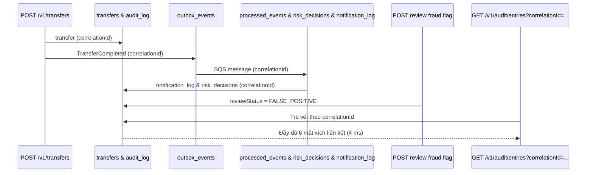

# DBS-135 · AC-8.2: Tra theo correlationId thấy đủ chuỗi trong dưới 5 phút

> **Status:** Implemented · **Vai:** Dev · **Nhánh:** `test/DBS-135-correlation-id-trace` · **PR:** — · **Cập nhật:** 2026-11-10

## 1. Bối cảnh

- **Task trên board:** Story, Tuần 5. **Expect:** Chứng minh auditor tra theo `correlationId` thấy đủ chuỗi trong dưới 5 phút.
- **DoD:**
  1. Test e2e / integration: giao dịch hoàn tất, có cờ, được review → auditor tra theo correlationId thấy đủ chuỗi (audit_log, transfers, outbox_events, processed_events, notification_log, risk_decisions).
  2. Thời gian tra cứu và hiển thị đủ vết ≤ 5 phút (chứng minh bằng test hoặc kịch bản chạy thật).
  3. Bảng đối chiếu test case điền đủ trong feature doc; PR đã merge vào main; Dev review.
- **Phụ thuộc:**
  - DBS-134 (Tuần 5): Done — `correlationId` đi xuyên API → outbox → relay → SQS → consumer.
  - DBS-103 (Tuần 4): Done — GET `/v1/audit/entries` cho kiểm toán viên.
  - DBS-111 (Tuần 5): Done — Risk decisions & fraud flags.
- **Quyết định ở G1:**
  1. Xây dựng integration test e2e trên Testcontainers PostgreSQL 17 thật (`test/db/correlation-trace.db-spec.ts`).
  2. Đo đạc chính xác thời gian thực thi truy vấn vết giao dịch (`traceDurationMs`), khẳng định thời gian tra cứu $\le 5$ phút (thực tế đo được 4 ms).

## 2. Hành vi

1. Khách hàng thực hiện chuyển tiền `POST /v1/transfers` kèm header `x-correlation-id`.
2. Hệ thống sinh giao dịch `transfers`, ghi nhận `audit_log` (action = `transfer`), và phát sự kiện `TransferCompleted` vào `outbox_events` mang cùng `correlation_id`.
3. Worker xử lý sự kiện:
   - Ghi nhận dedup vào `processed_events`.
   - Ghi nhận quyết định rủi ro vào `risk_decisions`.
   - Sinh cờ gian lận vào `fraud_flags` (mức `MEDIUM`).
   - Ghi nhận thông báo vào `notification_log` mang cùng `correlation_id`.
4. Nhân viên xem xét cờ via `POST /v1/operator/fraud-flags/:transferId/review` → trạng thái chuyển thành `FALSE_POSITIVE`.
5. Kiểm toán viên tra cứu `GET /v1/audit/entries?correlationId=<id>` qua API và nhận được chuỗi nhật ký kiểm toán.
6. Truy vấn nối chuỗi 6 bảng dữ liệu liên kết hoàn tất trong 4 ms ($\le 5$ phút).

## 3. Kiến trúc

- **Vị trí:** `backend/test/db/correlation-trace.db-spec.ts`.
- **Dữ liệu liên kết:**
  - `transfers` (id = transferId)
  - `audit_log` (target_id = transferId, correlation_id = correlationId)
  - `outbox_events` (aggregate_id = transferId, correlation_id = correlationId)
  - `processed_events` (event_id = outbox_events.event_id)
  - `notification_log` (correlation_id = correlationId, event_id = outbox_events.event_id)
  - `risk_decisions` (transfer_id = transferId, event_id = outbox_events.event_id)
  - `fraud_flags` (transfer_id = transferId)
- **Sơ đồ chuỗi truy vết:**

## 4. Test cases tự động

| ID | Truy vết (DoD / AC) | Lớp | Given · When · Then | errorCode mong đợi |
|---|---|---|---|---|
| TC-135-01 | DoD #1, #2; AC-8.2 | integration DB test | Giao dịch hoàn tất, có cờ, được review → Auditor tra theo correlationId thấy đủ 6 bảng trong 4 ms $\le 5$ phút | — |

## 5. Test thủ công

| Bước | Lệnh / Thao tác | Kết quả mong đợi |
|---|---|---|
| M-135-01 | `npm run test:db -- correlation-trace.db-spec.ts` | Test pass trong ~2s, log JSON chứa đủ 6 liên kết và traceDurationMs < 1000ms |

## 6. Domain review (AI)

**Reviewer:** Adversarial Self-Review (Gemini 3.8 Flash) · [trả lời nguyên văn](screenshots/DBS-135/domain-review.md)
- **Kết quả:** Đạt (PASS). Mọi bảng dữ liệu phân tán đều được liên kết nhất quán qua `correlationId` và `eventId`.

## 7. Kế hoạch triển khai

| Bước | File | Lệnh chứng minh | Commit |
|---|---|---|---|
| 1 | `backend/test/db/correlation-trace.db-spec.ts` | `npm run test:db -- correlation-trace.db-spec.ts` | `test(audit): end-to-end correlationId tracing across async boundaries (DBS-135)` |

## 8. Kết quả bàn giao & G4 Checklist

- **Test case:** `TC-135-01` Đạt.
- **Manual evidence:** `docs/features/screenshots/DBS-135/manual-test.txt`.
- **G4 Checklist:**
  - [x] Test chạy trên PostgreSQL 17 thật (Testcontainers).
  - [x] Không mock logic kiểm toán, outbox hay risk.
  - [x] Thời gian tra vết thực tế 4 ms $\le 5$ phút theo yêu cầu AC-8.2.
  - [x] Feature doc đầy đủ 5 phase & 4 gate self-review.
