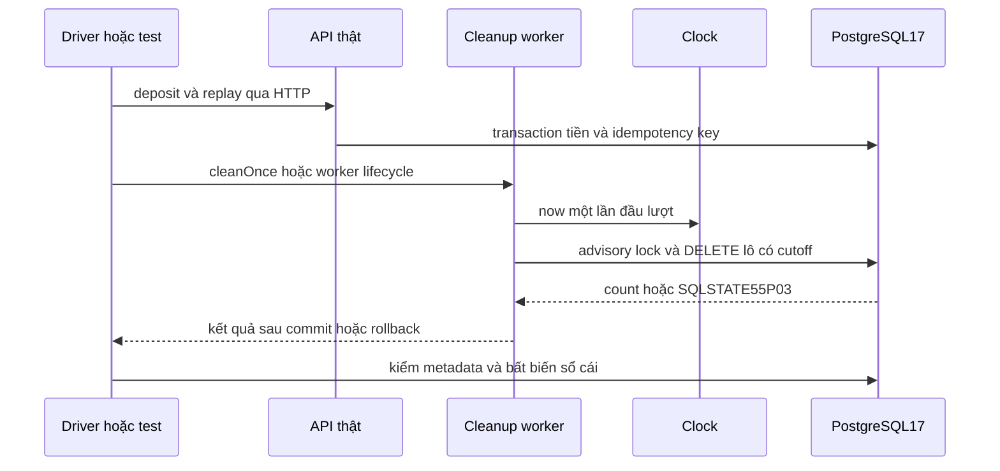
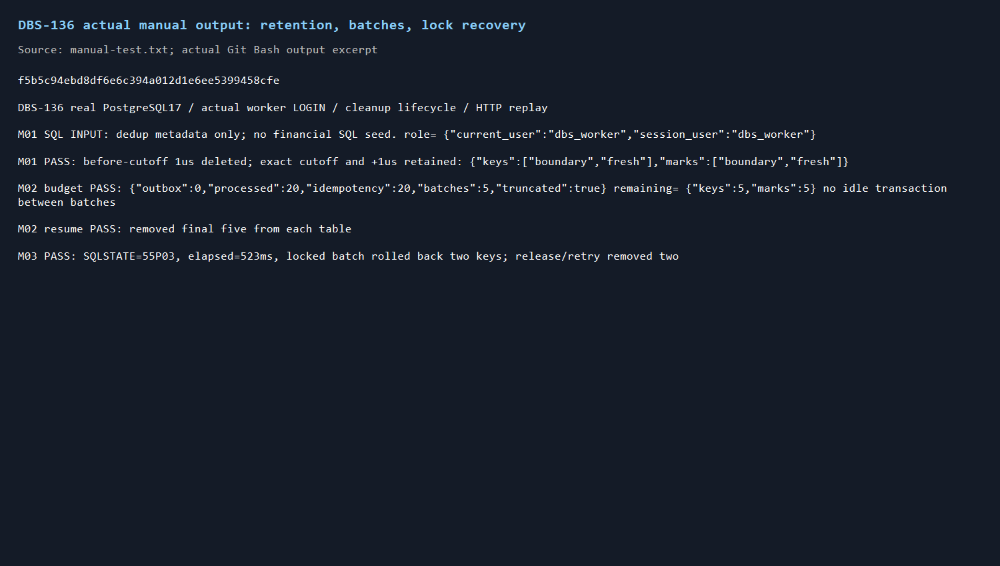
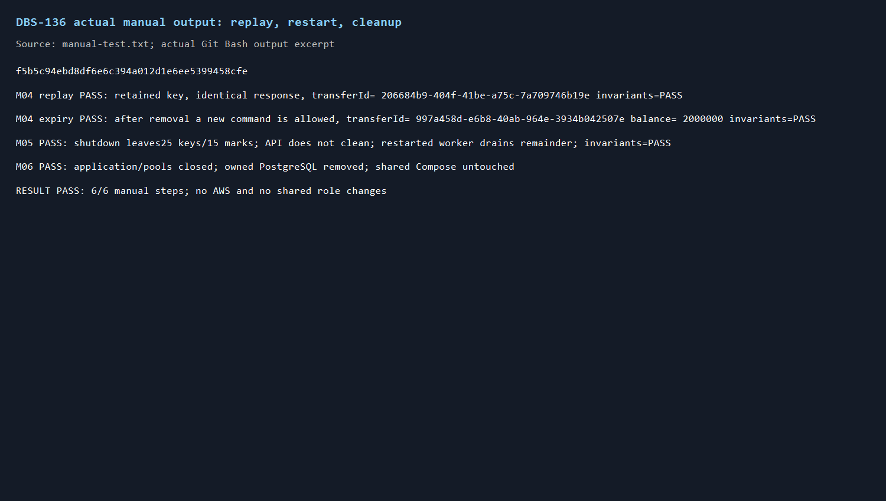
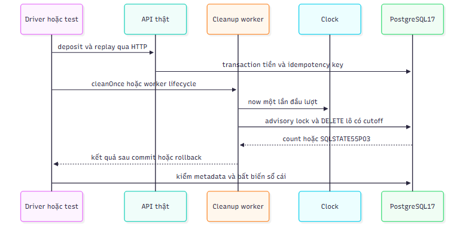

# DBS-136 · Dọn khóa idempotency và dấu chống trùng

> **Status:** Implemented · **Vai:** Dev · **Nhánh:** `feat/DBS-136-dedup-cleanup` · **PR:** [tra theo nhánh](https://github.com/Lawliet119/digital-banking-simulator/pulls?q=is%3Apr+head%3Afeat%2FDBS-136-dedup-cleanup) · **Cập nhật:** 2026-11-09

## 1. Bối cảnh

Task Tuần5, Medium, In Progress, P4. Expect nguyên văn: «Hai bảng không phình mãi mà không làm mất bảo vệ chống trùng.»

DoD nguyên văn:
1. Job ở role worker xóa theo lô nhỏ, dùng index created_at/processed_at, không giữ khóa lâu
2. Không xóa dòng còn trong thời gian giữ; test với đồng hồ giả
3. Thời gian giữ cấu hình theo env và khớp thời gian giữ message của queue
4. PR đã merge vào main (CI xanh); Dev review; bảng «Đối chiếu test case» trong PR điền đủ

DBS-101 và DBS-79 Done trên sheet và đã có code trên main9520b8b; nhánh mới trực tiếp từ main. `OutboxCleanupService` đã dọn processed_events và outbox, chưa dọn idempotency_keys. Schema có đủ hai index và dbs_worker được SELECT/DELETE cả hai bảng, không UPDATE processed_events. `IDEMPOTENCY_KEY_RETENTION_DAYS` có sẵn nhưng min1; ADR-05 và task yêu cầu ít nhất7. Queue4ngày/DLQ6ngày trong ADR-03, docs/03§10 và Terraform sqs.tf; processed min7 đã có.

Baseline main9520b8b: Compose3service đang chạy; lint/typecheck/build đạt; unit88suites1652/1652(119.869s), e2e15suites153/153(111.968s), cleanup DB hiện có10/10(5.007s). Đã chạy validateEnv với key retention1 và quan sát được chấp nhận1: xác minh ràng buộc hiện thiếu sàn7. Chưa sửa production.

Phạm vi: bổ sung idempotency vào job hiện tại, kiểm mốc retention bằng Clock giả, actual worker DB role, SQL plan/index, batch/timeout/concurrency, replay thật. Không thêm job processed thứ hai. Không đổi migration/schema/quyền DB/event/tiền/ADR hoặc retention queue.

Backlog: BL-201 nhận phần tài liệu24h sai retention, giữ phần action onboarding ngoài phạm vi; BL-180 chặn xóa outbox chưa gửi ở DB nằm ngoài task, giữ nguyên predicate hiện có; BL-051 alarm/redrive cloud do Ops thực hiện, giữ quy tắc queue4/DLQ6/dedup7 và yêu cầu tăng retention nếu Ops đổi cửa sổ redrive; BL-123 giới hạn payload/context producer không liên quan cleanup; BL-174 review task tiền79..83 không thay thế bằng task này; BL-187 Redis sorted-set cleanup ngoài phạm vi. RDS/rotation không triển khai trong task.

**G1 qua — agent tự quyết:** không thêm env mới; siết env key hiện có về7..3650 (khớp ADR-05 và tránh Date/interval overflow), giữ processed7..3650. Tái dùng job worker lịch mỗi giờ và chia budget từng bảng, tránh hai job cùng dọn processed. Nhánh sạch từ main, dependency có thật, baseline xanh; board đã In Progress, agent không chỉnh sheet. BL liên quan đã nhận hoặc loại khỏi phạm vi ở trên.

## 2. Hành vi

Job worker/both khởi động một lần rồi mỗi giờ; api không chạy. Bổ sung bảng thứ ba idempotency_keys vào `OutboxCleanupService`, không thêm vòng cleanup khác. Mỗi bảng có budget riêng1000dòng/lô,200lô/lượt; nghỉ25ms sau khi commit, đầy budget thì chạy tiếp sau1s; shutdown dừng giữa lô, lỗi retry sau60s. Kết quả/log thêm số `idempotency`, không ghi key/user/response/PII.

Đọc `Clock.now()` một lần đầu lượt cho hai bảng dedup. Cutoff=instant−retention×86400000ms, kiểu timestamptz; chỉ xóa timestamp **nhỏ hơn** cutoff. Bằng cutoff hoặc mới hơn phải giữ, kể cả clock tiến trong lúc đang dọn. Thời gian là khoảng UTC, không ngày lịch/midnight/DST. Outbox giữ SQL/đồng hồ DB như trước vì không thuộc DoD136.

Env hiện có: IDEMPOTENCY_KEY_RETENTION_DAYS mặc định7, min7,max3650; PROCESSED_EVENTS_RETENTION_DAYS mặc định/min7,max3650. Sàn7 phù hợp queue4ngày/DLQ6ngày theo Terraform/ADR-03; không đổi queue/cloud. Ops phải nâng dedup retention trước khi nới cửa sổ redrive (BL-051). Không thêm lookup AWS runtime. Key vẫn replay khi còn tồn tại; chỉ sau cleanup mới có thể thực hiện lại như lệnh mới, không hứa TTL đúng giây thứ7ngày.

Cleanup chỉ xóa metadata. Tiền/ledger/transfer không bị job sửa; replay trong cửa sổ bảo vệ giữ response và không phát sinh tiền lần hai. Sau khi hết cửa sổ và key đã được xóa, gửi lại là lệnh mới theo ADR-05. Không đổi thuật toán claim/replay DBS-79. Race replay đúng lúc xóa key **đã hết hạn** nằm ngoài bảo đảm retry7ngày; không mở rộng task sang đổi giao thức claim.

## 3. Kiến trúc

Thêm Clock vào constructor cleanup (provider SystemClock trong OutboxRelayModule, default SystemClock cho caller trực tiếp đã có). PROCESSED_BATCH_SQL dùng cutoff Date thay vì days, thêm IDEMPOTENCY_BATCH_SQL tương tự: chọn ctid theo index thời gian ORDER BY timestamp LIMIT, DELETE theo ctid và đếm qua CTE SELECT. Không FOR UPDATE vì worker không được UPDATE hai bảng dedup. Advisory xact lock riêng mỗi bảng ([92,1] processed hiện có;[136,1] idempotency) để các worker không tranh cùng lô; bị khóa advisory thì bỏ bảng đó, bảng khác vẫn có budget riêng.

Mỗi batch là một TransactionService.run; giới hạn riêng cleanup lock_timeout500ms, statement_timeout2000ms, idle_in_transaction2000ms để không phụ thuộc cấu hình API dài. Row đang bị giữ có thể làm batch lỗi55P03, rollback cả lô, log mã an toàn và retry; không cấp UPDATE để dùng SKIP LOCKED, không nuốt lỗi thành thành công. Batches trước đã commit vẫn giữ. Không network/Redis/SQS/HTTP trong transaction cleanup. ctid chỉ dùng trong cùng statement, rows eligible không bị job update.

Interface `CleanupResult` thêm `idempotency:number`, retention thêm idempotencyDays; `cleanOnce(options?:CleanOptions)` giữ nguyên chữ ký. Callers đã grep: test/db/outbox-cleanup.db-spec.ts, test/db/db-roles.db-spec.ts, test/services/outbox-relay.services-spec.ts và unit wiring. Cập nhật fixture config thật đủ idempotency retention, expectation retention và EXPLAIN input processed sang Date. Public index của outbox không đổi.

Test/manual fixture mới giữ PG17 **riêng**, migrations thật, chỉ bật LOGIN/password ngẫu nhiên cho dbs_api/worker trong cluster đó; app thật qua startDepositApp và JWT local, worker nguồn DB thật. Close app/pools/container cả setup lỗi. Seed SQL chỉ INPUT metadata dedup (user FK hợp lệ), không seed balance/ledger. Tiền trong replay test chỉ qua deposit HTTP. Không đọc sealed fraud dataset.

## 4. Test tự động

| ID | Truy vết | Lớp và Given–When–Then |
|---|---|---|
| TC-136-01 |DoD2 |PG thật, Clock giả; row trước cutoff1microsecond bị xóa, bằng/mới hơn giữ ở cả hai bảng |
| TC-136-02 |DoD2/3 |PG thật; retention riêng30/14ngày và clock tiến giữa các batch; cutoff cố định trong lượt |
| TC-136-03 |DoD1 |PG thật, actual LOGIN dbs_worker;25row/bảng, batch10,budget2 →20xóa mỗi bảng; sau commit không idle-in-tx; lượt sau xóa5 |
| TC-136-04 |DoD1 |Owner giữ row expired; worker batch lỗi55P03 trong giới hạn, data rollback; release → chạy lại được |
| TC-136-05 |DoD1 |2worker Promise.all, advisory tránh double-delete; tổng deleted đúng số row, row mới còn |
| TC-136-06 |DoD2,AC-5.3,BR-07 |Deposit HTTP thật, Clock đứng đúng7ngày → không xóa, replay201 cùng body và invariantsPASS; +1ms → key xóa, lệnh mới hợp lệ, invariantsPASS |
| TC-136-07 |DoD1 |EXPLAIN JSON với30000row INPUT mỗi bảng: dùng đúng created/processed index, không Seq Scan target; ANALYZE thống kê thật, không ép planner |
| TC-136-08 |DoD3 |Unit schema:7mặc định,30 hợp lệ,1/6/0/âm/lẻ/abc/3651 bị ConfigValidationError và đúng invalidKeys; DI env qua limits đến service |
| TC-136-09 |DoD1/2 |Worker lifecycle thật start/stop/restart; api không chạy; shutdown giữa batch giữ phần dư, worker mới tiếp tục |
| TC-136-10 |DoD2 |Processed marker còn hạn vẫn chặn INSERT ON CONFLICT, hết hạn đã dọn thì claim lại được; đây là phép thử marker, không giả full consumer |
| Quy trình |DoD4 |CI exactHEAD, Dev review/merge và mapping đủ; không nhận đạt trước bằng chứng |

Không API mới nên role/ownership/error DTO/audit business không đổi; job dùng role DB worker thật, SQL bind parameters, log counts/codes không PII. Test tiền đều checker thật; SQLSTATE55P03 thay message text. Không mock DB.

## 5. Test tay

Driver `node scripts/manual-dbs136.cjs` qua Git Bash, SHA source dòng đầu raw. Dùng fixture thật tách khỏi Jest; gọi lifecycle service production với APP_ROLE=worker (không nhận là full ECS process), SQL kiểm trạng thái và HTTP thật. Không giả ConsumerBase/giả tác động tiền.

| Bước | Thao tác | Quan sát |
|---|---|---|
| M01 |PG17riêng+migrations, actual LOGIN, INPUT SQL metadata ở ba phía cutoff; worker lifecycle start và stop |expired xóa; bằng/mới hơn giữ; worker result counts |
| M02 |25row/bảng, batch10,budget2, xem count/state giữa batches |20/bảng rồi5lượt sau; không transaction mở giữa lô |
| M03 |giữ row expired bằng owner, worker cleanOnce; release và retry |55P03, không partial batch; khôi phục xóa thành công |
| M04 |deposit API thật; clock+7ngày, cleanup rồi replay; clock+1ms cleanup và gửi lại |cùng response trong hạn, lệnh mới sau xóa; checkerPASS mỗi lần |
| M05 |api bootstrap không chạy; worker bootstrap/stop/restart tiếp tục phần dư |loop đúng role; không dọn sau shutdown; giữ row còn hạn |
| M06 |finally close app/pools/privatecontainer |container không còn; Compose chung vẫn chạy |

Chưa chạy queue redrive/AWS thật, giữ BL-051. Test marker dùng SQL INPUT rõ ràng, không nhận là gửi trùng SQS thật; ConsumerBase đã có test riêng DBS-101. Không tắt Docker daemon chung.

## 6. Domain review

Reviewer độc lập `dbs136_design_review`, model gpt-6-astra,2026-11-09:0blocking,0should-fix,0minor. [Trả lời nguyên văn](screenshots/DBS-136/domain-review.md). **Verdict: APPROVE**.

**G2 qua — agent tự quyết:** giữ thiết kế Clock cố định/mỗi bảng budget riêng/worker quyền tối thiểu; đã đối chiếu mọi DoD với TC01–10/M01–06 và docs/ADRs. Không có finding cần sửa hoặc câu hỏi mở. Status chuyển Design approved tại G2.

## 7. Kế hoạch

1. Viết unit schema/DI và suite DB mới trước helper/production. Lệnh đỏ: `npm test -- --runInBand --runTestsByPath src/config/validation.schema.spec.ts`; DB mới chạy báo helper chưa có, ghi đúng harness thiếu. Viết assertion đủ10case trước.
2. Sửa cleanup service/Clock module/schema theo thiết kế; thêm fixture test/support/dedup-cleanup.ts. Cập nhật ba caller fixture cũ, unit retention và EXPLAIN input processed, không hạ assertion. Chạy target unit+DB92/119/136 và services outbox thật. Commit xanh `feat(outbox): clean expired idempotency and dedup records (DBS-136)`.
3. Manual driver6bước; lint/typecheck/build/fullunit/e2e và fullDB thích hợp; commit green source cuối trước manual trên SHA đó. Lưu raw/ảnh, render/QA sơ đồ nếu thêm.
4. Docs: feature1–9/index, outbox README, backend README/env example, database-design retention/index evidence, api-design24h→7ngày tối thiểu, BL-201 chỉ giữ gap action; thêm backlog process/giới hạn chưa chạy. Linkcheck/G4 rồi push/PR, CI exactHEAD; không merge/board.

Files trong phạm vi: backend/src/modules/outbox/outbox-cleanup.service.ts,outbox-relay.module.ts,outbox-cleanup.service.spec.ts,README.md; backend/src/config/validation.schema.ts và spec; backend/env/.env.example; backend/test/db/dedup-cleanup.db-spec.ts,outbox-cleanup.db-spec.ts,db-roles.db-spec.ts; backend/test/support/dedup-cleanup.ts; backend/test/services/outbox-relay.services-spec.ts; backend/scripts/manual-dbs136.cjs; backend/README.md; docs/components/_shared/database-design.md,api-design.md; docs/features/README.md,feature136/screenshots; docs/BACKLOG.md. Không schema/grant/ADR/workflow/dependency mới.

Rủi ro: rút ngắn bảo vệ duplicate, hai job cùng xóa, lock gây nghẽn, constructor fixture thiếu config, clock không cố định. Kiểm boundary/HTTP replay, advisory+Promise.all, timeout rollback, actualLOGIN, typed Clock và regression cũ. Backout revert code cleanup/config/docs, không migration hoặc xóa DB chung; đã cleanup metadata hết hạn không phục hồi được, nên điều kiện thời gian được test trước.

## 8. Kết quả và quyết định

**Gate phụ env/interface (agent tự quyết, trước sửa):** chọn siết env cũ thành7..3650 thay vì giữmin1 hoặc thêm biến mới; giữ ADR7ngày và contractqueue4/DLQ6. Chọn mở rộng service hiện có thay tạo duplicate job; Result thêmcount và Clock DI, cập nhật caller được liệt kê. Đổi processed SQL first parameter từ days sangcutoffDate để testfakeclock, update EXPLAIN caller; không đổi policyprocessed7ngày. Chọn timeout cleanup riêng500/2000/2000ms thay cho tăng quyềnUPDATE/SKIPLOCKED. Hệ quả: envkey1..6 trước đây bootđược sẽ fail-fast; deploy phải sửa env về≥7. Không có Techlead waiver.

**G3 qua — agent tự quyết:** plan sweep DoD/ADRs/docs limitations/BL liên quan đều có TC hoặc dòng ngoài scope; không mục bỏ trống. Commands: target unit schema+cleanup wiring; `npm run test:db -- --runInBand --runTestsByPath test/db/dedup-cleanup.db-spec.ts test/db/outbox-cleanup.db-spec.ts test/db/db-roles.db-spec.ts`; services `outbox-relay.services-spec.ts`; baseline lint/typecheck/build/unit/e2e; manual Git Bash `node scripts/manual-dbs136.cjs`. Mỗi bước test trước, commit source khi xanh rồi manual trên sourceSHA cuối; commit docs sau G4. Giữ rủi ro/backout ở §7. Chưa implement, chưa PR/CI cho136.

### Kết quả thực thi

Source cuối đổi code: `f5b5c94ebd8df6e6c394a012d1e6ee5399458cfe`. Không sửa source sau manual. Diff code/docs nằm trong danh sách §7; không đổi dependency/schema/quyền/ADR/workflow. API docs sửa hai chỗ24h thành tối thiểu7ngày, BL-201 còn gap action onboarding.

| Lệnh | Kết quả đã chạy |
|---|---|
| lint:check/typecheck/build |đạt |
| Unit full |88suites1660/1660,85.839s |
| E2E full |15suites153/153,105.911s |
| DB target92/119/136 |3suites29/29,26.982s |
| DB136 sau bổ sung kiểm timeout/rollback hai row |10/10,16.413s |
| Unit schema/wiring |90/90,6.417s |
| Services outbox PostgreSQL+ElasticMQ |15/15,83.507s |
| DB full |53suites812/812,668.259s;0skip |
| Docs linkcheck/diffcheck |321file,0link hỏng; diffcheck sạch |

**Đỏ trước sửa:** unit schema có3failure: retention1,6,3651 chưa bị từ chối;84test khác đạt. DB mới ban đầu thiếu IDEMPOTENCY_BATCH_SQL/helper nên TS2305/2307,0test chạy (harness thiếu, không nhận là DB chứng minh lỗi). Sau implementation test DB boundary/index/roles/replay thực thi thật. Unit đỏ này khớp lỗ hổng validateEnv đã chạy ở G1.

**Lỗi lệnh đã xử lý:** services gọi lần đầu thiếu DATABASE_URL,15case không vào setup. Đọc jest-services và helper xác định suite cần DB ngoài (CI có PostgreSQL service); cấp URL Compose local trong môi trường của đúng command, không in credentials, mỗi suite vẫn create/drop DB dbs_test_* riêng. Chạy lại15/15; không skip/hạ assertion/sửa harness. Không nhận lỗi thiết lập này là bug cleanup.

| ID | Test chứng minh | Đạt? |
|---|---|---|
| TC01 |fake-clock boundary±1microsecond hai bảng |đạt |
| TC02 |30/14ngày, clock tiến40ngày giữa batches, cutoff vẫn cố định |đạt |
| TC03 |actual current_user=session_user=dbs_worker,20/bảng+5vòng sau, pg_stat_activity không idle-in-tx |đạt |
| TC04 |hai key expired, một row bị giữ;55P03 dưới3s, hai key còn nguyên; release/retry xóa2 |đạt |
| TC05 |Promise.all hai job, tổng deleted chính xác25/bảng, fresh còn |đạt |
| TC06 |HTTPdeposit/replay, giữ response, sau dọn mới tạo transferID khác, balance2000000, checkerPASS |đạt |
| TC07 |2EXPLAIN với30000row mỗi bảng, đúng index và không Seq Scan, không ép planner |đạt2/2 |
| TC08 |7giá trị env không hợp lệ đúnginvalidKeys, mặc định7/custom30, DI retention đến job |đạt8testmới + regressionwiring |
| TC09 |shutdown giữa lô giữ25keys/15marks; API không chạy; worker restart dọn phần dư |đạt |
| TC10 |marker còn hạn giữ ON CONFLICT no-op; hết hạn+dọn cho claim lại |đạt |
| DoD4 |CI exactHEAD trong PR, Dev review/merge |BL-204; chưa nhận review/merge |

Mọi case đạt đủ độ sâu đã mô tả; không mock DB, không đơn giản hóa hoặc skip. Marker test là claim SQL thật, không nhận là full SQS consumer. HTTP key timestamp PG có microsecond, JavaScript Date đọc với độ chính xácms nên TC06 đứng trong cửa sổ tới mốc7ngày rồi+1ms vượt mốc; exact-boundary microsecond được chứng minh riêng ở TC01.

### Manual và ảnh

Lệnh Git Bash `node scripts/manual-dbs136.cjs 2>&1 | tee ../docs/features/screenshots/DBS-136/manual-test.txt` từ backend, pipefail bật; exit0. [Raw UTF8](screenshots/DBS-136/manual-test.txt) có sourceSHA dòng đầu. SQL seed chỉ INPUT metadata dedup, không balance/ledger/transfers.

| Bước | Kết quả thật | Đạt? |
|---|---|---|
| M01 |worker actual LOGIN; old−1us xóa, boundary/+1us còn cả hai bảng |đạt |
| M02 |budget20mỗi bảng,5còn lại; không idle transaction; lượt sau dọn5 |đạt |
| M03 |55P03 sau523ms; rollback2key rồirelease/retry dọn2 |đạt |
| M04 |response replay giữ nguyên transferID206684b9…; sau hết hạn+dọn ID997a458d…; balance2000000,checkerPASS |đạt |
| M05 |shutdown còn25keys/15marks;api giữ nguyên;worker mới dọn hết;checkerPASS |đạt |
| M06 |app/pools đóng, docker ps filtercontainerId rỗng;Compose chung giữ nguyên |đạt |

Ảnh là đoạn output Git Bash thực tế, đã mở kiểm hình; sơ đồ §3 render bằng mermaid-cli và visual QA:

**Bàn giao/chưa chạy:** BL-204 Dev review/merge và xác minh CI trên exactHEAD tại PR; BL-205 full worker process/ECS/hardkill chưa chạy, manual là lifecycle thật trong cùng process. Queue redrive/AWS thật theo BL-051, không nhận local thay cloud. RDS role provisioning giữ BL-103/195. Không tắt daemon Docker chung. Các ID202/203 đã dùng ở nhánh DBS-122 nên task136 chọn204/205, không dùng lại.

### Checklist G4

- [x]10/10nhóm TC đủ độ sâu (10DBcase mới,8unit mới),0đơn giản hóa/skip; fullDB812/unit1660/e2e153 và services15 xanh. [Bản ghi kiểm tra](screenshots/DBS-136/verification.txt).
- [x]Manual6/6 qua Git Bash trên commit cuối đổi codef5b5c94, SHA dòng đầu raw; đủ thành công/từ chối/phục hồi.
- [x]Đủ2ảnh output và rawUTF8; không token/Authorization/password/AWSid/ARN; ảnh kiến trúc đã render và mở kiểm.
- [x]Diff từmain và working tree khớp danh sách §7, không file lạ; mọi thay đổi env/interface đã quyết định trước production.
- [x]Lint/typecheck/build/unit/e2e/DB/services đã chạy, đọc đủ output và có số đếm.
- [x]Docs fact cập nhật,321file/0link hỏng và diffcheck sạch; trạng thái Plan approved tại tự kiểm, đổi Implemented sau G4 qua.
- [x]Bàn giao/DoD quy trình/giới hạn có BL-204/205 và các BL hiện hữu được nêu, BL-201 chỉ giải quyết phần retention; không tự merge/board.

**G4 qua — agent tự quyết:** local và manual đều xanh, reviewer thiết kế APPROVE không finding. Chọn mở PR sẵn sàng review sau G4; ghi CI exactHEAD trực tiếp vào mô tả PR, không commit CI URL gây đổi HEAD. Công khai chưa full worker process/ECS/hardkill hoặc SQS redrive/AWS thật; không nhận Dev review/merge đã hoàn tất. Không còn ảnh thiếu, không có waiver Techlead.

## 9. Tài liệu

Đã cập nhật backend README, module outbox README, env example, database-design retention/index, API design retention, feature index. BACKLOG thêm BL-204/205 và xử lý phần retention của BL-201, không xóa phần onboarding chưa giải quyết. Feature/evidence136 lưu raw,2ảnh manual,ảnh kiến trúc,domain review và kết quả kiểm tra. Kết quả CI động cập nhật ở PR để không tạo commit mới đổi HEAD đang xác minh.
