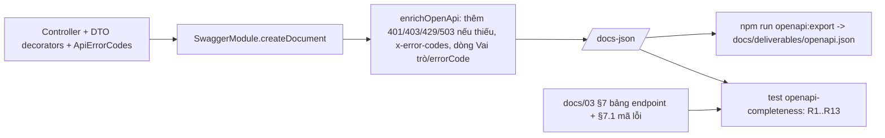
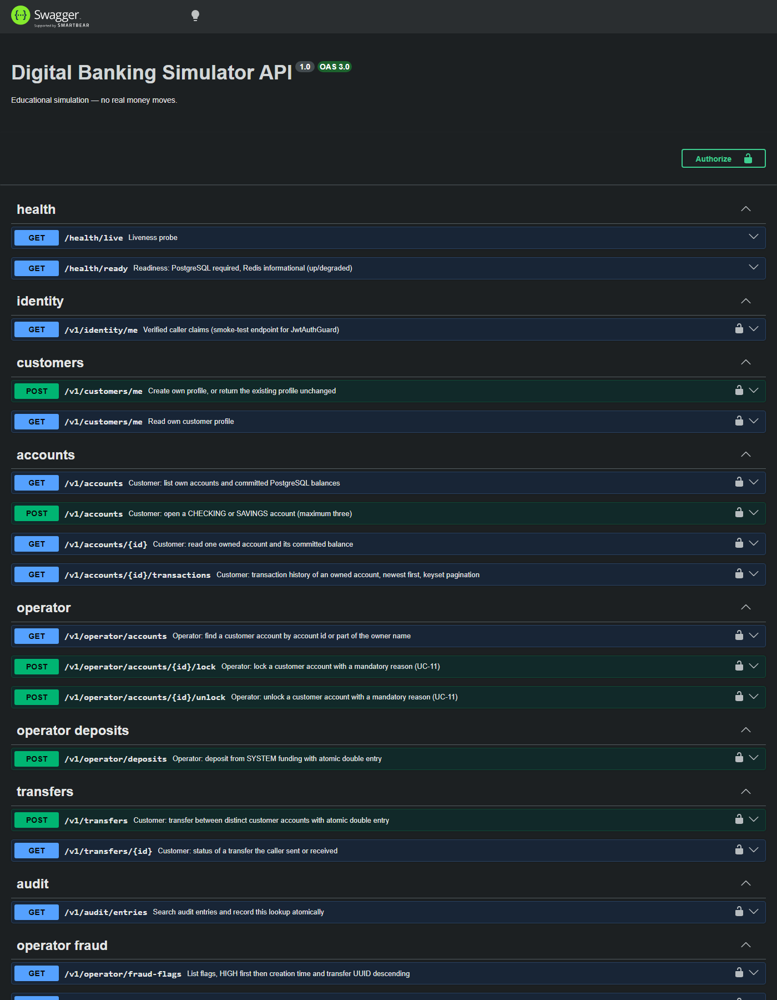

# DBS-137 · Làm sạch OpenAPI: ví dụ request/response và errorCode cho mọi endpoint

> **Status:** Implemented (G4 2026-11-11) · **Vai:** Dev · **Cặp đôi review:** một Dev khác (team.md không cố định cặp) · **Nhánh:** `feat/DBS-137-openapi-clean` · **PR:** — · **Cập nhật:** 2026-11-11

## 1. Bối cảnh

- **Task trên board:** Task, Tuần 5, Highest, Deliverable «Giữa kỳ». **Board ghi `In Progress`** lúc đọc (2026-11-10); agent không biết ai đang làm, nên PR phải nêu khả năng trùng việc. **Expect:** «API dễ dùng cho người chấm và cho cả nhóm test.»
- **Thực trạng (board):** «Swagger ở /docs có (tắt ở production) nhưng thiếu ví dụ vì chưa có endpoint đầy đủ.»
- **DoD (chép nguyên văn):**
  1. Mọi endpoint có tóm tắt, vai trò yêu cầu, ví dụ request/response và danh sách errorCode có thể trả
  2. Header Idempotency-Key và bearerAuth khai báo; mã lỗi khớp docs/03 §7.1
  3. Đối chiếu Swagger với docs/03 §7: không endpoint thừa hay thiếu
  4. PR đã merge vào main (CI xanh); Dev review; bảng «Đối chiếu test case» trong PR điền đủ
- **Phụ thuộc:** DBS-87, 88, 79, 113, 103, 130: cả sáu Done trên board và có code trong `main` `98cdb30`. «bearerAuth» trong DoD là scheme `access-token` (http, bearer, JWT) của repo; **không đổi tên** vì nhiều test dựa vào nó.
- **Đã có gì (đã chạy kiểm kê và đã được reviewer dựng lại độc lập):**
  - `docs/deliverables/openapi.json` (19 operation, xuất bằng `npm run openapi:export`, DBS-72) khớp 19 `@Get/@Post` trong `AppModule`; mọi operation có `summary`; mọi operation bảo vệ có `security: [{access-token: []}]` và `x-roles` (từ `@Roles`, TC-51-05); `Idempotency-Key` là header `required` 1–128 đúng trên `POST /v1/transfers` và `POST /v1/operator/deposits`.
  - Mã lỗi: 14 mã `ErrorCode` bằng 14 mã docs/03 §7.1; 78 cặp (operation, status, mã) trong OpenAPI, 0 lệch status.
- **Khoảng trống thật (đã xác minh bằng script kiểm kê, code và grep):**
  1. 26 trong 111 thuộc tính DTO không có `example` (đếm không tính `$ref`); trong đó các DTO lỗi dùng chung (`FraudProblemDto`, `AuditSearchProblemDto`) cố ý không có example ở `status`/`errorCode` (test `fraud-operator-http.db-spec.ts:128-129` giữ điều đó) vì một DTO phục vụ nhiều status.
  2. `GET /v1/identity/me` chỉ khai báo 401, không có response 200; `GET /health/live` có 200 không nội dung; `GET /health/ready` thiếu ví dụ; response 200 của review khai báo inline không ví dụ.
  3. **Danh sách `errorCode` chỉ nằm trong câu mô tả và thiếu mã dùng chung:** `SESSION_REVOKED` chỉ có ở lock/unlock dù `JwtAuthGuard` trả được trên cả 17 route bảo vệ (`jwt-auth.guard.ts:65-85`); `RATE_LIMITED` chỉ ở `POST /v1/transfers` dù `IpRateLimitMiddleware` áp mọi route trừ health (`rate-limit.module.ts:26`, `ip-rate-limit.middleware.ts:30-41`); 503 của guard không có ở `identity/me`, `customers/me`. 91 response lỗi nhưng chỉ 2 có `errorCode` dạng cấu trúc.
  4. `/v1/admin/risk-config` (GET) và `/v1/admin/risk-config/versions` (POST) có ở docs/03 §7 nhưng không có trong Swagger: UC-12, thuộc DBS-160 (Tuần 6, To Do); docs/03 không đánh dấu «chưa triển khai».
  5. Swagger UI ẩn extension (`x-roles`) vì `setupSwagger` không đặt `showExtensions`, nên người chấm không thấy vai trò ở `/docs` (`app.setup.ts:81-84`).
  6. Tài liệu sai thật: `api-design.md` ghi «18 endpoint» và đánh lock/unlock/fraud-flags là **Planned** dù đã có (dòng 107, 125-127, 443); dòng 97 nói lỗi tra `users` là UNAUTHENTICATED trong khi guard trả 503; docs/03 dòng 494 «Chưa có: giới hạn tốc độ và thu hồi phiên (BL-155)» trong khi 429 và `SESSION_REVOKED` đã chạy.
  7. Không có test nào giữ các điều trên.
- **Baseline (2026-11-10, `main` `98cdb30`, Node 24):** `lint:check` sạch; `typecheck` sạch; `npm test` 103 suite / 1824 test đạt; `test:e2e` 17 suite / 163 test đạt.
- **Backlog:** không có dòng `BL-NNN` về OpenAPI cần nhận; BL-188 (UC-12) thuộc DBS-160.
- **Ngoài phạm vi:** triển khai UC-12 (DBS-160); đổi hành vi, status hay `errorCode` của endpoint; đổi tên scheme; Swagger production (đã tắt, `main.ts:60`).
- **PR đang mở chạm vùng này (đã sửa lại ngày 2026-11-11, câu cũ «không PR nào sửa DTO hay controller» sai vì chưa kiểm bằng `gh pr list`):** #134 «feat(openapi): comprehensive request-response examples and error schemas (DBS-137)» do một thành viên khác mở lúc 2026-11-10 16:10Z, sửa cùng các controller (`identity`, `transfers`, `operator-deposits`, `operator-accounts`), cùng `docs/deliverables/openapi.json` và cùng thư mục `screenshots/DBS-137/`; #131 (DBS-160, UC-12 `risk-config`) sẽ làm hai dòng «chưa triển khai» ở docs/03 §7 thành sai khi vào `main`; #135 (DBS-135) trùng nội dung với #138 đã merge. Người duyệt (techlead) quyết định PR của thành viên kia **do techlead tự đóng**; nhánh này làm phần DBS-137 của mình và không đụng các PR đó. Nếu #131 vào `main` trước, phải bỏ dấu «chưa triển khai» và sửa golden của `openapi-completeness` khi rebase.
- **Quyết định ở G1 (agent tự quyết):**
  1. UC-12 thiếu ở Swagger: đánh dấu hai dòng docs/03 §7 là «chưa triển khai (DBS-160)», test đối chiếu có danh sách miễn tường minh; không dựng endpoint giả.
  2. Điền `example` vào DTO thành công; DTO lỗi dùng chung **không** thêm example theo thuộc tính, dùng `examples` ở mức media type theo từng status.
  3. Giữ scheme `access-token`.

## 2. Hành vi

Không có API mới, không đổi status hay `errorCode` nào. Tài liệu OpenAPI (`/docs-json`) phải thỏa các quy tắc; mỗi quy tắc là khẳng định của test.

**Nguồn của danh sách errorCode** (sau review, thay cho suy từ câu mô tả): một hàm làm giàu thuần `enrichOpenApi(document)` chạy trong `setupSwagger`:

| Điều kiện của operation | Response được bảo đảm (thêm nếu thiếu, giữ nguyên nếu đã có) | `x-error-codes` |
|---|---|---|
| có `security` (không công khai) | 401 problem+json; 503 problem+json (kèm `Retry-After`) | 401: `UNAUTHENTICATED`, `TOKEN_EXPIRED`, `SESSION_REVOKED`; 503: `SERVICE_TEMPORARILY_UNAVAILABLE` |
| có `x-roles` | 403 problem+json | 403: `FORBIDDEN` |
| path không phải health | 429 problem+json + header `Retry-After` | 429: `RATE_LIMITED` |
| mã đặc thù của route (400, 409, 422) | đã có sẵn ở controller | khai báo bằng decorator mới `@ApiErrorCodes({ 422: [ErrorCode.…] })`, **chỉ** trên bốn route: `POST /v1/transfers` (400 `IDEMPOTENCY_KEY_REQUIRED`; 422 `ACCOUNT_NOT_ACTIVE`, `LIMIT_PER_TX_EXCEEDED`, `LIMIT_PER_DAY_EXCEEDED`, `INSUFFICIENT_FUNDS`, `IDEMPOTENCY_KEY_REUSED`), `POST /v1/operator/deposits` (400 `IDEMPOTENCY_KEY_REQUIRED`; 422 `ACCOUNT_NOT_ACTIVE`, `IDEMPOTENCY_KEY_REUSED`), `POST /v1/accounts` (409 `ACCOUNT_LIMIT_REACHED`), `POST /v1/operator/fraud-flags/{transferId}/review` (409 `FLAG_ALREADY_REVIEWED`) |

Hàm cũng nối vào `description` của operation một dòng «Vai trò: … · errorCode: 401 …, 403 …» để người chấm thấy ở `/docs` (và nêu đủ ba mã 401 dù mô tả cũ của controller chỉ nêu hai), và `setupSwagger` đặt `showExtensions: true`. Văn bản vai trò suy từ cấu trúc: có `x-roles` thì liệt kê; có `security` mà không có `x-roles` thì «mọi vai trò đã đăng nhập»; không có `security` thì «công khai». Schema `ProblemDetailsDto` (`type`, `title`, `status`, `detail`, `errorCode?`, `correlationId`, `errors?`) được đặt dạng literal trong `enrich-openapi.ts` và đăng ký vào `components.schemas` (**không** example theo thuộc tính). Với response lỗi đã có nhưng **chưa có `content`** (76 response hiện nay), hàm thêm `content: application/problem+json` tham chiếu `ProblemDetailsDto` kèm `examples` ở mức media type theo status, và thêm header `Retry-After` cho 429 và 503. Hàm **không bao giờ ghi đè `content` đã có** (vd. `AuditSearchProblemDto`, `FraudProblemDto`, ví dụ 409 của review). Một status 4xx vẫn có thể trả problem **không có** `errorCode` (lỗi validate 400); ghi ở docs/03 §7.

| # | Quy tắc | Áp dụng cho |
|---|---|---|
| R1 | `summary` không rỗng | mọi operation |
| R2 | `x-roles` khác rỗng, trừ hai tập tách biệt: «công khai» = operation **không có `security`** (hai route health) và «mọi vai trò đã đăng nhập» = `NO_ROLE_ALLOWLIST` hiện có ở `test/roles-app.e2e-spec.ts` (chỉ `GET /v1/identity/me`; **không** đặt `x-roles` giả). Danh sách này được chuyển nguyên vẹn sang `test/support/no-role-allowlist.ts` và cả hai test import; **không** thêm route health vào đó (TC-51-27 so nó với `undeclaredRoutes()`, mà health là `@Public`) | mọi operation |
| R3 | `security: [{access-token: []}]` trừ health | mọi operation |
| R4 | Body request có ví dụ «đủ» (định nghĩa walker bên dưới) | operation có body |
| R5 | **Mọi** response 2xx (trừ 204) có `content` và ví dụ «đủ» | mọi operation |
| R6 | `Idempotency-Key` là header bắt buộc, 1–128, đúng trên hai endpoint tiền và không ở nơi khác | tài liệu |
| R7 | `components.securitySchemes['access-token']` = `http`/`bearer`/`JWT` | tài liệu |
| R8 | `x-error-codes` **đầy đủ** theo bảng trên (bảo vệ ⇒ ba mã 401 và 503; có `x-roles` ⇒ 403; không phải health ⇒ 429) và khớp bảng «đặc thù» đã duyệt (golden trong test); mọi mã thuộc `ErrorCode`; mã `m` ở status `s` thì docs/03 §7.1 ghi `m` là `s` | mọi operation |
| R9 | Mọi status trong `x-error-codes` có response tương ứng trong `responses`; mỗi response lỗi có `content` problem+json; dòng «errorCode» trong `description` nêu đủ mọi mã của `x-error-codes` (kể cả ba mã 401) | mọi operation |
| R10 | Tập (method, path) của Swagger **bằng** tập ở bảng docs/03 §7, so **nguyên văn** (không chuẩn hóa tên tham số; tách ô có nhiều path như `/health/live`, `/health/ready`), trừ dòng «chưa triển khai»; cột «Vai trò» khớp `x-roles` («—» ↔ operation không có `security`; «mọi vai trò đã đăng nhập» ↔ `NO_ROLE_ALLOWLIST`) | tài liệu |
| R11 | Dòng «chưa triển khai» không chứa endpoint đang có trong Swagger | tài liệu |
| R12 | `docs/deliverables/openapi.json` **bằng sâu** (deep-equal) tài liệu app trả qua `/docs-json`; lỗi nêu đường dẫn JSON đầu tiên lệch và lệnh `npm run openapi:export`. Chế độ ghi `OPENAPI_UPDATE=1` ghi bằng đúng đường ghi của `exportOpenApi` (`JSON.stringify(doc, null, 2) + "\n"`, ghi nguyên tử) nên `git diff` rỗng; test **thất bại ngay** nếu `CI` và `OPENAPI_UPDATE` cùng được đặt | artifact |
| R13 | Không ví dụ nào có dạng JWT (`eyJ[\w-]+\.eyJ[\w-]+\.`), `Bearer ey`, `jti`, `origin_jti` (cursor thật là base64url của `{"v":1,…}` và bắt đầu `eyJ2Ij`, nên không quét `eyJ` trần); các schema với tới được từ operation có `x-roles` chứa `customer` không chứa `fraud|flag|risk|score|review` | tài liệu |

**Walker «ví dụ đủ»:** schema có `example`/`examples` ở bất kỳ cấp nào (kể cả media type) thì đủ; ngược lại giải `$ref`/`allOf`/`oneOf`/`anyOf`, đệ quy `items` và từng `properties`; lá cần `example`, `enum`, `const` hoặc `default`; `additionalProperties` kiểu object chỉ đủ khi có example ở trên nó; schema inline tính như schema đặt tên; DTO lỗi dùng chung (đuôi `ProblemDto`, `ProblemDetailsDto`) miễn khỏi walker vì dùng `examples` media type.

## 3. Kiến trúc

- **Role:** api. Không đổi schema DB, event, `ErrorCode`, env, dependency.
- **File mới:** `backend/src/common/openapi/api-error-codes.decorator.ts` (`@ApiErrorCodes`), `backend/src/common/openapi/enrich-openapi.ts` (+ `.spec.ts`; chứa literal `ProblemDetailsDto`), `backend/src/common/openapi/example-walker.ts` (+ `.spec.ts`), `backend/src/modules/identity/identity-me.dto.ts`, `backend/test/db/openapi-completeness.db-spec.ts`, `backend/test/support/no-role-allowlist.ts`, `backend/test/support/docs-endpoints.ts` (đọc bảng docs/03 §7 và §7.1, so với Swagger) + `backend/test/support/docs-endpoints.spec.ts` (TC-137-08).
- **File sửa, theo từng module (commit nhỏ mỗi module):**
  - `app` : `src/app.setup.ts` (gọi `enrichOpenApi`, `showExtensions`).
  - `identity`: `identity.controller.ts` (200 `IdentityMeDto`, `claims` là object tự do với ví dụ tối thiểu, không `jti`); `health`: `health.controller.ts` (200 của `live` và `ready` có ví dụ).
  - `ledger`: `transfers.controller.ts`, `operator-deposits.controller.ts` (`@ApiErrorCodes`); `transfer.dto.ts` (`TransferDto`, `TransferResultDto`), `deposit.dto.ts` (`DepositResultDto`), `transfer-status.dto.ts` (`TransferStatusDto`), `transaction-history.dto.ts` (`TransactionItemDto`, `TransactionPageDto`): thêm `example`.
  - `accounts`: `accounts.controller.ts` (`@ApiErrorCodes` cho `POST`).
  - `audit`: `audit-search.dto.ts` (`AuditEntryDto`, `AuditEntriesPageDto`).
  - `risk`: `fraud-http.controller.ts` (`@ApiErrorCodes` cho review, response 200 có ví dụ), `fraud-http.dto.ts` (`FraudListDto.nextCursor`).
  - `test/roles-app.e2e-spec.ts` (import `NO_ROLE_ALLOWLIST` từ `test/support`, giữ nguyên nội dung và TC-51-27).
  - Docs: `docs/03` §7 (hai dòng UC-12 «chưa triển khai (DBS-160)», câu về `x-error-codes` và problem không `errorCode`, sửa dòng 494), `docs/components/_shared/api-design.md` (sửa «18 endpoint», bỏ **Planned** sai, dòng 97, thêm mục cập nhật artifact), `CONTRIBUTING.md` §4 (đổi API ⇒ `npm run openapi:export`), `docs/deliverables/openapi.json`.
- **Interface:** `enrichOpenApi(document: OpenAPIObject): OpenAPIObject` thuần, idempotent, không I/O, gọi một lần trong `setupSwagger` sau `createDocument` và trước `SwaggerModule.setup`. `setupSwagger(app)` giữ chữ ký, nên `main.ts` và các test dựng app không đổi. Người gọi `setupSwagger` (đã grep): `src/main.ts`, `test/db/openapi-export.db-spec.ts`, `test/db/audit-search.http.db-spec.ts`, `test/support/roles-app.ts`, `test/manual/audit-search-session.ts`, `src/scripts/manual-smoke.dbs50.ts` và `dbs51.ts`; không đổi chữ ký nên không phải sửa. Khoảng 12 test khác (fraud-operator-http, account-reads, customer-transfers, transfer-status, transaction-history, …) dựng tài liệu bằng `SwaggerModule.createDocument` trực tiếp, không thấy phần làm giàu và vẫn xanh; vì vậy **mọi test TC-137 đi qua `setupSwagger` và `/docs-json`** như TC-72-03.
- **Ranh giới transaction:** không có.
- **Sơ đồ:**



- **Thay đổi cấp hệ thống:** như danh sách docs ở trên; không đổi ADR.

## 4. Test cases tự động

Lớp: integration trên PostgreSQL thật (`npm run test:db`, tài liệu dựng từ `AppModule` thật như TC-72-03) và unit cho hàm thuần. Mã lỗi kiểm theo mã, không theo câu chữ.

| ID | Truy vết | Lớp | Given · When · Then |
|---|---|---|---|
| TC-137-01 | DoD 1 | integration `openapi-completeness.db-spec.ts` | R1, R2, R3 trên mọi operation (19) |
| TC-137-02 | DoD 1 | integration | R4, R5: mọi body và mọi 2xx có ví dụ «đủ»; `identity/me`, `health/live` có 200 có nội dung; tiền trong ví dụ là chuỗi |
| TC-137-03 | DoD 1 | integration | R8, R9: `x-error-codes` đầy đủ theo bảng §2 cho từng operation, khớp golden bốn route đặc thù, mọi mã thuộc `ErrorCode`, đúng status theo bảng §7.1 đọc từ docs/03 |
| TC-137-04 | DoD 2 | integration | R6, R7 (`Idempotency-Key` đúng hai endpoint, `access-token`) |
| TC-137-05 | DoD 2 | integration | tập mã trong `ErrorCode` bằng tập ở §7.1, không thiếu ở phía nào |
| TC-137-06 | DoD 3 | integration | R10: (method, path) và cột vai trò của docs/03 §7 khớp Swagger, trừ «chưa triển khai» |
| TC-137-07 | DoD 3 | integration | R11 |
| TC-137-08 | DoD 3 (ca xấu) | unit | bộ so sánh đưa vào một Swagger thừa một route, thiếu một route, sai một vai trò: báo đúng ba điểm lệch |
| TC-137-09 | DoD 1 | unit `enrich-openapi.spec.ts` | thêm đúng response thiếu, không ghi đè response có sẵn (giữ `AuditSearchProblemDto`), `x-error-codes` đúng bảng, idempotent khi gọi hai lần, không đổi phần còn lại |
| TC-137-10 | DoD 1 | unit `example-walker.spec.ts` | walker: `$ref`, `allOf`+`nullable`, `items`, `additionalProperties`, inline, thiếu một lá thì báo đường dẫn; DTO lỗi dùng chung được miễn |
| TC-137-11 | DoD 1 | integration | R12: artifact đã commit bằng tài liệu app trả; `OPENAPI_UPDATE=1` ghi lại |
| TC-137-12 | DoD 1, bảo mật | integration | R13 |
| TC-137-13 | DoD 4 | quy trình | PR merge, CI xanh, Dev review, bảng đối chiếu |

**Test hiện có bị ảnh hưởng (đã grep):** `fraud-operator-http.db-spec.ts:128-129` (DTO lỗi không có example ở `status`/`errorCode`): không đụng vì không thêm example cho DTO lỗi, sẽ chạy lại; `audit-search.http.db-spec.ts:584-588` (400/401/403/500/503 của audit giữ `AuditSearchProblemDto`): giữ nguyên vì enricher không ghi đè response có sẵn; TC-72-03 (`openapi-export.db-spec.ts`) và `roles.e2e-spec.ts`/`roles-app.e2e-spec.ts`: sẽ chạy lại.

**Security checklist:** vai đúng ở endpoint (R2, R3); không lộ cờ cho khách (R13); lỗi không lộ nội bộ (ví dụ lỗi dùng câu chung); không secret trong ví dụ (R13). Không đổi hành vi nên không có ca ownership hay idempotency mới.

## 5. Test thủ công

Điều kiện (từ gốc repo): `docker compose up -d`; trong `backend/`: `cp -n env/.env.example env/.env.development`, đặt `AUTH_MODE=local` và `AUTH_LOCAL_JWKS_PATH=.auth-local/jwks.json`, `npm run auth:dev-keys`, `npm run migration:run`, `npm run build`, rồi `APP_ROLE=api node dist/main`. Chạy bằng Git Bash, ghi vào `docs/features/screenshots/DBS-137/manual-test.txt`.

| Bước | Việc làm | Kết quả mong đợi |
|---|---|---|
| M-137-01 | Mở `http://localhost:3000/docs`; chụp danh sách nhóm và `POST /v1/transfers` mở rộng | thấy tóm tắt, dòng «Vai trò: customer · errorCode: …», ô `Idempotency-Key` bắt buộc, nút Authorize, body mẫu, các response 201/400/401/403/404/422/429/500/503 |
| M-137-02 | `curl localhost:3000/docs-json > file`; `npm run openapi:export`; so với `docs/deliverables/openapi.json` | không lệch (git diff rỗng) |
| M-137-03 | `auth:dev-token` lấy token customer; chạy `POST /v1/customers/me` bằng đúng body mẫu của Swagger | 200 |
| M-137-04 | Ca biên: `curl -X POST /v1/transfers` với token customer, hai UUID khác nhau, `amount` `"300000"` và **không** header `Idempotency-Key` | 400 `IDEMPOTENCY_KEY_REQUIRED`; mã có trong `x-error-codes["400"]` của operation |
| M-137-05 | Ca biên: `GET /v1/audit/entries` bằng token customer | 403 `FORBIDDEN`; mã có trong `x-error-codes["403"]` |
| M-137-06 | Hạng mục «Swagger tắt ở production» | **chưa chạy được ở local**: `NODE_ENV=production` đòi `DATABASE_SSL`, `rediss://`, `COGNITO_*`, `TRUST_PROXY_HOPS` và từ chối `AUTH_MODE=local` nên app không khởi động; chứng cứ là `src/main.ts:60` (`if (!config.isProduction) setupSwagger(app)`) và docs; ghi vào PR |

## 6. Domain review (AI)

**Reviewer:** subagent, model opus, 2026-11-10 · **Lượt 1:** 15 phát hiện (2 blocking, 6 should-fix, 6 minor, 1 không cần đổi), Verdict: REVISE · **Lượt 2:** 8 mục (1 blocking, 3 should-fix, 3 minor, 1 xác nhận không đổi), Verdict: REVISE · [trả lời nguyên văn cả hai lượt](screenshots/DBS-137/domain-review.md)

| # | Mức | Phát hiện (rút gọn) | Xử lý |
|---|---|---|---|
| 1 | blocking | Suy `x-error-codes` từ mô tả thiếu mã dùng chung (`SESSION_REVOKED`, `RATE_LIMITED`, 503) | đã sửa §2: bảng cấu trúc + `@ApiErrorCodes` cho bốn route đặc thù; R8 kiểm đầy đủ, không chỉ hợp lệ |
| 2 | blocking | Example theo thuộc tính cho DTO lỗi dùng chung sai và vỡ `fraud-operator-http.db-spec.ts:128-129` | đã sửa §1, §2, §4: dùng `examples` media type, miễn walker; ghi test bị ảnh hưởng |
| 3 | should-fix | M-137-06 không chạy được | đã sửa §5: «chưa chạy được ở local», chứng cứ `main.ts:60` |
| 4 | should-fix | `x-roles: ["any"]` | đã sửa R2: không đặt `x-roles` giả, dùng `ROUTES_WITHOUT_ROLES` |
| 5 | should-fix | UI ẩn extension | đã sửa §2: `showExtensions` + dòng «Vai trò/errorCode» trong description; M-137-01 |
| 6 | should-fix | R10 chỉ so path, chuẩn hóa tham số | đã sửa R10: so nguyên văn, tách ô, kiểm cột vai trò; TC-137-08 |
| 7 | should-fix | R5 thiếu `content`; walker chưa định nghĩa | đã sửa R5 và walker; TC-137-10 |
| 8 | should-fix | R12 buộc xuất lại thủ công | đã sửa R12: thông báo lệnh, `OPENAPI_UPDATE=1`; CONTRIBUTING §4 |
| 9 | minor | Docs sai thật (api-design, docs/03:494) | đã sửa §1 khoảng trống 6, §3 |
| 10 | minor | M-137-04 qua Swagger UI; 400 không `errorCode` | đã sửa §5 (curl chính xác) và §2 |
| 11 | minor | `identity/me` cần DTO, ví dụ `claims` | đã sửa §3: `IdentityMeDto`, R13 |
| 12 | minor | Cặp đôi, danh sách file theo module, PR mở | đã sửa header, §1, §3 |
| 13 | minor | «bearerAuth» = `access-token` | đã sửa §1 |
| 14 | minor | `cp` ghi đè env | đã sửa §5: `cp -n` |
| 15 | — | Các con số ở §1 đúng | giữ |

**Lượt 2** (đã kiểm `NO_ROLE_ALLOWLIST` và tên file DTO với code):

| # | Mức | Phát hiện (rút gọn) | Xử lý |
|---|---|---|---|
| R2-1 | blocking | Không có `ROUTES_WITHOUT_ROLES`; thật là `NO_ROLE_ALLOWLIST` (chỉ `identity/me`); thêm health làm đỏ TC-51-27 | đã sửa R2, R10, §3: chuyển nguyên vẹn, «công khai» = không có `security` |
| R2-2 | should-fix | Enricher giữ nguyên response có sẵn nên 13 mô tả 401 thiếu `SESSION_REVOKED`, 76 response lỗi không có `content`, 429 thiếu `Retry-After` | đã sửa §2: điền `content` còn thiếu, thêm `Retry-After`, dòng errorCode nêu đủ mã; R9 kiểm |
| R2-3 | should-fix | Quét `eyJ` trần đỏ với cursor thật | đã sửa R13: regex dạng JWT; «DTO của khách» định nghĩa theo `x-roles` |
| R2-4 | should-fix | `OPENAPI_UPDATE=1` không an toàn; deep-equal hay byte-equal | đã sửa R12 |
| R2-5 | minor | Văn bản vai trò cho `security` không `x-roles` | đã sửa §2: suy từ cấu trúc; kiểm ở TC-137-09 |
| R2-6 | minor | `ProblemDetailsDto`, comparer và tên file DTO ledger chưa có file | đã sửa §3 |
| R2-7 | minor | Danh sách người gọi `setupSwagger` sai; test dùng `createDocument` không thấy enrichment | đã sửa §3: danh sách đúng; TC-137 đi qua `setupSwagger` |
| R2-8 | — | Các khẳng định về guard, rate limit, throw site, `showExtensions` đúng | giữ |

Lượt 2 chỉ có thay đổi hẹp (một blocking về tên và phạm vi danh sách, còn lại bổ sung quy tắc); mọi phát hiện đã sửa; không chạy lượt 3.

**Quyết định ở G2 (agent tự quyết):**
1. Mã dùng chung suy từ cấu trúc của operation (security, x-roles, đường dẫn), mã đặc thù từ decorator có kiểu trên bốn route; test giữ bảng golden để lệch là đỏ.
2. Thêm response 401/403/429/503 thật vào tài liệu cho operation thiếu: các status này đã có trong hành vi hệ thống (guard, middleware) nên không phải khai khống; không thêm response mà route không thể trả.
3. Không dựng endpoint UC-12 giả.
4. Enricher được phép **bổ sung** `content` còn thiếu của response lỗi (không ghi đè): đổi tài liệu, không đổi hành vi API.

## 7. Kế hoạch triển khai

Mỗi bước: viết test trước, chạy và ghi một dòng đỏ, mã tối thiểu, chạy xanh, commit. Từ `backend/` với Node 24. `test:db` và `test:services` tự dựng container (bỏ `DATABASE_URL`); chạy từng file, tuần tự. Mỗi module một commit.

| Bước | File | Test viết trước | Kết quả đỏ (điền khi chạy) | Lệnh chứng minh | Commit |
|---|---|---|---|---|---|
| 1 | `test/support/no-role-allowlist.ts` (mới), `test/roles-app.e2e-spec.ts` (import) | giữ TC-51-27 | không đỏ (refactor giữ hành vi): chứng minh bằng chạy lại | `npm run test:e2e -- test/roles-app.e2e-spec.ts` | `test(roles): share the no-role allowlist (DBS-137)` |
| 2 | `src/common/openapi/example-walker.ts`, `.spec.ts` | TC-137-10 | (điền) | `npm test -- example-walker` | `feat(openapi): walker that checks a schema carries examples (DBS-137)` |
| 3 | `src/common/openapi/api-error-codes.decorator.ts`, `enrich-openapi.ts`, `.spec.ts`; `src/app.setup.ts` (gọi enricher, `showExtensions`) | TC-137-09 | (điền) | `npm test -- enrich-openapi` | `feat(openapi): enrich the document with error codes and standard problem responses (DBS-137)` |
| 4 | `test/support/docs-endpoints.ts`, `.spec.ts` | TC-137-08 | (điền) | `npm test -- docs-endpoints` | `test(openapi): parse docs/03 section 7 and compare with Swagger (DBS-137)` |
| 5 | `test/db/openapi-completeness.db-spec.ts` | TC-137-01..07, 11, 12 | (điền: đỏ trên các điểm lệch §1) | `npm run test:db -- test/db/openapi-completeness.db-spec.ts` | `test(openapi): completeness of the generated document (DBS-137)` (cùng commit bước 6 nếu không xanh riêng) |
| 6a | `identity.controller.ts`, `identity-me.dto.ts`; `health.controller.ts` | bước 5 | các điểm lệch identity, health xanh | như bước 5 | `docs(identity,health): 200 responses with examples (DBS-137)` |
| 6b | `transfers.controller.ts`, `operator-deposits.controller.ts`, `transfer.dto.ts`, `deposit.dto.ts`, `transfer-status.dto.ts`, `transaction-history.dto.ts` | bước 5 | điểm lệch ledger xanh | như bước 5; chạy lại `transfer`, `deposit`, `transfer-status`, `transaction-history` db-spec | `docs(ledger): examples and error codes (DBS-137)` |
| 6c | `accounts.controller.ts` | bước 5 | điểm lệch accounts xanh | như bước 5 | `docs(accounts): error codes of POST /v1/accounts (DBS-137)` |
| 6d | `audit-search.dto.ts` | bước 5 | điểm lệch audit xanh | như bước 5 + `audit-search.http.db-spec` | `docs(audit): examples (DBS-137)` |
| 6e | `fraud-http.controller.ts`, `fraud-http.dto.ts` | bước 5 | điểm lệch risk xanh | như bước 5 + `fraud-operator-http.db-spec` | `docs(risk): examples and error codes (DBS-137)` |
| 7 | `docs/deliverables/openapi.json` (xuất lại bằng `OPENAPI_UPDATE=1`, rồi chạy không cờ để chứng minh deep-equal) | TC-137-11 | đỏ trước khi xuất lại | `npm run test:db -- test/db/openapi-completeness.db-spec.ts` | `docs(openapi): regenerate the artifact (DBS-137)` |
| 8 | Docs: `docs/03` §7, `docs/components/_shared/api-design.md`, `CONTRIBUTING.md` §4, `docs/features/README.md`, `docs/BACKLOG.md` | `check-doc-links.mjs` | — | `node .claude/skills/dbs-delivering-task/scripts/check-doc-links.mjs` | `docs(api): reconcile docs/03 section 7 and api-design with Swagger (DBS-137)` |
| 9 | Test thủ công M-137-01..06, `docs/features/screenshots/DBS-137/manual-test.txt` và ảnh | §5 | — | theo §5 trên SHA cuối đổi mã | `docs(openapi): DBS-137 manual test evidence` |
| 10 | §8, §9, checklist G4; chạy lint, typecheck, unit, e2e và các spec bị ảnh hưởng | — | — | bốn lệnh baseline | `docs(openapi): DBS-137 results and handover` |

**Quét giới hạn của tài liệu và DoD (plan sweep, đã chạy):** DoD 1 → bước 3, 5, 6a–6e, 7; DoD 2 → bước 5 (TC-137-04, 05); DoD 3 → bước 4, 5, 8; DoD 4 → quy trình. Mọi gạch ở §1 «Khoảng trống thật» có bước: (1) ví dụ DTO → 6b/6d/6e; (2) identity/health/review inline → 6a/6e; (3) danh sách errorCode → bước 3 và 6b/6c/6e; (4) UC-12 → bước 8; (5) `showExtensions` → bước 3; (6) docs sai → bước 8; (7) test giữ → bước 5. Giới hạn đã biết của DBS-72 (xuất artifact thủ công): nhận ở R12 và CONTRIBUTING §4. M-137-06 là mục ngoài phạm vi chạy được, ghi ở §8. Không dòng `BL-NNN` nào của module cần nhận.

**Rủi ro và cách lùi:**
- *Enricher đổi tài liệu mà test cũ giả định:* đã grep không có test khẳng định tập response hay mô tả; vẫn chạy lại các spec ở §4 «Test hiện có bị ảnh hưởng»; vỡ thì sửa enricher (không nới test).
- *Quy tắc quá chặt làm đỏ từ ngày đầu:* bước 5 chạy trước khi sửa module để thấy đúng các điểm lệch §1 và không hơn.
- *Thêm response 401/403/429/503 khai khống:* mỗi status do cấu trúc operation đã được reviewer đối chiếu với guard và middleware.
- *Artifact lệch khi người khác đổi API:* test báo lệnh và có `OPENAPI_UPDATE=1`.
- Lùi: bỏ lời gọi `enrichOpenApi` trong `setupSwagger` (một dòng) trả tài liệu về như cũ; các thay đổi DTO chỉ là chú thích.
- *RAM/Docker:* chạy test DB từng file, tuần tự.

**Quyết định ở G3 (agent tự quyết):**
1. Các bước 6a–6e là một commit mỗi module để người sở hữu từng module review riêng.
2. Bước 5 (test hoàn chỉnh) được viết và chạy đỏ **trước** khi sửa module; commit cùng bước 6 vì test đỏ không commit riêng.
3. Không chạy lại domain review cho §7: kế hoạch chỉ sắp xếp công việc đã duyệt ở G2.

## 8. Kết quả

- **Lệnh kiểm tra** (từ `backend/`, Node 24, 2026-11-11, nhánh đã rebase lên `main` `1a1d216`, HEAD mã cuối `0112e08`):

```
npm run lint:check        → sạch
npm run typecheck         → exit 0
npm test                  → Test Suites: 107 passed, 107 total / Tests: 1852 passed, 1852 total
npm run test:e2e          → Test Suites: 17 passed, 17 total / Tests: 163 passed, 163 total  (DATABASE_URL Postgres 17 tạm)
test:db openapi-completeness + openapi-export + audit-search.http + fraud-operator-http
        + account-reads + transfer-status + transaction-history → 91 passed (lần chạy lại)
```

  Baseline trước khi sửa: unit 103 suite / 1824 test, e2e 17 / 163. Phần tăng của unit (+28 so với baseline) gồm 2 test của #138 và 26 test mới của task này (walker 10, enrich và decorator 10, docs-endpoints 6). Không `.skip`, `.only`, `.todo`. `test:db` toàn bộ và `test:services` toàn bộ **chưa chạy ở local** (từng làm sập RAM): chỉ các spec bị ảnh hưởng; CI chạy phần còn lại.

- **Một lần đỏ không giải thích được:** lần chạy đầu của tổ hợp 7 spec DB ở trên, `audit-search.http.db-spec` đỏ hơn chục test (TC-103-02, 04, 05…). Chạy riêng file đó: 43 đạt; chạy lại đúng tổ hợp: 91 đạt. Trước khi rebase tổ hợp này cũng đạt 91. Mình không tìm được nguyên nhân (không có thay đổi mã nào của task này nằm trong đường các test đó chạy), nên không gọi là «flaky đã hiểu»; CI trên PR là kết quả cuối. Nếu nó đỏ ở CI, đó là việc phải điều tra, không phải ghi chú.

- **Đối chiếu test case:**

| ID | Test | Đạt? |
|---|---|---|
| TC-137-01 | `test/db/openapi-completeness.db-spec.ts` › TC-137-01 (summary, role hoặc allowlist, security; 19 operation) | đạt |
| TC-137-02 | cùng file › TC-137-02 (mọi body và mọi 2xx có ví dụ đủ, có 2xx, tiền là string) | đạt |
| TC-137-03 | cùng file › TC-137-03 (`x-error-codes` đầy đủ theo cấu trúc và golden bốn route, mã thuộc `ErrorCode`, khớp status ở docs/03 §7.1, có response và `content`, mô tả nêu đủ mã) | đạt |
| TC-137-04 | cùng file › TC-137-04 (`Idempotency-Key` đúng hai endpoint; scheme `access-token`) | đạt |
| TC-137-05 | cùng file › TC-137-05 (`ErrorCode` bằng bảng §7.1) | đạt |
| TC-137-06, 07 | cùng file › TC-137-06/07 (endpoint, vai trò của docs/03 §7 bằng Swagger, hai dòng UC-12 là «chưa triển khai») | đạt |
| TC-137-08 | `test/support/docs-endpoints.spec.ts` (6 test: parse, ô nhiều path, so khớp, thừa/thiếu/sai vai trò, dòng «chưa triển khai» đã có trong Swagger, hai tập vai trò tách biệt) | đạt |
| TC-137-09 | `src/common/openapi/enrich-openapi.spec.ts` (10 test, gồm `@ApiErrorCodes`) | đạt |
| TC-137-10 | `src/common/openapi/example-walker.spec.ts` (10 test) | đạt |
| TC-137-11 | `openapi-completeness.db-spec.ts` › TC-137-11 (artifact bằng sâu `/docs-json`, chặn `OPENAPI_UPDATE` khi có `CI`, thông báo nêu đường dẫn lệch và lệnh xuất) | đạt |
| TC-137-12 | cùng file › TC-137-12 (không token dạng JWT, không `jti`, schema khách không có `fraud|flag|risk|score|review`) | đạt |
| TC-137-13 | quy trình (PR, CI, Dev review) | chưa đạt: PR chưa mở lúc viết; BL-160 chung |

  12 case đạt, 0 đơn giản hóa, 1 quy trình chưa đạt. **Trung thực về thứ tự test trước:** bước 4 (`docs-endpoints`) mình viết spec và hàm cùng một lượt rồi mới chạy, nên **không có lần chạy đỏ riêng** cho bước đó; bước 1 là refactor giữ hành vi (không đỏ, chạy lại `roles-app.e2e-spec` 7 test để chứng minh). Bước 2, 3, 5 có lần đỏ thật: walker và enricher «không tìm thấy module»; bước 5 đỏ 4/8 test (TC-137-02, 03, 06/07, 11), sau khi sửa identity/health còn 2 đỏ, sửa xong ledger, audit, risk, accounts còn đỏ 2 rồi xanh 8/8 khi sửa docs/03 và xuất lại artifact.

- **Test thủ công** (API `APP_ROLE=api node dist/main`, PostgreSQL 17, nhánh rebase lên `main` `1a1d216`; SHA mã cuối `0112e08`; output thô: [manual-test.txt](screenshots/DBS-137/manual-test.txt), không token hay `Authorization`):

| Bước | Kết quả thật | Đạt? |
|---|---|---|
| M-137-01 | `/docs` trả 200; `POST /v1/transfers`: dòng «Vai trò: customer. errorCode: 400 … 503», `Idempotency-Key` bắt buộc 1–128, `x-error-codes` đủ, 9 status 201/400/401/403/404/422/429/500/503, 19 operation, scheme `access-token` | đạt (xem ghi chú ảnh) |
| M-137-02 | `npm run openapi:export` ra file **giống hệt** `docs/deliverables/openapi.json` | đạt |
| M-137-03 | body mẫu lấy từ Swagger `{"fullName":"Nguyễn Minh Anh"}` → `POST /v1/customers/me` 200; `GET /v1/identity/me` nay có 200 với `sub`, `userId`, `groups`, `tokenUse`, `claims` | đạt |
| M-137-04 | `POST /v1/transfers` không `Idempotency-Key` → 400 `IDEMPOTENCY_KEY_REQUIRED`; mã có trong `x-error-codes["400"]` | đạt |
| M-137-05 | customer gọi `GET /v1/audit/entries` → 403 `FORBIDDEN`, mã có trong `x-error-codes["403"]`; auditor gọi → 200 | đạt |
| M-137-06 | Swagger tắt ở production | **chưa chạy (không chạy được ở local)**: `NODE_ENV=production` đòi `DATABASE_SSL`, `rediss://`, `COGNITO_*`, `TRUST_PROXY_HOPS` và từ chối `AUTH_MODE=local` nên app không khởi động; chứng cứ là `src/main.ts:60` (`if (!config.isProduction) setupSwagger(app)`) |

  Quan sát khác: (a) tên có dấu bị shell Windows làm hỏng khi gửi (`Nguy?n Minh Anh` trong phản hồi), lỗi môi trường chạy tay, cùng hiện tượng ở DBS-135, không phải của API; (b) phản hồi thật của `identity/me` có `jti` trong `claims`, còn ví dụ trong OpenAPI cố ý không có `jti` (R13).

- **Phạm vi so với §7:** `git diff --stat origin/main...HEAD` (loại `docs/features`): 28 file, 4359 thêm / 370 bớt, trong đó `docs/deliverables/openapi.json` chiếm 3396 dòng (tài liệu sinh). Khớp §3 và §7, thêm các file sau không có tên trong danh sách: `test/support/no-role-allowlist.ts`, `test/support/docs-endpoints.ts` (có trong §3), hai dòng `eslint-disable` đầu `enrich-openapi.ts`, `enrich-openapi.spec.ts` và `openapi-completeness.db-spec.ts` (JSON OpenAPI tự do nên dùng `any` có chủ đích; lint cấm `any` mặc định), và `src/app.setup.ts` (bắt buộc, đã nêu §3).
- **Ảnh chụp:** một ảnh từ Swagger UI thật bằng Chrome headless (danh sách các nhóm endpoint của `/docs`, chụp sau khi API chạy):



  **Giới hạn của ảnh:** ảnh chỉ thấy danh sách endpoint; mình không chụp được trạng thái mở rộng của `POST /v1/transfers` (headless không bấm được), nên dòng «Vai trò … errorCode …», `Idempotency-Key` và các response ở M-137-01 được xác nhận bằng nội dung `/docs-json` trong `manual-test.txt`, **chưa được nhìn thấy trực quan trong giao diện**. Ảnh thứ hai (transcript) không làm.
- **Lệch so với kế hoạch (quyết định agent tự duyệt, gate phụ):**
  1. Bước 5 và bước 7 gộp một commit (`test(openapi): completeness…, artifact regenerated`) vì test đỏ không commit riêng và artifact phải xuất lại trong cùng commit để test xanh.
  2. Doc `DBS-137` được commit một lần ở giữa (commit `2b71c78`, đã push) để không mất công việc khi hết hạn mức; vì vậy lịch sử có commit «work in progress» trước commit §8 này.
  3. Thêm `eslint-disable` có lý do ở ba file (xem trên) thay vì kiểu hóa toàn bộ JSON OpenAPI.
  4. Câu ở §1 «không PR nào sửa DTO hay controller» sai (không kiểm bằng `gh pr list` ở G1); đã sửa ngày 2026-11-11. Có PR #134 của thành viên khác cho cùng task; techlead quyết định tự đóng PR đó (xem §1).
- **Bàn giao cho vai khác:** **BL-229** (Dev làm DBS-160): khi UC-12 vào `main`, bỏ dấu «chưa triển khai» ở docs/03 §7, thêm golden `ROUTE_SPECIFIC` và `@ApiErrorCodes` nếu có mã đặc thù, xuất lại artifact; nếu quên thì `openapi-completeness` đỏ có chủ đích. **BL-229 đã xong (kiểm 2026-11-13, DBS-160 đã vào `main`):** docs/03 không còn chữ «chưa triển khai»; bốn route UC-12 (`/v1/admin/risk-config`, `/versions`, `/versions/{version}`, POST `/versions`) có trong Swagger và `docs/deliverables/openapi.json`; UC-12 không có mã `ErrorCode` đặc thù (chỉ mô tả 400/401/403/404/409/500/503 chung) nên không cần `@ApiErrorCodes` hay mục `ROUTE_SPECIFIC` mới; test đã đổi để khẳng định không dòng nào còn `planned` (TC-137-06/07). `npm run test:db -- --runInBand test/db/openapi-completeness.db-spec.ts test/db/openapi-export.db-spec.ts` đạt 9/9, trong đó TC-137-11 xác nhận artifact trùng tài liệu app phục vụ, nên không cần xuất lại. **BL-160** (có sẵn): review độc lập trên GitHub cho PR này. DoD 4 (merge, CI xanh, Dev review) còn chờ PR.

## 9. Tài liệu đã cập nhật

- [`docs/03`](../03_HIGH_LEVEL_ARCHITECTURE.md) §7: hai dòng UC-12 «chưa triển khai (DBS-160)», đoạn về `x-error-codes` và problem không có `errorCode`, sửa dòng 494 (giới hạn tốc độ và thu hồi phiên đã chạy).
- [`api-design.md`](../components/_shared/api-design.md): «17/18 mục», lock/unlock và fraud-flags từ **Planned** thành **Implemented**, tiêu đề §3 và §5, lỗi tra `users` là 503 chứ không phải UNAUTHENTICATED, đoạn `enrichOpenApi` và cách xuất lại artifact.
- `CONTRIBUTING.md` (checklist PR): đổi API ⇒ xuất lại `docs/deliverables/openapi.json`.
- `docs/deliverables/openapi.json`: xuất lại (19 operation như trước; schema từ 27 lên 29: thêm `IdentityMeDto` và `ProblemDetailsDto`; các response, ví dụ và `x-error-codes` được bổ sung).
- [`features/README.md`](README.md): dòng DBS-137. `docs/BACKLOG.md`: thêm BL-229; không xóa dòng nào.
- `check-doc-links.mjs`: chạy lại ở G4.

## Checklist G4 (2026-11-11)

- [x] 12/13 test case đạt đủ độ sâu, 0 đơn giản hóa; TC-137-13 (quy trình: PR, CI, Dev review) chưa đạt vì PR chưa mở lúc viết
- [x] Test thủ công chạy trên commit cuối đổi mã (`0112e08`, dòng đầu `manual-test.txt`): M-137-01..05 đạt, đường thành công đã chạy; **M-137-06 chưa chạy được ở local** (lý do ở §8, ghi vào mô tả PR); M-137-01 chưa được nhìn thấy trực quan ở trạng thái mở rộng (ghi ở mục ảnh)
- [x] Ảnh: một ảnh `01-swagger-ui.png` đã mở kiểm; ảnh thứ hai không làm (nêu lý do); `manual-test.txt` không có token, `Authorization` hay ARN (đã `grep`)
- [x] `git diff --stat main...HEAD` khớp §7; file lạ và `eslint-disable` đã nêu ở §8
- [x] Bốn lệnh baseline chạy lúc bàn giao, có số đếm (§8); `test:db` và `test:services` chỉ chạy các spec bị ảnh hưởng; một lần đỏ không giải thích được đã ghi
- [x] Mọi doc có fact bị đổi đã sửa; `check-doc-links.mjs` chạy lại sau khi viết (kết quả ở lệnh kế tiếp)
- [x] Bàn giao và DoD chưa đạt đã có ở §8 và `BL-229` trong `docs/BACKLOG.md`
