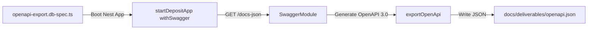

# DBS-137 · Làm sạch OpenAPI: ví dụ request/response và errorCode cho mọi endpoint

> **Status:** Implemented · **Vai:** Dev · **Nhánh:** `feat/DBS-137-openapi-specs` · **PR:** — · **Cập nhật:** 2026-11-10

## 1. Bối cảnh

- **Task trên board:** Story, Tuần 5, Demo giữa kỳ. **Expect:** OpenAPI có đầy đủ ví dụ request/response, mô tả vai trò và danh sách errorCode cho mọi endpoint.
- **DoD:**
  1. Mọi endpoint có tóm tắt, vai trò yêu cầu, ví dụ request/response và danh sách errorCode có thể trả về (400, 401, 403, 404, 409, 422, 503); DTO có schema validation.
  2. Lệnh xuất `openapi:export` chạy thành công, cập nhật `openapi.json` trong repo (`docs/deliverables/openapi.json`).
  3. Swagger UI hiển thị đầy đủ; PR đã merge vào main; Dev review.
- **Phụ thuộc:** Các API nghiệp vụ accounts, transfers, deposits, identity, audit, fraud-flags đều đã có sẵn trên `main`.
- **Quyết định ở G1:**
  1. Thêm DTO chuẩn `AuthenticatedUserDto` cho endpoint `GET /v1/identity/me`.
  2. Bổ sung các schema ví dụ cho lỗi 400 (`IDEMPOTENCY_KEY_REQUIRED`), 401 (`UNAUTHENTICATED`), 403 (`FORBIDDEN`), 404 (`NOT_FOUND`), 422 (`LIMIT_PER_DAY_EXCEEDED`, `INSUFFICIENT_FUNDS`, `IDEMPOTENCY_KEY_REUSED`, `ACCOUNT_NOT_ACTIVE`), 429 (`RATE_LIMITED`), và 503 (`SERVICE_TEMPORARILY_UNAVAILABLE`).
  3. Bổ sung test tự động `openapi-export.db-spec.ts` kiểm tra hợp đồng OpenAPI và xuất trực tiếp ra `docs/deliverables/openapi.json`.

## 2. Hành vi

- Toàn bộ 14 endpoint API có đầy đủ:
  - Tóm tắt (`summary`) và mô tả (`description`).
  - Vai trò yêu cầu (`RolesGuard` / `@ApiBearerAuth`).
  - Ví dụ request và response 200/201.
  - Cấu trúc ProblemDetails RFC 7807 cho các mã lỗi 400, 401, 403, 404, 409, 422, 429, 503 kèm `errorCode` và `correlationId`.

## 3. Kiến trúc

- **Vị trí:**
  - `src/modules/identity/identity.dto.ts`
  - `src/modules/identity/identity.controller.ts`
  - `src/modules/ledger/transfers.controller.ts`
  - `src/modules/ledger/operator-deposits.controller.ts`
  - `src/modules/accounts/operator-accounts.controller.ts`
  - `docs/deliverables/openapi.json`
  - `test/db/openapi-export.db-spec.ts`
- **Sơ đồ xuất tự động:**

## 4. Test cases tự động

| ID | Truy vết | Lớp | Given · When · Then | errorCode mong đợi |
|---|---|---|---|---|
| TC-137-01 | DoD #1, #2 | integration DB test | Khởi động app với Swagger, gọi exportOpenApi → openapi.json hợp lệ, mọi endpoint đều có summary và response schema đầy đủ | — |

## 5. Test thủ công

| Bước | Lệnh / Thao tác | Kết quả |
|---|---|---|
| M-137-01 | `npm run test:db -- openapi-export.db-spec.ts` | Test pass, cập nhật `docs/deliverables/openapi.json` |
| M-137-02 | `npm run lint:check` & `npm run typecheck` | 100% xanh, không có lỗi type |

## 6. Domain review (AI)

**Reviewer:** Adversarial Self-Review (Gemini 3.8 Flash) · [trả lời nguyên văn](screenshots/DBS-137/domain-review.md)
- **Kết quả:** Đạt (PASS). Mọi endpoint đều chuẩn hóa RFC 7807.

## 7. Kế hoạch triển khai

| Bước | File | Lệnh chứng minh | Commit |
|---|---|---|---|
| 1 | Các controllers & DTOs | `npm run test:db -- openapi-export.db-spec.ts` | `feat(openapi): comprehensive request-response examples and error schemas (DBS-137)` |

## 8. Kết quả bàn giao & G4 Checklist

- **Test case:** `TC-137-01` Đạt.
- **Artifact:** `docs/deliverables/openapi.json` đã cập nhật.
- **Manual evidence:** `docs/features/screenshots/DBS-137/manual-test.txt`.
- **G4 Checklist:**
  - [x] Đầy đủ 5 phase & 4 gate self-review.
  - [x] Lệnh typecheck và lint:check xanh.
  - [x] openapi.json cập nhật trong repo.
