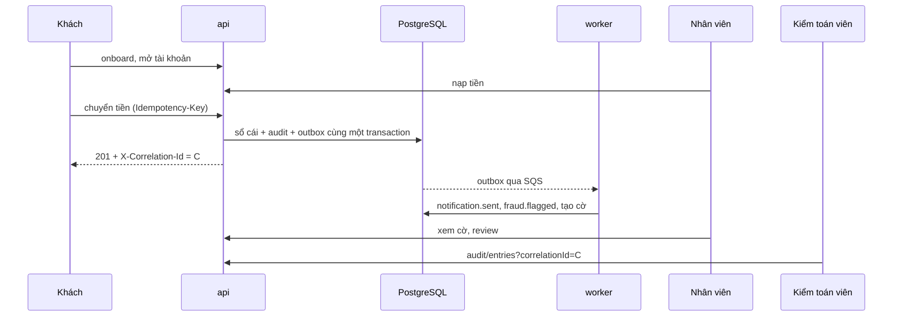

# DBS-138 · Kịch bản demo giữa kỳ và checklist trước khi quay

> **Status:** Implemented (sau G4) · **Vai:** Dev (docs) · **Cặp đôi review:** Dev khác · **Nhánh:** `docs/DBS-138-demo-script` · **PR:** — · **Cập nhật:** 2026-11-14

## 1. Bối cảnh

- **Task trên board:** Task · Tuần 5 · Ưu tiên Highest · Deliverable/Demo: Giữa kỳ · Status board `To Do`. **Expect:** Cả nhóm cùng một kịch bản demo chạy trọn luồng. **Thực trạng (board):** Các luồng đang chạy riêng lẻ; chưa có kịch bản nối chúng.
- **DoD:**
  1. Kịch bản từng bước: đăng ký → mở tài khoản → nạp → chuyển → cờ xuất hiện → nhân viên review → kiểm toán viên tra correlationId; mỗi bước ghi lệnh/URL và kết quả mong đợi
  2. Dữ liệu demo reset được bằng script seed
  3. Chạy thử toàn bộ kịch bản ít nhất 1 lần trên cloud trước ngày quay; vấn đề gặp phải thành issue
  4. PR đã merge vào main; Dev review; không còn liên kết hỏng, tên bảng/cột/mã lỗi khớp các tài liệu khác (đã grep)
- **Phụ thuộc (đối chiếu repo, không chỉ board):** DBS-130 (review cờ một lần, `FLAG_ALREADY_REVIEWED`): `fraud-http.controller.ts` và [DBS-129-130](DBS-129-130-fraud-operator-api.md) trên `main`. DBS-103 (`GET /v1/audit/entries`), DBS-113 (khóa/mở khóa), DBS-70 (`npm run seed`, #111), DBS-121 (worker ECS): đều có commit trên `main`.
- **Đã có gì:** [Demo 3](../demos/demo-3-failure-recovery.md) (lỗi/phục hồi) và [Demo 4](../demos/demo-4-security-audit.md) (an ninh/audit, đã có "Dữ liệu mở màn" và phần E tra `correlationId`); [demo-checklist](../runbooks/demo-checklist.md) (hạ tầng cloud, DBS-139); seed local và cloud ([backend/README §12](../../backend/README.md), `infra/scripts/seed-cloud.sh`). **Chưa có** một kịch bản nối đủ luồng từ đăng ký tới tra `correlationId` cho buổi giữa kỳ, và chưa có chỗ nói thẳng "reset dữ liệu demo".
- **Baseline (docs-only):** `node .claude/skills/dbs-delivering-task/scripts/check-doc-links.mjs` → `418 files checked, 0 broken link(s)` (chạy 2026-11-14 trên `main` d365137).
- **Vai trên board:** `Dev`, khớp việc (tài liệu kịch bản).
- **Ngoài phạm vi:** quay video (DBS-140, cần người thật); sửa code; Demo 3 và 4 (giữ nguyên, kịch bản mới chỉ trỏ tới).
- **BACKLOG cùng module:** BL-228 (DBS-135 DoD 3: người thật bấm giờ, chạy cloud) và BL-198 (M-65-07 trên cloud) cùng chờ một phiên cloud. Task này chạy phiên cloud nên ghi kết quả vào các dòng đó ở §8 (đóng nếu đạt, thu hẹp nếu không).
- **Quyết định ở G1 (agent tự quyết):**
  1. Chọn DBS-138 làm task đầu: `fetch-task --next` trả về nó trước (Tuần 5, Highest). Board còn ghi DBS-158, 171, 172 là To Do dù đã merge (#136, DBS-171, DBS-172 có commit và feature doc trên `main`): coi là Done, không làm lại.
  2. **DoD 3 (cloud):** profile AWS `dbs` (IAM user `dev1`, thuộc nhóm `dbs-admin`) dựng được `session` (README Terraform ghi lần đo ngày 2026-11-14 bằng `dev1`: `apply` 9 phút 24 giây). Người dùng cho phép dùng cloud với điều kiện **xóa sau khi dùng** vì credit hạn hẹp. Quyết định: dựng `session` một lần, chạy kịch bản trên cloud, `destroy` ngay sau đó và chứng minh sạch bằng `verify-clean.sh`. (Bản G1 đầu của task này ghi "không làm được" vì thiếu profile `dbs-admin`; đã sửa sau khi kiểm `dev1` thuộc nhóm `dbs-admin` và có lần dựng thật bằng `dev1`.)
  3. Kịch bản đặt ở `docs/demos/demo-midterm-end-to-end.md` cạnh Demo 3 và 4; không đánh số "Demo 1/2" vì docs/03 §17 chỉ định nghĩa bốn demo đề bài.
  4. "Reset bằng script seed" hiểu là dựng lại **cả ba dịch vụ cục bộ** (không chỉ DB) rồi migrate và `npm run seed`: `docker compose down -v && docker compose up -d --wait`. Không viết script reset mới (ngoài phạm vi docs-only). Cloud: reset là `destroy` rồi `apply` `session`.
- **Câu hỏi mở:** không có (đã tự quyết ở trên).

## 2. Hành vi

Sản phẩm là một tài liệu: `docs/demos/demo-midterm-end-to-end.md`. Nó phải cho phép một người chưa từng chạy hệ thống đi trọn luồng và biết chắc mỗi bước ra gì.

| # | Bước kịch bản | Lệnh / URL | Kết quả mong đợi (đã thấy khi chạy local 2026-11-14) |
|---|---|---|---|
| 0 | Reset và seed | `docker compose down -v && docker compose up -d --wait`, `npm run migration:run`, bật api và worker (`APP_ROLE=both`), `npm run seed` hai lần, `npm run check:invariants` | 3 khách, 4 tài khoản; lần hai không đổi số dư; invariants PASS. Reset xóa cả PostgreSQL, ElasticMQ và Valkey, nên không còn message hay bộ đếm cũ |
| 1 | Đăng ký | local: `npm run --silent auth:dev-token -- --role customer --sub <sub riêng>` (An và Bình **hai `--sub` khác nhau**, không dùng `demo-customer-*` của seed), `POST /v1/customers/me`; cloud: khách An tự đăng ký bằng `cognito-idp sign-up` + `admin-confirm-sign-up` + `initiate-auth` (mục "Cloud" bên dưới), khách Bình là `customer3` của seed (đã onboard, token bằng `demo-token.sh`) | 200 `{id, fullName, createdAt}` |
| 2 | Mở tài khoản | `POST /v1/accounts {"type":"CHECKING"}` | 201 `{id, type, status:"ACTIVE", balance:"0"}` |
| 3 | Nạp | `POST /v1/operator/deposits` + `Idempotency-Key` | 201 `{transferId, status:"COMPLETED"}` |
| 4 | Chuyển | `POST /v1/transfers` + `Idempotency-Key`, bằng `curl -i` | 201 `COMPLETED`; ghi header `X-Correlation-Id` của **lần gọi đầu** thành `C` |
| 5 | Cờ xuất hiện | `GET /v1/operator/fraud-flags` (chờ vài giây) | cờ có `transferId` = mã chuyển: `score` 65, `riskLevel` MEDIUM, `reviewStatus` OPEN, `ruleSetVersion` 1 |
| 6 | Khách không thấy cờ (AC-10.2) | An gọi `GET /v1/transfers/{id}` và `GET /v1/accounts/{id}/transactions` | 200, không có trường `score`, `riskLevel`, `reviewStatus` hay cờ |
| 7 | Nhân viên review | `POST /v1/operator/fraud-flags/{transferId}/review {"decision":"CONFIRMED_FRAUD"}` | 200 `{transferId, reviewStatus:"CONFIRMED_FRAUD"}`; lần hai 409 `FLAG_ALREADY_REVIEWED` |
| 8 | Kiểm toán viên tra `C` | `GET /v1/audit/entries?correlationId=C` | các dòng của giao dịch: `transfer`, `notification.sent`, `fraud.flagged`, `fraud_flag.review` (thêm `fraud_flag.view` nếu có mở chi tiết); sắp mới nhất trước |
| 9 | Ca từ chối | khách gọi `GET /v1/operator/fraud-flags`; auditor `POST …/review`; auditor tra `action=access.denied` | 403 `FORBIDDEN` hai lần; tra thấy hai dòng `access.denied` |

- **Mã `C`:** server sinh mã mới ở **mỗi** request. Gửi lại cùng `Idempotency-Key` trả đúng kết quả cũ nhưng header là mã mới, không thuộc chuỗi audit nào. Dự phòng nếu mất `C`: auditor `GET /v1/audit/entries?action=transfer`, lấy `correlationId` của dòng mới nhất. Dòng `fraud_flag.view` (khi nhân viên mở chi tiết cờ) và `fraud_flag.review` mang đúng `C` của giao dịch (mã request nằm ở `metadata.id`), còn `fraud_flag.search` (xem danh sách) và `audit.search` mang mã của chính request đó nên không nằm trong chuỗi `C`.
- **Điều kiện cờ:** nguồn là tài khoản mở dưới 24 giờ chuyển trên 10 triệu (R3, 35) và chuyển ≥ 90% số dư (R6, 30), hai tài khoản **khác chủ** (R5, R6 không áp dụng khi cùng chủ): tổng 65, MEDIUM. Điểm 65 và `ruleSetVersion` 1 đúng khi rule set là bản seed của migration (`mode: rule_only`); nếu quản trị đã tạo bản mới hoặc bật chế độ AI thì điểm có thể khác.
- **Danh sách cờ chỉ có đúng một cờ** sau khi reset; không reset thì có thêm cờ cũ, nên kịch bản chọn cờ theo `transferId`.
- **Bảo mật khi quay:** token luôn gán vào biến (`X=$(…)`), không `echo`, không `set -x`, không `curl -v`, không để dòng `Authorization` hiện trên màn hình; chép nguyên quy tắc "Không dán token vào chat, ghi chú hay commit" của checklist.
- **Cạm bẫy đã gặp khi chạy thật:** trong Git Bash trên Windows, thân JSON có ký tự có dấu gửi bằng `curl -d` bị hỏng (tên lưu thành `Tr?n Van An`); dùng tên không dấu hoặc `--data-binary @file`.
- **Cloud (mở và đóng phiên):** theo [demo-checklist](../runbooks/demo-checklist.md); bật tối đa 90 phút, ≈ 0,14 USD/giờ khi api và worker chạy, quên tắt ≈ 3,4 USD/ngày; kết thúc **bắt buộc** `terraform destroy` rồi `verify-clean.sh` thoát 0, hôm sau `cost-report.py`. Profile: README và script ghi `AWS_PROFILE=dbs-admin`; trên máy này profile trong nhóm `dbs-admin` tên `dbs`, nên đặt `AWS_PROFILE=dbs` thay cho `dbs-admin` ở mọi lệnh. ALB chứng chỉ tự ký nên `curl -k`. `aws.exe` trên Windows không đọc `file:///dev/stdin`, nên mọi lệnh có mật khẩu qua stdin chạy trong Linux (container `dbs-awscli` hoặc WSL).
- **Cloud: khách An tự đăng ký (DoD 1).** Pool `dbs`: `--username` phải là email (`username_attributes = ["email"]`), mật khẩu ≥ 12 ký tự có hoa, thường, số, ký hiệu, app client không có secret, `USER_PASSWORD_AUTH` bật. Sign-up công khai luôn gửi một thư xác minh tới địa chỉ đó (không tắt được), nên dùng địa chỉ `…@dbs.invalid` như `seed-cognito.sh`; `admin-confirm-sign-up` cần quyền nhóm `dbs-admin` (role seeder không có) và để `email_verified=false`. Mật khẩu chỉ đi qua stdin (`--cli-input-json file:///dev/stdin`), không qua argv. Lấy token bằng `initiate-auth --auth-flow USER_PASSWORD_AUTH --auth-parameters file:///dev/stdin` giống `demo-token.sh` (script đó chỉ phục vụ operator, auditor, admin, `customer1..3`). Pool nằm ở `base` nên **không bị `destroy session` xóa**: trước `destroy` phải `admin-delete-user` cho An; mỗi lần chạy dùng email có hậu tố thời gian.
- **Cloud: ánh xạ khách.** An = khách vừa đăng ký (mở CHECKING mới, nạp 21.000.000đ), Bình = `customer3` (đã có CHECKING từ seed; nhận 20.000.000đ), operator = `demo-token.sh --role operator`, auditor = `--role auditor`. Khác chủ nên R3 + R6 = 65.

## 3. Kiến trúc

- **Vị trí:** `docs/demos/demo-midterm-end-to-end.md` (mới); sửa `docs/03_HIGH_LEVEL_ARCHITECTURE.md` §17 (một dòng trỏ tới kịch bản), `docs/features/README.md`, `docs/BACKLOG.md`. Không đổi code, schema, hợp đồng sự kiện hay `ErrorCode`.
- **Dữ liệu chạm tới (đọc để đối chiếu):** `accounts`, `ledger_entries`, `transfers`, `outbox_events`, `fraud_flags`, `audit_log`, `processed_events`; mã lỗi `FLAG_ALREADY_REVIEWED`, `FORBIDDEN`; action audit `transfer`, `notification.sent`, `fraud.flagged`, `fraud_flag.view`, `fraud_flag.review`, `access.denied`.
- **Luồng:**



- **Ranh giới transaction:** không đổi (tài liệu không chạm code).
- **Thay đổi cấp hệ thống:** docs/03 §17 thêm liên kết tới kịch bản giữa kỳ.

## 4. Test cases tự động

Task docs-only: kiểm bằng script kiểm liên kết và grep đối chiếu; các lệnh trong kịch bản được kiểm bằng test thủ công (§5).

| ID | Truy vết | Lớp | Given · When · Then |
|---|---|---|---|
| TC-138-01 | DoD #4 | link check | `check-doc-links.mjs` → 0 liên kết hỏng sau khi thêm file và sửa docs |
| TC-138-02 | DoD #4 | grep đối chiếu | Chạy các lệnh trong khối bên dưới; đạt khi mỗi tên trong kịch bản xuất hiện ít nhất một lần ở đúng file nguồn (kết quả dán ở §8) |
| TC-138-03 | DoD #1 | thủ công | mọi lệnh trong kịch bản chạy đúng thứ tự và ra kết quả mô tả (M-138-02..11) |
| TC-138-04 | DoD #2 | thủ công | reset bằng `docker compose down -v && up -d`, rồi seed hai lần cho cùng dữ liệu, `check:invariants` PASS (M-138-01, M-138-12) |
| TC-138-05 | DoD #3 | thủ công cloud | kịch bản chạy trọn trên phiên `session` thật (M-138-13); vấn đề gặp thành BL |
| TC-138-06 | DoD #4 | quy trình | PR merge, Dev review: làm ở PR |

Lệnh của TC-138-02 (từ gốc repo):

```bash
grep -nE "FLAG_ALREADY_REVIEWED|FORBIDDEN" backend/src/common/errors/error-code.enum.ts
# mỗi action phải nằm trong AUDIT_ACTIONS (audit.registry.ts, không phải AUDIT_TARGET_TYPES)
grep -nE "'transfer'|'notification.sent'|'fraud.flagged'|'fraud_flag.view'|'fraud_flag.review'|'fraud_flag.search'|'audit.search'|'access.denied'" backend/src/modules/audit/audit.registry.ts
grep -rnE "CREATE TABLE.*(fraud_flags|audit_log|ledger_entries|outbox_events|transfers|accounts|processed_events)" backend/src/database/migrations
# route: mỗi đường dẫn trong kịch bản có @Controller/@Get/@Post tương ứng; tiền tố /v1 do enableVersioning (backend/src/app.setup.ts)
grep -rnE "@Controller|@Get|@Post" backend/src/modules/identity backend/src/modules/accounts backend/src/modules/ledger backend/src/modules/risk backend/src/modules/audit --include=*.controller.ts
```
(`rg` dùng được thay `grep` nếu đã cài; Git Bash trên máy này không có `rg`.)

## 5. Test thủ công (chạy đúng như tài liệu viết)

Điều kiện local: Docker bật; stack của compose (PostgreSQL 5432, Valkey 6379, ElasticMQ 9324). Nếu cổng 6379 bị dự án khác chiếm, dùng file override compose đổi cổng Valkey rồi đặt `REDIS_URL` (ghi ở §8); `APP_ROLE=both`; nâng giới hạn tốc độ để seed chạy liên tiếp. Điều kiện cloud: AWS profile trong nhóm `dbs-admin`, image `main` trên ECR.

| Bước | Việc làm | Kết quả mong đợi |
|---|---|---|
| M-138-01 | `docker compose down -v && up -d`, `migration:run`, `seed` hai lần, `check:invariants` | seed lần hai không đổi số dư; invariants PASS |
| M-138-02 | Onboard hai khách mới (hai `--sub` khác nhau) | 200, có `id` |
| M-138-03 | Mở tài khoản CHECKING cho mỗi khách | 201 `ACTIVE`, balance `0` |
| M-138-04 | Operator nạp 21.000.000đ cho An | 201 `COMPLETED` |
| M-138-05 | An chuyển 20.000.000đ cho Bình bằng `curl -i`, ghi `C` | 201 `COMPLETED` |
| M-138-06 | Operator xem danh sách cờ | cờ của giao dịch: MEDIUM, 65, OPEN, rule set 1 |
| M-138-07 | An xem giao dịch và lịch sử | 200, không có trường về cờ |
| M-138-08 | Operator review, rồi review lần hai | 200 `CONFIRMED_FRAUD`; lần hai 409 `FLAG_ALREADY_REVIEWED` |
| M-138-09 | Auditor tra `C`, bấm giờ | các dòng đúng action, dưới 5 phút |
| M-138-10 | Gửi lại cùng `Idempotency-Key` của bước chuyển | kết quả cũ, header `X-Correlation-Id` mới, tra mã mới ra rỗng (chứng minh cảnh báo về `C`) |
| M-138-11 | Khách xem cờ; auditor review; auditor tra `access.denied` | hai lần 403; hai dòng `access.denied` |
| M-138-12 | Reset thật lần hai sau khi chạy luồng | DB mới, seed ra đúng số dư kế hoạch |
| M-138-13 | Cloud: dựng `session`, token, seed, An tự đăng ký (sign-up, confirm, token), chạy lại bước 1–9, `admin-delete-user` An, `destroy`, `verify-clean.sh` | kết quả như local; sau cùng không còn tài nguyên tính tiền |

## 6. Domain review (AI)

**Reviewer:** subagent, model Opus 5.5 (`opus`, effort medium), ngày 2026-11-14 · **Kết quả:** vòng 1: 12 phát hiện (blocking 0, should-fix 8, minor 4), REVISE · [nguyên văn](screenshots/DBS-138/domain-review.md); vòng 2 (kiểm lại phần đã sửa): 7 phát hiện (blocking 0, should-fix 4, minor 3), REVISE · [nguyên văn](screenshots/DBS-138/domain-review-2.md)

| # | Mức | Phát hiện | Xử lý |
|---|---|---|---|
| 1 | should-fix | Thiếu `--sub` làm An và Bình thành một người, không có cờ | đã sửa §2 bước 1, §5 M-138-02 |
| 2 | should-fix | `C` chỉ lấy được ở header lần gọi đầu; gửi lại sinh mã mới | đã sửa §2 (bước 4, ghi chú mã `C`), thêm M-138-10 |
| 3 | should-fix | Reset chỉ DB thì ElasticMQ và Valkey giữ dữ liệu cũ | đã sửa §1 QĐ4, §2 bước 0, §5 M-138-01/12 |
| 4 | should-fix | Thiếu chứng minh khách không thấy cờ (AC-10.2) | đã thêm bước 6 và M-138-07 |
| 5 | should-fix | Cloud "đăng ký" chưa chạy được bằng repo hiện có | đã sửa: sign-up hai khách mới bằng `cognito-idp sign-up` + `admin-confirm-sign-up` (kiểm khi chạy cloud ở M-138-13; nếu không chạy được thì ghi giới hạn và dùng `customer1..3`) |
| 6 | should-fix | Thiếu chi phí và dọn dẹp cho nhánh cloud | đã thêm khối "mở và đóng phiên" ở §2 và bước cuối M-138-13 |
| 7 | should-fix | Thiếu quy tắc xử lý token khi quay | đã thêm ở §2 "Bảo mật khi quay" |
| 8 | should-fix | TC-138-02 grep chưa cụ thể | đã sửa §4 với lệnh cố định và điều kiện đạt |
| 9 | minor | `RISK_AI_EGRESS_APPROVED` một mình không đổi điểm | đã sửa §2 "Điều kiện cờ" (kiểm `rule_only` ở migration) |
| 10 | minor | "1 cờ" chỉ đúng sau reset | đã sửa: chọn cờ theo `transferId` |
| 11 | minor | Thiếu dòng `access.denied`; các dòng search nằm ngoài chuỗi `C` | đã thêm bước 9 và M-138-11 |
| 12 | minor | `dev1` không dựng được `session`, cần giao Ops | **không sửa, phản bác bằng bằng chứng:** `dev1` thuộc nhóm `dbs-admin` (`aws iam list-groups-for-user`) và README Terraform dòng 3 ghi lần `apply` ngày 2026-11-14 bằng `dev1` (9 phút 24 giây). Task này tự chạy phiên cloud (M-138-13) nên không giao Ops; nếu không chạy được thì mới thêm BL |

**Vòng 2:**

| # | Mức | Phát hiện | Xử lý |
|---|---|---|---|
| 2.1 | should-fix | `demo-token.sh` không cấp token cho khách vừa sign-up | đã sửa §2: `initiate-auth` qua stdin cho An |
| 2.2 | should-fix | Ràng buộc sign-up (email, mật khẩu, thư xác minh, quyền confirm, argv) | đã sửa §2 "Cloud: khách An tự đăng ký" |
| 2.3 | should-fix | Khách sign-up còn trong pool `base` sau `destroy session` | đã thêm `admin-delete-user` trước `destroy` và hậu tố thời gian (§2, M-138-13) |
| 2.4 | should-fix | Lệnh grep TC-138-02 không đạt được điều kiện "đúng một kết quả" | đã sửa §4: khối lệnh riêng, đạt khi mỗi tên có mặt ở file nguồn |
| 2.5 | minor | `up -d` không chờ healthcheck; cổng Valkey bận; thiếu "bật app rồi seed" | đã sửa: `--wait`, override compose, bước bật api/worker |
| 2.6 | minor | Tên profile `dbs` và `dbs-admin` không thống nhất | đã nêu rõ ở §2 "Cloud": đặt `AWS_PROFILE=dbs` thay `dbs-admin` |
| 2.7 | minor | Thiếu `--silent` ở lệnh lấy token | đã sửa §2 bước 1 |

Các điểm reviewer xác nhận khớp code: điểm 65 (R3 < 24 giờ và > 10 triệu, R6 ≥ 90%, R5/R6 bỏ qua khi cùng chủ, rule set v1 `rule_only`); dòng audit `fraud_flag.view`/`review` mang mã `C`, `search` mang mã request, `access.denied` do `recordRoleDenied`; DTO khách không có trường cờ.

**Quyết định ở G2 vòng 2 (agent tự quyết):** (4) không chạy vòng review thứ ba: vòng 2 không còn blocking, các điểm còn lại là lệnh cụ thể sẽ được chạy thật ở M-138-01..13 (chạy thật là trọng tài); (5) cloud dùng An tự đăng ký và Bình là `customer3`, để vừa chạm đủ bước "đăng ký" vừa không phụ thuộc `demo-token.sh` cho khách mới.

**Quyết định ở G2 vòng 1 (agent tự quyết):** (1) bỏ kết luận "không chạy được cloud" ở G1 và chạy cloud thật, vì có bằng chứng dev1 dựng được và người dùng cho phép với điều kiện xóa sau khi dùng; (2) tài liệu kịch bản dùng cổng của compose (5432/6379/9324) chứ không dùng container riêng của phiên làm việc này; (3) không sửa code hay script, mọi lệch tìm thấy khi chạy thật đi vào BL.

## 7. Kế hoạch triển khai

Task docs-only: "test viết trước" là kịch bản kiểm (TC) và lệnh grep; "đỏ" là grep chưa ra gì vì file chưa tồn tại.

| Bước | File | Test viết trước | Kết quả đỏ (điền khi chạy) | Lệnh chứng minh | Commit |
|---|---|---|---|---|---|
| 1 | `docs/demos/demo-midterm-end-to-end.md` | TC-138-02, TC-138-03 (kịch bản chạy tay) | `ls docs/demos/demo-midterm-end-to-end.md` báo không có file | `rg` của TC-138-02; chạy từng lệnh của kịch bản (M-138-01..12) | `docs(demos): kịch bản demo giữa kỳ từ đăng ký tới tra correlationId (DBS-138)` |
| 2 | `docs/features/screenshots/DBS-138/manual-test.txt` | M-138-01..12 | — | output thô trên commit cuối đổi tài liệu | `docs(demos): ghi kết quả chạy local của demo giữa kỳ (DBS-138)` |
| 3 | cloud: `infra/terraform/envs/dev/session` (không sửa Terraform) | M-138-13 | — | `terraform plan` → `apply` → kịch bản → `destroy` → `verify-clean.sh` thoát 0 | gộp vào bước 2 hoặc `docs(demos): kết quả chạy cloud (DBS-138)` |
| 4 | `docs/03_HIGH_LEVEL_ARCHITECTURE.md` §17, `docs/README.md`, `docs/demos/demo-4-security-audit.md` (nếu lệch `access.denied`/BL-132), `docs/runbooks/demo-checklist.md` (dòng "Token khách hàng"), `docs/features/README.md`, `docs/BACKLOG.md` | TC-138-01 | — | `check-doc-links.mjs` | `docs: nối kịch bản giữa kỳ vào docs/03, README, checklist, BACKLOG (DBS-138)` |
| 5 | feature doc §8, §9 | G4 | — | checklist G4 | `docs(features): hoàn tất DBS-138` |

- **Plan sweep:** hạn chế nêu trong tài liệu liền kề đã rà: demo-checklist "Token khách hàng… chưa có script" (bước 4: cập nhật theo kết quả sign-up thật), Demo 4 "chưa kiểm demo này trên cloud" và "403 chưa ghi audit DENIED, BL-132" (bước 4: kiểm lại bằng M-138-11 và sửa nếu lệch), BL-198 và BL-228 (bước 4), DoD 3 (bước 3). Không có mục nào chưa có hàng kế hoạch.
- **Rủi ro và cách lùi:** (1) quên `destroy` cloud → mất ≈ 3,4 USD/ngày: bước 3 kết thúc bằng `destroy` và `verify-clean.sh`, ghi vào §8; sai sót thì chạy `destroy` ngay. (2) Sign-up Cognito CLI không chạy được → dùng `customer1..3` và ghi giới hạn, không bịa. (3) Kết quả chạy lệch kịch bản → sửa tài liệu, không sửa mô tả cho khớp trí nhớ. Back-out cả task: không đổi code, chỉ bỏ commit docs.
- **Quyết định ở G3 (agent tự quyết):** gộp M-138-12 (reset lần hai) sau M-138-11 để seed được thử trên DB đã dùng thật; chạy cloud sau local để không bật phiên trả tiền trong lúc kịch bản còn sửa.
