# DBS-139 · Dựng môi trường dev từ đầu ≤ 30 phút và checklist trước demo

> **Status:** Implemented một phần (G4 tự duyệt 2026-11-12; DoD 1 và 4 chưa đạt: BL-251, BL-253) · **Vai:** #5 Platform & Ops · **Cặp đôi review:** Dev · **Nhánh:** `docs/DBS-139-dev-env-rebuild-demo-checklist` (từ `origin/feat/DBS-121-worker-service` f47f880, xem §1) · **PR:** — · **Cập nhật:** 2026-11-12

> **Nền nhánh.** DBS-139 phụ thuộc DBS-121 (service worker), mà DBS-121 mới chỉ có ở PR #149 (chưa merge; nhánh đó đã chứa DBS-120, PR #146). Nhánh này cắt từ `origin/feat/DBS-121-worker-service`, không từ `origin/main`. PR của DBS-139 chỉ nên mở/merge sau khi #146 và #149 vào `main` (hoặc đổi base của PR sang nhánh #149). Hệ quả: `git diff main...HEAD` của nhánh này gồm cả diff của DBS-120 và DBS-121; phạm vi riêng của DBS-139 là `git diff origin/feat/DBS-121-worker-service...HEAD`.

## 1. Bối cảnh

- **Task trên board:** Task, Tuần 5, Ưu tiên High, Deliverable «Giữa kỳ», Status "To Do". Vai board #5 Platform & Ops khớp loại việc (Terraform, vận hành, tài liệu). **Expect:** Demo không vấp lỗi hạ tầng.
- **Thực trạng trên board** (chép): môi trường dev dựng và xóa theo phiên nhưng chưa đo thời gian dựng từ đầu hay có checklist.
- **DoD** (nguyên văn, đánh số):
  1. Dựng từ trạng thái trống (terraform apply + pipeline + migration + seed) ≤ 30 phút; ghi từng bước và thời gian trong infra/terraform/README
  2. Checklist trước demo: dịch vụ nào bật, kiểm health, seed, token demo
  3. Sau demo terraform destroy phần xóa hằng ngày; xác nhận không còn tài nguyên tính tiền
  4. PR đã merge vào main (CI xanh); Dev review; bảng «Đối chiếu test case» trong PR điền đủ
- **Phụ thuộc** (board và repo):

| Task | Board | Trong repo |
|---|---|---|
| DBS-121 service worker | To Do | **Chỉ có ở PR #149**, chưa merge: `session/worker.tf`, `base/worker.tf`, nhóm B của test thủ công chưa chạy vì ECR không có image (BL-247). Nhánh nền của task này |
| DBS-54 Cognito, 4 nhóm, script seed nhân viên | Done | `base/cognito.tf`, `infra/scripts/seed-cognito.sh` (đã chạy: secret `dbs/dev/demo-accounts` và pool `dbs` đang có trên AWS) |
| DBS-75 Valkey TLS | Done | `session/redis.tf`, `base/redis_*.tf` |
| DBS-68 bước migration | Done | `.github/scripts/migrate.sh`, `session/ecs.tf` (`dbs-migrate`); BL-109 (chạy thật) chưa đạt |
| ADR-12 | board «không tìm thấy» | có trong repo: [ADR-12](../adr/0012-redis-valkey-node.md) (một node Valkey); board chỉ thiếu dòng |

- **Đã có gì:** Terraform `base` (66 tài nguyên giữ lại) và `session` (30 tài nguyên: RDS, Valkey, ALB, ECS api và worker, IAM) ở [infra/terraform/README.md](../../infra/terraform/README.md) (thứ tự dựng, `migrate.sh`, `deploy.sh`, seed Cognito); [seed dữ liệu qua API](../../backend/README.md) (`npm run seed`, DBS-70); `npm run check:invariants`; [báo cáo chi phí](../components/platform-infra/cost-reports/2026-11-04.md); [Demo 3](../demos/demo-3-failure-recovery.md); [feature doc DBS-121](DBS-121-worker-service.md) và [DBS-120](DBS-120-ecs-task-roles.md). Chưa có: số đo thời gian dựng, checklist trước demo, lệnh nào kiểm «không còn tài nguyên tính tiền» (README chỉ có danh sách loại tài nguyên trong `platform.md`), cách lấy token demo trên cloud.
- **Baseline** (hạ tầng: `fmt`, `validate`, `terraform test -parallelism=1 GOMAXPROCS=2 GOMEMLIMIT=1500MiB`, `TF_DATA_DIR` riêng để không đụng init backend thật): `terraform fmt -check -recursive` sạch; `bootstrap` **9 passed**, `envs/dev/base` **45 passed**, `envs/dev/session` **35 passed**, 0 failed; `test_seed_cognito.py` 12 OK, `test_cost_report.py` 18 OK. Task không đổi backend nên không chạy bốn lệnh `backend/` (không docker trên máy).
- **Tình trạng AWS lúc bắt đầu** (chỉ đọc, profile `dbs-admin`, `ap-southeast-1`): không RDS, ALB, ElastiCache; ECR `dbs-api` **0 image**; state `base` 66 tài nguyên, `terraform plan` base thêm đúng 2 (`aws_iam_role.github_deploy`, `aws_iam_role_policy.deploy`, role deploy chưa apply); state `session` rỗng, plan thêm 30. Budget có `My Monthly Cost Budget` 150 USD và `Free-tier Budget`. Máy không có `docker`, nên **không build và không đẩy được image** (BL-247).
- **Dòng BACKLOG liên quan:**

| Dòng | Quyết định |
|---|---|
| BL-232 (DBS-165/166 chờ môi trường dựng đúng DBS-139) | Task này cung cấp cách dựng và checklist; số đo tải thuộc DBS-166. Không xóa dòng |
| BL-247 (nhóm B của DBS-121 chưa chạy vì thiếu image), BL-242 (3), BL-109, BL-106 | Cùng một khoảng trống «chưa có image trên ECR». Không giải quyết ở đây (không có docker, không push ECR); phần của DBS-139 phụ thuộc chúng ghi «chưa chạy» và BL mới |
| BL-248 (deploy.sh chưa lăn worker), BL-103 (role DB riêng) | Ảnh hưởng thời gian/bước dựng; ghi vào README là giới hạn, không làm |
| BL-213 (seed chạy lại sau khi dọn idempotency) | Dựng từ trống tạo DB mới nên không dính; nhắc trong checklist |

- **Ngoài phạm vi:** build/đẩy image (CI `Image` trên `main`, DBS-36); đổi Terraform; role DB riêng (BL-103); lăn worker trong `deploy.sh` (BL-248); alarm (DBS-163); load test cloud (DBS-166); tạo tài khoản khách hàng demo trên Cognito (xem câu hỏi 2).
- **Câu hỏi mở / Quyết định ở G1** (agent tự quyết, người dùng vắng):
  1. *Không thể đo trọn «dựng từ trống ≤ 30 phút» vì thiếu image.* Quyết định: đo thật phần Terraform `session` (bước chiếm thời gian nhất: RDS; `base` giữ lại, không đo) và các bước chạy được (token Cognito, kiểm health ALB, destroy, kiểm sạch; `seed-cognito.sh` chỉ `--dry-run`, không đo, tài khoản đã có từ DBS-54); phần pipeline, migration, seed API, health 200 ghi **ước tính từ tài liệu và log trước, ghi rõ «chưa đo»**, DoD 1 ghi **chưa đạt** (BL mới), không viết «≤ 30 phút» như đã chứng minh.
  2. *Token khách hàng trên cloud.* `npm run seed -- --auth cloud` cần 3 token customer; Cognito cho tự đăng ký nhưng chưa có script tạo 3 khách demo. Quyết định: thêm `infra/scripts/demo-token.sh` cho `operator`, `auditor`, `admin` (đã có tài khoản do DBS-54); token customer ghi BL.
  3. *«Xác nhận không còn tài nguyên tính tiền»* hiện là danh sách nói trong `platform.md`, không có công cụ. Quyết định: viết `infra/scripts/verify-clean.sh` (chỉ đọc, có test với `aws` giả), vì tag listing không đủ (`platform.md`: bỏ sót ENI và EIP).
  4. *`apply -target`.* Apply thật dùng `-target` với **đủ 30 địa chỉ** của plan (danh sách ở §5), để thời gian đo bằng thời gian của một lần dựng thật (một danh sách thiếu sẽ bỏ qua tài nguyên IAM và cho số đo lệch); ECS service để `desired_count = 0` và `worker_desired_count = 0` (không image, không tốn Fargate). `image_tag` bắt buộc là SHA 40 ký tự hex: dùng SHA của HEAD làm giá trị giữ chỗ, **an toàn chỉ vì cả hai service ở 0 task**; đây là ngoại lệ có chủ ý của quy tắc README «tag phải có trên ECR» và README ghi rõ.
  5. *Go-ahead cho `apply`/`destroy` thật* — **lệch có chủ ý so với `platform.md`** («không `apply` hay `destroy` account thật khi người dùng chưa đồng ý trong hội thoại»). Người dùng vắng. Căn cứ: (i) bộ nhớ `feedback-autonomous-gates` (2026-11-12): người dùng ủy quyền agent audit tự chạy, với «thay đổi AWS ngoài danh sách -target đã duyệt vẫn phải ghi rõ và giữ chi phí tối thiểu»; (ii) bộ nhớ `feedback-cost-minimal-aws` (2026-10-25): task `session` chỉ `apply` đến khi xong test thủ công rồi `destroy` trong cùng phiên; (iii) yêu cầu của agent điều phối nêu profile `dbs-admin`, `apply -target` với danh sách ghi trong doc, `destroy` ngay sau khi kiểm. **Quyền của harness không phải câu «đồng ý» của người dùng trong chat**; đây là một lệch được ghi nhận ở §8 và trong tin nhắn G4 để người dùng thấy. Quy tắc chạy: (a) chỉ chạy khi harness cho phép, bị chặn thì **không lách**, bước ghi «chưa chạy» và thành BL; (b) **trước `apply`, kiểm `destroy` được phép**: chạy `terraform destroy` trên state `session` còn rỗng (no-op, cùng lệnh và cùng quyền); bị chặn thì không `apply`; (c) nếu `destroy` thật bị chặn sau khi đã `apply`: dừng mọi việc khác, báo ngay cho người dùng, ghi tài nguyên đang chạy và đơn giá ≈ 0,09 USD/giờ.
  6. *Không `apply base` trong test thủ công* (reviewer 1.5): role `dbs-github-deploy` chỉ có tác dụng cho bước pipeline (chưa chạy) và apply từ nhánh chưa merge làm `base` lệch thêm (BL-138). Thời gian `base` ghi «giữ lại, không dựng lại mỗi phiên, không đo».
  7. *`check:invariants` trên cloud không chạy được* (RDS private, checker cần `ts-node`, BL-128). Bước này ghi «chưa chạy (BL-128)» trong bảng README và checklist, không là ô tick.
  8. *`npm run seed -- --auth cloud` qua ALB tự ký* (CN `dbs-dev.local`, Node từ chối TLS; không có output chứng chỉ). Quyết định: không sửa Terraform ở đây; checklist truyền token chỉ qua biến `DBS_*_TOKEN` (không cờ `--*-token` trên argv) và ghi BL cho vấn đề TLS.
  9. *`seed-cognito.sh` ghi vào Cognito và secret* (kể cả không `--rotate`). Tài khoản đã có (DBS-54), nên test thủ công chỉ chạy `--dry-run`; nếu `demo-token.sh` báo chưa seed, ghi «chưa chạy» chứ không tự seed (ngoài danh sách ghi được duyệt).
  10. *`verify-clean.sh` quét cả tài khoản*, không lọc theo tag hay VPC (cố ý: ENI và EIP mồ côi thường không mang tag). Tài nguyên không thuộc dự án thấy ở M-139-01 được ghi nhận và báo cáo, không lọc bỏ.

## 2. Hành vi

Task không có API. Nó thêm hai công cụ vận hành và hai tài liệu.

### 2.1 `infra/scripts/verify-clean.sh` (chỉ đọc)

Quét mười ba loại tài nguyên tính tiền ở `ap-southeast-1` (mọi lời gọi có `--region` rõ ràng, chỉ động từ `describe-*`/`list-*`), mỗi loại một dòng:

| # | Loại | Gọi | FAIL khi |
|---|---|---|---|
| 1 | NAT Gateway | `ec2 describe-nat-gateways` trạng thái `pending, available, deleting` | có |
| 2 | Load balancer | `elbv2 describe-load-balancers` | có |
| 3 | RDS instance và cluster | `rds describe-db-instances`, `describe-db-clusters` | có |
| 4 | RDS snapshot thủ công | `rds describe-db-snapshots --snapshot-type manual` | có |
| 5 | ElastiCache | `elasticache describe-replication-groups`, `describe-cache-clusters` | có |
| 6 | ECS | `ecs list-clusters` rồi `list-services`/`describe-services` và `list-tasks` | service `desiredCount > 0` hoặc task đang chạy; cluster rỗng chỉ là thông tin (miễn phí) |
| 7 | Elastic IP | `ec2 describe-addresses` | có |
| 8 | ENI `available` | `ec2 describe-network-interfaces` lọc `status=available` | có (ENI mồ côi; `platform.md`) |
| 9 | WAF regional | `wafv2 list-web-acls --scope REGIONAL` | có |
| 10 | VPC interface endpoint, EC2 | `ec2 describe-vpc-endpoints` (loại `Interface`), `describe-instances` (mọi trạng thái trừ `terminated`) | có (ADR-10) |
| 11 | Bản sao lưu tự động RDS còn lại | `rds describe-db-instance-automated-backups` | có (`delete_automated_backups` là ý định, đây là bằng chứng) |
| 12 | Snapshot ElastiCache | `elasticache describe-snapshots` | có |
| 13 | EBS volume và snapshot của tài khoản | `ec2 describe-volumes`, `describe-snapshots --owner-ids self` | có |

Kết quả: in `OK <tên>` hoặc `FAIL <tên>: <id…>` (chỉ định danh, không ARN, không số tài khoản); thoát **0** khi cả mười ba loại sạch, **1** khi **có** loại còn thứ tính tiền (kể cả khi loại khác lỗi: một thứ còn lại là sự thật đã biết; dòng cuối vẫn nêu loại không kiểm được), **2** khi không loại nào FAIL nhưng có lệnh `aws` lỗi (thiếu quyền, hết hạn credential): loại đó in `LOI <tên>: không kiểm được`, các loại khác vẫn chạy, và **không bao giờ thoát 0** nếu có loại không kiểm được. Không có lựa chọn ghi/xóa.

### 2.2 `infra/scripts/demo-token.sh --role operator|auditor|admin`

In **đúng một dòng, access token Cognito, ra stdout**; mọi thông báo ra stderr. Nguồn mật khẩu: secret `dbs/dev/demo-accounts` (DBS-54; `SECRET_NAME` ghi đè), client `COGNITO_CLIENT_ID` (hoặc từ `terraform output` của `base`), luồng `USER_PASSWORD_AUTH` bằng `aws cognito-idp initiate-auth`. Mật khẩu không bao giờ nằm trên argv, không vào biến môi trường của tiến trình con, không ghi tệp; JSON yêu cầu đi qua stdin (`--cli-input-json file:///dev/stdin`), như `seed-cognito.sh`. Mọi lời gọi `aws` có `--region ap-southeast-1`. Chỉ in token khi phản hồi có `AuthenticationResult.AccessToken` khác rỗng, khác `None` và đúng ba đoạn JWT; phản hồi là thử thách (`ChallengeName`, ví dụ `NEW_PASSWORD_REQUIRED` sau lần seed dở) → thoát 1, không in gì ra stdout. Lỗi: vai lạ → thoát 2; thiếu secret, hoặc secret có nhưng không có vai đó trong `users` → thoát 1 kèm gợi ý chạy `seed-cognito.sh`; Cognito từ chối (`NotAuthorizedException`) → thoát 1, stderr không chứa mật khẩu hay token. Token sống 15 phút (DBS-54): checklist nói rõ lấy token **sau** khi mọi thứ đã lên.

### 2.3 Tài liệu

- `infra/terraform/README.md` có mục «Dựng từ trạng thái trống và đo thời gian (DBS-139)»: bảng từng bước (lệnh, vai trò, thời gian **đo** hoặc **ước tính chưa đo**), tổng; mục «Dọn sau demo và chứng minh sạch» dùng `verify-clean.sh`.
- `docs/runbooks/demo-checklist.md`: checklist trước demo (dịch vụ nào bật và vì sao, kiểm health từng tầng, seed, token, ngân sách) và checklist sau demo.

Ca biên: ENI `available` hoặc bản sao lưu RDS ở trạng thái `deleting` sau `destroy` (vài phút): script báo FAIL, người chạy đợi và chạy lại (README); khi đang bật, loại 11 (bản sao lưu tự động của instance sống) cũng FAIL, không phải lỗi; cluster ECS rỗng và log group, SQS, ECR, Cognito, secret, KMS **không** là FAIL (thuộc phần giữ lại, gần như miễn phí).

## 3. Kiến trúc

- **Vị trí:** không đụng `backend/`; không đổi Terraform; không thêm env var, `ErrorCode`, bảng. File mới: `infra/scripts/verify-clean.sh`, `infra/scripts/demo-token.sh`, `infra/scripts/tests/test_verify_clean.py`, `infra/scripts/tests/test_demo_token.py`, `docs/runbooks/demo-checklist.md`; sửa `infra/terraform/README.md`, `docs/03_HIGH_LEVEL_ARCHITECTURE.md` §13.3 (liên kết), `docs/BACKLOG.md`, `docs/features/README.md`.
- **Quyền cần:** người chạy `verify-clean.sh` cần các quyền `Describe*/List*` ở trên (nhóm `dbs-admin` đã có). Không cần quyền ghi. `demo-token.sh` cần `secretsmanager:GetSecretValue` trên `dbs/dev/demo-accounts` (và `kms:Decrypt` qua Secrets Manager) và `cognito-idp:InitiateAuth` (API công khai, không cần quyền IAM).
- **Test:** cả hai script chạy được với `aws` giả (cùng cách `test_seed_cognito.py`: thư mục `PATH` có `aws` giả, ghi argv của mọi lời gọi), không cần credential.
- **Luồng dựng từ trống** (đối tượng của bảng đo ở README):

```mermaid
flowchart LR
    A[Kiểm tài khoản, budget, verify-clean] --> B[apply base: giữ lại]
    B --> C[CI Image: image sha lên ECR]
    C --> D[apply session: RDS, Valkey, ALB]
    D --> E[migrate.sh: dbs-migrate one-off]
    E --> F[desired_count=1, worker=1]
    F --> G[seed-cognito + demo-token + npm run seed]
    G --> H[health live ready + invariants]
    H --> I[Demo]
    I --> J[destroy session + verify-clean]
```

- **Bước cố ý bỏ qua trong luồng:** tạo ba role DB (`db-roles.sql`) không có bước riêng: migration bước 7 tạo role `NOLOGIN` và task vẫn nối bằng credential master (BL-103). `check:invariants` không chạy được trên cloud (BL-128), nên nút H của sơ đồ trên chỉ có health; bước invariants ghi «chưa chạy (BL-128)».
- **Ranh giới transaction:** không có. **Thay đổi cấp hệ thống:** docs/03 §13.3 thêm một dòng liên kết tới README và checklist; không đổi ADR.

## 4. Test cases tự động

Công cụ viết bằng bash, test bằng Python `unittest` với `aws` giả (quy ước của `infra/scripts/tests`). Không có Terraform mới nên không có `terraform test` mới; 89 test hạ tầng của baseline phải giữ nguyên.

| ID | Truy vết | Lớp | Given · When · Then | Mã thoát / kết quả |
|---|---|---|---|---|
| TC-139-01 | DoD 3 | script, `aws` giả | Cả mười ba loại rỗng → `verify-clean.sh` | thoát 0; in 13 dòng `OK`; ECS cluster rỗng không FAIL |
| TC-139-02 | DoD 3 | script | Mỗi loại một thứ còn lại (NAT, ALB, RDS instance, RDS snapshot thủ công, ElastiCache, ECS service desired>0 hoặc task chạy, EIP, ENI available, WAF, endpoint interface) | thoát 1; dòng `FAIL` của loại đó nêu id; các loại khác `OK` (ca con theo loại) |
| TC-139-03 | DoD 3 | script | Một lệnh `aws` lỗi (AccessDenied) | thoát 2, `LOI` cho loại đó, loại khác vẫn chạy, **không** thoát 0 dù phần còn lại sạch |
| TC-139-04 | DoD 3 | script | Mọi lời gọi `aws` đã ghi | động từ chỉ `describe-*`, `list-*`; mọi lời gọi có `--region ap-southeast-1`; không `delete/terminate/release/modify` |
| TC-139-13 | DoD 3 | script | Một loại FAIL và một loại LOI cùng lúc | thoát 1; có cả dòng `FAIL` và `LOI` |
| TC-139-14 | DoD 3 | script | Mỗi loại 11, 12, 13 còn lại một thứ (bản sao lưu RDS, snapshot ElastiCache, volume EBS, snapshot EBS) và một instance EC2 `stopped` | thoát 1, dòng FAIL nêu id |
| TC-139-05 | DoD 3 | script | Service ECS `desiredCount=0`, 0 task | không FAIL; một task `RUNNING` hoặc `desiredCount=1` → FAIL |
| TC-139-06 | DoD 3 | script | ENI `in-use` (của task đang chạy) | không tính là ENI mồ côi (chỉ lọc `available`) |
| TC-139-07 | DoD 2 | script | `demo-token.sh --role operator`, secret và Cognito giả đúng | thoát 0; stdout đúng một dòng bằng token; stderr không chứa token; mọi lời gọi `aws` có `--region ap-southeast-1` |
| TC-139-08 | DoD 2 (bảo mật) | script | Cùng ca trên, đọc argv và env đã ghi, tệp trong `TMPDIR` | mật khẩu không xuất hiện trong argv của bất kỳ lời gọi nào, không trong tệp tạm; `TMPDIR` rỗng |
| TC-139-09 | DoD 2 | script | `--role customer`, thiếu `--role`, vai trống | thoát 2, không gọi AWS |
| TC-139-10 | DoD 2 | script | Secret không tồn tại | thoát 1, gợi ý `seed-cognito.sh`, không gọi Cognito |
| TC-139-11 | DoD 2 | script | Cognito `NotAuthorizedException` | thoát 1; stdout rỗng; stderr không chứa mật khẩu |
| TC-139-15 | DoD 2 | script | Cognito trả thử thách `NEW_PASSWORD_REQUIRED` (không có `AuthenticationResult`); token `None`, rỗng hoặc không đủ ba đoạn | thoát 1; stdout rỗng (không bao giờ in `None`) |
| TC-139-16 | DoD 2 | script | Secret có nhưng thiếu khóa của vai trong `users` | thoát 1, gợi ý `seed-cognito.sh`, không gọi Cognito |
| TC-139-12 | DoD 1, 2, 3 | tài liệu | `check-doc-links.mjs`; bảng bước trong README có đủ các bước của §3 mỗi bước có cột thời gian; checklist có đủ bốn mục (dịch vụ bật, health, seed, token) | link sạch; kiểm bằng đọc và grep |
| — | DoD 4 | quy trình | PR merge, CI xanh, Dev review, bảng «Đối chiếu test case» | không có case; BACKLOG ghi (BL mới) vì agent không merge |

DoD 1 (≤ 30 phút) **không có test tự động**: nó chỉ chứng minh được bằng đo thật (§5).

## 5. Test thủ công

Thực hiện trên AWS thật (profile `dbs-admin`, `ap-southeast-1`), chi phí tối thiểu, theo [manual-testing.md](../../.claude/skills/dbs-delivering-task/references/manual-testing.md) và Session protocol của `platform.md`.

**Điều kiện.** (a) AWS sạch trước khi bắt đầu (M-139-01). (b) Go-ahead và `destroy`: xem câu 5 ở §1 (lệch có chủ ý, ghi nhận); bị harness chặn thì M-139-06..10 là «chưa chạy». (c) `-target` đúng 30 địa chỉ của plan `session` (M-139-02), không thêm, không bớt: `aws_acm_certificate.dev`, `aws_db_instance.main`, `aws_db_parameter_group.postgres17`, `aws_ecs_cluster.main`, `aws_ecs_service.api`, `aws_ecs_service.worker`, `aws_ecs_task_definition.api`, `.migrate`, `.worker`, `aws_elasticache_replication_group.main`, `aws_iam_role.execution`, `.migrate_execution`, `.task`, `.worker_execution`, `.worker_task`, `aws_iam_role_policy.execution`, `.migrate_execution`, `.migrate_read_db_master_secret`, `.read_db_master_secret`, `.read_redis_auth_secret`, `.worker_execution`, `.worker_read_secrets`, `aws_iam_role_policy_attachment.worker_sqs`, `aws_lb.main`, `aws_lb_listener.http`, `.https`, `aws_lb_target_group.api`, `aws_secretsmanager_secret_version.redis_auth`, `tls_private_key.dev`, `tls_self_signed_cert.dev`; biến `desired_count=0`, `worker_desired_count=0`, `image_tag` = SHA của HEAD (giữ chỗ). (d) Không `apply base`. (e) **Chi phí khi bật** (README, ADR-11): RDS ≈ 0,029 + Valkey 0,0192 + ALB ≈ 0,025 cộng IPv4 công khai ≈ 0,01 = **≈ 0,09 USD/giờ** (≈ 2 USD/ngày, ≈ 65 USD/tháng nếu quên); trần của phiên là **90 phút bật** và phải `destroy` xong trong 15 phút kế tiếp; bước nào chạy quá trần thì dừng và `destroy`.

| Bước | Việc làm | Kết quả mong đợi |
|---|---|---|
| M-139-01 | `verify-clean.sh`; `aws ecr describe-images --repository-name dbs-api`; `aws budgets describe-budgets --account-id <id> --query 'Budgets[].BudgetName'` (id được che trong bằng chứng) | thoát 0, 13 `OK` (nếu có tài nguyên ngoài dự án: ghi nhận, câu 10); ECR 0 image; có budget |
| M-139-02 | `terraform plan` session với biến ở trên, ghi tóm tắt | «30 to add, 0 to change, 0 to destroy»; không NAT, không VPC endpoint |
| M-139-03 | (không cần session, chạy trước khi bật) `seed-cognito.sh --dry-run`; `demo-token.sh --role operator\|auditor\|admin`; giải mã `cognito:groups`, `iat`, `exp` (không in token) | mỗi vai ra một token; nhóm đúng vai; `exp − iat = 900` |
| M-139-04 | Đường từ chối: `demo-token.sh --role customer`; `SECRET_NAME=dbs/dev/khong-ton-tai demo-token.sh --role operator` | thoát 2; thoát 1 kèm gợi ý `seed-cognito.sh` |
| M-139-05 | Kiểm quyền `destroy`: đúng dạng lệnh của M-139-09 (cùng `-var account_id`, `-var state_bucket`, `-var image_tag`, `-var desired_count=0`, `-var worker_desired_count=0`, cùng cờ), chạy trên state `session` còn rỗng; M-139-09 phải dùng đúng dạng này | «No changes», thoát 0 (hoặc bị chặn: không `apply`) |
| M-139-06 | `apply session` với 30 `-target`; đo giây tổng và «Creation complete after …» của RDS, Valkey, ALB | thoát 0; có thời gian từng tài nguyên chính |
| M-139-07 | `verify-clean.sh` khi đang bật (đường lỗi) | thoát 1; `FAIL` nêu RDS `dbs-dev`, ElastiCache `dbs-dev`, ALB `dbs-dev` (và loại 11) |
| M-139-08 | Health từng tầng: `describe-db-instances` (`available`), `describe-replication-groups` (`available`), `curl -sk https://<alb>/health/live` | RDS và Valkey `available`; ALB trả **503** (chưa có target): chứng minh ALB và TLS đã lên; không viết 200 |
| M-139-09 | `terraform destroy` session (cùng biến, không `-target`); đo giây và «Destruction complete after …» của RDS, Valkey, ALB | thoát 0 |
| M-139-10 | `verify-clean.sh` + lệnh chỉ đọc độc lập (`describe-db-instances`, `describe-load-balancers`, `describe-replication-groups`, `describe-addresses`, `describe-network-interfaces` lọc `available`, `ecs list-clusters`); `terraform state list` session | thoát 0; mọi danh sách rỗng; state rỗng |
| M-139-11 | **chưa chạy (chờ image: BL-247)**: CI `Image` đẩy SHA lên ECR; `migrate.sh`; `desired_count = 1`, `worker_desired_count = 1`; `/health/live` và `/health/ready` 200; `npm run seed -- --auth cloud` (token qua biến `DBS_*_TOKEN`; TLS tự ký, BL mới); `check:invariants` (BL-128) | ghi «chưa chạy» kèm lý do; thời gian ước tính, không đo |

## 6. Domain review (AI)

**Reviewer:** subagent mới, read-only, model opus, 2026-11-12 · **Lượt 1:** 13 phát hiện (blocking 1, should-fix 8, minor 4), verdict **REVISE** · [trả lời nguyên văn](screenshots/DBS-139/domain-review.md)

| # | Mức | Phát hiện | Xử lý |
|---|---|---|---|
| 1 | blocking | Apply/destroy thật cần go-ahead | **lệch có chủ ý so với `platform.md`, ghi nhận** (§1 câu 5, §5 (b)): người dùng vắng, ủy quyền qua bộ nhớ và agent điều phối; harness chặn thì «chưa chạy», không lách; ghi ở §8 và G4 |
| 2 | should-fix | `-target` thiếu tài nguyên | đã sửa: §1 câu 4, §5 (c) dùng đủ 30 địa chỉ |
| 3 | should-fix | `check:invariants` không chạy được trên cloud | đã sửa: §1 câu 7, §3, M-139-11; BL |
| 4 | should-fix | `image_tag` giữ chỗ | đã sửa: §1 câu 4 (ngoại lệ ghi vào README) |
| 5 | should-fix | Không apply base từ nhánh chưa merge | đã sửa: §1 câu 6, §5 (d) |
| 6 | should-fix | Thiếu chi phí và trần thời gian | đã sửa: §5 (e) |
| 7 | should-fix | verify-clean thiếu loại | đã sửa: §2.1 thành 13 loại; TC-139-14 |
| 8 | should-fix | Thử thách Cognito in `None` | đã sửa: §2.2; TC-139-15, 16 |
| 9 | should-fix | Seed cloud: TLS tự ký, token trên argv | đã sửa: §1 câu 8; BL |
| 10 | minor | Thứ tự mã thoát FAIL và LOI | đã sửa: §2.1 (1 thắng); TC-139-13 |
| 11 | minor | Bước role DB bị bỏ qua | đã sửa: §3 |
| 12 | minor | `--region` ở demo-token | đã sửa: §2.2; TC-139-07 |
| 13 | minor | Lệnh M-139-01 đầy đủ, che id | đã sửa: M-139-01 |

**Lượt 2** (sau sửa): 5 phát hiện (blocking 1, should-fix 2, minor 2), verdict **REVISE** · [nguyên văn](screenshots/DBS-139/domain-review.md#lượt-2)

| # | Mức | Phát hiện | Xử lý |
|---|---|---|---|
| 2.1 | blocking | `apply` được phép nhưng `destroy` bị chặn thì tài nguyên chạy khi vắng người | đã sửa: §1 câu 5 (b)(c), M-139-05 kiểm quyền `destroy` trên state rỗng trước khi `apply` |
| 2.2 | should-fix | Trích bộ nhớ sai, §6 ghi «đã sửa» cho thứ vẫn lệch | đã sửa: trích đúng hai bộ nhớ, trạng thái «lệch có chủ ý, ghi nhận» |
| 2.3 | should-fix | `seed-cognito.sh` có ghi AWS | đã sửa: chỉ `--dry-run`; M-139-03/04 chạy trước khi bật; §1 câu 9 |
| 2.4 | minor | Loại 11 FAIL cả khi sống; `deleting` | đã sửa: §2 ca biên, M-139-07 |
| 2.5 | minor | Quét cả tài khoản | đã sửa: §1 câu 10 |

**Quyết định ở G2:** như §1 (agent tự duyệt, người dùng vắng). 
**Lượt 3:** 4 phát hiện (should-fix 1, minor 3), REVISE · [nguyên văn](screenshots/DBS-139/domain-review.md#lượt-3): tham chiếu M-139-10 thành M-139-11 (đã sửa); M-139-05 dùng đúng lệnh của M-139-09 (đã sửa); số đếm lượt 1 thành 1/8/4 (đã sửa); §1 câu 1 ghi seed Cognito chỉ `--dry-run`, không đo (đã sửa).

**Lượt 4:** 1 phát hiện minor (§6 thiếu bản ghi lượt 3, đã thêm ở trên) · **Verdict: APPROVE** · [nguyên văn](screenshots/DBS-139/domain-review.md#lượt-4)

## 7. Kế hoạch triển khai

Không có migration, service hay endpoint. Thứ tự: công cụ (test trước) → test thủ công thật trên AWS → tài liệu với số đo thật. Sơ đồ plan Terraform mong đợi: «session: 30 to add, 0 to change, 0 to destroy; base: không apply»; kiểm tĩnh không đổi (`terraform test` 9 + 45 + 35 phải giữ nguyên, vì không sửa `.tf`).

| Bước | File | Test viết trước | Kết quả đỏ (điền khi chạy) | Lệnh chứng minh | Commit |
|---|---|---|---|---|---|
| 1 | `infra/scripts/verify-clean.sh`, `infra/scripts/tests/test_verify_clean.py` (`aws` giả riêng trong file test) | TC-139-01..06, 13, 14 | thoát 127 «verify-clean.sh: No such file» ở mọi ca (20 ca con đỏ) | `python3 infra/scripts/tests/test_verify_clean.py` | `feat(infra): verify-clean.sh read-only check for billable leftovers (DBS-139)` |
| 2 | `infra/scripts/demo-token.sh`, `infra/scripts/tests/test_demo_token.py` | TC-139-07..11, 15, 16 | 12 lỗi vì chưa có script; sau test thủ công đỏ thêm 2 ca khi aws giả bắt `--cli-input-json` | `python3 infra/scripts/tests/test_demo_token.py` | `feat(infra): demo-token.sh prints Cognito token for demo staff (DBS-139)` |
| 3 | `docs/features/screenshots/DBS-139/manual-test.txt` | M-139-01..10 | — | các lệnh ở §5 trên SHA của commit đổi code cuối | `docs(features): DBS-139 manual test output` |
| 4 | `infra/terraform/README.md`, `docs/runbooks/demo-checklist.md`, `docs/03_HIGH_LEVEL_ARCHITECTURE.md` §13.3, `docs/BACKLOG.md`, `docs/features/README.md`, feature doc §8–§9 | TC-139-12 (link check, grep) | — | `node .claude/skills/dbs-delivering-task/scripts/check-doc-links.mjs` | `docs: DBS-139 rebuild runbook, demo checklist, backlog` |

**Rà soát DoD và giới hạn (sweep):** DoD 1 → bảng bước ở README (bước 4) cộng M-139-06..11; DoD 2 → `demo-checklist.md` và `demo-token.sh`; DoD 3 → `verify-clean.sh`, M-139-09..10; DoD 4 → dòng «quy trình» và BL. Giới hạn đã biết (BL-103, 128, 247, 248, `check:invariants`, TLS tự ký, token customer) đều có dòng trong §8 hoặc BL.

**Rủi ro và cách lùi:** (1) harness chặn `apply` hoặc `destroy`: không lách, ghi «chưa chạy»; (2) `destroy` stall ở ENI: chạy lại, kiểm bằng `verify-clean.sh`; (3) bước nào chạy quá trần 90 phút bật thì dừng và `destroy`; (4) lùi mã: xóa các file mới, không đụng Terraform hay state. **Quyết định ở G3:** agent tự duyệt (người dùng vắng); không đổi ADR, env var, `ErrorCode`, schema.

## 8. Kết quả

- **Lệnh kiểm tra** (lúc bàn giao, `GOMAXPROCS=2 GOMEMLIMIT=1500MiB`, `-parallelism=1`): `terraform fmt -check -recursive` sạch; `terraform test` bootstrap **9 passed**, base **45 passed**, session **35 passed**, 0 failed (không sửa `.tf`); `test_verify_clean.py` **9 OK**, `test_demo_token.py` **7 OK**, `test_seed_cognito.py` 12 OK, `test_cost_report.py` 18 OK; `bash -n` hai script sạch; `check-doc-links.mjs` 408 file, 0 liên kết hỏng. Không `.skip`, `.only`, `.todo`. Không chạy `backend/` (không đổi, không có docker).
- **Đỏ trước khi viết mã:** `test_verify_clean.py` thoát 127 (chưa có script) ở cả 20 ca con; `test_demo_token.py` 12 lỗi (chưa có script). Sau khi chạy thật, thêm đỏ thứ hai: aws giả được dạy hành vi thật của AWS CLI (từ chối `--cli-input-json file:///dev/stdin`), test đỏ 2 ca, rồi sửa script.
- **Đối chiếu test case:**

| ID | Test | Đạt? |
|---|---|---|
| TC-139-01 | `test_verify_clean` › `test_01_all_clean_exit_0_with_13_ok` | đạt |
| TC-139-02 | › `test_02_each_leftover_exit_1_and_names_the_id` (12 ca con) và `test_02b_ecs_service_and_task_leftovers` | đạt |
| TC-139-03 | › `test_03_aws_error_exit_2_never_0` | đạt |
| TC-139-04 | › `test_04_read_only_and_region_pinned` | đạt |
| TC-139-05 | › `test_05_service_desired_zero_is_not_a_failure` và `test_02b` (task chạy, service desired>0) | đạt |
| TC-139-06 | › `test_06_in_use_eni_is_not_an_orphan` | đơn giản hóa (aws giả không mô phỏng ENI `in-use`; test khẳng định bộ lọc `status=available` được gửi cho máy chủ; ENI `in-use` thật chưa thử vì không có ENI nào lúc test thủ công) |
| TC-139-07 | `test_demo_token` › `test_07_success_prints_only_token_and_pins_region` | đạt |
| TC-139-08 | › `test_08_password_never_on_argv_env_or_disk` | đạt |
| TC-139-09 | › `test_09_bad_role_exit_2_no_aws_call` (5 ca con) | đạt |
| TC-139-10 | › `test_10_missing_secret_exit_1_hint_no_cognito_call` | đạt |
| TC-139-11 | › `test_11_cognito_denied_exit_1_no_leak` | đạt |
| TC-139-12 | `check-doc-links.mjs` sạch; bảng bước và checklist kiểm bằng đọc | đơn giản hóa (nội dung bảng và checklist chỉ kiểm bằng đọc, không có test tự động) |
| TC-139-13 | `test_verify_clean` › `test_13_fail_and_error_together_exit_1_with_both_lines` | đạt |
| TC-139-14 | › `test_14_extra_leftover_kinds_and_stopped_instance` (đủ bốn loại mới nằm trong `test_02` qua `LEFTOVERS`; EC2 `stopped` ở đây) | đạt |
| TC-139-15 | `test_demo_token` › `test_15_challenge_or_non_jwt_never_prints_token` | đạt |
| TC-139-16 | › `test_16_secret_without_role_exit_1_hint_no_cognito_call` | đạt |
| quy trình DoD 4 | PR merge, CI, Dev review, bảng đối chiếu | chưa làm (BL-253) |

14 đạt, 2 đơn giản hóa (TC-139-06, TC-139-12), 1 chưa làm (quy trình).

- **Test thủ công** (trên 283ea1d, output thô ở [manual-test.txt](screenshots/DBS-139/manual-test.txt)):

| Bước | Kết quả thật | |
|---|---|---|
| M-139-01 | `verify-clean.sh` thoát 0, 13 `OK`, 17 giây; ECR `dbs-api` 0 image; hai budget `Free-tier Budget` và `My Monthly Cost Budget` | đạt |
| M-139-02 | `plan` 30 `-target`: «30 to add, 0 to change, 0 to destroy», 5 giây | đạt |
| M-139-03 | `seed-cognito.sh --dry-run` thoát 0 (không gọi AWS); `demo-token.sh` cho operator, auditor, admin: `cognito:groups` đúng vai, `token_use = access`, `exp − iat` 900 (admin 899) giây, token không bị in. **Lần chạy 1 trên 6990030 không đạt**: AWS CLI thật báo `Invalid JSON received` với `--cli-input-json file:///dev/stdin`; sửa thành `--auth-parameters file:///dev/stdin` (283ea1d), chạy lại toàn bộ §5 | đạt (sau sửa) |
| M-139-04 | `--role customer` thoát 2; `SECRET_NAME=dbs/dev/khong-ton-tai` thoát 1 kèm gợi ý `seed-cognito.sh` | đạt |
| M-139-05 | `destroy` trên state rỗng: «Destroy complete! Resources: 0 destroyed», thoát 0 | đạt |
| M-139-06 | `apply` 30 `-target`: «30 added», **9 phút 16 giây** (RDS 8:41, Valkey 9:10, ALB 2:13) | đạt |
| M-139-07 | `verify-clean.sh` khi bật: thoát 1; FAIL load-balancer `dbs-dev`, rds `dbs-dev`, elasticache `dbs-dev` và `dbs-dev-001`, elastic-ip (hai IP của ALB), rds-automated-backup | đạt |
| M-139-08 | RDS `available`, Valkey `available`, ALB `/health/live` **503** (chưa có target, TLS lên) | đạt (503 đúng kỳ vọng; 200 chưa chạy) |
| M-139-09 | Lần 1 **không xóa gì** (script dùng chung bị agent khác ghi đè, dừng ở hỏi xác nhận, thoát 1; xem ghi chú trong manual-test.txt); lần 2 bằng script riêng: «30 destroyed», **4 phút 50 giây** (ALB 17 giây, RDS 1:51, Valkey 4:14) | đạt |
| M-139-10 | `verify-clean.sh` thoát 0, 13 `OK`; các lệnh chỉ đọc độc lập đếm 0 (RDS, ALB, Valkey, EIP, ENI available, NAT, cluster ECS); `terraform state list` session 0 | đạt |
| M-139-11 | image lên ECR, `migrate.sh`, nâng api và worker, health 200, seed cloud, token gọi route thật, `check:invariants` | **chưa chạy** (không có image và docker, BL-247, BL-251; invariants BL-128; TLS tự ký và khách hàng BL-252) |

- **Chi phí và dọn dẹp AWS:** bật 16:02 đến 16:18 UTC (≈ 16 phút, dưới trần 90 phút) × ≈ 0,09 USD/giờ ≈ **0,025 USD** (ước tính; số thật ở Cost Explorer ngày kế tiếp). Sạch: `verify-clean.sh` thoát 0, mọi `describe-*` đếm 0, state `session` rỗng. Phần `base` không đụng. Không `apply base`.
- **Phạm vi so với §7:** `git diff --stat origin/feat/DBS-121-worker-service...HEAD`: 4 file công cụ và test (`verify-clean.sh`, `demo-token.sh`, hai test), `infra/terraform/README.md`, `docs/runbooks/demo-checklist.md`, docs/03 §13.3 (một dòng), `docs/BACKLOG.md`, `docs/features/README.md`, feature doc và `screenshots/DBS-139/`; khớp §7. Không `.tf`.
- **Ảnh chụp:** không có. Không có công cụ chụp màn hình terminal trong phiên này; bằng chứng là output thô [manual-test.txt](screenshots/DBS-139/manual-test.txt) (đã che số tài khoản AWS; không có token, mật khẩu hay `Authorization`; `grep` xác nhận 0 chuỗi `eyJ` và 0 số tài khoản). Người dùng nhận từng ảnh thiếu khi duyệt G4 hoặc bổ sung `01-verify-clean.png`, `02-demo-token.png`, `03-destroy.png`.
- **Lệch so với kế hoạch** (quyết định agent tự duyệt, người dùng vắng): (1) `demo-token.sh` đổi cách gọi (`--auth-parameters`) sau khi test thủ công bắt được lỗi mà `aws` giả bỏ sót; `aws` giả và test đã được sửa theo hành vi thật; (2) apply/destroy thật không có «go-ahead trong hội thoại» của người dùng như `platform.md` đòi: dựa vào ủy quyền ghi ở §1 câu 5, **lệch có chủ ý, người dùng cần biết**; (3) lần destroy đầu thất bại vì scratchpad dùng chung; không có thiệt hại (không xóa gì, không chạm state của agent khác), đã chạy lại. 
- **Bàn giao và DoD chưa đạt:** DoD 1 chưa đạt, chỉ đo phần Terraform → **BL-251**; seed cloud (TLS tự ký, token khách hàng, token trên argv) → **BL-252**; DoD 4 (merge, CI, Dev review, bảng đối chiếu), CI cho hai test Python → **BL-253**; `check:invariants` trên cloud → thêm nguồn vào **BL-128**; image trên ECR → thêm nguồn vào **BL-247**.

## 9. Tài liệu đã cập nhật

`infra/terraform/README.md` (mục «Dựng từ trạng thái trống và đo thời gian», dọn và chứng minh sạch, token demo), `docs/runbooks/demo-checklist.md` (mới), `docs/03_HIGH_LEVEL_ARCHITECTURE.md` §13.3 (một dòng liên kết), `docs/features/README.md` (dòng DBS-139), `docs/BACKLOG.md` (thêm BL-251, BL-252, BL-253; thêm nguồn cho BL-128 và BL-247; không xóa dòng nào).
