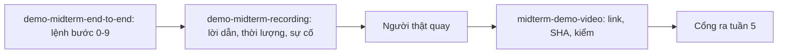

# DBS-140 · Quay và lưu video demo giữa kỳ (phần chuẩn bị của agent)

> **Status:** Implemented (phần chuẩn bị; video thật chưa quay, BL-390) · **Vai:** Dev · **Cặp đôi review:** Dev khác · **Nhánh:** `docs/DBS-140-video-demo-prep` · **PR:** #204 · **Cập nhật:** 2026-11-15

## 1. Bối cảnh

- **Task trên board:** Task, Tuần 5, Ưu tiên Highest, Deliverable/Demo «Giữa kỳ», status To Do. **Expect:** «Có bằng chứng demo toàn luồng cho giữa kỳ.» **Thực trạng:** «Chưa có video demo. Cần môi trường dựng được từ đầu (DBS-139) và kịch bản đã chạy thử (DBS-138). Cổng ra tuần 5 yêu cầu «video demo toàn luồng».»
- **DoD** (nguyên văn):
  1. Video 15–20 phút chạy trọn luồng theo kịch bản, có tiếng giải thích
  2. Link video lưu ở docs/deliverables (không đưa file nặng vào git)
  3. Cổng ra tuần 5 «video demo toàn luồng» đạt
- **Phụ thuộc:** DBS-138 (kịch bản giữa kỳ): đã merge (PR #197, `841d5ec`); DBS-139 (dựng môi trường từ đầu): đã merge (PR #152, DoD 1 chưa đạt trọn: BL-251, không chặn việc quay vì quay trên local).
- **Vì sao chỉ làm một phần:** quay video cần **người thật** (nói tiếng giải thích, ghi màn hình, xem lại video, tải lên chỗ chia sẻ). Agent không có micro, không ghi hình và không có tài khoản chia sẻ của nhóm. DoD 1, 2 (link thật) và 3 vì vậy **chưa đạt**; task này không bịa link hay kết quả.
- **Đã có gì:** [demo giữa kỳ](../demos/demo-midterm-end-to-end.md) (lệnh bước 0–9, đã chạy trọn local và cloud ngày 2026-11-14, [DBS-138 §8](DBS-138-midterm-demo-script.md)), phần «Kịch bản quay» ≈ 10 phút và «Checklist trước khi quay» trong đó; [demo-checklist](../runbooks/demo-checklist.md) (cloud). **Thiếu so với DoD:** kịch bản quay chỉ ≈ 10 phút (DoD 15–20), không có lời dẫn, không có chỗ lưu link, không có cách kiểm video sau khi quay.
- **Baseline** (loại việc: tài liệu, không đổi code, Terraform hay CI): `node .claude/skills/dbs-delivering-task/scripts/check-doc-links.mjs` trên `origin/main` `2301329`. Kịch bản bước 0–9 chạy lại trên commit này ở M-140-01.
- **Dòng BACKLOG liên quan:** BL-350 (script đăng ký khách trên cloud; chỉ ảnh hưởng nếu quay cloud), BL-351 (chưa có người chạy lại kịch bản bằng tay; việc quay chính là lần chạy đó) — **không xóa**, ghi thêm nguồn. BL-380 và BL-383 (video của DBS-185, DBS-184) là video khác, không thuộc task này.
- **Ngoài phạm vi:** quay, tải lên, báo cổng tuần 5 (người thật); DBS-141 và DBS-142 (sau khi có video); sửa code hay lệnh của kịch bản demo.
- **Câu hỏi mở và quyết định ở G1** (agent tự quyết, người dùng vắng):
  1. Làm tới đâu? Quyết: soạn **kịch bản quay 15–20 phút có lời dẫn**, **file chứa link và mẫu metadata** ở `docs/deliverables/`, checklist trước và sau khi quay; chạy thử toàn bộ bước 0–9 trên commit hiện tại. Không làm gì cần người thật.
  2. Quay local hay cloud? Quyết: **local** làm mặc định (ổn định, miễn phí); cloud là tùy chọn có hướng dẫn sẵn ở demo giữa kỳ.
  3. Tên file: `docs/demos/demo-midterm-recording.md` (kịch bản quay, thuộc thư mục demos) và `docs/deliverables/midterm-demo-video.md` (đúng nơi DoD 2 nêu).
  4. DoD chưa đạt (video thật, link, cổng tuần 5) ghi thành **BL-390** trong BACKLOG: vai Dev (người nhóm kèm người gõ lệnh), techlead báo cổng; điều kiện đóng: video 15–20 phút quay trên một commit đã ghi, link xem được ở `midterm-demo-video.md`, checklist đã tick, BL-351 và BL-228 cập nhật theo §4 của kịch bản quay.
  5. BL-380 và BL-383 (video của DBS-185, DBS-184) đang ghi «gộp với DBS-140»; hai việc đó cần **cloud** còn video giữa kỳ quay **local**, nên đổi cột chủ thành «một buổi quay cloud riêng» và không để chúng gộp vào task này (domain review #3).
  6. BL-351 (người nhóm chạy lại kịch bản trên đúng commit sẽ quay) và BL-228 (người thật bấm giờ tra `C`) sẽ được lần quay đáp ứng; không đóng ở PR này vì chưa có lần quay, kịch bản quay §4 ghi cách cập nhật.

## 2. Hành vi

Task không có API. Nó cung cấp **ba thứ có thể kiểm bằng cách đọc và chạy**:

| Thứ | Chấp nhận khi |
|---|---|
| Kịch bản quay `demo-midterm-recording.md` | Có 11 đoạn (mở màn, bước 0–9, kết) với mốc thời gian cộng đúng bằng tổng ghi ở đầu bảng (17,5 phút, **đã gồm thời gian gõ lệnh**); tổng nằm trong 15–20 phút; mỗi đoạn trỏ tới bước đã có trong demo giữa kỳ (không chép lệnh); có checklist trước, sau khi quay, thứ tự cắt khi vượt 20 phút và bảng sự cố |
| `midterm-demo-video.md` | Có ô link (đang ghi «chưa có»), ô commit, môi trường, thời lượng, người quay, checklist kiểm 7 dòng; ghi rõ trạng thái chưa quay |
| Ràng buộc «không đưa file nặng vào git» | `.gitignore` chặn `*.mp4`, `*.mov`, `*.mkv`, `*.webm` ở mọi thư mục (nếu chưa có), và không có file video nào trong repo |

Ca biên: video quá 20 phút hoặc dưới 15 phút → kịch bản nói cắt hoặc thêm chỗ nào (A, K, E; mỗi chỗ −0,5 phút); sai một lệnh giữa chừng → dừng, reset bước 0, quay lại từ đầu; **token hết hạn giữa chừng** (dev token sống 900 giây, sai lệch đồng hồ 5 giây: `dev-auth.ts`, `jwks-verifier.service.ts`) → token lấy ở đầu đoạn C (mốc 2:30) và lấy lại ngoài khung hình ở mốc 13:00, còn `401 TOKEN_EXPIRED` giữa chừng thì lấy lại bằng đúng lệnh cũ, không reset; mất `C` → tra `action=transfer`; lộ token → hủy bản quay và thu hồi.

## 3. Kiến trúc

- **Vị trí:** chỉ tài liệu. File mới: `docs/demos/demo-midterm-recording.md`, `docs/deliverables/midterm-demo-video.md`. Sửa: `docs/demos/demo-midterm-end-to-end.md` (mục «Kịch bản quay ≈ 10 phút» thay bằng con trỏ sang kịch bản mới để không còn hai kịch bản mâu thuẫn; «Giới hạn hiện tại»), `docs/deliverables/README.md` (một dòng), `docs/features/README.md`, `docs/BACKLOG.md` (thêm BL-390, đổi chủ BL-380 và BL-383), `.gitignore` (bốn mẫu video).
- **Interface:** không có code. Người gọi: không có symbol nào bị đổi.
- **Dữ liệu và transaction:** không áp dụng (dry-run chạy API thật bằng dữ liệu tạm trên container Postgres riêng, xóa sau khi xong).
- **Thay đổi cấp hệ thống:** không có (không đổi ADR, docs/03, hợp đồng).

## 4. Test cases tự động

Task tài liệu: kiểm bằng script có sẵn và lệnh shell, không có test mã.

| ID | Truy vết | Lớp | Given · When · Then |
|---|---|---|---|
| TC-140-01 | DoD 1 (15–20 phút) | tài liệu | Script node đọc bảng ở §2 của kịch bản quay, cộng cột «Phút» = tổng ghi ở đầu bảng, nằm trong [15, 20], và các mốc `mm:ss` liên tiếp khớp tổng cộng dồn |
| TC-140-02 | DoD 1 (trọn luồng) | tài liệu | Mỗi bước 1–9 của demo giữa kỳ xuất hiện đúng một lần ở cột «Lệnh ở» của kịch bản quay, và mọi anchor đó tồn tại trong `demo-midterm-end-to-end.md` |
| TC-140-03 | DoD 2, **chỉ phần «không đưa file nặng vào git» và có chỗ lưu link**; link thật **chưa đạt** (BL-390) | tĩnh | `midterm-demo-video.md` tồn tại và được `docs/deliverables/README.md` link tới; `git check-ignore` báo `*.mp4`, `*.mov`, `*.mkv`, `*.webm` bị bỏ qua; `git ls-files` không có file video nào |
| TC-140-04 | mọi DoD | tài liệu | `check-doc-links.mjs`: 0 liên kết hỏng |
| TC-140-05 | không lộ bí mật | tĩnh | grep trong hai file mới và `manual-test.txt` không thấy chuỗi dạng JWT (`eyJ`), access key AWS (`AKIA`), id tài khoản AWS 12 chữ số |
| quy trình | DoD 3 | — | Cổng ra tuần 5 do techlead xác nhận sau khi có video: **chưa đạt**, BL-390 |

## 5. Test thủ công

Điều kiện: Docker Desktop chạy; Node 24; cổng 5432 và 6379 có thể bị chiếm nên dùng container riêng (Postgres `55434`, Valkey `6381`); ElasticMQ nếu cần cho worker.

| Bước | Việc làm | Kết quả mong đợi |
|---|---|---|
| M-140-01 | Dựng Postgres 17, Valkey và ElasticMQ riêng (cổng 55434, 6381, 9324; **lệch so với doc**: doc dùng `docker compose` với cổng 55432/6380 và `down -v` ở bước 0; ở đây reset bằng cách xóa và tạo lại container, đặt `DATABASE_URL`, `REDIS_URL`, URL ElasticMQ tương ứng), build backend trên commit hiện tại, chạy **bước 0–9** theo lệnh trong doc, bấm giờ từng bước | Mọi bước ra kết quả mong đợi của doc: 201, cờ điểm 65 MEDIUM, khách không thấy cờ, 409 `FLAG_ALREADY_REVIEWED`, năm dòng audit `=C`, hai `403` và dòng `access.denied`. Thời gian **gõ lệnh** của agent ghi để đối chiếu (chỉ là cận dưới: người nói thêm lời dẫn) |
| M-140-02 | Ca biên (a): sau hơn 15 phút kể từ lúc lấy token, gọi lại một lệnh bước 8 bằng token cũ, rồi lấy token mới bằng đúng lệnh `tok` (cùng `RUN`, `--sub`) và gọi lại | token cũ: `401` `TOKEN_EXPIRED`; token mới: 200, dữ liệu cũ còn nguyên (không reset) |
| M-140-03 | Ca biên (b) và (c): chạy bước 4 lần nữa **không reset** với `RUN` mới (thêm một cờ), đọc cờ của giao dịch mới bằng `transferId`; rồi bỏ biến `C`, lấy lại bằng `GET /v1/audit/entries?action=transfer` | cờ cũ còn trong danh sách, cờ mới đọc đúng theo `transferId`; `correlationId` lấy lại bằng `action=transfer` khớp `C` cũ |
| M-140-04 | Kiểm các lệnh trong «Trước khi bấm quay»: `docker compose ps` (hoặc `docker ps` với container riêng), `npm run check:invariants` | chạy đúng như viết; không có lệnh nào trong checklist mà doc không nêu cách chạy |
| M-140-05 | Chạy TC-140-01..05 (script `tc140.mjs`, ở scratchpad; kết quả dán vào `manual-test.txt`) và `check-doc-links.mjs` | Xanh |
| M-140-06 | Dọn: dừng process node, xóa container tạm | `docker ps` không còn container của task |

Bước **không thể chạy** (ghi trước, không giả «đạt»): quay thật, nghe lại tiếng, đo thời lượng thực với lời dẫn (17,5 phút là ước lượng của bảng §2, chưa đo bằng người), tải lên và kiểm link, báo cổng tuần 5. Đây là BL-390.

## 6. Domain review (AI)

**Reviewer:** subagent mới (Agent tool, model opus, effort medium, read-only), 2026-11-15 · **Vòng 1:** 11 phát hiện (1 blocking, 7 should-fix, 3 minor), verdict REVISE · [trả lời nguyên văn](screenshots/DBS-140/domain-review.md)

| # | Mức | Phát hiện | Xử lý |
|---|---|---|---|
| 1 | blocking | Token dev sống 900 giây, bốn token lấy một lần ở mốc ~3:00 nên AN và AUD hết hạn trước bước 9 nếu quay chậm | đã sửa: kịch bản lấy token đầu đoạn C và lấy lại ngoài khung hình ở mốc 13:00; thêm dòng sự cố `401 TOKEN_EXPIRED`; thêm ca biên §2 và bước M-140-02 |
| 2 | should-fix | Thời lượng chưa rõ có gồm thời gian gõ lệnh; dư địa chỉ 1,5 phút | đã sửa: bảng ghi rõ «đã gồm thời gian gõ lệnh», tổng 17,5 phút (dư 2,5 phút), thứ tự cắt và thêm; chạy thử có đọc lời dẫn và bấm giờ ở §3 của kịch bản; §5 ghi 17,5 là ước lượng chưa đo bằng người |
| 3 | should-fix | BL-380 và BL-383 ghi «gộp với DBS-140» nhưng cần cloud | đã sửa: đổi cột chủ ở BACKLOG thành một buổi quay cloud riêng; ghi ở §1 quyết định 5 |
| 4 | should-fix | BL-390 chưa có nội dung; BL-351, BL-228 chưa nối với lần quay | đã sửa: nội dung BL-390 ở §1 quyết định 4 và trong BACKLOG; kịch bản quay §4.4 nói cách cập nhật BL-351, BL-228 |
| 5 | should-fix | Hai kịch bản quay mâu thuẫn trong demo giữa kỳ | đã sửa: mục «Kịch bản quay ≈ 10 phút» thay bằng con trỏ |
| 6 | should-fix | Manual test không chạy đúng lệnh doc (cổng, ElasticMQ), M-140-02 vô nghĩa, không có ca biên thật | đã sửa §5: ghi rõ lệch so với doc ở M-140-01; M-140-02 và M-140-03 là ca token hết hạn, chạy không reset, mất `C`; M-140-04 nêu lệnh cụ thể |
| 7 | should-fix | TC-140-02 không thể đạt vì bước 2 không có liên kết riêng | đã sửa: hàng C có hai liên kết (Bước 1 và Bước 2); script `tc140.mjs` đạt |
| 8 | should-fix | TC-140-03 dễ bị đọc là «DoD 2 đạt» | đã sửa §4: ghi chỉ phần «không file nặng, có chỗ lưu link»; link thật chưa đạt, BL-390 |
| 9 | minor | «Một terminal duy nhất» mâu thuẫn với process server | đã sửa: hai terminal, server ngoài vùng ghi hình |
| 10 | minor | Lời dẫn A chưa nói local dùng ElasticMQ và khóa dev; F thiếu «khác chủ»; liên kết docs/03 thiếu anchor | đã sửa: A nêu bản quay là local; F ghi «khác chủ»; liên kết docs/03 có anchor §4, §6.3, §6.5, §6.6 |
| 11 | minor | Danh sách đuôi video thiếu `.webm` | đã sửa kịch bản §4 |

**Vòng 2** (subagent mới, cùng cấu hình, đã sửa vòng 1): 6 phát hiện (0 blocking, 3 should-fix, 3 minor), verdict REVISE · [trả lời nguyên văn](screenshots/DBS-140/domain-review-round2.md). Vòng 1 mục 2, 4-11 xác nhận đã sửa; mục 1 và 3 sửa đúng ý nhưng còn một khe hở (xem 2.1).

| # | Mức | Phát hiện | Xử lý |
|---|---|---|---|
| 2.1 | should-fix | Lấy lại token «ở cửa sổ khác» không có tác dụng: biến `tok`, `RUN` và token nằm ở terminal ghi hình | đã sửa: lấy lại trong cùng terminal, ngay trong khung hình, gán vào biến, không in (kịch bản quay §1 quyết định 5, §2 đoạn I) |
| 2.2 | should-fix | Dừng ghi để lấy token mâu thuẫn với «một lần quay liền» | đã sửa theo phương án (b): không dừng ghi; dòng sự cố `TOKEN_EXPIRED` cũng không dừng ghi; checklist ở midterm-demo-video ghi «không dừng ghi hay cắt ghép» |
| 2.3 | should-fix | BL-390 và §6 nói đã chạy thử trong khi chưa có `manual-test.txt`; BL-390 trích §8 chưa có | sẽ đúng sau khi chạy M-140-01..06 và viết §8 (bằng chứng ở `screenshots/DBS-140/manual-test.txt`); G4 kiểm lại từng câu |
| 2.4 | minor | §3 liệt kê features/README nhưng chưa có hàng DBS-140 | đã thêm hàng DBS-140 |
| 2.5 | minor | Checklist video link tới demo giữa kỳ thay vì kịch bản quay | đã sửa: link cả hai |
| 2.6 | minor | demo-midterm-end-to-end nói «lệnh ở bước 1» cho việc lấy token | đã sửa: trỏ tới Bước 1–9 và nói cùng RUN, --sub |

**Quyết định ở G2** (agent tự quyết): không chạy vòng 3: vòng 2 không còn blocking, mọi sửa là văn bản và đã kiểm bằng lệnh (`tc140.mjs` 0 lỗi, `check-doc-links` 0 hỏng, grep không còn «ngoài khung hình»); phát hiện 2.3 được kiểm ở G4 bằng sự tồn tại của `manual-test.txt`.

## 7. Kế hoạch triển khai

Task tài liệu, không có code sản phẩm; «test viết trước» là kiểm TC-140-01..05 chạy đỏ rồi xanh.

| Bước | File | Test viết trước | Kết quả đỏ (khi chạy) | Lệnh chứng minh | Commit |
|---|---|---|---|---|---|
| 1 | `.gitignore` | TC-140-03 | `git check-ignore x.mp4` thoát 1 trước khi thêm mẫu | `git check-ignore -v x.mp4 x.mov x.mkv x.webm` | `chore(docs): chặn file video trong git (DBS-140)` |
| 2 | `docs/demos/demo-midterm-recording.md`, `docs/demos/demo-midterm-end-to-end.md` | TC-140-01, 02 | `tc140.mjs`: thiếu liên kết bước 2 (bản đầu của hàng C) | `node tc140.mjs` (0 lỗi) | `docs(demos): kịch bản quay video giữa kỳ 17,5 phút có lời dẫn (DBS-140)` |
| 3 | `docs/deliverables/midterm-demo-video.md`, `docs/deliverables/README.md` | TC-140-03, 04 | `check-doc-links`: liên kết tới file chưa tồn tại | `check-doc-links.mjs` (0 hỏng) | `docs(deliverables): tờ lưu link video demo giữa kỳ (DBS-140)` |
| 4 | M-140-01..06, `screenshots/DBS-140/manual-test.txt` | — | — | xem §5 | `docs(features): bằng chứng chạy thử kịch bản DBS-140` |
| 5 | feature doc §8-§9, `docs/features/README.md`, `docs/BACKLOG.md` (BL-390; BL-380, 383 đổi chủ) | TC-140-04 | — | `check-doc-links.mjs` | `docs(features): DBS-140 kết quả, bàn giao, BL-390` |

**Quét kế hoạch** (giới hạn trong doc và DoD): DoD 1 (video thật) chưa làm được → BL-390; DoD 2 (link thật) chưa làm được → BL-390, có tờ lưu link; DoD 3 → BL-390; «không đưa file nặng vào git» → bước 1; giới hạn «Chưa có lần quay» của demo giữa kỳ → sửa ở bước 2; BL-351 và BL-228 → ghi cách cập nhật sau khi quay (không đóng ở PR này); BL-380, BL-383 → đổi chủ ở bước 5.

Rủi ro và cách lùi: chỉ tài liệu, `git revert` PR là đủ; rủi ro duy nhất là kịch bản sai lệch so với lệnh thật sau khi code đổi, nên checklist yêu cầu chạy thử lại bước 0–9 trên đúng commit sẽ quay. **Quyết định ở G3** (agent tự quyết): ghép bước 1–3 thành các commit riêng như trên nhưng phần doc đã được soạn trước G3 (mô tả trong §1: bản nháp song song với thiết kế); không có code sản phẩm nên không vi phạm «không mã trước G3»; ghi ở đây để reviewer biết thứ tự thực tế.

## 8. Kết quả

- **Lệnh kiểm tra** (chạy lúc bàn giao, đầu ra thô ở [manual-test.txt](screenshots/DBS-140/manual-test.txt)): `check-doc-links.mjs` → `448 files checked, 0 broken link(s)`; `tc140.mjs` → 0 lỗi (TC-140-01, 02, 05); `git check-ignore -v x.mp4 x.mov x.mkv x.webm` → cả bốn bị `.gitignore` chặn; `git ls-files` không có file video. Không chạy bốn lệnh backend, `terraform` hay CI test vì không file nào của chúng đổi.
- **Đối chiếu test case:**

| ID | Kiểm | Đạt? |
|---|---|---|
| TC-140-01 | `tc140.mjs`: 11 đoạn, tổng 17,5 phút khớp tổng ghi, nằm trong [15, 20], mốc `mm:ss` khớp cộng dồn | đạt |
| TC-140-02 | `tc140.mjs`: mỗi bước 1–9 một liên kết, bước 0 có liên kết, mọi anchor tồn tại trong demo giữa kỳ | đạt |
| TC-140-03 | `midterm-demo-video.md` tồn tại và được `docs/deliverables/README.md` link; `.gitignore` chặn bốn đuôi video; không file video trong git | đạt cho phần «không file nặng, có chỗ lưu link»; **link thật chưa có (BL-390)** |
| TC-140-04 | `check-doc-links.mjs` 0 hỏng | đạt |
| TC-140-05 | không JWT, access key, id 12 số trong ba file mới và `manual-test.txt` | đạt (script kiểm ba file; `manual-test.txt` kiểm bằng `grep`, 0 kết quả) |
| quy trình DoD 3 | cổng ra tuần 5 | **chưa đạt** (BL-390) |

- **Test thủ công** (commit đang thử `2301329`, task không đổi code; stack riêng `dbs140`, một process `node dist/main` `APP_ROLE=both`):

| Bước | Kết quả |
|---|---|
| M-140-01 | **đạt**: bước 0 seed hai lần (lần hai «Reused», «skipped»), `check:invariants` PASS (9,0 giây); bước 1 201 hai khách (0,6 giây); bước 2 hai tài khoản (0,5 giây); bước 3 nạp 201 `COMPLETED` (0,3 giây); bước 4 `201 Created`, `C` là UUID (0,5 giây); bước 5 cờ `score 65`, `MEDIUM`, `OPEN`, `ruleSetVersion 1` (5,3 giây gồm `sleep 5`); bước 6 phản hồi khách không có trường về cờ (0,5 giây); bước 7 chi tiết cờ `hits` R3, review 200 `CONFIRMED_FRAUD`, lần hai 409 `FLAG_ALREADY_REVIEWED` (0,8 giây); bước 8 năm dòng audit đều `=C` (`fraud_flag.review`, `fraud_flag.view`, `fraud.flagged`, `notification.sent`, `transfer`), 302 ms (373 ms kể cả khởi động `curl`); bước 9 hai `403` và dòng `access.denied` `NO_PERMISSION` (0,8 giây). Tổng thời gian **gõ lệnh** của agent 9,6 giây: cận dưới của mỗi đoạn, thời lượng 17,5 phút của kịch bản gần như hoàn toàn là lời dẫn |
| M-140-02 | **đạt**: token có `iat`/`exp` quá khứ → `401 TOKEN_EXPIRED`; lấy lại bằng đúng lệnh `tok` → 200 và dữ liệu cũ còn (3 dòng audit theo `C1`, không reset) |
| M-140-03 | **đạt**: chạy lại bước 1–4 không reset với `RUN` mới → cờ thứ hai (score 65, MEDIUM, OPEN), cờ cũ vẫn còn, đọc cờ theo `transferId`; `GET /v1/audit/entries?action=transfer` trả dòng mới nhất mang đúng `C` của giao dịch vừa chạy và vẫn có dòng của `C1` |
| M-140-04 | **đạt**: `docker compose ps` (ba dịch vụ Up/healthy), `npm run check:invariants` PASS (`debit` = `credit`, `balance` 0), 0 dòng log mức error |
| M-140-05 | **đạt** (TC-140-01..05, `check-doc-links`) |
| M-140-06 | **đạt**: process node đã dừng, container `dbs140-*` và volume đã xóa |
| (không chạy được) | quay thật, nghe lại tiếng, đo thời lượng với lời dẫn, tải lên và kiểm link, báo cổng tuần 5: **chưa chạy**, BL-390 |

- **Lệch so với kế hoạch / ghi chú:** (1) lần chạy đầu của M-140-02..04 hỏng vì script thử dùng `/tmp` mà node trên Windows không thấy: lỗi của script thử, ghi nguyên trong `manual-test.txt`, chạy lại ở phần 2 trên cùng stack, không reset (đúng ca biên cần thử); (2) M-140-01 dùng `node dist/main` thay `npm run start:dev` (cùng một ứng dụng, không theo dõi file) và cổng riêng 55434/6381, ghi ở §5; (3) bản thảo kịch bản quay và tờ lưu link được viết **trước** khi qua G2 (cùng lúc với thiết kế), vì là tài liệu chứ không phải code: ghi ở §7. Vòng review 2 vẫn REVISE (không blocking), đã sửa, không chạy vòng 3 (xem §6).
- **Ảnh chụp:** không áp dụng (task tài liệu; bằng chứng là `manual-test.txt`).
- **Bàn giao:** **BL-390** (Dev, người quay: video thật, link, cổng tuần 5); BL-380 và BL-383 đổi chủ thành «một buổi quay cloud riêng»; BL-351 và BL-228 giữ nguyên, kịch bản quay §4.4 ghi cách cập nhật sau lần quay.
- **Phạm vi so với §7:** `git diff --stat origin/main...HEAD` khớp danh sách: `.gitignore`, `docs/BACKLOG.md`, `docs/deliverables/README.md`, `docs/deliverables/midterm-demo-video.md`, `docs/demos/demo-midterm-end-to-end.md`, `docs/demos/demo-midterm-recording.md`, `docs/features/DBS-140-…md`, `docs/features/README.md`, `docs/features/screenshots/DBS-140/*`.

## 9. Tài liệu đã cập nhật

`docs/demos/demo-midterm-recording.md` (mới), `docs/deliverables/midterm-demo-video.md` (mới), `docs/demos/demo-midterm-end-to-end.md` (thay mục «Kịch bản quay» bằng con trỏ, sửa «Giới hạn hiện tại» và câu lấy lại token), `docs/deliverables/README.md`, `docs/features/README.md`, `.gitignore`, `docs/BACKLOG.md` (thêm BL-390; BL-380, BL-383 đổi chủ; không xóa dòng nào).

## Checklist G4

- [x] 5/5 test case tự động đạt đủ độ sâu cho phần task làm được (TC-140-03 chỉ đạt phần «không file nặng, có chỗ lưu link»; DoD 2 và DoD 3 thật chưa đạt, BL-390)
- [x] Test thủ công chạy trên `2301329` (task không đổi code; SHA ở dòng đầu `manual-test.txt`), mọi bước M-140-01..06 đã chạy; phần quay thật «chưa chạy» nêu tên ở §8 và mô tả PR
- [x] Không có ảnh chụp (task tài liệu); `manual-test.txt` không có token, `Authorization`, id tài khoản AWS (grep 0 kết quả)
- [x] `git diff --stat` khớp §7 (xem §8)
- [x] Baseline của loại task (tài liệu): `check-doc-links.mjs` sạch
- [x] Doc có fact bị đổi đã sửa (demo giữa kỳ, README); `check-doc-links.mjs` 0 hỏng; trạng thái doc: Implemented sau G4
- [x] DoD chưa đạt đã ghi §8 và có BL-390; không có dòng BACKLOG task này xử lý xong để xóa
