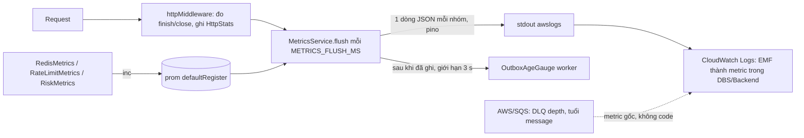

# DBS-144 · Metric SLI: độ trễ, lỗi, tuổi outbox, redis_fallback_total (xuất bằng CloudWatch EMF)

> **Status:** Implemented · **Vai:** Dev · **Cặp đôi review:** Dev khác (theo team.md) · **Nhánh:** `feat/DBS-144-sli-metrics` · **PR:** — · **Cập nhật:** 2026-11-09

## 1. Bối cảnh

- **Task trên board:** Task, Tuần 5, Demo P4, ưu tiên Medium. **Expect:** «Có số đo để vẽ dashboard và đặt alarm.»
- **DoD (chép nguyên văn):**
  1. Độ trễ p50/p95/p99 và tỉ lệ lỗi theo endpoint chính; độ sâu DLQ và tuổi message cũ nhất; redis_fallback_total; độ trễ từ giao dịch tới cờ
  2. Cách xuất (CloudWatch EMF hoặc metric từ log) thống nhất và ghi ở components/observability
  3. Không có nhãn chứa dữ liệu cá nhân (không id khách trong tên metric)
  4. PR đã merge vào main (CI xanh); Dev review; bảng «Đối chiếu test case» trong PR điền đủ
  5. Thêm metric: số quyết định theo ai_status (SUCCEEDED, UNAVAILABLE, REFUSED, INVALID_RESPONSE, BUDGET_EXHAUSTED, CONFIG_INVALID), độ trễ gọi AI, tỉ lệ fallback baseline, risk_rule_error_total{rule}; nhãn không chứa dữ liệu cá nhân
- **Phụ thuộc:** DBS-42 (log JSON) Done và có trong `main`. DBS-121 (service worker trên ECS) **To Do**: chỉ chặn việc xem gauge của worker trên CloudWatch thật. Service `api` và log group đã có trong Terraform nên EMF của api kiểm được trên cloud khi #5 dựng phiên (cần quyền AWS, xem «Chưa chạy» ở §8).
- **Đã có gì (đã đọc code):**
  - `prom-client` có trong `package.json`; các counter đăng ký vào `defaultRegister`: `redis_fallback_total` (`libs/redis/redis.metrics.ts`), `rate_limited_total{scope}` (`common/rate-limit/rate-limit.metrics.ts`), `risk_redis_fallback_total{rule,reason}` và `risk_config_redis_fallback_total` (`modules/risk/risk.metrics.ts`; **`RiskMetrics` chưa là provider của app nào**, hai counter này chỉ có khi consumer chấm điểm được nối), `risk_unsupported_mode_total` (`scoring.service.ts`). **Không có gì đọc `defaultRegister`**: không có `/metrics`, không có EMF (BL-152).
  - Không có metric HTTP nào; pino-http chỉ ghi dòng log.
  - `outbox_unpublished_idx (id) WHERE published_at IS NULL` (migration `1792627200000`); `dbs_worker` có `SELECT` trên `outbox_events` (`infra/scripts/db-roles.sql:78`); `dbs_api` chỉ `INSERT`, nên gauge chạy **chỉ ở role có worker**.
  - SQS tự phát `ApproximateNumberOfMessagesVisible` và `ApproximateAgeOfOldestMessage` (namespace `AWS/SQS`, dimension `QueueName`).
  - Có `modules/risk/ai/openai-decisions.ts` (`assess`) và `ScoringService` đặt `aiStatus`, nhưng **chưa nối vào app**: `RiskModule` là `@Module({})`, chỉ `scripts/fraud-ai-evaluate.ts` gọi `assess`; không có consumer `risk-events`, không có `fraud_flags` ghi từ code, RSK-01 (`risk_decisions`) To Do. Nên không có chỗ nào trong tiến trình đang chạy để đo ai_status hay độ trễ giao dịch → cờ.
- **Baseline (2026-11-09, main `488c3c0`):** `lint:check` sạch, `typecheck` sạch, `npm test` 1655 test / 89 suite đạt, `test:e2e` 153 test / 15 suite đạt (`DATABASE_URL` Postgres 17 tạm cổng 55433).
- **Phạm vi làm (cắt theo phụ thuộc chưa có):**

| DoD | Làm trong task này? |
|---|---|
| 1: p50/p95/p99 + tỉ lệ lỗi theo endpoint | **Có**: histogram thời gian theo `Route` (mẫu đường dẫn, không id) và `Method`, đếm 5xx và request bị ngắt |
| 1: redis_fallback_total | **Có**: xuất các counter prom-client trong allowlist (§3) |
| 1: tuổi outbox chưa gửi cũ nhất (SLO docs/03 §14) | **Có**: gauge của worker, tính tuổi trong SQL |
| 1: độ sâu DLQ, tuổi message cũ nhất | **Không viết code**: metric gốc `AWS/SQS`; alarm là việc của #5 (BL-051). Ghi ở components/observability |
| 1: độ trễ giao dịch → cờ; 5: ai_status, độ trễ AI, fallback baseline, `risk_rule_error_total` | **Chưa làm**: không có consumer/adapter chạy trong app (xem trên). Không viết metric cho code chưa nối. BL cho vai #4 trỏ tới `scripts/fraud-ai-evaluate.ts`, `scoring.service.ts:112-160` |
| 2, 3 | **Có** |
| 4 | quy trình |

- **Ngoài phạm vi:** dashboard (DBS-145), alarm (BL-051, BL-179), kiểm trên CloudWatch thật, metric đối soát `MISMATCH` (BL-127; `registerGauge` dùng được), tracing.
- **Quyết định ở G1 (agent tự quyết):**
  1. **EMF.** Task chạy ở Fargate với `awslogs`; EMF là một dòng JSON, CloudWatch tự tạo metric, **không cần IAM mới, sidecar hay cổng** (ADR-10). `/metrics` cần collector chưa có.
  2. **Không thêm thư viện** `aws-embedded-metrics`: định dạng là một object JSON nhỏ, viết tay có test kiểm từng giới hạn; thêm dependency là gate phụ và kéo theo agent. **Bám đúng đặc tả EMF đã đọc** (docs.aws.amazon.com, «Specification: Embedded metric format», 2026-11-09): mỗi metric ở gốc **chỉ là số hoặc mảng số ≤ 100 phần tử, không lồng object** (vòng review 2 bắt lỗi dùng `{Values,Counts,...}`); mảng > 100 phần tử làm CloudWatch bỏ cả dòng; `Timestamp` trong khoảng −14 ngày..+2 giờ; ≤ 100 metric mỗi dòng; mỗi bộ dimension tạo một metric riêng. Việc kiểm trên CloudWatch thật vẫn ghi thành BL (không có thông tin AWS trong phiên này).
  3. **Biến môi trường mới** (gate phụ): `METRICS_EMF` (tùy chọn; không đặt = bật khi `NODE_ENV` là `staging`/`production`, tắt ở development/test) và `METRICS_FLUSH_MS` (mặc định 60000, miền 1000..600000).
  4. **Gom theo bucket cố định** (1, 2, 5, 10, 20, 50, 100, 150, 200, 300, 500, 1000, 2000, 5000, 10000, 60000 ms) để bộ nhớ không đổi, rồi lúc flush **trải ra thành mảng số**: mỗi mẫu là biên trên của bucket, cắt thành các dòng ≤ 100 phần tử (mỗi dòng một metric `http_request_duration_ms` duy nhất, không kèm bộ đếm). Mỗi `(Route, Method)` tối đa 10 000 mẫu mỗi lượt flush; vượt thì chia tỉ lệ các bucket (giữ phân phối) và `http_requests_total` vẫn đếm đủ, nên **số request lấy từ `http_requests_total`, không từ SampleCount của độ trễ**. Các ngưỡng SLO 150 ms, 300 ms, 1 s nằm trên biên bucket. Mỗi mẫu gửi đi là **biên trên** của bucket; CloudWatch còn ước lượng phân vị nên giá trị đọc ra lệch biên vài phần trăm (đo thật ở M-144-09), đừng so đúng bằng biên.
  5. **Nhãn được phép:** `Route`, `Method`, `Role`, `Rule`, `Reason`, `Scope`. `Route` là mẫu; không khớp route nào là `unmatched`. `Method` thuộc `{GET, POST, PUT, PATCH, DELETE, HEAD, OPTIONS}` còn lại là `OTHER`. Giá trị nhãn chứa UUID, `@` hoặc dãy ≥ 6 chữ số bị thay bằng `redacted`.
  6. **Lỗi = 5xx.** 422 và 429 không tính (docs/03 §14). Request bị ngắt trước khi trả lời (ALB/khách đóng kết nối) đếm riêng `http_aborted_total` và **vẫn vào histogram** để p99 không thấp giả.
  7. **Ba bộ dimension** cho nhóm HTTP: `[Route, Method]`, `[Method]`, `[]` (cộng gộp cả dịch vụ cho SLO 5xx > 1%). Route `/health/*` chỉ có bộ `[Route, Method]` để probe 15 s của ALB không làm loãng tỉ lệ. Chi phí: mỗi bộ dimension là một metric riêng, với 4 metric HTTP × (≈ 20 cặp Route×Method + ≈ 5 bộ `[Method]` + 1 bộ `[]`) ≈ 105 metric tùy chỉnh, cộng khoảng 10 của counter; ≈ 35 USD mỗi tháng nếu để chạy cả tháng, tính theo giờ nên phiên ngắn rẻ hơn nhiều: ghi ở observability.
  8. **Ghi qua pino của ứng dụng** (`PinoLogger.logger.child({}, { level: 'info' })`), không mở writer thứ hai trên fd 1 (tránh cắt ngang dòng). Mỗi dòng EMF vì thế có thêm `level`, `time`, `role`: EMF cho phép trường thừa ở gốc. Test thay bằng sink tiêm vào.
  9. **Gauge có giới hạn riêng:** chạy bằng `TransactionService.run` với `statementTimeoutMs = 2000` (không bao phủ bước connect/BEGIN, và server bị `pause` thì không tự hủy được) cộng `Promise.race` 3 s; chỉ một lượt flush tại một thời điểm; **mỗi gauge tối đa một lần đọc đang chạy**: lần đọc trước chưa xong (kể cả sau khi race hết hạn) thì lượt này bỏ qua gauge đó và log `warn`, nên gauge giữ nhiều nhất một kết nối của pool; dòng HTTP và counter ghi **trước** khi chờ gauge.
  10. **Tuổi tính trong SQL** (`EXTRACT(EPOCH FROM clock_timestamp() - created_at)`) để không lệch đồng hồ ECS/RDS. Gauge phát 0 khi không có dòng chờ; nếu worker chết thì **không có dữ liệu**: alarm của #5 phải dùng `Maximum` và `TreatMissingData=breaching` (bàn giao §8).
  11. **Baseline của counter lấy lúc `onApplicationBootstrap`** (registry dùng chung cả tiến trình Jest); `Timestamp` = **đầu** khoảng đo; lượt flush cuối khi tắt chỉ ghi HTTP và counter (DataSource có thể đã đóng), bỏ gauge DB.
  12. **Allowlist counter:** `redis_fallback_total`, `rate_limited_total{scope}`, `risk_redis_fallback_total{rule,reason}`, `risk_config_redis_fallback_total`. `risk_unsupported_mode_total` không vào (không có nhãn nào cần, chưa dùng ở app).

## 2. Hành vi

| # | Điều kiện | Kết quả |
|---|---|---|
| H1 | `METRICS_EMF` tắt (mặc định development, test) | Không dòng EMF; `httpMiddleware()` đi thẳng `next()`; không timer |
| H2 | Bật, request kết thúc (`finish`) | Thời gian vào bucket của `(Route, Method)`; `status ≥ 500` cộng `http_5xx_total`; mọi request cộng `http_requests_total` |
| H3 | Kết nối đóng trước khi trả lời xong (`close` mà `writableFinished = false`) | Cộng `http_aborted_total` và `http_requests_total`, thời gian vào histogram; **không** cộng 5xx |
| H4 | Route chưa khớp (404 không handler, 429 của giới hạn IP chạy trước route, `OPTIONS` của CORS) | `Route = unmatched`. `HEAD` giữ `Method = HEAD` |
| H5 | Mỗi `METRICS_FLUSH_MS` | Mỗi `(Route, Method)` có dữ liệu → (a) một dòng bộ đếm `http_requests_total`, `http_5xx_total`, `http_aborted_total` (Count, mỗi cái một số); (b) các dòng độ trễ, mỗi dòng `http_request_duration_ms` là **mảng ≤ 100 số** (Milliseconds, biên trên bucket), tối đa 10 000 mẫu rồi chia tỉ lệ; `Timestamp` = đầu khoảng đo; rồi xóa bộ đếm |
| H6 | Mỗi flush | Mỗi counter prom-client trong allowlist có giá trị **tăng** so với lần trước (baseline lấy lúc bootstrap): một dòng EMF `<tên prom>` = số tăng, nhãn → dimension, thêm `Role`. Không tăng thì không dòng. Counter giảm (reset) coi như baseline mới |
| H7 | Mỗi flush ở role có worker | Sau khi ghi HTTP và counter: dòng `outbox_oldest_unpublished_age_seconds` (Seconds) = tuổi dòng `outbox_events` chưa gửi cũ nhất, **0 khi không có** |
| H8 | Gauge ném lỗi hoặc treo quá 3 s (DB chết/pause) | Log `warn` (không kèm lỗi thô) rồi bỏ qua gauge đó; HTTP/counter đã ghi; lượt kế tiếp vẫn chạy; không có hai lượt flush chồng nhau |
| H9 | Ghi lỗi | Nuốt lỗi; request không bao giờ bị ảnh hưởng |
| H10 | Tắt ứng dụng | Flush lần cuối (HTTP + counter, không gauge DB) rồi dừng timer; `unref`; sau đó gọi `logger.flush` của pino và chờ callback (best-effort) |

Ví dụ hai dòng (rút gọn, `Timestamp` là mili giây của đầu khoảng đo; test tính giá trị này chứ không chép):

```json
{"level":30,"time":"2026-11-09T11:01:00.012Z","role":"api","_aws":{"Timestamp":1794222000000,"CloudWatchMetrics":[{"Namespace":"DBS/Backend","Dimensions":[["Route","Method"],["Method"],[]],"Metrics":[{"Name":"http_requests_total","Unit":"Count"},{"Name":"http_5xx_total","Unit":"Count"},{"Name":"http_aborted_total","Unit":"Count"}]}]},"Route":"/v1/operator/deposits","Method":"POST","http_requests_total":10,"http_5xx_total":0,"http_aborted_total":0}
{"level":30,"time":"2026-11-09T11:01:00.013Z","role":"api","_aws":{"Timestamp":1794222000000,"CloudWatchMetrics":[{"Namespace":"DBS/Backend","Dimensions":[["Route","Method"],["Method"],[]],"Metrics":[{"Name":"http_request_duration_ms","Unit":"Milliseconds"}]}]},"Route":"/v1/operator/deposits","Method":"POST","http_request_duration_ms":[20,20,20,20,20,20,20,50,50,100]}
```

## 3. Kiến trúc

- **Vị trí:** `backend/src/common/metrics/` (mới), mọi role. Gauge outbox đăng ký từ `modules/outbox` (module sở hữu bảng; ESLint cấm `common` import `@modules`).
- **Interface cung cấp:**
  - `buildEmf(spec): EmfDocument` (thuần: kiểm giới hạn, làm sạch nhãn), `LatencyHistogram` (thuần), `HttpStats`.
  - `MetricsService` (`@Global` `MetricsModule`): `httpMiddleware(): RequestHandler`, `registerGauge({ name, unit, read })`, `flush(now?)`; `OnApplicationBootstrap` / `OnApplicationShutdown`; sink tiêm được (`EMF_SINK`), mặc định pino của ứng dụng.
  - `metricsConfig` (`@config/metrics.config.ts`): `{ enabled, flushMs }`.
  - `configureHttpApp(app, settings, requestLogger?, requestMetrics?)`: tham số mới, tùy chọn, sau `requestLogger`; middleware mount ngay sau `correlationIdMiddleware` (trước CORS). Người gọi (grep): các e2e gọi 2–3 tham số nên không đổi; **`main.ts` phải đổi** thành `configureHttpApp(app, config, createHttpLogging(...), app.get(MetricsService).httpMiddleware())`, nếu quên thì HTTP không được đo ở production. Chốt bằng `metrics-wiring.spec.ts` (đọc mã nguồn `main.ts`, theo mẫu `common/money/main-wiring.spec.ts`) và bước M-144-02.
  - `OutboxAgeGauge` (`modules/outbox`, trong `OutboxRelayModule`, nên chỉ ở role có worker): đọc bằng `TransactionService`.
- **Dữ liệu:** chỉ đọc `outbox_events`: `SELECT EXTRACT(EPOCH FROM clock_timestamp() - created_at) FROM outbox_events WHERE published_at IS NULL ORDER BY id LIMIT 1` (đi theo `outbox_unpublished_idx`). Không migration, không đổi quyền.
- **Ranh giới transaction:** gauge là truy vấn chỉ-đọc trong `TransactionService.run` riêng, `statementTimeoutMs = 2000`, không khóa; request path không chờ flush.
- **Allowlist:** counter `redis_fallback_total`, `rate_limited_total{scope}`, `risk_redis_fallback_total{rule,reason}`, `risk_config_redis_fallback_total`; nhãn `Route`, `Method`, `Role`, `Rule`, `Reason`, `Scope`.
- **Sơ đồ:**



- **Thay đổi cấp hệ thống:** docs/03 §14 (đoạn «Xuất metric»), `docs/components/observability/01-concept-brief.md` (cách xuất, danh sách, nhãn, DLQ gốc, chi phí, quy tắc alarm cho #5), `backend/env/.env.example`, README module outbox, `docs/BACKLOG.md`.

## 4. Test cases tự động

| ID | Truy vết | Lớp | Given · When · Then |
|---|---|---|---|
| TC-144-01 | DoD 1, 2 | unit `emf.spec.ts` | `buildEmf` cho `_aws.CloudWatchMetrics[0]` có `Namespace`, `Dimensions` (nhiều bộ, gồm `[]`), `Metrics[].Unit` hợp lệ, `Timestamp` mili giây trong −14 ngày..+2 giờ; **mọi metric ở gốc là số hoặc `number[]` ≤ 100, không object lồng**; NaN/vô hạn và > 100 phần tử bị từ chối; mọi tên trong `Metrics` có mặt ở gốc; ≤ 100 metric mỗi dòng; dimension chỉ là chuỗi ASCII in được, 1..1024 ký tự; mảng độ trễ dài hơn 100 được cắt thành nhiều dòng, tổng số mẫu giữ nguyên |
| TC-144-01b | G1.8 | unit | Một tài liệu EMF đi qua `pino(createLoggingOptions(...))` thật: phần `_aws` và mọi metric ra **giống hệt** (không bị redact/cắt); đổi danh sách redact làm test này đỏ |
| TC-144-02 | DoD 3 | unit | Giá trị nhãn chứa UUID, email, ≥ 6 chữ số → `redacted`; tên nhãn ngoài allowlist và tên metric sai bị từ chối; `Method` lạ/chữ thường → chuẩn hóa hoặc `OTHER` |
| TC-144-03 | DoD 1 | unit `latency-histogram.spec.ts` | Mẫu đúng 300 ms vào bucket 300, 301 ms vào 500, 70 000 ms vào bucket cuối; `expand()` ra mảng số đúng thứ tự, tổng = số mẫu; quá 10 000 mẫu thì chia tỉ lệ giữ phân phối (p95 không đổi); `drain` rồi rỗng |
| TC-144-04 | DoD 1 | unit `http-stats.spec.ts` | 200, 404, 422, 429 không cộng 5xx; 500 và 503 cộng; mọi request cộng `http_requests_total`; không route → `unmatched`; `HEAD` giữ `HEAD`; `OPTIONS` không route → `unmatched`; kết nối bị ngắt cộng `http_aborted_total` và vào histogram, không cộng 5xx |
| TC-144-05 | DoD 1, 3 | e2e `metrics.e2e-spec.ts` | App thật dựng bằng `configureHttpApp` kèm middleware: `GET /v1/accounts/<uuid>` hai lần với hai id → **một** dòng `Route=/v1/accounts/:id`; trong các dòng có `_aws` không UUID nào; đường dẫn lạ → `unmatched`; không token → route thật, 401 không là 5xx; `/health/live` chỉ có bộ dimension `[Route,Method]` |
| TC-144-05b | H3 | unit `http-metrics.middleware.spec.ts` | `res` giả: `finish` rồi `close` → đếm đúng một lần (cờ `recorded`); `close` với `writableFinished=false` → `http_aborted_total` + vào histogram, không 5xx; `close` rồi không `finish` → một lần |
| TC-144-05c | §3 | unit `metrics-wiring.spec.ts` | Mã nguồn `main.ts` gọi `configureHttpApp` với `MetricsService.httpMiddleware()`; thiếu thì đỏ |
| TC-144-06 | DoD 1 | unit `metrics.service.spec.ts` | `flush` xuất số **tăng** của bốn counter trong allowlist với nhãn đúng và `Role`; flush hai lần không đổi → không dòng; counter ngoài allowlist bị bỏ; counter đã có giá trị trước khi app khởi động không bị tính vào lượt đầu; counter giảm → baseline mới |
| TC-144-07 | DoD 1 | db `outbox-age-gauge.db-spec.ts` | PostgreSQL thật: trống → 0; một dòng chờ tạo cách đây 42 s → ≈ 42 (±2); dòng đã `published_at` không tính; hai dòng chờ → tuổi dòng cũ hơn; tuổi tính theo đồng hồ DB; với `SET LOCAL enable_seqscan = off`, EXPLAIN dùng `outbox_unpublished_idx` |
| TC-144-08 | DoD 2 | unit `metrics.config.spec.ts`, `validation.schema.spec.ts` | `METRICS_EMF` không đặt: bật khi `staging`/`production`, tắt khi `development`/`test`; đặt `false` ở `production` thì tắt; `METRICS_FLUSH_MS` mặc định 60000, 999 và 600001 bị từ chối |
| TC-144-09 | H1 | unit | Tắt: `httpMiddleware()` gọi `next()` và không ghi; `flush` không in; không timer sau bootstrap |
| TC-144-10 | H8, H9 | unit | Gauge ném lỗi: dòng HTTP/counter vẫn xuất, log `warn` không chứa nội dung lỗi; gauge **không bao giờ resolve** → flush xong sau ≤ 3 s, lượt kế vẫn ghi HTTP/counter nhưng **không gọi lại** gauge đó (tối đa một lần đọc đang chạy), có log `warn`; không có hai lượt flush chồng nhau; sink ném → `flush` không ném |
| TC-144-11 | H10, DoD 2 | unit | `onApplicationShutdown` flush phần còn lại (không gauge DB), gọi `flush` của logger rồi dừng; timer `unref`; `Timestamp` là đầu khoảng đo |
| TC-144-12 | DoD 1, 3 | services `metrics-chain.services-spec.ts` | App `both` thật + ElasticMQ + Postgres: nạp tiền bằng token operator, `flush()` → có dòng `POST /v1/operator/deposits` với `http_5xx_total=0` và dòng `outbox_oldest_unpublished_age_seconds`; trong các dòng có `_aws` không có UUID, `sub` hay token |
| TC-144-13 | DoD 4 | quy trình | PR, CI, Dev review |
| TC-144-14 | DoD 1 (DLQ) | tài liệu | components/observability nêu DLQ depth/tuổi message dùng `AWS/SQS`; quy tắc alarm cho #5; không có code |

## 5. Test thủ công

Điều kiện: Postgres tạm cổng 55433 (container `dbs63-fix-pg`, DB `banking_manual`), `docker compose up -d` (Valkey `dbs-valkey-1`, ElasticMQ `dbs-elasticmq-1`: **dùng chung với các phiên khác trên máy, dừng rồi bật lại ngay**), `backend/env/.env.development` với `AUTH_MODE=local`. Chạy bằng `npx cross-env METRICS_EMF=true METRICS_FLUSH_MS=5000 APP_ROLE=both npm run start` từ `backend/` (Git Bash hoặc PowerShell), output app vào file; token bằng `npm run --silent auth:dev-token -- --role operator --sub operator-hoang`.

| Bước | Việc làm | Kết quả mong đợi |
|---|---|---|
| M-144-01 | Khởi động, chưa gửi request | Mỗi 5 s một dòng `outbox_oldest_unpublished_age_seconds` = 0 |
| M-144-02 | Onboard khách, mở tài khoản, nạp tiền (operator), `GET /v1/accounts/{id}` hai lần | Dòng `POST /v1/operator/deposits`: `http_requests_total=1`; dòng `GET /v1/accounts/:id`: `=2`; `http_5xx_total=0` |
| M-144-03 | Gọi đường dẫn không tồn tại, `GET` không token, nạp tiền vào tài khoản đã khóa (422) | `unmatched`, 401 và 422 đều `http_5xx_total=0` |
| M-144-04 | `docker pause dbs63-fix-pg`, gọi `/health/ready` (503) và đợi 2 flush, `docker unpause dbs63-fix-pg` | `/health/ready` có `http_5xx_total ≥ 1`; trong lúc DB treo: log `warn` của gauge trong ≤ 3 s, dòng HTTP vẫn ra đúng nhịp; sau unpause gauge ra lại |
| M-144-05 | `docker stop dbs-valkey-1`, gửi vài request nạp tiền, `docker start dbs-valkey-1` | Dòng `redis_fallback_total` (và `rate_limited_total` nếu có) với số tăng > 0, dimension `Role` |
| M-144-06 | `docker stop dbs-elasticmq-1`, nạp tiền, đợi 2 flush, `docker start dbs-elasticmq-1` | `outbox_oldest_unpublished_age_seconds` > 5 và tăng dần; về 0 sau khi relay gửi hết |
| M-144-07 | Trên mọi dòng chứa `_aws`, tìm UUID, `eyJ`, tên khách | Không có |
| M-144-08 | Chạy lại với `METRICS_EMF=false` và vài request | Không dòng `_aws` nào |

## 6. Domain review (AI)

**Reviewer:** subagent, model opus (effort medium), 2026-11-09 · **Vòng 1:** 16 phát hiện (blocking 2, should-fix 7, minor 7), verdict REVISE · **Vòng 2** (reviewer mới, chạy lại trên các mục đã sửa): 8 phát hiện (blocking 1, should-fix 3, minor 4), verdict REVISE · cả hai vòng đã sửa hết trong §1–§5 (bảng dưới) · [trả lời nguyên văn cả hai vòng](screenshots/DBS-144/domain-review.md)

| # | Mức | Phát hiện | Xử lý |
|---|---|---|---|
| 1 (vòng 1) | blocking | EMF viết tay, chưa kiểm trên CloudWatch | **Vòng 1 sửa sai** (thêm `Count/Sum/Min/Max` vào object lồng); vòng 2 bắt được và tôi **đọc đặc tả AWS** (WebFetch 2026-11-09): target phải là số hoặc mảng số ≤ 100, không lồng object. Đã đổi sang mảng số ≤ 100 chia nhiều dòng (G1.2, G1.4, H5, ví dụ, TC-144-01/03). Việc gửi một dòng thật lên log group dev và đọc `get-metric-statistics` **không làm được** (`aws sts get-caller-identity` → NoCredentials; quy trình cấm chạm tài khoản thật khi chưa có người cho phép): ghi «chưa chạy» ở §8 và BL cho #5 (**sau đó đã kiểm xong, xem M-144-09 ở §8**). Không chặn merge: hình dạng nay đúng đặc tả văn bản, mọi thứ tắt được bằng `METRICS_EMF=false`, và rủi ro còn lại là «không ra metric», không phải sai dữ liệu hay sai tiền |
| 2 | blocking | Gauge không có timeout, flush treo khi DB chết | Đã sửa: G1.9, H8, TC-144-10 (gauge không bao giờ resolve), chạy trong `TransactionService.run` với `statementTimeoutMs=2000` + `Promise.race` 3 s, một lượt flush, HTTP/counter ghi trước gauge |
| 3 | should-fix | Thiếu bộ dimension gộp; `/health` làm loãng | Đã sửa: G1.7, ba bộ dimension, `/health/*` chỉ `[Route,Method]`, TC-144-05 |
| 4 | should-fix | `finish` bỏ sót request bị ngắt | Đã sửa: H3, `http_aborted_total`, TC-144-04/05 |
| 5 | should-fix | Hai writer trên fd 1 | Đã sửa: G1.8, ghi qua pino của app, sink tiêm được |
| 6 | should-fix | Tuổi tính bằng đồng hồ JS | Đã sửa: G1.10, §3 Dữ liệu, TC-144-07 |
| 7 | should-fix | EXPLAIN dùng index không ổn định | Đã sửa: TC-144-07 dùng `SET LOCAL enable_seqscan = off` |
| 8 | should-fix | «Không UUID» sai khi bật log request | Đã sửa: TC-144-05/12 chỉ xét dòng có `_aws`; M-144-07 |
| 9 | should-fix | Thiếu quy tắc alarm/chi phí bàn giao #5 | Đã sửa: G1.7, G1.10; bàn giao ở §8 (BL) và observability. Gồm `Maximum` + `TreatMissingData=breaching` cho tuổi outbox, `GreaterThanThreshold` cho phân vị, `notBreaching` cho DLQ (SQS ngừng phát khi queue rảnh 6 giờ), chi phí ≈ 70 metric |
| 10 | minor | Lý do sai về adapter AI | Đã sửa §1 «Đã có gì» và bảng phạm vi |
| 11 | minor | `RiskMetrics` chưa là provider; allowlist chưa nêu | Đã sửa §1, G1.12, §3 |
| 12 | minor | Baseline counter bắt đầu từ 0 | Đã sửa: G1.11, TC-144-06 |
| 13 | minor | Flush cuối sau khi DataSource đóng | Đã sửa: G1.11, H10, TC-144-11 |
| 14 | minor | `Timestamp` lệch một khoảng | Đã sửa: G1.11, H5, TC-144-11 |
| 15 | minor | HEAD/OPTIONS/method lạ | Đã sửa: G1.5, H4, TC-144-02/04 |
| 16 | minor | Kịch bản thủ công không chạy được ở PowerShell, tên container | Đã sửa: §5 dùng `npx cross-env`, nêu tên container và cảnh báo dùng chung |

Vòng 2:

| # | Mức | Phát hiện | Xử lý |
|---|---|---|---|
| 2.1 | blocking | Histogram là object lồng, trái đặc tả | Đã sửa (xem dòng «1 (vòng 1)»); TC-144-01 ép mọi metric là số hoặc `number[]` ≤ 100 |
| 2.2 | should-fix | `statement_timeout` không bao phủ connect/BEGIN; race hết hạn vẫn giữ kết nối; mỗi lượt lại mở gauge mới | Đã sửa: G1.9 mỗi gauge tối đa một lần đọc đang chạy, bỏ qua lượt sau, nêu rõ giới hạn của 2000 ms; TC-144-10 |
| 2.3 | should-fix | `main.ts` phải đổi, nếu không production không đo | Đã sửa: §3 nêu dòng phải đổi; TC-144-05c (`metrics-wiring.spec.ts`) + M-144-02 |
| 2.4 | should-fix | Chi phí còn thấp (4 metric, mỗi bộ dimension một metric) | Đã sửa: G1.7 ≈ 105 + 10 metric, ≈ 35 USD/tháng nếu chạy cả tháng; ghi ở observability khi Phase 5 |
| 2.5 | minor | Flush cuối khi SIGTERM có thể mất | Đã sửa: H10, TC-144-11 gọi `logger.flush` (best-effort) |
| 2.6 | minor | Không tái hiện được client ngắt trong e2e | Đã sửa: bỏ khỏi TC-144-05, thêm TC-144-05b ở mức unit với `res` giả và cờ `recorded` |
| 2.7 | minor | `Timestamp` ví dụ sai | Đã sửa ví dụ; test tính giá trị |
| 2.8 | minor | Sink tiêm bỏ qua cấu hình pino thật | Đã sửa: TC-144-01b chạy qua `pino(createLoggingOptions(...))` |

**Quyết định ở G2 (agent tự quyết):**
1. Chuyển sang đúng dạng mảng số của đặc tả, đánh đổi nhiều dòng log hơn (≤ 1 dòng mỗi 100 request mỗi route mỗi phút, có trần 10 000 mẫu) để lấy tính đúng đắn; bộ nhớ vẫn là bucket cố định.
2. Việc kiểm CloudWatch thật không chặn merge mà thành BL cho #5 (xem dòng 1 vòng 1), vì cách kiểm duy nhất cần tài khoản AWS và một phiên «Up» do người cho phép.
3. Giữ `/health/*` trong EMF để Ops thấy probe; chỉ bỏ khỏi các bộ dimension gộp.
4. Không chạy vòng 3: mọi phát hiện vòng 2 là sửa văn bản/thiết kế đã có chứng cứ trong đặc tả hoặc mã nguồn, không còn bất đồng cần phân xử; các test case mới có kiểm tự động (TC-144-01/01b/05b/05c/10) nên một lỗi sót sẽ đỏ ở Phase 4.

## 7. Kế hoạch triển khai

| Bước | File | Test viết trước | Kết quả đỏ (điền khi chạy) | Lệnh chứng minh | Commit |
|---|---|---|---|---|---|
| 1 | `config/metrics.config.ts` (mới), `config/validation.schema.ts`, `config/index.ts`, `config/config.module.ts`, `config/metrics.config.spec.ts`, `config/validation.schema.spec.ts`, `env/.env.example` | TC-144-08 | TS2307: Cannot find module `./metrics.config` (6 test chưa chạy được) | `npx jest src/config` | `feat(config): METRICS_EMF and METRICS_FLUSH_MS (DBS-144)` |
| 2 | `common/metrics/emf.ts`, `latency-histogram.ts`, `http-stats.ts` (+ `.spec.ts`) | TC-144-01, 01b, 02, 03, 04 | TS2307: Cannot find module `./emf`, `./latency-histogram`, `./http-stats` (3 suite đỏ) | `npx jest src/common/metrics` | `feat(metrics): EMF builder, latency histogram and HTTP stats (DBS-144)` |
| 3 | `common/metrics/http-metrics.middleware.ts`, `metrics.service.ts`, `metrics.module.ts`, `index.ts`, `app.module.ts` (+ specs) | TC-144-05b, 06, 09, 10, 11 | Spec viết trước khi có `metrics.service.ts`, `http-metrics.middleware.ts`; không chạy riêng lượt đỏ (module chưa tồn tại) | `npx jest src/common/metrics` | `feat(metrics): MetricsService flushes HTTP, counters and gauges as EMF (DBS-144)` |
| 4 | `app.setup.ts`, `main.ts`, `common/metrics/metrics-wiring.spec.ts`, `test/metrics.e2e-spec.ts` | TC-144-05, 05c | `metrics-wiring.spec` 2/2 đỏ (main.ts chưa có dòng); e2e «Test suite failed to run» (TS: `configureHttpApp` chưa nhận tham số thứ tư) | `npx jest src/common/metrics/metrics-wiring.spec.ts && npm run test:e2e -- metrics` | `feat(metrics): measure every HTTP request (DBS-144)` |
| 5 | `modules/outbox/outbox-age.gauge.ts`, `outbox-relay.module.ts`, `test/db/outbox-age-gauge.db-spec.ts` | TC-144-07 | TS2307: Cannot find module `@modules/outbox/outbox-age.gauge` | `DATABASE_URL= npm run test:db -- outbox-age-gauge` | `feat(outbox): oldest unpublished age gauge for the worker (DBS-144)` |
| 6 | `test/services/metrics-chain.services-spec.ts`, `.github/workflows/ci.yml` | TC-144-12 | Không có lượt đỏ riêng (test tích hợp của các phần đã có); lần chạy đầu sai kỳ vọng `published: 2` (thực tế 1), đã sửa test | `npm run test:services -- metrics-chain` | `test(metrics): API and worker emit EMF end to end (DBS-144)` |
| 7 | docs: `components/observability/01-concept-brief.md`, `docs/03` §14, `modules/outbox/README.md`, `docs/BACKLOG.md`, `docs/features/README.md`, §8–§9 của doc này, `screenshots/DBS-144/manual-test.txt` | M-144-01..08; TC-144-14 | — | `node .claude/skills/dbs-delivering-task/scripts/check-doc-links.mjs` | `docs(metrics): EMF export, SLI list and hand-offs (DBS-144)` |

**Quét kế hoạch (plan sweep):** DoD 1 → bước 2–6 (HTTP, counter, outbox) + TC-144-14 (DLQ gốc AWS) + BL (giao dịch→cờ); DoD 2 → bước 1, 7; DoD 3 → TC-144-02, 05, 12 và allowlist; DoD 5 → BL cho #4. Giới hạn trong tài liệu: BL-152 (nối counter Redis) → bước 3; BL-179/BL-051 (alarm) → bàn giao #5; BL-127 → ghi `registerGauge` dùng được. Mọi mục có dòng kế hoạch hoặc dòng «ngoài phạm vi».

**Rủi ro và cách lùi:** (1) EMF sai hình dạng trên CloudWatch → chỉ mất metric; tắt bằng `METRICS_EMF=false` hoặc revert PR, không đổi dữ liệu. (2) Chi phí log: ≤ 1 dòng/100 request/route/phút. (3) Overhead mỗi request: một `hrtime` và một phép tăng map; tắt thì đi thẳng `next()`. (4) Gauge giữ kết nối pool: tối đa một, `statement_timeout` 2 s; tắt bằng `METRICS_EMF=false`. (5) Đổi `main.ts`/`app.setup.ts` ảnh hưởng mọi request: e2e hiện có (153) phải xanh sau bước 4.

**Quyết định ở G3 (agent tự quyết):** (1) `metrics.service.ts` nhận `PinoLogger` và token `EMF_SINK` tùy chọn để test tiêm sink; (2) thêm bước CI riêng cho `metrics-chain.services-spec` theo quy ước mỗi services-spec một bước; (3) gauge outbox đặt trong `OutboxRelayModule` (chỉ role có worker), không ở `OutboxModule` (api không có `SELECT` trên `outbox_events`).

## 8. Kết quả

- **Lệnh kiểm tra** (2026-11-09, trên nhánh, sau commit `c3dff10`; `DATABASE_URL` Postgres 17 tạm cổng 55433 cho e2e/services, bỏ đặt cho `test:db`):
  - `npm run lint:check` sạch; `npm run typecheck` sạch.
  - `npm test`: **1733 test / 97 suite đạt** (baseline 1655 / 89).
  - `npm run test:e2e`: **157 test / 16 suite đạt** (baseline 153 / 15; thêm `metrics.e2e-spec.ts`).
  - `npm run test:db -- --maxWorkers=2`: **812 test / 54 suite đạt**.
  - `test:services`, mỗi spec riêng như CI: 14 spec đạt, gồm `metrics-chain.services-spec.ts` 2/2 và mọi spec dùng consumer/relay (`outbox-relay`, `outbox-relay-faults`, `correlation-chain`, `consumer-base`, `notification-consumer-review`).
  - Không có `.skip`, `.only`, `.todo` trong test của task (đã đếm bằng grep trên các file mới).
- **Đối chiếu test case:**

| ID | Test | Đạt? |
|---|---|---|
| TC-144-01 | `common/metrics/emf.spec.ts` › buildEmf, splitSamples | đạt |
| TC-144-01b | `common/metrics/emf-logging.spec.ts` | đạt |
| TC-144-02 | `emf.spec.ts` › sanitizeDimensionValue, normalizeMethod, dimension ngoài allowlist | đạt |
| TC-144-03 | `latency-histogram.spec.ts` | đạt |
| TC-144-04 | `http-stats.spec.ts`, `metrics.service.spec.ts` › HTTP lines | đạt |
| TC-144-05 | `test/metrics.e2e-spec.ts` (4 test, AppModule thật) | đạt |
| TC-144-05b | `http-metrics.middleware.spec.ts` | đạt |
| TC-144-05c | `metrics-wiring.spec.ts` | đạt |
| TC-144-06 | `metrics.service.spec.ts` › counters, roles | đạt |
| TC-144-07 | `test/db/outbox-age-gauge.db-spec.ts` (6 test, PostgreSQL thật) | đạt |
| TC-144-08 | `config/metrics.config.spec.ts` (miền `METRICS_FLUSH_MS` kiểm qua `validateEnv` trong chính spec này, không thêm vào `validation.schema.spec.ts`) | đạt |
| TC-144-09 | `metrics.service.spec.ts` › switched off | đạt |
| TC-144-10 | `metrics.service.spec.ts` › gauges, output | đạt |
| TC-144-11 | `metrics.service.spec.ts` › lifecycle | đạt |
| TC-144-12 | `test/services/metrics-chain.services-spec.ts` | **đơn giản hóa**: dùng app của `startDepositApp` (controller, guard và middleware thật, PostgreSQL và ElasticMQ thật, relay dựng tay) chứ không phải `AppModule` đầy đủ; `AppModule` thật được phủ ở TC-144-05 và bước M-144-01..08 |
| TC-144-13 | PR, CI, Dev review | quy trình, chờ PR |
| TC-144-14 | `docs/components/observability/01-concept-brief.md` mục «Xuất metric» | đạt |

- **Test thủ công** trên commit `c3dff10` (output thô: [manual-test.txt](screenshots/DBS-144/manual-test.txt)):

| Bước | Kết quả |
|---|---|
| M-144-01 | **đạt**: hai dòng cách 5 s, `outbox_oldest_unpublished_age_seconds = 0` |
| M-144-02 | **đạt**: `POST /v1/operator/deposits` 1 request, `GET /v1/accounts/:id` 2 request dưới một mẫu, `http_5xx_total = 0`, không id trong nhãn |
| M-144-03 | **đạt**: `unmatched` cho đường dẫn lạ, 401 và 422 không là 5xx |
| M-144-04 | **đạt**: `/health/ready` 503 → `http_5xx_total = 1` (chỉ bộ `[Route,Method]`); gauge hết hạn sau 3 s, lượt sau bỏ qua (`still reading`), sau `unpause` ra lại; hai cảnh báo không kèm nội dung lỗi |
| M-144-05 | **đạt**: Valkey dừng, 3 lần nạp tiền đều 201, `redis_fallback_total = 3` với `Role=both` |
| M-144-06 | **đạt**: ElasticMQ dừng, tuổi outbox 2,7 → 7,7 → 12,8 → 17,8 giây, về 0 sau khi relay gửi |
| M-144-07 | **đạt**: 55 dòng EMF, 0 dòng có UUID, token hoặc tên người dùng; chỉ các giá trị dimension hợp lệ |
| M-144-08 | **đạt**: `METRICS_EMF=false`, 3 request, 0 dòng EMF |
| M-144-09 | **đạt** (sau merge): metric thật trên CloudWatch, xem dưới |

  **M-144-09 (sau merge PR #119, 2026-11-09): đạt.** Hai dòng EMF do chính mã của task sinh ra được gửi vào `/dbs/dev/api` bằng `aws logs put-log-events` (profile `dbs`, user `dev1`), rồi đọc lại bằng `get-metric-statistics`: SampleCount/Sum/Min/Max của độ trễ = 20/3600/20/1000 đúng từ 20 mẫu, requests = 20, 5xx = 1, ba bộ dimension ra đủ 12 metric, không có metric lỗi EMF trong `AWS/Logs`. **Phát hiện:** CloudWatch tính p50/p95/p99 là ước lượng (21,1/977,5/995,5 cho giá trị thật 20/1000/1000), nên «ngưỡng chính xác với `GreaterThanThreshold`» ở G1.4 chỉ đúng theo nghĩa «không thấp hơn biên bucket» chứ không đúng từng con số; đã sửa quy tắc alarm ở observability. Log stream tạm đã xóa. **Chưa chạy:** gauge của worker trên ECS (cần DBS-121).
- **Ảnh chụp:** không có (chỉ có output terminal); output thô nằm ở `manual-test.txt`. Thiếu ảnh được nêu ở G4 và mô tả PR.
- **Phạm vi so với §7** (`git diff --stat origin/main...HEAD`: 39 file, +2621/−9). File ngoài danh sách §7, mỗi file một quyết định gate phụ (agent tự quyết, ghi sau khi làm vì là hệ quả của thiết kế):
  - `modules/outbox/outbox-cleanup.service.spec.ts`: test DI dựng `OutboxRelayModule` nên phải có `MetricsService` giả (global stub), vì module giờ đăng ký gauge. Một commit (`66a25f6`) đã vào nhánh khi 4 test outbox này đỏ do tôi nối bằng `;`; sửa ở `ee9ad8b` trước khi push, bộ test đầy đủ chạy sau đó.
  - `test/support/deposit-app.ts`: thêm tùy chọn `metrics` (middleware) để services-spec đo đúng như `main.ts`.
  - `common/metrics/emf-logging.spec.ts`, `http-metrics.middleware.spec.ts`: có trong §4 (TC-144-01b, 05b) nhưng bảng §7 gộp vào bước 2–3.
  - `modules/outbox/index.ts` không đổi (tôi đã hoàn lại việc export gauge vì `outbox.module.spec` ghim API công khai nhỏ).
- **Lệch so với kế hoạch / quyết định gate phụ:** (1) thiết kế histogram đổi từ object `{Values,Counts,...}` sang mảng số ≤ 100 chia nhiều dòng sau khi vòng review 2 và đặc tả AWS cho thấy object lồng không hợp lệ (§1 G1.2, §6); (2) đã làm ở Phase 2, trước khi code. Không đổi ADR, hợp đồng event, `ErrorCode`, schema DB, quyền DB, money rule; hai biến môi trường mới đã quyết ở G1.
- **DoD so với kết quả:**

| DoD | Kết quả |
|---|---|
| 1 | **Một phần.** Có: độ trễ (p50/p95/p99 tính ở CloudWatch) và tỉ lệ 5xx theo route, `redis_fallback_total`, tuổi outbox chưa gửi; DLQ và tuổi message dùng metric gốc `AWS/SQS` (ghi ở observability, alarm là việc #5, BL-051/203). **Chưa có:** thời gian giao dịch → cờ (BL-204) |
| 2 | Đạt: EMF, ghi ở `components/observability` |
| 3 | Đạt: allowlist nhãn, `redacted`, test TC-144-02/05/12 và M-144-07 |
| 4 | Quy trình: PR mở sau G4, chờ CI và Dev review |
| 5 | **Chưa làm** (BL-204): chưa có consumer chấm điểm hay adapter AI chạy trong app |

- **Bàn giao cho vai khác (đã có dòng `docs/BACKLOG.md`):**
  - **BL-203 đã xóa** sau khi kiểm xong trên CloudWatch (M-144-09). Phần alarm và dashboard (quy tắc `Maximum`/`breaching`/`GreaterThanThreshold`/`notBreaching`, chi phí ≈ 115 metric) nằm ở observability và được BL-051, BL-179 và DBS-145 trỏ tới; metric của worker xem sau DBS-121.
  - **BL-204** (#4): metric thời gian giao dịch → cờ, `ai_status`, độ trễ AI, fallback baseline, `risk_rule_error_total`; `RiskMetrics` chưa là provider; cần API mẫu phân phối ở `MetricsService`.
  - Cập nhật tại chỗ: BL-127 (`registerGauge` dùng được cho metric đối soát), BL-152 (counter Redis đã xuất bằng EMF; còn dashboard và kiểm `opossum`), BL-179 (metric đã có, còn cảnh báo).

## 9. Tài liệu đã cập nhật

`docs/components/observability/01-concept-brief.md` (mục «Xuất metric»: cách xuất, biến, danh sách metric, nhãn, DLQ gốc, quy tắc alarm, chi phí), `docs/03_HIGH_LEVEL_ARCHITECTURE.md` §14 (đoạn «Xuất metric»), `backend/src/modules/outbox/README.md` (gauge tuổi outbox), `backend/env/.env.example` (`METRICS_FLUSH_MS`, `METRICS_EMF` ghi chú), `docs/features/README.md` (dòng DBS-144), `docs/BACKLOG.md` (thêm BL-204; sửa BL-051, BL-127, BL-152, BL-179; **xóa BL-203** ở PR sau merge, vì đã kiểm xong trên CloudWatch). `check-doc-links.mjs`: 323 file, 0 liên kết hỏng.
