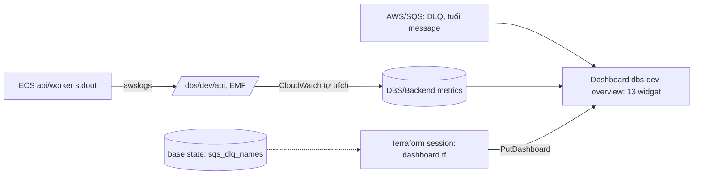
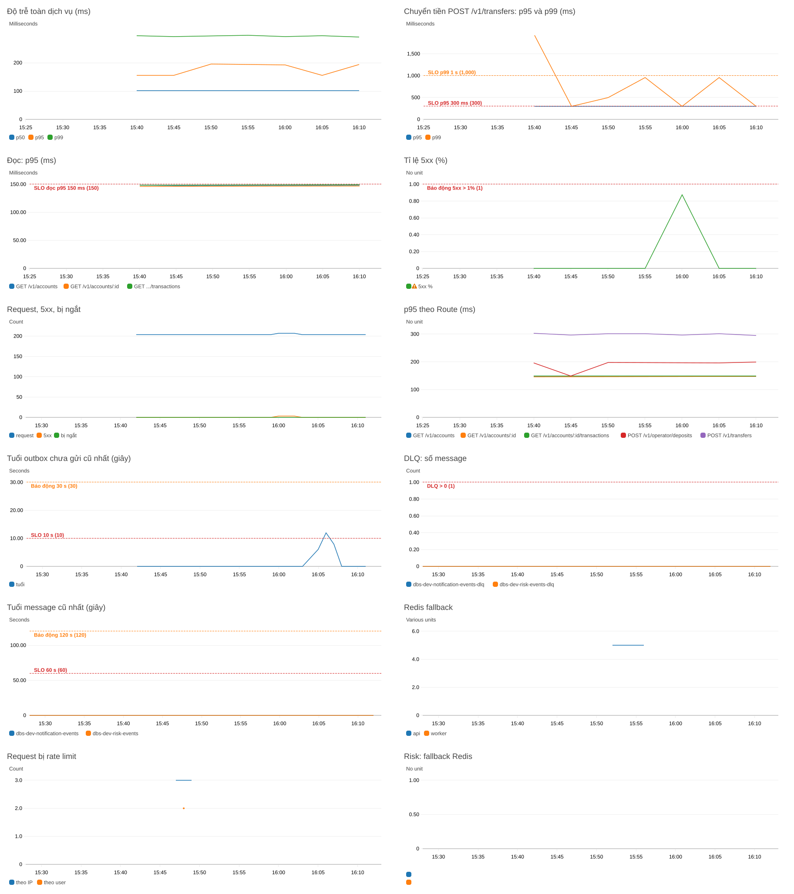

# DBS-145 · Dashboard CloudWatch bản đầu (Terraform)

> **Status:** Implemented · **Vai:** #5 Platform & Ops · **Cặp đôi review:** Dev khác (theo team.md) · **Nhánh:** `infra/DBS-145-cloudwatch-dashboard` (cắt từ `origin/main` `17b011e`; không phụ thuộc PR chưa merge) · **PR:** — · **Cập nhật:** 2026-11-12

## 1. Bối cảnh

- **Task trên board:** Task, Tuần 5, Demo P4, ưu tiên Medium, vai #5 (chuyển từ #6 ngày 12/10). **Expect:** «Nhìn được sức khỏe hệ thống khi demo.»
- **DoD (chép nguyên văn):**
  1. Dashboard hiển thị các metric của DBS-144, tạo bằng Terraform
  2. Ảnh chụp lúc có tải nhẹ lưu cạnh tài liệu observability
  3. PR đã merge vào main (CI xanh); Dev review; bảng «Đối chiếu test case» trong PR điền đủ
- **Phụ thuộc:** DBS-144 **Done và có trong `main`** (PR #119, #120; `backend/src/common/metrics/`, [DBS-144](DBS-144-sli-metrics-emf.md)). DBS-121 (service `worker` trên ECS, PR #149 chưa merge) **không chặn việc dựng dashboard**: chỉ chặn việc thấy dòng thật của `outbox_oldest_unpublished_age_seconds` và counter của worker; bảng đó trống cho tới khi có worker (xem Quyết định 6).
- **Đã có gì (đã chạy/đọc):**
  - Terraform: không có `aws_cloudwatch_dashboard` nào (`grep`), `aws cloudwatch list-dashboards` rỗng. `envs/dev/base` giữ log group `/dbs/dev/api`, queue SQS và DLQ (`sqs_dlq_names` có trong output đã apply); `envs/dev/session` là phần dựng/xóa theo phiên (state key `dev/session.tfstate`, đang rỗng).
  - Metric: namespace `DBS/Backend`; `http_request_duration_ms` (mảng mẫu, dimension `[Route,Method]`, `[Method]`, `[]`), `http_requests_total`, `http_5xx_total`, `http_aborted_total` (cùng ba bộ), `redis_fallback_total` (`[Role]`), `rate_limited_total` (`[Role,Scope]`), `risk_config_redis_fallback_total` (`[Role]`), `outbox_oldest_unpublished_age_seconds` (`[]`, đơn vị Seconds). `AWS/SQS` (`QueueName`): `ApproximateNumberOfMessagesVisible`, `ApproximateAgeOfOldestMessage`. Quy tắc đọc/alarm đã chốt ở [observability](../components/observability/01-concept-brief.md#xuất-metric-dbs-144).
  - SLO: docs/03 §14 (đọc p95 < 150 ms, chuyển tiền p95 < 300 ms / p99 < 1 s, 5xx > 1%, tuổi outbox < 10 s alarm 30 s, DLQ = 0, tuổi message < 60 s alarm 120 s).
  - **Chưa có** (không dựng): thời gian giao dịch → cờ, `ai_status`, độ trễ AI, `risk_rule_error_total` (BL-204: metric chưa tồn tại).
- **Baseline (2026-11-12, `origin/main` `17b011e`):** loại task hạ tầng: `terraform init -backend=false`, `terraform fmt -list=true -write=false` (không file nào lệch), `terraform validate` (hợp lệ), `terraform test -parallelism=1` ở `envs/dev/session`: **24 đạt, 0 lỗi**. Backend không đổi nên không chạy lại bốn lệnh jest.
- **Ngoài phạm vi:** alarm và SNS (BL-051, BL-179, BL-182, BL-161: việc kế của #5; task này chỉ vẽ ngưỡng thành đường kẻ), widget ALB/ECS/RDS/Valkey (hạ tầng, chưa có service worker; BL mới), metric đối soát (BL-127), metric chấm điểm/AI (BL-204), chạy tải thật (DBS-166), dashboard prod.
- **Quyết định ở G1 (agent tự quyết, người dùng vắng):**
  1. **Đặt ở `envs/dev/session`**, không ở `base`: DoD nói xóa/dựng cùng môi trường dev; dashboard sống và chết với phiên, base không đổi. Dashboard không tham chiếu tài nguyên nào của session (chỉ tên queue từ remote state của base) nên `-target` dựng/xóa riêng được mà không kéo ALB/RDS.
  2. **Một dashboard `dbs-dev-overview`**, 13 widget (1 văn bản + 12 metric), Terraform sinh JSON bằng `jsonencode` từ `locals` (không file JSON dài chép tay), khóa vùng bằng `var.region`.
  3. **Dùng đúng bộ dimension DBS-144 đã phát**; số liệu tổng (không theo Route) dùng bộ `[]` để `/health/*` không làm loãng. Có một widget p95 theo Route bằng `SEARCH` (dimension `Route` là mẫu đường dẫn nên không phát sinh nhãn cá nhân).
  4. **Ngưỡng SLO vẽ thành đường kẻ ngang** (`annotations.horizontal`); đây không phải alarm.
  5. **Không thêm biến môi trường, quyền IAM hay dependency**; không đổi schema, event, ErrorCode, tiền. `aws_cloudwatch_dashboard` không có tag (provider không hỗ trợ), chi phí kiểm soát bằng việc xóa cùng phiên; dashboard đầu tiên-thứ ba trong tài khoản miễn phí, từ dashboard thứ tư ≈ 3 USD/tháng tính theo thời gian tồn tại; vì widget `SEARCH` có thể vượt 50 metric nên coi như tính tiền ngay (M-145-04 ghi số metric thật).
  6. **Widget worker và risk để trống khi chưa có dữ liệu** thay vì ẩn đi, kèm ghi chú trong widget văn bản: demo thấy ngay chỗ nào chưa có nguồn. Trạng thái thật (review #6): `risk_config_redis_fallback_total` đã được worker phát (RiskWorkerModule) nên có số khi service worker chạy (DBS-121); `risk_redis_fallback_total` không còn (BL-204 bỏ: đọc feature là SQL, không có chỗ tăng) nên widget chỉ vẽ `risk_config_redis_fallback_total`.
  7. **Manual test cô lập khỏi tài khoản dùng chung** (review #2, #4): (a) state key riêng `dev/session-dbs145.tfstate` và `TF_DATA_DIR` riêng, nên `.terraform` của worktree và `dev/session.tfstate` (agent DBS-139) không bị chạm; (b) biến `metrics_namespace` (mặc định `DBS/Backend`, ứng dụng ghi đúng namespace này; chỉ đổi khi thử dashboard) để tải mô phỏng đi vào namespace `DBS/Backend-dbs145`, **không trộn số giả vào metric thật** và không chạm alarm sau này; namespace thật đã được DBS-144 kiểm bằng dữ liệu thật. Object state rỗng còn trong bucket được liệt kê ở M-145-09.
  8. **Đường SLO chỉ vẽ trên route đúng SLI** (review #5): chuyển tiền = `POST /v1/transfers` (p95 300 ms, p99 1 s), đọc (số dư, lịch sử) = `GET /v1/accounts` (danh sách kèm số dư), `GET /v1/accounts/:id` và `GET /v1/accounts/:id/transactions` (p95 150 ms), cửa sổ 5 phút (`period` 300) như docs/03 §14. Widget toàn dịch vụ và theo Method là tổng quan, không có đường SLO.
  9. **`SEARCH` viết đúng cú pháp** (review vòng 4 #1): namespace luôn đặt trong dấu nháy kép, `{"${var.metrics_namespace}",Method,Route} MetricName="..."`, vì tên có `-`, `/` hoặc `#` mà không nháy sẽ bị tách từ và không ra dữ liệu; tftest (TC-145-03, 04b, 04c) kiểm chuỗi có nháy, và M-145-06 kiểm widget `SEARCH` ra chuỗi thời gian thật.
  10. **Chỉ vẽ `Role` `api` và `worker`** (review #2 vòng 4): `Role=both` chỉ có khi chạy một tiến trình ở local, ECS dùng `api` và `worker`; nói rõ trong widget văn bản.
  11. **`periodOverride = "inherit"`** cạnh `start = "-PT3H"` trong body (review vòng 5 #1): mặc định console là `auto` và tự tính lại `period` theo khoảng thời gian, làm đường SLO nằm trên cửa sổ khác 5 phút; TC-145-01 kiểm, M-145-06 kiểm `get-dashboard`.
  12. **CI:** repo chưa có job Terraform (BL-028 đã có): tftest chạy tay, output dán vào PR; không thêm job ở task này.

## 2. Hành vi

| # | Điều kiện | Kết quả |
|---|---|---|
| H1 | `terraform apply` ở `envs/dev/session` | Tạo `aws_cloudwatch_dashboard.overview` tên `dbs-dev-overview`; output `dashboard_name` và `dashboard_url` (đường dẫn console) |
| H2 | `destroy` session (hoặc `-target` dashboard) | Dashboard biến mất; dựng lại ra đúng nội dung cũ (không phụ thuộc trạng thái) |
| H3 | Mọi widget metric thuộc namespace `var.metrics_namespace` (mặc định `DBS/Backend`; kiểm định: bắt đầu bằng `DBS/`, ký tự `A-Za-z0-9_./#:-`) hoặc `AWS/SQS`; tên dimension chỉ thuộc `Route Method Role Rule Reason Scope QueueName` | Không có id khách/tài khoản/token trong dashboard (DBS-144 DoD 3) |
| H4 | Hàng 1 | Văn bản: mục đích, cách đọc (phân vị là ước lượng quanh biên bucket; lỗi = 5xx; thống kê tuổi outbox là `Maximum`), danh sách metric chưa có (BL-204) |
| H5 | Hàng 2 | «Độ trễ toàn dịch vụ p50/p95/p99» (bộ `[]`, tổng quan, không đường SLO, `period` 300); «Chuyển tiền `POST /v1/transfers`» p95 và p99 (bộ `[Route,Method]`, đường 300 ms và 1000 ms) |
| H6 | Hàng 3 | «Đọc p95» `GET /v1/accounts`, `GET /v1/accounts/:id` và `GET /v1/accounts/:id/transactions` (đường 150 ms, `period` 300); «Tỉ lệ 5xx %» = `100 * FILL(http_5xx_total,0) / http_requests_total` (bộ `[]`, tổng theo kỳ 300 s, đường 1%); «Request, 5xx, bị ngắt» (Sum, 60 s) |
| H7 | Hàng 4 | «p95 theo Route» (`SEARCH` bộ `[Route,Method]`, loại `/health/live` và `/health/ready`, 300 s); «Tuổi outbox chưa gửi cũ nhất» (`Maximum`, đường 10 s và 30 s); «DLQ: số message» từng DLQ (`Maximum`, đường 1) |
| H8 | Hàng 5 | «Tuổi message cũ nhất» từng queue chính (`Maximum`, đường 60 s và 120 s); `redis_fallback_total` theo `Role` (api, worker); `rate_limited_total` `Role=api` theo `Scope` (ip, user) |
| H8b | Hàng 6 | Fallback của risk: `risk_config_redis_fallback_total` bằng `SEARCH` (`{Role,Reason}`); trống khi chưa có nguồn (Quyết định 6). BL-204 bỏ dòng `risk_redis_fallback_total` |
| H9 | Chu kỳ | Widget có đường SLO latency/5xx `period` 300 s; tuổi outbox, DLQ, tuổi message, counter 60 s; khoảng thời gian mặc định 3 giờ gần nhất (đặt trong body; làm mới tự động là cài đặt console, Terraform không đặt được và tftest không kiểm). Widget văn bản không phải metric nên không có ảnh |

Ví dụ một widget (`jsonencode` sinh dòng metric đầy đủ, không dùng dấu «...»):

```json
{"type":"metric","x":0,"y":3,"width":12,"height":6,"properties":{"title":"Độ trễ toàn dịch vụ (ms)","region":"ap-southeast-1","view":"timeSeries","stat":"p95","period":300,
 "metrics":[["DBS/Backend","http_request_duration_ms",{"stat":"p50","label":"p50"}],["DBS/Backend","http_request_duration_ms",{"stat":"p95","label":"p95"}],["DBS/Backend","http_request_duration_ms",{"stat":"p99","label":"p99"}]]}}
```

## 3. Kiến trúc

- **Vị trí:** `infra/terraform/envs/dev/session/dashboard.tf` (mới), output thêm ở `outputs.tf`, test `tests/dashboard.tftest.hcl` (mới); `tests/session.tftest.hcl` thêm `sqs_dlq_names` vào `override_data` của remote state (nếu không, mọi test cũ vỡ vì thiếu thuộc tính). `mock_provider`, `variables`, `override_*` chỉ có hiệu lực trong file khai báo chúng, nên file test mới **chép đủ** mock, biến, `override_resource` (ARN, `master_user_secret`) và `override_data` có `sqs_dlq_names` (review #1). Biến mới `metrics_namespace` (`variables.tf`, mặc định `DBS/Backend`, kiểm định ký tự).
- **Interface:** không có API. Terraform đọc `local.base.sqs_dlq_names` (map `risk`/`notification` → tên DLQ; output có sẵn ở `base/outputs.tf`, đã apply); tên queue chính = tên DLQ bỏ hậu tố `-dlq`. Không đọc tài nguyên của session.
- **Dữ liệu:** không chạm DB. Chỉ cần quyền `cloudwatch:PutDashboard/GetDashboard/DeleteDashboards/ListDashboards` của profile `dbs-admin`.
- **Sơ đồ:**



- **Thay đổi cấp hệ thống:** docs/03 §14 (dòng «Dashboard»: nay có), `docs/components/observability/01-concept-brief.md` (mục dashboard, ảnh chụp, chi phí), `infra/terraform/README.md` (dashboard, `-target`), `docs/BACKLOG.md` (BL-152 phần dashboard; hàng mới); observability brief tách dòng `risk_config_redis_fallback_total` (dimension `[Role]`, worker phát khi chạy) khỏi `risk_redis_fallback_total` (`[Role,Rule,Reason]`, sau đó bỏ ở BL-204), sửa dimension sai hiện có.
- **Chi phí:** dashboard ≈ 3 USD/tháng tính theo giờ tồn tại (ba dashboard đầu miễn phí nếu mỗi cái ≤ 50 metric; widget `SEARCH` có thể vượt, nên coi như tính tiền); `GetMetricWidgetImage` 0,02 USD/1000 metric, `GetMetricData` 0,01; metric tùy chỉnh của bài kiểm vài cent; không có tài nguyên tính tiền theo giờ khác trong manual test.

## 4. Test cases tự động (`terraform test`, `mock_provider`, không cần AWS)

| ID | Truy vết | Lớp | Given · When · Then |
|---|---|---|---|
| TC-145-01 | DoD 1 | tftest | Dashboard `dbs-dev-overview` có trong plan của session, `dashboard_body` là JSON hợp lệ, đúng 13 widget (1 `text` + 12 `metric`), body có `start = "-PT3H"` và `periodOverride = "inherit"`, mỗi widget nằm trong lưới 24 cột (`x+width ≤ 24`), vùng = `var.region` |
| TC-145-02 | DoD 1 | tftest | Mọi metric DBS-144 xuất hiện trong body: 4 metric HTTP, `redis_fallback_total`, `rate_limited_total`, `risk_config_redis_fallback_total`, `outbox_oldest_unpublished_age_seconds`, cộng (BL-204: thêm assert body không còn `risk_redis_fallback_total`) `ApproximateNumberOfMessagesVisible` và `ApproximateAgeOfOldestMessage` |
| TC-145-03 | DoD 1 (DBS-144 DoD 3) | tftest | Chạy với biến mặc định: mọi namespace ∈ {`DBS/Backend`, `AWS/SQS`} (tập cho phép là {`var.metrics_namespace`, `AWS/SQS`}); mọi tên dimension (phần tử chuỗi ở chỉ số chẵn ≥ 2, lọc bằng `can(tostring(v))`) ∈ allowlist `Route Method Role Rule Reason Scope QueueName`; các chuỗi `SEARCH` chỉ chứa tên dimension trong allowlist (regex); các chuỗi metric và `SEARCH` (không xét widget văn bản) không chứa `userId`, `customer` |
| TC-145-04 | DoD 1 | tftest | Đường ngưỡng đúng docs/03 §14 và đúng SLI: 300 và 1000 chỉ ở widget `POST /v1/transfers`, 150 chỉ ở widget đọc (`/v1/accounts`, `/v1/accounts/:id`, `/transactions`), 1 ở 5xx %, 10 và 30 ở tuổi outbox, 1 ở DLQ, 60 và 120 ở tuổi message; widget toàn dịch vụ không có đường SLO; `period` 300 ở widget latency/5xx, 60 ở các widget còn lại có đường ngưỡng |
| TC-145-04b | H7 | tftest | `SEARCH` p95 theo Route loại `/health/live` và `/health/ready` |
| TC-145-04c | QĐ 7 | tftest | `metrics_namespace` đổi thì mọi widget `DBS/*` (kể cả `SEARCH`) đổi theo, widget `AWS/SQS` không đổi; giá trị chứa ký tự cấm bị từ chối |
| TC-145-05 | DoD 1 | tftest | Widget DLQ và tuổi message dùng đúng tên queue lấy từ remote state (mock `dbs-dev-risk-events-dlq`, `dbs-dev-notification-events-dlq`) và queue chính tương ứng |
| TC-145-06 | DoD 1 | tftest | Widget 5xx % là biểu thức metric math có `100 *` chia `http_requests_total` và `FILL` 0; tuổi outbox dùng `Maximum` (quy tắc bàn giao DBS-144) |
| TC-145-07 | H1 | tftest | Output `dashboard_name = dbs-dev-overview`, `dashboard_url` chứa vùng và tên |
| TC-145-08 | H2 | thủ công | Dashboard không tham chiếu tài nguyên session khác: kế hoạch `-target` chỉ «1 to add» (M-145-03) |
| TC-145-09 | DoD 2 | thủ công | Ảnh các widget lúc có tải nhẹ trong `screenshots/DBS-145/`, đặt cạnh tài liệu observability (M-145-06) |
| TC-145-10 | DoD 3 | quy trình | PR, CI (chưa có job Terraform, BL-028: tftest chạy tay, output dán vào PR), Dev review |
| TC-145-11 | không hồi quy | tftest | 24 test cũ của session vẫn đạt |

## 5. Test thủ công (AWS thật, profile `dbs-admin`, ap-southeast-1, chi phí tối thiểu)

Địa chỉ cho `-target` (chỉ một): `aws_cloudwatch_dashboard.overview`. Mọi lệnh `terraform` dùng `TF_DATA_DIR` ngoài repo, `-backend-config=bucket=dbs-tfstate-<account>-ap-southeast-1 -backend-config=key=dev/session-dbs145.tfstate` (worktree không có `backend.hcl`), `-var state_bucket=… -var account_id=… -var image_tag=<40 số 0>` (không dùng tới) và `-var metrics_namespace=DBS/Backend-dbs145`. Điều kiện: không có docker, nên tải nhẹ **không** là app chạy trên ECS: là các dòng EMF do **chính mã DBS-144** (`HttpStats` → `toEmfSpecs` → `buildEmf`, cộng `buildEmf` cho counter và gauge) sinh, script **ghi đè** `_aws.CloudWatchMetrics[0].Namespace` thành `DBS/Backend-dbs145` sau `buildEmf` (hàm này luôn ghi `DBS/Backend`) và **dừng trước `put-log-events`** nếu còn dòng nào mang namespace thật; sắp xếp mọi dòng theo timestamp rồi đẩy bằng `aws logs put-log-events` vào `/dbs/dev/api` (stream tạm, xóa sau); timestamp lùi 30 phút để đồ thị có hình ngay. Kết quả đọc lại là của CloudWatch thật, nhưng **là số mô phỏng**, ghi rõ khung giờ.

| Bước | Việc làm | Kết quả mong đợi |
|---|---|---|
| M-145-01 | `sts get-caller-identity`, `list-dashboards`, liệt kê ALB/RDS/ElastiCache/ECS/NAT/EIP/WAF (chụp lại hiện trạng trước) | Không có `dbs-dev-overview`; ghi hiện trạng làm mốc để so sau |
| M-145-02 | `init` (key và `TF_DATA_DIR` riêng); `plan -target=...` với `account_id` sai (000000000000); rồi `plan` với `metrics_namespace` chứa ký tự cấm (`DBS Backend!`) | Cả hai **bị từ chối** (account không nằm trong `allowed_account_ids`; kiểm định biến) |
| M-145-03 | `plan -target=aws_cloudwatch_dashboard.overview` đúng account | `Plan: 1 to add, 0 to change, 0 to destroy` |
| M-145-04 | `apply -target=...`; `get-dashboard` (số widget); `put-dashboard` cùng body lên tên tạm `dbs-dev-dbs145-validate` để đọc `DashboardValidationMessages`, rồi `delete-dashboards`; `put-dashboard` một body hỏng (JSON cụt) lên tên tạm | `1 added`; 13 widget; thông báo hợp lệ rỗng; body hỏng bị API từ chối (`InvalidParameterInput`); `plan` lần hai «No changes»; tên tạm đã xóa |
| M-145-05 | Chạy script phát ≈ 30 phút EMF, mỗi phút các cặp `(Route, Method)` đúng: `POST /v1/transfers` (≈ 0,3 rps, mẫu ở bucket 100–300 ms và vài mẫu 1000 ms, một đợt 503 ngắn), `GET /v1/accounts`, `GET /v1/accounts/:id`, `GET /v1/accounts/:id/transactions` (tổng ≈ 3 rps, mẫu 20–150 ms), `POST /v1/operator/deposits`, `/health/live` và `/health/ready` (để kiểm loại trừ ở H7); tuổi outbox lên 12 s rồi về 0; `redis_fallback_total` Role=api và worker, `rate_limited_total` Scope ip và user; đợi 2–3 phút | `put-log-events` không từ chối dòng nào (`rejectedLogEventsInfo` rỗng); `list-metrics --namespace DBS/Backend-dbs145` thấy các metric; trước khi xóa stream tạm, `filter-log-events` với mẫu JSON `{ $._aws.CloudWatchMetrics[0].Namespace = "DBS/Backend" }` trả 0 dòng (cả hai bộ lọc chạy với `--log-stream-names <stream tạm>`, cộng số dòng qua mọi trang), còn mẫu `= "DBS/Backend-dbs145"` trả đủ số dòng đã gửi (đối chứng dương) (không rò sang metric thật) |
| M-145-06 | Với 12 widget metric lấy `properties` từ `get-dashboard`, gọi `get-metric-widget-image` → PNG (widget văn bản không render được: không ảnh); so số của `get-metric-data` với số tính trước trong script: 5xx % (tổng) và p95 của widget «Chuyển tiền» (`POST /v1/transfers`) và của `GET /v1/accounts/:id` | Ảnh có đường dữ liệu và đường ngưỡng; 5xx % khớp số tính trước (phân vị ước lượng, sai khác vài %); widget DLQ 0 hoặc trống; widget risk trống, `SEARCH` p95 theo Route **có chuỗi thời gian thật** (không rỗng) và không có `/health/*` |
| M-145-07 | Kiểm dimension: `list-metrics --namespace DBS/Backend-dbs145`, mọi `Route` là mẫu đường dẫn, không UUID; body dashboard không có tên dimension ngoài allowlist | Không có dữ liệu cá nhân |
| M-145-08 | `list-dashboards` (lặp lại kiểm tên không bị ai khác dựng trong lúc thử, ghi kết quả); `destroy -target=...`; `list-dashboards`; `apply` lại; `get-dashboard` so với lần trước | Xóa sạch rồi dựng lại ra body giống hệt (so băm) |
| M-145-09 | Xóa log stream tạm; `destroy -target=...` lần cuối; `destroy` đầy đủ không `-target` (state key riêng chỉ chứa dashboard) rồi `terraform state list` rỗng; lặp lại các lệnh chỉ đọc của M-145-01; `list-dashboards` lần nữa (tên chưa bị ai khác dùng) trước `destroy`; liệt kê object `dev/session-dbs145.tfstate` (rỗng, còn trong bucket); ghi metric trong `DBS/Backend-dbs145` còn lại tới khi hết hạn (15 ngày, không xóa được) | Không còn dashboard nào của task, state rỗng, hiện trạng bằng mốc ban đầu (trừ thứ agent khác tạo, ghi rõ); `.terraform` của worktree không bị đổi (đã dùng `TF_DATA_DIR`) |

## 6. Domain review (AI)

**Reviewer:** subagent mới mỗi vòng, read-only, model opus, 2026-11-12 · **6 vòng**: vòng 1 (13 phát hiện: 0 blocking, 6 should-fix, 7 minor), vòng 2 (9: 0/2/7), vòng 3 (5: 0/1/4), vòng 4 (2: 0/1/1), vòng 5 (2: 0/1/1), **vòng 6: 3 minor, Verdict APPROVE** · [trả lời nguyên văn cả sáu vòng](screenshots/DBS-145/domain-review.md)

| # | Mức | Phát hiện (tóm tắt) | Xử lý |
|---|---|---|---|
| V1 #1 | should-fix | Test mới phải chép mock/override | đã sửa §3 |
| V1 #2, V2 #1–2, V3 #2 | should-fix | Số mô phỏng lẫn vào metric thật; `buildEmf` luôn ghi namespace thật; kiểm rò | đã sửa QĐ 7, biến `metrics_namespace`, script ghi đè và chặn, filter JSON, M-145-05/07 |
| V1 #3, #9, #10, #11, V2 #7, #8 | should-fix/minor | Cách chạy: `put-dashboard` tên tạm, `-var`, bucket, sắp xếp sự kiện, ảnh chỉ cho widget metric, loại `/health/*` | đã sửa §5, H7 |
| V1 #4, V3 #3 | should-fix/minor | State key, `TF_DATA_DIR`, destroy đầy đủ | đã sửa QĐ 7, M-145-09 |
| V1 #5, V2 #3 | should-fix | Đường SLO phải đúng route (transfers, accounts) | đã sửa QĐ 8, H5–H6, TC-145-04 |
| V1 #6, V2 #6 | should-fix/minor | Risk: config fallback đã phát, dimension sai ở observability | đã sửa QĐ 6, §3 (sửa brief ở §9) |
| V1 #7, V5 #1 | minor/should-fix | Cửa sổ 5 phút và `periodOverride` | đã sửa QĐ 8, 11, TC-145-01/04 |
| V1 #8, V4 #1, V3 #4 | minor/should-fix | Kiểm dimension, `SEARCH` có nháy, tập namespace | đã sửa TC-145-03, QĐ 9 |
| V1 #12, V3 #5 | minor | Giá, miễn phí 50 metric | đã sửa QĐ 5, §3 |
| V1 #13 | minor | CI không có job Terraform | không sửa: ghi QĐ 12, BL-028 đã có |
| V2 #4, #5, #9, V4 #2 | minor | Số widget, tự làm mới, metric còn lại, `Role=both` | đã sửa |
| V6 #1–3 | minor | Chỉ định stream cho filter, kiểm tên dashboard lặp lại, PII chỉ xét chuỗi metric | đã sửa §4, §5 |

**Quyết định ở G2 (agent tự duyệt, người dùng vắng):** chấp nhận thiết kế sau 6 vòng; không có câu hỏi blocking còn lại.

## 7. Kế hoạch triển khai

Kế hoạch `terraform plan` dự kiến: **1 to add, 0 to change, 0 to destroy** (`aws_cloudwatch_dashboard.overview`); không đổi tài nguyên nào khác của session.

| Bước | File | Test viết trước | Kết quả đỏ | Lệnh chứng minh | Commit |
|---|---|---|---|---|---|
| 1 | `session/tests/session.tftest.hcl` (thêm `sqs_dlq_names` vào override), `session/tests/dashboard.tftest.hcl` | TC-145-01..07, 04b, 04c | `0 passed, 1 failed, 10 skipped` (chưa có `aws_cloudwatch_dashboard.overview` và `var.metrics_namespace`) | `terraform test -filter=tests/dashboard.tftest.hcl` | cùng commit bước 2 |
| 2 | `session/variables.tf`, `session/dashboard.tf`, `session/outputs.tf` | như trên | `11 passed`; đột biến (đổi 150 → 151, `POST` → `PUT`, `QueueName` → `Queue`) làm đỏ hai run đúng chỗ | `terraform test -parallelism=1` (35 đạt) | `feat(infra): CloudWatch dashboard ... (DBS-145)` |
| 3 | `docs/` (observability, docs/03 §14, README Terraform, BACKLOG, features README) | TC-145-14 (liên kết) | — | `node .claude/skills/dbs-delivering-task/scripts/check-doc-links.mjs` | `docs(observability): ...` |
| 4 | manual M-145-01..09 | — | — | script ở §8 | `docs(...)` kèm ảnh và `manual-test.txt` |

Rủi ro và cách lùi: dashboard là tài nguyên độc lập, lùi bằng `destroy -target` hoặc revert commit; không chạm state dùng chung (state key riêng trong lúc thử). **Quyết định ở G3 (agent tự duyệt, người dùng vắng):** kế hoạch khớp §2–§5; sweep: mọi dòng DoD và mọi mục «chưa có» ở §1 đều có dòng kế hoạch hoặc BL (§8).

## 8. Kết quả

- **Lệnh kiểm tra (2026-11-12, `envs/dev/session`):** `terraform fmt -list=true` (không file lệch), `terraform validate` hợp lệ, `GOMAXPROCS=2 GOMEMLIMIT=1500MiB terraform test -parallelism=1`: `Success! 35 passed, 0 failed` (24 cũ + 11 mới; không `skip`). Backend không đổi nên không chạy lại jest.
- **Đối chiếu test case:**

| ID | Test | Đạt? |
|---|---|---|
| TC-145-01 | `dashboard.tftest.hcl` › `dashboard_shape` | đạt |
| TC-145-02 | › `dashboard_has_every_metric` | đạt |
| TC-145-03 | › `dashboard_labels_are_safe` | đạt |
| TC-145-04 | › `dashboard_slo_lines` | đạt |
| TC-145-04b | › `dashboard_route_search_excludes_health` | đạt |
| TC-145-04c | › `dashboard_namespace_variable`, `rejects_namespace_with_bad_characters`, `rejects_namespace_without_dbs_prefix` | đạt |
| TC-145-05 | › `dashboard_queue_names` | đạt |
| TC-145-06 | › `dashboard_error_rate_expression` | đạt |
| TC-145-07 | › `dashboard_outputs` | đạt |
| TC-145-08 | M-145-03: `Plan: 1 to add, 0 to change, 0 to destroy` với `-target` | đạt |
| TC-145-09 | M-145-06b: 12 ảnh + ảnh ghép trong `screenshots/DBS-145/` | đơn giản hóa (số mô phỏng, ảnh render bằng API chứ không phải màn hình console; BL-262, BL-263) |
| TC-145-10 | PR, CI, Dev review | chưa làm (chưa có PR; CI không có job Terraform, BL-028, BL-262) |
| TC-145-11 | `session.tftest.hcl` (24 run) | đạt |

- **Test thủ công** (AWS thật, profile `dbs-admin`, ap-southeast-1, SHA `89e244e`; lệnh và output thô ở [manual-test.txt](screenshots/DBS-145/manual-test.txt), đã thay id tài khoản và IP):

| Bước | Kết quả | |
|---|---|---|
| M-145-01 | Không có `dbs-dev-overview`; **hiện trạng khi bắt đầu**: ALB, RDS, ElastiCache, ECS `dbs-dev` và 2 EIP là phiên của agent DBS-139 (giữ khóa `dev/session.tfstate.tflock`); không cạnh tranh, không đụng | đạt |
| M-145-02 | `plan` với `account_id=000000000000` → `AWS account ID not allowed`; `metrics_namespace="DBS Backend!"` → `Invalid value for variable ... must start with DBS/` | đạt (cả hai bị từ chối) |
| M-145-03 | `Plan: 1 to add, 0 to change, 0 to destroy` | đạt |
| M-145-04 | `apply -target=aws_cloudwatch_dashboard.overview`: `1 added`; `get-dashboard`: 13 widget (12 metric), `start=-PT3H`, `periodOverride=inherit`; `put-dashboard` tên tạm: `DashboardValidationMessages: []`; JSON cụt và widget thiếu `region/metrics` bị `InvalidParameterInput` (3 lỗi liệt kê); tên tạm đã xóa; `plan` lần hai `No changes` | đạt |
| M-145-05 | 459 dòng EMF mô phỏng 30 phút (15:42–16:12Z) do `HttpStats → toEmfSpecs → buildEmf` thật sinh, namespace ghi đè `DBS/Backend-dbs145`, 4 lô, `rejectedLogEventsInfo` rỗng; `list-metrics` thấy 44 metric trong namespace thử | đạt |
| M-145-06 | `get-metric-data` đối chiếu: `http_requests_total` tổng **6129 = 6129** mong đợi, `http_5xx_total` **9 = 9**, 5xx toàn khung 0,1468 % (cửa sổ 5 phút lớn nhất 0,585 %, dưới đường 1 %); `redis_fallback_total` 25 = 25; `rate_limited_total` ip 9 = 9; tuổi outbox cực đại 12 s; p95 `POST /v1/transfers` 296–302 ms so với mong đợi bucket 300 (ước lượng, như đã cảnh báo), p99 300–1876 ms; p95 `GET /v1/accounts/:id` ≈ 146 ms (bucket 150); 12 PNG render, `SEARCH` p95 theo Route **ra chuỗi thời gian thật, không có `/health/*`**; DLQ 0 (số thật của SQS); widget risk trống như thiết kế | đạt |
| M-145-07 | `Route` trong namespace thử: `/health/live`, `/health/ready`, `/v1/accounts`, `/v1/accounts/:id`, `/v1/accounts/:id/transactions`, `/v1/operator/deposits`, `/v1/transfers` (toàn mẫu, không id); `filter-log-events` JSON trên stream tạm: dòng mang `DBS/Backend` thật = **0**, mang `DBS/Backend-dbs145` = **459** | đạt |
| M-145-08 | `destroy -target` → `list-dashboards` rỗng → `apply -target` lại → băm body **787d63fceee82f30 = 787d63fceee82f30** | đạt |
| M-145-09 | Xóa stream tạm; `destroy` đầy đủ `1 destroyed`; `terraform state list` rỗng; `list-dashboards` rỗng; ALB/NAT/EIP/WAF rỗng, `.terraform` của worktree không đổi. RDS và ElastiCache `dbs-dev` còn lại **không phải của DBS-145** (phiên DBS-139 đang tự dọn: ECS, ALB, EIP đã biến mất giữa M-01 và M-09). Còn lại do task này: object `dev/session-dbs145.tfstate` (rỗng) trong bucket state và metric trong `DBS/Backend-dbs145` (hết hạn sau 15 ngày, không xóa được) | đạt |

- **Số mô phỏng, không phải số thật:** mọi dữ liệu ở M-145-05..07 và các ảnh là mô phỏng (không docker, không app chạy trên ECS); script không commit (ở scratchpad của phiên); guard chặn namespace thật không kích hoạt lần này, bằng chứng không rò là `filter-log-events` = 0. Số metric thật của dashboard (ngưỡng 50 để miễn phí) chưa đếm.
- **Chi phí:** dashboard tồn tại ≈ 5 phút (≈ 0,0003 USD), 44 metric tùy chỉnh trong 1 giờ và 12 lần `GetMetricWidgetImage` ≈ vài cent; không tạo tài nguyên tính tiền theo giờ nào khác. Hóa đơn thật chưa xem (billing trễ ≥ 1 ngày); ước tính tổng dưới 0,10 USD.
- **Phạm vi so với §7:** `git diff --stat origin/main...HEAD` trước commit tài liệu cuối: 7 file (feature doc, domain-review, `dashboard.tf`, `outputs.tf`, `variables.tf`, hai file tftest) khớp §7; các file docs cập nhật ở §9.
- **Ảnh chụp:** [ghép 12 widget](screenshots/DBS-145/00-dashboard-overview.png); từng widget `01`..`12` cùng thư mục (render bằng `GetMetricWidgetImage`, không phải màn hình console; số mô phỏng).



- **Lệch so với kế hoạch:** không có lệch ngoài các quyết định đã ghi ở §1 (biến `metrics_namespace`, state key riêng, `periodOverride`); biến mới `metrics_namespace` là biến Terraform, không phải env của ứng dụng.
- **Bàn giao cho vai khác:** BL-261 (widget ALB/ECS/RDS/Valkey, 5xx ở ALB, đối soát; #5), BL-262 (DoD 3, ảnh console; Dev reviewer và #5), BL-263 (ảnh từ số thật, DBS-121/166; #5); BL-028 thêm DBS-145 làm nguồn (tftest vào job CI); BL-152 sửa (dashboard đã có, còn số thật). Metric chấm điểm có từ BL-204; `risk_redis_fallback_total` đã bỏ ở BL-204 (widget, tftest TC-145-02).


### Ảnh từ số thật 2026-11-14 (BL-263)

Phiên AWS có api và worker trên ECS, vài chục request, tắt/bật worker và kích hoạt thử alarm: 24 widget metric của
`dbs-dev-overview` (15) và `dbs-dev-infra` (9) render bằng `GetMetricWidgetImage`, cửa sổ 3 giờ, ở
[`screenshots/DBS-145/real-2026-11-14/`](screenshots/DBS-145/real-2026-11-14/index.tsv) (tên file ↔ tiêu đề widget trong
`index.tsv`). Ảnh `00`..`12` cũ là số mô phỏng, giữ lại làm đối chứng. Các điểm tăng vọt trong `risk_decision_total
{AiStatus=CONFIG_INVALID}`, `risk_rule_error_total`, `reconciliation_runs_total{Status=MISMATCH}` và
`risk_config_*` lúc 21:40–21:52 là dòng EMF tổng hợp dùng kích hoạt thử alarm, không phải lỗi thật. Vẫn chưa có ảnh màn
hình console (BL-262).

**Container Insights (BL-261):** giữ tắt. Widget «Task api sau ALB: khỏe và không khỏe» (`HealthyHostCount`) đã có số thật trong phiên này và đủ cho dev 1–2 task; Container Insights tính phí theo metric mỗi task và chỉ thêm số task, nên chỉ bật khi production cần theo dõi số task theo thời gian.

## 9. Tài liệu đã cập nhật

`docs/components/observability/01-concept-brief.md` (mục Dashboard, tách dòng `risk_config_redis_fallback_total` `[Role]` khỏi `risk_redis_fallback_total`, trạng thái), `docs/03_HIGH_LEVEL_ARCHITECTURE.md` §14 (dòng Dashboard), `infra/terraform/README.md` (mục Dashboard), `docs/features/README.md` (hàng DBS-145), `docs/BACKLOG.md`: thêm BL-261, BL-262, BL-263; sửa BL-152 và BL-028; không xóa dòng nào.

## Checklist G4 (agent tự kiểm, người dùng vắng)

- [x] 11/12 case có test hoặc bước thủ công đạt đủ độ sâu (TC-145-01..08, 11 và 04b/04c), 1 đơn giản hóa (TC-145-09: số mô phỏng, ảnh API), 1 chưa làm (TC-145-10, quy trình)
- [x] Test thủ công chạy trên commit `89e244e` (dòng đầu `manual-test.txt`, commit cuối đổi code); success path đã chạy; không có bước nào «chưa chạy»; `manual-test.txt` đã thay id tài khoản và IP, không có token hay header `Authorization`
- [x] Ảnh có đủ (12 + 1 ảnh ghép); nêu rõ là số mô phỏng và không phải màn hình console
- [x] `git diff --stat origin/main...HEAD` khớp §7
- [x] Baseline hạ tầng chạy lúc bàn giao: fmt, validate, `terraform test` 35 đạt
- [x] Doc liên quan đã sửa; `check-doc-links.mjs` (chạy ở bước sau); trạng thái doc Implemented
- [x] DoD chưa đạt (DoD 3 và phần ảnh thật) có BL-262, BL-263

