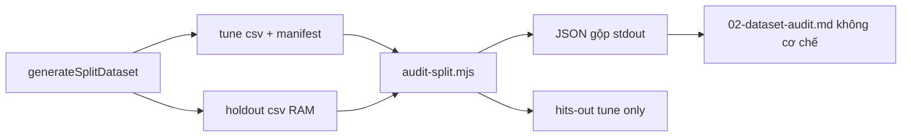

# DBS-146 · Kiểm tra tập dữ liệu giao #4: không rò rỉ nhãn và phân phối hợp lý

> **Status:** Plan approved (G1, G2, G3 qua ngày 2026-11-15) · **Vai:** Dev (dataset) · **Cặp đôi review:** không có Dev review (quyết định techlead, xem DoD 4) · **Nhánh:** `test/DBS-146-dataset-audit` · **PR:** — · **Cập nhật:** 2026-11-15

> **Bức tường dữ liệu:** tài liệu này nằm trong `docs/` mà #4 đọc được, nên **chỉ ghi kết luận và loại phát hiện, không ghi cơ chế sinh dữ liệu** (giá trị, số tài khoản, số dòng từng kịch bản, phân phối ngày). Cơ chế và số liệu theo kịch bản nằm ở `load-tests/fraud-dataset/AUDIT-NOTES.md` (thư mục kín, FRAUD guide §6.2).

## 1. Bối cảnh

- **Task trên board:** Task, Tuần 5, Medium, Deliverable P5, Status In Progress (board chậm: không có nhánh hay PR nào). **Thực trạng:** «Cần chắc tập tune không chứa thông tin của holdout và dữ liệu không «dễ» một cách giả tạo.» **Expect:** «Kết quả đánh giá fraud đáng tin.»
- **DoD (nguyên văn):**
  1. Kiểm: không khách nào ở cả tune lẫn holdout; tập giao #4 không có cột nhãn của holdout
  2. Tỉ lệ gian lận theo kịch bản, phân phối số tiền, số giao dịch/khách/ngày hợp lý; không kịch bản nào có dấu hiệu nhận diện tầm thường (ví dụ chỉ một giá trị scenario trùng khít một luật)
  3. Báo cáo ngắn lưu docs/components/fraud-dataset
  4. PR đã merge vào main; Dev review; không còn liên kết hỏng, tên bảng/cột/mã lỗi khớp các tài liệu khác (đã grep)
- **Phụ thuộc:** DBS-127 Done (board và repo: PR #115, `load-tests/fraud-dataset/split.mjs`, `load-tests/verify-tune.mjs`).
- **Đã có:** [DBS-126](DBS-126-fraud-scenarios.md), [DBS-127](DBS-127-customer-split.md) (TC-127-02 chỉ kiểm không trùng khách trên fixture nhỏ), [README dataset](../../load-tests/fraud-dataset/README.md), [FRAUD guide §4.2, §6](../components/risk/FRAUD_DETECTION_GUIDE.md), provider thật `backend/src/modules/risk/features/offline-feature-provider.ts` và `npm run export-features`.
- **Thực trạng đã chạy thật (2026-11-15, Node 24.22.2):** `split.mjs --tune-dir` ra 101.551 dòng, SHA256 `6366f108…b122c0` (khớp README), `load-tests/verify-tune.mjs` đạt; 1.009 dòng fraud (0,994%); holdout 44.660 dòng, fraud 0,947%. Khảo sát tạm cho thấy tune **có dấu hiệu nhận diện** (một thuộc tính của tài khoản và một số hạn chế mô phỏng) và hard negatives rất ít (12 dòng, đã có BL-173); chi tiết trong `AUDIT-NOTES.md`. Chưa có công cụ nào kiểm **gói thật** theo DoD 1 và 2.
- **Baseline:** bốn suite dataset (`node --test`) 70/70 đạt, 0 bỏ qua; `check-doc-links.mjs` 455 file, 0 hỏng. Task không đổi backend nên không chạy lint/test backend (loại task: script dataset + tài liệu).
- **Ngoài phạm vi:** giao tune cho #4, nơi lưu nhãn holdout, xác nhận offline của #4 (BL-171); đo chất lượng luật (BL-044); sửa hạn chế mô phỏng và tăng hard negatives (BL, §8). `load-tests/verify-tune.mjs` giữ nguyên.
- **Quyết định ở G1 (agent tự quyết):** (a) làm task này vì không task Dev nào khác mở khóa được (DBS-173..175 chờ DBS-166 Ops chưa có PR); (b) agent là Dev dataset nên được đọc thư mục kín, subagent review thì không; (c) holdout chỉ ở RAM, số holdout công bố chỉ gộp; (d) hạn chế mô phỏng không sửa trong task này, chỉ sửa tell rẻ nằm ở một cột (§2.E).

## 2. Hành vi

`node load-tests/fraud-dataset/audit-split.mjs [--customers N] [--days D] [--tune-csv <path>] [--tune-manifest <path>] [--hits-out <path>]` sinh lại cặp cohort bằng `generateSplitDataset` (holdout **chỉ ở RAM**, không ghi đĩa), kiểm và in **một dòng JSON gộp** (không ID, không nhãn theo dòng, không đường dẫn). Seed mặc định `dbs-split-v1`; seed khác chỉ đọc từ **tệp** do biến `DBS_AUDIT_SEED_FILE` trỏ tới (không có cờ `--seed`). Tệp đọc dạng UTF-8, bỏ **đúng một** dấu xuống dòng cuối (`\n` hoặc `\r\n`); từ chối khi rỗng, > 128 ký tự, có BOM đầu tệp, hoặc còn ký tự điều khiển/định dạng (Unicode Cc, Cf) hay khoảng trắng ở hai đầu. Lưu ý: `split.mjs` vẫn chỉ nhận `--seed` trên dòng lệnh, nên seed bí mật vẫn lộ ở phía sinh tune; bàn giao qua BL-171 (A7-ii). Tham số sai (khóa lạ, lặp khóa, `--customers` ngoài 3334–100000, `--days` ngoài 30–90, tệp seed không đọc được/rỗng/dài hơn 128 ký tự): exit 1, thông báo chung, không lặp lại tham số.

`--hits-out` (tùy chọn) ghi cho **tune** một CSV `tx_id,R1,R2,R3,R4,R5,R6` (0/1) để đối chiếu với provider thật. Dùng lại **nguyên** hàm `canonical` và `insideCheckout` của `split.mjs` (xuất thêm hai hàm này, không đổi hành vi): realpath của thư mục cha đã có (không lách được bằng symlink/junction), từ chối khi một thư mục cha có `.git`, từ chối tệp đã tồn tại; chỉ ghi **sau khi** mọi kiểm bắt buộc đạt.

**Exit code:** `0` khi mọi kiểm **bắt buộc** (A1–A6, B1, B2, B3, B5) đạt; `1` khi có kiểm bắt buộc hỏng hoặc tham số sai. Phát hiện loại C không đổi exit code mà đổi trường `dod2`: `"met"` ⇔ không có *tell* **và** không có *hạn chế mô phỏng*; ngược lại `"partial"`. Mọi phát hiện *nội tại* (kể cả cặp kịch bản–luật ở C1) **bắt buộc** liệt kê trong `dod2Notes` kèm lý do, để báo cáo không im lặng về chúng.

**A. Rò rỉ (DoD 1), tất cả phải bằng 0 hoặc đúng:**

| Mã | Kiểm | Đạt khi |
|---|---|---|
| A1 | Giao `from_customer ∪ to_customer` của tune với registry khách holdout | 0 khách chung |
| A2 | Giao tài khoản và `tx_id` tune với holdout | 0 |
| A3 | Dòng tune có người gửi hoặc nhận thuộc registry holdout (và ngược lại) | 0 |
| A4 | Quét **nguyên byte** `tune.csv` (và tune-manifest, nếu cho) tìm từng customer/account/tx ID của holdout | 0 lần xuất hiện |
| A5 | Header đúng 12 cột `tx_id…scenario`, không cột thừa; manifest tune (sinh lại **và** tệp thật nếu có `--tune-manifest`, so từng byte) đúng các khóa `version,columns,sha256,customers,transactions` | đúng |
| A6 | `is_fraud=1` khi và chỉ khi `scenario` thuộc tám kịch bản fraud công khai; không có cột nhãn thứ ba | đúng |
| A7 | **Rủi ro ghi nhận, không phải kiểm tự động**, báo cáo nêu rõ ba điều: (i) holdout sinh lại được từ seed mặc định công khai cộng code, nên bức tường chỉ là quy ước «chỉ #6 đọc»; (ii) seed bí mật cho holdout cuối **sinh lại cả tune** (hash công bố ở README là của tune khác, tune giao #4 phải được sinh lại và giao lại), và `split.mjs` cần nhận seed từ tệp như audit; (iii) hợp đồng kịch bản ở [DBS-126 §2.3](DBS-126-fraud-scenarios.md) đang công khai trong `docs/` (chi tiết từng kịch bản) nên #4 đọc được: vi phạm bức tường đã biết, bàn giao BL để dời ra khỏi `docs/` hoặc chấp nhận rõ ràng | báo cáo có mục này |

**B. Độ hợp lý (DoD 2):**

| Mã | Đo | Đạt khi (bắt buộc) |
|---|---|---|
| B1 | Tỉ lệ fraud chung và theo kịch bản (số dòng, % tổng, từ CSV) cho tune; holdout chỉ tỉ lệ chung | chung trong 0,8–1,2% (tune và holdout); mỗi kịch bản fraud ở tune ≥ 30 dòng |
| B2 | Số tiền: `amount > 0` mọi dòng; p50 của NORMAL trong [100.000; 5.000.000] đồng (FRAUD guide §6.1: trung vị mỗi khách «từ 100k đến vài triệu»); in p50/p90/p99/max của NORMAL và từng kịch bản (BigInt, `floor((n-1)*p)`) | hai điều kiện đầu đạt |
| B3 | Giao dịch/khách/ngày theo định nghĩa DBS-126 (ngày Việt Nam, gồm ngày không giao dịch, cộng tài khoản cùng chủ), tính lại từ CSV và đối chiếu `stats.activity` của generator | trung bình trong 0,3–3 (guide §6.1 «λ 0,3–3») và bằng `stats.activity.mean` |
| B4 | Hard negatives: số dòng từng nhóm HN | báo; nhóm < 30 dòng ghi «không đủ đo báo nhầm theo nhóm» (không ảnh hưởng exit; đã là BL-173) |
| B5 | Đủ dữ liệu holdout (nội bộ, chỉ in kết quả, không in số): mỗi kịch bản fraud ≥ 30 dòng (bắt buộc); nhóm HN < 30 dòng → `holdoutHn:"thin"` (không chặn, BL-173) | fraud: đạt |

**C. Dấu hiệu nhận diện tầm thường (DoD 2).** Mọi phát hiện được phân loại. Báo cáo công khai ghi tên kịch bản **chỉ** cho phát hiện *nội tại*; phát hiện *hạn chế mô phỏng* và *tell* chỉ ghi số lượng và mã BL, không tên kịch bản, không cơ chế:

- **Nội tại:** cặp (kịch bản, đặc trưng/bin hoặc luật) nằm trong **bảng cố định** rút từ mô tả một câu công khai (FRAUD guide §6.1) và cột «Luật nên bắt»; bảng chốt trước khi chạy, là hằng số trong `audit-split.mjs` và được test (nội dung bảng ở `AUDIT-NOTES.md`). Ngoài bảng là *tell*: phân loại hoàn toàn cơ học.
- **Hạn chế mô phỏng:** mẫu do cách generator dựng đồ thị giao dịch (định nghĩa và phép kiểm C3 ở `AUDIT-NOTES.md`, không ghi ở đây). Không sửa trong task này; BL.
- **Tell:** còn lại. Phải bằng 0 để `met`; sửa nếu rẻ, nếu không thì BL.

*C1 trùng khít một luật.* Cài lại R1–R6 `v1` độc lập trên CSV, theo guide §4.2 và provider thật. `t` là `occurred_at` của dòng; các dòng cùng timestamp được xét **cùng nhau** như provider:

| Luật | Điều kiện (bản offline của audit) |
|---|---|
| R1 | số lệnh từ `from_account` với `occurred_at` trong `(t − 10 phút, t]`, gồm mọi dòng cùng timestamp và chính nó, > 5 (dòng cách đúng 10:00 bị loại) |
| R2 | lịch sử cùng `from_account` trong `[t − 30 ngày, t)` (chỉ dòng có timestamp nhỏ hơn t); bỏ qua khi < 5 lệnh; `m2` = tổng hai phần tử giữa (n lẻ: 2× phần tử giữa); hit khi `2 × amount > 5 × m2` |
| R3 | tuổi tài khoản nguồn `max(0, t − from_account_created_at)` < 24 giờ **và** `amount` > 10.000.000 |
| R4 | tồn tại lệnh `to_account → from_account` với timestamp trong `[t − 1 giờ, t)` (đúng 1 giờ trước **hit**; cùng timestamp **không** tính) |
| R5 | `from_customer ≠ to_customer` và `newRecipients1h ≥ 5`, tính **như provider**: lấy các dòng của `from_account` trong `(t − 1 giờ, t]`; với mỗi `to_account` phân biệt, xét dòng **sớm nhất còn trong cửa sổ** (timestamp τ); `to_account` đó là «mới» khi không có dòng nào của cùng `from_account` tới nó với timestamp trong `[τ − 30 ngày, τ)` (các dòng cùng timestamp τ không làm nó «cũ») |
| R6 | `from_customer ≠ to_customer`, `from_balance_before` ≥ 1.000.000 và `amount × 10 ≥ from_balance_before × 9` |

Với mỗi kịch bản S và luật R: `recall_row = |R∩S|/|S|`; `recall_src` = tỉ lệ `from_account` của S có ≥ 1 dòng bị R hit; `recall_pair` = tỉ lệ cặp (`from_account`,`to_account`) của S có ≥ 1 dòng bị R hit; `fpr = |R ∩ không-fraud| / |không-fraud|`. **R tách S «tầm thường»** khi `max(recall_row, recall_src, recall_pair) ≥ 0,95` **và** `fpr ≤ 1%`. Cặp (S, R) mà R nằm trong cột «Luật nên bắt» của guide §6.1 là *nội tại*; cặp ngoài bảng đó (kể cả mọi cặp của ba kịch bản «ngoài tầm luật») là *tell*. Bản cài là công cụ kiểm dữ liệu, không thay `OfflineFeatureProvider` và không đo chất lượng luật; đối chiếu với provider ở TC-146-12 và M-146-08.

*C2 bin lộ nhãn.* Nhãn tham chiếu `S` chạy trên **từng kịch bản fraud** và trên **toàn bộ fraud** (`is_fraud=1`, kịch bản giả `FRAUD`), vì thuộc tính dùng chung cho cả nhóm kịch bản mới lộ ở mức nhãn. Đặc trưng và bin cố định:

| Đặc trưng | Bin |
|---|---|
| `from_account_created_at`, `to_account_created_at` | giá trị nguyên; giờ trong ngày (UTC); khoảng ngày theo bậc 30 ngày |
| `amount` | thang log 4 bin mỗi bậc 10; **khoảng hẹp nhất** chứa ≥ 50% số dòng của S (cửa sổ trượt trên số tiền đã sắp) |
| giờ trong ngày (giờ Việt Nam) | 24 bin |
| tuổi tài khoản nguồn tại giao dịch | < 1 giờ, < 24 giờ, < 7 ngày, < 30 ngày, < 180 ngày, ≥ 180 ngày |
| `amount / from_balance_before` | decile |
| `from_customer = to_customer` | 2 giá trị |

Một bin v là **ứng viên** khi `|S∩v|/|S| ≥ 0,5` (độ phủ), `|S∩v| ≥ 20` và **lift** `P(S|v)/P(S) ≥ 10` (không dùng ngưỡng tuyệt đối vì tỉ lệ nền của một kịch bản chỉ ~0,1%; lift 10 nghĩa là bin chứa kịch bản gấp 10 lần nền). Thêm bin «**ngoài vùng NORMAL**»: giá trị/khoảng của đặc trưng mà dòng NORMAL không bao giờ nhận, và độ phủ của S ở đó ≥ 0,5. Phân loại ứng viên: *nội tại* khi (S, đặc trưng/bin) có trong bảng cố định; *hạn chế mô phỏng* theo quy tắc kín (dựa trên S∩v, không trên v, nên không phụ thuộc giá trị mà hash chọn); còn lại *tell*. **Dự phòng** khi nhãn `FRAUD` không đủ lift: so thuộc tính **theo tài khoản** giữa tài khoản nhóm kịch bản và nhóm nền, báo khi một giá trị chiếm ≥ 50% tài khoản nhóm kịch bản mà < 1% tài khoản nền. Số đo thật trên tune hiện tại (ở `AUDIT-NOTES.md`) cho thấy nhãn `FRAUD` đủ lift; dự phòng dành cho seed khác.

**D. Kết luận.** DoD 1 đạt khi A1–A6 đạt (+ A7 được nêu). DoD 2: `dod2:"met"` chỉ khi B1–B3, B5 đạt và không *tell*, không *hạn chế mô phỏng*; còn lại `partial` kèm số lượng theo loại và mã BL. Về ví dụ của DoD 2 («một giá trị scenario trùng khít một luật»): kịch bản «trong tầm luật» bị luật dự kiến tách ra là **chủ đích thiết kế** của FRAUD guide §6.1 (cột «Luật nên bắt»: đo recall của luật trên kịch bản nó nhắm tới), không phải nhãn lộ từ dữ liệu; báo cáo liệt kê từng cặp như vậy (`dod2Notes`) và nói rõ điều này, để P5 không trình bày recall trên các cặp đó như năng lực tổng quát. Kết quả `met` hay `partial` báo đúng như công cụ in ra.

**E. Sửa generator tối thiểu.** Chỉ sửa tell «rẻ» nằm ở một cột thuộc tính của tài khoản: đổi cách đặt thuộc tính đó cho nhóm kịch bản sao cho cùng phân phối với nhóm NORMAL, suy ra bằng hash từ `seed` và chỉ số khách (cơ chế trong `AUDIT-NOTES.md`); không đụng `random()` của kịch bản nên số tiền, giờ và người nhận không đổi. Tác động chấp nhận: **đổi byte** CSV/simulation/stats của generator mixed mặc định và tune mặc định (hash mới), tức đảo quyết định «không đổi bytes generator cũ» của DBS-127 §2; tune chưa giao cho #4 (BL-171) nên không có bản cũ cần giữ. Ghi quyết định ở §8 và `Techlead waiver` ở PR. Phát hiện loại khác (nếu có) không sửa trong task này: BL.

## 3. Kiến trúc

- **Vị trí:** script Node cục bộ, không backend/DB/AWS. File mới: `load-tests/fraud-dataset/audit-split.mjs`, `audit-split.test.mjs`, `AUDIT-NOTES.md` (kín); sửa `scenarios.mjs`; nối suite mới vào bước dataset trong `.github/workflows/ci.yml`; báo cáo công khai `docs/components/fraud-dataset/02-dataset-audit.md`.
- **Interface:** xuất `parseCsv`, `leakage`, `profile`, `ruleHits`, `valueCandidates`, `auditSplit`. Người gọi `generateSplitDataset`: `split.mjs` và test của nó; chữ ký không đổi. `planScenarios` giữ chữ ký.
- **Dữ liệu:** không bảng nào; CSV 12 cột (docs/03 §15.4, FRAUD guide §6.1), tên cột không đổi.
- **Ranh giới:** holdout chỉ trong RAM; stdout chỉ số gộp.
- **Thứ tự commit:** (1) `audit-split.mjs` + test + chạy «trước» trên generator **chưa sửa** (ghi golden SHA cho TC-146-09); (2) sửa `scenarios.mjs`; (3) tài liệu + «sau».

- **Thay đổi cấp hệ thống:** README dataset (hash tune mới, lệnh audit), DBS-126 §8.3 (ba SHA mixed mặc định), DBS-127 §8 (hash tune), brief fraud-dataset (liên kết báo cáo), `docs/features/README.md`, `docs/BACKLOG.md` (BL-171 và BL-173 thêm nguồn DBS-146; BL mới cho hạn chế mô phỏng (nếu có) và cho A7-iii; vì `docs/BACKLOG.md` công khai, dòng BL chỉ ghi loại, số lượng và trỏ `load-tests/fraud-dataset/AUDIT-NOTES.md`, không mô tả mẫu). Không đổi ADR, schema, event, mã lỗi.

## 4. Test cases tự động

`node --test load-tests/fraud-dataset/audit-split.test.mjs`; fixture CSV nhỏ viết tay cho biên, gói mặc định cho ca thật.

| ID | DoD | Lớp | Given · When · Then |
|---|---|---|---|
| TC-146-01 | 1 | Node (gói mặc định) | Split `dbs-split-v1`: A1–A6 đều 0/đúng |
| TC-146-02 | 1 | Node (đối chứng âm) | Chèn một dòng của khách holdout vào tune → A1, A3, A4 > 0, kết quả «không đạt» |
| TC-146-03 | 1 | Node (đối chứng âm) | Thêm cột `holdout_label` vào header, hoặc khóa lạ vào manifest, hoặc một byte lạ trong manifest thật → A5 không đạt |
| TC-146-04 | 2 | Node | B1–B3 của tune khớp `stats` generator (số dòng, fraud, quantile, `activity.mean`); B2 p50 NORMAL trong khoảng; đối chứng: CSV có `amount=0` → B2 hỏng |
| TC-146-05 | 2 | Node (fixture tay, biên) | **R1:** dòng thứ 6 trong 10 phút hit, thứ 5 không; lệnh cách đúng 10:00 bị loại, 9:59 tính; nhiều dòng cùng timestamp tính cả nhóm. **R2:** 4 lệnh lịch sử bỏ qua, 5 tính; đúng 5× không hit, 5× + 1đ hit; lịch sử chẵn cho trung vị nửa đồng, kể cả ca biên `2×amount = 5×m2` với `m2` lẻ (trung vị `x,5`); lệnh cách đúng 30 ngày tính, 30 ngày + 1 ms không. **R3:** tuổi 23:59:59 hit, 24:00:00 không; 10.000.000 không, 10.000.001 hit; tuổi âm coi là 0. **R4:** lệnh ngược cách 59:59 và **đúng 1:00:00 đều hit**, 1:00:00,001 không; cùng timestamp không tính. **R5:** 5 người nhận mới hit, 4 không; người nhận đã nhận cách đúng 30 ngày không «mới»; **hai dòng cùng timestamp tới cùng người nhận đều «mới»**; dòng đầu cửa sổ rời đi trong khi dòng kế tiếp tới cùng người nhận không «mới» → đếm đúng như provider; bỏ qua khi cùng chủ. **R6:** số dư 1.000.000 hit, 999.999 không; đúng 90% hit; bỏ qua khi cùng chủ |
| TC-146-06 | 2 | Node (đối chứng âm) | CSV tổng hợp mà mọi dòng một kịch bản chung một bin → C2 báo ứng viên (cả ở nhãn `FRAUD`); bin chung của nhiều kịch bản chỉ lộ ở nhãn `FRAUD`; CSV trải đều → không báo; ứng viên ngoài bảng nội tại và ngoài quy tắc kín → *tell*; khoảng số tiền hẹp chứa ≥ 50% S → báo; giá trị ngoài vùng NORMAL → báo |
| TC-146-07 | 2 | Node (gói mặc định) | Sau sửa generator: không *tell* nào ở nhãn kịch bản và nhãn `FRAUD` (phân loại cơ học theo bảng cố định); phát hiện còn lại chỉ là *nội tại* hoặc *hạn chế mô phỏng*; bảng nội tại là hằng số được test; ngày mở tài khoản của nhóm kịch bản có hình dạng khớp NORMAL (tham số cụ thể kiểm trong test kín `AUDIT-NOTES.md`, không ghi ở đây) |
| TC-146-08 | 2 | Node (gói mặc định) | Ma trận C1: ba kịch bản ngoài tầm luật không cặp nào tách tầm thường; mọi cặp tách của kịch bản trong tầm luật có R trong bảng §6.1 (ngược lại → *tell*); in `recall_row/src/pair`, `fpr` |
| TC-146-09 | 2 | Node | Sửa generator không đổi số dòng, số fraud, thứ tự `tx_id`, mọi cột trừ các cột thuộc tính tài khoản bị sửa: oracle là golden SHA256 của CSV đã bỏ các cột đó, **ghi vào test trước khi sửa** (lấy ở commit (1)) |
| TC-146-10 | 1, 2 | CLI (spawn từ Node, `env` đặt trực tiếp) | Mặc định exit 0, một dòng JSON, không chứa ID holdout; `dod2:"partial"`. Sai: khóa lạ, lặp khóa, `--customers 100`, `--days 99`, tệp seed rỗng/không có/> 128 ký tự/có ký tự điều khiển giữa chuỗi, `--seed x` → exit 1, không in tham số. Tệp seed `dbs-split-v1\n` và `dbs-split-v1\r\n` cho đúng JSON như mặc định; `dbs-split-v1\n\n`, tệp có BOM đầu và ` dbs-split-v1` bị từ chối |
| TC-146-11 | 1 | CLI | Hai lần chạy cho JSON giống hệt; `--tune-csv` bị sửa một byte → exit 1; `--tune-manifest` sai khóa → exit 1 |
| TC-146-12 | 2 | Node + backend | Trên tune thật, chạy `exportFeaturesString` (qua ts-node/jest trong `backend/`, hoặc `npm run export-features`) và so **theo `tx_id`** với `--hits-out`: R1 = `txCount10m > 5`; R2 = `historyCount30d ≥ 5` và `2×amount > 5×m2`, `m2` tính bằng BigInt từ chuỗi `medianAmount30d`: `2×phần nguyên + (có «.5» ? 1 : 0)`, không dùng `Number`; R3 = `accountAgeHours < 24` và `amount > 10.000.000`; R4 = `minutesSinceReverse` không rỗng; R5 = `newRecipients1h ≥ 5` **và** `sameOwner=false`; R6 = `sameOwner=false`, `fromBalanceBefore ≥ 1.000.000` và `amount×10 ≥ fromBalanceBefore×9` (BigInt). Tập `tx_id` hit bằng nhau từng luật. Không chạy được trong `node --test` thì chuyển thành M-146-08 và ghi «đơn giản hóa» |
| TC-146-13 | 2 | Node (đối chứng âm) | Holdout giả có một kịch bản fraud < 30 dòng → B5 không đạt, exit 1; HN < 30 → `holdoutHn:"thin"` mà exit vẫn 0 |
| TC-146-14 | 1, 2 | CLI | `--hits-out`: ghi tệp đúng 7 cột, một dòng mỗi `tx_id` của tune; từ chối đường dẫn trong checkout (kể cả qua symlink/junction trỏ vào checkout), tệp đã có, hoặc khi kiểm bắt buộc hỏng (không tạo tệp) |
| Quy trình | 3, 4 | — | Báo cáo `02-dataset-audit.md` (không cơ chế); `check-doc-links.mjs` 0 hỏng; grep tên cột/kịch bản khớp; **DoD 4 «Dev review»: không có theo quyết định techlead bỏ yêu cầu Dev review ([#175](https://github.com/Lawliet119/digital-banking-simulator/pull/175)); ghi `Techlead waiver: Dev review, không merge theo quy trình Dev, không sửa board` ở PR; DoD 4 đạt một phần** |

## 5. Test thủ công

Điều kiện: Node 24; không Docker/AWS (M-146-08 cần `npm ci` ở `backend/`). Shell: Git Bash. Thư mục kết quả là thư mục tạm ngoài repo.

| Bước | Việc làm | Kết quả mong đợi |
|---|---|---|
| M-146-01 | Ở commit (1) (generator **chưa sửa**): `split.mjs --tune-dir <mới>` rồi `audit-split.mjs --tune-csv <tune.csv> --tune-manifest <manifest.json>` | Exit 0; A1–A6 đạt; `dod2:"partial"`; có ít nhất một *tell* ở nhãn `FRAUD` (bằng chứng «trước», chi tiết ở `AUDIT-NOTES.md`); hash `6366f108…` |
| M-146-02 | Ở commit (2) (sau sửa): lặp M-146-01 | Exit 0; không *tell*; phát hiện còn lại chỉ là *nội tại*/*hạn chế mô phỏng* (không nêu cột nào); `dod2Notes` liệt kê mọi cặp nội tại; `dod2:"partial"`; hash tune đổi |
| M-146-03 | Chạy `audit-split.mjs` hai lần, `cmp` hai đầu ra | Byte giống nhau |
| M-146-04 | `node load-tests/verify-tune.mjs <tune.csv>` sau sửa | Đạt, 101.551 dòng, hash mới |
| M-146-05 | Sửa một byte của `tune.csv`; thêm cột giả vào header; sửa manifest | Mỗi lần exit 1, thông báo chung, không lộ tham số |
| M-146-06 | Tham số sai (Git Bash): `--seed x`, `--customers 100`, `--bogus 1`, `--days 30 --days 31`; `DBS_AUDIT_SEED_FILE` trỏ tệp rỗng | Exit 1, không tạo file |
| M-146-07 | Bốn suite dataset cũ, suite audit và `check-doc-links.mjs` | Đạt hết, 0 liên kết hỏng, 0 bỏ qua |
| M-146-08 | `audit-split.mjs --hits-out <hits.csv>`; `cd backend && npm run export-features -- --input <tune.csv> --output <features.csv>`; so theo `tx_id` R1–R6 như TC-146-12 | Tập hit bằng nhau từng luật; khác thì ghi nguyên nhân, không ghi «đạt» |

## 6. Domain review (AI)

**Reviewer:** subagent opus, effort medium, 2026-11-15 · **Vòng 1:** 16 phát hiện (3 blocking, 8 should-fix, 5 minor), REVISE · [nguyên văn (tệp trỏ)](screenshots/DBS-146/domain-review.md) · **Vòng 2:** 14 phát hiện (2 blocking, 7 should-fix, 5 minor), REVISE · [nguyên văn (tệp trỏ)](screenshots/DBS-146/domain-review.md)

| # | Mức | Phát hiện | Xử lý |
|---|---|---|---|
| 1.1 | blocking | phát hiện còn lại sau §2.E | đã sửa: phân loại riêng + BL, `dod2:"partial"` |
| 1.2 | blocking | biên R4 bị đảo | đã sửa §2.C, TC-146-05 |
| 1.3 | blocking | doc công khai lộ cơ chế | đã sửa ở vòng 1 và vòng 2 (2.2) |
| 1.4–1.16 | should-fix, minor | thứ tự commit, bin C2, kết luận DoD 2, ngữ nghĩa R1/R2/R5, bytes mixed, B5, B2, A5, exit code, BL-173, waiver | đã sửa (xem §2, §4, §5) |
| 2.1 | blocking | C2 theo từng kịch bản không thấy thuộc tính dùng chung cả nhóm | đã sửa: thêm nhãn `FRAUD` vào C2; M-146-01, TC-146-06/07 kiểm ở nhãn này |
| 2.2 | blocking | doc công khai vẫn mô tả cơ chế | đã sửa: bỏ khỏi §1, §2.E, §4 TC-146-07, ngoài phạm vi; chuyển `AUDIT-NOTES.md`; sửa banner |
| 2.3 | should-fix | phân loại theo v không xác định | đã sửa: theo S∩v, quy tắc kín; M-146-02 không nêu cột |
| 2.4 | should-fix | ngưỡng C2 | đã sửa: lift ≥ 10, độ phủ ≥ 0,5, ≥ 20 dòng, khoảng hẹp nhất, bin ngoài vùng NORMAL |
| 2.5 | should-fix | R5 chưa như provider | đã sửa bảng R5; thêm ca cùng timestamp, dòng đầu rời cửa sổ vào TC-146-05 |
| 2.6 | should-fix | đối chiếu provider chỉ R1/R5 | đã sửa TC-146-12, M-146-08: R1/R2/R4/R5 theo `tx_id`, R5 kèm `sameOwner=false` |
| 2.7 | should-fix | `dod2` mâu thuẫn | đã sửa §2 exit code và §2.D: `met` ⇔ không tell, không hạn chế mô phỏng |
| 2.8 | should-fix | seed bí mật đổi cả tune; lịch sử shell | đã sửa: seed qua tệp `DBS_AUDIT_SEED_FILE`; A7-ii |
| 2.9 | should-fix | DBS-126 §2.3 công khai hợp đồng kịch bản | đã sửa: A7-iii, BL bàn giao |
| 2.10 | minor | B5 HN ≥ 1 không thể hỏng | đã sửa: HN < 30 → `thin` không chặn; fraud ≥ 30 bắt buộc |
| 2.11 | minor | `recall_src` với ROUND_TRIP | đã sửa: thêm `recall_pair` |
| 2.12 | minor | env rỗng trên PowerShell | đã sửa: tệp seed, test spawn từ Node, nêu Git Bash |
| 2.13 | minor | `--hits-out` thiếu luật đường dẫn | đã sửa §2, TC-146-14 |
| 2.14 | minor | đường dẫn `verify-tune.mjs` | đã sửa |

**Vòng 3:** 8 phát hiện (1 blocking, 4 should-fix, 3 minor), REVISE · [nguyên văn (tệp trỏ)](screenshots/DBS-146/domain-review.md)

| # | Mức | Phát hiện | Xử lý |
|---|---|---|---|
| 3.1 | blocking | định nghĩa và tên kịch bản ở báo cáo công khai vẫn lộ cơ chế | đã sửa: định nghĩa chuyển `AUDIT-NOTES.md`; đổi tên loại thành *hạn chế mô phỏng*; báo cáo chỉ ghi tên kịch bản cho *nội tại*; bỏ câu dự đoán ở §1, §2.D, §2.E, §3 |
| 3.2 | should-fix | chưa chứng minh nhãn `FRAUD` thấy tell «trước» | đã đo, đủ lift (số ở `AUDIT-NOTES.md`); thêm dự phòng so theo tài khoản |
| 3.3 | should-fix | *nội tại* quyết định sau khi thấy kết quả | đã sửa: bảng cố định chốt trước, hằng số trong code có test |
| 3.4 | should-fix | tệp seed: xuống dòng cuối; `split.mjs` vẫn lấy `--seed` | đã sửa quy tắc đọc tệp, TC-146-10; bàn giao `split.mjs` đọc tệp seed qua BL-171 (A7-ii) |
| 3.5 | should-fix | `met` cùng tồn tại với ví dụ của DoD 2 | đã sửa §2.D: lập luận chủ đích thiết kế §6.1, `dod2Notes` bắt buộc |
| 3.6 | minor | R2 cần BigInt cho trung vị `x.5` | đã sửa TC-146-12, ca biên ở TC-146-05 |
| 3.7 | minor | R3/R6 chưa đối chiếu | đã sửa TC-146-12, M-146-08 |
| 3.8 | minor | luật đường dẫn `--hits-out` | đã sửa: dùng lại nguyên `canonical`/`insideCheckout`; ca symlink ở TC-146-14 |

**Nguyên văn ba vòng review** chép lại cơ chế generator (vòng 1 #3 trích từ doc cũ), nên lưu ở thư mục kín `load-tests/fraud-dataset/reviews/DBS-146/`; `screenshots/DBS-146/domain-review.md` chỉ trỏ tới đó (quyết định gate phụ, §8).

**Vòng 4:** 4 phát hiện (1 should-fix, 3 minor), REVISE kèm ghi chú «sửa #1 là không còn blocking hay should-fix, APPROVE không cần thêm vòng» · [nguyên văn (tệp trỏ)](screenshots/DBS-146/domain-review.md)

| # | Mức | Phát hiện | Xử lý |
|---|---|---|---|
| 4.1 | should-fix | liên kết vòng 2 hỏng sau khi dời nguyên văn | đã sửa: trỏ về tệp trỏ, thêm liên kết vòng 3 và 4 |
| 4.2 | minor | số lift và câu «dùng chung thuộc tính» còn công khai | đã sửa: chỉ ghi «đủ lift, số ở `AUDIT-NOTES.md`» |
| 4.3 | minor | dòng BL công khai phải không cơ chế | đã sửa §3 |
| 4.4 | minor | BOM và khoảng trắng ở tệp seed; «một ký tự» | đã sửa §2 và TC-146-10 |

**Quyết định ở G2 (agent tự quyết):** dừng ở vòng 4, không chạy vòng 5: reviewer nói rõ sau khi sửa 4.1 thì không còn blocking hay should-fix; bốn sửa của vòng 4 là đổi chữ và một luật đọc tệp, đã tự kiểm bằng `check-doc-links.mjs` và grep cơ chế trong doc.

## 7. Kế hoạch triển khai

| Bước | File | Test viết trước | Kết quả đỏ (1 dòng) | Lệnh chứng minh | Commit |
|---|---|---|---|---|---|
| 1 | `split.mjs` (xuất thêm `canonical`, `insideCheckout`, không đổi hành vi), `audit-split.mjs`, `audit-split.test.mjs`, `AUDIT-NOTES.md`, `reviews/DBS-146/` | TC-146-01..06, 08, 10..14 (TC-146-07 phần «trước»: có *tell* ở nhãn `FRAUD`), golden SHA của TC-146-09 lấy ở bước này | điền khi chạy | `node --test load-tests/fraud-dataset/audit-split.test.mjs load-tests/fraud-dataset/split.test.mjs` | `test(fraud-dataset): DBS-146 công cụ kiểm rò rỉ và độ hợp lý của tune/holdout` |
| 2 | `scenarios.mjs` | TC-146-07 (không *tell*), TC-146-09 (golden) đỏ trước khi sửa | điền khi chạy | bốn suite cũ + suite audit | `fix(fraud-dataset): DBS-146 ngày mở tài khoản nhóm kịch bản cùng phân phối với nền` |
| 3 | `.github/workflows/ci.yml`, `docs/components/fraud-dataset/02-dataset-audit.md`, brief fraud-dataset, README dataset, DBS-126 §8.3, DBS-127 §8, `docs/features/README.md`, `docs/BACKLOG.md`, feature doc §8–§9, `screenshots/DBS-146/manual-test.txt` | M-146-01..08 | — | `check-doc-links.mjs`, manual | `docs(fraud-dataset): DBS-146 báo cáo kiểm tập dữ liệu và bằng chứng` |

**Quét giới hạn và DoD:** DoD 1 → bước 1 (A1–A7); DoD 2 → bước 1–2 (B, C, sửa §2.E); DoD 3 → bước 3 (`02-dataset-audit.md`); DoD 4 → bước 3 + quy trình (waiver Dev review). Giới hạn ở README dataset (bức tường dữ liệu, cấu hình lớn chưa benchmark BL-173) và DBS-127 §8 (BL-171): ngoài phạm vi, chỉ thêm nguồn. Không đổi `generate.mjs`, `generate-fraud.mjs`, `inspect-fraud.mjs`, `verify-tune.mjs`. Không test nào ghim hash mixed/tune (đã grep), nên đổi byte chỉ đụng tài liệu.

**Rủi ro và cách lùi:** (1) sửa `scenarios.mjs` làm generator mixed vượt kiểm prevalence/replay: inspector chạy trong mọi lần sinh, test cũ sẽ đỏ; lùi bằng revert commit 2, công cụ ở commit 1 vẫn dùng được. (2) Bộ nhớ: sinh split mặc định ~150 nghìn dòng, đo trước đó 1,7 giây; chạy test từng suite một. (3) TC-146-12 cần backend `node_modules` (đã có); không chạy được trong `node --test` thì chuyển M-146-08.

**Quyết định ở G3 (agent tự quyết):** ba commit theo thứ tự trên để có bằng chứng «trước» thật; TC-146-12 thực hiện thành bước thủ công M-146-08 (cần ts-node của backend, không đưa backend vào suite dataset của CI), ghi «đơn giản hóa» ở §8.
