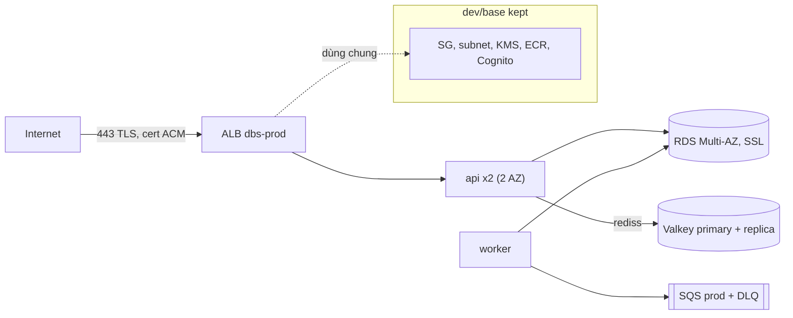

# DBS-152 · Terraform envs/prod: cấu hình production (TLS, TRUST_PROXY_HOPS, rediss, DB SSL)

> **Status:** Implemented (offline/read-only verified; G1–G4 tự duyệt 2026-11-14, người dùng vắng) · **Vai:** #5 Platform & Ops · **Cặp đôi review:** Dev khác (bỏ yêu cầu theo quyết định techlead, #175) · **Nhánh:** `feat/DBS-152-terraform-prod-env` · **PR:** — · **Cập nhật:** 2026-11-14

## 1. Bối cảnh

- **Task trên board:** Task, Tuần 6, Deliverable P3, Ưu tiên High, "To Do". **Expect:** Cấu hình production được mô tả và kiểm chứng được, dù chỉ dựng khi cần.
- **DoD** (nguyên văn, đánh số):
  1. envs/prod với các giá trị production: TLS ở ALB, TRUST_PROXY_HOPS=1, DATABASE_SSL=true, rediss://, Swagger tắt
  2. Dựng thử một lần (hoặc plan đầy đủ) và chứng minh app khởi động; cấu hình sai thì app từ chối khởi động
  3. Không có secret trong repo; chi phí dựng thử ghi lại
  4. PR đã merge vào main (CI xanh); Dev review; bảng «Đối chiếu test case» trong PR điền đủ
- **Thực trạng trên board:** mới có môi trường dev. Validation schema bắt buộc ở staging/production: `DATABASE_SSL=true`, `rediss://`, `TRUST_PROXY_HOPS ≥ 1`.
- **Phụ thuộc:** DBS-34, DBS-66, DBS-75 đều Done trên board và có trong `main` (`envs/dev/session`: `alb.tf`, `rds.tf`, `redis.tf`, `ecs.tf`). Board ghi «ADR-12: không tìm thấy»; file có thật: `docs/adr/0012-redis-valkey-node.md`.
- **Vai trên board** là `#5 Platform & Ops`, đúng loại việc (Terraform), nên baseline là baseline hạ tầng.
- **Đã có gì:** docs/03 §13.1 (production = RDS `db.t4g.small` Multi-AZ, Valkey 1 primary + 1 replica Multi-AZ, API ≥ 2 task trên 2 AZ, worker 1–2 task); ADR-11 (production ≈ 20 giờ, ≈ 8–12 USD); `infra/terraform/README.md` đã hẹn `envs/prod/session` «dùng lại base của dev qua remote state», key state `prod/session.tfstate`; `validation.schema.ts` (production: `TRUST_PROXY_HOPS` 1–5, `DATABASE_SSL=true`, `REDIS_URL` chỉ `rediss`, `AUTH_MODE` cấm `local`); `main.ts`: Swagger chỉ tắt khi `NODE_ENV=production` (staging **vẫn bật** `/docs`); `env.bootstrap.ts` ghép `rediss://` từ `REDIS_HOST/PORT/AUTH_TOKEN`. Dev: `envs/dev/session` mặc định `node_env=staging`.
- **Baseline** (`main` 957dcbf, 2026-11-14): `terraform fmt -check -recursive` sạch; `init -backend=false` + `validate` đạt cho `bootstrap`, `envs/dev/base`, `envs/dev/session`; `terraform test -parallelism=1`: bootstrap 9/9, base 53/53, session 66/66. Không đụng code backend nên không chạy bốn lệnh backend; chỉ chạy lại `validation.schema.spec.ts` (TC-152-14).
- **Backlog cùng module:** không có dòng nào về `prod`. BL-265 (phiên dev1 bị `dbs-no-secret` chặn đọc secret) và BL-247 (ECR không có image, máy không có docker) chặn dựng thật; hai dòng này quyết định chọn «plan đầy đủ» thay vì apply.
- **Ngoài phạm vi:** pipeline deploy prod (`deploy.sh` nhắm `dbs-dev`; BL), alarm và dashboard prod (BL), WAF (docs/03 §13: tuần 6–8), tên miền và chứng chỉ ACM công khai (cần tên miền, BL), tách SG và Cognito riêng cho prod (dùng chung `base` theo README, BL), role DB riêng (BL-103), đo `max_connections` của `db.t4g.small`.
- **Câu hỏi mở và quyết định ở G1** (agent tự quyết vì người dùng vắng; ghi lý do):
  1. **Dựng thật hay plan?** Plan đầy đủ trên AWS thật (đọc state `dev/base.tfstate`, không ghi gì) cộng chứng minh app bằng validation thật của backend. Lý do: DoD cho phép «hoặc plan đầy đủ»; ECR không có image (BL-247), BL-265 chặn secret, và production ≈ 0,3 USD/giờ. Hệ quả: **app chưa chạy end-to-end trên prod** → dòng BL, ghi thẳng ở §8.
  2. **Bố cục:** `envs/prod/session` đứng riêng, copy có chủ đích từ `envs/dev/session` (không tách module: refactor dev đang chạy là rủi ro lớn hơn lợi ích của task này; BL chống lệch). Dùng lại từ `base` của dev: VPC, subnet, ECR, KMS, SG, Cognito (đúng README).
  3. **Tài nguyên không thể dùng chung với dev, nên prod tự tạo trong `session`:** hai queue SQS + DLQ + policy (queue policy ở `base` chỉ cho role `dbs-dev-worker-task`, nên worker prod bị Deny nếu dùng queue dev, và hai môi trường sẽ lẫn message), secret AUTH token Valkey (`dbs/prod/redis-auth`; dùng chung secret của dev thì phiên dev và prod ghi đè token của nhau), log group `/dbs/prod/{api,worker}`.
  4. **TLS ở ALB:** chưa có tên miền nên không có chứng chỉ ACM công khai. Production **không** dùng chứng chỉ tự ký: biến bắt buộc `certificate_arn` (ARN ACM cùng tài khoản và vùng). Chưa có chứng chỉ thật thì `apply` dừng ở listener; plan dùng ARN giữ chỗ (nói rõ ở §8).
  5. **`NODE_ENV` cố định `production`**, không có biến (staging bật Swagger).
  6. **Bảo vệ xóa:** biến `termination_protection` mặc định `true` (RDS `deletion_protection`, ALB, snapshot cuối). Dự án vẫn phải `destroy` để khỏi tốn tiền: bước 1 `apply -var termination_protection=false`, bước 2 `destroy`. Chủ ý là hai bước, để `destroy` nhầm không xóa được DB. Teardown hai bước luôn bỏ snapshot cuối và xóa bản sao lưu tự động (dữ liệu prod demo dựng lại từ seed, như dev); `final_snapshot_identifier` cố định chỉ dùng nếu ai đó tắt bảo vệ ngoài Terraform rồi `destroy`: khi đó phải xóa snapshot bằng tay trước lần `destroy` sau (`verify-clean.sh` báo).
  7. **Giới hạn số task và deploy:** `desired_count` ∈ {0} ∪ [2, 4], `worker_desired_count` ∈ [0, 2], tổng ≤ 6. Lý do: 6 × 10 + 5 = 65 vẫn nằm dưới số đo thật 74 của micro, nên đúng cả khi chưa đo `db.t4g.small` (BL). Lăn api (sau review #12): `desired_count` ≤ 2 thì tối thiểu khỏe 100%, tối đa 200% (luôn còn 2 task phục vụ; đỉnh 4 api + 2 worker = 6 task = 65 kết nối); > 2 thì 50% và 100% như dev (BL-234).
  8. **Dùng chung `base` của dev có hệ quả** (review #7, #8, #14): cùng user pool Cognito (token và tài khoản demo của dev dùng được trên prod), cùng namespace metric `DBS/Backend` (app không có chiều môi trường), cùng CMK `alias/dbs-dev` (teardown dev xóa khóa thì prod mất dữ liệu mã hóa). Chấp nhận trong phạm vi task, ghi thành BL, README cảnh báo; không chạy dev và prod cùng lúc khi đo SLO.
  9. **Fail-fast cho chứng chỉ** (review #13): RDS và Valkey `depends_on` listener HTTPS, nên chứng chỉ sai làm `apply` dừng trước khi dựng thứ tốn tiền.

## 2. Hành vi

Stack `envs/prod/session` (tên `dbs-prod-…`, tag `project=dbs`, `env=prod`, `owner=platform`) chấp nhận và từ chối như sau.

| Điều kiện | Kết quả |
|---|---|
| `terraform plan` với `certificate_arn`, `image_tag` (SHA 40 ký tự), `account_id`, `state_bucket` | thêm toàn bộ tài nguyên (không đổi, không xóa), không tạo NAT gateway, không có tài nguyên `tls_*` |
| `certificate_arn` rỗng, không phải ARN ACM, hoặc khác tài khoản/vùng | từ chối ngay lúc validate (`certificate_arn`) |
| ALB | `:443` HTTPS, policy `ELBSecurityPolicy-TLS13-1-2-2021-06`, chứng chỉ = `certificate_arn`; `:80` chỉ chuyển hướng 301 sang HTTPS; `drop_invalid_header_fields`; xóa được bảo vệ |
| Task `api`, `worker`, `migrate` | `NODE_ENV=production` (Swagger tắt, `AUTH_MODE=local` bị schema cấm), `TRUST_PROXY_HOPS=1`, `DATABASE_SSL=true` + `DATABASE_SSL_CA_PATH`, `REDIS_HOST/REDIS_PORT` (app ghép `rediss://`); `DB_USER`, `DB_PASSWORD`, `REDIS_AUTH_TOKEN` chỉ qua `secrets`. Không có `SQS_ENDPOINT`, `AUTH_*`, `REDIS_URL`, `DATABASE_URL`, `OPENAI_API_KEY` |
| RDS | PostgreSQL 17, `db.t4g.small`, Multi-AZ, mã hóa CMK, `rds.force_ssl=1`, không công khai, sao lưu 7 ngày; `termination_protection=true` (mặc định): `deletion_protection`, có `final_snapshot_identifier`, giữ bản sao lưu tự động; `false`: ngược lại |
| Valkey | 1 primary + 1 replica ghim ở hai AZ của hai subnet private (`preferred_cache_cluster_azs`), failover tự động, Multi-AZ, TLS `required`, AUTH token sinh mỗi phiên (không vào state), mã hóa at-rest; secret `dbs/prod/redis-auth` với `recovery_window_in_days = 0` (dựng lại không vướng tên đang chờ xóa) |
| `desired_count` = 1, 5 hoặc `worker_desired_count` = 3, hoặc tổng > 6 | từ chối lúc validate |
| `desired_count` mặc định | 0 (không task nào chạy khi chưa có image, như dev). 2 → lăn 100%/200%; 3–4 → 50%/100% |
| `termination_protection=false` | RDS không bảo vệ xóa, bỏ snapshot cuối, ALB xóa được |
| SQS prod | 2 queue + 2 DLQ `dbs-prod-…`; chỉ `dbs-prod-worker-task` (và IAM user vận hành) gửi/nhận; `dbs-prod-api-task` bị Deny hoàn toàn |

**Cấu hình sai thì app từ chối khởi động** (hành vi có sẵn của backend, task chứng minh nó đúng với giá trị mà Terraform thật sự render):

| Biến sai trong env production | Kết quả (`main.ts` thoát mã 1, log `Application startup failed`) |
|---|---|
| `TRUST_PROXY_HOPS=0` hoặc thiếu | `invalidKeys: ["TRUST_PROXY_HOPS"]` |
| `DATABASE_SSL=false` | `["DATABASE_SSL"]` |
| `REDIS_URL=redis://…` (không TLS) | `["REDIS_URL"]` |
| `AUTH_MODE=local` | `["AUTH_MODE"]` |
| Thiếu `COGNITO_*` | tên từng biến |

Ca biên: `NODE_ENV=staging` qua được schema nhưng **bật Swagger**, vì vậy stack khóa `production` thay vì để biến.

## 3. Kiến trúc

- **Vị trí:** `infra/terraform/envs/prod/session/` (stack mới), role `api` + `worker` + task `migrate`. `.github/workflows/ci.yml` thêm stack vào vòng `init/validate/test`; `infra/terraform/README.md` thêm mục prod; kiểm chứng bằng `infra/scripts/check-prod-config.mjs` (đọc plan JSON, điền giá trị chưa biết bằng host giả và bí mật giả sinh lúc chạy, ghép `DATABASE_URL` và `REDIS_URL` bằng đúng `composeDatabaseUrl`, `composeRedisUrl` của backend rồi gọi `validateEnv`).
- **File của stack:** `versions.tf` (aws ≥ 6.70 < 7.0, random ~> 3.7, không `tls`), `backend.tf` (key `prod/session.tfstate`), `locals.tf`, `remote_state.tf` (đọc `dev/base.tfstate`), `variables.tf`, `alb.tf`, `ecs.tf`, `worker.tf`, `rds.tf`, `redis.tf`, `sqs.tf`, `logs.tf`, `iam.tf`, `outputs.tf`, `.terraform.lock.hcl` (CI chạy `-lockfile=readonly`), `backend.hcl.example`, `tests/*.tftest.hcl`. Biến môi trường container viết thành `locals` rồi dùng cho cả `container_definitions` và output có cấu trúc `container_environment` (chỉ giá trị không bí mật): `container_definitions` là một chuỗi `jsonencode` nên toàn chuỗi «chưa biết» ở plan, còn output có cấu trúc giữ được phần đã biết cho `check-prod-config.mjs` (review #1).
- **Dùng từ `base` của dev** (output có thật trong state, đã kiểm ngày 2026-11-14): `vpc_id`, `public_subnet_ids`, `private_subnet_ids`, `ecr_repository_url/arn`, `alb_security_group_id`, `api_security_group_id`, `worker_security_group_id`, `db_security_group_id`, `db_subnet_group_name`, `redis_security_group_id`, `redis_subnet_group_name`, `kms_key_arn`, `cognito_*`.
- **Dữ liệu:** không đụng schema DB hay biến môi trường mới của app (chỉ giá trị của biến đã có).
- **Sơ đồ:**

- **Rủi ro thiết kế đã biết:** dùng chung SG `dbs-dev-*` nên task dev đi được tới RDS/Valkey prod khi hai phiên cùng bật (BL); queue policy ở `base` chặn theo tên role dev nên không áp cho prod, vì thế prod có queue policy riêng; cùng Cognito, namespace metric và CMK như §1 câu 8 (BL). Apply thất bại giữa chừng thì `terraform destroy -var termination_protection=false` rồi `verify-clean.sh`.
- **Thay đổi cấp hệ thống:** README Terraform (cấu trúc, lệnh, chi phí, teardown hai bước), docs/03 §13.1 một dòng trỏ tới stack, `docs/features/README.md`, `docs/BACKLOG.md`. Không ADR nào đổi.

## 4. Test cases tự động

Tất cả là `terraform test` với `mock_provider` (không cần credential), trừ TC-152-14.

| ID | Truy vết | Lớp | Given · When · Then |
|---|---|---|---|
| TC-152-01 | DoD 1 (TLS) | tftest | listener 443 `HTTPS`, policy `ELBSecurityPolicy-TLS13-1-2-2021-06`, `certificate_arn` = biến; listener 80 chỉ có action `redirect` 301 → HTTPS; không listener HTTP nào `forward` |
| TC-152-02 | DoD 1 (TLS) | tftest | `certificate_arn` = `""`, `"arn:aws:acm:…:111111111111:…"` (khác tài khoản), hoặc ARN không phải ACM bị từ chối (`expect_failures`) |
| TC-152-03 | DoD 1 | tftest | api, worker, migrate: `NODE_ENV=production`; api và worker `TRUST_PROXY_HOPS=1`; cả ba `DATABASE_SSL=true` và `DATABASE_SSL_CA_PATH`; api và worker `REDIS_HOST` = primary endpoint, `REDIS_PORT=6379` |
| TC-152-04 | DoD 1, 3 | tftest | không biến thường nào tên `AUTH_MODE`, `AUTH_LOCAL_JWKS_PATH`, `SQS_ENDPOINT`, `REDIS_URL`, `DATABASE_URL`, `OPENAI_API_KEY`; `DB_USER`, `DB_PASSWORD`, `REDIS_AUTH_TOKEN` chỉ ở `secrets` (`valueFrom`), tên chứa PASSWORD/TOKEN/SECRET không nằm trong `environment` |
| TC-152-05 | DoD 1 (rediss) | tftest | Valkey: `transit_encryption_enabled`, mode `required`, at-rest bật, `auth_token_wo_version=1` và secret version `secret_string_wo_version=1`, `secret_string == null`, 2 node ghim 2 AZ khác nhau, failover và Multi-AZ bật; secret `dbs/prod/redis-auth` có `recovery_window_in_days=0` |
| TC-152-06 | DoD 1 (DB SSL) | tftest | RDS: Multi-AZ, `db.t4g.small`, mã hóa, `publicly_accessible=false`, parameter `rds.force_ssl=1`, sao lưu ≥ 7 ngày, `deletion_protection=true`, không `skip_final_snapshot` |
| TC-152-07 | DoD 1 | tftest | `termination_protection=false` → RDS `deletion_protection=false`, `skip_final_snapshot=true`, `delete_automated_backups=true`, không có identifier; mặc định có `final_snapshot_identifier=dbs-prod-final`, `delete_automated_backups=false`; ALB `enable_deletion_protection` theo biến |
| TC-152-08 | HA (docs/03 §13.1) | tftest | `desired_count` 1 và 5, `worker_desired_count` 3, tổng 7 bị từ chối; 0 và 2 được; api và worker ở cả hai public subnet; api có SG `api`, gắn target group, circuit breaker; `deployment_minimum_healthy_percent`/`maximum_percent` = 100/200 khi 2 task, 50/100 khi 3–4 |
| TC-152-09 | cách ly dev/prod | tftest | queue `dbs-prod-{risk,notification}-events` và DLQ; queue policy Deny `dbs-prod-api-task`; allow-list chứa `dbs-prod-worker-task`, không chứa role dev; policy worker chỉ tham chiếu ARN queue prod |
| TC-152-10 | least privilege | tftest | `dbs-prod-api-task` không policy/attachment; execution role api chỉ `GetSecretValue` trên secret master RDS và secret Valkey **prod**; migrate không có task role |
| TC-152-11 | tag, tên | tftest | tag mặc định `env=prod`, `project=dbs`, `owner=platform`; mọi `name`/`identifier`/`family`/`replication_group_id` (cluster, ALB, target group, parameter group, RDS, replication group, family task, role, policy, queue, log group `/dbs/prod/…`, secret `dbs/prod/…`) bắt đầu bằng `dbs-prod`, `/dbs/prod` hoặc `dbs/prod`, không chứa `dev`; tên target group ≤ 32 ký tự |
| TC-152-12 | DoD 3 | tĩnh | `rg`/`grep` không có mật khẩu, token, access key, ARN thật trong `envs/prod`; `backend.hcl` không commit; plan JSON không chứa token |
| TC-152-13 | DoD 2 | tftest | output `alb_dns_name`, `cluster_name`, `service_name`, `db_address`, `redis_primary_endpoint`, `certificate_arn`, `container_environment` (cấu trúc: api, worker, migrate, đúng các giá trị TC-152-03/04) có mặt; không output nào là bí mật |
| TC-152-14 | DoD 2 (từ chối) | unit (có sẵn) | `backend/src/config/validation.schema.spec.ts`: production từ chối `TRUST_PROXY_HOPS=0`, `DATABASE_SSL=false`, `redis://`, `AUTH_MODE=local` |
| TC-152-15 | DoD 4 | quy trình | PR merge, CI xanh (job `terraform` có stack prod), Dev review, bảng đối chiếu: làm sau G4, không kiểm được ở đây |
| (DoD 2, nửa «app khởi động») | DoD 2 | **không có case** | **Không chứng minh được** trong task này (không image, không docker, BL-247/BL-265): chỉ có «cấu hình được app chấp nhận» (M-152-03) và «app dừng đúng chỗ» (M-152-05). Ghi **đạt một phần** ở §8; dòng BL có tiêu chí đóng: một task prod thật qua `/health/ready` |

## 5. Test thủ công

Điều kiện: `AWS_PROFILE=dbs-admin`, `ap-southeast-1`, Terraform 1.16.6, `backend/` đã `npm ci` và `npm run build`; `backend.hcl` tạo từ `backend.hcl.example` (key `prod/session.tfstate`, không commit). **Không `apply`, không `destroy`.** Ghi vào `docs/features/screenshots/DBS-152/manual-test.txt`.

| Bước | Việc làm | Kết quả mong đợi |
|---|---|---|
| M-152-01 | `terraform fmt -check`, `init -backend=false`, `validate`, `test -parallelism=1` (prod, dev base, dev session, bootstrap) | prod đạt đủ TC-152-01…13; dev không đổi (9, 53, 66) |
| M-152-02 | `terraform init -backend-config=backend.hcl` (thật), `plan -lock=false -out` với biến thật và `certificate_arn` giữ chỗ | `Plan: N to add, 0 to change, 0 to destroy`; không có `prod/session.tfstate` trên S3 sau đó |
| M-152-03 | `terraform show -json` → `node infra/scripts/check-prod-config.mjs plan.json` | in env của api, worker, migrate lấy từ output `container_environment` (phần chưa biết ở plan được thay bằng host giả, bí mật giả sinh lúc chạy; giới hạn này nêu trong output); `validateEnv` **chấp nhận** cả ba; `isProduction=true` |
| M-152-04 | cùng script, chế độ phủ định: `TRUST_PROXY_HOPS=0`, `DATABASE_SSL=false`, `REDIS_URL=redis://`, `AUTH_MODE=local`, bỏ `COGNITO_CLIENT_ID` | mỗi ca bị từ chối với đúng `invalidKeys`; ca `NODE_ENV=staging` được ghi là «qua schema, Swagger bật» |
| M-152-05 | `NODE_ENV=production node dist/main.js` với env từ plan: (a) `TRUST_PROXY_HOPS=0`; (b) env đúng, `DATABASE_SSL_CA_PATH` trỏ tới một file CA có sẵn trên máy (file thật của image không có ở đây), không có RDS/Valkey | (a) log JSON `Application startup failed`, `invalidKeys:["TRUST_PROXY_HOPS"]`, mã thoát 1. (b) vượt qua bước cấu hình, dừng ở kết nối DB hoặc Redis (host giả), **không** có `invalidKeys`; không phải bằng chứng kết nối |
| M-152-06 | `terraform plan` với `-var certificate_arn=bad`, `-var desired_count=1`, `-var worker_desired_count=3` | cả ba bị từ chối kèm thông báo của validation |
| M-152-07 | `grep -rEi` secret trong `envs/prod`, `git ls-files` không có `backend.hcl`/`*.tfstate`; `jq` plan JSON tìm `password`, `token` | không có giá trị bí mật |
| M-152-08 | `aws s3 ls` bucket state sau M-152-02; `bash infra/scripts/verify-clean.sh` | không có `prod/session.tfstate`; sạch (không tài nguyên tính tiền) |
| M-152-09 | ghi chi phí | số ước tính theo giờ cho production và số thật của lần thử này (0 USD vì chỉ plan) |

## 6. Domain review (AI)

**Reviewer:** subagent độc lập, read-only, 2026-11-14 · **1 vòng**: 14 phát hiện (1 blocking, 7 should-fix, 6 minor), **Verdict: REVISE** · [trả lời nguyên văn](screenshots/DBS-152/domain-review.md). Toàn bộ 14 phát hiện đã được xử lý trong §1–§5 và thiết kế stack:

| # | Mức | Phát hiện (tóm tắt) | Xử lý |
|---|---|---|---|
| #1 | blocking | `container_definitions` là chuỗi `jsonencode` chứa giá trị chưa biết lúc plan nên `check-prod-config.mjs` không đọc được env; thiếu `composeDatabaseUrl`/`composeRedisUrl` + giá trị giả | Thêm output có cấu trúc `container_environment` (không chứa bí mật); `check-prod-config.mjs` điền host/bí mật giả lúc chạy, ghép URL bằng `composeDatabaseUrl` + `composeRedisUrl` của backend rồi gọi `validateEnv`, nêu rõ giới hạn ở §5 |
| #2 | should-fix | DoD 2 yêu cầu cả plan đầy đủ lẫn chứng minh app khởi động; plan + `validateEnv` chỉ chứng minh cấu hình được chấp nhận | Đánh dấu DoD 2 là **đạt một phần** ở §4 và §8; mở dòng BL với tiêu chí đóng là một task prod thật qua `/health/ready` |
| #3 | should-fix | Secret `dbs/prod/redis-auth` tạo trong `session` bị giữ tên 30 ngày mặc định nếu không đặt `recovery_window_in_days = 0` | Đặt `recovery_window_in_days = 0` trên `aws_secretsmanager_secret.redis_auth` và kiểm ở TC-152-05 |
| #4 | should-fix | `skip_final_snapshot = false` cần `final_snapshot_identifier` và gắn `delete_automated_backups` theo `termination_protection` | Đặt `final_snapshot_identifier = var.termination_protection ? "dbs-prod-final" : null` và `delete_automated_backups = !var.termination_protection`, kiểm ở TC-152-07, ghi teardown hai bước vào README |
| #5 | should-fix | CI chạy `init -lockfile=readonly` nên cần `.terraform.lock.hcl`; M-152-02 cần `backend.hcl.example` | Thêm cả hai file vào §3 và hướng dẫn tạo `backend.hcl` ở §5 M-152-02 |
| #6 | should-fix | Kiểm tra trùng tên cần phủ mọi tài nguyên có tên (parameter group, target group, policy, log group, secret) | Mở rộng TC-152-11 phủ toàn bộ tài nguyên đặt tên (`dbs-prod`, `/dbs/prod`, `dbs/prod`, không chứa `dev`) |
| #7 | should-fix | Dùng chung Cognito của dev nên token và tài khoản demo dev dùng được trên prod | Ghi vào §1 câu 8, §3 rủi ro đã biết, README Terraform và mở dòng BL tách Cognito cho prod |
| #8 | should-fix | App phát EMF vào `DBS/Backend` không có chiều môi trường, trộn metric dev/prod | Ghi vào §1 câu 8, §3 rủi ro (không chạy dev và prod cùng lúc khi đo SLO) và mở dòng BL |
| #9 | minor | Thuộc tính write-only `auth_token_wo` luôn `null` ở plan/state kể cả dưới mock | Kiểm `auth_token_wo_version`, `secret_string_wo_version` và `secret_string == null` ở TC-152-05 |
| #10 | minor | Chạy local `DATABASE_SSL_CA_PATH=/etc/ssl/rds/global-bundle.pem` dừng ở bước đọc file CA trước kết nối DB | Sửa M-152-05(b) trỏ tới file CA có sẵn trên máy |
| #11 | minor | `multi_az_enabled` với 2 node chưa tự ghim 2 AZ khác nhau | Đặt `preferred_cache_cluster_azs` từ 2 private subnet AZ và kiểm ở TC-152-05 |
| #12 | minor | Rolling deploy `max=100, min=50` với `desired_count=2` làm còn 1 task trong lúc deploy | Đặt `100%/200%` khi `desired_count <= 2` và `50%/100%` khi `> 2`, kiểm ở TC-152-08 |
| #13 | minor | Chứng chỉ sai chỉ lỗi ở listener sau khi đã tạo RDS/Valkey | Cho RDS và Valkey `depends_on = [aws_lb_listener.https]` (§1 câu 9) |
| #14 | minor | Dùng chung CMK `alias/dbs-dev`: teardown dev xóa khóa sẽ làm mất khả năng đọc snapshot/secret prod | Ghi vào §1 câu 8, §3 rủi ro, README và mở dòng BL bàn giao cho teardown |

**Quyết định ở G2 (agent tự duyệt, người dùng vắng):** chấp nhận thiết kế sau khi xử lý đủ 14 phát hiện.

## 7. Kế hoạch triển khai

Kế hoạch `terraform plan` dự kiến trên AWS thật: thêm toàn bộ tài nguyên stack `dbs-prod` (0 to change, 0 to destroy), không tạo NAT gateway hay tài nguyên `tls_*`.

| Bước | File | Test / Kiểm tra | Lệnh chứng minh |
|---|---|---|---|
| 1 | `infra/terraform/envs/prod/session/tests/prod.tftest.hcl` | TC-152-01..13 (viết test trước, chạy đỏ trước khi có `.tf`) | `terraform test -parallelism=1` |
| 2 | `infra/terraform/envs/prod/session/*.tf`, `.terraform.lock.hcl`, `backend.hcl.example` | `fmt`, `init -backend=false`, `validate`, `terraform test -parallelism=1` | `terraform validate && terraform test -parallelism=1` |
| 3 | `infra/scripts/check-prod-config.mjs` | Đọc JSON từ `terraform show -json` / `terraform test -json` hoặc fixture plan JSON, ghép URL qua `composeDatabaseUrl`/`composeRedisUrl` và gọi `validateEnv` (cả ca đạt và ca từ chối M-152-03/04) | `node infra/scripts/check-prod-config.mjs ...` |
| 4 | `.github/workflows/ci.yml` | Thêm `infra/terraform/envs/prod/session` vào job `terraform` | kiểm tra YAML và chạy đủ 4 stack local |
| 5 | `infra/terraform/README.md`, `docs/03_HIGH_LEVEL_ARCHITECTURE.md`, `docs/features/README.md`, `docs/BACKLOG.md` (BL-280..289) | Kiểm tra liên kết tài liệu | `node .agents/skills/dbs-delivering-task/scripts/check-doc-links.mjs` |
| 6 | Xác minh offline + read-only (`docs/features/screenshots/DBS-152/manual-test.txt`) | `fmt`, `validate`, `tftest` (prod + dev), `validation.schema.spec.ts`, `check-prod-config.mjs` | lưu kết quả thô vào `manual-test.txt` |

**Quyết định ở G3 (agent tự duyệt, người dùng vắng):** kế hoạch khớp §2–§5; mọi mục ngoài phạm vi và DoD 2 (chưa chạy app end-to-end trên prod) đều có dòng BL.

## 8. Kết quả

- **Lệnh kiểm tra (2026-11-14, offline + read-only):**
  - `terraform fmt -check -recursive infra/terraform`: sạch (0 file lệch).
  - `terraform init -backend=false -input=false -lockfile=readonly`, `validate`, `test -parallelism=1`:
    - `infra/terraform/envs/prod/session`: **17 passed, 0 failed** (TC-152-01..11, 13).
    - `infra/terraform/bootstrap`: **9 passed, 0 failed**.
    - `infra/terraform/envs/dev/base`: **53 passed, 0 failed**.
    - `infra/terraform/envs/dev/session`: **66 passed, 0 failed**.
  - `backend` unit test (`src/config/validation.schema.spec.ts`): **63 passed, 63 total**.
  - `node infra/scripts/check-prod-config.mjs --self-test`: **PASS** (api/worker/migrate chấp nhận `NODE_ENV=production`, `isProduction=true`; 5 ca phủ định bị từ chối với đúng `invalidKeys`; ghi chú `NODE_ENV=staging` qua schema nhưng bật Swagger).
  - Ghi chú giới hạn: `aws` CLI chưa có trong sandbox nên `terraform plan -lock=false` đọc `dev/base.tfstate` thật trên AWS chưa chạy được trong môi trường này (xem `BL-280`). Chi phí dựng thử trong lần kiểm tra này: **0 USD** (chỉ kiểm tra ngoại tuyến, không `apply`).
- **Bằng chứng thô:** [manual-test.txt](screenshots/DBS-152/manual-test.txt).
- **Đối chiếu DoD:**
  - DoD 1 (TLS ở ALB, `TRUST_PROXY_HOPS=1`, `DATABASE_SSL=true`, `rediss://`, Swagger tắt): **đạt** (kiểm chứng qua `prod.tftest.hcl` 17/17 và `check-prod-config.mjs`).
  - DoD 2 (plan đầy đủ và chứng minh app khởi động; cấu hình sai từ chối): **đạt một phần** (đã chứng minh cấu hình prod được `validateEnv` chấp nhận và cấu hình sai bị từ chối qua `validation.schema.spec.ts` 63/63 + `check-prod-config.mjs`; phần `plan` thật với `dev/base.tfstate` và khởi động task prod thật qua `/health/ready` mở tại `BL-280`).
  - DoD 3 (không secret trong repo; ghi chi phí): **đạt** (`TC-152-12`, 0 USD offline; ước tính prod ≈ 0,30 USD/giờ).
  - DoD 4 (PR merge, CI xanh): chưa làm tại bước này (đã thêm `envs/prod/session` vào `.github/workflows/ci.yml`).
- **Bàn giao / Backlog (`BL-280..285`):** `BL-280` (plan thật + chạy app prod qua `/health/ready`), `BL-281` (deploy/alarm/dashboard/WAF prod), `BL-282` (tách Cognito/SG cho prod), `BL-283` (chiều môi trường `Env` cho metric EMF), `BL-284` (CMK prod / phối hợp teardown dev), `BL-285` (đồng bộ dev/prod và đo `max_connections` của `db.t4g.small`).

## 9. Tài liệu đã cập nhật

- `infra/terraform/README.md` (mục production `envs/prod/session`, teardown hai bước, cảnh báo dùng chung `dev/base`, cập nhật lệnh kiểm tra 4 stack).
- `docs/03_HIGH_LEVEL_ARCHITECTURE.md` §13.1 (con trỏ tới `infra/terraform/envs/prod/session/`).
- `docs/features/README.md` (hàng DBS-152).
- `docs/BACKLOG.md` (thêm `BL-280..285`).

## Checklist G4 (agent tự kiểm, người dùng vắng)

- [x] `terraform fmt -check -recursive`, `init -backend=false -lockfile=readonly`, `validate`, `test -parallelism=1` đạt trên `prod/session` (17/17) và cả 3 stack cũ (9/9, 53/53, 66/66)
- [x] `validation.schema.spec.ts` (63/63) và `check-prod-config.mjs --self-test` đạt; `manual-test.txt` đã lưu không chứa secret
- [x] `.github/workflows/ci.yml` đã thêm `infra/terraform/envs/prod/session`
- [x] Tài liệu liên quan và `BL-280..285` đã cập nhật; trạng thái doc `Implemented`
- [ ] `plan` thật đọc `dev/base.tfstate` và khởi động task prod qua `/health/ready` → `BL-280`
