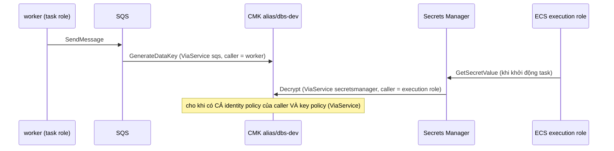

# DBS-154 · KMS key do nhóm quản lý cho RDS, SQS và Secrets Manager

> **Status:** Draft · **Vai:** #5 Platform & Ops · **Cặp đôi review:** Dev khác (theo team.md) · **Nhánh:** `feat/DBS-154-kms-cmk` (cắt từ `origin/main` `957dcbf`, đã có DBS-120/121/139/145/155) · **PR:** — · **Cập nhật:** 2026-11-14

## 1. Bối cảnh

- **Task trên board:** Task, Tuần 6, ưu tiên High, Deliverable/Demo P3, vai #5 Platform & Ops (khớp loại việc: Terraform, nên baseline là `terraform fmt/validate/test`). **Expect:** «Dữ liệu nhạy cảm được mã hóa bằng khóa do nhóm quản lý và có thể thu hồi.»
- **DoD (nguyên văn):**
  1. Key KMS riêng với policy tối thiểu; RDS, SQS, Secrets Manager dùng key này
  2. Xoay khóa tự động bật; chi phí KMS ghi lại
  3. Kiểm tra: tài nguyên được mã hóa bằng đúng key (ảnh chụp/lệnh CLI)
  4. PR đã merge vào main (CI xanh); Dev review; bảng «Đối chiếu test case» trong PR điền đủ
- **Phụ thuộc:** DBS-66 (RDS) và DBS-73 (SQS) Done và có trong `main`. Không có task chưa xong chặn việc này.
- **"Thực trạng" trên board đã cũ** (kiểm bằng lệnh AWS thật ngày 2026-11-14, `aws kms`, `aws rds`, `aws sqs`, `aws secretsmanager`):

| Thứ | Hiện tại | Đạt DoD 1? |
|---|---|---|
| CMK `alias/dbs-dev` (`envs/dev/base/kms.tf`) | Có từ DBS-66, `KeyManager=CUSTOMER`, xoay 365 ngày đã bật (`NextRotationDate` 2027-10-26) | key policy là **mặc định** (root toàn quyền), chưa tối thiểu |
| RDS `dbs-dev`: lưu trữ và secret master `rds!db-…` | Dùng CMK (`kms_key_id` ở `session/rds.tf:31,39`) | đạt |
| ElastiCache Valkey | Dùng CMK (`session/redis.tf:32`) | đạt |
| Secret `dbs/dev/redis-auth` | Dùng CMK (`base/redis_auth.tf`) | đạt |
| Secret `dbs/dev/demo-accounts` (do `seed-cognito.sh` tạo) | `KmsKeyId` rỗng = khóa AWS quản lý `aws/secretsmanager` | **chưa** |
| 4 queue SQS (2 queue + 2 DLQ, `base/sqs.tf`) | SSE-SQS (`SqsManagedSseEnabled=true`, `KmsMasterKeyId` rỗng) | **chưa** |

- **Đã có gì:** DBS-120 (execution role có `kms:Decrypt` trên CMK chỉ qua Secrets Manager), [DBS-66](DBS-66-terraform-rds.md), [DBS-73](DBS-73-terraform-sqs.md), BL-241 (queue policy allow-list, `base/sqs.tf`), `infra/scripts/verify-clean.sh` (mẫu cho script kiểm chỉ đọc). **Baseline** (2026-11-14): `terraform fmt -check -recursive` sạch; `terraform test -parallelism=1` ở `envs/dev/base` 53 pass, `envs/dev/session` 66 pass, `bootstrap` 9 pass, `validate` sạch; không có code backend bị đổi nên bốn lệnh backend không thuộc baseline (xem `task-kinds.md`, hàng Infrastructure).
- **Môi trường AWS lúc làm:** account của profile `dbs-admin`; phiên `session` **đang bật do người/agent khác dựng lúc 05:12 UTC** (RDS `dbs-dev`, Valkey, ALB, ECS `api`+`worker` 1 task mỗi service). Việc của task này chỉ `apply` `envs/dev/base`; không đụng stack `session`, không bật `disable-key` trên CMK dùng chung (RDS sẽ mất truy cập khóa).
- **Backlog cùng module:** BL-241 (queue policy, không đổi), BL-243 (simulate policy execution role: không thuộc task này, không đụng), BL-265 (policy `dbs-no-secret` chặn `kms:Decrypt` với group `dbs-dev`: không ảnh hưởng profile `dbs-admin`, nêu để không nhầm khi một principal khác thử). Không dòng nào cần xóa.
- **Ngoài phạm vi:** (a) mã hóa CloudWatch Logs, ECR, SNS `dbs-dev-alarms`, S3 state bằng CMK (đang dùng khóa dịch vụ hoặc SSE-S3); (b) tách mỗi dịch vụ một key; (c) khóa multi-region hoặc key cho `prod`; (d) mã hóa tầng ứng dụng (ví dụ cột PII). Mỗi mục thành dòng BACKLOG ở §8.
- **Câu hỏi mở và quyết định ở G1 (agent tự duyệt vì người dùng vắng):**
  1. *Một key hay nhiều key?* Dùng **một** CMK chung (đã có, 1 USD/tháng). Lý do: DoD nói «Key KMS riêng … dùng key này» (số ít); thêm key tốn 1 USD/tháng mỗi key và không đổi kiểm soát vì quyền nằm ở IAM theo từng role. Đánh đổi (thu hồi tất cả bốn loại cùng lúc) ghi ở §3 và BACKLOG.
  2. *Tạo key mới hay sửa key hiện có?* Sửa tại chỗ key `alias/dbs-dev` (đổi key RDS buộc tạo lại instance; key mới còn buộc session kế tiếp tạo lại mọi thứ). Policy và description đổi tại chỗ, `terraform plan` phải là 0 destroy.
  3. *Secret `demo-accounts`:* Terraform không quản lý (script tạo); sửa script để luôn đặt `--kms-key-id`, và tự chuyển bản cũ (`update-secret`). Không đưa vào Terraform vì giá trị (mật khẩu demo) không được vào state.
  4. *`terraform apply` thật và hành động AWS khác:* người dùng đã cho phép trong phiên này (profile `dbs-admin`). Không destroy.

## 2. Hành vi

**H1. Key policy tối thiểu (ủy quyền cho IAM, chỉ qua dịch vụ).** Ba statement, không có `kms:*` và **không `Principal "*"`** (domain review #1: statement `*` kèm `ViaService` cho mọi principal của tài khoản dùng key mà không cần identity policy; thế thì mọi quyền KMS trong IAM vô nghĩa và ai đọc được secret hay queue cũng giải mã được):

| Sid | Principal | Cho phép | Điều kiện |
|---|---|---|---|
| `AccountManagesKeyNotData` | gốc tài khoản (`arn:aws:iam::<acct>:root`) | chỉ thao tác quản lý: `Describe*`, `Get*`, `List*`, `EnableKey`, `DisableKey`, `EnableKeyRotation`, `DisableKeyRotation`, `RotateKeyOnDemand`, `PutKeyPolicy`, `UpdateKeyDescription`, `TagResource`, `UntagResource`, `ScheduleKeyDeletion`, `CancelKeyDeletion`, `CreateAlias`, `UpdateAlias`, `DeleteAlias`, `RevokeGrant` | không (vẫn cần identity policy của IAM) |
| `UseKeyOnlyThroughAwsServices` | gốc tài khoản (nghĩa là **ủy quyền cho IAM**: principal phải có quyền trong identity policy) | `Encrypt`, `Decrypt`, `ReEncryptFrom`, `ReEncryptTo`, `GenerateDataKey`, `GenerateDataKeyWithoutPlaintext` | `kms:CallerAccount` = tài khoản **và** `kms:ViaService` ∈ {`rds`, `secretsmanager`, `sqs`, `elasticache`}`.<region>.amazonaws.com` (dựng từ `var.region`) |
| `GrantsForAwsServices` | gốc tài khoản (ủy quyền IAM) | `CreateGrant` | như dòng trên và `kms:GrantIsForAWSResource = true` |

Hệ quả cần đúng: dùng key cần **cả hai** lớp, identity policy của principal **và** key policy qua dịch vụ. Không ai (kể cả admin) gọi `kms:Encrypt`/`Decrypt` trực tiếp bằng CLI trên key này (`AccessDeniedException`: không qua dịch vụ). Principal cần quyền KMS trong IAM, liệt kê hết: 3 execution role (api, worker, migrate: `kms:Decrypt` qua Secrets Manager, đã có từ DBS-120), task role worker (`GenerateDataKey`, `Decrypt` qua SQS, mới), role seeder (qua Secrets Manager, mới), người `apply` (admin, `AdministratorAccess`). Task role api không có gì. `PutKeyPolicy` còn với gốc tài khoản nên không tự khóa mình.

**H2. SQS dùng CMK.** Hai queue chính và hai DLQ đặt `kms_master_key_id` = ARN CMK, `kms_data_key_reuse_period_seconds = 300` (giảm số lời gọi KMS), tắt SSE-SQS. Message cũ chưa mã hóa bằng CMK vẫn đọc được (SQS xử lý theo từng message).
- Policy worker `dbs-dev-worker-sqs` (gắn vào role task worker ở `session`) thêm một statement: `kms:GenerateDataKey` và `kms:Decrypt` trên **đúng CMK**, điều kiện `kms:ViaService = sqs.ap-southeast-1.amazonaws.com`. Role api vẫn không có gì (queue policy từ chối và không có quyền KMS).
- Người vận hành redrive DLQ (`StartMessageMoveTask`, runbook `dlq-redrive.md`) cần quyền KMS trong identity của mình (qua SQS); admin có sẵn; ghi vào runbook. Hai queue chính có `depends_on` policy worker để quyền KMS có trước khi queue chuyển sang CMK.

**H3. Secrets Manager dùng CMK.** Ba secret của dự án đều mã hóa bằng CMK: master RDS và `redis-auth` (đã có), `dbs/dev/demo-accounts`: `seed-cognito.sh` tạo mới với `--kms-key-id alias/dbs-dev`, và nếu secret đã có mà `KmsKeyId` khác CMK thì chạy `update-secret --kms-key-id` (SM tự mã hóa lại phiên bản hiện tại). Role `dbs-dev-cognito-seeder` thêm `secretsmanager:UpdateSecret` và `kms:Decrypt`, `kms:GenerateDataKey`, `kms:DescribeKey` **chỉ trên CMK, chỉ qua Secrets Manager**.

**H4. Xoay khóa.** `enable_key_rotation = true`, `rotation_period_in_days = 365` ghi rõ trong code (không dựa vào mặc định); `deletion_window_in_days = 7`.

**H5. Công cụ kiểm (DoD 3).** `infra/scripts/verify-kms.sh`, chỉ đọc (như `verify-clean.sh`), in từng dòng `OK`/`FAIL`/`BO-QUA`/`LOI` và thoát 0 (mọi thứ đang có đều dùng CMK), 1 (có thứ dùng khóa khác), 2 (không kiểm được). Kiểm: CMK `Enabled` + `CUSTOMER` + xoay bật; mọi RDS instance và ElastiCache group tên `dbs-*` có `KmsKeyId` = CMK và `StorageEncrypted`/`AtRestEncryptionEnabled`; mọi queue `dbs-dev-*` có `KmsMasterKeyId` trỏ CMK (ARN, id hoặc alias) và không SSE-SQS; mọi secret tên `dbs/*` hoặc `rds!db-*` có `KmsKeyId` = CMK. Loại không có tài nguyên (session đã xóa) in `BO-QUA`, không phải `FAIL`.

**Ca biên:** secret `KmsKeyId` rỗng ⇒ `FAIL` (rỗng nghĩa là `aws/secretsmanager`); queue chỉ có SSE-SQS ⇒ `FAIL`; alias thay cho ARN ở SQS vẫn là CMK; `aws` lỗi quyền ⇒ `LOI` (thoát 2, không kết luận sạch); không tài nguyên nào của loại ⇒ `BO-QUA`.

## 3. Kiến trúc

- **Vị trí:** `infra/terraform/envs/dev/base/` (stack giữ lại): `kms.tf` (key, alias, policy), `sqs.tf` (queue, policy worker), `cognito_seeder.tf` (role seed); `infra/scripts/seed-cognito.sh`, `infra/scripts/verify-kms.sh` (mới). Stack `session` **không đổi**: nó đọc `kms_key_arn` qua `terraform_remote_state`, giá trị giữ nguyên.
- **Interface:** output `kms_key_arn` giữ nguyên (người gọi: `session/rds.tf`, `session/redis.tf`, `session/iam.tf`, `base/redis_auth.tf`). Thêm output `kms_key_id` không cần. Đổi `aws_sqs_queue.*` từ `sqs_managed_sse_enabled` sang `kms_master_key_id` (người gọi: `local.sqs_all_queues`, `aws_sqs_queue_policy.deny_api`: không phụ thuộc thuộc tính này).
- **Dữ liệu chạm:** không có bảng Postgres, không đổi schema, event contract, `ErrorCode`, env var hay money rule.
- **Luồng dùng key:**

- **Rủi ro chính và cách xử:** (1) policy sai ⇒ RDS/Valkey/SQS/secret mất truy cập khóa. Chặn bằng: `plan` không đổi gì ở `session`; thử thật trên phiên đang bật (chạy task Fargate đọc secret, copy snapshot RDS bằng CMK, gửi/nhận SQS, ElastiCache snapshot) **trước khi** coi là đạt; đường «tạo từ trống» sẽ được xác nhận khi dựng phiên kế tiếp (BACKLOG). (2) Tự khóa: gốc tài khoản giữ `PutKeyPolicy`; `bypass_policy_lockout_safety_check` để mặc định `false`. (3) Một key chung: thu hồi (`disable-key`) làm hỏng cả bốn loại, và RDS chuyển `inaccessible-encryption-credentials`; chấp nhận cho dev, thử thu hồi trên **key tạm** (M-154-09) chứ không trên key dùng chung.
- **Chi phí:** KMS 1 USD/tháng/key (đo thật: 0,6003 USD tới 2026-11-13 gồm cả hai phiên, `AWS Key Management Service` ở báo cáo [2026-11-14](../components/platform-infra/cost-reports/2026-11-14.md)); yêu cầu 20.000 đầu tiên mỗi tháng miễn phí, ở dev vài trăm lời gọi/tháng (113 lời gọi ghi nhận 25/10–31/10). SQS thêm lời gọi KMS mỗi 5 phút/queue có hoạt động (`kms_data_key_reuse_period_seconds = 300`). Khoản xoay khóa chưa phát sinh (lần xoay đầu 2027-10-26); số thật sẽ lấy từ báo cáo chi phí tuần (DBS-143).
- **Thay đổi cấp hệ thống:** README Terraform (mục KMS mới), docs/03 §12 (một dòng), threat-model (T-ID nếu có về mã hóa), runbook `dlq-redrive.md` (quyền KMS), platform-infra concept brief. ADR không đổi (ADR-11 đã nêu «KMS» ở dòng 25).

## 4. Test cases tự động

Lớp: `tf` = `terraform test` với `mock_provider` (không cần credential); `py` = test Python với `aws` giả.

| ID | Truy vết | Lớp | Given · When · Then | Mong đợi |
|---|---|---|---|---|
| TC-154-01 | DoD 1 | tf `base/tests/kms.tftest.hcl` | Given policy CMK (dựng bằng `jsonencode`); When parse JSON; Then đúng 3 statement với Sid trên, không statement nào có `Principal "*"`, `kms:*` hay `Action` rỗng | đúng |
| TC-154-02 | DoD 1 | tf `base/tests/kms.tftest.hcl` | Statement `AccountManagesKeyNotData` (gốc tài khoản) **không** chứa `Encrypt`, `Decrypt`, `ReEncrypt*`, `GenerateDataKey*`, `CreateGrant` và **có** `kms:PutKeyPolicy`, `kms:ScheduleKeyDeletion`, `kms:CancelKeyDeletion` (không tự khóa) | đúng |
| TC-154-03 | DoD 1 | tf `base/tests/kms.tftest.hcl` | `UseKeyOnlyThroughAwsServices` và `GrantsForAwsServices` dùng `Principal = { AWS = "arn:aws:iam::<acct>:root" }` (ủy quyền IAM), luôn có `kms:CallerAccount` và `kms:ViaService` dựng từ `var.region` (thử thêm `region = "us-west-2"`) đúng bốn dịch vụ (`rds`, `secretsmanager`, `sqs`, `elasticache`); `GrantsForAwsServices` còn `kms:GrantIsForAWSResource = "true"` | đúng |
| TC-154-04 | DoD 2 | tf `base/tests/kms.tftest.hcl` | `enable_key_rotation = true`, `rotation_period_in_days = 365`, `deletion_window_in_days = 7`, alias `alias/dbs-dev` | đúng |
| TC-154-05 | DoD 1 | tf `sqs.tftest.hcl` | Mọi queue (2 chính, 2 DLQ) `kms_master_key_id` = ARN CMK, `kms_data_key_reuse_period_seconds = 300`, `sqs_managed_sse_enabled` không bật | đúng |
| TC-154-06 | DoD 1 | tf | Policy worker có statement KMS: action đúng `{GenerateDataKey, Decrypt}`, resource đúng `[CMK]`, `kms:ViaService = sqs…`; không action `kms:*`; các statement SQS cũ giữ nguyên | đúng |
| TC-154-07 | DoD 1 | tf `cognito.tftest.hcl` | Role seeder: KMS chỉ `{Decrypt, GenerateDataKey, DescribeKey}` trên CMK, `ViaService = secretsmanager…`; có `secretsmanager:UpdateSecret`; vẫn không `*`, không `Delete*` | đúng |
| TC-154-08 | DoD 1 | tf (đã có) | `redis_auth` secret dùng CMK (thêm assert ở `redis.tftest.hcl`); RDS storage, secret master RDS, Valkey dùng CMK (`session.tftest.hcl` đã có từ DBS-66/75) | đạt (đã có) |
| TC-154-09 | DoD 3 | py `test_verify_kms.py` | Tất cả dùng CMK ⇒ thoát 0, mọi dòng `OK` | exit 0 |
| TC-154-10 | DoD 3 | py | Từng loại sai (RDS khóa khác; Valkey khóa khác; queue chỉ SSE-SQS; secret `KmsKeyId` rỗng; CMK xoay tắt; CMK `Disabled`) ⇒ `FAIL` đúng loại, thoát 1 | exit 1 |
| TC-154-11 | DoD 3 | py | Không có RDS/Valkey (session đã xóa) ⇒ `BO-QUA`, thoát 0; `aws` lỗi quyền ⇒ `LOI`, thoát 2 (không báo OK); queue khai alias thay ARN ⇒ `OK`; script chỉ gọi `describe-*`, `get-*`, `list-*` (không lệnh ghi) | đúng |
| TC-154-12 | DoD 1 | py `test_seed_cognito.py` | Tạo secret mới: lệnh `create-secret` có `--kms-key-id alias/dbs-dev`; secret có sẵn khóa cũ: gọi `update-secret --kms-key-id`; secret có sẵn đã đúng CMK: không gọi `update-secret` | đúng |
| TC-154-13 | DoD 4 | quy trình | PR merge, CI xanh (job `terraform`, `script-tests`), Dev review | chờ PR |

## 5. Test thủ công (AWS thật, profile `dbs-admin`, `ap-southeast-1`)

Điều kiện: `AWS_PROFILE=dbs-admin`; `backend.hcl` của `envs/dev/base` (không commit); phiên `session` đang bật (có sẵn). Output thô ở `screenshots/DBS-154/manual-test.txt` (đã che id tài khoản, ARN, id key).

| Bước | Việc làm | Kết quả mong đợi |
|---|---|---|
| M-154-00 | **Sao lưu rollback:** `aws kms get-key-policy --key-id alias/dbs-dev --policy-name default --output text > /tmp/kms-policy-before.json`; chuẩn bị sẵn lệnh khôi phục `aws kms put-key-policy --key-id alias/dbs-dev --policy-name default --policy file:///tmp/kms-policy-before.json` | lưu xong policy cũ trước khi chạm key dùng chung |
| M-154-01 | **Trước khi sửa:** `bash infra/scripts/verify-kms.sh` | thoát 1: `FAIL sqs` (4 queue chỉ SSE-SQS), `FAIL secrets` (`demo-accounts` không CMK); CMK, RDS, Valkey `OK` |
| M-154-02 | `terraform plan` ở `envs/dev/base` | `0 to add, 7 to change, 0 to destroy` (key, 4 queue, policy worker, policy seeder); không destroy |
| M-154-03 | `terraform apply` (đã được phép) rồi `aws kms get-key-policy` và `get-key-rotation-status` | policy đúng 3 statement (không `Principal "*"`); rotation `true`, 365 |
| M-154-04 | `aws kms encrypt --key-id alias/dbs-dev` trực tiếp (admin) | `AccessDeniedException` (từ chối: không qua dịch vụ) |
| M-154-05 | Tạo queue tạm ngoài `dbs-dev-*` với `KmsMasterKeyId=alias/dbs-dev`, `send-message` / `receive-message` / `delete-message` rồi xóa queue tạm; đồng thời kiểm tra worker đang chạy trên `dbs-dev-*-events` | queue tạm gửi–nhận thành công; queue thật có `KmsMasterKeyId` = CMK, `SqsManagedSseEnabled=false`, log `/dbs/dev/worker` không có lỗi `KMS.*` |
| M-154-06 | `aws sts assume-role` role `dbs-dev-cognito-seeder` rồi chạy `bash infra/scripts/seed-cognito.sh` (không `--rotate`), sau đó `describe-secret` và `get-secret-value` | `update-secret` thành công bằng role seeder, `KmsKeyId` = CMK; đọc lại được (đủ khóa JSON, không in giá trị) |
| M-154-07 | `aws ecs run-task --cluster dbs-dev --task-definition dbs-api --launch-type FARGATE --network-configuration "awsvpcConfiguration={subnets=[...],securityGroups=[...],assignPublicIp=ENABLED}" --overrides '{"containerOverrides":[{"name":"api","command":["node","-e","process.exit(0)"]}]}'` | task `STOPPED` exitCode 0, không `ResourceInitializationError`/`AccessDenied` |
| M-154-08 | `aws rds copy-db-snapshot` từ **automated snapshot** đang có (`rds:dbs-dev-…`) với `--kms-key-id alias/dbs-dev` rồi `describe-db-snapshots`; sau đó xóa bản copy | snapshot copy `available`, `KmsKeyId` = CMK (không đụng instance `dbs-dev`); bản copy bị xóa, `rds-snapshot-manual` sạch |
| M-154-09 | **Thu hồi** trên key tạm: tạo key + queue tạm với `KmsDataKeyReusePeriodSeconds=60`, gửi OK → `disable-key` → đợi > 60 s → gửi lỗi `KMS.DisabledException` → `enable-key` → gửi OK → xóa queue, `schedule-key-deletion` 7 ngày | gửi lỗi đúng khi tắt (sau hết hạn data key cache), phục hồi khi bật; key tạm chờ xóa |
| M-154-10 | `bash infra/scripts/verify-kms.sh` sau apply | thoát 0; `OK` CMK, RDS, Valkey, 4 queue, 3 secret |
| M-154-11 | `aws ce get-cost-and-usage` dịch vụ KMS, từ 25/10 | số liệu thật để ghi chi phí (README và §8) |

## 6. Domain review (AI)

Kết quả review độc lập tại [domain-review.md](screenshots/DBS-154/domain-review.md) (11 phát hiện: 1 blocking, 5 should-fix, 5 minor; Verdict `REVISE` → đã xử lý toàn bộ):

| # | Mức độ | Xử lý |
|---|---|---|
| 1 | blocking | Đổi `Principal` của `UseKeyOnlyThroughAwsServices` và `GrantsForAwsServices` từ `"*"` sang `arn:aws:iam::<acct>:root` (ủy quyền cho IAM, cần cả identity policy và key policy `ViaService`); thêm assert không có `Principal "*"` trong `kms.tftest.hcl` (TC-154-01..03). |
| 2 | should-fix | Thêm bước `M-154-00` sao lưu policy cũ và lệnh khôi phục `put-key-policy`. Lưu ý Terraform: `aws_iam_policy.worker_sqs` tham chiếu `aws_sqs_queue.main[*].arn` nên không đặt `depends_on` ngược trên queue (sẽ tạo vòng lặp); khi apply trực tiếp trên môi trường đang có worker chạy, có thể `-target=aws_iam_policy.worker_sqs` trước nếu cần zero-downtime. |
| 3 | should-fix | Sửa `M-154-09`: tạo queue tạm với `KmsDataKeyReusePeriodSeconds=60` và đợi > 60 s sau `disable-key` trước khi gửi để tránh hit data key cache. |
| 4 | should-fix | Sửa `M-154-05`: round-trip gửi/nhận trên queue tạm ngoài `dbs-dev-*` (tránh làm bẩn DLQ/alarm của phiên đang chạy); kiểm queue thật bằng log `/dbs/dev/worker` và metric. |
| 5 | should-fix | Sửa `M-154-06`: chạy `seed-cognito.sh` dưới `aws sts assume-role` của `dbs-dev-cognito-seeder` để kiểm chứng quyền `UpdateSecret` + KMS mới. |
| 6 | should-fix | Sửa `M-154-08`: copy từ automated snapshot (`rds:dbs-dev-…`) thay vì `create-db-snapshot` để không treo I/O instance đang dùng. |
| 7 | minor | Bổ sung `--launch-type FARGATE` và `--network-configuration` vào `M-154-07`. |
| 8 | minor | Cập nhật test cũ mâu thuẫn (`cognito.tftest.hcl`, `sqs.tftest.hcl`) và comment/README (`cognito_seeder.tf`, `infra/terraform/README.md`). |
| 9 | minor | Dùng `jsonencode` cho key policy; thêm assert root giữ `PutKeyPolicy`/`ScheduleKeyDeletion`/`CancelKeyDeletion` và `ViaService` dựng từ `var.region`. |
| 10 | minor | Cập nhật `docs/03_HIGH_LEVEL_ARCHITECTURE.md` dòng 803 phản ánh đúng thực trạng (S3 dùng SSE-S3, đưa nâng cấp CMK vào BACKLOG). |
| 11 | minor | Ghi mục BACKLOG cho việc kiểm tra xoay secret RDS và dựng mới RDS/Valkey từ trống dưới key policy mới ở phiên kế tiếp. |

## 7. Kế hoạch triển khai

1. **Tài liệu & kế hoạch:** Hoàn thiện §4–§7 trong `docs/features/DBS-154-kms-cmk.md` theo domain review.
2. **Terraform (`infra/terraform/envs/dev/base/`):**
   - `kms.tf`: cập nhật `aws_kms_key.main` với `description`, `rotation_period_in_days = 365`, và `policy = jsonencode(...)` gồm 3 statement (`AccountManagesKeyNotData`, `UseKeyOnlyThroughAwsServices`, `GrantsForAwsServices`), tất cả dùng `arn:aws:iam::${var.account_id}:root` và `var.region`.
   - `sqs.tf`: bỏ `sqs_managed_sse_enabled = true`, bật `kms_master_key_id = aws_kms_key.main.arn` và `kms_data_key_reuse_period_seconds = 300` cho cả `aws_sqs_queue.dlq` và `aws_sqs_queue.main`; thêm statement `KmsForSqs` (`kms:GenerateDataKey`, `kms:Decrypt` trên CMK với `kms:ViaService = sqs.${var.region}.amazonaws.com`) vào `aws_iam_policy.worker_sqs`.
   - `cognito_seeder.tf`: cập nhật comment, thêm `secretsmanager:UpdateSecret` vào `DemoAccountsSecret`, và thêm statement `KmsForDemoAccountsSecret` (`kms:Decrypt`, `kms:GenerateDataKey`, `kms:DescribeKey` trên CMK với `kms:ViaService = secretsmanager.${var.region}.amazonaws.com`).
3. **Terraform tests (`infra/terraform/envs/dev/base/tests/`):**
   - Tạo `kms.tftest.hcl` (TC-154-01..04, gồm test `Principal` không phải `*`, lockout guard, và `region` biến).
   - Cập nhật `sqs.tftest.hcl` (TC-154-05..06) và `cognito.tftest.hcl` (TC-154-07); kiểm tra `redis.tftest.hcl` (TC-154-08).
4. **Scripts & Python tests (`infra/scripts/`):**
   - Tạo `verify-kms.sh` (chỉ đọc `describe-*`/`get-*`/`list-*`, kiểm tra CMK, RDS, ElastiCache, SQS, Secrets Manager, trả `OK`/`FAIL`/`BO-QUA`/`LOI`, exit 0/1/2).
   - Cập nhật `seed-cognito.sh`: thêm `KMS_KEY_ID` (mặc định `alias/dbs-dev`), truyền `--kms-key-id` khi `create-secret`, và kiểm tra `describe-secret` để gọi `update-secret --kms-key-id` khi secret có sẵn chưa dùng đúng CMK.
   - Tạo `tests/test_verify_kms.py` (TC-154-09..11) và cập nhật `tests/fake_aws.py` + `tests/test_seed_cognito.py` (TC-154-12).
5. **Kiểm chứng offline:**
   - `terraform fmt -check -recursive`
   - `terraform init -backend=false`, `terraform validate`, `terraform test -parallelism=1` trên `envs/dev/base` và `envs/dev/session`.
   - `python3 -m unittest discover -s infra/scripts/tests -v`.
6. **Cập nhật tài liệu hệ thống & kiểm tra liên kết:**
   - `infra/terraform/README.md`, `docs/03_HIGH_LEVEL_ARCHITECTURE.md`, `docs/runbooks/dlq-redrive.md`, `docs/features/README.md`, `docs/BACKLOG.md` (BL-300..).
   - `node .agents/skills/dbs-delivering-task/scripts/check-doc-links.mjs`.

## 8. Kết quả

- **Offline / tự động (sau sửa `GrantsForAwsServices` cho `ec.amazonaws.com`):**
  - `terraform fmt -check -recursive` & `terraform validate`: đạt.
  - `envs/dev/base`: `terraform test` **56 passed, 0 failed** (gồm `kms.tftest.hcl`: 3/3 pass).
  - `infra/scripts/tests`: `python3 -m unittest discover -s infra/scripts/tests -v` đạt (TC-154-09..12).
- **Live AWS (`ap-southeast-1`, profile `dbs-admin`):**
  - **M-154-03 / M-154-04:** CMK `alias/dbs-dev` bật xoay khóa 365 ngày; gọi `aws kms encrypt` trực tiếp bị `AccessDeniedException` (key policy chặn dùng data action ngoài dịch vụ AWS).
  - **M-154-05 / M-154-06:** 4 SQS queue và 3 Secrets Manager secret (gồm `demo-accounts` sau khi chạy `seed-cognito.sh`) đều dùng CMK `alias/dbs-dev`.
  - **M-154-07:** Task Fargate `dbs-migrate` (`f429db0207714fe1ab1f8fb0bc0d4128`) đọc secret DB mã hóa CMK và chạy migration thành công (exit 0); `api` & `worker` chạy healthy (`/health/ready` 200, `database: up`, `redis: up`).
  - **M-154-08:** Snapshot RDS `dbs-dev-kms-test-snap` và bản copy `--kms-key-id alias/dbs-dev` đều `Encrypted=True` với CMK; đã xóa 2 snapshot test.
  - **M-154-09:** Diễn tập thu hồi khóa tạm trên queue test (`manual-test-m09.txt`) → `KMS.DisabledException`, đã dọn sạch queue & khóa tạm.
  - **M-154-10:** `bash infra/scripts/verify-kms.sh` thoát 0: `OK cmk`, `OK rds: 1`, `OK elasticache: 1`, `OK sqs: 4`, `OK secrets: 3`.
  - **Phát hiện thực tế trên AWS (đã sửa):** ElastiCache `CreateReplicationGroup` gọi `kms:CreateGrant` với `invokedBy: ec.amazonaws.com` nhưng không truyền `kms:ViaService`; đã cập nhật `GrantsForAwsServices` dùng `kms:GrantIsForAWSResource = "true"` + `kms:CallerAccount` (giữ `kms:ViaService` trên `UseKeyOnlyThroughAwsServices`).
- **Bằng chứng (đã redact account ID / key ID):** [manual-test.txt](screenshots/DBS-154/manual-test.txt), [manual-test-m09.txt](screenshots/DBS-154/manual-test-m09.txt).

## 9. Tài liệu đã cập nhật

- [docs/features/DBS-154-kms-cmk.md](DBS-154-kms-cmk.md)
- [docs/features/screenshots/DBS-154/manual-test.txt](screenshots/DBS-154/manual-test.txt)
- [docs/features/screenshots/DBS-154/manual-test-m09.txt](screenshots/DBS-154/manual-test-m09.txt)
- [infra/terraform/README.md](../../infra/terraform/README.md), [docs/03_HIGH_LEVEL_ARCHITECTURE.md](../03_HIGH_LEVEL_ARCHITECTURE.md), [docs/runbooks/dlq-redrive.md](../runbooks/dlq-redrive.md), [docs/BACKLOG.md](../BACKLOG.md) (đã cập nhật ở các commit trước trên nhánh).
