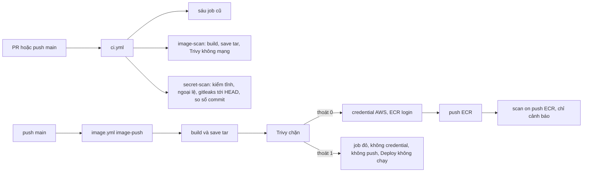

# DBS-155 · CI quét lỗ hổng image và quét secret

> **Status:** Draft · **Vai:** #5 Platform & Ops · **Cặp đôi review:** một Dev không phải tác giả · **Nhánh:** `infra/DBS-155-ci-image-secret-scan` · **PR:** — · **Cập nhật:** 2026-11-11

## 1. Bối cảnh

- **Task trên board:** Task, Tuần 6, Ưu tiên High, Deliverable P3, board đang "To Do" (người dùng chuyển sang "In Progress"). **Thực trạng (board):** "CI mới build và đẩy image (scan on push của ECR chưa đủ làm cổng chặn)." **Expect:** "Lỗi bảo mật nghiêm trọng bị chặn ngay trong PR/CI."
- **DoD** (nguyên văn):
  1. Bước quét image (vd Trivy) fail khi có lỗ hổng mức cao/nghiêm trọng có bản sửa; bước quét secret (vd gitleaks) fail khi phát hiện
  2. Danh sách ngoại lệ có lý do và hạn xem lại
  3. PR thử có secret giả hoặc dependency lỗi → CI đỏ; kết quả quét đính vào bản nộp P3
  4. PR đã merge vào main (CI xanh); Dev review; bảng «Đối chiếu test case» trong PR điền đủ
- **Phụ thuộc:** DBS-36 (build image, đẩy ECR tag SHA qua OIDC): Done trên board; `.github/workflows/image.yml` có trên `main` (`17b011e`). Mọi lần chạy `image.yml` trên `main` đều `skipped` vì repo chưa có biến `AWS_ROLE_ARN` (BL-034).
- **Đã có gì** (đã mở file và chạy lệnh, `main` = `17b011e`):

| Nơi | Hiện trạng |
|---|---|
| [`ci.yml`](../../.github/workflows/ci.yml) | Trigger `pull_request` và `push` `main`; sáu job `lint`, `typecheck`, `unit`, `e2e`, `db`, `build` (dòng 32–231). Không job nào build image hay quét gì. Tên job là hợp đồng với required checks (dòng 3–6). |
| [`image.yml`](../../.github/workflows/image.yml) | Chỉ `push` `main` và `workflow_dispatch`; job `image-push`: `docker build` (dòng 65–72) rồi `docker push`; bước "Kết quả scan" (dòng 75–82) chỉ đọc `findingSeverityCounts` của ECR, lỗi chỉ `::warning::`, không chặn. |
| [`deploy.yml`](../../.github/workflows/deploy.yml) | `workflow_run` sau `Image`; không liên quan quét. |
| [`check-image-workflow.py`](../../.github/scripts/check-image-workflow.py) | Kiểm tĩnh `image.yml`: một job `image-push`, không chuỗi `pull_request`, không chuỗi `latest`, mọi `uses:` ghim SHA 40 ký tự; chỉ `image.yml`/`deploy.yml` được xin `id-token`. Chạy local: `OK`. Chỉ chạy trong `image.yml`/`deploy.yml` (sau merge), chưa chạy ở CI của PR. |
| [`backend/Dockerfile`](../../backend/Dockerfile) | Ba stage `node:24-alpine` (tag, không ghim digest), runtime chạy user `node`, `ADD --checksum` bundle CA RDS. `.dockerignore` loại `test`, `env`, `.auth-local`. |
| [`ecr.tf`](../../infra/terraform/envs/dev/base/ecr.tf) | `scan_on_push = true` (dòng 8–10), quét cơ bản của ECR, chạy sau khi đã push nên không chặn được. |
| Ghim action | Mọi `uses:` ghim SHA kèm comment phiên bản; quy tắc ở [CONTRIBUTING §4b](../../CONTRIBUTING.md#4b-đọc-kết-quả-ci-trên-github-actions) và BL-013. |
| Trivy, gitleaks | Không có trong repo (grep `trivy`, `gitleaks` trong `.github/`: 0). |

- **Baseline local** (máy này: không có Docker, Trivy, gitleaks, actionlint, act; Node 26.11.1 dù `.nvmrc` = 24; 12 CPU, 7,6 GB RAM):

| Lệnh (trong `backend/`) | Kết quả |
|---|---|
| `npm run lint:check` | thoát 0 |
| `npm run typecheck` | thoát 0 |
| `npm test` | lần đầu bị kill (137, hết RAM với 12 worker); `npm test -- --maxWorkers=3`: 110/110 suite, 1870/1870 test đạt |
| `npm run test:e2e -- --maxWorkers=3` | thoát 1: 14/17 suite, 149/149 test đạt; 3 suite (`metrics`, `roles-app`, `app-guard`) đỏ vì `ECONNREFUSED 127.0.0.1:5432`: không có PostgreSQL vì không có Docker. Không phải lỗi code |
| `npm run build` | thoát 0 |
| `node --test ../load-tests/fraud-dataset/*.test.mjs` (4 file của job `unit`) | 70/70 đạt |
| `test:db`, `test:services` | không chạy được (cần Docker) |
| `python3 .github/scripts/check-image-workflow.py` (gốc repo) | `OK` |

- **Phát hiện ban đầu (đọc, không sửa):**
  - `npm audit --omit=dev`: 10 lỗ hổng ở dependency production: 4 high, 6 moderate, 0 critical. Bốn high đều có bản sửa trong dải semver hiện tại: `body-parser` 2.0.0–2.3.0 (GHSA-27r3-jxmh-p828), `multer` 2.0.0–2.4.0 (GHSA-q7qp-rjg7-q26m, qua `@nestjs/platform-express`), `joi` 18.0.0–18.3.0 (GHSA-4528-x5fx-h6hg). Cả cây (gồm dev): 1 critical, 6 high, 37 moderate, 2 low; dependency dev không vào image. Nghĩa là cổng Trivy bật hôm nay sẽ **đỏ ngay**.
  - Quét lịch sử git bằng regex (`git log --all -p`, script tạm ở scratchpad, giá trị đã che; `git rev-list --count HEAD` = 138, `--all` = 494 vì có 52 nhánh remote): khối `PRIVATE KEY` có thân khóa chỉ ở `backend/test/support/tls-fixtures/server.key` (ngoại lệ CONTRIBUTING §6, BL-111); các chỗ khác chỉ là dòng tiêu đề (`dev-auth.spec.ts`, manual-test DBS-53, tài liệu). Hai chuỗi dạng JWT ở `logging.options.spec.ts` và tài liệu review DBS-42 (token thử). Không có `AKIA…`, `ghp_…`, `sk-…`, `xox…`, `AIza…`. Ước lượng này đã được thay bằng số đếm thật ngay dưới.
  - **gitleaks 8.30.1** (binary, `git --log-opts="HEAD" --redact`, bộ luật mặc định, chưa có cấu hình): thoát 1, "137 commits scanned", **122 phát hiện**: 1 `private-key` (`server.key`, BL-111) và 121 `generic-api-key`. Phân loại theo dạng giá trị (không in giá trị; report chưa che đã xóa): 113 là UUID trong `docs/features/screenshots/**/manual-test*.txt` (Idempotency-Key, `"key":"…"`, `idem_key`), 3 là id container Docker (hex 64) cùng thư mục, 5 là giá trị thử trong 5 file spec (`compose-redis-url`, `env.bootstrap`, `validation.schema`, `r2-unusual-amount`, `r3-new-account-large-transfer`). Không phát hiện nào giống credential thật; xử lý ở câu 13.
  - **gitleaks đếm 137, `git rev-list --count HEAD` = 138:** commit `a89b678` chỉ xóa file nên gitleaks không đếm. `git log --diff-filter=AM --format=%H HEAD | wc -l` = 137, khớp.
  - **Trivy 0.76.1** `fs` trên `backend/package-lock.json` (dependency production, DB tải từ `mirror.gcr.io`): CRITICAL 0; HIGH 3 (cả 3 có bản sửa): `body-parser` 2.3.0 → 2.4.0 (CVE-2026-111181), `joi` 18.2.9 → 18.3.1 (CVE-2026-118772), `multer` 2.4.0 → 2.5.0 (CVE-2026-113872); MEDIUM 4 (có bản sửa); LOW 0; không có lỗi chưa có bản sửa. Lệnh chặn (a) thoát 1. `fs --scanners secret` trên cây (trừ `node_modules`): 0 phát hiện, thoát 0. Gói Alpine và `npm` đi kèm image `node` chưa quét được (cần image, chỉ có trên CI).
  - Chưa có bản ghép P3: [deliverables README](../deliverables/README.md) ghi P3 (Security & DevOps, #5, tuần 6) "chưa nộp", nguồn là `components/ci-cd`, threat model.
- **BACKLOG liên quan:**

| Dòng | Quyết định |
|---|---|
| BL-035 (chặn theo mức nghiêm trọng khi scan image và quét secret) | **Nhận phần quét**, không xóa dòng: điều kiện đóng còn "BL-012 xong", ngoài task này. Phase 5 thu hẹp BL-035 về đúng phần đó (thêm `image-scan`, `secret-scan` vào ruleset) và ghi ở §9 |
| BL-111 (allowlist gitleaks đúng đường dẫn `server.key`) | **Nhận**, xóa dòng |
| BL-013 (tên job khác sáu tên, `uses:` ghim SHA cho workflow quét) | **Nhận** phần quét; phần deploy đã có từ DBS-38, nên xóa dòng |
| BL-012 (required checks của `main`) | **Nêu tên**. DBS-37 Done trên board nhưng dòng còn; không kiểm được ruleset vì không gọi GitHub trước G3. Job mới chỉ chặn merge khi chủ repo thêm `image-scan`, `secret-scan` vào ruleset: phần này nằm ở BL-035 đã thu hẹp |
| BL-034, BL-104 (`image.yml` luôn `skipped` vì thiếu `AWS_ROLE_ARN`) | **Nêu tên**: bước chặn trong `image.yml` chỉ chứng minh được bằng kiểm tĩnh và chạy local cho tới khi biến có |
| BL-106 (`docker build` thật chưa chạy) | **Nêu tên**: job `image-scan` sẽ build thật trên runner (chứng minh `ADD --checksum`), ghi task này thêm làm nguồn ở Phase 5; phần AWS vẫn mở |
| BL-028 (Terraform trong CI), BL-225 (ghim image ElasticMQ) | **Nêu tên**, ngoài phạm vi |

- **Ngoài phạm vi:** sửa ruleset/required checks (chủ repo, BL-012); quét IaC/Terraform (BL-028); quét lỗ hổng dependency dev (không vào image); SBOM, ký image; chặn deploy theo kết quả scan ECR; viết bản ghép P3 (người dẫn dắt P3), task này chỉ đặt kết quả quét ở nguồn `components/ci-cd` và link từ hàng P3.
- **Câu hỏi mở** và **Quyết định ở G1** (agent tự quyết, 2026-11-11):

| # | Câu hỏi | Quyết định và lý do |
|---|---|---|
| 1 | Công cụ | **Trivy** cho image (lỗ hổng OS Alpine và gói npm trong image, kèm quét secret trong image), **gitleaks** cho repo. Đúng ví dụ DoD, docs/03 §12 ("quét bí mật trong CI"), NFR-SEC-04 ([BRD](../BRD.md): 0 bí mật trong mã nguồn, đo bằng quét trong CI), threat model T16. |
| 2 | Cách chạy, có tính là thêm dependency không | **Có**, là gate phụ (ghi ở §8). Chạy bằng **image Docker chính thức ghim digest**: `ghcr.io/aquasecurity/trivy:0.76.1@sha256:…` (GHCR, không Docker Hub ẩn danh bị giới hạn lượt kéo) và `ghcr.io/gitleaks/gitleaks:v8.30.1@sha256:…`; không dùng action marketplace (không thêm JavaScript bên thứ ba chạy với token của job; gitleaks-action cần license với tài khoản tổ chức). Phiên bản đã chọn theo advisory: xem §8 "Chọn phiên bản". Digest và chữ ký cosign của image kiểm ở Phase 3. Local dùng binary chính thức cùng phiên bản. |
| 3 | Đặt ở workflow/job nào | Hai job mới trong `ci.yml`: **`image-scan`** (build image, `docker save`, Trivy trên file tar) và **`secret-scan`** (gitleaks, cộng kiểm tĩnh workflow và ngoại lệ), chạy mọi PR và push `main`, tên khác sáu tên hợp đồng, `working-directory: .` (gốc repo; `ci.yml` mặc định `backend`). Trong **`image.yml`**: build, save, Trivy **trước** `configure-aws-credentials`; chỉ khi Trivy thoát 0 mới lấy credential, kiểm tag và push. Không nhét vào job `build`: đổi nghĩa một check hợp đồng và CONTRIBUTING §4b. |
| 4 | Ngưỡng | Trivy `--severity HIGH,CRITICAL --ignore-unfixed --exit-code 1` (đúng "cao/nghiêm trọng có bản sửa"); thêm một bước chỉ in (exit 0) HIGH/CRITICAL chưa có bản sửa để người đọc thấy. MEDIUM/LOW không chặn. Secret trong image: một lượt Trivy riêng `--scanners secret` **không lọc mức**, mọi phát hiện là đỏ. gitleaks: mọi phát hiện (bộ luật mặc định) là đỏ, `--redact`. |
| 5 | Ngoại lệ | Ba file ở gốc repo, mỗi mục có lý do và hạn xem lại. Trivy: **`.trivyignore.yaml`** (`statement`, `expired_at`; Trivy tự bỏ mục quá hạn nên lỗ hổng hiện lại). gitleaks theo đường dẫn: **`.gitleaks.toml`** (`useDefault = true`, `description` chứa `Hạn xem lại: YYYY-MM-DD`, path neo `^…$` đúng một file). gitleaks theo phát hiện cụ thể trong commit đã có trên `main` (không viết lại được lịch sử): **`.gitleaksignore`**, mỗi fingerprint `commit:file:rule:line` có dòng `#` ngay trên ghi lý do và hạn. Hạn: **cuộn 90 ngày** (≤ hôm nay + 90 ngày, UTC), không gắn ngày kết thúc dự án. `.github/scripts/check-scan-exceptions.py` đỏ khi thiếu lý do/hạn, hạn đã qua hoặc quá 90 ngày. Hạn qua là **cố ý đỏ**: #5 xem lại lý do rồi gia hạn bằng PR; người gia hạn là người review PR đó. |
| 6 | gitleaks quét gì | **Lịch sử tới `HEAD`** (`fetch-depth: 0`, `--log-opts="HEAD"`) ở cả PR (HEAD là merge commit nên gồm commit của PR và `main`) và `main`. Không quét `--all` (mặc định của chế độ `git`): checkout `fetch-depth: 0` kéo cả 52 nhánh remote (`rev-list --all` = 494 so với `HEAD` = 138), nên một nhánh rác có secret sẽ làm mọi PR đỏ. Secret đã revert trong PR vẫn đỏ; nhánh lỡ commit secret phải rotate rồi viết lại lịch sử nhánh (CONTRIBUTING §6). Sau quét, so số commit gitleaks báo với số commit tới `HEAD` có thêm/sửa file (H2); lệch là đỏ (chống xanh giả do clone nông, `safe.directory`, mount sai). |
| 7 | 4 lỗ hổng high đang có bản sửa | **Sửa trong task này** bằng cập nhật `package-lock.json` trong dải semver hiện tại (không đổi `package.json` nếu dải cho phép), vì cổng không được đỏ ngay lúc merge và ngoại lệ cho lỗi đã có bản sửa đi ngược DoD #1. Gate phụ (đổi dependency, ghi §8); CI sáu job chứng minh không vỡ. Phát hiện Trivy khác npm audit (gói Alpine, `npm` đi kèm image `node`) xử lý ở Phase 4 theo kết quả thật: ưu tiên sửa (vd bỏ `npm`/`npx` khỏi stage runtime, runtime không dùng npm: `ecs.tf` dòng 99), cuối cùng mới là ngoại lệ có hạn. |
| 8 | Chứng minh "PR thử → CI đỏ" khi chưa lên GitHub | Trước G3 không chạm GitHub. Phase 4: chạy local đúng image, phiên bản và tham số workflow dùng (nhánh thử cục bộ có secret giả, có dependency lỗi, có ngoại lệ quá hạn). Sau đó chuẩn bị nhánh thử `test/DBS-155-scan-proof` (loại `test` có trong CONTRIBUTING §2) với các commit thử để coordinator đẩy lên một Draft PR bỏ đi, **sau** khi Draft PR của nhánh task đã có run xanh (không chạy song song); xóa nhánh khi đã ghi link. Secret giả là khóa sinh ngẫu nhiên tại chỗ, không phải định dạng token của nhà cung cấp. Người dùng đã cho tải binary Trivy và gitleaks chính thức vào scratchpad; máy vẫn không có Docker nên phần cần `docker build` chỉ chứng minh trên CI (cột "Chạy được ở đâu" ở §4, §5). |
| 12 | CVE mới công bố làm PR không liên quan đỏ | Chấp nhận: base `node:24-alpine` theo tag và DB Trivy tải mới mỗi lần nên kết quả thay đổi theo ngày. Quy trình ở §2 H6. Ghim digest base image chuyển BACKLOG ở Phase 5 (đổi thì phải có người cập nhật digest, ngoài DoD). |
| 13 | 121 phát hiện `generic-api-key` sẵn có trong lịch sử | Không viết lại lịch sử `main` và không allowlist cả thư mục. (a) Một allowlist trong `.gitleaks.toml` chỉ cho luật `generic-api-key`, `regexTarget = "secret"`, giá trị đúng dạng UUID hoặc hex 64, **và** path `^docs/features/screenshots/.+\.(txt\|md)$`: đó là Idempotency-Key và id container trong log test thủ công, không phải bí mật (116 phát hiện). (b) 5 giá trị thử trong spec: fingerprint trong `.gitleaksignore`, mỗi dòng có lý do và hạn (cho phép chính xác commit, file, dòng; giá trị mới ở chỗ khác vẫn đỏ). Hệ quả: một UUID thật sự là secret đặt trong log test thủ công sẽ lọt; chấp nhận vì log đó đã có quy tắc che token (`manual-testing.md`). Phân loại lại bằng output thật ở Phase 4. |
| 9 | Kết quả quét cho P3 | Lưu bản tóm tắt kết quả (lệnh, phiên bản, số phát hiện theo mức, ngoại lệ) ở `docs/components/ci-cd/scan-results.md`, link từ concept brief ci-cd, hàng P3 của deliverables README và T16 của threat model. |
| 10 | Nhánh | `infra/`: CONTRIBUTING §2 ghi `infra` cho "Terraform, CI/CD"; DBS-35, DBS-41 dùng `infra/`. Không có loại `ci/`. |
| 11 | Board role | #5 khớp loại việc (CI quét image/secret là việc của #5 theo `platform.md`). |

## 2. Hành vi

Task không có API. Mô tả những gì CI chấp nhận và từ chối. `<digest>` chốt ở Phase 3; `$T` là thư mục tạm của runner (`$RUNNER_TEMP`). Mọi lệnh chạy ở gốc repo (`working-directory: .`).

**H1. Job `image-scan` (`ci.yml`, mọi PR và push `main`, `timeout-minutes: 15`).**
- Bước: checkout (không giữ credential) → `docker build --provenance=false --sbom=false -t dbs-api:scan backend` → `docker save -o "$T/img.tar" dbs-api:scan` → tải DB → ba lượt Trivy.
- Container Trivy **không mount `docker.sock`**, không nhận biến môi trường của job, chỉ thấy thư mục cache DB và file cần quét (chỉ đọc). Lượt tải DB có mạng nhưng không thấy image; ba lượt quét chạy `--network none`, `--skip-db-update`, `--offline-scan`:

```bash
TRIVY=ghcr.io/aquasecurity/trivy:0.76.1@sha256:<digest>
DBREPO=mirror.gcr.io/aquasec/trivy-db:2,ghcr.io/aquasecurity/trivy-db:2
docker run --rm -v "$T/cache:/cache" "$TRIVY" image --cache-dir /cache --download-db-only --db-repository "$DBREPO"
RUN="docker run --rm --network none -v $T/cache:/cache -v $T/img.tar:/scan/img.tar:ro -v $PWD/.trivyignore.yaml:/scan/.trivyignore.yaml:ro $TRIVY image --cache-dir /cache --skip-db-update --offline-scan --input /scan/img.tar"
$RUN --scanners vuln --severity HIGH,CRITICAL --ignore-unfixed --ignorefile /scan/.trivyignore.yaml --exit-code 1   # (a) chặn lỗ hổng
$RUN --scanners secret --exit-code 1                                                                             # (b) chặn secret, không lọc mức
$RUN --scanners vuln --severity HIGH,CRITICAL --exit-code 0                                                       # (c) chỉ in, gồm lỗi chưa có bản sửa
```

- Kết quả (a): có ít nhất một lỗ hổng HIGH/CRITICAL có `FixedVersion` không nằm trong ngoại lệ còn hạn → thoát 1, job đỏ. Chỉ MEDIUM/LOW, hoặc HIGH/CRITICAL chưa có bản sửa → thoát 0 (lỗi chưa sửa hiện ở (c)). Kết quả (b): bất kỳ secret nào Trivy phát hiện trong các lớp của image, ở **mọi** mức → thoát 1.
- Ca biên: tải DB lỗi ở cả hai repo → bước tải thoát khác 0, job đỏ (fail-closed); chạy lại bằng "Re-run failed jobs". `docker build` lỗi (vd checksum bundle RDS đổi) → đỏ trước khi quét. Ngoại lệ quá hạn → Trivy bỏ mục đó, lỗ hổng hiện lại ở (a); đồng thời H4 đỏ.

**H2. Job `secret-scan` (`ci.yml`, mọi PR và push `main`, `timeout-minutes: 10`).**
- Bước: checkout `fetch-depth: 0` (không giữ credential) → `pip install pyyaml==6.0.2` → `python3 .github/scripts/check-image-workflow.py` (kiểm tĩnh mọi workflow, có fixture âm; xem H7) → `python3 .github/scripts/check-scan-exceptions.py` (H4) → gitleaks → so số commit.

```bash
docker run --rm -v "$PWD:/repo:ro" ghcr.io/gitleaks/gitleaks:v8.30.1@sha256:<digest> \
  git /repo --log-opts="HEAD" --config /repo/.gitleaks.toml --gitleaks-ignore-path /repo/.gitleaksignore \
  --redact --exit-code 1 --verbose 2>&1 | tee "$T/gitleaks.log"
test "$(sed -n 's/.* \([0-9]\+\) commits scanned.*/\1/p' "$T/gitleaks.log")" = "$(git log --diff-filter=AM --format=%H HEAD | wc -l)"
```

- Số so sánh là số commit tới `HEAD` có thêm hoặc sửa file, không phải `git rev-list --count HEAD`: gitleaks không đếm commit chỉ xóa file (đo local: 137 so với 138, lệch đúng commit `a89b678`).

- Kết quả: bất kỳ phát hiện nào ở bất kỳ commit tới `HEAD` (trừ ngoại lệ còn hạn) → thoát 1; log chỉ có luật, file, dòng, commit, fingerprint, giá trị `REDACTED`. Không phát hiện → 0. Số commit gitleaks quét khác số ở dòng `test` (clone nông, `safe.directory`, mount sai, 0 commit) → đỏ. `set -o pipefail` để `tee` không nuốt mã thoát.
- Ca biên: `backend/test/support/tls-fixtures/server.key` không báo (allowlist đúng đường dẫn); cùng nội dung ở đường dẫn khác vẫn báo. Secret đã revert vẫn đỏ. Nhánh remote khác có secret **không** ảnh hưởng (chỉ quét tới `HEAD`).

**H3. `image.yml`.** Thứ tự mới của job `image-push`: checkout → kiểm tĩnh → `docker build -t dbs-api:$IMAGE_TAG backend` → `docker save` → tải DB → Trivy (a) và (b) như H1 → `configure-aws-credentials` → ECR login → kiểm tag đã có → nếu chưa có: `docker tag` sang `$REGISTRY/$REPOSITORY:$IMAGE_TAG` và `docker push` → đọc scan ECR (chỉ cảnh báo, như cũ). Trivy thoát 1 → job đỏ trước khi có credential AWS hay token OIDC được dùng, không push, `Deploy` không chạy (chỉ chạy khi `Image` `success`). Hệ quả: image được build cả khi tag đã có trên ECR (vài phút runner, chấp nhận). Vẫn một job, không chuỗi `latest`, không `pull_request`.

**H4. Ngoại lệ** (ba file ở gốc repo).

`.trivyignore.yaml`:

```yaml
vulnerabilities:
  - id: CVE-2099-00000            # ví dụ dạng; file rỗng nếu không cần
    paths: ["usr/local/lib/node_modules/npm/node_modules/x/package.json"]
    statement: "Lý do cụ thể; ai chấp nhận (#5); cách đóng"
    expired_at: 2027-02-01
```

`.gitleaks.toml`:

```toml
[extend]
useDefault = true

[[allowlists]]
description = "Khóa thử TLS CN=localhost, CA đã hủy khóa, chỉ cho test (CONTRIBUTING §6, BL-111). Hạn xem lại: 2027-02-01"
paths = ['''^backend/test/support/tls-fixtures/server\.key$''']

[[allowlists]]
description = "Idempotency-Key (UUID) và id container (hex 64) trong log test thủ công, không phải bí mật (§1 câu 13). Hạn xem lại: 2027-02-01"
targetRules = ["generic-api-key"]
condition = "AND"
regexTarget = "secret"
regexes = ['''^[0-9a-f]{8}-[0-9a-f]{4}-[0-9a-f]{4}-[0-9a-f]{4}-[0-9a-f]{12}$''', '''^[0-9a-f]{64}$''']
paths = ['''^docs/features/screenshots/.+\.(txt|md)$''']
```

Cú pháp `targetRules`, `condition` kiểm lại trên gitleaks 8.30.1 ở Phase 4 (binary đã có).

`.gitleaksignore` (chỉ khi cần, cho phát hiện trong commit bất biến trên `main`):

```text
# Token thử trong spec, không phải credential thật. Hạn xem lại: 2027-02-01
<commit>:backend/src/common/logging/logging.options.spec.ts:jwt:<line>
```

`check-scan-exceptions.py` (Python chuẩn + PyYAML) thoát 1 và nêu tên mục khi: mục Trivy thiếu `statement` hoặc `expired_at`; allowlist gitleaks thiếu `description` hoặc không có `Hạn xem lại: YYYY-MM-DD`; `paths` không neo `^…$` hoặc kết thúc `/`; fingerprint trong `.gitleaksignore` không có dòng `#` lý do + hạn ngay trên; hạn < hôm nay (UTC) hoặc > hôm nay + 90 ngày. Hạn qua thì CI đỏ có chủ ý cho tới khi #5 xem lại và gia hạn bằng PR. Chạy lại một commit cũ sau khi hạn của nó qua cũng đỏ: chấp nhận, vì cổng chỉ có nghĩa với đầu nhánh.

**H5. Dependency.** Cập nhật `package-lock.json` trong dải semver hiện tại cho `body-parser`, `multer` (qua `@nestjs/platform-express`), `joi`. Sau đó `npm audit --omit=dev` không còn high/critical; diff phiên bản resolve chỉ gồm các gói đó và phụ thuộc của chúng (ghi ở §8); `package.json` không đổi nếu dải cho phép. Rủi ro đường tiền: `joi` kiểm schema sự kiện outbox (`src/common/events/event-schemas.ts`) và cấu hình; `body-parser` giữ giới hạn kích thước body (413, BL-023).

**H6. CVE mới công bố làm PR không liên quan đỏ.** Base `node:24-alpine` theo tag và DB Trivy cập nhật mỗi lần chạy, nên một CVE mới có bản sửa có thể làm mọi PR đỏ qua đêm (gồm PR đường tiền, khi check thành bắt buộc). Quy trình: người thấy đỏ báo #5; #5 trong một ngày làm việc (1) sửa trước: nâng lockfile hoặc build lại với base mới; (2) chỉ khi chưa sửa được mới thêm ngoại lệ có lý do và hạn ≤ 90 ngày, review như PR thường. Image `ci.yml` quét và image `image.yml` đẩy có thể khác nhau (base theo tag, build khác thời điểm): vì vậy `image.yml` tự quét lại image chính nó đẩy (H3). Ghim digest base image: BACKLOG ở Phase 5.

**H7. Kiểm tĩnh chạy trên mọi PR.** `check-image-workflow.py` mở rộng và chạy trong `secret-scan` (H2), không chỉ trong `image.yml`/`deploy.yml` (luôn `skipped`, BL-034). Kiểm thêm: hai job mới tồn tại, tên không trùng sáu tên, `working-directory: .`, `timeout-minutes` có, `contents: read`, không `id-token`, `persist-credentials: false`; image công cụ ghim `@sha256:` 64 hex trên GHCR; đủ cờ ở H1/H2 (gồm `--log-opts="HEAD"`, `--redact`, `--network none`, `fetch-depth: 0`); không chuỗi `docker.sock` ở bất kỳ workflow nào; trong `image.yml` bước Trivy đứng trước `configure-aws-credentials` và `docker push`; `ci.yml` có bước gọi chính script này. Mỗi điều có fixture âm.

## 3. Kiến trúc

- **Vị trí:** `.github/workflows/ci.yml` (hai job mới), `.github/workflows/image.yml` (sắp lại bước), `.github/scripts/check-image-workflow.py` (H7), mới `.github/scripts/check-scan-exceptions.py`, `.github/scripts/tests/test_check_scan_exceptions.py`, `.trivyignore.yaml`, `.gitleaks.toml`, `.gitleaksignore` (nếu cần); `backend/package-lock.json`; có thể `backend/Dockerfile` (§1 câu 7, theo kết quả Trivy). Không đổi code ứng dụng; role `api`/`worker` không đổi.
- **Interface:** không đổi symbol exported. Hợp đồng tên check: thêm `image-scan`, `secret-scan`; sáu tên cũ giữ nguyên. `image.yml` vẫn một job `image-push`.
- **Dữ liệu, transaction:** không áp dụng.
- **Quyền và cô lập:** hai job mới chỉ `contents: read`, không `id-token`, `persist-credentials: false`, không `secrets.*`, không cache Actions. Container công cụ không có `docker.sock`, không biến môi trường của job (`ACTIONS_RUNTIME_TOKEN`, `ACTIONS_ID_TOKEN_REQUEST_*`, credential AWS không đi vào container), lượt quét không có mạng. Trong `image.yml` Trivy chạy trước khi có credential AWS.
- **Thời gian:** `image-scan` 15 phút (build lạnh `npm ci` + Nest build + kéo image + DB), `secret-scan` 10 phút. Số đo thật ghi ở §8.
- **Sơ đồ:**



- **Thay đổi cấp hệ thống:** docs/03 §13.3 (Build: Trivy chặn trước push, gitleaks), CONTRIBUTING §4b (bảng check thêm hai dòng chạy ở gốc repo, quy tắc tên job, thời gian tối đa 15 phút cho `image-scan`), CONTRIBUTING §6 (ba file ngoại lệ, gia hạn), concept brief ci-cd, threat model T16 (Trạng thái, NFR-SEC-04), deliverables README hàng P3. Không đổi ADR.

## 4. Test cases tự động

Lớp "tĩnh": script Python, chạy local và trong `secret-scan`. Lớp "công cụ": chạy đúng phiên bản và tham số của workflow trên dữ liệu thử. Lớp "Actions": chỉ đạt khi có link run thật. Cột "Ở đâu": **L** chạy được trên máy này (binary đã tải), **CI** chỉ trên GitHub (cần `docker build`).

| ID | Truy vết | Lớp | Ở đâu | Given · When · Then | Mong đợi |
|---|---|---|---|---|---|
| TC-155-01 | DoD 1 | tĩnh | L, CI | `ci.yml` · `check-image-workflow.py` · hai job mới, tên không trùng sáu tên, `working-directory: .`, `timeout-minutes`, `contents: read`, không `id-token`, `persist-credentials: false`, image ghim `ghcr.io/…@sha256:` 64 hex | `OK` |
| TC-155-02 | DoD 1 | tĩnh | L, CI | Đủ cờ H1 (a)(b), `--network none`; H2 `--log-opts="HEAD"`, `--redact`, `--exit-code 1`, `fetch-depth: 0`, bước so số commit | `OK` |
| TC-155-03 | DoD 1 | tĩnh | L, CI | `image.yml`: Trivy trước `configure-aws-credentials` và `docker push`; không `docker.sock` ở mọi workflow; vẫn một job, không `latest`, không `pull_request` | `OK` |
| TC-155-04 | DoD 1 | tĩnh, fixture âm | L, CI | Bỏ từng cờ ở TC-02, digest thành tag, Docker Hub thay GHCR, Trivy sau credential, thêm `docker.sock`, tên job `build`, bỏ `working-directory` | mỗi fixture `FAIL` |
| TC-155-05 | DoD 1 | tĩnh | CI (Actions) | `ci.yml` có bước chạy `check-image-workflow.py` trong `secret-scan`; log run có dòng `OK` | `OK` trong log |
| TC-155-06 | DoD 2 | unit Python | L, CI | `check-scan-exceptions.py` với mục đủ lý do và hạn trong 90 ngày (ba file) | thoát 0 |
| TC-155-07 | DoD 2 | unit Python | L, CI | Thiếu `statement`; thiếu `expired_at`; hạn đã qua; hạn > hôm nay + 90; allowlist thiếu hạn; `paths` không neo hoặc là thư mục; fingerprint không có dòng lý do | mỗi ca thoát 1, nêu tên mục |
| TC-155-08 | DoD 2, BL-111 | tĩnh | L, CI | `.gitleaks.toml` thật: đúng một allowlist path, khớp chính xác `server.key` | `OK` |
| TC-155-09 | DoD 1, 3 | công cụ | L (`trivy fs` lockfile), CI (image) | Thêm dependency production có lỗ hổng HIGH đã có bản sửa · Trivy (a) | thoát 1, bảng nêu CVE |
| TC-155-10 | DoD 1, 3, NFR-SEC-04 | công cụ | L, CI | Commit chứa khóa sinh ngẫu nhiên ở `tmp/fake.key` · gitleaks H2 | thoát 1, giá trị `REDACTED` |
| TC-155-11 | DoD 1, 3, NFR-SEC-04 | công cụ | L, CI | Sau `git revert` commit đó | vẫn thoát 1 |
| TC-155-12 | DoD 1, NFR-SEC-04 | công cụ | L (gitleaks, `trivy fs`), CI (image) | Nhánh task sau sửa lockfile · gitleaks và Trivy (a)(b) | thoát 0; số commit gitleaks = số commit thêm/sửa file tới `HEAD` (H2) |
| TC-155-13 | DoD 2 | công cụ | L (`trivy fs`), CI | Ngoại lệ hợp lệ cho CVE ở TC-09 → thoát 0; `expired_at` về hôm qua → Trivy (a) thoát 1 và `check-scan-exceptions.py` thoát 1 | 0 rồi 1 |
| TC-155-14 | DoD 2 | công cụ | L, CI | Bản sao `server.key` ở đường dẫn khác · gitleaks | thoát 1 |
| TC-155-15 | DoD 1 | công cụ | L (`trivy rootfs`), CI (image) | Thư mục/image có file khóa riêng · Trivy (b) | thoát 1 |
| TC-155-16 | DoD 1 | công cụ | L | Repo thử có nhánh khác chứa secret, `HEAD` sạch · gitleaks H2 | thoát 0 (chỉ quét tới `HEAD`) |
| TC-155-17 | DoD 1 | công cụ | L | Clone nông (`--depth 1`) · H2 | bước so số commit thoát 1 |
| TC-155-18 | DoD 1, NFR-SEC-04 | Actions | CI | Draft PR của nhánh task: `image-scan`, `secret-scan` và sáu job cũ xanh | link run |
| TC-155-19 | DoD 2, 3 | Actions | CI | Draft PR thử `test/DBS-155-scan-proof`: commit dependency lỗi → `image-scan` đỏ; commit secret giả → `secret-scan` đỏ; commit revert secret → vẫn đỏ; commit ngoại lệ đã hết hạn cho CVE đó → `image-scan` đỏ | link từng run |
| TC-155-20 | DoD 3 | tài liệu | L | `scan-results.md` có lệnh, phiên bản, số phát hiện theo mức, ngoại lệ; link từ hàng P3, ci-cd, T16; `check-doc-links.mjs` sạch | 0 link hỏng |
| TC-155-21 | DoD 1 (H5) | backend | L một phần, CI | Sau sửa lockfile: `npm audit --omit=dev` 0 high/critical; lint, typecheck, unit, build local; trên CI xanh đủ: `test/error-handling.e2e-spec.ts` (413, BL-023), `test/db/money-flow.db-spec.ts`, các suite `test:services` outbox và consumer; diff phiên bản resolve chỉ gồm gói dự định | xanh |
| TC-155-22 | DoD 4 | quy trình | — | PR merge vào `main` với CI xanh, Dev khác review, bảng đối chiếu điền đủ | quy trình |

## 5. Test thủ công

Công cụ local: binary chính thức Trivy 0.76.1 và gitleaks 8.30.1 ở scratchpad, gọi bằng đường dẫn tuyệt đối (§8 "Chọn phiên bản"). Không Docker nên không build image local. Nhánh thử `test/DBS-155-scan-proof` tạo cục bộ; chỉ coordinator đẩy lên GitHub, sau G3 và sau M-155-08.

| Bước | Việc làm | Ở đâu | Kết quả mong đợi |
|---|---|---|---|
| M-155-01 | `trivy fs --scanners vuln --severity HIGH,CRITICAL --ignore-unfixed --exit-code 1 backend/package-lock.json` trên nhánh task (sau sửa lockfile) | L | thoát 0 (đường thành công, phần npm) |
| M-155-02 | gitleaks lệnh H2 (binary, `--log-opts="HEAD"`, `--redact`) rồi so số commit với số commit thêm/sửa file tới `HEAD` (H2) | L | thoát 0; `server.key` không bị báo; hai số bằng nhau |
| M-155-03 | Nhánh thử: thêm dependency production có HIGH đã sửa, `trivy fs` lockfile | L | thoát 1, CVE hiện trong bảng (bị từ chối) |
| M-155-04 | Nhánh thử: commit khóa sinh bằng `openssl genpkey` vào `tmp/fake.key`, gitleaks; `git revert`, gitleaks lại | L | cả hai lần thoát 1, `REDACTED` |
| M-155-05 | Ngoại lệ hợp lệ cho CVE M-03 → `trivy fs` thoát 0; `expired_at` về hôm qua → `trivy fs` thoát 1 và `check-scan-exceptions.py` thoát 1 nêu tên mục | L | 0 rồi 1 |
| M-155-06 | `trivy rootfs --scanners secret --exit-code 1` trên thư mục tạm có file khóa riêng | L | thoát 1 |
| M-155-07 | `check-image-workflow.py`, `check-scan-exceptions.py`, test fixture âm | L | `OK`, thoát 0 |
| M-155-08 | Draft PR của nhánh task | CI | tám check xanh; log `image-scan` có ba lượt Trivy, log `secret-scan` có `OK` kiểm tĩnh và số commit khớp; link run |
| M-155-09 | Draft PR thử `test/DBS-155-scan-proof`, đẩy lần lượt bốn commit: dependency lỗi; secret giả; revert secret; ngoại lệ đã hết hạn | CI | `image-scan` đỏ ở commit 1 và 4, `secret-scan` đỏ ở commit 2 và 3, log không lộ giá trị; link từng run; đóng PR, xóa nhánh |
| M-155-10 | `image.yml` thật trên `main` | CI | **chưa chạy được** cho tới khi có `AWS_ROLE_ARN` (BL-034); thay bằng M-155-07 (thứ tự bước) và M-155-08 (cùng lệnh Trivy) |

## 6. Domain review (AI)

**Reviewer:** subagent, model claude-opus-5-5 (coordinator gửi, chỉ đọc), ngày 2026-11-11 · **Kết quả vòng 1:** 15 phát hiện (blocking 1, should-fix 9, minor 5), verdict REVISE · [trả lời nguyên văn](screenshots/DBS-155/domain-review.md)

| # | Mức | Phát hiện | Xử lý |
|---|---|---|---|
| 1 | blocking | `fetch-depth: 0` kéo mọi nhánh; gitleaks `git` mặc định quét `--all`, nhánh thử có secret làm mọi PR đỏ | **đã sửa** §1 câu 6, H2 (`--log-opts="HEAD"`), TC-02, TC-16; M-08 và M-09 chạy lần lượt. Đã kiểm: `rev-list --count HEAD` = 138, `--all` = 494 |
| 2 | should-fix | `ci.yml` mặc định `working-directory: backend`, lệnh H1/H2 giả định gốc repo | **đã sửa** H1, H2, H7, TC-01, TC-04; §3 thêm sửa bảng CONTRIBUTING §4b. Đã kiểm `ci.yml` dòng 27–29 |
| 3 | should-fix | Mount `docker.sock` cho Trivy quyền root trên runner, đọc được token OIDC/AWS/`ACTIONS_RUNTIME_TOKEN` | **đã sửa** H1, H3, §3: `docker save` + `--input`, không socket, quét `--network none`; `image.yml` quét trước `configure-aws-credentials`; TC-03, TC-04 cấm `docker.sock` |
| 4 | should-fix | Chỉ có allowlist theo path, hạn cứng 2026-12-14 làm CI đỏ không sửa được | **đã sửa** §1 câu 5, H4: thêm `.gitleaksignore` theo fingerprint có lý do và hạn; hạn cuộn ≤ 90 ngày; hạn qua là cố ý đỏ, #5 gia hạn bằng PR; chạy lại commit cũ đỏ là chấp nhận |
| 5 | should-fix | Không chống xanh giả khi gitleaks quét 0 commit | **đã sửa** H2 (so số commit, `pipefail`), TC-12, TC-17, M-02, M-08. Chạy binary thật cho thấy so với `rev-list --count HEAD` sẽ đỏ giả (137 ≠ 138, commit chỉ xóa file); số so sánh đổi thành `git log --diff-filter=AM` (= 137) |
| 6 | should-fix | Kiểm tĩnh chỉ chạy trong `image.yml`/`deploy.yml` luôn `skipped` | **đã sửa** H7: chạy trong `secret-scan` mọi PR; TC-05 |
| 7 | should-fix | §5 không ghi bước nào chạy được, thiếu chứng minh revert và ngoại lệ hết hạn | **đã sửa** cột "Ở đâu" ở §4, §5; binary đã tải nên M-01…07 chạy local; M-09 thêm commit revert và commit ngoại lệ hết hạn; TC-19 |
| 8 | should-fix | Xóa BL-035 trong khi điều kiện đóng còn BL-012 | **đã sửa** §1 bảng BACKLOG: giữ, thu hẹp về phần ruleset |
| 9 | should-fix | `--severity HIGH,CRITICAL` lọc cả secret | **đã sửa** H1 lượt (b) riêng không lọc mức, §1 câu 4, TC-15, M-06 |
| 10 | should-fix | Kết quả không tất định (base theo tag, DB mới), không có quy trình | **đã sửa** H6, §1 câu 12; ghim digest base chuyển BACKLOG ở Phase 5 |
| 11 | minor | Nâng lockfile chạm đường tiền (`joi`, `body-parser`) | **đã sửa** H5, TC-21 nêu suite bắt buộc và diff phiên bản |
| 12 | minor | Docker Hub ẩn danh, chưa kiểm digest, DB không mirror | **đã sửa** §1 câu 2 (GHCR), H1 `--db-repository` hai nguồn; kiểm cosign image ở Phase 3; binary local đã chọn theo advisory (§8) |
| 13 | minor | Chưa truy vết NFR-SEC-04 | **đã sửa** §1 câu 1, TC-10, 11, 12, 18; T16 ở §3 |
| 14 | minor | `scratch/` không phải loại nhánh | **đã sửa** dùng `test/DBS-155-scan-proof`, xóa sau khi ghi link |
| 15 | minor | Job mới thiếu `timeout-minutes` | **đã sửa** H1 15 phút, H2 10 phút, §3, TC-01; CONTRIBUTING §4b cập nhật ở Phase 5 |

**Quyết định ở G2:** chờ vòng 2.

## 7. Kế hoạch triển khai

Chưa viết (Phase 3).

## 8. Kết quả

- **Chọn phiên bản** (2026-11-11, trước khi tải):
  - Trivy: advisory [GHSA-69fq-xp46-6x23](https://github.com/aquasecurity/trivy/security/advisories/GHSA-69fq-xp46-6x23) (CVE-2026-33634, Critical, 2026-03-21): binary v0.69.4; image `0.69.4`, `latest` (GHCR, ECR Public, Docker Hub) và `0.69.5`, `0.69.6` (chỉ Docker Hub); `trivy-action` tag `0.0.1`–`0.34.2`; `setup-trivy` `v0.2.0`–`v0.2.6` bị chiếm quyền trong các cửa sổ 2026-03-19…23. Image tham chiếu theo digest không bị ảnh hưởng. Advisory [GHSA-mcj4-mphf-j9ff](https://github.com/aquasecurity/trivy/security/advisories/GHSA-mcj4-mphf-j9ff) (High, path traversal qua DB tải về) vá ở 0.71.1. Chọn **v0.76.1** (2026-10-21, release Immutable, sau mọi advisory). Không lấy v0.76.2 (2026-11-05, mới 6 ngày) để có thời gian ổn định.
  - gitleaks: trang advisory của `gitleaks/gitleaks` không có advisory nào. Chọn **v8.30.1** (2026-03-21, Latest). Release không có dấu Immutable.
- **Tải** (người dùng cho phép, vào `scratchpad/tools/<công cụ>-<ver>/`, gọi bằng đường dẫn tuyệt đối, không cài hệ thống):

| File | URL | Kích thước (byte) | sha256 | Kiểm |
|---|---|---|---|---|
| `trivy_0.76.1_Linux-64bit.tar.gz` | `https://github.com/aquasecurity/trivy/releases/download/v0.76.1/trivy_0.76.1_Linux-64bit.tar.gz` | 52676794 | `c7cbe3137fb8a48a17574bede3dd6beb16742d1e9772929940fc90082c39d9c0` | `sha256sum -c` với `trivy_0.76.1_checksums.txt`: OK; không trùng hash IoC của advisory |
| `trivy_0.76.1_checksums.txt` | cùng thư mục release | 2121 | — | — |
| `trivy_0.76.1_Linux-64bit.tar.gz.sigstore.json` | cùng thư mục release | 10383 | — | **chưa kiểm chữ ký**: máy không có cosign |
| `gitleaks_8.30.1_linux_x64.tar.gz` | `https://github.com/gitleaks/gitleaks/releases/download/v8.30.1/gitleaks_8.30.1_linux_x64.tar.gz` | 8230402 | `551f6fc83ea457d62a0d98237cbad105af8d557003051f41f3e7ca7b3f2470eb` | `sha256sum -c` với `gitleaks_8.30.1_checksums.txt`: OK; release không có file chữ ký |
| `gitleaks_8.30.1_checksums.txt` | cùng thư mục release | 999 | — | — |

  Binary sau giải nén: `trivy` sha256 `d1dfca6a…3d83`, `--version` = 0.76.1; `gitleaks` sha256 `88f91962…5509`, `version` = 8.30.1. DB Trivy tải từ `mirror.gcr.io/aquasec/trivy-db:2` (nguồn mặc định đầu tiên của 0.76.1, cùng giá trị ghi ở H1).
- **Quét local trên nhánh task, trước khi sửa gì** (chỉ đọc, kết quả và giải thích ở §1 "Phát hiện ban đầu"): gitleaks 122 phát hiện (1 `private-key`, 121 `generic-api-key`), 137 commit; Trivy `fs` lockfile HIGH 3 có bản sửa, MEDIUM 4, CRITICAL 0, không có lỗi chưa sửa; Trivy secret `fs` 0.
- **Chứng minh ở đâu:** local chạy được TC-01…17 trừ phần "image" của TC-09, 12, 15 (dùng `trivy fs`/`rootfs` thay); chỉ CI: Trivy trên image thật (gói Alpine, `npm` đi kèm, secret trong lớp image), TC-05, TC-18, TC-19, phần e2e/db của TC-21.

- **Lệch so với kế hoạch / gate phụ (ghi trước khi làm):**
  1. *Thêm dependency công cụ CI* (Trivy, gitleaks). Phương án: (a) action marketplace ghim SHA; (b) image Docker chính thức trên GHCR ghim digest; (c) tải binary kèm checksum trong job. Chọn (b): ít mã bên thứ ba nhất chạy trong job, không cần license, ghim bất biến, cô lập được (không socket, không mạng khi quét). Local dùng binary chính thức cùng phiên bản (người dùng cho phép tải). Hệ quả: cập nhật digest thủ công khi nâng phiên bản (giống quy tắc SHA ở CONTRIBUTING §4b); job tốn thêm thời gian kéo image và DB.
  2. *Đổi dependency backend* (`package-lock.json`, 4 high có bản sửa trong dải). Phương án: sửa ngay; ngoại lệ có hạn; tách task. Chọn sửa ngay trong dải semver: DoD #1 không cho bỏ qua lỗi đã có bản sửa nếu không có lý do, và cổng không được đỏ khi merge. Hệ quả: PR chạm `backend/`; CI sáu job và các suite ở TC-21 là bằng chứng không vỡ; không đổi `package.json` trừ khi dải không đủ.

## 9. Tài liệu đã cập nhật

Chưa có.
