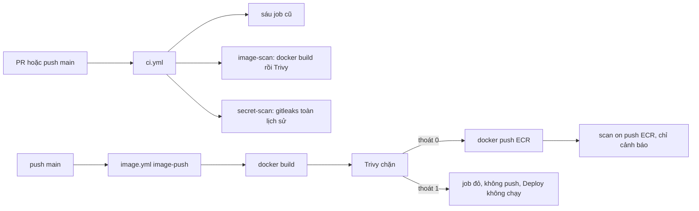

# DBS-155 · CI quét lỗ hổng image và quét secret

> **Status:** Draft · **Vai:** #5 Platform & Ops · **Cặp đôi review:** một Dev không phải tác giả · **Nhánh:** `infra/DBS-155-ci-image-secret-scan` · **PR:** — · **Cập nhật:** 2026-11-11

## 1. Bối cảnh

- **Task trên board:** Task, Tuần 6, Ưu tiên High, Deliverable P3, board đang "To Do" (người dùng chuyển sang "In Progress"). **Thực trạng (board):** "CI mới build và đẩy image (scan on push của ECR chưa đủ làm cổng chặn)." **Expect:** "Lỗi bảo mật nghiêm trọng bị chặn ngay trong PR/CI."
- **DoD** (nguyên văn):
  1. Bước quét image (vd Trivy) fail khi có lỗ hổng mức cao/nghiêm trọng có bản sửa; bước quét secret (vd gitleaks) fail khi phát hiện
  2. Danh sách ngoại lệ có lý do và hạn xem lại
  3. PR thử có secret giả hoặc dependency lỗi → CI đỏ; kết quả quét đính vào bản nộp P3
  4. PR đã merge vào main (CI xanh); Dev review; bảng «Đối chiếu test case» trong PR điền đủ
- **Phụ thuộc:** DBS-36 (build image, đẩy ECR tag SHA qua OIDC): Done trên board; `.github/workflows/image.yml` có trên `main` (`17b011e`). Mọi lần chạy `image.yml` trên `main` đều `skipped` vì repo chưa có biến `AWS_ROLE_ARN` (BL-034).
- **Đã có gì** (đã mở file và chạy lệnh, `main` = `17b011e`):

| Nơi | Hiện trạng |
|---|---|
| [`ci.yml`](../../.github/workflows/ci.yml) | Trigger `pull_request` và `push` `main`; sáu job `lint`, `typecheck`, `unit`, `e2e`, `db`, `build` (dòng 32–231). Không job nào build image hay quét gì. Tên job là hợp đồng với required checks (dòng 3–6). |
| [`image.yml`](../../.github/workflows/image.yml) | Chỉ `push` `main` và `workflow_dispatch`; job `image-push`: `docker build` (dòng 65–72) rồi `docker push`; bước "Kết quả scan" (dòng 75–82) chỉ đọc `findingSeverityCounts` của ECR, lỗi chỉ `::warning::`, không chặn. |
| [`deploy.yml`](../../.github/workflows/deploy.yml) | `workflow_run` sau `Image`; không liên quan quét. |
| [`check-image-workflow.py`](../../.github/scripts/check-image-workflow.py) | Kiểm tĩnh `image.yml`: một job `image-push`, không chuỗi `pull_request`, không chuỗi `latest`, mọi `uses:` ghim SHA 40 ký tự; chỉ `image.yml`/`deploy.yml` được xin `id-token`. Chạy local: `OK`. Chỉ chạy trong `image.yml`/`deploy.yml` (sau merge), chưa chạy ở CI của PR. |
| [`backend/Dockerfile`](../../backend/Dockerfile) | Ba stage `node:24-alpine` (tag, không ghim digest), runtime chạy user `node`, `ADD --checksum` bundle CA RDS. `.dockerignore` loại `test`, `env`, `.auth-local`. |
| [`ecr.tf`](../../infra/terraform/envs/dev/base/ecr.tf) | `scan_on_push = true` (dòng 8–10), quét cơ bản của ECR, chạy sau khi đã push nên không chặn được. |
| Ghim action | Mọi `uses:` ghim SHA kèm comment phiên bản; quy tắc ở [CONTRIBUTING §4b](../../CONTRIBUTING.md#4b-đọc-kết-quả-ci-trên-github-actions) và BL-013. |
| Trivy, gitleaks | Không có trong repo (grep `trivy`, `gitleaks` trong `.github/`: 0). |

- **Baseline local** (máy này: không có Docker, Trivy, gitleaks, actionlint, act; Node 26.11.1 dù `.nvmrc` = 24; 12 CPU, 7,6 GB RAM):

| Lệnh (trong `backend/`) | Kết quả |
|---|---|
| `npm run lint:check` | thoát 0 |
| `npm run typecheck` | thoát 0 |
| `npm test` | lần đầu bị kill (137, hết RAM với 12 worker); `npm test -- --maxWorkers=3`: 110/110 suite, 1870/1870 test đạt |
| `npm run test:e2e -- --maxWorkers=3` | thoát 1: 14/17 suite, 149/149 test đạt; 3 suite (`metrics`, `roles-app`, `app-guard`) đỏ vì `ECONNREFUSED 127.0.0.1:5432`: không có PostgreSQL vì không có Docker. Không phải lỗi code |
| `npm run build` | thoát 0 |
| `node --test ../load-tests/fraud-dataset/*.test.mjs` (4 file của job `unit`) | 70/70 đạt |
| `test:db`, `test:services` | không chạy được (cần Docker) |
| `python3 .github/scripts/check-image-workflow.py` (gốc repo) | `OK` |

- **Phát hiện ban đầu (đọc, không sửa):**
  - `npm audit --omit=dev`: 10 lỗ hổng ở dependency production: 4 high, 6 moderate, 0 critical. Bốn high đều có bản sửa trong dải semver hiện tại: `body-parser` 2.0.0–2.3.0 (GHSA-27r3-jxmh-p828), `multer` 2.0.0–2.4.0 (GHSA-q7qp-rjg7-q26m, qua `@nestjs/platform-express`), `joi` 18.0.0–18.3.0 (GHSA-4528-x5fx-h6hg). Cả cây (gồm dev): 1 critical, 6 high, 37 moderate, 2 low; dependency dev không vào image. Nghĩa là cổng Trivy bật hôm nay sẽ **đỏ ngay**.
  - Quét lịch sử git bằng regex (137 commit, script tạm ở scratchpad, giá trị đã che): khối `PRIVATE KEY` có thân khóa chỉ ở `backend/test/support/tls-fixtures/server.key` (ngoại lệ CONTRIBUTING §6, BL-111); các chỗ khác chỉ là dòng tiêu đề (`dev-auth.spec.ts`, manual-test DBS-53, tài liệu). Hai chuỗi dạng JWT ở `logging.options.spec.ts` và tài liệu review DBS-42 (token thử). Không có `AKIA…`, `ghp_…`, `sk-…`, `xox…`, `AIza…`. Đây chỉ là ước lượng; số đếm thật chờ gitleaks.
  - Chưa có bản ghép P3: [deliverables README](../deliverables/README.md) ghi P3 (Security & DevOps, #5, tuần 6) "chưa nộp", nguồn là `components/ci-cd`, threat model.
- **BACKLOG liên quan:**

| Dòng | Quyết định |
|---|---|
| BL-035 (chặn theo mức nghiêm trọng khi scan image và quét secret) | **Nhận**, xóa dòng ở PR này. Phần "BL-012 xong" của điều kiện đóng không thuộc task này (xem BL-012) |
| BL-111 (allowlist gitleaks đúng đường dẫn `server.key`) | **Nhận**, xóa dòng |
| BL-013 (tên job khác sáu tên, `uses:` ghim SHA cho workflow quét) | **Nhận** phần quét; phần deploy đã có từ DBS-38, nên xóa dòng |
| BL-012 (required checks của `main`) | **Nêu tên**. DBS-37 Done trên board nhưng dòng còn; không kiểm được ruleset vì không gọi GitHub trước G3. Job mới chỉ chặn merge khi chủ repo thêm `image-scan`, `secret-scan` vào ruleset: thêm dòng BACKLOG ở Phase 5 |
| BL-034, BL-104 (`image.yml` luôn `skipped` vì thiếu `AWS_ROLE_ARN`) | **Nêu tên**: bước chặn trong `image.yml` chỉ chứng minh được bằng kiểm tĩnh và chạy local cho tới khi biến có |
| BL-106 (`docker build` thật chưa chạy) | **Nêu tên**: job `image-scan` sẽ build thật trên runner (chứng minh `ADD --checksum`), ghi task này thêm làm nguồn ở Phase 5; phần AWS vẫn mở |
| BL-028 (Terraform trong CI), BL-225 (ghim image ElasticMQ) | **Nêu tên**, ngoài phạm vi |

- **Ngoài phạm vi:** sửa ruleset/required checks (chủ repo, BL-012); quét IaC/Terraform (BL-028); quét lỗ hổng dependency dev (không vào image); SBOM, ký image; chặn deploy theo kết quả scan ECR; viết bản ghép P3 (người dẫn dắt P3), task này chỉ đặt kết quả quét ở nguồn `components/ci-cd` và link từ hàng P3.
- **Câu hỏi mở** và **Quyết định ở G1** (agent tự quyết, 2026-11-11):

| # | Câu hỏi | Quyết định và lý do |
|---|---|---|
| 1 | Công cụ | **Trivy** cho image (lỗ hổng OS Alpine và gói npm trong image, kèm quét secret trong image), **gitleaks** cho repo. Đúng ví dụ DoD, docs/03 §12 ("quét bí mật trong CI"), threat model T16. |
| 2 | Cách chạy, có tính là thêm dependency không | **Có**, là gate phụ (ghi ở §8). Chạy bằng **image Docker chính thức ghim digest** (`docker run aquasec/trivy:<ver>@sha256:…`, `ghcr.io/gitleaks/gitleaks:<ver>@sha256:…`), không dùng action marketplace: không thêm code JavaScript của bên thứ ba chạy với token của job, cùng lệnh chạy được ở local, ghim digest đúng tinh thần quy tắc ghim SHA. Phiên bản và digest chốt ở Phase 3, sau khi kiểm release notes và các sự cố chuỗi cung ứng đã công bố của từng công cụ (có báo cáo về sự cố với `trivy-action` năm 2026, chưa kiểm). gitleaks-action cũng loại vì cần license với tài khoản tổ chức. |
| 3 | Đặt ở workflow/job nào | Hai job mới trong `ci.yml`: **`image-scan`** (build image từ `backend/Dockerfile` rồi Trivy) và **`secret-scan`** (gitleaks), chạy mọi PR và push `main`, tên khác sáu tên hợp đồng. Thêm **bước Trivy trong `image.yml` giữa build và push**: image có lỗ hổng không lên ECR (đóng phần còn lại của BL-035, vì `image.yml` không chờ CI). Không nhét vào job `build`: đổi nghĩa một check hợp đồng và CONTRIBUTING §4b. |
| 4 | Ngưỡng | Trivy `--severity HIGH,CRITICAL --ignore-unfixed --exit-code 1` (đúng "cao/nghiêm trọng có bản sửa"); thêm một bước chỉ in (exit 0) HIGH/CRITICAL chưa có bản sửa để người đọc thấy. MEDIUM/LOW không chặn. gitleaks: mọi phát hiện (bộ luật mặc định) là đỏ, `--redact`. |
| 5 | Ngoại lệ | Trivy: **`.trivyignore.yaml`** ở gốc repo, mỗi mục có `id`, `statement` (lý do) và `expired_at` (hạn xem lại; Trivy tự bỏ mục quá hạn nên phát hiện hiện lại và job đỏ). gitleaks: **`.gitleaks.toml`** (`useDefault = true`), mỗi allowlist có `description` chứa lý do và `Hạn xem lại: YYYY-MM-DD`, phạm vi hẹp nhất (đường dẫn đúng file, không cả thư mục). Thêm `.github/scripts/check-scan-exceptions.py` (Python chuẩn, `tomllib`, PyYAML ghim như `image.yml`): đỏ khi một mục thiếu lý do hoặc hạn, hoặc hạn đã qua. |
| 6 | gitleaks quét gì | **Toàn bộ lịch sử** (`fetch-depth: 0`) ở cả PR và `main`: repo nhỏ (137 commit), BL-111 yêu cầu sạch cả lịch sử, và một secret đã revert trong nhánh PR vẫn nằm trên GitHub. Hệ quả: nhánh lỡ commit secret phải rotate rồi viết lại lịch sử nhánh (CONTRIBUTING §6), revert không làm xanh. |
| 7 | 4 lỗ hổng high đang có bản sửa | **Sửa trong task này** bằng cập nhật `package-lock.json` trong dải semver hiện tại (không đổi `package.json` nếu dải cho phép), vì cổng không được đỏ ngay lúc merge và ngoại lệ cho lỗi đã có bản sửa đi ngược DoD #1. Gate phụ (đổi dependency, ghi §8); CI sáu job chứng minh không vỡ. Phát hiện Trivy khác npm audit (gói Alpine, `npm` đi kèm image `node`) xử lý ở Phase 4 theo kết quả thật: ưu tiên sửa (vd bỏ `npm`/`npx` khỏi stage runtime, runtime không dùng npm: `ecs.tf` dòng 99), cuối cùng mới là ngoại lệ có hạn. |
| 8 | Chứng minh "PR thử → CI đỏ" khi chưa lên GitHub | Trước G3 không chạm GitHub. Phase 4: chạy local đúng image, phiên bản và tham số workflow dùng (nhánh thử cục bộ có secret giả, có dependency lỗi, có ngoại lệ quá hạn). Sau đó chuẩn bị **commit thử riêng** trên nhánh thử (không phải nhánh của PR thật) để coordinator đẩy lên một Draft PR bỏ đi; link run đỏ/xanh là bằng chứng. Secret giả là khóa sinh ngẫu nhiên tại chỗ, không phải định dạng token của nhà cung cấp (tránh push protection và báo động giả). **Chặn:** máy này không có Docker, Trivy, gitleaks, act. Cần người dùng cài Docker hoặc cho phép tải binary Trivy và gitleaks đúng phiên bản (kèm checksum) vào scratchpad; nếu không, các bước local ghi "chưa chạy" và chỉ còn bằng chứng GitHub. |
| 9 | Kết quả quét cho P3 | Lưu bản tóm tắt kết quả (lệnh, phiên bản, số phát hiện theo mức, ngoại lệ) ở `docs/components/ci-cd/scan-results.md`, link từ concept brief ci-cd, hàng P3 của deliverables README và T16 của threat model. |
| 10 | Nhánh | `infra/`: CONTRIBUTING §2 ghi `infra` cho "Terraform, CI/CD"; DBS-35, DBS-41 dùng `infra/`. Không có loại `ci/`. |
| 11 | Board role | #5 khớp loại việc (CI quét image/secret là việc của #5 theo `platform.md`). |

## 2. Hành vi

Task không có API. Mô tả những gì CI chấp nhận và từ chối.

**H1. Job `image-scan` (`ci.yml`, mọi PR và push `main`).**
- Bước: checkout (không giữ credential) → `docker build --provenance=false --sbom=false -t dbs-api:scan backend` → kiểm ngoại lệ (`check-scan-exceptions.py`) → Trivy chặn → Trivy chỉ in.
- Lệnh chặn (phiên bản chốt ở Phase 3):

```bash
docker run --rm -v /var/run/docker.sock:/var/run/docker.sock -v "$PWD:/repo:ro" -w /repo \
  aquasec/trivy:<ver>@sha256:<digest> image \
  --scanners vuln,secret --severity HIGH,CRITICAL --ignore-unfixed \
  --ignorefile .trivyignore.yaml --exit-code 1 --format table dbs-api:scan
```

- Lệnh in: như trên nhưng bỏ `--ignore-unfixed`, `--exit-code 0`.
- Kết quả: có ít nhất một lỗ hổng HIGH/CRITICAL có `FixedVersion` và không nằm trong ngoại lệ còn hạn, hoặc một secret trong image → thoát 1, job đỏ. Chỉ có MEDIUM/LOW hoặc HIGH chưa có bản sửa → thoát 0, xanh (HIGH chưa sửa hiện ở bước in).
- Ca biên: tải DB lỗ hổng lỗi (mạng, rate limit) → Trivy thoát khác 0, job đỏ (fail-closed); chạy lại bằng "Re-run failed jobs". `docker build` lỗi (vd checksum bundle RDS đổi) → đỏ trước khi quét. Ngoại lệ quá hạn → Trivy bỏ qua mục đó, lỗ hổng hiện lại, đỏ; `check-scan-exceptions.py` cũng đỏ với tên mục quá hạn.

**H2. Job `secret-scan` (`ci.yml`, mọi PR và push `main`).**
- Bước: checkout `fetch-depth: 0` (không giữ credential) → kiểm ngoại lệ → gitleaks.

```bash
docker run --rm -v "$PWD:/repo:ro" ghcr.io/gitleaks/gitleaks:<ver>@sha256:<digest> \
  git /repo --config /repo/.gitleaks.toml --redact --exit-code 1 --verbose
```

- Kết quả: bất kỳ phát hiện nào ở bất kỳ commit nào → thoát 1, log chỉ có luật, file, dòng, commit và giá trị đã che (`REDACTED`). Không phát hiện → 0.
- Ca biên: `server.key` trong `backend/test/support/tls-fixtures/` không báo (allowlist đúng đường dẫn đó); cùng nội dung khóa đặt ở đường dẫn khác vẫn báo. Một file `.pem`/`.key` mới ở bất kỳ đâu khác → đỏ. Secret đã revert vẫn đỏ (H2 quét lịch sử).

**H3. Bước chặn trong `image.yml`.** Sau "Build và push" tách thành build → Trivy chặn (cùng lệnh H1, image `$REGISTRY/$REPOSITORY:$IMAGE_TAG`) → push. Trivy thoát 1 → không push, job đỏ, `Deploy` không chạy (chỉ chạy khi `Image` `success`). Bước đọc scan ECR giữ nguyên, chỉ cảnh báo. `check-image-workflow.py` thêm kiểm: có bước Trivy, đứng trước `docker push`, đúng tham số, image ghim digest.

**H4. Ngoại lệ.** `.trivyignore.yaml`:

```yaml
vulnerabilities:
  - id: CVE-2099-00000            # ví dụ dạng; không có mục nào nếu không cần
    paths: ["usr/local/lib/node_modules/npm/..."]
    statement: "Lý do cụ thể; ai chấp nhận (#5); cách đóng"
    expired_at: 2026-12-14
```

`.gitleaks.toml`:

```toml
[extend]
useDefault = true

[[allowlists]]
description = "Khóa thử TLS CN=localhost, CA đã hủy khóa, chỉ cho test (CONTRIBUTING §6, BL-111). Hạn xem lại: 2026-12-14"
paths = ['''^backend/test/support/tls-fixtures/server\.key$''']
```

`check-scan-exceptions.py` đỏ khi: mục Trivy thiếu `statement` hoặc `expired_at`, hoặc `expired_at` < hôm nay (UTC); allowlist gitleaks thiếu `description`, không có `Hạn xem lại: YYYY-MM-DD`, hoặc hạn đã qua; một `paths` của gitleaks là thư mục (kết thúc `/` hoặc không neo `^…$`). Hạn tối đa: không quá ngày kết thúc dự án 2026-12-14 (hạn ngắn buộc xem lại).

**H5. Dependency.** Sau cập nhật lockfile: `npm audit --omit=dev` không còn high/critical; `package.json` không đổi dải nếu không cần. Sáu job CI vẫn xanh.

## 3. Kiến trúc

- **Vị trí:** `.github/workflows/ci.yml` (hai job mới), `.github/workflows/image.yml` (một bước), `.github/scripts/check-image-workflow.py` (thêm kiểm `ci.yml` và `image.yml`), mới `.github/scripts/check-scan-exceptions.py`, `.github/scripts/tests/test_check_scan_exceptions.py`, `.trivyignore.yaml`, `.gitleaks.toml`; `backend/package-lock.json`; có thể `backend/Dockerfile` (H5/§1 câu 7, theo kết quả Trivy). Không đổi code ứng dụng, role `api`/`worker` không đổi.
- **Interface:** không đổi symbol exported. Hợp đồng tên check: thêm `image-scan`, `secret-scan`; sáu tên cũ giữ nguyên. `image.yml` vẫn một job `image-push`, không chuỗi `pull_request`, `latest`.
- **Dữ liệu, transaction:** không áp dụng.
- **Quyền:** hai job mới chỉ `contents: read`, không `id-token` (check script đã cấm `id-token` ngoài `image.yml`/`deploy.yml`), `persist-credentials: false`, không `secrets.*`, không cache.
- **Sơ đồ:**



- **Thay đổi cấp hệ thống:** docs/03 §13.3 (Build: nêu rõ quét Trivy chặn trước push, gitleaks), CONTRIBUTING §4b (bảng check thêm hai dòng, quy tắc tên job), concept brief ci-cd, threat model T16 (Trạng thái), deliverables README hàng P3. Không đổi ADR.

## 4. Test cases tự động

Task cấu hình CI: lớp "tĩnh" là script Python chạy local và trong CI; lớp "công cụ" là chạy đúng image/tham số của workflow trên dữ liệu thử; lớp "Actions" chỉ đạt khi có link run thật.

| ID | Truy vết | Lớp | Given · When · Then | Mong đợi |
|---|---|---|---|---|
| TC-155-01 | DoD 1 | tĩnh | `ci.yml` · `check-image-workflow.py` · có job `image-scan`, `secret-scan`, tên không trùng sáu tên, `contents: read`, không `id-token`, `persist-credentials: false`, image công cụ ghim `@sha256:` 64 hex | `OK` |
| TC-155-02 | DoD 1 | tĩnh | Trivy ở `ci.yml` và `image.yml` có đủ `--severity HIGH,CRITICAL`, `--ignore-unfixed`, `--exit-code 1`, `--ignorefile .trivyignore.yaml`; gitleaks có `--redact`, `--exit-code 1`, checkout `fetch-depth: 0` | `OK` |
| TC-155-03 | DoD 1 | tĩnh | `image.yml`: bước Trivy đứng trước `docker push`; vẫn một job, không `latest`, không `pull_request` | `OK` |
| TC-155-04 | DoD 1 | tĩnh (fixture âm) | Bỏ từng cờ ở TC-02, đổi digest thành tag, đặt Trivy sau push, đặt tên job `build` · chạy check | mỗi fixture `FAIL` |
| TC-155-05 | DoD 2 | unit Python | `check-scan-exceptions.py` với mục đủ lý do và hạn tương lai | thoát 0 |
| TC-155-06 | DoD 2 | unit Python | mục Trivy thiếu `statement`; thiếu `expired_at`; hạn đã qua; hạn sau 2026-12-14; allowlist gitleaks thiếu hạn; `paths` là thư mục | mỗi ca thoát 1, nêu tên mục |
| TC-155-07 | DoD 2, BL-111 | tĩnh | `.gitleaks.toml` thật: đúng một allowlist path, khớp chính xác `server.key` | `OK` |
| TC-155-08 | DoD 1, 3 | công cụ | Image build từ nhánh có thêm dependency production có lỗ hổng HIGH đã có bản sửa · Trivy lệnh H1 | thoát 1, bảng nêu CVE |
| TC-155-09 | DoD 1, 3 | công cụ | Repo thử có commit chứa khóa riêng sinh ngẫu nhiên ở `tmp/fake.key` · gitleaks lệnh H2 | thoát 1, giá trị `REDACTED` |
| TC-155-10 | DoD 1, 3 | công cụ | Cùng repo sau `git revert` commit đó | vẫn thoát 1 (lịch sử) |
| TC-155-11 | DoD 1 | công cụ | Nhánh task (sau sửa lockfile) · cả hai lệnh | thoát 0 |
| TC-155-12 | DoD 2 | công cụ | Ngoại lệ Trivy hợp lệ cho CVE ở TC-08 · chạy lại → thoát 0; đổi `expired_at` về hôm qua → thoát 1 | 0 rồi 1 |
| TC-155-13 | DoD 2 | công cụ | Đặt bản sao `server.key` ở đường dẫn khác · gitleaks | thoát 1 |
| TC-155-14 | DoD 1 | Actions | Draft PR của nhánh task: `image-scan`, `secret-scan` và sáu job cũ xanh | link run |
| TC-155-15 | DoD 3 | Actions | Draft PR thử (bỏ đi) có commit dependency lỗi: `image-scan` đỏ; có commit secret giả: `secret-scan` đỏ | link run |
| TC-155-16 | DoD 3 | tài liệu | `scan-results.md` có lệnh, phiên bản, số phát hiện theo mức và ngoại lệ; link từ hàng P3 deliverables, ci-cd, T16; `check-doc-links.mjs` sạch | 0 link hỏng |
| TC-155-17 | DoD 1 (H5) | backend | Sau sửa lockfile: `npm audit --omit=dev` 0 high/critical; lint, typecheck, unit, build local; e2e/db trên CI | xanh |
| TC-155-18 | DoD 4 | quy trình | PR merge vào `main` với CI xanh, Dev khác review, bảng đối chiếu điền đủ | quy trình |

## 5. Test thủ công

Điều kiện: Docker (hoặc binary Trivy và gitleaks đúng phiên bản workflow) trên máy chạy, gốc repo ở nhánh task. Nhánh thử `scratch/DBS-155-proof` tạo cục bộ, không merge. Bước M-155-07…09 cần coordinator đẩy lên GitHub sau G3.

| Bước | Việc làm | Kết quả mong đợi |
|---|---|---|
| M-155-01 | `docker build --provenance=false --sbom=false -t dbs-api:scan backend` rồi lệnh Trivy H1 | thoát 0; bảng không có HIGH/CRITICAL có bản sửa (đường thành công) |
| M-155-02 | Lệnh gitleaks H2 trên nhánh task | thoát 0, "no leaks found"; `server.key` không bị báo |
| M-155-03 | Nhánh thử: thêm dependency production có HIGH đã sửa (chọn ở Phase 3, vd một phiên bản cũ có CVE công bố), build, Trivy | thoát 1, CVE hiện trong bảng (bị từ chối) |
| M-155-04 | Nhánh thử: commit khóa sinh bằng `openssl genpkey` vào `tmp/fake.key`, gitleaks; rồi `git revert`, gitleaks lại | cả hai lần thoát 1, giá trị `REDACTED` |
| M-155-05 | Thêm ngoại lệ hợp lệ cho CVE của M-03 → Trivy thoát 0; đổi `expired_at` về hôm qua → Trivy thoát 1 và `check-scan-exceptions.py` thoát 1 nêu tên mục | 0 rồi 1 (ca phục hồi/hết hạn) |
| M-155-06 | `python3 .github/scripts/check-image-workflow.py` và `python3 .github/scripts/check-scan-exceptions.py` trên nhánh task | `OK`, thoát 0 |
| M-155-07 | Draft PR của nhánh task trên GitHub | tám check xanh; link run |
| M-155-08 | Draft PR thử (từ nhánh thử, có commit dependency lỗi và commit secret giả) | `image-scan` đỏ, `secret-scan` đỏ, log không lộ giá trị; link run; đóng PR, xóa nhánh |
| M-155-09 | `image.yml` thật trên `main` | chưa chạy được cho tới khi có `AWS_ROLE_ARN` (BL-034); thay bằng M-155-06 và chạy local đúng chuỗi build → Trivy → (không push) |

## 6. Domain review (AI)

Chưa chạy (coordinator gửi reviewer).

## 7. Kế hoạch triển khai

Chưa viết (Phase 3).

## 8. Kết quả

Chưa có.

- **Lệch so với kế hoạch / gate phụ (ghi trước khi làm):**
  1. *Thêm dependency công cụ CI* (Trivy, gitleaks). Phương án: (a) action marketplace ghim SHA; (b) image Docker chính thức ghim digest; (c) tải binary kèm checksum. Chọn (b): ít mã bên thứ ba nhất chạy trong job, cùng lệnh ở local, không cần license, ghim bất biến. Hệ quả: phải cập nhật digest thủ công khi nâng phiên bản (giống quy tắc SHA ở CONTRIBUTING §4b); job cần kéo image (vài giây đến chục giây).
  2. *Đổi dependency backend* (`package-lock.json`, 4 high có bản sửa trong dải). Phương án: sửa ngay; ngoại lệ có hạn; tách task. Chọn sửa ngay trong dải semver: DoD #1 không cho ngoại lệ với lỗi đã có bản sửa nếu không có lý do, và cổng không được đỏ khi merge. Hệ quả: PR chạm `backend/`, CI sáu job là bằng chứng không vỡ; không đổi `package.json` trừ khi dải không đủ.

## 9. Tài liệu đã cập nhật

Chưa có.
