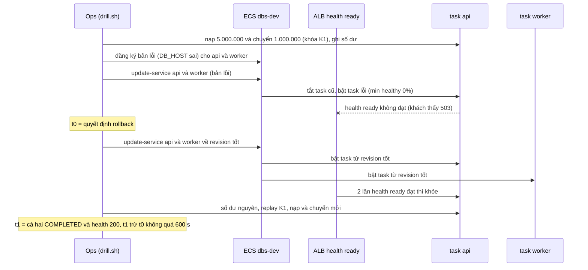

# DBS-156 · Diễn tập rollback về task definition cũ trong ≤ 10 phút

> **Status:** Implemented (sau G4) · **Vai:** #5 Platform & Ops · **Cặp đôi review:** không bắt buộc (quyết định techlead, BACKLOG #175) · **Nhánh:** `docs/DBS-156-rollback-drill` · **PR:** [#185](https://github.com/Lawliet119/digital-banking-simulator/pull/185) · **Cập nhật:** 2026-11-15

## 1. Bối cảnh

- **Task trên board:** Task, Tuần 6, Ưu tiên High, Deliverable/Demo **P3**, vai board #5 Platform & Ops (khớp loại việc: vận hành AWS, runbook). **Expect:** «Rollback là việc đã làm thật, có số thời gian.»
- **Thực trạng trên board** (chép): «Cách rollback mới ghi ở README (DBS-38), chưa diễn tập.»
- **DoD** (nguyên văn, đánh số):
  1. Cố ý deploy bản lỗi rồi rollback về task definition cũ cho cả api và worker, đo thời gian ≤ 10 phút
  2. Video và log lưu docs/deliverables; quy trình ghi thành runbook
  3. Kiểm health và một giao dịch mẫu sau rollback
- **Phụ thuộc** (board và repo, đã kiểm):

| Task | Board | Trong repo / trên AWS |
|---|---|---|
| DBS-38 deploy tự động | Done | `.github/scripts/deploy.sh`, `infra/terraform/README.md` mục «Rollback thủ công» |
| DBS-121 service worker | Done | `session/worker.tf` (service `worker`, 0%/100%, circuit breaker); `deploy.sh` lăn worker (BL-248) |

- **Đã có gì:** README rollback (trước PR này chỉ có `api`); docs/03 §13.3 một dòng «Cập nhật service về task definition trước đó»; circuit breaker `rollback = true` ở cả hai service; `render-task-definition.py`; ALB kiểm `/health/ready` 15 s, 2 đạt là khỏe, 3 trượt là unhealthy, grace 60 s.
- **Ba lần chạy trên AWS thật** (`AWS_PROFILE=dbs`, nhóm `dbs-admin`, `ap-southeast-1`):
  - **Lần 1, 2026-11-14:** trên stack `session` do phiên trước dựng (chưa có khách hay tài khoản). Chỉ đo thời gian và health; **không có giao dịch mẫu** (DoD 3 thiếu). Giữ nguyên làm lịch sử.
  - **Lần 2, 2026-11-15:** dựng phiên mới từ trạng thái trống (image `c96c1de`, bản mới nhất trên `main` đã có image ECR), seed khách demo, chạy `drill.sh` có giao dịch mẫu trước và sau. Giao dịch đạt, nhưng domain review chỉ ra lần này **không chứng minh bản lỗi thật sự hỏng** (Phase B dừng ở 503 đầu tiên, khi chưa task lỗi nào dừng), nên không dùng làm bằng chứng DoD 1. Giữ nguyên làm lịch sử.
  - **Lần 3, 2026-11-15:** cùng phiên, `drill.sh` đã sửa theo review: Phase B chờ tới khi mỗi service có task của bản lỗi dừng vì lỗi (`failedTasks` ≥ 1) rồi mới rollback. Đây là bằng chứng chính (§8). Sau đó `terraform destroy` và `verify-clean.sh`.
- **Phát hiện khi xác minh «Thực trạng» bằng cách chạy:**
  - `list-task-definitions` của README chỉ trả revision **ACTIVE**, và AWS từ chối `update-service` về revision `INACTIVE` (Phase E). Nhưng một phiên mới dựng **vẫn có revision ACTIVE của phiên cũ**: lần 2 thấy `dbs-api:16`, `dbs-api:10` và `dbs-worker:12`, `dbs-worker:7` cùng ACTIVE. Revision `:10` và `:7` do `deploy.sh` đăng ký ở phiên trước, trỏ RDS, Valkey và secret đã xóa. Vì vậy «task definition cũ» là revision đang chạy tốt **ngay trước** lần deploy lỗi (`dbs-api:16`, `dbs-worker:12`), không phải «ACTIVE mới nhất» bất kỳ; runbook bắt kiểm revision thuộc phiên hiện tại.
  - **Tên service sai trong runbook bản đầu (đã sửa):** runbook ghi `dbs-dev-api` / `dbs-dev-worker`, trong khi service thật là `api` và `worker` (cluster `dbs-dev`, family `dbs-api`, `dbs-worker`). `drill.sh` bản đầu phải override `API_SVC`, `WORKER_SVC`.
  - README không nói gì về worker, và `deployments` không đủ để biết rollback đã xong thật (cần `runningCount`, đúng `taskDefinition`, health ALB, log).
- **Baseline** (loại việc: vận hành AWS và tài liệu, không đổi code sản phẩm, Terraform hay CI): `node .claude/skills/dbs-delivering-task/scripts/check-doc-links.mjs` sạch trên `origin/main` `c96c1de`; `.github/scripts/tests` 163 tests OK ở lần 1. Không chạy bốn lệnh backend hay `terraform test` vì không file nào của chúng đổi.
- **Dòng BACKLOG liên quan:**

| Dòng | Quyết định |
|---|---|
| BL-104 (`Deploy` thật trên `main` chưa chạy) | Cùng khoảng trống «pipeline chưa chạy thật». Rollback qua workflow `Deploy` thật vẫn là BL-104; thêm DBS-156 làm nguồn |
| BL-234 (api 1 task, min healthy 0%) | Không phải một dòng của `docs/BACKLOG.md`: chỉ là ghi chú trong `envs/dev/session/ecs.tf`. Drill đo đúng điều này (thời gian mất phục vụ khi deploy lỗi) |
| BL-384 (worker thoát exit 137 sau 79 s) | Giải thích phần lớn thời gian rollback của worker (§8); không xóa |
| BL-380, BL-383 (video cloud) | BL-393 mới gộp video của DBS-156 cùng buổi quay |
| BL-128 | Dòng đã đóng ở các task trước; `invariants.js` chạy được bằng task `dbs-migrate`, nên Phase F của `drill.sh` chạy nó (§8) |

- **Ngoài phạm vi:** viết công cụ rollback tự động (runbook dùng lệnh `aws` chuẩn); đổi `deploy.sh`, Terraform, CI, ECR lifecycle; rollback migration (schema giữ kiểu expand); rollback có xung đột schema «contract» (nêu trong runbook, chưa diễn tập); `Deploy` workflow thật qua OIDC (BL-104); đường «đăng ký lại từ image SHA» (BL-394); video màn hình thật (BL-393); load test khi rollback (DBS-166).
- **Quyết định ở G1** (agent tự quyết; không còn câu hỏi mở):
  1. **«Bản lỗi» = revision task definition cấu hình sai** (`DB_HOST=broken-db-host.invalid`, cùng image): ECS thấy giống hệt một deploy thật (revision mới của `dbs-api` và `dbs-worker`, `update-service` trỏ tới nó). Không build image lỗi vì `deploy.sh` đòi tag SHA có thật trên ECR.
  2. **«Task definition cũ»** = revision đang chạy tốt ngay trước lúc deploy lỗi (lần 2 và 3: `dbs-api:16`, `dbs-worker:12`).
  3. **Hai service rollback liên tiếp**; thời gian đo từ lệnh `update-service` đầu tiên của rollback tới khi **cả hai** `COMPLETED` đúng revision, `runningCount = desiredCount` và `/health/ready` = 200 qua ALB (≤ 600 s). Đo thêm riêng từng service.
  4. **Giao dịch mẫu đi qua API thật**, không SQL: khách `customer1`, `customer2` và tài khoản do `seed-cloud.sh` tạo; operator nạp, `customer1` chuyển. Chứng chỉ ALB dev tự ký nên `curl -k` (BL-252).
  5. **«Video» của DoD 2:** người quay video không có ở phiên này. Thay bằng **bản ghi terminal phát lại được** (`script --log-timing`, phát bằng `scriptreplay`) trong `docs/deliverables/P3-rollback-drill/` (nay đã gỡ khỏi cây làm việc, lấy lại từ lịch sử git tại commit `dd93d1b`), **không gọi là video**; việc quay màn hình thật là BL-393. DoD 2 vì vậy ghi «một phần».
  6. **Chạy lại trên phiên dựng mới** (thay vì dùng stack còn sót): lần 1 không có giao dịch mẫu, và credit hạn hẹp nên phải `destroy` ngay sau lần chạy cuối (lần 3, cùng phiên với lần 2), rồi `verify-clean.sh` thoát 0.

## 2. Hành vi

Task không thêm API. Nó định nghĩa **kịch bản diễn tập**, **ngưỡng đạt** và **quy trình rollback** ([`docs/runbooks/rollback.md`](../runbooks/rollback.md)).

### 2.1 Kịch bản (`docs/deliverables/P3-rollback-drill/drill.sh`)

| Pha | Việc | Hệ thống phải cho thấy |
|---|---|---|
| A. Nền tốt và giao dịch trước | Ghi revision đang chạy; health; lấy token; ghi số dư đầu; operator nạp 5.000.000đ vào `customer1` (khóa riêng); `customer1` chuyển 1.000.000đ sang `customer2` (khóa `K1`); ghi `transferId` và số dư **trước sự cố** | health 200; nạp và chuyển `201` `COMPLETED`; số dư = đầu + 4.000.000 và đầu + 1.000.000 |
| B. Deploy lỗi | Đăng ký revision mới của hai family chỉ khác `DB_HOST` sai, `update-service` cả hai; **chờ tới khi mỗi service có ít nhất một task của bản lỗi dừng vì lỗi** (`failedTasks` ≥ 1 ở deployment trỏ bản lỗi), tối đa 300 s | ghi `stoppedReason` của task lỗi và trạng thái deployment lúc `t0`; PRIMARY vẫn là bản lỗi (circuit breaker chưa tự rollback). `/health/ready` = 503 một mình **không** đủ: api chạy 1 task với min healthy 0% nên deploy tốt cũng có khoảng 503 |
| C. Rollback | Ghi `t0`; `update-service` api rồi worker về revision tốt; poll mỗi 5 s | Cả hai `PRIMARY` `COMPLETED` đúng revision, `runningCount = desiredCount`, `/health/ready` 200; **tổng ≤ 600 s**; ghi mốc từng service |
| D. Sau rollback | Health, log từ `t0`, hàng đợi SQS; lấy lại token (sống 15 phút); **(a)** `GET /v1/accounts` số dư = trước sự cố; **(b)** replay lệnh chuyển với `K1` và cùng body; **(c)** nạp 2.000.000đ và chuyển 500.000đ mới | log không có `Application startup failed`, worker có `Worker started`; (b) `201` cùng `transferId`, số dư không đổi; (c) `201` `COMPLETED`, số dư khớp từng đồng |
| E. Dọn và từ chối | Hủy đăng ký hai revision lỗi; thử `update-service` về revision `INACTIVE` | AWS từ chối; service vẫn ở revision tốt |
| F. Bất biến | `invariants.js` bằng task `dbs-migrate` (một lần) | thoát 0 |

### 2.2 Ngưỡng đạt (DoD; docs/03 §13.3 trỏ về đây)

| Chỉ số | Đạt khi |
|---|---|
| Thời gian rollback | từ lệnh `update-service` đầu tiên của rollback tới khi cả api và worker ổn định **và** `/health/ready` = 200 qua ALB: ≤ 600 s |
| Sau rollback | cả hai service về đúng revision cũ; deployment `PRIMARY` `COMPLETED`; không còn deployment `IN_PROGRESS` |
| Giao dịch mẫu | số dư trước sự cố còn nguyên; replay trả đúng `transferId` cũ; nạp và chuyển mới `201` `COMPLETED` và số dư khớp chữ số |
| Dữ liệu | rollback chỉ đổi image, không đụng schema; `invariants.js` thoát 0 |

Mất phục vụ khi deploy lỗi (api 1 task, min healthy 0%, BL-234) cũng được in: từ lúc health khác 200 tới lúc 200 trở lại. Số tham khảo, không có ngưỡng.

### 2.3 Quy tắc của runbook

- Quyết định rollback khi: deployment `PRIMARY` không `COMPLETED` sau 10 phút, `/health/ready` không 200 sau grace, hoặc tỉ lệ 5xx tăng sau deploy. Circuit breaker có thể đã tự rollback: kiểm `rolloutState` trước.
- **Chỉ rollback được về revision ACTIVE.** Revision INACTIVE bị AWS từ chối (đã thử, Phase E); khi đó đăng ký lại **nguyên** revision INACTIVE (`describe-task-definition` vẫn đọc được), đưa đúng revision đó qua stdin vào `render-task-definition.py` (với image của chính nó); đừng mô tả theo tên family như `deploy.sh`, vì cách đó lấy revision ACTIVE mới nhất, tức bản lỗi (chưa diễn tập, BL-394).
- **Sau mọi lần rollback**, kể cả khi circuit breaker tự rollback: hủy đăng ký revision lỗi của cả hai family và tắt workflow `Deploy` tới khi có bản sửa, vì `deploy.sh` dựng lần deploy kế tiếp từ revision ACTIVE mới nhất.
- Rollback đổi image, **không** hoàn tác migration: an toàn với migration expand; migration «contract» đã chạy thì sửa tiến.
- Terraform không kéo service về revision của nó (`ignore_changes = [task_definition]`).
- Worker lăn 0%/100%: có khoảng trống xử lý, sự kiện nằm ở outbox (ADR-03) và được xử lý bù.
- Tên **service** là `api` và `worker`, không phải `dbs-dev-api` / `dbs-dev-worker`.

## 3. Kiến trúc

- **Vị trí:** không đổi code sản phẩm, Terraform hay CI. File mới: [`docs/runbooks/rollback.md`](../runbooks/rollback.md); bằng chứng ở `docs/deliverables/P3-rollback-drill/` (`drill.sh`, `timings.md`). Bản ghi terminal thô của lần 2 và lần 3 (`run-2/`, `run-3/`, mỗi thư mục có `drill.typescript` + `drill.timing`) đã gỡ khỏi cây làm việc; lấy lại từ lịch sử git tại commit `dd93d1b`. Sửa: `infra/terraform/README.md` (mục Rollback thủ công), docs/03 §13.3, `docs/deliverables/P4-incident-table.md` (một dòng), `docs/features/README.md`, `docs/BACKLOG.md`.
- **Công cụ dùng (có sẵn):** `aws ecs describe-task-definition / register-task-definition / update-service / describe-services`, `aws logs`, `aws sqs`, `infra/scripts/demo-token.sh`, `infra/scripts/ac-5-10-tools.py overrides` (dựng ghi đè cho task `dbs-migrate`), `curl -k`. Không symbol nào bị đổi.
- **Chạy ở đâu:** `drill.sh` cần Linux (python3, curl ≥ 7.55) hoặc container `dbs-awscli`; Git Bash trên Windows không đủ.
- **Dữ liệu:** chỉ qua API (nạp, chuyển, đọc tài khoản); không SQL. Bảng chạm gián tiếp: `accounts`, `transfers`, `ledger_entries`, `idempotency_keys`, `audit_log`, `outbox_events`.
- **Ranh giới transaction:** không có code mới; mỗi lệnh nạp/chuyển là một transaction của api như thiết kế (replay đọc phản hồi đã lưu trong `idempotency_keys`).

- **Rủi ro vận hành khi diễn tập:** api mất phục vụ trong lúc deploy lỗi (stack dev, không khách thật); worker lỗi lặp lại tạo vài task `STOPPED`; circuit breaker có thể tự rollback trước lệnh tay (nếu xảy ra, ghi như kết quả riêng).
- **Thay đổi cấp hệ thống:** docs/03 §13.3 (dòng Rollback trỏ runbook và số đo thật), README Terraform (mục rollback thêm worker, tên service, trỏ runbook). Không ADR nào bị đổi (rollback bằng task definition vốn là quyết định ở ADR-11 và §13.3).

## 4. Test cases tự động

Task vận hành và tài liệu: không có code sản phẩm nên không có test đơn vị mới. Các case là kiểm tự động trên tài liệu và công cụ; bằng chứng chính là test thủ công §5 trên AWS thật.

| ID | Truy vết | Lớp | Given · When · Then | `errorCode` |
|---|---|---|---|---|
| TC-156-01 | DoD 2 (runbook, log trong repo) | tài liệu | `check-doc-links.mjs` sau khi thêm runbook và sửa các doc: 0 link hỏng | — |
| TC-156-02 | DoD 1 (công cụ tạo bản lỗi) | unit (có sẵn) | `python3 -m unittest discover .github/scripts/tests` vẫn xanh (chỉ cần khi doc đổi script CI; task này không đổi) | — |
| TC-156-03 | DoD 1, 3 (kịch bản chạy lại được) | tĩnh | `bash -n drill.sh`; kịch bản chạy thật ở M-156-01..08 | — |
| TC-156-04 | DoD 2 (không lộ bí mật) | tĩnh | `grep -E` trên `run-*/drill.typescript` (đã gỡ, xem §8), `timings.md`, `manual-test.txt`: không khớp `[0-9]{12}` (id tài khoản AWS), `elb\.amazonaws\.com` (DNS ALB), `eyJ` (JWT) | — |
| TC-156-05 | DoD 2 (runbook đủ nội dung) | tài liệu | grep runbook: có đủ mục «Khi nào rollback», «Trước khi làm», «Rollback», «Kiểm sau rollback», «Giao dịch mẫu», «Khi không rollback được», «Số đo»; tên service `api` / `worker`; không còn `dbs-dev-api` / `dbs-dev-worker` làm tên service | — |
| quy trình | DoD 1, 3 | thủ công | M-156-01..08 trên AWS thật (§5) | — |
| quy trình | PR | — | PR, CI, bảng đối chiếu | — |

## 5. Test thủ công

Điều kiện: stack `session` đang chạy (api 1 task, worker 1 task, đã `seed-cognito.sh` và `seed-cloud.sh`), profile thuộc nhóm `dbs-admin` (`dbs` trên máy này), `ap-southeast-1`, từ gốc repo, chạy **trong container `dbs-awscli`**; token chỉ qua biến, không in. Pha A–F chạy bằng `docs/deliverables/P3-rollback-drill/drill.sh` một mạch, bọc bằng `script --log-timing`.

| Bước | Việc làm | Kết quả mong đợi |
|---|---|---|
| M-156-01 | Dựng phiên (desired 0) → `db-roles.sh` → `migrate.sh` → desired 1 → `seed-cognito.sh` → `seed-cloud.sh`; `/health/ready` | 200; api và worker 1/1; ghi các revision ACTIVE (có thể còn revision của phiên cũ) |
| M-156-02 | Phase A: nạp 5.000.000 và chuyển 1.000.000 (khóa `K1`) trước deploy lỗi | `201` `COMPLETED` cả hai; số dư = đầu + 4.000.000 và đầu + 1.000.000 |
| M-156-03 | Phase B: đăng ký bản lỗi, `update-service`, chờ task lỗi dừng | revision lỗi `ACTIVE`, chỉ `DB_HOST` khác; mỗi service `failedTasks` ≥ 1 với `stoppedReason`; PRIMARY vẫn là bản lỗi lúc `t0` |
| M-156-04 | Phase C: rollback, poll tới khi xong | tổng ≤ 600 s; đúng revision từng service; ghi mốc health, api, worker |
| M-156-05 | Phase D kiểm hệ thống: `describe-services`, health, log của **task tốt** từ `t0`, SQS | health 200; không `Application startup failed` trong luồng log của task tốt; `Worker started` có; hàng đợi và DLQ 0 |
| M-156-06 | Phase D giao dịch mẫu: (a) số dư nguyên; (b) replay `K1`; (c) nạp 2.000.000 và chuyển 500.000 mới | (a) bằng trước sự cố; (b) `201`, cùng `transferId`, số dư **cả hai** tài khoản không đổi; (c) `201` `COMPLETED`, số dư = trước + 1.500.000 và + 500.000 |
| M-156-07 | Phase E: hủy đăng ký revision lỗi, thử `update-service` về revision INACTIVE | AWS từ chối; service vẫn ở revision tốt |
| M-156-08 | Phase F: `invariants.js`; rồi `terraform destroy`, `verify-clean.sh`, kiểm 0 ECS/RDS/ALB | exit code 0; `verify-clean` thoát 0 |

## 6. Domain review (AI)

**Reviewer:** subagent, model Opus 5.5 (`opus`, effort medium), ngày 2026-11-15, trên §1–§5, `rollback.md` và `drill.sh` (đọc cả bản ghi lần 2 đang chạy) · **Vòng 1:** 16 phát hiện (blocking 1, should-fix 6, minor 9), REVISE · [nguyên văn](screenshots/DBS-156/domain-review.md) · **Vòng 2:** xem dưới bảng.

| # | Mức | Phát hiện | Xử lý |
|---|---|---|---|
| 1 | blocking | Lần 2 không chứng minh bản lỗi thật sự hỏng: Phase B dừng ở 503 đầu tiên, khi chưa task lỗi nào dừng; 503 đó do min healthy 0% | **đã sửa và chạy lại:** Phase B chờ `failedTasks` ≥ 1 ở cả hai service, ghi `stoppedReason` và trạng thái deployment lúc `t0`, `BROKEN_SEEN=0` tính FAIL. Lần 3 đạt: hai task lỗi `Essential container in task exited 1`, PRIMARY vẫn là bản lỗi lúc `t0` |
| 2 | should-fix | Revision lỗi còn ACTIVE thì `deploy.sh` chép lại cấu hình lỗi ở lần deploy kế tiếp; không nói dừng deploy | đã sửa runbook: mục «Sau mọi lần rollback (bắt buộc, kể cả khi circuit breaker tự rollback)» hủy đăng ký revision lỗi; «Trước khi làm» 1 tắt workflow `Deploy` |
| 3 | should-fix | §1 nói phiên mới chỉ có một revision ACTIVE; lần 2 thấy revision phiên cũ vẫn ACTIVE | đã sửa §1, M-156-01, runbook (kiểm revision thuộc phiên hiện tại); việc dọn revision cũ khi dựng phiên thành BL-396 |
| 4 | should-fix | Đường INACTIVE dùng `render-task-definition.py` sẽ chép lại bản lỗi | đã sửa runbook và BL-394: đăng ký lại nguyên revision INACTIVE từ `describe-task-definition` |
| 5 | should-fix | Không có trap khôi phục; không kiểm mã thoát `update-service` | đã sửa `drill.sh`: `trap on_exit` đưa hai service về bản tốt và hủy đăng ký bản lỗi; `upd` ghi FAIL khi AWS từ chối |
| 6 | should-fix | Doc ghi Implemented nhưng thiếu §8, chỗ trống, edit hứa ở §3 | đã sửa: §7–§9, điền số đo, sửa README Terraform, docs/03 §13.3, P4 |
| 7 | should-fix | Không có cách xem bản lỗi đã migrate chưa; khi rollback hỏng chỉ ghi «desiredCount = 0» | đã sửa runbook: lệnh đọc log `migrate/migrate/<task-id>`, lệnh hạ về 0 task kèm hậu quả và bước báo, gọi người |
| 8 | minor | `rolloutState` không có `ROLLBACK_*` | đã sửa runbook: dấu hiệu thật là PRIMARY về revision cũ và một deployment `FAILED` trỏ bản lỗi |
| 9 | minor | Phép thử INACTIVE có thể đẩy api sang bản lỗi | đã sửa `drill.sh`: nếu revision đổi thì đưa lại bản tốt |
| 10 | minor | Kiểm `Application startup failed` trên cả nhóm log cho FAIL giả | đã sửa `drill.sh` và runbook: lọc theo luồng log của task tốt |
| 11 | minor | `set_token "$(…)" \|\| return 1` không bắt được lỗi `demo-token.sh` | đã sửa: gán biến, kiểm khác rỗng |
| 12 | minor | Replay chỉ kiểm số dư customer1 | đã sửa: kiểm cả customer2 (lần 3 PASS) |
| 13 | minor | Tiêu chí TC-156-04 «không có ARN đầy đủ» không đạt được | đã sửa: regex 12 chữ số, `elb.amazonaws.com`, `eyJ` |
| 14 | minor | BL-234 không phải dòng BACKLOG; ngưỡng 600 s ghi nhầm nguồn | đã sửa §1, §2.2, runbook |
| 15 | minor | Chưa nêu quyền tối thiểu | đã thêm danh sách quyền vào runbook; tách role vận hành riêng là BL-395 |
| 16 | minor | `t0` không được gán trong lệnh | đã sửa runbook: `t0=$(date -u +%s)` |

Lần 2 còn một FAIL của chính script: kiểm `Worker started` đọc sai vì `filter-log-events` trả theo trang (in «1» rồi «0»); worker thật có dòng đó. Đã sửa bằng cách cộng số của từng trang; lần 3 PASS.

**Vòng 2** ([nguyên văn](screenshots/DBS-156/domain-review-2.md)): 8 phát hiện (blocking 0, should-fix 3, minor 5), REVISE; xác nhận blocking của vòng 1 đã được giải quyết bằng lần 3 và mọi số liệu khớp bản ghi. Đã sửa hết:

| # | Mức | Phát hiện | Xử lý |
|---|---|---|---|
| 2.1 | should-fix | Trap chạy lại sau Ctrl-C và có thể chết vì SIGPIPE trước khi khôi phục | đã sửa: trap gỡ chính nó, bỏ qua SIGPIPE, gọi `aws` trước khi in, in ra fd 3; `redact` bỏ qua INT; INT/TERM thoát 130 |
| 2.2 | should-fix | `__DESTROY__` chưa điền; «Hai lần»; quyết định 6 nói destroy sau lần 2 | đã sửa §1, §8 M-156-08 với kết quả destroy và `verify-clean.sh` thật; thêm vào `manual-test.txt` |
| 2.3 | should-fix | Lý do không dùng `render-task-definition.py` sai: script đọc stdin; người lấy revision mới nhất là `deploy.sh` | đã sửa runbook, §2.3, BL-394: đưa đúng revision INACTIVE qua stdin vào script, với image của nó |
| 2.4 | minor | Lần 3 chạy working tree, commit sau | đã ghi rõ ở §8 và checklist |
| 2.5 | minor | Tắt workflow không hủy lần chạy đang có, không chặn `deploy.sh` tay; thiếu quyền GitHub | đã thêm `gh run cancel`, cảnh báo chạy tay, quyền write/maintain |
| 2.6 | minor | Thiếu `ecs:TagResource` | đã thêm vào danh sách quyền |
| 2.7 | minor | Kiểm log của task tốt có thể PASS giả khi không có luồng log | đã sửa `drill.sh`: kiểm có task, kiểm luồng log tồn tại, thêm dòng `HTTP listener started` của api |
| 2.8 | minor | README nói `destroy session` bỏ task definition, mâu thuẫn BL-396 | đã sửa README |

**Quyết định ở G2 (agent tự quyết):** (1) chạy lại diễn tập (lần 3) trên cùng phiên thay vì chỉ thêm bằng chứng log cho lần 2, vì DoD 1 cần một lần chạy có task lỗi dừng thật trước rollback; (2) giữ lần 1 và lần 2 làm lịch sử, ghi rõ vì sao không dùng làm bằng chứng chính; (3) giữ cách tạo «bản lỗi» bằng `DB_HOST` sai (cùng image), không build image lỗi.

## 7. Kế hoạch triển khai

| Bước | File | Kiểm trước | Lệnh chứng minh | Commit |
|---|---|---|---|---|
| 1 | `docs/runbooks/rollback.md`, `drill.sh` (tên service, giao dịch mẫu, quyền, đường INACTIVE, sau mọi lần rollback) | TC-156-05: còn `dbs-dev-api` làm tên service | `grep`, `bash -n` | `docs(runbook)`, `fix(ops)` |
| 2 | Dựng phiên, chạy `drill.sh` (lần 2, rồi lần 3 sau review), `destroy` | M-156-01..08 | `run-*/drill.typescript` (đã gỡ sau đó), `verify-clean.sh` | gộp bước 3 |
| 3 | `timings.md`, `manual-test.txt`, `run-2/`, `run-3/` (đã gỡ sau đó) | TC-156-04 | `grep -E` không lộ bí mật | `docs(ops)` |
| 4 | feature doc §1–§9, README Terraform, docs/03 §13.3, P4, `docs/features/README.md`, BACKLOG | TC-156-01 | `check-doc-links.mjs` | `docs(features)` |

Rủi ro và cách lùi: diễn tập làm api mất phục vụ trên stack dev (không khách thật); script chết giữa chừng thì `trap` đưa về bản tốt; quên `destroy` thì tốn khoảng 0,14 USD/giờ, nên `destroy` chạy ngay sau lần 3. Lùi PR: chỉ tài liệu và một script diễn tập, bỏ commit là đủ.

## 8. Kết quả

- **Kiểm tự động:** `check-doc-links.mjs` → 0 liên kết hỏng (TC-156-01); `bash -n drill.sh` đạt (TC-156-03); `grep -E '[0-9]{12}|elb\.amazonaws\.com|eyJ'` trên `run-2/drill.typescript`, `run-3/drill.typescript` (khi còn trong cây làm việc), `timings.md`, `manual-test.txt` → 0 dòng (TC-156-04); runbook đủ bảy mục, không còn `dbs-dev-api`/`dbs-dev-worker` làm tên service (TC-156-05). TC-156-02 không chạy: task không đổi script CI.
- **Ba lần chạy trên AWS dev** (`ap-southeast-1`, cluster `dbs-dev`, api 1 task, worker 1 task):

| Lần | Ngày, image | Bản tốt → bản lỗi | Bản lỗi hỏng thật trước rollback? | Rollback tổng | Health 200 | api COMPLETED | worker COMPLETED | Giao dịch mẫu | Dùng làm |
|---|---|---|---|---|---|---|---|---|---|
| 1 | 2026-11-14 | `dbs-api:7`/`dbs-worker:4` → `:8`/`:5` | không kiểm | 301 s | +78 s | +108 s | +299 s | không có | lịch sử |
| 2 | 2026-11-15, `c96c1de` | `dbs-api:16`/`dbs-worker:12` → `:17`/`:13` | **không**: rollback lúc +47 s, chưa task lỗi nào dừng | 305 s | +86 s | +118 s | +305 s | đạt (trừ một FAIL của script) | lịch sử |
| 3 | 2026-11-15, `c96c1de` | `dbs-api:16`/`dbs-worker:12` → `:18`/`:14` | **có**: api và worker mỗi bên 1 task `Essential container in task exited 1`, PRIMARY vẫn là bản lỗi lúc `t0` | **267 s** | +127 s | +184 s | +267 s | **đạt hết** | **bằng chứng chính** |

- **Lần 3 chi tiết** (bản ghi terminal thô `run-3/drill.typescript` + `run-3/drill.timing` không còn trong cây làm việc, lấy lại từ lịch sử git tại commit `dd93d1b`, đường dẫn cũ `docs/deliverables/P3-rollback-drill/run-3/`; tóm tắt ở [manual-test.txt](screenshots/DBS-156/manual-test.txt)):

| Bước | Kết quả |
|---|---|
| M-156-01 | đạt: phiên dựng lại (apply desired 0 → `db-roles.sh` → `migrate.sh` → desired 1, `/health/ready` 200 sau 42 s), `seed-cognito.sh` 6 tài khoản, `seed-cloud.sh` 3 khách, 4 tài khoản. Revision ACTIVE: `dbs-api:16`, `:10`, `dbs-worker:12`, `:7` (`:10`, `:7` của phiên cũ) |
| M-156-02 | đạt: nạp 5.000.000 và chuyển 1.000.000 → `201` `COMPLETED`; số dư customer1 53.500.000 → 57.500.000, customer2 13.000.000 → 14.000.000 |
| M-156-03 | đạt: bản lỗi `dbs-api:18`, `dbs-worker:14` (chỉ khác `DB_HOST`); sau 197 s mỗi service `failedTasks` = 1, `stoppedReason` `Essential container in task exited 1`; deployment lúc `t0`: PRIMARY/IN_PROGRESS trỏ bản lỗi, ACTIVE/COMPLETED trỏ bản tốt |
| M-156-04 | đạt: `t0` 12:27:46Z; `/health/ready` 200 sau 127 s, api COMPLETED sau 184 s, worker sau 267 s, tổng **267 s ≤ 600 s**. Mất phục vụ khoảng 290 s (từ 40 s sau deploy lỗi), dài vì chờ task lỗi dừng thật trước khi rollback |
| M-156-05 | đạt: health 200; luồng log của task tốt không có `Application startup failed`; worker có `Worker started` |
| M-156-06 | đạt: (a) số dư sau rollback 57.500.000 và 14.000.000 (bằng trước sự cố); (b) replay cùng khóa → `201`, cùng `transferId` `7cff9ef6-…`, số dư **cả hai** không đổi; (c) nạp 2.000.000 và chuyển 500.000 mới → `201` `COMPLETED`, số dư 59.000.000 và 14.500.000 |
| M-156-07 | đạt: hủy đăng ký `:18`, `:14`; `update-service` về revision INACTIVE bị từ chối (`TaskDefinition is inactive`); api vẫn ở `dbs-api:16` |
| M-156-08 | đạt: `invariants.js` thoát 0 (`debit` = `credit` = 104.500.000, `balance` 0). Sau đó `terraform destroy` phiên: bắt đầu 19:33:45, xong 19:41:23 (+07), «Destroy complete! Resources: 63 destroyed.»; `verify-clean.sh` «KET LUAN: sạch (13 loại)», thoát 0; `terraform state list` của `session` rỗng; không còn container. Còn sót `dbs-api:10` ACTIVE của phiên cũ (không tốn tiền, đúng hiện tượng BL-396) |

- **DoD:** 1 đạt (lần 3); 2 **một phần**: log và runbook có, video màn hình thật **chưa có** (bản ghi terminal phát lại được thay tạm, nay đã gỡ khỏi cây làm việc, xem §8; BL-393); 3 đạt (lần 3).
- **Lệch so với kế hoạch (agent tự duyệt):** (1) chạy thêm lần 3 sau review; (2) `drill.sh` sửa sau lần 2; lần 3 chạy từ working tree và được commit ngay sau thành `f2d6a45` (12:33:59Z, sau khi lần 3 xong lúc 12:33:27Z); output của lần 3 khớp mã đó. Sau vòng review 2, `drill.sh` sửa thêm: trap chạy đúng một lần và an toàn khi Ctrl-C, kiểm luồng log của task tốt tồn tại, thêm kiểm dòng `HTTP listener started` của api. Các sửa này chỉ thêm kiểm và đổi đường hủy giữa chừng; đường chạy bình thường đã đo không đổi, nên không chạy lần 4 (tiết kiệm credit); (3) không sửa `deploy.sh`: việc «hủy đăng ký bản lỗi sau rollback» và «dọn revision phiên cũ» thành bước runbook và BL-396.
- **Ảnh chụp:** bản ghi terminal phát lại được (`run-2/`, `run-3/`) thay cho ảnh khi làm task; sau đó đã gỡ khỏi cây làm việc, lấy lại từ lịch sử git tại commit `dd93d1b`.
- **Bàn giao cho vai khác:**

| Việc | Vai | BL |
|---|---|---|
| Quay video màn hình thật của diễn tập (gộp buổi quay cloud với BL-380, BL-383) | Dev quay | BL-393 |
| Diễn tập đường «revision cũ đã INACTIVE → đăng ký lại nguyên revision» | #5 Platform & Ops | BL-394 |
| Role vận hành riêng, quyền tối thiểu cho rollback (thay nhóm admin) | #5 Platform & Ops | BL-395 |
| Dọn revision task definition của phiên cũ khi dựng phiên, hoặc `deploy.sh` từ chối dựng từ revision lạ | #5 Platform & Ops | BL-396 |
| Rollback qua workflow `Deploy` thật qua OIDC | chủ repo / #5 | BL-104 (thêm nguồn DBS-156) |

## 9. Tài liệu đã cập nhật

- Mới: `docs/runbooks/rollback.md`, `docs/deliverables/P3-rollback-drill/` (`drill.sh`, `timings.md`; `run-2/`, `run-3/` thêm lúc làm task, đã gỡ sau đó), `docs/features/screenshots/DBS-156/` (`manual-test.txt`, `domain-review.md`).
- Sửa: `infra/terraform/README.md` (mục Rollback thủ công), `docs/03_HIGH_LEVEL_ARCHITECTURE.md` §13.3 (dòng Rollback), `docs/deliverables/P4-incident-table.md` (một dòng DBS-156), `docs/features/README.md` (hàng DBS-156), `docs/BACKLOG.md` (thêm BL-393, BL-394, BL-395, BL-396; BL-104 thêm nguồn DBS-156).

## Checklist G4

- [x] 5/5 test case đạt (TC-156-02 không áp dụng: không đổi script CI)
- [x] Test thủ công lần 3 chạy trên `drill.sh` của working tree, commit ngay sau thành `f2d6a45`; M-156-01..08 đạt; bước chưa có: video màn hình thật (BL-393); các kiểm thêm sau vòng review 2 chưa chạy trên AWS (xem «Lệch so với kế hoạch»)
- [x] Bản ghi và `manual-test.txt` không có token, id tài khoản AWS, DNS ALB (`grep -E` 0 dòng)
- [x] Phiên cloud đã `destroy`, `verify-clean.sh` thoát 0
- [x] `check-doc-links.mjs` 0 hỏng; status Implemented
- [x] Bàn giao và DoD chưa đạt có dòng BL-393..396 trong `docs/BACKLOG.md`
