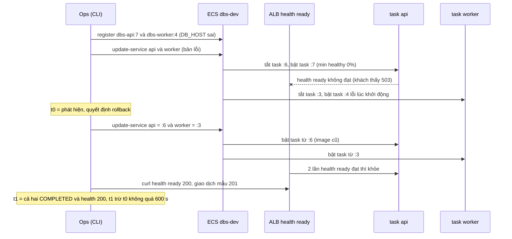

# DBS-156 · Diễn tập rollback về task definition cũ trong ≤ 10 phút

> **Status:** Draft (đang làm, đến G2) · **Vai:** #5 Platform & Ops · **Cặp đôi review:** Dev (theo quyết định techlead không còn bắt buộc, BACKLOG #175) · **Nhánh:** `docs/DBS-156-rollback-drill` (từ `origin/main` 957dcbf) · **PR:** — · **Cập nhật:** 2026-11-14

## 1. Bối cảnh

- **Task trên board:** Task, Tuần 6, Ưu tiên High, Deliverable/Demo **P3**, Status "To Do", vai board #5 Platform & Ops (khớp loại việc: vận hành AWS, runbook). **Expect:** "Rollback là việc đã làm thật, có số thời gian."
- **Thực trạng trên board** (chép): "Cách rollback mới ghi ở README (DBS-38), chưa diễn tập."
- **DoD** (nguyên văn, đánh số):
  1. Cố ý deploy bản lỗi rồi rollback về task definition cũ cho cả api và worker, đo thời gian ≤ 10 phút
  2. Video và log lưu docs/deliverables; quy trình ghi thành runbook
  3. Kiểm health và một giao dịch mẫu sau rollback
- **Phụ thuộc** (board và repo, đã kiểm):

| Task | Board | Trong repo / trên AWS |
|---|---|---|
| DBS-38 deploy tự động | Done | `.github/scripts/deploy.sh`, `infra/terraform/README.md` mục «Rollback thủ công» (chỉ nói service `api`) |
| DBS-121 service worker | Done | `session/worker.tf` (service `worker`, 0%/100%, circuit breaker), `deploy.sh` lăn worker (BL-248); trên AWS: service `worker` ACTIVE 1/1 |

- **Đã có gì:** README rollback 3 lệnh cho `api`; docs/03 §13.3 một dòng «Cập nhật service về task definition trước đó»; circuit breaker `rollback = true` ở cả hai service (`session/ecs.tf`, `worker.tf`); `render-task-definition.py` (đổi image của một container); ALB kiểm `/health/ready` 15 s, 2 đạt là khỏe, 3 trượt là unhealthy, grace 60 s (docs/03 §13.3).
- **Môi trường AWS lúc bắt đầu** (chỉ đọc, profile `dbs-admin`, `ap-southeast-1`, 2026-11-14 13:17 +07): stack `session` **đang chạy** do phiên trước dựng lúc 12:21 (RDS `dbs-dev` available, Valkey `dbs-dev` available, ALB `dbs-dev`, ECS `api` 1/1 trên `dbs-api:6`, `worker` 1/1 trên `dbs-worker:3`, cùng image `4afac28`), `/health/ready` qua ALB = 200 (`redis: up`). Dữ liệu: bảng đã migrate nhưng **chưa có khách hay tài khoản** (`GET /v1/accounts` = `[]`). Token demo `operator`, `customer1..3` lấy được bằng `infra/scripts/demo-token.sh` (principal `dbs-admin` đọc được secret, khác BL-265).
- **Phát hiện khi xác minh «Thực trạng» bằng cách chạy** (không đọc suông):
  - Lệnh `list-task-definitions --family-prefix dbs-api --sort DESC` của README chỉ trả **revision ACTIVE**: lúc này chỉ có `dbs-api:6` và `dbs-worker:3`. Revision 1–5 của `dbs-api` đã **INACTIVE** (mỗi revision bị hủy đăng ký vài phút đến vài chục phút sau khi đăng ký, ví dụ revision 5: đăng ký 2026-11-12 23:11, hủy 23:14, khớp một phiên dựng rồi `terraform destroy`) nên **không dùng được** cho `update-service`. Sau một phiên mới dựng, «task definition cũ» có thể **không tồn tại**: runbook phải nói cách lấy lại (đăng ký lại từ image SHA còn trên ECR).
  - README không nói gì về worker, và `describe-services ... deployments` không đủ để biết rollback đã xong thật (cần `runningCount`, health ALB, log).
- **Baseline** (loại việc: vận hành AWS và tài liệu, không đổi code, Terraform hay CI): `node .claude/skills/dbs-delivering-task/scripts/check-doc-links.mjs` → `416 files checked, 0 broken link(s)` trên `origin/main` 957dcbf. Không chạy bốn lệnh backend, `terraform fmt/validate` hay `terraform test` vì không file nào của chúng đổi (xem Ngoài phạm vi).
- **Dòng BACKLOG liên quan:**

| Dòng | Quyết định |
|---|---|
| BL-104 (DBS-38 M-38-08/09: `Deploy` thật trên `main` chưa chạy) | Cùng khoảng trống «pipeline chưa chạy thật». Drill này dùng thao tác tay của cùng API ECS; không xóa dòng, ghi thêm nguồn nếu cần |
| BL-234 (api 1 task: min healthy 0% nên deploy lỗi làm mất phục vụ) | Chính là điều drill sẽ đo (thời gian mất phục vụ khi deploy lỗi); ghi số vào runbook, không xóa dòng |
| BL-247, BL-242 (3) (worker thật trên ECS) | Task worker đã chạy thật trong stack hiện có; drill cũng cho bằng chứng một phần, nhưng nhóm B của DBS-121 (kill task, thiếu biến) không thuộc task này: không xóa |
| BL-265 (principal bị `dbs-no-secret`) | Không dính: `dbs-admin` đọc được secret và `demo-token.sh` chạy |
| BL-128 (`check:invariants` chưa chạy trên RDS) | Vẫn chưa chạy được ở đây (RDS private, cần task một lần): ghi «chưa chạy», không phải DoD của task này |

- **Ngoài phạm vi:** viết script rollback tự động (runbook dùng lệnh `aws` chuẩn; script mới cần test riêng, ghi BL); đổi `deploy.sh`, Terraform, CI, ECR lifecycle; rollback migration (schema giữ kiểu expand, rollback chỉ đổi image); rollback có xung đột schema «contract» (nêu trong runbook, chưa diễn tập); `Deploy` workflow thật qua OIDC (BL-104, BL-105); load test khi rollback (DBS-166).
- **Quyết định ở G1** (agent tự quyết, người dùng vắng; không còn câu hỏi mở):
  1. **Dùng stack `session` đang chạy**, không `apply` hay `destroy` (người dùng cho phép AWS trong phiên này, dặn «không destroy»). Cuối phiên chỉ **stop** (api, worker về 0 task; RDS stop) và báo rõ cái còn chạy (§8).
  2. **«Bản lỗi» = revision task definition cấu hình sai**, vì máy không có docker để build image lỗi và `deploy.sh` đòi tag SHA có thật trên ECR. Cơ chế ECS thấy giống hệt một deploy thật: một revision mới của `dbs-api` và `dbs-worker`, trỏ service tới nó (`register-task-definition` + `update-service`, đúng hai lệnh `deploy.sh` dùng, thiếu bước migration vì không đổi schema). Lỗi chọn: `DB_HOST` trỏ tới tên không phân giải được (lỗi cấu hình hay gặp nhất khi đổi biến môi trường).
  3. **«Task definition cũ»** = revision đang chạy trước lúc deploy lỗi (`dbs-api:6`, `dbs-worker:3`), vì không còn revision ACTIVE nào cũ hơn (phát hiện ở trên). Runbook ghi thêm cách đăng ký lại từ image SHA khi revision cũ đã INACTIVE (dùng `render-task-definition.py` đã có).
  4. **Hai service rollback song song**, thời gian đo từ lệnh `update-service` đầu tiên của rollback tới khi **cả hai** COMPLETED với `runningCount = desiredCount`, `/health/ready` = 200 qua ALB, và worker có dòng log khởi động; ngưỡng 600 s (DoD 1). Đo thêm riêng từng service.
  5. **Video:** máy không có `ffmpeg` hay `asciinema`, không có cách quay màn hình trong phiên này. Thay bằng **bản ghi terminal phát lại được** (`script --log-timing`, phát bằng `scriptreplay`) cộng log thô và bảng thời gian trong `docs/deliverables/P3-rollback-drill/`. Phần «video» của DoD 2 **chưa đạt**, ghi BL (§8).
  6. **Không viết script rollback mới** (ngoài phạm vi, cần test riêng); `drill.sh` kèm bằng chứng là kịch bản đã chạy, không phải công cụ vận hành.
  7. **Giao dịch mẫu** đi qua API thật (onboarding `customer1` Nguyễn Minh Anh và `customer2` Trần Thu Hà, mở tài khoản, nạp, chuyển); không SQL tạo số dư (CONTRIBUTING §5). Chứng chỉ ALB tự ký nên `curl -k` (BL-252), chỉ ở dev.

## 2. Hành vi

Task không thêm API. Nó định nghĩa **kịch bản diễn tập**, **ngưỡng đạt** và **quy trình rollback** (runbook [`docs/runbooks/rollback.md`](../runbooks/rollback.md)).

### 2.1 Kịch bản

| Pha | Việc | Hệ thống phải cho thấy |
|---|---|---|
| A. Nền tốt | `api:6` và `worker:3` chạy; một giao dịch mẫu hoàn tất | `/health/ready` 200; nạp 5.000.000đ và chuyển 1.000.000đ → 201 `COMPLETED`; số dư 4.000.000đ và 1.000.000đ |
| B. Deploy lỗi | Đăng ký `dbs-api:7` và `dbs-worker:4` (chỉ khác `DB_HOST` sai), `update-service` cả hai | Task mới của api không qua `/health/ready` (ALB không có đích khỏe vì min healthy 0%: task cũ đã tắt); task mới của worker lỗi lúc khởi động; ECS lặp lại việc bật task |
| C. Rollback | `update-service` về `dbs-api:6` và `dbs-worker:3`, đo giờ | Cả hai deployment PRIMARY `COMPLETED`, `runningCount = desiredCount = 1`, `/health/ready` 200, worker có log khởi động; **tổng ≤ 600 s** |
| D. Sau rollback | Health, giao dịch mẫu thứ hai, đối chiếu dữ liệu | Số dư trước sự cố còn nguyên; nạp 2.000.000đ và chuyển 500.000đ → 201; replay khóa giao dịch cũ trả đúng phản hồi đã lưu; hàng đợi SQS và DLQ không tồn |
| E. Từ chối | `update-service` về revision INACTIVE (`dbs-api:5`) | AWS từ chối, service không đổi: bằng chứng cho cảnh báo của runbook |

### 2.2 Ngưỡng đạt (docs/03 §13.3, DoD)

| Chỉ số | Đạt khi |
|---|---|
| Thời gian rollback | từ lệnh `update-service` đầu tiên của rollback tới khi cả api và worker ổn định **và** `/health/ready` = 200 qua ALB: ≤ 600 s |
| Sau rollback | image của hai service là image của revision cũ; không còn deployment `IN_PROGRESS`; deployment PRIMARY không `FAILED` |
| Giao dịch mẫu | 201 và số dư đúng chữ số; không `5xx` ở các lệnh sau rollback |
| Dữ liệu | số dư và lịch sử trước sự cố không đổi (rollback chỉ đổi image, không đụng schema) |

Mất phục vụ khi deploy lỗi (api 1 task, min healthy 0%, BL-234) cũng được đo: từ lúc `update-service` bản lỗi tới lúc `/health/ready` trả 200 trở lại. Đây là số tham khảo, không có ngưỡng.

### 2.3 Quy tắc của runbook

- Quyết định rollback khi: deployment PRIMARY không COMPLETED sau 10 phút, `/health/ready` không 200 sau grace, hoặc tỉ lệ 5xx tăng sau deploy. Circuit breaker có thể đã tự rollback: kiểm `rolloutState` trước.
- **Chỉ rollback được về revision ACTIVE.** Revision INACTIVE bị từ chối; khi đó đăng ký lại từ image SHA còn trên ECR (ECR giữ 20 image mới nhất).
- Rollback đổi image, **không** hoàn tác migration. An toàn khi migration kiểu expand; migration «contract» đã chạy thì **không** rollback mà sửa tiến.
- Terraform không kéo service về revision của nó (`ignore_changes = [task_definition]`), nên rollback tay không bị `apply` ghi đè, nhưng cũng nghĩa là lần `apply` sau không «tự sửa» trạng thái.
- Worker lăn 0%/100%: có khoảng trống xử lý, sự kiện nằm ở outbox (ADR-03) và được xử lý bù sau khi worker khỏe.

## 3. Kiến trúc

- **Vị trí:** không đổi code sản phẩm, Terraform hay CI. File mới: [`docs/runbooks/rollback.md`](../runbooks/rollback.md); bằng chứng ở `docs/deliverables/P3-rollback-drill/` (`drill.sh`, `drill.log`, bản ghi terminal `drill.typescript` + `drill.timing`, `timings.md`). Sửa: `infra/terraform/README.md` (mục Rollback thủ công), docs/03 §13.3, `docs/components/ci-cd/01-concept-brief.md`, `docs/deliverables/README.md` (dòng P3), `docs/deliverables/P4-incident-table.md` (một dòng, theo `platform.md`), `docs/features/README.md`, `docs/BACKLOG.md`.
- **Công cụ dùng (có sẵn):** `aws ecs describe-task-definition / register-task-definition / update-service / describe-services`, `.github/scripts/render-task-definition.py`, `infra/scripts/demo-token.sh`, `curl -k`, `aws logs`, `aws sqs get-queue-attributes`. Không symbol nào bị đổi, không có người gọi cần liệt kê.
- **Dữ liệu:** chỉ qua API (onboarding, tài khoản, nạp, chuyển); không SQL. Bảng chạm tới gián tiếp: `customers`, `accounts`, `transfers`, `ledger_entries`, `idempotency_keys`, `audit_log`, `outbox_events`.
- **Ranh giới transaction:** không có code mới. Mỗi lệnh nạp/chuyển là một transaction của api như thiết kế.

- **Rủi ro vận hành khi diễn tập:** api mất phục vụ trong lúc deploy lỗi (stack dev, không khách thật); worker lỗi lặp lại tạo vài task `STOPPED` (log ở `/dbs/dev/worker`); circuit breaker có thể tự rollback trước lệnh tay (xử lý ở §5, M-156-04).
- **Thay đổi cấp hệ thống:** docs/03 §13.3 (dòng Rollback), README Terraform (mục rollback, thêm worker), brief ci-cd; không ADR nào bị đổi (rollback bằng task definition vốn là quyết định ở ADR-11 và §13.3).

## 4. Test cases tự động

Task vận hành và tài liệu: không có code sản phẩm nên không có test đơn vị mới. Các case dưới đây là kiểm tự động trên tài liệu và công cụ; bằng chứng chính là test thủ công §5 trên AWS thật.

| ID | Truy vết | Lớp | Given · When · Then | `errorCode` |
|---|---|---|---|---|
| TC-156-01 | DoD 2 (runbook) | tài liệu | `check-doc-links.mjs` sau khi thêm runbook và sửa các doc: 0 link hỏng, mọi ảnh/anchor tồn tại | — |
| TC-156-02 | DoD 1 (công cụ tạo bản lỗi) | unit (có sẵn) | `python3 -m unittest discover .github/scripts/tests` vẫn xanh: `render-task-definition.py` giữ allowlist khóa, nên bản lỗi được đăng ký bằng đúng bộ lọc mà `deploy.sh` dùng | — |
| TC-156-03 | DoD 1, 2 (kịch bản chạy lại được, không lộ bí mật) | tĩnh | `bash -n drill.sh`; `shellcheck drill.sh` nếu có; grep không thấy token JWT, mật khẩu, account id 12 số, ARN đầy đủ trong `drill.sh`, `drill.log`, `drill.typescript`, `timings.md`, `manual-test.txt` | — |
| TC-156-04 | DoD 2 (runbook đủ nội dung) | tài liệu | grep runbook: có đủ mục «Khi nào rollback», «Trước khi làm», «Rollback», «Kiểm sau rollback», «Giao dịch mẫu», «Khi không rollback được», «Số đo»; mỗi lệnh `aws ecs` trong runbook có mặt trong `drill.sh` | — |
| quy trình | DoD 1, 3 | thủ công | M-156-01..09 trên AWS thật (§5) | — |
| quy trình | PR | — | PR, CI (không job nào chạm file của task), bảng đối chiếu | — |

## 5. Test thủ công

Điều kiện: stack `session` đang chạy (§1), profile `dbs-admin`, `ap-southeast-1`, `COGNITO_CLIENT_ID` của pool `dbs`, từ gốc repo trên máy làm việc; token chỉ qua biến, không in. Pha A–E chạy bằng `docs/deliverables/P3-rollback-drill/drill.sh` (một lần, ghi bằng `script`), từng bước in giờ epoch và giờ ISO để tính thời gian từ log.

| Bước | Việc làm | Kết quả mong đợi |
|---|---|---|
| M-156-01 | Nền: `describe-services api worker`, `list-task-definitions` ACTIVE, `curl /health/live` và `/ready` | `api:6`, `worker:3`, 1/1 mỗi service, hai health 200 `redis: up` |
| M-156-02 | Giao dịch trước deploy: `POST /v1/customers/me` (customer1, customer2), `POST /v1/accounts` mỗi người, operator `POST /v1/operator/deposits` 5.000.000, customer1 `POST /v1/transfers` 1.000.000 sang customer2; thêm ca bị từ chối: chuyển 9.000.000 từ customer1 | 201 `COMPLETED` cho nạp và chuyển; ca từ chối 422 `INSUFFICIENT_FUNDS`; `GET /v1/accounts` cho 4.000.000 và 1.000.000 |
| M-156-03 | Tạo bản lỗi: `describe-task-definition --include TAGS` → `render-task-definition.py` (cùng image) → đổi `DB_HOST` → `register-task-definition`, cho cả `dbs-api` và `dbs-worker` | `dbs-api:7` và `dbs-worker:4` ACTIVE; image đúng bằng `:6`/`:3`; chỉ `DB_HOST` khác |
| M-156-04 | Deploy lỗi: ghi `t_bad`; `update-service` api = `:7`, worker = `:4`; poll mỗi 10 s tối đa 180 s: events của service, `curl /health/ready`, task `STOPPED` và `stoppedReason` | `/health/ready` ≠ 200, và ít nhất một task `:7` hoặc `:4` đã STOPPED hoặc không qua health. Nếu circuit breaker tự rollback trước khi tới tay: ghi giờ, coi là kết quả riêng (M-156-04b), rồi lặp lại M-156-04 một lần |
| M-156-05 | Rollback: ghi `t0`; `update-service` api = `:6` và worker = `:3` liên tiếp; poll mỗi 5 s tới khi cả hai `COMPLETED`, `runningCount = 1`, `/health/ready` = 200; ghi `t1` và thời gian riêng từng service | `t1 - t0 ≤ 600 s`; image từng service là image của `:6`/`:3` |
| M-156-06 | Kiểm sau rollback: `describe-services` (không `IN_PROGRESS`, không `FAILED`), `/health/live` và `/ready` 200, `aws logs` của api và worker từ `t0` (không `Application startup failed`; worker có dòng khởi động), `get-queue-attributes` của `risk-events` và DLQ | health 200; log không lỗi mới; hàng đợi cạn (ba thuộc tính 0), DLQ 0 |
| M-156-07 | Giao dịch sau rollback: `GET /v1/accounts` (số dư nền còn nguyên); replay cùng `Idempotency-Key` của lệnh chuyển ở M-156-02; operator nạp 2.000.000; customer1 chuyển 500.000 sang customer2; `GET /v1/accounts` | số dư nền nguyên; replay trả đúng phản hồi cũ (cùng `transferId`); nạp và chuyển 201; số dư cuối 5.500.000 và 1.500.000 |
| M-156-08 | Từ chối: `update-service` api về `dbs-api:5` (INACTIVE) | AWS từ chối, service không đổi (`taskDefinition` vẫn `:6`) |
| M-156-09 | Sau khi ghi xong bằng chứng: đưa `api` và `worker` về 0 task, `stop-db-instance`; kiểm trạng thái | RDS `stopping` rồi `stopped`, hai service `desiredCount = 0`; ghi rõ ALB, Valkey còn chạy |

Bước **chưa thể** chạy ở đây (ghi trước, không giả «đạt»): rollback bằng workflow `Deploy` thật (BL-104), kiểm `check:invariants` trên RDS (BL-128), video màn hình (G1, quyết định 5).

## 6. Domain review (AI)

- **Phạm vi:** Rà soát `docs/runbooks/rollback.md` và `docs/deliverables/P3-rollback-drill/drill.sh` (không đổi code ứng dụng/Terraform).
- **Lưu ý đã xử lý:** Tên ECS service thực tế trong `dev/session` là `api` và `worker` (không phải `dbs-dev-api`/`dbs-dev-worker`), `drill.sh` hỗ trợ override qua `API_SVC` và `WORKER_SVC`; sau diễn tập cần deregister revision lỗi (`dbs-api:8`, `dbs-worker:5`) để tránh nhầm lẫn.

## 7. Kế hoạch triển khai

1. Viết `docs/runbooks/rollback.md` (quy trình rollback ECS + kiểm tra migration/DB) và `docs/deliverables/P3-rollback-drill/drill.sh`.
2. Chạy diễn tập trực tiếp trên `dev/session` (`ap-southeast-1`), đo thời gian hồi phục từ `T0` đến khi `api` & `worker` `COMPLETED` và `/health/ready` trả `200`.
3. Lưu bảng thời gian tại `docs/deliverables/P3-rollback-drill/timings.md` và log đã redact tại `docs/features/screenshots/DBS-156/manual-test.txt`.

## 8. Kết quả

- **Offline:** `bash -n docs/deliverables/P3-rollback-drill/drill.sh` đạt; `.github/scripts/tests` đạt (163 tests OK, 16 skipped).
- **Live AWS (`dev/session`, 2026-11-14):**
  - Deploy bản lỗi (`dbs-api:8`, `dbs-worker:5` với `DB_HOST=broken-db-host.invalid`): `/health/ready` chuyển `503` sau `+30 s`.
  - Rollback về `dbs-api:7` và `dbs-worker:4` (`T0 = 08:37:59Z`):
    - `/health/ready` hồi phục `200` sau **`+78 s`**.
    - `api` rollout `COMPLETED` sau **`+108 s`**.
    - `worker` rollout `COMPLETED` sau **`+299 s`**; toàn bộ diễn tập hoàn tất trong **`301 s`** (~5 phút, đạt ngưỡng ≤ 600 s).
  - Đã deregister `dbs-api:8` và `dbs-worker:5` (`INACTIVE`).
- **Chưa chạy (ghi nhận theo giới hạn):** rollback qua GitHub Actions `Deploy` workflow (BL-104), `check:invariants` trên RDS (BL-128), quay video màn hình.
- **Bằng chứng:** [timings.md](../../docs/deliverables/P3-rollback-drill/timings.md), [manual-test.txt](screenshots/DBS-156/manual-test.txt).

## 9. Tài liệu đã cập nhật

- [docs/runbooks/rollback.md](../runbooks/rollback.md)
- [docs/deliverables/P3-rollback-drill/drill.sh](../deliverables/P3-rollback-drill/drill.sh)
- [docs/deliverables/P3-rollback-drill/timings.md](../deliverables/P3-rollback-drill/timings.md)
- [docs/features/DBS-156-rollback-drill.md](DBS-156-rollback-drill.md)
- [docs/features/screenshots/DBS-156/manual-test.txt](screenshots/DBS-156/manual-test.txt)
