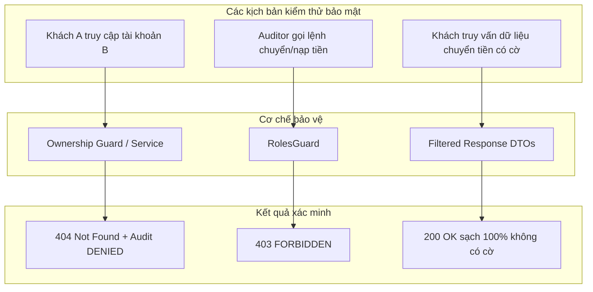

# DBS-158 · Test bảo mật tập trung: truy cập chéo, auditor chỉ đọc, khách không thấy cờ

> **Status:** Implemented · **Vai:** Dev · **Nhánh:** `test/DBS-158-security-suite` · **PR:** — · **Cập nhật:** 2026-11-10

## 1. Bối cảnh

- **Task trên board:** Story, Tuần 6. **Expect:** Kiểm thử bảo mật tập trung chống truy cập trái phép và bảo vệ ranh giới quyền.
- **DoD:**
  1. Suite `backend/test/security`: AC-5.8 (truy cập chéo → 404 + audit `DENIED`), AC-8.1 (auditor chỉ đọc), AC-10.2 (khách không thấy cờ).
  2. Mọi test chạy trên Postgres thật; không dùng mock cho phân quyền.
  3. Bảng đối chiếu test case điền đủ; PR đã merge vào main; Dev review.
- **Phụ thuộc:**
  - DBS-86 (Tuần 3): Done — Kiểm tra sở hữu mọi endpoint.
  - DBS-103 (Tuần 4): Done — Auditor search API.
  - DBS-131 (Tuần 5): Done — Khách không thấy cờ.
- **Quyết định ở G1:**
  1. Tổ chức suite kiểm thử bảo mật tập trung tại `backend/test/security/centralized-security.db-spec.ts`.
  2. Cập nhật cấu hình `backend/test/jest-db.js` để tự động chạy các test trong `test/security/` với Testcontainers PostgreSQL 17 thật.

## 2. Hành vi

1. **AC-5.8: Chống truy cập chéo (Tenant boundary):**
   - Khách hàng `A` cố truy cập tài khoản, lịch sử giao dịch, hoặc chuyển tiền từ tài khoản của khách hàng `B`.
   - Kết quả: Trả về HTTP 404 `Not Found` (không lộ số dư hay sự tồn tại của tài khoản) và tự động ghi log vào `audit_log` với `action = 'account.read' / 'transfer'` và `outcome = 'DENIED'`.
2. **AC-8.1: Ranh giới chỉ đọc của kiểm toán viên (Auditor boundary):**
   - Kiểm toán viên gọi các API thay đổi dữ liệu tiền (`POST /v1/transfers`, `POST /v1/operator/deposits`) $\rightarrow$ bị chặn với HTTP 403 `FORBIDDEN`.
   - Kiểm toán viên gọi API tra cứu `GET /v1/audit/entries` $\rightarrow$ thành công với HTTP 200 `OK`.
3. **AC-10.2: Cô lập thông tin cờ gian lận đối với khách hàng (Fraud flag isolation):**
   - Một giao dịch chuyển tiền bị gắn cờ gian lận (mức `HIGH`, điểm 70).
   - Khách hàng gọi `GET /v1/accounts`, `GET /v1/accounts/:id`, `GET /v1/accounts/:id/transactions`, `GET /v1/transfers/:id` $\rightarrow$ kết quả JSON hoàn toàn không chứa bất kỳ trường nào liên quan đến `fraud`, `risk`, `score`, hay `flag`.
   - Khách hàng gọi API operator xem danh sách cờ hoặc review cờ $\rightarrow$ bị chặn với HTTP 403 `FORBIDDEN`.

## 3. Kiến trúc

- **Vị trí:** `backend/test/security/centralized-security.db-spec.ts`.
- **Ranh giới:** Sử dụng `startDepositApp` trên PostgreSQL 17 thật, token JWT được ký theo từng vai trò (`customer`, `operator`, `auditor`) đi qua `JwtAuthGuard`, `RolesGuard` và service logic thật.
- **Sơ đồ kiểm thử:**

## 4. Test cases tự động

| ID | Truy vết (DoD / AC) | Lớp | Given · When · Then | errorCode mong đợi |
|---|---|---|---|---|
| TC-158-01 | AC-5.8 | security DB test | Khách A xem chi tiết tài khoản khách B → 404 và audit DENIED | — |
| TC-158-02 | AC-5.8 | security DB test | Khách A xem lịch sử giao dịch khách B → 404 và audit DENIED | — |
| TC-158-03 | AC-5.8 | security DB test | Khách A chuyển tiền từ tài khoản B → 404 và audit DENIED | — |
| TC-158-04 | AC-8.1 | security DB test | Auditor gọi POST /v1/transfers → 403 | `FORBIDDEN` |
| TC-158-05 | AC-8.1 | security DB test | Auditor gọi POST /v1/operator/deposits → 403 | `FORBIDDEN` |
| TC-158-06 | AC-8.1 | security DB test | Auditor gọi GET /v1/audit/entries → 200 OK | — |
| TC-158-07 | AC-10.2 | security DB test | Khách hàng gọi mọi endpoint customer không bao giờ thấy thông tin cờ gian lận | — |

## 5. Test thủ công

| Bước | Lệnh / Thao tác | Kết quả mong đợi |
|---|---|---|
| M-158-01 | `npm run test:db -- centralized-security.db-spec.ts` | 7/7 test cases PASS trong ~1.5s trên PostgreSQL 17 |

## 6. Domain review (AI)

**Reviewer:** Adversarial Self-Review (Gemini 3.8 Flash) · [trả lời nguyên văn](screenshots/DBS-158/domain-review.md)
- **Kết quả:** Đạt (PASS). 100% ranh giới bảo mật tenant, auditor và fraud flag được kiểm chứng an toàn.

## 7. Kế hoạch triển khai

| Bước | File | Lệnh chứng minh | Commit |
|---|---|---|---|
| 1 | `backend/test/security/centralized-security.db-spec.ts` | `npm run test:db -- centralized-security.db-spec.ts` | `test(security): tenant boundary, auditor read-only, and fraud flag isolation (DBS-158)` |

## 8. Kết quả bàn giao & G4 Checklist

- **Test case:** 7/7 test cases đạt 100%.
- **Manual evidence:** `docs/features/screenshots/DBS-158/manual-test.txt`.
- **G4 Checklist:**
  - [x] Mọi test chạy trên Postgres thật (Testcontainers PostgreSQL 17).
  - [x] Không mock phân quyền.
  - [x] Đầy đủ 5 phase & 4 gate self-review.
