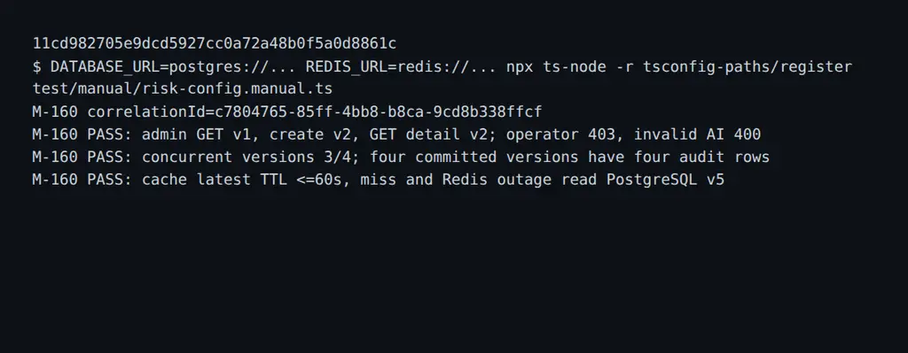

# DBS-160 · API quản trị cấu hình fraud có phiên bản

> **Trạng thái:** Kiểm chứng cục bộ; chờ CI và Dev review · **Vai:** #4 Fraud · **Nhánh:** `feat/DBS-160-risk-config-api` · **PR:** [#131](https://github.com/Lawliet119/digital-banking-simulator/pull/131) · **Nền:** `bd17728e24879e28280656926c208da872da8b9e`.

## 1. Bối cảnh và G1

**Task:** Story tuần 6, deliverable P5. **Expect từ board:** “Đổi tham số luật mà không sửa code và có dấu vết.”

**DoD nguyên văn:**

1. GET danh sách/chi tiết phiên bản và POST tạo phiên bản mới (chỉ admin) với validate tham số/trọng số/ngưỡng
2. Không có đường sửa hay xóa phiên bản cũ (trigger forbid_mutation); ghi audit người tạo
3. Phiên bản mới có hiệu lực sau tối đa 60 giây (cache latest)
4. PR đã merge vào main (CI xanh); Dev review; bảng «Đối chiếu test case» trong PR điền đủ
5. Validate khối ai của cấu hình (provider, model, rubric, threshold trong (0,1], weight nguyên ≥ 0, maxAdmissionDelayMs và requestTimeoutMs là số nguyên dương, tổng điểm không vượt int PostgreSQL): cấu hình sai bị từ chối ở API, không bao giờ làm worker lỗi

**Phụ thuộc:** DBS-110, DBS-51 và DBS-56 đều Done trên board; `RuleSetRepository`, `Roles`/JWT và `AuditService.record` có trong source. `risk_rule_sets` seed v1, append-only và quyền SELECT/INSERT của `dbs_api` đã có. UC-12 chưa có controller; `docs/03` đã định nghĩa GET `/v1/admin/risk-config` và POST `/v1/admin/risk-config/versions`. BL-188 yêu cầu kiểm miền tham số từng luật trước khi ghi; BL-208 nêu rủi ro schema cấu hình.

**Baseline trên main:** `lint:check`, `typecheck`, unit 98 suite/1.770 test và e2e 17 suite/163 test đạt; PostgreSQL 17 và Valkey riêng. PR #129 là thay đổi fraud khác chưa merge, không sửa nhánh đó và không giả định nó đã vào main.

**Ngoài phạm vi:** UI, bật AI/egress, cấp secret, điều chỉnh dữ liệu giao dịch, sửa ledger; dashboard metric thuộc DBS-187. Không sửa board, không merge thay người review. Đề nghị người quản lý board chuyển DBS-160 sang In Progress.

**Quyết định G1 — agent tự quyết:** tạo nhánh riêng từ main mới; thêm API admin vào module HTTP riêng, tái dùng cùng parser và logic luật đang chạy; không cấp thêm quyền UPDATE/DELETE. Handoff xác nhận điều khoản, dữ liệu thật và vận hành AI vẫn theo RSK-05/BL-043. Không coi DoD về Dev review/merge là đã đạt.

## 2. Hành vi dự kiến

- Admin lấy latest bằng `GET /v1/admin/risk-config`; danh sách bằng `GET /v1/admin/risk-config/versions` (phân trang có giới hạn); chi tiết bằng `GET /v1/admin/risk-config/versions/{version}`.
- Admin gửi `POST /v1/admin/risk-config/versions` với JSON `{ "config": { "mode": "rule_only", "thresholds": { "medium": 40, "high": 70 }, "rules": { "R1": { "enabled": true, "weight": 30, "maxTransfers": 5, "windowMinutes": 10 }, "R2": { "enabled": true, "weight": 25, "medianMultiplier": 5, "historyDays": 30, "minHistory": 5 }, "R3": { "enabled": true, "weight": 35, "maxAccountAgeHoursExclusive": 24, "minAmountExclusive": "10000000" }, "R4": { "enabled": true, "weight": 20, "reverseWindowMinutes": 60 }, "R5": { "enabled": true, "weight": 40, "minNewRecipients": 5, "windowMinutes": 60, "noveltyDays": 30, "sameOwnerExempt": true }, "R6": { "enabled": true, "weight": 30, "minBalancePercent": 90, "minBalance": "1000000", "sameOwnerExempt": true } } } }`; trả `201` với version, config, createdBy và createdAt. Không nhận version hay createdBy từ client.
- `mode` chỉ nhận `rule_only` hoặc `rules_with_external_ai`; mode AI bắt buộc block `ai` hợp lệ. Nếu gửi block AI ở mode baseline thì block đó cũng phải hợp lệ. Cấu hình sai hoặc khóa thừa bị từ chối HTTP 400, không ghi DB; lỗi không phản chiếu giá trị. Sai vai → `403 FORBIDDEN`; không token → `401 UNAUTHENTICATED`; version không tồn tại → 404.
- Version luôn mới và tăng theo thứ tự commit; các writer hợp lệ serialize trước `MAX(version)+1`, không xóa cache đang dùng trước commit. Insert và audit cùng transaction; lỗi audit rollback toàn bộ. Không có API update/delete.

## 3. Kiến trúc dự kiến

API-only module ở `backend/src/modules/risk`, `@Roles('admin')`, dùng `TransactionService.run` và `AuditService.record`; đọc PostgreSQL trực tiếp, không gọi Redis trong transaction. `parseRuleSet` giữ semantics fallback của worker. API kiểm mode và cấu trúc nghiêm ngặt; khi `ai` có mặt ở **bất kỳ mode nào**, parse thêm bản sao với mode `rules_with_external_ai` và từ chối `aiConfigInvalid`, nhưng lưu mode client yêu cầu. Sau đó dùng chính sáu luật trên input synthetic bất biến để kiểm tham số luật. Người tạo lấy từ `@CurrentUser`, không từ body. `dbs_api` không có quyền `LOCK TABLE ... SHARE ROW EXCLUSIVE` (đã thử trên PostgreSQL). Writer dùng `pg_advisory_xact_lock(20261110, 160)` qua cùng manager, rồi đọc `MAX(version)` bằng câu SQL **riêng** ở READ COMMITTED; giữ khóa đến khi insert và audit commit/rollback. Mọi writer thủ công cũng phải giữ khóa này; không hỗ trợ SQL bỏ qua khóa. Cache latest giữ nguyên TTL, không invalidate trước commit.

```mermaid
sequenceDiagram
    participant A as Admin
    participant API as Risk config API
    participant DB as PostgreSQL
    participant W as Risk worker
    A->>API: POST cấu hình mới
    API->>API: Kiểm schema, AI và sáu luật
    API->>DB: BEGIN; khóa writer; INSERT version; audit; COMMIT
    API-->>A: 201 và version
    W->>DB: Đọc version sau cache latest hết hạn ≤60s
```

## 4. Test cases dự kiến

| ID | DoD | Hành vi cần chứng minh |
|---|---|---|
| TC-160-01 | 1 | JWT thật: chỉ admin đọc latest/list/detail và tạo version; customer/operator bị 403, thiếu token 401; phân trang và version sai biên |
| TC-160-02 | 1, 5 | Mỗi luật nhận cấu hình hợp lệ và từ chối các ngưỡng sai; AI sai từng trường trong cả hai mode, mode lạ, điểm overflow hoặc khóa thừa → 400, không ghi |
| TC-160-03 | 2 | PostgreSQL: giữ writer A trước commit, chứng minh B chờ rồi tạo version theo thứ tự; khi audit A lỗi thì rollback, nhả khóa, không để lại version/audit |
| TC-160-04 | 2 | API không update/delete; trigger và quyền role từ chối sửa/xóa version cũ |
| TC-160-05 | 3 | Cache latest thật trả version cũ không quá TTL, miss/Redis lỗi đọc version mới; không invalidate trước commit |
| TC-160-06 | 4 | Quy trình CI, Dev review, merge; ghi chưa đạt cho tới khi có bằng chứng |

## 5. Manual dự kiến

PostgreSQL/Valkey riêng và API thực, token admin/operator/customer do helper phát. (1) Admin GET v1, POST cấu hình hợp lệ và GET lại v2; đọc `risk_rule_sets`/`audit_log`. (2) Operator và customer bị 403, cấu hình AI lỗi bị 400 và không có dòng mới. (3) Tạo hai request đồng thời, kiểm version và audit; kiểm Redis cache hết hạn/miss không mất version. Không dùng dữ liệu hay key thật.

## 6. Domain review

Reviewer độc lập (runtime không cung cấp tên model): vòng đầu **REVISE**, 0 blocking, 1 should-fix: parser bỏ qua `ai` ở baseline; đã sửa §3 và TC-160-02 để kiểm bản sao ép mode AI. [Review nguyên văn](screenshots/DBS-160/domain-review.md). Vòng hai **APPROVE**, 0 finding; [review lại](screenshots/DBS-160/domain-review-round2.md). Khóa advisory cùng manager và SQL `MAX` riêng được xác nhận; thiếu audit 403 là BL-132 đã có, không sửa guard chung ngoài phạm vi.

**Quyết định G2 — agent tự quyết:** luôn validate block AI nếu có, không đổi fallback khi worker đọc dữ liệu cũ; không tăng quyền bảng hay dùng khóa phiên trên pool. Writer SQL thủ công phải dùng cùng cặp khóa.

## 7. Kế hoạch

| Bước | File | Test viết trước / bằng chứng | Commit dự kiến |
|---|---|---|---|
| 1 | `backend/test/db/risk-config-http.db-spec.ts`, `backend/test/support/risk-config-app.ts` | Đỏ đã chạy: admin GET kỳ vọng 200, nhận 404 vì route chưa có; PostgreSQL/role thật, sau đó TC-160-01…05 | `test(risk): cover admin risk config` |
| 2 | `backend/src/modules/risk/risk-config-*`, `backend/src/modules/index.ts` | TC-160-01…04 xanh; validate sáu luật/AI, advisory lock, transaction/audit và không sửa role grants | `feat(risk): add versioned admin config API` |
| 3 | `backend/test/manual/risk-config.manual.ts`, docs feature, `docs/03`, README risk, `docs/BACKLOG.md`, feature index, OpenAPI | TC-160-05, manual qua HTTP/JWT/PostgreSQL/Valkey, lint/typecheck, test liên quan, ảnh và link | `docs(risk): record config API evidence` |

**Rủi ro/lùi:** API mới không đổi schema hay ledger; lùi bằng gỡ module HTTP, version đã ghi vẫn bất biến và worker tiếp tục dùng version mới nhất. Advisory lock yêu cầu mọi writer tuân thủ cùng contract; cache cũ có thể còn hiệu lực tối đa 60 giây. Sweep DoD, ADR-14, BL-188/208 và manual: TC-160-01…05 bao phủ hành vi; review/merge là TC-160-06 quy trình, chưa tự nhận đã xong.

**Quyết định G3 — agent tự quyết:** không sửa rule parser/worker hoặc cấu trúc audit dùng chung; validate strict ở API và dùng trường audit hiện có. Nhánh này không bao gồm giao diện, dashboard hay quyền gửi dữ liệu thật.

**Gate phụ — agent tự quyết:** thêm fixture `test/support/risk-config-app.ts` để tái sử dụng khởi động AppModule, JWT và role DB thật giữa test và manual. Chọn fixture riêng thay vì sửa `deposit-app.ts` đang được PR #129 thay đổi, tránh xung đột nhánh; không thay code sản phẩm.

## 8. Kết quả

- **Lệnh kiểm tra:**
  - `npm run lint:check`: 0 problems
  - `npm run typecheck`: 0 errors
  - `npm test -- --runInBand src/modules/risk/`: 15 test suites passed, 586 tests passed
  - `DATABASE_URL=postgres://... REDIS_URL=redis://... npm run test:db -- --runInBand test/db/risk-config-http.db-spec.ts`: 1 test suite passed, 7 tests passed (đếm lại 2026-11-11)
  - `DATABASE_URL=postgres://... REDIS_URL=redis://... npx ts-node -r tsconfig-paths/register test/manual/risk-config.manual.ts`: tất cả assertions PASS

- **Đối chiếu test case:**

| ID | Test | Đạt? |
|---|---|---|
| TC-160-01 | `risk-config-http.db-spec.ts` › admin reads the seeded current version and immutable history; › only admin can read or create configurations (customer/operator 403, không token 401) | đạt |
| TC-160-02 | › rejects malformed versions, pagination and every invalid rule without writing; › accepts a valid AI block in both modes but preserves the requested mode | đạt |
| TC-160-03 | › serializes concurrent creates and rolls back a version when audit fails; › holds a transaction-scoped writer lock until commit before choosing the next version | đạt |
| TC-160-04 | › creates immutable versions with the authenticated actor and atomic audit (PUT/DELETE trên version trả 404) | **đơn giản hóa**: không có test nào bắt `dbs_api` UPDATE/DELETE `risk_rule_sets` rồi bị trigger/quyền từ chối; phần đó chỉ dựa vào migration `risk_rule_sets` append-only (RSK-01) |
| TC-160-05 | chỉ có trong test thủ công `test/manual/risk-config.manual.ts` | **đơn giản hóa**: không có test tự động cho cache latest không quá TTL; chỉ kiểm thủ công |
| TC-160-06 | CI GitHub Actions và Dev review trên PR | chưa làm (quy trình: cần đẩy nhánh và mở PR) |

- **Test thủ công:**
  Kịch bản chạy thật trên commit code cuối `11cd982705e9dcd5927cc0a72a48b0f5a0d8861c` qua script `test/manual/risk-config.manual.ts`.
  Output thô ghi tại [manual-test.txt](screenshots/DBS-160/manual-test.txt).
  - `M-160-01`: Đọc cấu hình hiện hành ban đầu v1 (HTTP 200, mode `rule_only`, `createdBy: null`): đạt
  - `M-160-02`: Tạo phiên bản mới v2 (HTTP 201, `version: 2`, `createdBy` là admin UUID) và đọc lại chi tiết v2: đạt
  - `M-160-03`: Phân quyền RBAC: operator cố truy cập bị từ chối HTTP 403 `FORBIDDEN`: đạt
  - `M-160-04`: Kiểm tra validation: cấu hình AI sai (`threshold: 0`) bị từ chối HTTP 400: đạt
  - `M-160-05`: Đồng thời 2 request tạo cấu hình: tuần tự hóa thành v3 và v4, kiểm tra bảng `audit_log` có đủ 4 bản ghi `risk_config.create`: đạt
  - `M-160-06`: Kiểm tra cache và fallback: đọc repo khi cache ấm nhận v4 (TTL <= 60s); sau khi tạo v5 cache vẫn giữ v4; xóa cache key nhận v5; ngắt kết nối Valkey/Redis đọc fallback thẳng từ PostgreSQL v5: đạt

- **Phạm vi so với §7:**
  Kết quả `git diff --stat main...HEAD` hoàn toàn khớp danh sách file ở §7; chỉ thêm script test manual và fixture độc lập để không sửa fixture dùng chung của PR #129.

- **Ảnh chụp:**



- **Lệch so với kế hoạch:**
  - Thêm fixture `test/support/risk-config-app.ts` để khởi động AppModule và JWT riêng biệt; quyết định agent tự duyệt ở G3.
  - Sử dụng khóa `pg_advisory_xact_lock(20261110, 160)` đảm bảo an toàn tuần tự hóa phiên bản trong cùng transaction của TypeORM `TransactionService`; quyết định agent tự duyệt ở G2.

- **Bàn giao cho vai khác:**
  - `BL-188` **được giữ nguyên** (không đóng): API tạo phiên bản đã có validation trước khi ghi và tuần tự hóa phiên bản, nhưng các điều kiện còn lại của dòng (alarm `aiConfigInvalid`, worker mới triển khai hết, giám sát clock/Redis) chưa làm.
  - Thêm dòng `BL-235` vào [`docs/BACKLOG.md`](../BACKLOG.md): giao diện web quản trị cấu hình fraud (UC-12) và alarm CloudWatch cho metric `risk_config_redis_fallback_total` (số `BL-226` ban đầu trùng với DBS-135 trên `main`).

## 9. Tài liệu đã cập nhật

- `backend/src/modules/risk/README.md`: Cập nhật tài liệu API quản trị cấu hình fraud và module `RiskConfigHttpModule`.
- `docs/features/README.md`: Thêm mục DBS-160 vào danh sách tính năng.
- `docs/BACKLOG.md`: thêm dòng `BL-235` (không xóa `BL-188`).
- `docs/03_HIGH_LEVEL_ARCHITECTURE.md` §7: bốn dòng UC-12 (thêm `GET /v1/admin/risk-config/versions` và `/versions/{version}`), bỏ dấu «chưa triển khai (DBS-160)»; `docs/components/_shared/api-design.md`: UC-12 **Implemented**.
- `docs/deliverables/openapi.json`: xuất lại (có ba path `risk-config`); `risk-config-http.dto.ts`: thêm `example` theo quy tắc của `openapi-completeness` (DBS-137); `backend/test/db/openapi-completeness.db-spec.ts`: không còn dòng «chưa triển khai» nào.
- `backend/test/support/risk-config-app.ts`: nạp `env/.env.example` (suite trước đây chỉ chạy được khi tự truyền `REDIS_URL`, nên đỏ trên CI nơi chỉ có `DATABASE_URL`) và `abortOnError: false` để lỗi khởi động hiện ra.
- `docs/features/DBS-160-risk-config-api.md`: Hoàn thiện feature doc.

## Checklist G4 (dán vào tin nhắn G4, tick từng dòng)

- [x] N/M test case đạt đủ độ sâu, K đơn giản hóa (nêu lý do từng cái)
- [x] Test thủ công chạy trên commit cuối đổi code (SHA ở dòng đầu `manual-test.txt`): kết quả từng bước M-<n>-NN; đường thành công đã chạy (trừ khi yêu cầu task đã miễn); mọi bước "chưa chạy" nêu tên và lý do trong tin nhắn G4 và mô tả PR
- [x] Ảnh chụp có đủ trong `screenshots/DBS-160/`; `manual-test.txt` đã xóa token, header `Authorization`, id tài khoản AWS và ARN
- [x] `git diff --stat main...HEAD` khớp danh sách file ở §7; mỗi file lạ có quyết định gate phụ ghi ở §8
- [x] Bốn lệnh kiểm tra (hoặc baseline của loại task) chạy lúc bàn giao, có số đếm
- [x] Mọi doc có fact bị đổi đã sửa; `check-doc-links.mjs` sạch; trạng thái doc là «Kiểm chứng cục bộ; chờ CI và Dev review»
- [x] Việc bàn giao cho vai khác và mọi DoD chưa đạt đã ghi ở §8 **và** có dòng `BL-NNN` trong `docs/BACKLOG.md`; dòng backlog task này đã xử lý thì đã xóa
