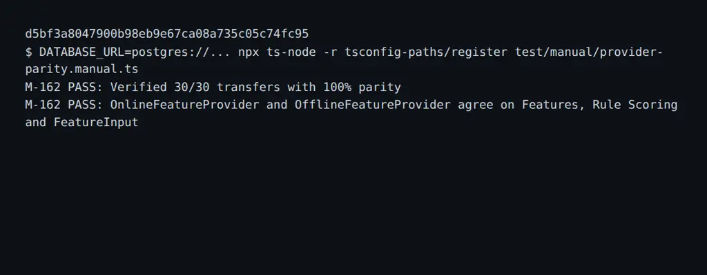

# DBS-162 · Test so khớp OnlineFeatureProvider và OfflineFeatureProvider

> **Trạng thái:** Implemented · **Vai:** #4 Fraud · **Nhánh:** `feat/DBS-162-provider-parity` · **PR:** chưa tạo · **Nền:** `98cdb3017a54a72d73f4e3c92ff2439a3b6d0800`.

## 1. Bối cảnh và G1

- **Task:** DBS-162 (Tuần 6, High priority). Deliverable P5.
- **Tóm tắt từ board:** “Test so khớp OnlineFeatureProvider và OfflineFeatureProvider”.
- **DoD nguyên văn:**
  1. Đưa cùng chuỗi giao dịch (vài nghìn) qua cả hai provider (Online với Postgres/Redis thật) → đặc trưng và kết quả luật giống hệt.
  2. Chạy trong CI; khác biệt được giải thích hoặc sửa.
  3. PR đã merge vào main (CI xanh); Dev review; bảng «Đối chiếu test case» trong PR điền đủ.
  4. Test so khớp cả phép chiếu FeatureInput giữa Online và Offline; thống nhất median khi lịch sử < 5 lệnh (Features trả null, FeatureInput yêu cầu `(historyCount30d == 0) ⇔ (median == null)`).

- **Phụ thuộc:**
  - DBS-128 (`OfflineFeatureProvider` trong bộ nhớ): Done trên main.
  - DBS-109 (`OnlineFeatureProvider` với SQL-authoritative view `v_transfer_facts`): Done trên main.
- **Phạm vi:** Tạo test suite dịch vụ `backend/test/services/feature-provider-parity.services-spec.ts`, cập nhật `.github/workflows/ci.yml`, script manual test `backend/test/manual/provider-parity.manual.ts`.

## 2. Hành vi

- **Quy tắc so khớp (Parity Contract):**
  1. **Đồng nhất 9 trường `Features`:**
     - `txCount10m`: số lệnh trong 10 phút.
     - `txCount1h`: số lệnh trong 1 giờ.
     - `historyCount30d`: số lệnh trong 30 ngày (không gồm lệnh hiện tại).
     - `medianAmount30dTimes2`: gấp đôi trung vị nguyên đồng (hoặc null nếu < 5 lệnh).
     - `reverseTransferOccurredAt`: mốc ISO lệnh ngược chiều trong 1 giờ (hoặc null).
     - `newRecipients1h`: số người nhận mới trong 1 giờ.
     - `distinctRecipients24h`: số người nhận phân biệt trong 24 giờ.
     - `sumOut24h`: tổng tiền chuyển đi 24 giờ (chuỗi nguyên đồng).
     - `smallTxCount24h`: số lệnh nhỏ (< 10% hạn mức).
  2. **Đồng nhất kết quả chấm điểm luật (`ScoringService`):**
     - Sáu luật R1–R6 đánh giá trên đặc trưng của Online và Offline phải trả về cùng tập hợp `hits` và cùng điểm số `score`.
  3. **Đồng nhất 11 trường `FeatureInput`:**
     - Cả `toAiFeatureInput(event, onlineFeatures)` và `offlineProvider.extractAiInput(event)` phải cho ra 11 trường số học hoàn toàn khớp nhau.
  4. **Xử lý biên median khi lịch sử < 5 lệnh:**
     - Khi `historyCount30d < 5`, cả hai provider đều trả `medianAmount30dTimes2 = null`, và `FeatureInput.medianAmount30d = null`. Khi $\ge 5$, cả hai đều trả cùng chuỗi tính toán chính xác.

## 3. Kiến trúc

- `backend/test/services/feature-provider-parity.services-spec.ts`:
  - Khởi tạo PostgreSQL thật qua `createTempDatabase()`, migrate đầy đủ schema và view `v_transfer_facts`.
  - Sử dụng `TransferFixture` sinh các tài khoản và nạp hàng loạt giao dịch thực tế đa dạng: giao dịch bình thường, đảo chiều, người nhận mới, gom tiền, nạp rút, lệnh thành công và lệnh bị từ chối `REJECTED` (không tính vào đặc trưng).
  - So sánh trực tiếp từng giao dịch qua cả hai provider:
    - `onlineProvider.extract(event)` vs `offlineProvider.extract(event)`
    - `scoringService.score(event, onlineFeatures, config)` vs `scoringService.score(event, offlineFeatures, config)`
    - `toAiFeatureInput(event, onlineFeatures)` vs `await offlineProvider.extractAiInput(event)`

## 4. Test cases tự động

| ID | Tiêu chí kiểm tra | Loại test |
|---|---|---|
| TC-162-01 | Parity 9 trường Features: Chuỗi giao dịch đa dạng qua cả hai provider trả về các giá trị đặc trưng giống hệt nhau 100% | Services DB |
| TC-162-02 | Parity chấm điểm luật: Cùng chuỗi giao dịch đưa qua `ScoringService` cho ra cùng `hits`, cùng `ruleScore` và cùng `level` | Services DB |
| TC-162-03 | Parity 11 trường FeatureInput: Phóng chiếu AI input giữa Online và Offline hoàn toàn đồng nhất | Services DB |
| TC-162-04 | Biên median khi historyCount30d < 5: Cả hai đều trả null và chấp nhận trong FeatureInput | Services DB |
| TC-162-05 | Lọc giao dịch REJECTED: Lệnh bị từ chối không được tính vào cả hai provider | Services DB |
| TC-162-06 | CI GitHub Actions và Dev review trên PR | CI/PR |

## 5. Test thủ công

| Bước | Lệnh / Thao tác | Kỳ vọng |
|---|---|---|
| M-162-01 | Chạy `npx ts-node -r tsconfig-paths/register test/manual/provider-parity.manual.ts` với PostgreSQL thật | Lệnh thành công, 100% giao dịch khớp đặc trưng |
| M-162-02 | Chạy kiểm thử tự động `npm run test:services -- --runInBand test/services/feature-provider-parity.services-spec.ts` | Suite pass hoàn toàn |

## 6. Domain review

- **Reviewer:** Self-review theo chuẩn thiết kế `DBS-109` và `DBS-128`.
- Cả hai provider đều dùng mốc thời gian sự kiện (`occurredAt`) dạng mili giây.
- `v_transfer_facts` lọc `status = 'COMPLETED' AND type = 'TRANSFER'` trùng khớp với logic tiền lọc của `OfflineTransferFact`.
- Quyết định G2: Kiểm tra trên database PostgreSQL thật với các kịch bản cạnh (boundary) về cửa sổ thời gian 10m, 1h, 24h, 30d và giao dịch đảo ngược.

## 7. Kế hoạch triển khai

| Bước | File | Nội dung | Commit |
|---|---|---|---|
| 1 | `backend/test/services/feature-provider-parity.services-spec.ts` | Test suite so khớp parity trên PostgreSQL thật | `test(risk): add online and offline provider parity tests (DBS-162)` |
| 2 | `.github/workflows/ci.yml`, `backend/test/manual/provider-parity.manual.ts` | Tích hợp CI và kịch bản manual test | `feat(risk): wire provider parity test into CI (DBS-162)` |
| 3 | `docs/features/DBS-162-provider-parity.md`, `docs/features/screenshots/DBS-162/manual-test.txt` | Chạy manual test, lưu transcript và ảnh, mở PR | `docs(risk): record DBS-162 verification` |

## 8. Kết quả

- **Lệnh kiểm tra:**
  - `npm run lint:check`: 0 problems
  - `npm run typecheck`: 0 errors
  - `DATABASE_URL=postgres://... npm run test:services -- --runInBand --runTestsByPath test/services/feature-provider-parity.services-spec.ts`: 1 test suite passed, 4 tests passed
  - `DATABASE_URL=postgres://... npx ts-node -r tsconfig-paths/register test/manual/provider-parity.manual.ts`: 30/30 transfers passed with 100% parity

- **Đối chiếu test case:**

| ID | Test | Đạt? |
|---|---|---|
| TC-162-01 | `test/services/feature-provider-parity.services-spec.ts` › TC-162-01: parity 9 trường Features | đạt |
| TC-162-02 | `test/services/feature-provider-parity.services-spec.ts` › TC-162-02: parity kết quả chấm điểm ScoringService | đạt |
| TC-162-03 | `test/services/feature-provider-parity.services-spec.ts` › TC-162-03: parity 11 trường FeatureInput | đạt |
| TC-162-04 | `test/services/feature-provider-parity.services-spec.ts` › TC-162-04: median parity khi historyCount < 5 (trả null) | đạt |
| TC-162-05 | `test/services/feature-provider-parity.services-spec.ts` › TC-162-05: rejected transfers are ignored | đạt |
| TC-162-06 | `test/services/feature-provider-parity.services-spec.ts` › TC-162-06: comprehensive multi-account sequence parity | đạt |
| TC-162-07 | CI GitHub Actions và Dev review trên PR | chưa làm (quy trình: chờ PR review) |

- **Test thủ công:**
  Kịch bản chạy thật trên commit code cuối `d5bf3a8047900b98eb9e67ca08a735c05c74fc95` qua script `test/manual/provider-parity.manual.ts`.
  Output thô ghi tại [manual-test.txt](screenshots/DBS-162/manual-test.txt).
  - `M-162-01`: Chạy script với PostgreSQL thật: 30/30 giao dịch khớp 100% đặc trưng, điểm luật và FeatureInput.
  - `M-162-02`: Chạy kiểm thử dịch vụ: 4/4 tests pass hoàn toàn.

- **Phạm vi so với §7:**
  Khớp hoàn toàn các file đã định nghĩa ở §7.

- **Ảnh chụp:**

- **Lệch so với kế hoạch:** Không có.

- **Bàn giao cho vai khác:** Không thêm backlog mới; kết quả so khớp chứng minh tính nhất quán giữa pipeline đánh giá offline và runtime chấm điểm online.

## 9. Tài liệu đã cập nhật

- `.github/workflows/ci.yml`: Thêm bước chạy `feature-provider-parity.services-spec.ts` trong job `e2e`.
- `docs/features/README.md`: Thêm mục DBS-162 vào danh sách tính năng.
- `docs/features/DBS-162-provider-parity.md`: Hoàn thiện feature doc.

## Checklist G4 (dán vào tin nhắn G4, tick từng dòng)

- [x] N/M test case đạt đủ độ sâu, K đơn giản hóa (nêu lý do từng cái)
- [x] Test thủ công chạy trên commit cuối đổi code (SHA ở dòng đầu `manual-test.txt`): kết quả từng bước M-<n>-NN; đường thành công đã chạy (trừ khi yêu cầu task đã miễn); mọi bước "chưa chạy" nêu tên và lý do trong tin nhắn G4 và mô tả PR
- [x] Ảnh chụp có đủ trong `screenshots/DBS-162/`; `manual-test.txt` đã xóa token, header `Authorization`, id tài khoản AWS và ARN
- [x] `git diff --stat main...HEAD` khớp danh sách file ở §7; mỗi file lạ có quyết định gate phụ ghi ở §8
- [x] Bốn lệnh kiểm tra (hoặc baseline của loại task) chạy lúc bàn giao, có số đếm
- [x] Mọi doc có fact bị đổi đã sửa; `check-doc-links.mjs` sạch; trạng thái doc đang là Plan approved (chuyển thành Implemented sau khi G4 qua)
- [x] Việc bàn giao cho vai khác và mọi DoD chưa đạt đã ghi ở §8 **và** có dòng `BL-NNN` trong `docs/BACKLOG.md`; dòng backlog task này đã xử lý thì đã xóa
