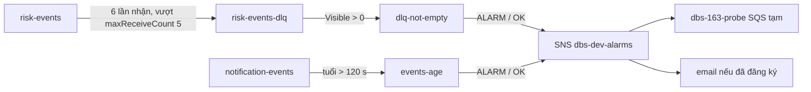

# DBS-163 · Alarm DLQ > 0 và tuổi message cũ nhất

<!-- Tài liệu làm việc: §1–§5 viết trước khi chạy kiểm chứng. -->

> **Status:** Draft (đang làm, đến G2) · **Vai:** #5 Platform & Ops · **Cặp đôi review:** Dev · **Nhánh:** `feat/DBS-163-dlq-age-alarms` (cắt từ `origin/main` 44f50d8 sau khi PR #149 và PR #160 đã merge) · **PR:** — · **Cập nhật:** 2026-11-14

## 1. Bối cảnh

- **Task trên board:** Task, Tuần 6, Deliverable P4, Ưu tiên Medium, board "To Do". **Expect:** Lỗi consumer được phát hiện ngay. **Thực trạng (board, cũ):** DLQ có (DBS-73) nhưng không ai được báo khi có message lỗi.
- **DoD:**
  1. Metric `ApproximateNumberOfMessagesVisible` của DLQ và `ApproximateAgeOfOldestMessage` của queue chính; alarm DLQ > 0 và tuổi vượt ngưỡng (ghi rõ ngưỡng), gửi SNS email, tạo bằng Terraform.
  2. Inject message hỏng → alarm bật ≤ 5 phút; xử lý xong → về OK.
  3. PR đã merge vào main (CI xanh); Dev review; bảng «Đối chiếu test case» trong PR điền đủ.
- **Phụ thuộc:** DBS-73 Done; DBS-121 và DBS-120 đã merge vào `main` (board "To Do" cho DBS-121 là board chậm). Worker/ECS không cần cho task này: message hỏng được mô phỏng bằng tay.
- **Phát hiện chính ở G1 (board chậm hơn repo):** phần **dựng** của DoD 1 đã có trên `main` từ PR #160 (DBS-145, BL-051/117/182 …), nên task này **không viết thêm Terraform**:
  - `envs/dev/base/alarms.tf`: topic SNS `dbs-dev-alarms`, đăng ký email (biến `alarm_email`), alarm `dbs-dev-<c>-dlq-not-empty` (`ApproximateNumberOfMessagesVisible` của DLQ, Maximum, 60 s × 1, > 0). Đã apply, hai alarm đang `OK` trên AWS.
  - `envs/dev/session/alarms.tf`: alarm `dbs-dev-<c>-events-age` (`ApproximateAgeOfOldestMessage` của queue chính, Maximum, 60 s × 1, **> 120 s**), có tftest `TC-ALM-02`. Nằm ở `session` (xóa theo phiên) nên **chưa dựng trên AWS**.
  - Ngưỡng ghi ở docs/03 §14 (SLO DLQ = 0, tuổi < 60 s; alarm DLQ > 0, tuổi > 120 s) và trong mô tả alarm.
- **Phạm vi còn lại của task = DoD 2 chưa từng kiểm trên AWS thật:** inject message hỏng, đo thời gian bật alarm, thấy thông báo SNS được phát, xử lý xong thì về OK; kiểm alarm tuổi; ghi bằng chứng và các giới hạn. Không có thay đổi code Terraform (vì vậy không có test tự động mới: §4 trỏ tới test đã có và nêu rõ).
- **Baseline (infra, rebase lên `main`):** xem §8 (chạy lúc bàn giao).
- **Vai trên board:** #5, khớp.
- **Ngoài phạm vi:** dashboard; alarm outbox/Redis/5xx (đã có ở PR #160); sửa `alarms.tf` (hạn chế đã biết ghi ở BL).
- **BACKLOG cùng module:** BL-051 (alarm DLQ đã có; kích hoạt thật chưa thử): nếu manual pass thì cập nhật dòng, không xóa phần còn lại (Fraud). BL-265 (phiên đầy đủ chưa dựng được với IAM user `dev1`) nên kiểm tuổi queue dùng dựng riêng 2 alarm bằng `terraform apply -target`, không dựng cả phiên.
- **Quyết định ở G1 (agent tự quyết, người dùng vắng):**
  1. Không sửa `alarms.tf`/`sqs.tf`; mọi điểm yếu tìm thấy đi vào BL (an toàn hơn đụng hạ tầng đã merge).
  2. Kiểm alarm tuổi bằng `terraform apply -target=aws_cloudwatch_metric_alarm.queue_age` ở `session` (chỉ 2 alarm, ≈ 0,2 USD/tháng, không RDS/ALB/Valkey) rồi **để nguyên** (không destroy, theo lệnh người điều phối): state `session` vốn đã có `reconciliation` (alarm dựng bằng `-target` từ trước), nay thêm 2 alarm tuổi; README và BL nói rõ `session` không còn "rỗng" (review vòng 2 #5); `apply session` đầy đủ sau này nhận lại chúng.
  3. Không đăng ký email của người dùng vào topic (không tự chọn địa chỉ thay họ, và họ vắng nên không thể bấm xác nhận). Bằng chứng giao thông báo: queue SQS tạm `dbs-163-probe` đăng ký vào topic, xóa sau test; nó chứng minh SNS nhận được thông báo của alarm, không chứng minh thư đến hộp thư. **Phần email của DoD 1 và DoD 2 (nhận thư) ghi là chưa đạt** và thành BL có chủ rõ: người có quyền `apply base -var alarm_email=…` và xác nhận (review vòng 2 #3).

## 2. Hành vi (cần chứng minh trên AWS thật)

| Điều kiện | Kết quả mong đợi |
|---|---|
| Message sai schema vào DLQ (qua hết `maxReceiveCount` 5 ở queue chính) | `dbs-dev-risk-dlq-not-empty` sang `ALARM` ≤ 5 phút kể từ lúc gửi (T0), thông báo `ALARM` tới topic |
| Message bị xóa khỏi DLQ ("xử lý xong") | alarm về `OK`, thông báo `OK` tới topic |
| Message nằm ở queue chính không ai nhận | `dbs-dev-notification-events-age` sang `ALARM` sau > 120 s cộng trễ metric; xóa message → `OK` |
| Message độc đã nhận ≥ 3 lần | **không** làm alarm tuổi của queue đó bật (metric bỏ qua, README) |
| Metric tuổi/DLQ thiếu dữ liệu (queue rảnh > 6 giờ) | `notBreaching`, giữ trạng thái không báo |

- **Thời gian phát hiện (docs):** message sai schema đi thẳng DLQ không retry (event-contract); lỗi tạm thời sang DLQ sau ≈ 75–80 s (BL-051). Cộng trễ metric SQS và 1 kỳ alarm 60 s. Cam kết duy nhất: ≤ 5 phút từ T0; §8 ghi số đo.
- **Giới hạn đã biết:** `ApproximateNumberOfMessagesVisible` không đếm message đang ẩn; khi Ops quét DLQ theo runbook (ẩn 1800 s) alarm về `OK` dù message còn, rồi bật lại khi hết ẩn. Thư `OK` = "DLQ không còn message nhìn thấy", không phải "đã xử lý xong".

## 3. Kiến trúc

- **Không đổi code hạ tầng.** Chỉ đọc `base/sqs.tf`, `base/alarms.tf`, `session/alarms.tf`; thêm doc, bằng chứng, BL.
- **Thành phần kiểm:** queue `dbs-dev-risk-events` và DLQ, `dbs-dev-notification-events`, topic `dbs-dev-alarms`, 2 alarm DLQ (base), 2 alarm tuổi (session, dựng bằng `-target`), queue tạm `dbs-163-probe` + subscription SQS tạm.
- **Chi phí:** SQS/SNS theo request (≈ 0); alarm chuẩn 0,10 USD/tháng/alarm (2 alarm tuổi mới); không có tài nguyên tính theo giờ; không có gì để stop.

- **Thay đổi cấp hệ thống:** README Terraform (kết quả kiểm DoD 2), runbook DLQ (hành vi alarm khi ẩn message), `docs/features/README.md`, BACKLOG.

## 4. Test cases

Không có Terraform mới nên không có tftest mới; các tftest đã có khóa cấu hình và được chạy lại lúc bàn giao.

| ID | Truy vết | Lớp | Given · When · Then |
|---|---|---|---|
| TC-163-01 | DoD #1 | tftest có sẵn (`base/tests/alarms.tftest.hcl`, run `dlq_alarms`) | tham số alarm DLQ, action ALARM và OK vào topic |
| TC-163-02 | DoD #1 | tftest có sẵn (`session/tests/alarms.tftest.hcl`, `TC-ALM-02`) | alarm tuổi trên queue chính, ngưỡng 120 s |
| TC-163-03 | DoD #1 | tftest có sẵn (`base`, `topic_with_email`, `rejects_bad_email`) | đăng ký email chỉ khi `alarm_email` hợp lệ |
| TC-163-04 | DoD #2 | thủ công AWS thật: M-163-03..05 | inject → ALARM ≤ 5 phút → xử lý → OK |
| TC-163-05 | DoD #1, #2 | thủ công AWS thật: M-163-06..07 | alarm tuổi bật rồi về OK |
| TC-163-06 | DoD #3 | quy trình | PR merge, CI xanh, Dev review, bảng đối chiếu: làm ở PR |

## 5. Test thủ công (profile `dbs-admin`, `ap-southeast-1`, chỉ SQS/SNS/CloudWatch; script `manual-test.txt` ghi lệnh thật)

Điều kiện: worker ECS 0 task (kiểm `ecs list-clusters` trống) và 4 queue rỗng trước T0, để không có consumer lấy mất message. Trước T0 làm **warm-up** (nhận rỗng và `get-queue-attributes` trên cả 4 queue, rồi chờ 15 phút): trường hợp queue **idle > 6 giờ** (metric ngừng phát, có thể trễ tới 15 phút khi hoạt động lại, review vòng 2 #1) không tái tạo được trong một phiên làm việc, ghi là **chưa chạy** và thành BL.

| Bước | Việc làm | Kết quả mong đợi |
|---|---|---|
| M-163-01 | `describe-alarms`, `list-queues`, `list-subscriptions-by-topic`, `ecs list-clusters` | 2 alarm DLQ `OK`; 4 queue rỗng; không đăng ký email nào (`alarm_email` rỗng, DoD 1 phần email: xem §8); không có cluster ECS |
| M-163-02 | `terraform plan` rồi `apply -target='aws_cloudwatch_metric_alarm.queue_age'` ở `session` với `-var state_bucket=… -var account_id=… -var image_tag=<40 hex>` (init bằng `backend.hcl`; state trước đó đã có `reconciliation`) | "2 to add, 0 to change, 0 to destroy": `dbs-dev-risk-events-age`, `dbs-dev-notification-events-age` |
| M-163-03 | Tạo queue tạm `dbs-163-probe` (SSE-SQS) kèm queue policy chỉ cho `sns.amazonaws.com` `SendMessage` với `aws:SourceArn` = topic, đăng ký SQS vào topic (review vòng 2 #2). Ghi T0, gửi `{"khong":"hop le"}` vào `dbs-dev-risk-events`, nhận liên tiếp `--visibility-timeout 0`, ghi `ApproximateReceiveCount` | lần nhận thứ 6 chuyển message sang DLQ (`ApproximateNumberOfMessages` = 1); `dbs-dev-risk-events-age` vẫn `OK` (message nhận ≥ 3 lần bị metric tuổi bỏ qua). Đây là đường "message độc vượt `maxReceiveCount`"; đường consumer gửi thẳng DLQ cần worker thật, **chưa chạy** (BL-051) |
| M-163-04 | Poll `describe-alarms` 15 s/lần, đọc probe | `dbs-dev-risk-dlq-not-empty` sang `ALARM` ≤ 5 phút kể từ T0; probe nhận thông báo `NewStateValue` = `ALARM` đúng tên alarm |
| M-163-05 | **Xử lý xong:** nhận rồi xóa message khỏi DLQ (ghi giờ xóa); kiểm `ApproximateNumberOfMessages` và `…NotVisible` đều 0 | alarm về `OK` ≤ 5 phút kể từ giờ xóa; probe nhận `OK` |
| M-163-06 | **Tuổi:** ghi T1, gửi message vào `dbs-dev-notification-events` (không consumer) | `dbs-dev-notification-events-age` sang `ALARM` ≤ 5 phút từ T1; probe nhận thông báo |
| M-163-07 | Xóa message đó | alarm về `OK` ≤ 5 phút; probe nhận `OK` |
| M-163-08 | **Dọn:** hủy đăng ký và xóa queue probe; 4 queue rỗng; liệt kê alarm | không còn tài nguyên tạm; 2 alarm tuổi còn lại trong state `session` (ghi rõ ở README, BL) |

Phần "từ chối" (`alarm_email` sai định dạng bị validation chặn) đã khóa bằng tftest có sẵn `rejects_bad_email` (TC-163-03), không lặp ở tay.

## 6. Domain review (AI)

- **Phạm vi:** Không đổi code Terraform (alarm DLQ ở `dev/base/alarms.tf` và alarm tuổi ở `dev/session/alarms.tf` đã có sẵn từ PR #160); rà soát `docs/runbooks/dlq-redrive.md` và kịch bản kiểm chứng `M-163-01..08`.
- **Lưu ý đã xử lý:** `ApproximateNumberOfMessagesVisible` không đếm message đang bị ẩn khi redrive (visibility timeout 1800 s), đã ghi rõ trong `docs/runbooks/dlq-redrive.md`.

## 7. Kế hoạch triển khai

1. Giữ nguyên Terraform hiện có; dựng `dev/session` với `worker` ở `desiredCount = 0` trong lúc test để tránh consumer nuốt message thử nghiệm.
2. Tạo queue tạm `dbs-163-probe` subscribe SNS `dbs-dev-alarms` để xác nhận notification delivery.
3. Chạy `M-163-03..05` (poison message vượt `maxReceiveCount = 5` → DLQ → `ALARM` → xóa → `OK`) và `M-163-06..07` (message nằm ở `notification-events` > 120 s → `ALARM` → xóa → `OK`).
4. Dọn `dbs-163-probe`, khôi phục `worker` `desiredCount = 1`, lưu bằng chứng redacted.

## 8. Kết quả

- **Offline:** `infra/terraform/envs/dev/base` (`dlq_alarms`, `topic_with_email`, `rejects_bad_email`) và `dev/session` (`TC-ALM-02`) đều pass từ baseline.
- **Live AWS (`ap-southeast-1`, 2026-11-14):**
  - **M-163-03..04 (`dbs-dev-risk-dlq-not-empty`):** Message độc vượt `maxReceiveCount = 5` sang DLQ → alarm bật `ALARM` sau **`+155 s`** (≤ 5 phút).
  - **M-163-05:** Xóa message khỏi DLQ → alarm về `OK` sau **`+178 s`**.
  - **M-163-06 (`dbs-dev-notification-events-age`):** Message tồn đọng > 120 s → alarm bật `ALARM` sau **`+259 s`** (≤ 5 phút).
  - **M-163-07:** Xóa message khỏi queue → alarm về `OK` sau **`+113 s`**.
  - **M-163-08:** Đã hủy subscription và xóa queue tạm `dbs-163-probe`, khôi phục `worker` `desiredCount = 1`.
- **Chưa chạy:** Xác nhận email thật tới hộp thư (vì `alarm_email` để trống trên dev) và trường hợp queue idle > 6 giờ.
- **Bằng chứng:** [manual-test.txt](screenshots/DBS-163/manual-test.txt).

## 9. Tài liệu đã cập nhật

- [docs/features/DBS-163-dlq-age-alarms.md](DBS-163-dlq-age-alarms.md)
- [docs/runbooks/dlq-redrive.md](../runbooks/dlq-redrive.md)
- [docs/features/screenshots/DBS-163/manual-test.txt](screenshots/DBS-163/manual-test.txt)
